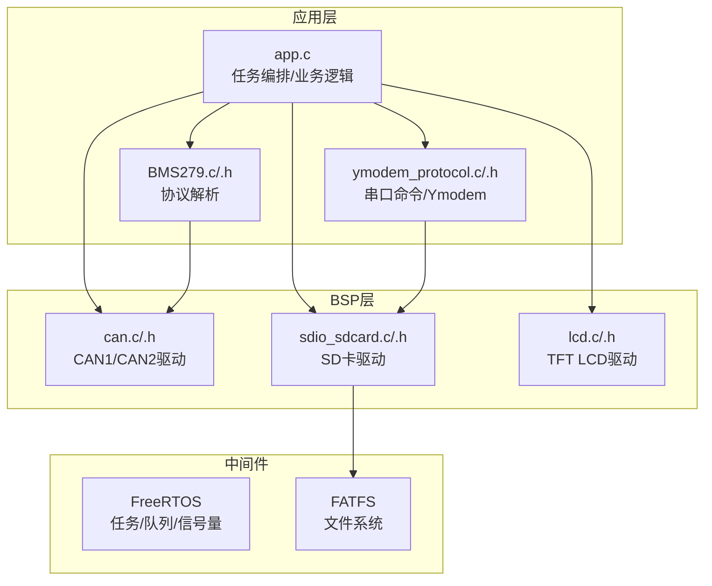
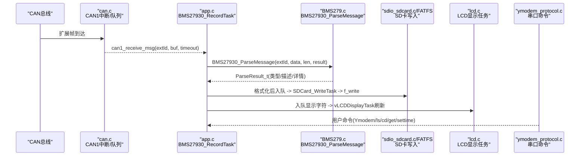
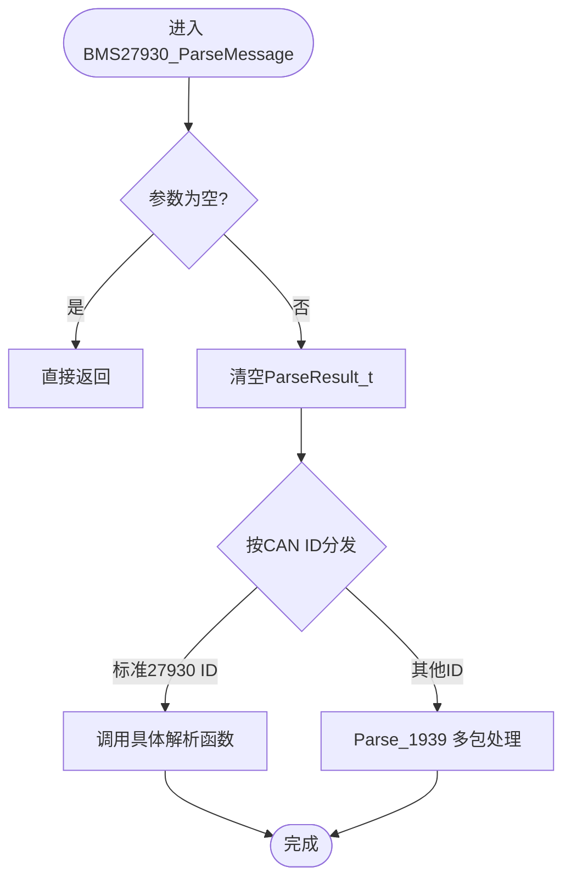
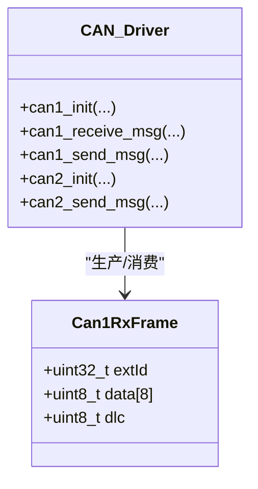
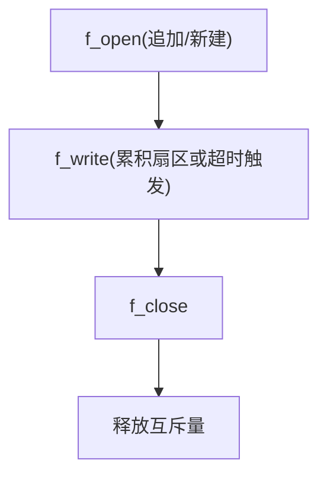
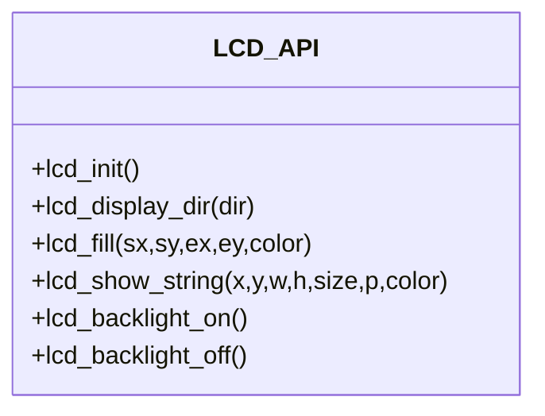
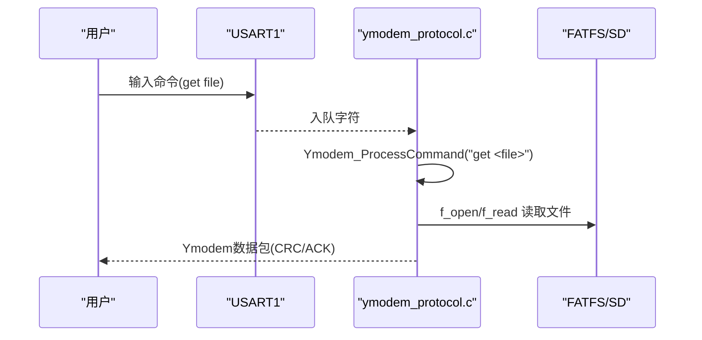
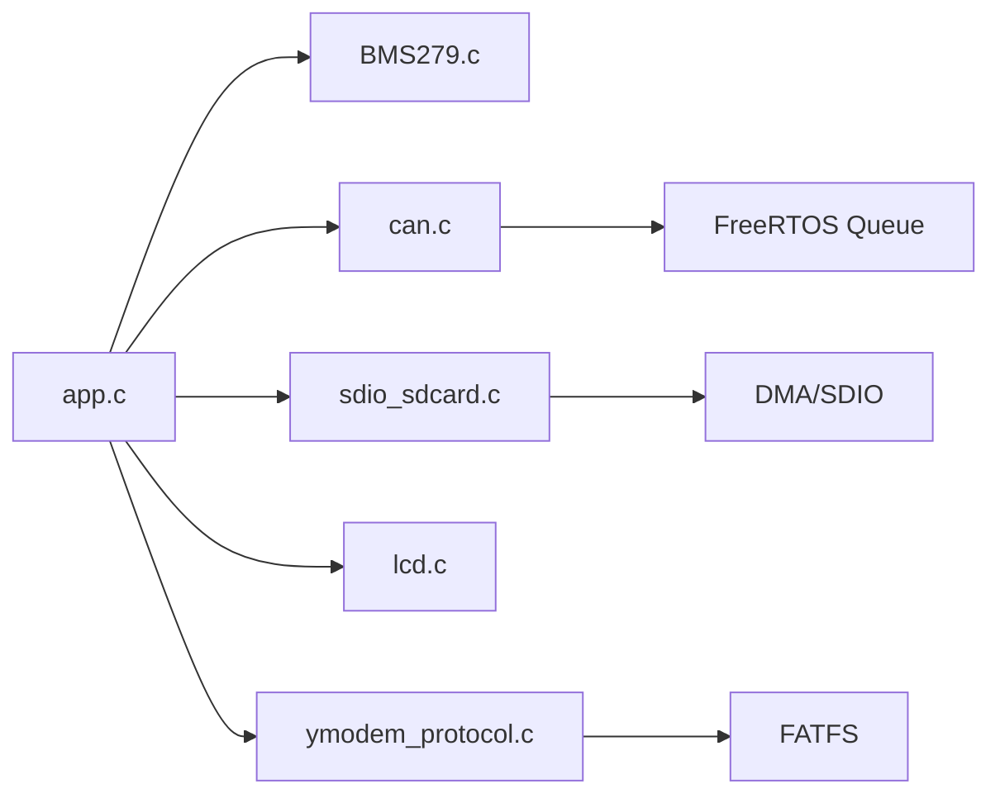

# API参考手册

<cite>
**本文引用的文件**   
- [app.h](file://_gbk_backup/User/app.h)
- [app.c](file://_gbk_backup/User/app.c)
- [BMS279.h](file://_gbk_backup/User/BMS279.h)
- [BMS279.c](file://_gbk_backup/User/BMS279.c)
- [ymodem_protocol.h](file://_gbk_backup/User/ymodem_protocol.h)
- [ymodem_protocol.c](file://_gbk_backup/User/ymodem_protocol.c)
- [can.h](file://_gbk_backup/Driver/BSP/can.h)
- [can.c](file://_gbk_backup/Driver/BSP/can.c)
- [sdio_sdcard.h](file://_gbk_backup/Driver/BSP/sdio_sdcard.h)
- [sdio_sdcard.c](file://_gbk_backup/Driver/BSP/sdio_sdcard.c)
- [lcd.h](file://_gbk_backup/Driver/BSP/LCD/lcd.h)
- [lcd.c](file://_gbk_backup/Driver/BSP/LCD/lcd.c)
</cite>

## 目录
1. [简介](#简介)
2. [项目结构](#项目结构)
3. [核心组件](#核心组件)
4. [架构总览](#架构总览)
5. [详细组件分析](#详细组件分析)
6. [依赖关系分析](#依赖关系分析)
7. [性能与限制](#性能与限制)
8. [故障排查指南](#故障排查指南)
9. [结论](#结论)
10. [附录：API清单与示例](#附录api清单与示例)

## 简介
本手册面向CAN Tracker（STM32F407 + FreeRTOS）项目的公共API，覆盖以下模块：
- 协议解析API（GB/T 27930-2015、J1939多包）
- CAN通信API（CAN1/CAN2驱动）
- 存储管理API（SD卡+文件系统）
- 显示接口API（TFT LCD）
- 系统服务API（任务调度、按键、LED、低功耗、Ymodem串口命令）

文档按模块组织，提供函数原型、参数说明、返回值定义、错误码列表、使用示例与注意事项，并给出版本兼容性与迁移建议。

## 项目结构
本项目采用分层模块化设计：
- BSP层：硬件驱动（CAN、SDIO、LCD、电源管理等）
- 中间件层：FreeRTOS、FATFS、内存管理
- 应用层：协议解析（BMS279）、Ymodem传输、任务编排（app.c）

图表来源
- [app.c:529-541](file://_gbk_backup/User/app.c#L529-L541)
- [BMS279.c:42-114](file://_gbk_backup/User/BMS279.c#L42-L114)
- [ymodem_protocol.c:303-428](file://_gbk_backup/User/ymodem_protocol.c#L303-L428)
- [can.c:40-106](file://_gbk_backup/Driver/BSP/can.c#L40-L106)
- [sdio_sdcard.c:141-225](file://_gbk_backup/Driver/BSP/sdio_sdcard.c#L141-L225)
- [lcd.c:593-800](file://_gbk_backup/Driver/BSP/LCD/lcd.c#L593-L800)

章节来源
- [app.c:529-541](file://_gbk_backup/User/app.c#L529-L541)

## 核心组件
- 协议解析：BMS27930_ParseMessage 统一入口，按CAN ID分发到具体报文解析器；支持J1939多包组包与BRM/BCP/BCS等PGN解析。
- CAN通信：can1_init/can1_receive_msg/can1_send_msg；CAN2仅初始化与发送。中断接收+队列缓冲。
- 存储管理：sd_init/sd_read_disk/sd_write_disk；通过FATFS进行文件读写；互斥量保护并发访问。
- 显示接口：lcd_init/lcd_show_string/lcd_fill等图形与文本绘制；背光控制。
- 系统服务：任务创建与调度（vTaskCreateFunction），按键扫描与处理，LED定时器回调，低功耗模式切换，Ymodem命令交互。

章节来源
- [BMS279.c:42-114](file://_gbk_backup/User/BMS279.c#L42-L114)
- [can.h:45-52](file://_gbk_backup/Driver/BSP/can.h#L45-L52)
- [sdio_sdcard.h:332-337](file://_gbk_backup/Driver/BSP/sdio_sdcard.h#L332-L337)
- [lcd.h:211-242](file://_gbk_backup/Driver/BSP/LCD/lcd.h#L211-L242)
- [app.c:529-541](file://_gbk_backup/User/app.c#L529-L541)

## 架构总览
下图展示从CAN接收到协议解析、日志落盘、LCD显示与串口命令的端到端数据流。

图表来源
- [can.c:186-224](file://_gbk_backup/Driver/BSP/can.c#L186-L224)
- [app.c:200-309](file://_gbk_backup/User/app.c#L200-L309)
- [BMS279.c:42-114](file://_gbk_backup/User/BMS279.c#L42-L114)
- [app.c:311-366](file://_gbk_backup/User/app.c#L311-L366)
- [app.c:452-521](file://_gbk_backup/User/app.c#L452-L521)
- [ymodem_protocol.c:711-748](file://_gbk_backup/User/ymodem_protocol.c#L711-L748)

## 详细组件分析

### 协议解析API（GB/T 27930 / J1939）
- 主入口
  - 函数：BMS27930_ParseMessage
  - 参数：canId(uint32_t), data(uint8_t*), len(uint8_t), result(ParseResult_t*)
  - 返回：无（结果填充至result）
  - 行为：根据CAN ID分派到对应解析器；未知ID走J1939多包流程
- 数据结构
  - ParseResult_t：type_str/description/parsed_info
  - 各报文结构体：CHM/BHM/CRM/CTS/CML/BRO/CRO/BCL/CCS/BSM/BMV/BMT/BSP/BST/CST/BSD/CSD/BEM/CEM/STOP_ERROR
- J1939多包
  - 连接管理：J1939_CM/J1939_CM_ACK
  - 数据传送：J1939_DT
  - PGN映射：BRM(0x02)/BCP(0x06)/BCS(0x11)

图表来源
- [BMS279.c:42-114](file://_gbk_backup/User/BMS279.c#L42-L114)
- [BMS279.c:557-708](file://_gbk_backup/User/BMS279.c#L557-L708)

章节来源
- [BMS279.h:47-51](file://_gbk_backup/User/BMS279.h#L47-L51)
- [BMS279.h:21-44](file://_gbk_backup/User/BMS279.h#L21-L44)
- [BMS279.c:42-114](file://_gbk_backup/User/BMS279.c#L42-L114)
- [BMS279.c:557-708](file://_gbk_backup/User/BMS279.c#L557-L708)

### CAN通信API
- CAN1
  - can1_init(tsjw, tbs2, tbs1, brp, mode)：初始化CAN1（中断接收，扩展帧）
  - can1_receive_msg(extId, buf, timeout_ms)：阻塞式接收（队列）
  - can1_send_msg(extId, data, len)：发送扩展帧
- CAN2
  - can2_init(...)：初始化（仅发送）
  - can2_send_msg(...)：发送扩展帧

图表来源
- [can.h:21-28](file://_gbk_backup/Driver/BSP/can.h#L21-L28)
- [can.h:45-52](file://_gbk_backup/Driver/BSP/can.h#L45-L52)
- [can.c:40-106](file://_gbk_backup/Driver/BSP/can.c#L40-L106)
- [can.c:116-179](file://_gbk_backup/Driver/BSP/can.c#L116-L179)
- [can.c:245-341](file://_gbk_backup/Driver/BSP/can.c#L245-L341)

章节来源
- [can.h:45-52](file://_gbk_backup/Driver/BSP/can.h#L45-L52)
- [can.c:40-106](file://_gbk_backup/Driver/BSP/can.c#L40-L106)
- [can.c:116-179](file://_gbk_backup/Driver/BSP/can.c#L116-L179)
- [can.c:186-224](file://_gbk_backup/Driver/BSP/can.c#L186-L224)
- [can.c:245-341](file://_gbk_backup/Driver/BSP/can.c#L245-L341)

### 存储管理API（SD卡+FATFS）
- 底层驱动
  - sd_init()：SDIO/DMA/NVIC初始化，识别卡类型，设置总线宽度与时钟
  - sd_read_disk(pbuf, saddr, cnt)：块读
  - sd_write_disk(pbuf, saddr, cnt)：块写
- 文件系统（FATFS）
  - f_mount/f_open/f_write/f_close：文件操作
  - 互斥量 xSDCardMutex：跨任务保护SD访问

图表来源
- [app.c:35-71](file://_gbk_backup/User/app.c#L35-L71)
- [app.c:311-366](file://_gbk_backup/User/app.c#L311-L366)
- [sdio_sdcard.c:141-225](file://_gbk_backup/Driver/BSP/sdio_sdcard.c#L141-L225)

章节来源
- [sdio_sdcard.h:332-337](file://_gbk_backup/Driver/BSP/sdio_sdcard.h#L332-L337)
- [sdio_sdcard.c:141-225](file://_gbk_backup/Driver/BSP/sdio_sdcard.c#L141-L225)
- [app.c:35-71](file://_gbk_backup/User/app.c#L35-L71)
- [app.c:311-366](file://_gbk_backup/User/app.c#L311-L366)

### 显示接口API（TFT LCD）
- 初始化与配置
  - lcd_init()：GPIO/FSMC配置，自动探测驱动IC，设置分辨率与方向
  - lcd_display_dir(dir)：横/竖屏切换
- 绘图与文本
  - lcd_fill(x,y,w,h,color)：矩形填充
  - lcd_show_string(x,y,w,h,size,p,color)：字符串显示
  - lcd_backlight_on/off()：背光控制

图表来源
- [lcd.h:211-242](file://_gbk_backup/Driver/BSP/LCD/lcd.h#L211-L242)
- [lcd.c:593-800](file://_gbk_backup/Driver/BSP/LCD/lcd.c#L593-L800)

章节来源
- [lcd.h:211-242](file://_gbk_backup/Driver/BSP/LCD/lcd.h#L211-L242)
- [lcd.c:593-800](file://_gbk_backup/Driver/BSP/LCD/lcd.c#L593-L800)

### 系统服务API（任务/按键/LED/Ymodem）
- 任务与资源
  - vTaskCreateFunction()：创建所有任务（LED、UART、按键、SD卡、BMS记录、Ymodem、LCD显示）
  - xKeyQueue/xSDCardWriteQueue/lcd_display_queue：任务间通信队列
  - xSDCardMutex：SD卡互斥量
- 按键与LED
  - vKeyScanTask()：单击/双击/长按检测
  - vLED1Task()/vLEDTimerCallback()：LED闪烁与低电量检测
- Ymodem命令
  - Ymodem_Init()/Ymodem_Task()：串口命令循环
  - Ymodem_ProcessCommand(cmd)：help/ls/cd/pwd/get/settime/exit
  - Ymodem_SendFile(filename)：通过Ymodem协议发送文件

图表来源
- [app.c:529-541](file://_gbk_backup/User/app.c#L529-L541)
- [app.c:94-152](file://_gbk_backup/User/app.c#L94-L152)
- [app.c:154-198](file://_gbk_backup/User/app.c#L154-L198)
- [ymodem_protocol.c:589-685](file://_gbk_backup/User/ymodem_protocol.c#L589-L685)
- [ymodem_protocol.c:711-748](file://_gbk_backup/User/ymodem_protocol.c#L711-L748)

章节来源
- [app.c:94-152](file://_gbk_backup/User/app.c#L94-L152)
- [app.c:154-198](file://_gbk_backup/User/app.c#L154-L198)
- [app.c:529-541](file://_gbk_backup/User/app.c#L529-L541)
- [ymodem_protocol.h:78-124](file://_gbk_backup/User/ymodem_protocol.h#L78-L124)
- [ymodem_protocol.c:303-428](file://_gbk_backup/User/ymodem_protocol.c#L303-L428)
- [ymodem_protocol.c:589-685](file://_gbk_backup/User/ymodem_protocol.c#L589-L685)
- [ymodem_protocol.c:711-748](file://_gbk_backup/User/ymodem_protocol.c#L711-L748)

## 依赖关系分析
- 模块耦合
  - app.c 依赖：BMS279、CAN、SD、LCD、Ymodem、FreeRTOS
  - BMS279.c 依赖：BMS279.h（数据类型与常量）
  - ymodem_protocol.c 依赖：FATFS、FreeRTOS队列、外部串口发送
  - can.c 依赖：FreeRTOS队列、NVIC中断
  - sdio_sdcard.c 依赖：DMA、SDIO、FreeRTOS信号量/互斥量
  - lcd.c 依赖：FSMC、GPIO、字体库

图表来源
- [app.c:1-22](file://_gbk_backup/User/app.c#L1-L22)
- [ymodem_protocol.c:9-28](file://_gbk_backup/User/ymodem_protocol.c#L9-L28)
- [can.c:11-19](file://_gbk_backup/Driver/BSP/can.c#L11-L19)
- [sdio_sdcard.c:1-7](file://_gbk_backup/Driver/BSP/sdio_sdcard.c#L1-L7)

章节来源
- [app.c:1-22](file://_gbk_backup/User/app.c#L1-L22)
- [ymodem_protocol.c:9-28](file://_gbk_backup/User/ymodem_protocol.c#L9-L28)
- [can.c:11-19](file://_gbk_backup/Driver/BSP/can.c#L11-L19)
- [sdio_sdcard.c:1-7](file://_gbk_backup/Driver/BSP/sdio_sdcard.c#L1-L7)

## 性能与限制
- CAN接收
  - 中断+队列，队列深度10；队列满会丢包并计数
  - 建议：提高队列深度或加快消费者任务优先级
- SD写入
  - 扇区级累积（512字节）或1分钟超时写入，避免频繁写放大
  - 互斥量串行化访问，避免并发损坏
- LCD刷新
  - 每100ms批量刷新，减少刷屏开销；队列快满时告警
- Ymodem传输
  - CRC模式优先；失败重试上限10次；EOT双发确保结束
- 低功耗
  - 电池电压低于阈值进入低功耗模式，需保证串口输出完成

章节来源
- [can.c:18-19](file://_gbk_backup/Driver/BSP/can.c#L18-L19)
- [app.c:311-366](file://_gbk_backup/User/app.c#L311-L366)
- [app.c:452-521](file://_gbk_backup/User/app.c#L452-L521)
- [ymodem_protocol.c:232-298](file://_gbk_backup/User/ymodem_protocol.c#L232-L298)
- [app.c:154-198](file://_gbk_backup/User/app.c#L154-L198)

## 故障排查指南
- CAN接收不到数据
  - 检查波特率配置与过滤器是否开启扩展帧
  - 确认队列未溢出（查看丢包计数）
- SD卡无法挂载或写入失败
  - 检查互斥量获取是否成功
  - 确认FATFS挂载与路径正确
- LCD显示异常
  - 检查驱动IC识别与方向设置
  - 确认FSMC时序与引脚复用
- Ymodem传输失败
  - 确认对端已发送'C'启动
  - 检查CRC模式与重试次数
- 按键无响应
  - 检查按键任务优先级与队列长度

章节来源
- [can.c:186-224](file://_gbk_backup/Driver/BSP/can.c#L186-L224)
- [app.c:414-450](file://_gbk_backup/User/app.c#L414-L450)
- [lcd.c:593-800](file://_gbk_backup/Driver/BSP/LCD/lcd.c#L593-L800)
- [ymodem_protocol.c:303-428](file://_gbk_backup/User/ymodem_protocol.c#L303-L428)

## 结论
本项目的API以FreeRTOS为中枢，围绕CAN数据采集、协议解析、持久化存储与可视化展示形成闭环。通过合理的队列与互斥机制，兼顾实时性与可靠性。建议在量产前优化队列深度、调整任务优先级，并对关键路径增加错误码与诊断信息。

## 附录：API清单与示例

### 协议解析API（BMS279）
- BMS27930_ParseMessage(canId, data, len, result)
  - 参数：
    - canId：CAN扩展ID
    - data：数据指针（最多8字节）
    - len：数据长度
    - result：解析结果结构体指针
  - 返回：无
  - 错误处理：空指针直接返回；长度不足在子解析器中提示
  - 使用示例：见 [BMS279.c:42-114](file://_gbk_backup/User/BMS279.c#L42-L114)

章节来源
- [BMS279.h:47-51](file://_gbk_backup/User/BMS279.h#L47-L51)
- [BMS279.c:42-114](file://_gbk_backup/User/BMS279.c#L42-L114)

### CAN通信API
- can1_init(tsjw, tbs2, tbs1, brp, mode)
  - 参数：时钟分频与时段参数；mode：普通/回环
  - 返回：0成功，1失败
  - 示例：[can.c:40-106](file://_gbk_backup/Driver/BSP/can.c#L40-L106)
- can1_receive_msg(extId, buf, timeout_ms)
  - 参数：extId输出；buf至少8字节；timeout_ms阻塞时间
  - 返回：DLC（1~8），0表示超时/空
  - 示例：[can.c:116-141](file://_gbk_backup/Driver/BSP/can.c#L116-L141)
- can1_send_msg(extId, data, len)
  - 参数：extId；data；len（1~8）
  - 返回：0成功，1参数错误，2发送失败
  - 示例：[can.c:150-179](file://_gbk_backup/Driver/BSP/can.c#L150-L179)
- can2_init(...)/can2_send_msg(...)
  - 返回：同can1系列
  - 示例：[can.c:245-341](file://_gbk_backup/Driver/BSP/can.c#L245-L341)

章节来源
- [can.h:45-52](file://_gbk_backup/Driver/BSP/can.h#L45-L52)
- [can.c:40-106](file://_gbk_backup/Driver/BSP/can.c#L40-L106)
- [can.c:116-179](file://_gbk_backup/Driver/BSP/can.c#L116-L179)
- [can.c:245-341](file://_gbk_backup/Driver/BSP/can.c#L245-L341)

### 存储管理API（SD+FATFS）
- sd_init()
  - 返回：SD_Error枚举
  - 示例：[sdio_sdcard.c:141-225](file://_gbk_backup/Driver/BSP/sdio_sdcard.c#L141-L225)
- sd_read_disk(pbuf, saddr, cnt)/sd_write_disk(pbuf, saddr, cnt)
  - 返回：SD_Error枚举
  - 示例：[sdio_sdcard.h:332-337](file://_gbk_backup/Driver/BSP/sdio_sdcard.h#L332-L337)
- FATFS文件操作（f_open/f_write/f_close）
  - 返回：FRESULT
  - 示例：[app.c:35-71](file://_gbk_backup/User/app.c#L35-L71)

章节来源
- [sdio_sdcard.h:332-337](file://_gbk_backup/Driver/BSP/sdio_sdcard.h#L332-L337)
- [sdio_sdcard.c:141-225](file://_gbk_backup/Driver/BSP/sdio_sdcard.c#L141-L225)
- [app.c:35-71](file://_gbk_backup/User/app.c#L35-L71)

### 显示接口API（LCD）
- lcd_init()
  - 功能：初始化LCD与FSMC，探测驱动IC
  - 示例：[lcd.c:593-800](file://_gbk_backup/Driver/BSP/LCD/lcd.c#L593-L800)
- lcd_display_dir(dir)
  - 参数：dir=0竖屏，1横屏
  - 示例：[lcd.c:441-521](file://_gbk_backup/Driver/BSP/LCD/lcd.c#L441-L521)
- lcd_fill(x,y,w,h,color)/lcd_show_string(...)
  - 示例：[lcd.h:231-240](file://_gbk_backup/Driver/BSP/LCD/lcd.h#L231-L240)
- lcd_backlight_on/off()
  - 示例：[lcd.h:241-242](file://_gbk_backup/Driver/BSP/LCD/lcd.h#L241-L242)

章节来源
- [lcd.h:211-242](file://_gbk_backup/Driver/BSP/LCD/lcd.h#L211-L242)
- [lcd.c:593-800](file://_gbk_backup/Driver/BSP/LCD/lcd.c#L593-L800)

### 系统服务API（任务/按键/LED/Ymodem）
- vTaskCreateFunction()
  - 功能：创建系统任务
  - 示例：[app.c:529-541](file://_gbk_backup/User/app.c#L529-L541)
- vKeyScanTask()/vKeyProcessTask()
  - 功能：按键检测与处理
  - 示例：[app.c:94-152](file://_gbk_backup/User/app.c#L94-L152), [app.c:368-412](file://_gbk_backup/User/app.c#L368-L412)
- vLED1Task()/vLEDTimerCallback()
  - 功能：LED闪烁与低电量检测
  - 示例：[app.c:154-198](file://_gbk_backup/User/app.c#L154-L198)
- Ymodem_Init()/Ymodem_Task()
  - 功能：串口命令循环
  - 示例：[ymodem_protocol.c:688-706](file://_gbk_backup/User/ymodem_protocol.c#L688-L706), [ymodem_protocol.c:711-748](file://_gbk_backup/User/ymodem_protocol.c#L711-L748)
- Ymodem_ProcessCommand(cmd)
  - 功能：解析命令(help/ls/cd/pwd/get/settime/exit)
  - 示例：[ymodem_protocol.c:589-685](file://_gbk_backup/User/ymodem_protocol.c#L589-L685)
- Ymodem_SendFile(filename)
  - 功能：通过Ymodem协议发送文件
  - 返回：0成功，负数错误码
  - 示例：[ymodem_protocol.c:303-428](file://_gbk_backup/User/ymodem_protocol.c#L303-L428)

章节来源
- [app.c:94-152](file://_gbk_backup/User/app.c#L94-L152)
- [app.c:154-198](file://_gbk_backup/User/app.c#L154-L198)
- [app.c:368-412](file://_gbk_backup/User/app.c#L368-L412)
- [app.c:529-541](file://_gbk_backup/User/app.c#L529-L541)
- [ymodem_protocol.h:78-124](file://_gbk_backup/User/ymodem_protocol.h#L78-L124)
- [ymodem_protocol.c:303-428](file://_gbk_backup/User/ymodem_protocol.c#L303-L428)
- [ymodem_protocol.c:589-685](file://_gbk_backup/User/ymodem_protocol.c#L589-L685)
- [ymodem_protocol.c:688-706](file://_gbk_backup/User/ymodem_protocol.c#L688-L706)
- [ymodem_protocol.c:711-748](file://_gbk_backup/User/ymodem_protocol.c#L711-L748)