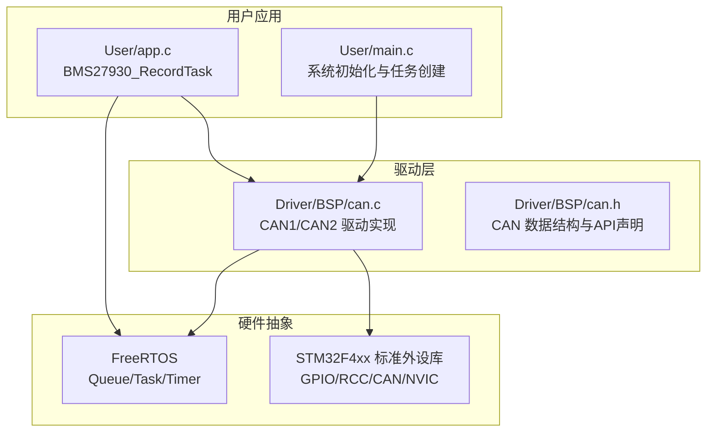
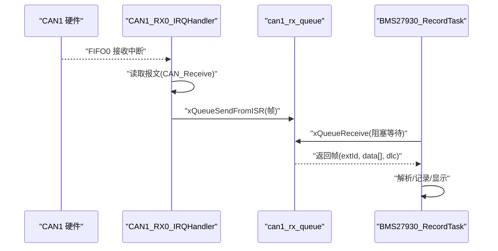
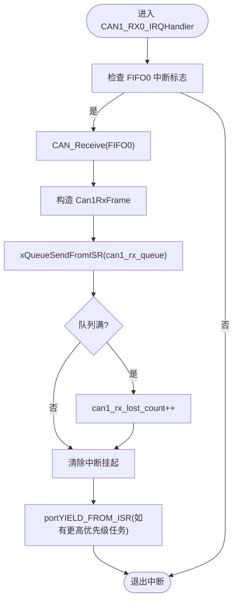
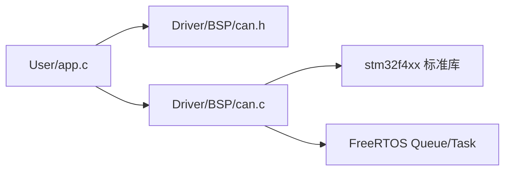

# CAN通信API

<cite>
**本文引用的文件**   
- [can.c](file://_gbk_backup/Driver/BSP/can.c)
- [can.h](file://_gbk_backup/Driver/BSP/can.h)
- [app.c](file://_gbk_backup/User/app.c)
- [main.c](file://_gbk_backup/User/main.c)
</cite>

## 目录
1. [简介](#简介)
2. [项目结构](#项目结构)
3. [核心组件](#核心组件)
4. [架构总览](#架构总览)
5. [详细组件分析](#详细组件分析)
6. [依赖关系分析](#依赖关系分析)
7. [性能与优化](#性能与优化)
8. [故障排查指南](#故障排查指南)
9. [结论](#结论)
10. [附录：完整使用示例流程](#附录完整使用示例流程)

## 简介
本文件为基于 STM32F407 标准库与 FreeRTOS 的 CAN 总线通信系统 API 文档。重点覆盖以下内容：
- CAN1/CAN2 控制器初始化、配置与操作接口
- 数据接收函数 can1_receive_msg() 的使用方法，包括中断处理与队列机制
- CAN 帧结构定义、过滤器配置与仲裁机制相关说明
- 双 CAN 控制器的操作接口与错误处理机制
- 性能优化与调试方法
- 完整的代码级使用流程（以“章节来源”形式给出具体实现位置）

本项目仅支持 29 位扩展帧，CAN1 采用中断接收 + FreeRTOS 队列，CAN2 仅提供发送能力。

## 项目结构
与本 API 直接相关的源文件组织如下：
- Driver/BSP/can.c：CAN1/CAN2 驱动实现（初始化、收发、中断、队列）
- Driver/BSP/can.h：CAN 驱动头文件（数据结构、函数声明、队列大小宏）
- User/app.c：应用层任务示例（从队列消费 CAN 报文并记录/显示）
- User/main.c：系统初始化入口（创建 CAN 队列、启动任务调度）

图表来源
- [can.c:1-342](file://_gbk_backup/Driver/BSP/can.c#L1-L342)
- [can.h:1-55](file://_gbk_backup/Driver/BSP/can.h#L1-L55)
- [app.c:200-309](file://_gbk_backup/User/app.c#L200-L309)
- [main.c:40-59](file://_gbk_backup/User/main.c#L40-L59)

章节来源
- [can.c:1-342](file://_gbk_backup/Driver/BSP/can.c#L1-L342)
- [can.h:1-55](file://_gbk_backup/Driver/BSP/can.h#L1-L55)
- [app.c:200-309](file://_gbk_backup/User/app.c#L200-L309)
- [main.c:40-59](file://_gbk_backup/User/main.c#L40-L59)

## 核心组件
- CAN1 驱动
  - 初始化：can1_init()
  - 接收：can1_receive_msg()
  - 发送：can1_send_msg()
  - 中断：CAN1_RX0_IRQHandler()
- CAN2 驱动
  - 初始化：can2_init()
  - 发送：can2_send_msg()
- 数据结构
  - Can1RxFrame：接收帧封装（扩展ID、数据负载、DLC）
  - CANLogEntry：日志条目（扩展ID、数据负载、DLC、时间戳）
- 全局变量
  - can1_rx_queue：FreeRTOS 队列句柄（生产者：中断；消费者：应用任务）
  - can1_rx_lost_count：丢包计数（队列满时递增）

章节来源
- [can.h:17-41](file://_gbk_backup/Driver/BSP/can.h#L17-L41)
- [can.c:17-19](file://_gbk_backup/Driver/BSP/can.c#L17-L19)

## 架构总览
下图展示 CAN 通信在系统中的整体数据流：硬件中断 → 驱动 ISR → FreeRTOS 队列 → 应用任务消费。

图表来源
- [can.c:186-224](file://_gbk_backup/Driver/BSP/can.c#L186-L224)
- [app.c:200-309](file://_gbk_backup/User/app.c#L200-L309)

## 详细组件分析

### CAN1 控制器初始化与配置
- 功能要点
  - 使能 GPIOA 与 CAN1 时钟
  - 配置 PA11(RX)/PA12(TX) 复用为 CAN1
  - 设置 CAN 工作模式、SJW/BS1/BS2/Prescaler 等时序参数
  - 配置过滤器（掩码模式，32位，不过滤，关联 FIFO0）
  - 配置 NVIC 中断优先级（满足 FreeRTOS 要求），使能 FIFO0 接收中断
- 关键参数
  - tsjw/tbs2/tbs1/brp：波特率与时序参数（内部会减1，不能为0）
  - mode：CAN_Mode_Normal 或 CAN_Mode_LoopBack
- 返回值
  - 0：成功；1：失败

章节来源
- [can.c:26-106](file://_gbk_backup/Driver/BSP/can.c#L26-L106)

### CAN1 数据接收 with 中断与队列
- 中断处理流程
  - 检测 FIFO0 接收中断标志
  - 调用 CAN_Receive 读取报文
  - 提取 ExtId/DLC/Data，封装为 Can1RxFrame
  - 通过 xQueueSendFromISR 将帧发送到 FreeRTOS 队列
  - 若队列满，丢弃并累加丢包计数
  - 清除中断挂起标志，必要时触发任务切换
- 应用侧接收
  - can1_receive_msg() 从队列中阻塞/非阻塞地取帧
  - 返回实际 DLC；超时或队列为空返回 0

图表来源
- [can.c:186-224](file://_gbk_backup/Driver/BSP/can.c#L186-L224)

章节来源
- [can.c:186-224](file://_gbk_backup/Driver/BSP/can.c#L186-L224)

### CAN1 发送接口
- 功能要点
  - 固定使用扩展帧（IDE=Extended，RTR=Data）
  - 校验 len ∈ [1,8] 且 data 非空
  - 填充 TxMessage 并通过 CAN_Transmit 发送
- 返回值
  - 0：成功；1：参数错误；2：无可用邮箱（发送失败）

章节来源
- [can.c:143-179](file://_gbk_backup/Driver/BSP/can.c#L143-L179)

### CAN2 控制器初始化与发送
- 功能要点
  - 使能 GPIOB 与 CAN2 时钟
  - 配置 PB5(PB6) 复用为 CAN2
  - 设置 CAN 时序参数与过滤器（过滤器编号 14~27）
  - 不启用中断，仅用于发送
- 发送接口
  - can2_send_msg()：与 can1_send_msg() 行为一致，固定扩展帧

章节来源
- [can.c:231-303](file://_gbk_backup/Driver/BSP/can.c#L231-L303)
- [can.c:305-341](file://_gbk_backup/Driver/BSP/can.c#L305-L341)

### 数据结构与帧定义
- Can1RxFrame
  - extId：29位扩展ID
  - data[8]：数据负载（最多8字节）
  - dlc：数据长度码（0~8）
- CANLogEntry
  - extId/data/dlc：同 Can1RxFrame
  - timestamp：可选时间戳（可由应用填充）

章节来源
- [can.h:21-38](file://_gbk_backup/Driver/BSP/can.h#L21-L38)

### 过滤器配置与仲裁机制
- 过滤器配置
  - CAN1：过滤器编号 0，掩码模式，32位，不过滤，关联 FIFO0
  - CAN2：过滤器编号 14，掩码模式，32位，不过滤，关联 FIFO0
- 仲裁机制
  - 发送优先级由 ID 决定（TXFP=DISABLE）
  - 仅支持扩展帧（IDE=Extended）

章节来源
- [can.c:83-93](file://_gbk_backup/Driver/BSP/can.c#L83-L93)
- [can.c:288-298](file://_gbk_backup/Driver/BSP/can.c#L288-L298)
- [can.c:160-164](file://_gbk_backup/Driver/BSP/can.c#L160-L164)

### 应用层使用示例（消费队列）
- BMS27930_RecordTask
  - 循环调用 can1_receive_msg(&extId, buf, timeout_ms)
  - 根据是否与前帧相同进行差异化处理（原始记录或解析后记录）
  - 通过队列通知 SD 卡任务写入，同时向 LCD 显示队列推送字符

章节来源
- [app.c:200-309](file://_gbk_backup/User/app.c#L200-L309)

### 系统初始化与队列创建
- main.c
  - 初始化外设（RTC/OLED/LCD/RS485 等）
  - 调用 can1_init() 初始化 CAN1
  - 创建 can1_rx_queue（深度 CAN1_RX_QUEUE_SIZE，元素类型为 Can1RxFrame）
  - 创建其他任务并启动调度器

章节来源
- [main.c:40-59](file://_gbk_backup/User/main.c#L40-L59)

## 依赖关系分析
- 模块耦合
  - app.c 依赖 can.h 暴露的 API 与数据结构
  - can.c 依赖 stm32f4xx 标准库与 FreeRTOS 队列/任务
- 外部依赖
  - STM32F4xx 标准外设库（GPIO/RCC/CAN/NVIC）
  - FreeRTOS（Queue/Task/Timer）

图表来源
- [app.c:1-22](file://_gbk_backup/User/app.c#L1-L22)
- [can.c:11-15](file://_gbk_backup/Driver/BSP/can.c#L11-L15)
- [can.h:13-15](file://_gbk_backup/Driver/BSP/can.h#L13-L15)

章节来源
- [app.c:1-22](file://_gbk_backup/User/app.c#L1-L22)
- [can.c:11-15](file://_gbk_backup/Driver/BSP/can.c#L11-L15)
- [can.h:13-15](file://_gbk_backup/Driver/BSP/can.h#L13-L15)

## 性能与优化
- 队列深度与丢包
  - CAN1_RX_QUEUE_SIZE 默认 10，若高频报文可能导致队列满丢包
  - 可通过增大队列深度或提高应用任务优先级来缓解
- 中断上下文最小化
  - ISR 只做最少的拷贝与队列发送，避免耗时操作
- 过滤器策略
  - 当前为“不过滤”，可改为按 ID 掩码过滤以减少无效报文
- 发送重试与超时
  - 当 CAN_Transmit 返回无邮箱时，建议在上层做重试与退避
- 波特率与时序
  - 合理配置 SJW/BS1/BS2/Prescaler，确保总线负载与误码率达标

章节来源
- [can.h:17-18](file://_gbk_backup/Driver/BSP/can.h#L17-L18)
- [can.c:211-216](file://_gbk_backup/Driver/BSP/can.c#L211-L216)
- [can.c:172-178](file://_gbk_backup/Driver/BSP/can.c#L172-L178)
- [can.c:62-76](file://_gbk_backup/Driver/BSP/can.c#L62-L76)

## 故障排查指南
- 常见问题
  - 初始化失败：检查 GPIO 复用、RCC 时钟、CAN 时序参数
  - 无法接收：确认 FIFO0 中断已使能、NVIC 优先级符合 FreeRTOS 要求
  - 频繁丢包：检查队列深度与应用任务处理能力
  - 发送失败：检查总线负载、邮箱占用情况
- 诊断手段
  - 观察 can1_rx_lost_count 增长判断丢包
  - 使用回环模式验证本地收发链路
  - 结合串口打印与 LCD 显示定位问题阶段

章节来源
- [can.c:95-103](file://_gbk_backup/Driver/BSP/can.c#L95-L103)
- [can.c:211-216](file://_gbk_backup/Driver/BSP/can.c#L211-L216)
- [can.c:172-178](file://_gbk_backup/Driver/BSP/can.c#L172-L178)

## 结论
该 CAN 驱动提供了简洁稳定的双控制器接口，CAN1 支持中断接收与 FreeRTOS 队列解耦，CAN2 提供纯发送能力。通过合理的过滤器配置、队列深度与任务优先级设计，可在高吞吐场景下保持低延迟与稳定性。建议在量产前对波特率与时序进行充分验证，并结合丢包计数与回环测试完善鲁棒性。

## 附录：完整使用示例流程
以下流程展示了从初始化到收发的端到端步骤（以“章节来源”引用具体实现位置）：
- 初始化 CAN1
  - 调用 can1_init(tsjw, tbs2, tbs1, brp, mode)
  - 参考：[can.c:26-106](file://_gbk_backup/Driver/BSP/can.c#L26-L106)
- 创建接收队列
  - can1_rx_queue = xQueueCreate(CAN1_RX_QUEUE_SIZE, sizeof(Can1RxFrame))
  - 参考：[main.c:50-52](file://_gbk_backup/User/main.c#L50-L52)
- 应用任务消费报文
  - 循环调用 can1_receive_msg(&extId, buf, timeout_ms)
  - 参考：[app.c:215-217](file://_gbk_backup/User/app.c#L215-L217)
- 发送报文（CAN1/CAN2）
  - can1_send_msg(extId, data, len) / can2_send_msg(extId, data, len)
  - 参考：[can.c:143-179](file://_gbk_backup/Driver/BSP/can.c#L143-L179), [can.c:305-341](file://_gbk_backup/Driver/BSP/can.c#L305-L341)