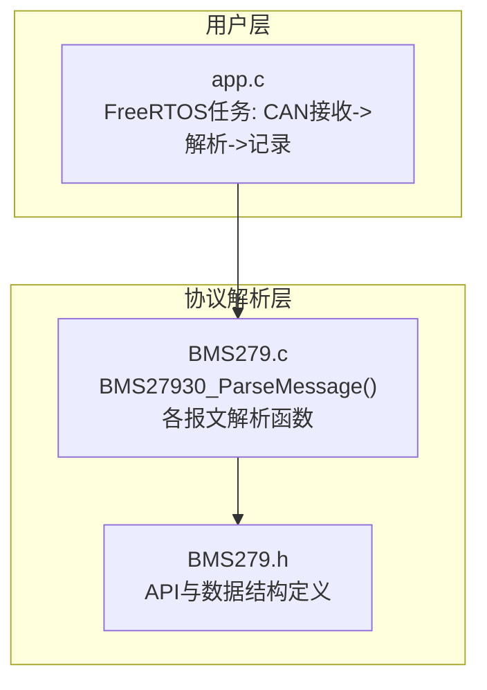
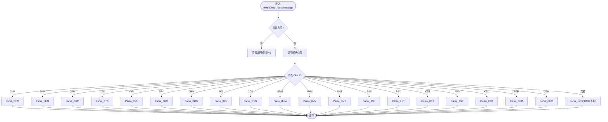
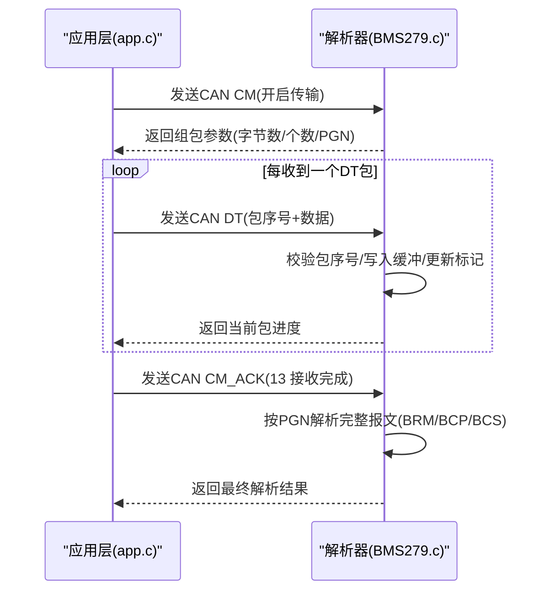
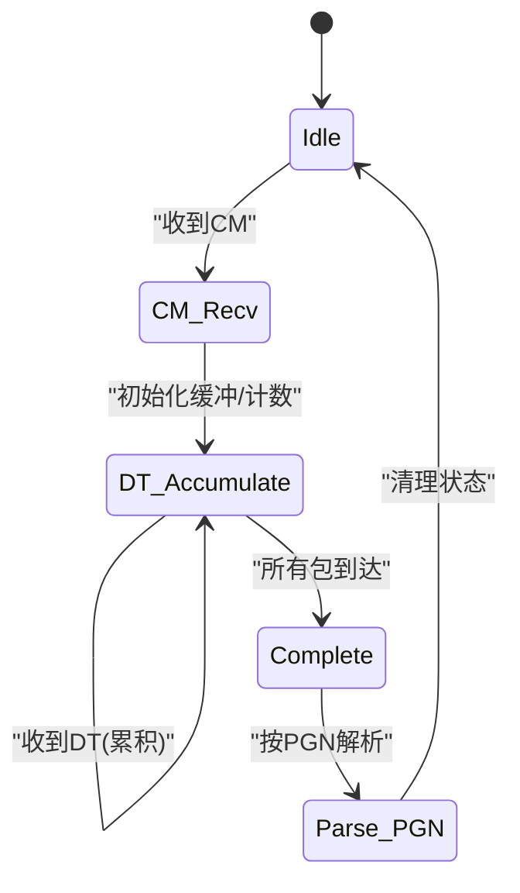
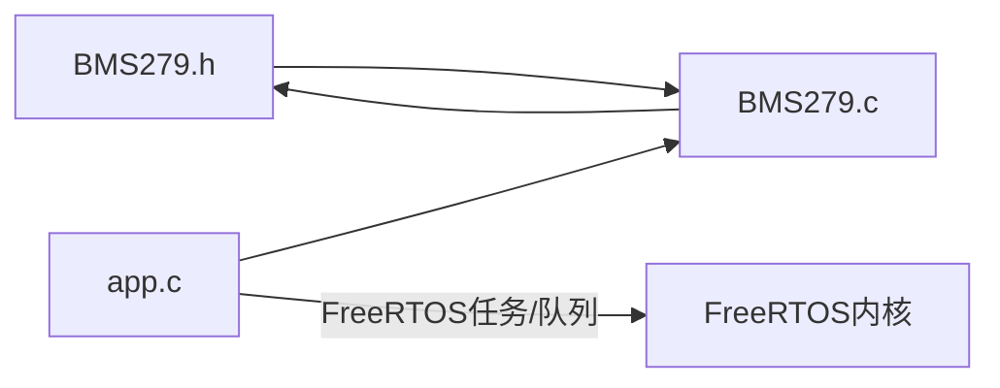

# 协议解析API

<cite>
**本文引用的文件**   
- [BMS279.h](file://_gbk_backup/User/BMS279.h)
- [BMS279.c](file://_gbk_backup/User/BMS279.c)
- [app.c](file://_gbk_backup/User/app.c)
</cite>

## 目录
1. [简介](#简介)
2. [项目结构](#项目结构)
3. [核心组件](#核心组件)
4. [架构总览](#架构总览)
5. [详细组件分析](#详细组件分析)
6. [依赖关系分析](#依赖关系分析)
7. [性能与内存特性](#性能与内存特性)
8. [故障排查指南](#故障排查指南)
9. [结论](#结论)
10. [附录：使用示例与最佳实践](#附录使用示例与最佳实践)

## 简介
本文件面向GB/T 27930电动汽车充电通信协议的解析引擎，提供面向应用层的API文档。重点包括：
- 核心解析函数 BMS27930_ParseMessage() 的接口定义、参数说明与返回值约定
- 支持的报文类型（CHM、BHM、CRM、CTS、CML、BRO、CRO、BCP、BCS、BCL、CCS、BSM、BMV、BMT、BSP、BST、CST、BSD、CSD、BEM、CEM）及其数据结构定义
- J1939多包传输（BRM/BCP/BCS）的组包与解析流程
- 协议状态机管理、数据验证与错误处理机制
- 完整的代码示例路径，展示如何初始化解析器、处理不同类型充电数据并获取解析结果
- API的性能特性与内存使用限制说明

## 项目结构
该协议解析模块由头文件与实现文件组成，并在FreeRTOS任务中集成CAN接收与日志记录：
- BMS279.h：协议常量、数据结构与对外API声明
- BMS279.c：协议解析实现，包含各报文类型的解析逻辑与J1939多包组装
- app.c：FreeRTOS任务示例，演示从CAN总线读取报文、调用解析器并将结果写入存储设备

图示来源
- [app.c:200-277](file://_gbk_backup/User/app.c#L200-L277)
- [BMS279.c:42-114](file://_gbk_backup/User/BMS279.c#L42-L114)
- [BMS279.h:46-194](file://_gbk_backup/User/BMS279.h#L46-L194)

章节来源
- [BMS279.h:1-201](file://_gbk_backup/User/BMS279.h#L1-L201)
- [BMS279.c:1-710](file://_gbk_backup/User/BMS279.c#L1-L710)
- [app.c:200-277](file://_gbk_backup/User/app.c#L200-L277)

## 核心组件
- 对外API
  - BMS27930_ParseMessage(canId, data, len, result)：根据CAN ID分发到具体报文解析函数，填充解析结果结构体
- 数据结构
  - ParseResult_t：统一的解析输出结构，包含报文类型字符串、描述与详细信息
  - 各类报文结构体：如BMS27930_CHM_t、BMS27930_BHM_t、BMS27930_CRM_t等，用于表达协议字段语义
- 内部解析器
  - 针对每种报文类型的静态解析函数（Parse_CHM、Parse_BHM、...），负责长度校验、字节序转换、单位换算与文本格式化
  - J1939多包传输解析器（Parse_1939），支持连接管理（CM）、确认（CM_ACK）与数据传输（DT）

章节来源
- [BMS279.h:46-194](file://_gbk_backup/User/BMS279.h#L46-L194)
- [BMS279.c:12-32](file://_gbk_backup/User/BMS279.c#L12-L32)
- [BMS279.c:42-114](file://_gbk_backup/User/BMS279.c#L42-L114)

## 架构总览
解析引擎采用“按ID分发 + 专用解析器”的架构。主入口函数依据CAN ID将报文路由至对应解析函数；未知ID走J1939多包流程。

图示来源
- [BMS279.c:42-114](file://_gbk_backup/User/BMS279.c#L42-L114)

## 详细组件分析

### 对外API：BMS27930_ParseMessage
- 功能
  - 根据传入的CAN ID选择对应的解析函数，完成报文字段的解析与格式化，输出到ParseResult_t
- 参数
  - canId：CAN标识符（支持标准/扩展帧ID）
  - data：报文数据缓冲区指针
  - len：数据长度
  - result：解析结果输出结构体指针
- 返回值
  - 无返回值；通过result输出解析信息
- 行为与约束
  - 若result或data为NULL，直接返回不执行任何操作
  - 每次调用前会清空result，避免残留上次解析内容
  - 对不支持的CAN ID，交由J1939多包解析器处理

章节来源
- [BMS279.h:193-194](file://_gbk_backup/User/BMS279.h#L193-L194)
- [BMS279.c:42-114](file://_gbk_backup/User/BMS279.c#L42-L114)

### 报文类型与数据结构
以下为支持的报文类型与其在头文件中定义的结构体（部分关键类型）：
- CHM（充电机握手）：BMS27930_CHM_t
- BHM（车辆握手）：BMS27930_BHM_t
- CRM（充电机辨识）：BMS27930_CRM_t
- BRM（BMS辨识，J1939多包）：BMS27930_BRM_t
- BCP（电池充电参数）：BMS27930_BCP_t
- CTS（时间同步）：BMS27930_CTS_t
- CML（充电机最大输出能力）：BMS27930_CML_t
- BRO（车辆准备就绪）：BMS27930_BRO_t
- CRO（充电机准备就绪）：BMS27930_CRO_t
- BCL（电池充电需求）：BMS27930_BCL_t
- BCS（电池充电总状态）：BMS27930_BCS_t
- CCS（充电机充电状态）：BMS27930_CCS_t
- BSM（动力蓄电池状态）：BMS27930_BSM_t
- BMV（单体电池电压）：未单独定义结构体，但存在解析逻辑
- BMT（电池温度）：未单独定义结构体，但存在解析逻辑
- BSP（预留报文）：未单独定义结构体，但存在解析逻辑
- BST/CST（中止充电）：BMS27930_STOP_t
- BSD（车辆统计数据）：BMS27930_BSD_t
- CSD（充电机统计数据）：BMS27930_CSD_t
- BEM/CEM（错误报文）：BMS27930_ERROR_t

```mermaid
classDiagram
class ParseResult_t {
+char type_str[16]
+char description[64]
+char parsed_info[512]
}
class BMS27930_CHM_t {
+uint8_t protocol_version[3]
}
class BMS27930_BHM_t {
+uint16_t max_voltage
}
class BMS27930_CRM_t {
+uint8_t result
+char charger_num[8]
}
class BMS27930_BRM_t {
+uint8_t protocol_version[3]
+uint8_t battery_type
+uint16_t rated_capacity
+uint16_t rated_voltage
+char battery_manufacturer[4]
+uint32_t battery_pack_num
+uint8_t manufacture_date[3]
+uint32_t charge_count
+uint8_t property_flag
+uint8_t reserved
+char vin[17]
+uint8_t bms_version[3]
}
class BMS27930_BCP_t {
+uint16_t max_charge_voltage_single
+uint16_t max_charge_current
+uint16_t max_charge_voltage_total
+uint16_t max_temperature
+uint16_t current_soc
+uint16_t current_voltage
}
class BMS27930_CTS_t {
+uint8_t year
+uint8_t month
+uint8_t day
+uint8_t hour
+uint8_t minute
+uint8_t second
}
class BMS27930_CML_t {
+uint16_t max_output_voltage
+uint16_t min_output_voltage
+uint16_t max_output_current
+uint16_t min_output_current
}
class BMS27930_BRO_t {
+uint8_t ready
}
class BMS27930_CRO_t {
+uint8_t ready
}
class BMS27930_BCL_t {
+uint16_t voltage_demand
+uint16_t current_demand
+uint8_t charge_mode
}
class BMS27930_BCS_t {
+uint16_t voltage_measure
+uint16_t current_measure
+uint16_t max_single_voltage
+uint8_t max_single_num
+uint8_t soc
+uint16_t remain_time
}
class BMS27930_CCS_t {
+uint16_t voltage_output
+uint16_t current_output
+uint16_t charge_time
}
class BMS27930_BSM_t {
+uint8_t max_single_voltage_num
+uint8_t max_temperature
+uint8_t max_temperature_probe_num
+uint8_t min_temperature
+uint8_t min_temperature_probe_num
+uint8_t voltage_status
+uint8_t soc_status
+uint8_t current_status
+uint8_t temperature_status
+uint8_t insulation_status
+uint8_t connector_status
+uint8_t charge_allow_status
}
class BMS27930_STOP_t {
+uint8_t stop_reason
+uint8_t fault_reason
+uint8_t error_reason
}
class BMS27930_BSD_t {
+uint8_t soc_before
+uint8_t soc_after
+uint16_t min_voltage
+uint16_t max_voltage
+uint8_t min_temp
+uint8_t max_temp
}
class BMS27930_CSD_t {
+uint16_t charge_time
+uint16_t output_energy
}
class BMS27930_ERROR_t {
+uint8_t recv_timeout
+uint8_t recv_format_error
+uint8_t other_error
}
```

图示来源
- [BMS279.h:46-191](file://_gbk_backup/User/BMS279.h#L46-L191)

章节来源
- [BMS279.h:46-191](file://_gbk_backup/User/BMS279.h#L46-L191)

### J1939多包传输解析（BRM/BCP/BCS）
- 支持PGN类型
  - 0x02：BRM（BMS与车辆辨识）
  - 0x06：BCP（电池充电参数）
  - 0x11：BCS（电池充电状态）
- 流程要点
  - CM（连接管理）：开启传输，携带总字节数、包个数与PGN
  - DT（数据传输）：逐包接收，按包号偏移写入缓冲，维护已收包标记
  - CM_ACK（确认）：11表示确认接收，13表示接收完成
  - 全部包到达后，按PGN进行字段解析与格式化

图示来源
- [BMS279.c:557-708](file://_gbk_backup/User/BMS279.c#L557-L708)

章节来源
- [BMS279.c:557-708](file://_gbk_backup/User/BMS279.c#L557-L708)

### 协议状态机管理
- 单帧报文：无显式状态机，解析函数直接处理数据并填充结果
- J1939多包：内部维护以下状态（静态变量）
  - rxbuf：组包缓冲
  - packcnt：总包数
  - pgn：参数组编号
  - packID：当前包号
  - bytecnt：总字节数
  - pos：当前位置（用于计算偏移）
  - packReceived[]：已收包标记数组
- 状态转移
  - 初始：等待CM
  - CM后：初始化缓冲与计数
  - DT循环：按包号写入，检查完整性
  - 完成：触发PGN分支解析，清理标记

图示来源
- [BMS279.c:557-708](file://_gbk_backup/User/BMS279.c#L557-L708)

章节来源
- [BMS279.c:557-708](file://_gbk_backup/User/BMS279.c#L557-L708)

### 数据验证与错误处理
- 空指针保护：当result或data为NULL时直接返回
- 长度校验：多数解析函数在解析前检查len是否满足最小要求，否则输出“数据长度不足/错误”
- 数值范围与单位换算：
  - 电流值常带偏移（例如偏移400A），需做减法换算
  - 温度值常带偏移（例如偏移50℃），需做有符号转换
  - 电压/能量等以固定小数位系数（如0.1V、0.01V、0.1kWh）换算
- 异常状态拼接：如BSM在检测到异常标志位时追加状态信息
- J1939包序号合法性检查：非法包序号直接返回，避免污染缓冲

章节来源
- [BMS279.c:42-114](file://_gbk_backup/User/BMS279.c#L42-L114)
- [BMS279.c:119-130](file://_gbk_backup/User/BMS279.c#L119-L130)
- [BMS279.c:135-146](file://_gbk_backup/User/BMS279.c#L135-L146)
- [BMS279.c:151-170](file://_gbk_backup/User/BMS279.c#L151-L170)
- [BMS279.c:199-211](file://_gbk_backup/User/BMS279.c#L199-L211)
- [BMS279.c:216-234](file://_gbk_backup/User/BMS279.c#L216-L234)
- [BMS279.c:239-266](file://_gbk_backup/User/BMS279.c#L239-L266)
- [BMS279.c:271-290](file://_gbk_backup/User/BMS279.c#L271-L290)
- [BMS279.c:296-312](file://_gbk_backup/User/BMS279.c#L296-L312)
- [BMS279.c:317-344](file://_gbk_backup/User/BMS279.c#L317-L344)
- [BMS279.c:349-369](file://_gbk_backup/User/BMS279.c#L349-L369)
- [BMS279.c:374-392](file://_gbk_backup/User/BMS279.c#L374-L392)
- [BMS279.c:397-402](file://_gbk_backup/User/BMS279.c#L397-L402)
- [BMS279.c:407-433](file://_gbk_backup/User/BMS279.c#L407-L433)
- [BMS279.c:438-464](file://_gbk_backup/User/BMS279.c#L438-L464)
- [BMS279.c:469-490](file://_gbk_backup/User/BMS279.c#L469-L490)
- [BMS279.c:495-510](file://_gbk_backup/User/BMS279.c#L495-L510)
- [BMS279.c:515-531](file://_gbk_backup/User/BMS279.c#L515-L531)
- [BMS279.c:536-552](file://_gbk_backup/User/BMS279.c#L536-L552)
- [BMS279.c:557-708](file://_gbk_backup/User/BMS279.c#L557-L708)

## 依赖关系分析
- 模块内依赖
  - BMS279.c依赖BMS279.h中的常量与结构体定义
  - app.c依赖BMS279.c提供的解析API，并通过FreeRTOS队列与外设交互
- 外部依赖
  - stm32f4xx.h：MCU相关类型与寄存器定义
  - string.h/stdio.h：字符串与格式化I/O
  - FreeRTOS：任务、队列等系统服务（在app.c中使用）

图示来源
- [BMS279.h:17-19](file://_gbk_backup/User/BMS279.h#L17-L19)
- [BMS279.c:10-32](file://_gbk_backup/User/BMS279.c#L10-L32)
- [app.c:200-277](file://_gbk_backup/User/app.c#L200-L277)

章节来源
- [BMS279.h:17-19](file://_gbk_backup/User/BMS279.h#L17-L19)
- [BMS279.c:10-32](file://_gbk_backup/User/BMS279.c#L10-L32)
- [app.c:200-277](file://_gbk_backup/User/app.c#L200-L277)

## 性能与内存特性
- 时间复杂度
  - 单帧解析：O(1)，主要为固定长度的字段解析与字符串格式化
  - J1939多包：累计O(N)，N为包数量；每包仅一次memcpy与标记更新
- 空间复杂度
  - 单帧解析：常数级额外空间（局部临时变量与格式化缓冲）
  - J1939多包：静态缓冲rxbuf（128字节）与packReceived（7字节）
- 内存使用限制
  - 解析结果ParseResult_t占用约592字节（type_str 16 + description 64 + parsed_info 512）
  - J1939组包缓冲rxbuf为128字节，适用于较小报文的多包组合
- 注意事项
  - 频繁调用sprintf/strcat会产生较多栈上临时缓冲，建议在高吞吐场景下评估堆栈深度
  - 建议在应用层复用ParseResult_t实例，避免重复分配

章节来源
- [BMS279.h:46-51](file://_gbk_backup/User/BMS279.h#L46-L51)
- [BMS279.c:557-564](file://_gbk_backup/User/BMS279.c#L557-L564)

## 故障排查指南
- 现象：解析结果为空或乱码
  - 可能原因：传入result或data为NULL；报文长度不足
  - 排查方法：检查调用方指针有效性；打印len与各解析函数的长度判断分支
- 现象：J1939多包无法完成
  - 可能原因：包序号非法或未收到CM/ACK；包丢失导致packReceived未全置1
  - 排查方法：检查CM/ACK/DT序列；确认包序号范围与packcnt一致；必要时复位状态
- 现象：数值异常（电流/温度/电压）
  - 可能原因：单位换算或偏移量理解错误
  - 排查方法：对照各解析函数中的换算逻辑（如电流偏移400A、温度偏移50℃、电压系数0.1V/0.01V）

章节来源
- [BMS279.c:42-46](file://_gbk_backup/User/BMS279.c#L42-L46)
- [BMS279.c:557-617](file://_gbk_backup/User/BMS279.c#L557-L617)
- [BMS279.c:619-708](file://_gbk_backup/User/BMS279.c#L619-L708)

## 结论
本解析引擎提供了覆盖GB/T 27930主要报文的统一解析API，并通过J1939多包机制扩展了对BRM/BCP/BCS的支持。其设计简洁、职责清晰，适合在嵌入式系统中作为协议解析中间层使用。在实际部署中，建议结合应用层任务调度与缓存策略，优化高频报文处理的性能与稳定性。

## 附录：使用示例与最佳实践

### 初始化与基本用法
- 步骤
  1. 在FreeRTOS任务中接收CAN报文（扩展ID、数据、长度）
  2. 声明ParseResult_t实例
  3. 调用BMS27930_ParseMessage(canId, data, len, &parse_result)
  4. 读取parse_result.type_str/description/parsed_info进行显示或记录
- 参考路径
  - [app.c:200-277](file://_gbk_backup/User/app.c#L200-L277)

### 处理不同报文类型
- 单帧报文（CHM/BHM/CRM/CTS/CML/BRO/CRO/BCP/BCS/BCL/CCS/BSM/BMV/BMT/BSP/BST/CST/BSD/CSD/BEM/CEM）
  - 直接调用BMS27930_ParseMessage即可，内部自动分发
- J1939多包报文（BRM/BCP/BCS）
  - 先处理CM（开启传输），再依次处理DT（数据包），最后处理CM_ACK（确认）
  - 完成后解析结果会在最后一次DT或ACK回调中给出
- 参考路径
  - [BMS279.c:42-114](file://_gbk_backup/User/BMS279.c#L42-L114)
  - [BMS279.c:557-708](file://_gbk_backup/User/BMS279.c#L557-L708)

### 获取解析结果
- 字段含义
  - type_str：报文类型（如“CHM”、“BRM”、“BCP”等）
  - description：中文描述（如“充电机握手”、“BMS与车辆辨识”等）
  - parsed_info：详细解析信息（含单位换算后的数值与状态）
- 参考路径
  - [BMS279.h:46-51](file://_gbk_backup/User/BMS279.h#L46-L51)
  - [app.c:245-255](file://_gbk_backup/User/app.c#L245-L255)

### 性能与内存优化建议
- 复用ParseResult_t实例，避免重复栈分配
- 在高吞吐场景下减少不必要的字符串格式化，可考虑按需输出关键字段
- 合理设置FreeRTOS任务优先级与时钟节拍，确保CAN接收与解析的实时性

章节来源
- [BMS279.h:46-51](file://_gbk_backup/User/BMS279.h#L46-L51)
- [app.c:245-255](file://_gbk_backup/User/app.c#L245-L255)