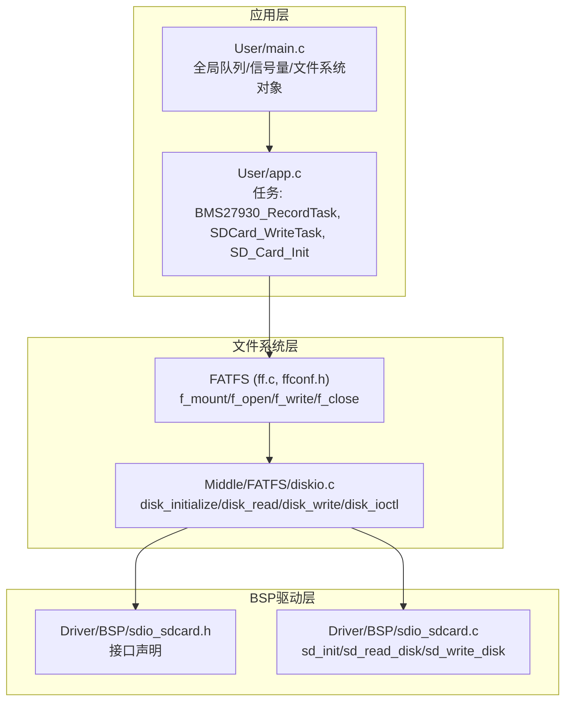
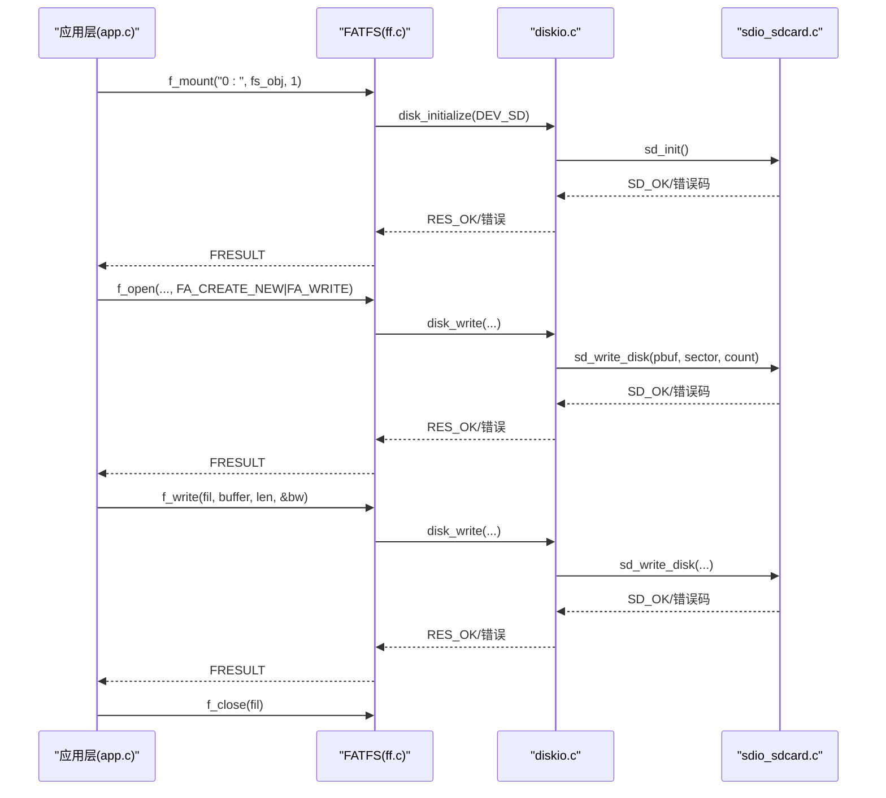
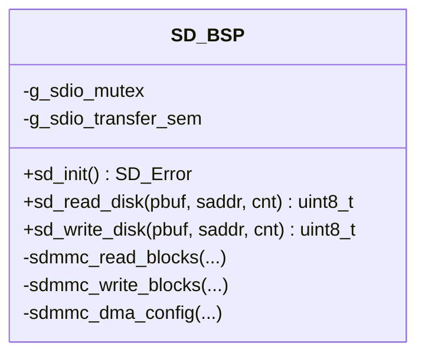
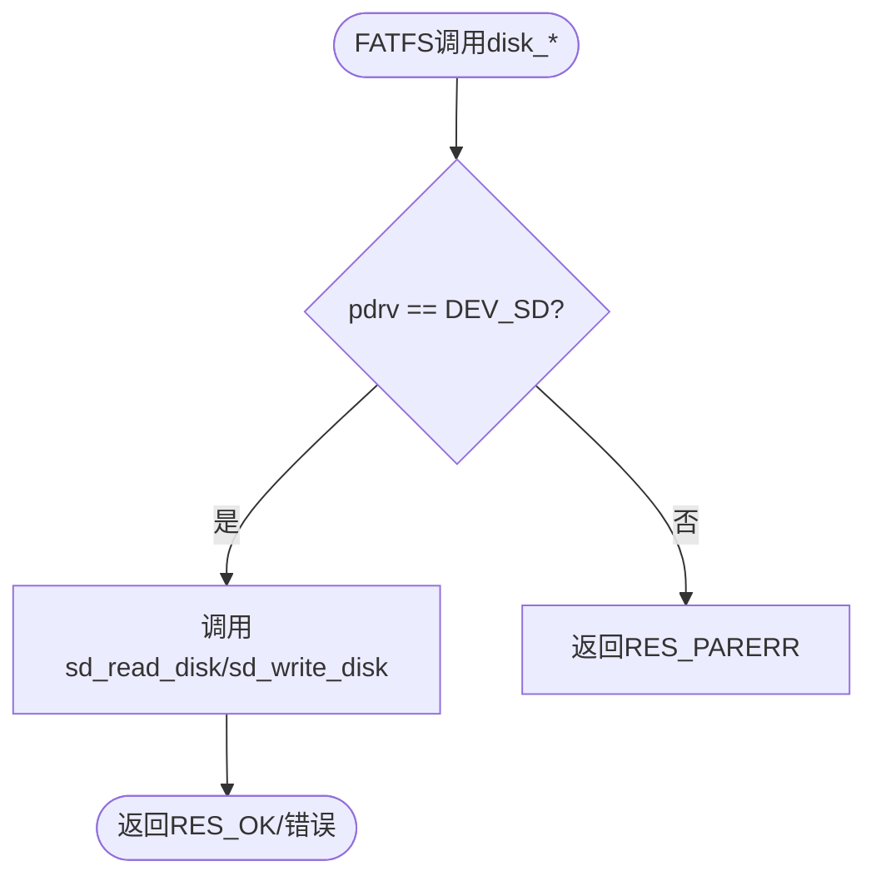
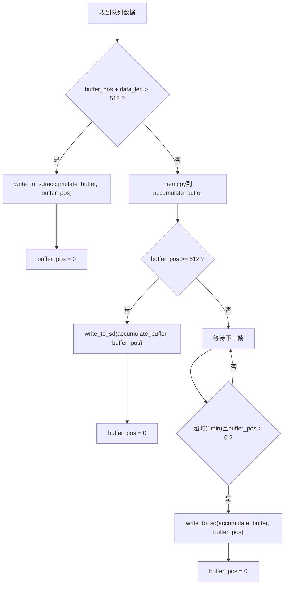
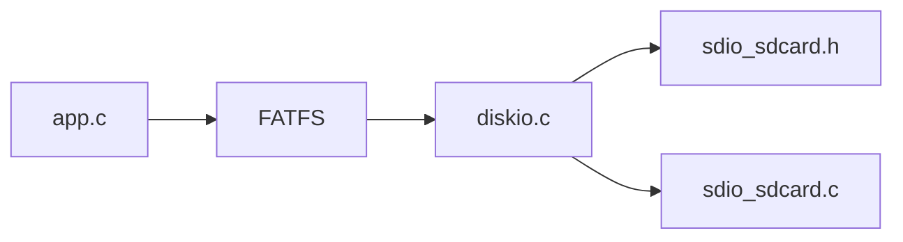

# 存储管理API

<cite>
**本文引用的文件**   
- [app.c](file://_gbk_backup/User/app.c)
- [app.h](file://_gbk_backup/User/app.h)
- [main.c](file://_gbk_backup/User/main.c)
- [sdio_sdcard.c](file://_gbk_backup/Driver/BSP/sdio_sdcard.c)
- [sdio_sdcard.h](file://_gbk_backup/Driver/BSP/sdio_sdcard.h)
- [diskio.c](file://_gbk_backup/Middle/FATFS/diskio.c)
</cite>

## 目录
1. [简介](#简介)
2. [项目结构](#项目结构)
3. [核心组件](#核心组件)
4. [架构总览](#架构总览)
5. [详细组件分析](#详细组件分析)
6. [依赖关系分析](#依赖关系分析)
7. [性能与容量优化](#性能与容量优化)
8. [故障排查指南](#故障排查指南)
9. [结论](#结论)
10. [附录：使用示例与最佳实践](#附录使用示例与最佳实践)

## 简介
本文件系统面向STM32F4平台上的SD卡采集与日志记录场景，提供基于FATFS的文件系统操作、扇区级缓冲与批量写入优化、以及数据完整性与错误恢复机制。文档重点说明以下能力：
- FATFS文件系统挂载与底层磁盘I/O适配
- SD卡初始化、读写扇区接口
- 应用层数据存储函数（如write_to_sd）的使用方法与参数约定
- 扇区级缓冲与超时落盘策略
- 并发访问保护（互斥量）与错误码处理
- 性能优化与容量管理建议

## 项目结构
本项目在FreeRTOS环境下运行，关键路径如下：
- 用户应用层：User/app.c、User/app.h、User/main.c
- BSP驱动层：Driver/BSP/sdio_sdcard.c、Driver/BSP/sdio_sdcard.h
- FATFS适配层：Middle/FATFS/diskio.c

图表来源
- [app.c:31-71](file://_gbk_backup/User/app.c#L31-L71)
- [app.c:311-366](file://_gbk_backup/User/app.c#L311-L366)
- [app.c:414-450](file://_gbk_backup/User/app.c#L414-L450)
- [main.c:23-31](file://_gbk_backup/User/main.c#L23-L31)
- [diskio.c:38-98](file://_gbk_backup/Middle/FATFS/diskio.c#L38-L98)
- [sdio_sdcard.h:332-336](file://_gbk_backup/Driver/BSP/sdio_sdcard.h#L332-L336)
- [sdio_sdcard.c:1403-1449](file://_gbk_backup/Driver/BSP/sdio_sdcard.c#L1403-L1449)

章节来源
- [app.c:31-71](file://_gbk_backup/User/app.c#L31-L71)
- [app.c:311-366](file://_gbk_backup/User/app.c#L311-L366)
- [app.c:414-450](file://_gbk_backup/User/app.c#L414-L450)
- [main.c:23-31](file://_gbk_backup/User/main.c#L23-L31)
- [diskio.c:38-98](file://_gbk_backup/Middle/FATFS/diskio.c#L38-L98)
- [sdio_sdcard.h:332-336](file://_gbk_backup/Driver/BSP/sdio_sdcard.h#L332-L336)
- [sdio_sdcard.c:1403-1449](file://_gbk_backup/Driver/BSP/sdio_sdcard.c#L1403-L1449)

## 核心组件
- SD卡BSP驱动
  - sd_init：SDIO/DMA初始化、时钟配置、总线宽度设置、卡识别与信息获取
  - sd_read_disk / sd_write_disk：扇区级读/写封装，内部调用多块读写命令并带互斥保护
- FATFS适配层
  - disk_initialize：映射到sd_init
  - disk_read / disk_write：映射到sd_read_disk / sd_write_disk
  - disk_ioctl：返回扇区大小、块大小、扇区数量等元信息
- 应用层
  - write_to_sd：按日期生成文件名，打开/创建CSV文件，追加写入，关闭文件；受互斥量保护
  - SDCard_WriteTask：扇区级缓冲累积（512字节），或1分钟无新数据时落盘，减少频繁写入
  - SD_Card_Init：创建互斥量，分配FATFS对象，挂载驱动器“0:”

章节来源
- [sdio_sdcard.h:332-336](file://_gbk_backup/Driver/BSP/sdio_sdcard.h#L332-L336)
- [sdio_sdcard.c:1403-1449](file://_gbk_backup/Driver/BSP/sdio_sdcard.c#L1403-L1449)
- [diskio.c:38-98](file://_gbk_backup/Middle/FATFS/diskio.c#L38-L98)
- [app.c:35-71](file://_gbk_backup/User/app.c#L35-L71)
- [app.c:311-366](file://_gbk_backup/User/app.c#L311-L366)
- [app.c:414-450](file://_gbk_backup/User/app.c#L414-L450)

## 架构总览
下图展示从应用层到BSP驱动的完整调用链，包括FATFS的挂载与文件操作。

图表来源
- [app.c:414-450](file://_gbk_backup/User/app.c#L414-L450)
- [app.c:35-71](file://_gbk_backup/User/app.c#L35-L71)
- [diskio.c:38-98](file://_gbk_backup/Middle/FATFS/diskio.c#L38-L98)
- [sdio_sdcard.c:1403-1449](file://_gbk_backup/Driver/BSP/sdio_sdcard.c#L1403-L1449)

## 详细组件分析

### SD卡BSP驱动（sdio_sdcard.c/h）
- 主要职责
  - 硬件初始化：GPIO复用、SDIO时钟、DMA通道、NVIC中断
  - 卡识别与配置：CMD0/CMD8/ACMD41序列、RCA分配、CSD/CID解析、总线宽度设置
  - 数据传输：单块/多块读写，DMA+中断同步，错误检测与恢复
- 对外接口
  - sd_init：初始化SD卡
  - sd_read_disk / sd_write_disk：扇区级读/写，内部加互斥锁保护
- 关键实现要点
  - 高容量卡（SDHC/SDXC）地址需左移9位（以字节寻址）
  - 多块写前发送ACMD55+CMD23预置块数，提升吞吐
  - DMA传输完成通过信号量同步，支持超时控制

图表来源
- [sdio_sdcard.h:332-336](file://_gbk_backup/Driver/BSP/sdio_sdcard.h#L332-L336)
- [sdio_sdcard.c:1403-1449](file://_gbk_backup/Driver/BSP/sdio_sdcard.c#L1403-L1449)
- [sdio_sdcard.c:655-737](file://_gbk_backup/Driver/BSP/sdio_sdcard.c#L655-L737)
- [sdio_sdcard.c:747-800](file://_gbk_backup/Driver/BSP/sdio_sdcard.c#L747-L800)

章节来源
- [sdio_sdcard.h:332-336](file://_gbk_backup/Driver/BSP/sdio_sdcard.h#L332-L336)
- [sdio_sdcard.c:1403-1449](file://_gbk_backup/Driver/BSP/sdio_sdcard.c#L1403-L1449)

### FATFS适配层（diskio.c）
- 主要职责
  - 将FATFS的通用磁盘接口映射到具体SD卡驱动
  - 提供扇区大小、块大小、扇区数量等查询
- 关键函数
  - disk_initialize：调用sd_init
  - disk_read：调用sd_read_disk
  - disk_write：调用sd_write_disk
  - disk_ioctl：返回GET_SECTOR_SIZE=512、GET_BLOCK_SIZE=g_sd_card_info.CardBlockSize、GET_SECTOR_COUNT=CardCapacity/512

图表来源
- [diskio.c:38-98](file://_gbk_backup/Middle/FATFS/diskio.c#L38-L98)
- [diskio.c:107-143](file://_gbk_backup/Middle/FATFS/diskio.c#L107-L143)

章节来源
- [diskio.c:38-98](file://_gbk_backup/Middle/FATFS/diskio.c#L38-L98)
- [diskio.c:107-143](file://_gbk_backup/Middle/FATFS/diskio.c#L107-L143)

### 应用层数据存储（app.c）
- write_to_sd
  - 功能：根据RTC时间生成文件名（CSV），尝试追加打开，不存在则新建，写入缓冲区后关闭文件
  - 并发保护：使用xSDCardMutex互斥量保护文件操作
  - 错误处理：打印错误码，不阻塞主流程
- SDCard_WriteTask
  - 功能：从队列接收待写数据，累积至512字节扇区大小或1分钟无新数据时触发write_to_sd
  - 优化：避免频繁小写，降低SD卡磨损与开销
- SD_Card_Init
  - 功能：创建互斥量，分配FATFS对象，挂载驱动器“0:”，成功后删除自身任务

图表来源
- [app.c:311-366](file://_gbk_backup/User/app.c#L311-L366)
- [app.c:35-71](file://_gbk_backup/User/app.c#L35-L71)

章节来源
- [app.c:35-71](file://_gbk_backup/User/app.c#L35-L71)
- [app.c:311-366](file://_gbk_backup/User/app.c#L311-L366)
- [app.c:414-450](file://_gbk_backup/User/app.c#L414-L450)

## 依赖关系分析
- 应用层依赖
  - FreeRTOS队列/信号量用于任务间通信与并发保护
  - RTC驱动用于文件名时间戳
  - FATFS API进行文件级读写
- 文件系统层依赖
  - diskio.c依赖sdio_sdcard.h/c提供的sd_init/sd_read_disk/sd_write_disk
- BSP层依赖
  - STM32 HAL/寄存器操作、DMA、SDIO、NVIC

图表来源
- [app.c:31-71](file://_gbk_backup/User/app.c#L31-L71)
- [diskio.c:38-98](file://_gbk_backup/Middle/FATFS/diskio.c#L38-L98)
- [sdio_sdcard.h:332-336](file://_gbk_backup/Driver/BSP/sdio_sdcard.h#L332-L336)

章节来源
- [app.c:31-71](file://_gbk_backup/User/app.c#L31-L71)
- [diskio.c:38-98](file://_gbk_backup/Middle/FATFS/diskio.c#L38-L98)
- [sdio_sdcard.h:332-336](file://_gbk_backup/Driver/BSP/sdio_sdcard.h#L332-L336)

## 性能与容量优化
- 扇区级缓冲与批量写入
  - 累积至512字节再写，减少小写次数，提高吞吐并延长SD卡寿命
  - 1分钟无新数据自动落盘，保证数据不丢失
- 多块写优化
  - 多块写前发送ACMD55+CMD23预置块数，减少命令开销
- 总线宽度与时钟
  - 启用4位总线模式，动态计算最优分频系数，平衡稳定性与速度
- 容量管理
  - 通过disk_ioctl获取CardCapacity与CardBlockSize，可据此实施轮转文件或按容量阈值切换目标文件
- 并发安全
  - 全局互斥量保护SDIO访问，避免多任务竞争导致的数据损坏

[本节为通用指导，不直接分析具体文件]

## 故障排查指南
- 常见问题定位
  - 挂载失败：检查f_mount返回值，确认sd_init成功；查看串口打印的错误码
  - 写入失败：检查write_to_sd中f_write返回值与已写字节数是否匹配；确认互斥量未死锁
  - 队列满：检查xSDCardWriteQueue深度与生产者速率，必要时增大队列长度
- 错误码参考
  - FATFS：FR_OK表示成功，其他值参见ff.h定义
  - SD卡：SD_OK表示成功，其他值参见sdio_sdcard.h中的SD_Error枚举
- 恢复策略
  - 重试机制：对临时错误（如超时）进行有限次重试
  - 降级策略：若连续失败，切换到只读模式或停止采集，防止进一步损坏

章节来源
- [app.c:35-71](file://_gbk_backup/User/app.c#L35-L71)
- [sdio_sdcard.h:18-67](file://_gbk_backup/Driver/BSP/sdio_sdcard.h#L18-L67)

## 结论
本存储管理系统通过FATFS与自定义BSP驱动的结合，实现了稳定可靠的SD卡数据采集与日志记录。应用层采用扇区级缓冲与超时落盘策略，结合互斥量保护，有效提升了写入性能与数据安全性。建议在量产环境中加入容量管理与轮转策略，进一步提升长期运行的鲁棒性。

[本节为总结性内容，不直接分析具体文件]

## 附录：使用示例与最佳实践

- 初始化与挂载
  - 步骤：创建互斥量、分配FATFS对象、调用f_mount挂载“0:”
  - 参考路径：[SD_Card_Init:414-450](file://_gbk_backup/User/app.c#L414-L450)
- 创建文件与写入采集数据
  - 步骤：构造文件名（含日期）、f_open(FA_CREATE_NEW|FA_WRITE)、f_write循环、f_close
  - 参考路径：[write_to_sd:35-71](file://_gbk_backup/User/app.c#L35-L71)
- 读取历史记录
  - 步骤：f_open(FA_READ)、f_read循环、f_close
  - 说明：当前代码未包含读取逻辑，可按上述步骤扩展
- 扇区级缓冲与批量写入
  - 策略：累积至512字节或1分钟无新数据时触发write_to_sd
  - 参考路径：[SDCard_WriteTask:311-366](file://_gbk_backup/User/app.c#L311-L366)
- 容量与性能调优
  - 通过disk_ioctl获取CardCapacity/CardBlockSize，实现文件轮转与分区策略
  - 调整SDIO时钟分频与总线宽度，平衡速度与稳定性
  - 参考路径：[disk_ioctl:107-143](file://_gbk_backup/Middle/FATFS/diskio.c#L107-L143)

章节来源
- [app.c:35-71](file://_gbk_backup/User/app.c#L35-L71)
- [app.c:311-366](file://_gbk_backup/User/app.c#L311-L366)
- [app.c:414-450](file://_gbk_backup/User/app.c#L414-L450)
- [diskio.c:107-143](file://_gbk_backup/Middle/FATFS/diskio.c#L107-L143)