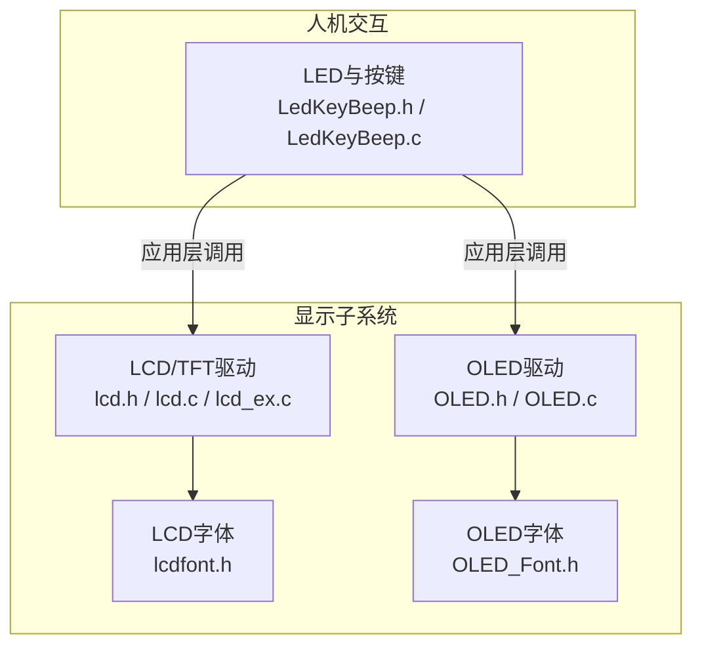
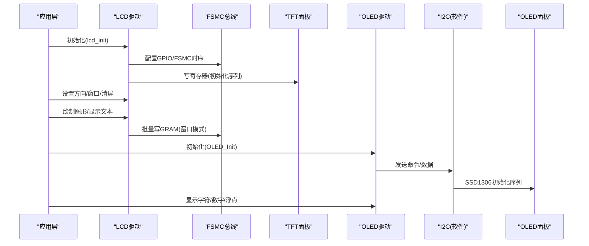
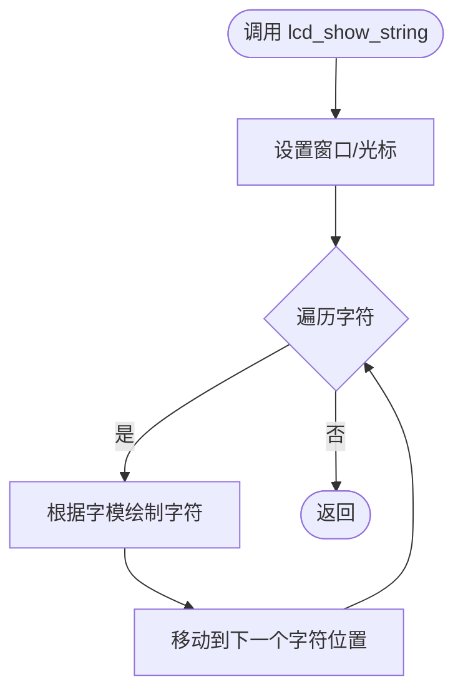
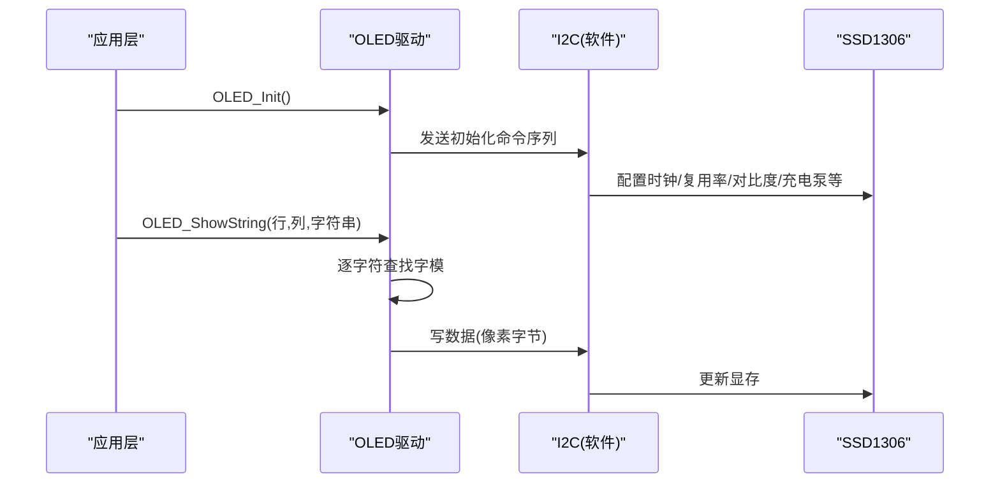
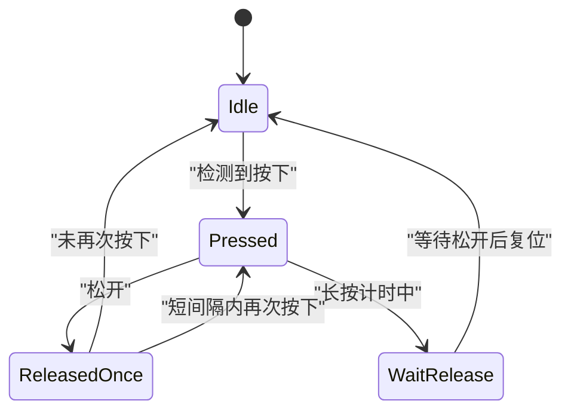
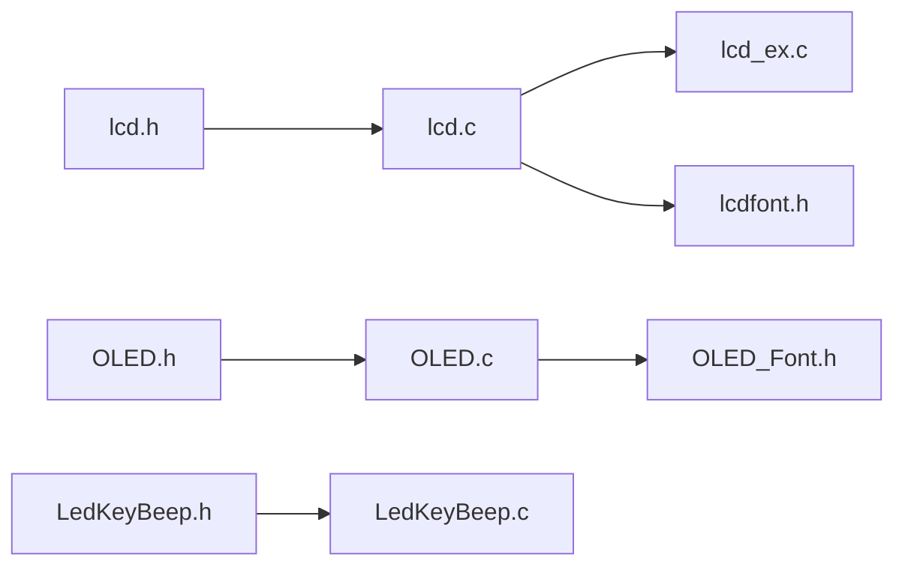

# 显示接口API

<cite>
**本文引用的文件**   
- [lcd.h](file://_gbk_backup/Driver/BSP/LCD/lcd.h)
- [lcd.c](file://_gbk_backup/Driver/BSP/LCD/lcd.c)
- [lcd_ex.c](file://_gbk_backup/Driver/BSP/LCD/lcd_ex.c)
- [lcdfont.h](file://_gbk_backup/Driver/BSP/LCD/lcdfont.h)
- [OLED.h](file://_gbk_backup/Driver/BSP/OLED.h)
- [OLED.c](file://_gbk_backup/Driver/BSP/OLED.c)
- [OLED_Font.h](file://_gbk_backup/Driver/BSP/OLED_Font.h)
- [LedKeyBeep.h](file://_gbk_backup/Driver/BSP/LedKeyBeep.h)
- [LedKeyBeep.c](file://_gbk_backup/Driver/BSP/LedKeyBeep.c)
</cite>

## 目录
1. [简介](#简介)
2. [项目结构](#项目结构)
3. [核心组件](#核心组件)
4. [架构总览](#架构总览)
5. [详细组件分析](#详细组件分析)
6. [依赖关系分析](#依赖关系分析)
7. [性能与功耗优化](#性能与功耗优化)
8. [故障排查指南](#故障排查指南)
9. [结论](#结论)
10. [附录：示例流程与最佳实践](#附录示例流程与最佳实践)

## 简介
本文件为STM32F407工程中的用户界面显示系统API文档，覆盖LCD（TFT）与OLED两类显示驱动、图形绘制与文本显示、按键输入处理、LED控制以及蜂鸣器相关接口。重点说明以下能力：
- LCD/TFT驱动的初始化、方向设置、窗口管理、点/线/矩形/圆等图形绘制、字符/数字/字符串显示、背光控制。
- OLED的I2C软件模拟、命令/数据写入、光标定位、清屏、ASCII字符与数字/浮点数显示。
- 按键扫描与事件分类（单击/双击/长按）、LED开关与翻转。
- 显示缓冲区管理与刷新机制（基于GRAM的直接写入与窗口化批量写）。
- 性能优化与功耗管理建议（FSMC时序、窗口批量写、背光PWM、关闭显示/降低对比度等）。

## 项目结构
本项目在Driver/BSP下提供显示与外设驱动：
- LCD/TFT驱动：lcd.h/c/ex、字体lcdfont.h
- OLED驱动：OLED.h/c、字库OLED_Font.h
- 人机交互：LedKeyBeep.h/c（LED与按键）

图表来源
- [lcd.h:209-243](file://_gbk_backup/Driver/BSP/LCD/lcd.h#L209-L243)
- [OLED.h:9-17](file://_gbk_backup/Driver/BSP/OLED.h#L9-L17)
- [LedKeyBeep.h:25-32](file://_gbk_backup/Driver/BSP/LedKeyBeep.h#L25-L32)

章节来源
- [lcd.h:209-243](file://_gbk_backup/Driver/BSP/LCD/lcd.h#L209-L243)
- [OLED.h:9-17](file://_gbk_backup/Driver/BSP/OLED.h#L9-L17)
- [LedKeyBeep.h:25-32](file://_gbk_backup/Driver/BSP/LedKeyBeep.h#L25-L32)

## 核心组件
- LCD/TFT驱动
  - 设备参数与颜色常量、FSMC地址映射、画笔颜色与背景色全局变量。
  - 底层寄存器读写、GRAM写入准备、坐标设置、读像素。
  - 显示开关、扫描方向、显示方向、窗口设置、清屏、填充、几何绘制。
  - 文本显示：单字符、数字、扩展数字、字符串；背光控制。
- OLED驱动
  - I2C软件模拟（SCL/SDA），命令/数据发送，光标定位，清屏。
  - ASCII字符显示、字符串显示、十进制/十六进制/二进制/带符号数、浮点数显示。
  - 初始化序列（SSD1306类配置）。
- 人机交互
  - LED初始化与控制（开/关/翻转）。
  - 按键初始化与扫描（支持单击/双击/长按状态机）。

章节来源
- [lcd.h:88-119](file://_gbk_backup/Driver/BSP/LCD/lcd.h#L88-L119)
- [lcd.h:148-185](file://_gbk_backup/Driver/BSP/LCD/lcd.h#L148-L185)
- [lcd.h:209-243](file://_gbk_backup/Driver/BSP/LCD/lcd.h#L209-L243)
- [OLED.h:9-17](file://_gbk_backup/Driver/BSP/OLED.h#L9-L17)
- [LedKeyBeep.h:6-13](file://_gbk_backup/Driver/BSP/LedKeyBeep.h#L6-L13)
- [LedKeyBeep.h:16-21](file://_gbk_backup/Driver/BSP/LedKeyBeep.h#L16-L21)
- [LedKeyBeep.h:25-32](file://_gbk_backup/Driver/BSP/LedKeyBeep.h#L25-L32)

## 架构总览
显示子系统通过统一的API暴露功能，上层应用可组合使用以完成UI渲染与交互。

图表来源
- [lcd.c:593-705](file://_gbk_backup/Driver/BSP/LCD/lcd.c#L593-L705)
- [lcd.c:531-584](file://_gbk_backup/Driver/BSP/LCD/lcd.c#L531-L584)
- [OLED.c:323-373](file://_gbk_backup/Driver/BSP/OLED.c#L323-L373)
- [OLED.c:94-115](file://_gbk_backup/Driver/BSP/OLED.c#L94-L115)

## 详细组件分析

### LCD/TFT驱动API
- 初始化与基础控制
  - lcd_init()：GPIO/FSMC初始化、ID识别、各IC初始化分支。
  - lcd_display_on()/lcd_display_off()：开启/关闭显示。
  - lcd_backlight_on()/lcd_backlight_off()：背光开关。
  - lcd_ssd_backlight_set(pwm)：SSD1963背光PWM亮度设置。
- 坐标与窗口
  - lcd_set_cursor(x,y)：设置当前坐标。
  - lcd_set_window(sx,sy,width,height)：设置写入窗口，用于批量写GRAM。
  - lcd_scan_dir(dir)/lcd_display_dir(dir)：扫描方向与横竖屏切换。
- 图形绘制
  - lcd_draw_point(x,y,color)：画点。
  - lcd_draw_line(x1,y1,x2,y2,color)：画直线。
  - lcd_draw_rectangle(x1,y1,x2,y2,color)：画矩形。
  - lcd_fill_circle(x,y,r,color)/lcd_draw_circle(x0,y0,r,color)：实心圆/空心圆。
  - lcd_fill(sx,sy,ex,ey,color)/lcd_color_fill(...)：纯色/彩色矩形填充。
  - lcd_clear(color)：清屏。
- 文本显示
  - lcd_show_char(x,y,char,size,mode,color)：显示单个字符。
  - lcd_show_num(x,y,num,len,size,color)：显示无符号整数。
  - lcd_show_xnum(x,y,num,len,size,mode,color)：扩展数字显示。
  - lcd_show_string(x,y,width,height,size,p,color)：显示字符串。
- 读取像素
  - lcd_read_point(x,y)：读取某点颜色（兼容LTDC的32位颜色）。

图表来源
- [lcd.h:237-240](file://_gbk_backup/Driver/BSP/LCD/lcd.h#L237-L240)
- [lcd.c:531-584](file://_gbk_backup/Driver/BSP/LCD/lcd.c#L531-L584)
- [lcd.c:413-418](file://_gbk_backup/Driver/BSP/LCD/lcd.c#L413-L418)

章节来源
- [lcd.h:209-243](file://_gbk_backup/Driver/BSP/LCD/lcd.h#L209-L243)
- [lcd.c:593-705](file://_gbk_backup/Driver/BSP/LCD/lcd.c#L593-L705)
- [lcd.c:531-584](file://_gbk_backup/Driver/BSP/LCD/lcd.c#L531-L584)
- [lcd.c:413-418](file://_gbk_backup/Driver/BSP/LCD/lcd.c#L413-L418)
- [lcd.c:194-242](file://_gbk_backup/Driver/BSP/LCD/lcd.c#L194-L242)
- [lcd.c:254-405](file://_gbk_backup/Driver/BSP/LCD/lcd.c#L254-L405)
- [lcd.c:441-521](file://_gbk_backup/Driver/BSP/LCD/lcd.c#L441-L521)
- [lcd.c:425-434](file://_gbk_backup/Driver/BSP/LCD/lcd.c#L425-L434)

### OLED驱动API
- 初始化与清屏
  - OLED_Init()：I2C端口初始化、SSD1306初始化序列、清屏。
  - OLED_Clear()：全屏清零。
- 光标与显示
  - OLED_SetCursor(Y,X)：设置页/列光标。
  - OLED_ShowChar(Line,Column,Char)：显示ASCII字符（8x16字库）。
  - OLED_ShowString(Line,Column,String)：显示字符串。
- 数值显示
  - OLED_ShowNum(...)：十进制正数。
  - OLED_ShowSignedNum(...)：十进制带符号数。
  - OLED_ShowHexNum(...)：十六进制正数。
  - OLED_ShowBinNum(...)：二进制正数。
  - OLED_ShowFloat(Line,Column,Num,IntLen,DecLen)：浮点数显示。
- I2C底层
  - OLED_I2C_Start/Stop/SendByte：软件模拟I2C时序。
  - OLED_WriteCommand/Data：命令/数据封装。

图表来源
- [OLED.c:323-373](file://_gbk_backup/Driver/BSP/OLED.c#L323-L373)
- [OLED.c:155-184](file://_gbk_backup/Driver/BSP/OLED.c#L155-L184)
- [OLED.c:94-115](file://_gbk_backup/Driver/BSP/OLED.c#L94-L115)

章节来源
- [OLED.h:9-17](file://_gbk_backup/Driver/BSP/OLED.h#L9-L17)
- [OLED.c:10-33](file://_gbk_backup/Driver/BSP/OLED.c#L10-L33)
- [OLED.c:40-87](file://_gbk_backup/Driver/BSP/OLED.c#L40-L87)
- [OLED.c:94-115](file://_gbk_backup/Driver/BSP/OLED.c#L94-L115)
- [OLED.c:123-146](file://_gbk_backup/Driver/BSP/OLED.c#L123-L146)
- [OLED.c:155-184](file://_gbk_backup/Driver/BSP/OLED.c#L155-L184)
- [OLED.c:208-317](file://_gbk_backup/Driver/BSP/OLED.c#L208-L317)
- [OLED.c:323-373](file://_gbk_backup/Driver/BSP/OLED.c#L323-L373)

### 按键输入与LED控制API
- LED控制
  - LED_Init()：初始化LED引脚。
  - LED0_ON()/LED0_OFF()/LED0_Turn()：开/关/翻转。
- 按键扫描
  - Key_Init()：初始化按键引脚（内部下拉）。
  - Key_Scan(mode)：扫描按键并返回事件类型（单击/双击/长按）。
  - 宏定义：WK_UP、KEY_SHORT_PRESS_1/2、KEY_LONG_PRESS、TASK_PERIOD_MS、LONG_PRESS_TICKS、DOUBLE_CLICK_TICKS。
  - 状态机：KEY_STATE_IDLE/PRESSED/RELEASED_ONCE/WAIT_RELEASE。

图表来源
- [LedKeyBeep.h:16-21](file://_gbk_backup/Driver/BSP/LedKeyBeep.h#L16-L21)
- [LedKeyBeep.h:6-13](file://_gbk_backup/Driver/BSP/LedKeyBeep.h#L6-L13)

章节来源
- [LedKeyBeep.h:6-13](file://_gbk_backup/Driver/BSP/LedKeyBeep.h#L6-L13)
- [LedKeyBeep.h:16-21](file://_gbk_backup/Driver/BSP/LedKeyBeep.h#L16-L21)
- [LedKeyBeep.h:25-32](file://_gbk_backup/Driver/BSP/LedKeyBeep.h#L25-L32)
- [LedKeyBeep.c:6-42](file://_gbk_backup/Driver/BSP/LedKeyBeep.c#L6-L42)
- [LedKeyBeep.c:53-68](file://_gbk_backup/Driver/BSP/LedKeyBeep.c#L53-L68)

## 依赖关系分析
- LCD/TFT
  - 依赖FSMC总线与GPIO复用，通过lcd.h中的宏定义与lcd.c中的初始化逻辑完成硬件抽象。
  - 多IC支持通过lcd_ex.c中的初始化函数分支实现（ILI9341/ST7789/NT35310/ST7796/NT35510/ILI9806/SSD1963）。
  - 字体依赖lcdfont.h提供的ASCII点阵。
- OLED
  - 依赖软件I2C（PD6/PD7）与SSD1306命令集。
  - 字体依赖OLED_Font.h提供的8x16字库。
- 人机交互
  - LED与按键独立于显示子系统，但常与显示联动（例如按键触发屏幕刷新或状态指示）。

图表来源
- [lcd.h:209-243](file://_gbk_backup/Driver/BSP/LCD/lcd.h#L209-L243)
- [lcd.c:29-39](file://_gbk_backup/Driver/BSP/LCD/lcd.c#L29-L39)
- [OLED.h:1-17](file://_gbk_backup/Driver/BSP/OLED.h#L1-L17)
- [LedKeyBeep.h:1-37](file://_gbk_backup/Driver/BSP/LedKeyBeep.h#L1-L37)

章节来源
- [lcd.c:29-39](file://_gbk_backup/Driver/BSP/LCD/lcd.c#L29-L39)
- [lcd_ex.c:35-40](file://_gbk_backup/Driver/BSP/LCD/lcd_ex.c#L35-L40)
- [OLED.c:1-3](file://_gbk_backup/Driver/BSP/OLED.c#L1-L3)

## 性能与功耗优化
- 显示性能
  - 使用lcd_set_window()进行窗口化批量写GRAM，减少多次坐标设置开销。
  - 优先使用lcd_fill()/lcd_color_fill()进行区域填充，避免逐点绘制。
  - 合理选择扫描方向与显示方向，减少坐标转换与翻转带来的额外开销。
  - 对高频刷新区域采用局部刷新策略，避免整屏重绘。
- 传输与总线
  - FSMC时序已配置为异步模式，确保读写时序满足LCD IC要求；必要时微调BTR/BWTR寄存器以提升稳定性。
  - 对于SSD1963，可使用lcd_ssd_backlight_set()调节PWM占空比平衡亮度与功耗。
- 功耗管理
  - 空闲时调用lcd_display_off()关闭显示，降低面板功耗。
  - 降低OLED对比度（0x81命令）与关闭充电泵（0x8D命令）以降低功耗。
  - 调整LCD背光亮度或使用背光开关控制。
- 内存与刷新
  - 尽量合并连续绘制操作，减少GRAM写入次数。
  - 使用lcd_write_ram_prepare()配合窗口设置，提升批量写入效率。

章节来源
- [lcd.c:531-584](file://_gbk_backup/Driver/BSP/LCD/lcd.c#L531-L584)
- [lcd.c:425-434](file://_gbk_backup/Driver/BSP/LCD/lcd.c#L425-L434)
- [lcd.c:160-187](file://_gbk_backup/Driver/BSP/LCD/lcd.c#L160-L187)
- [OLED.c:323-373](file://_gbk_backup/Driver/BSP/OLED.c#L323-L373)

## 故障排查指南
- LCD无法点亮或花屏
  - 检查FSMC时钟与GPIO复用配置是否正确（CS/RS/WR/RD/D0-D15）。
  - 确认LCD ID识别分支是否匹配实际IC型号。
  - 验证lcd_display_on()是否被调用。
- 显示方向异常
  - 检查lcd_display_dir()与lcd_scan_dir()的参数与IC差异（如SSD1963的特殊处理）。
- 文本显示乱码
  - 确认字体数组与字符编码一致（ASCII）。
  - 检查lcd_show_string()的width/height与字体大小匹配。
- OLED无显示或闪烁
  - 检查I2C引脚（PD6/PD7）与上拉电阻。
  - 确认OLED_Init()完整执行且命令序列正确。
  - 调整对比度与预充电周期参数。
- 按键误触发
  - 检查Key_Init()引脚配置与内部下拉。
  - 确认任务周期与长按/双击阈值设置合理。

章节来源
- [lcd.c:593-705](file://_gbk_backup/Driver/BSP/LCD/lcd.c#L593-L705)
- [lcd.c:441-521](file://_gbk_backup/Driver/BSP/LCD/lcd.c#L441-L521)
- [OLED.c:10-33](file://_gbk_backup/Driver/BSP/OLED.c#L10-L33)
- [LedKeyBeep.c:53-68](file://_gbk_backup/Driver/BSP/LedKeyBeep.c#L53-L68)

## 结论
本显示接口API提供了完整的LCD/TFT与OLED驱动能力，涵盖图形绘制、文本显示、窗口化管理、按键与LED控制，并通过FSMC与软件I2C实现高效数据传输。结合窗口化批量写、背光与显示开关、对比度调节等手段，可在保证交互体验的同时优化性能与功耗。建议在应用中按模块组织UI逻辑，合理使用LCD/OLED API，并结合按键事件驱动界面刷新。

## 附录：示例流程与最佳实践
- 初始化显示器
  - 调用lcd_init()完成LCD初始化与IC识别。
  - 调用OLED_Init()完成OLED初始化与清屏。
- 显示实时数据
  - 使用lcd_show_num()/lcd_show_string()或OLED_ShowNum()/OLED_ShowFloat()刷新数值。
  - 使用lcd_set_window()与lcd_fill()/lcd_color_fill()进行区域刷新。
- 响应用户输入
  - 调用Key_Scan()获取按键事件，根据事件类型触发界面更新或状态切换。
  - 使用LED0_ON()/LED0_OFF()/LED0_Turn()提供视觉反馈。
- 最佳实践
  - 将频繁刷新的UI元素放入固定窗口，减少整屏重绘。
  - 在低电量场景关闭LCD显示或降低OLED对比度。
  - 合理设置按键去抖与长按阈值，避免误判。

章节来源
- [lcd.h:209-243](file://_gbk_backup/Driver/BSP/LCD/lcd.h#L209-L243)
- [OLED.h:9-17](file://_gbk_backup/Driver/BSP/OLED.h#L9-L17)
- [LedKeyBeep.h:25-32](file://_gbk_backup/Driver/BSP/LedKeyBeep.h#L25-L32)