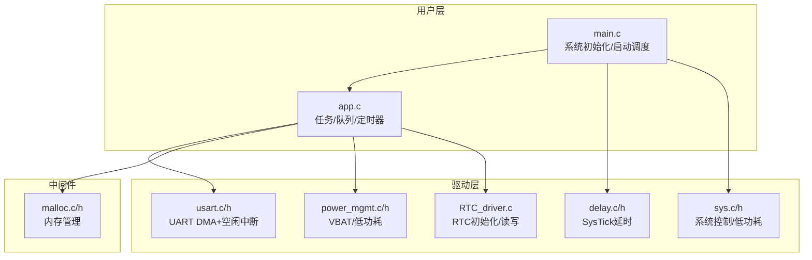
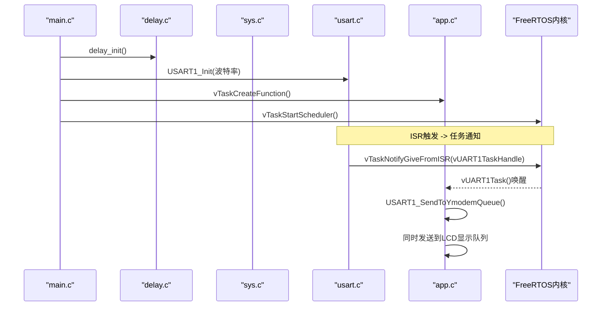
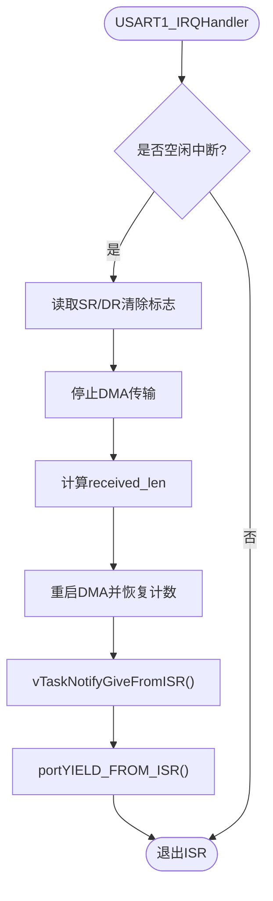
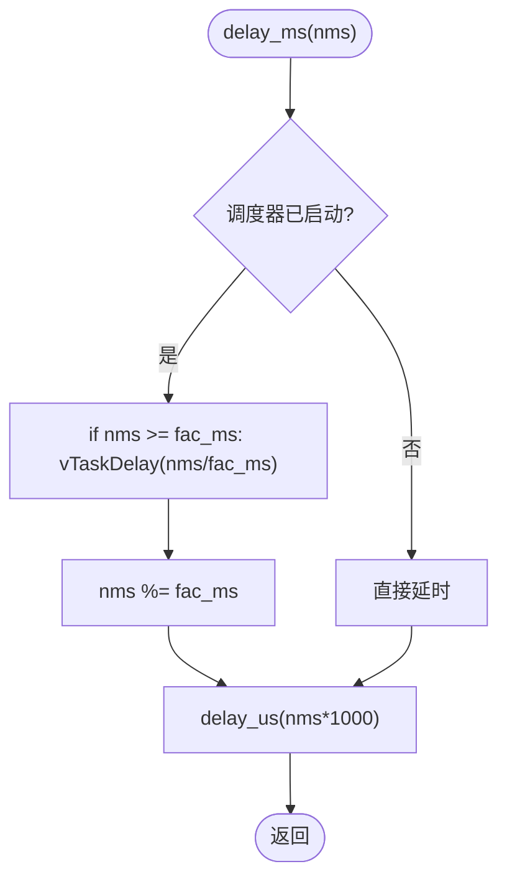
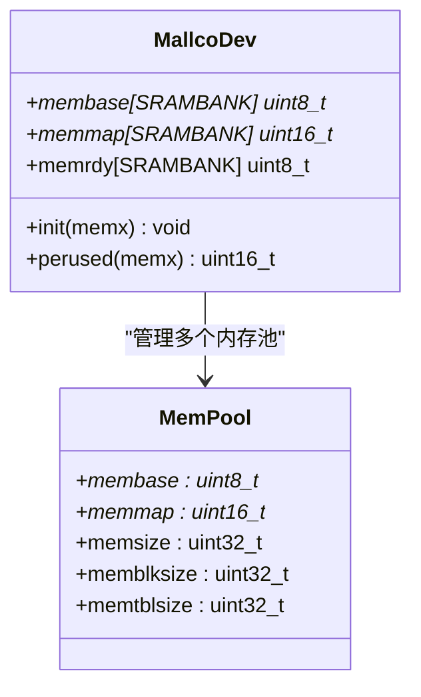
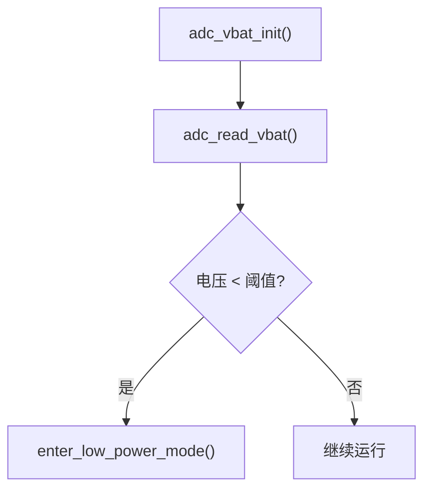
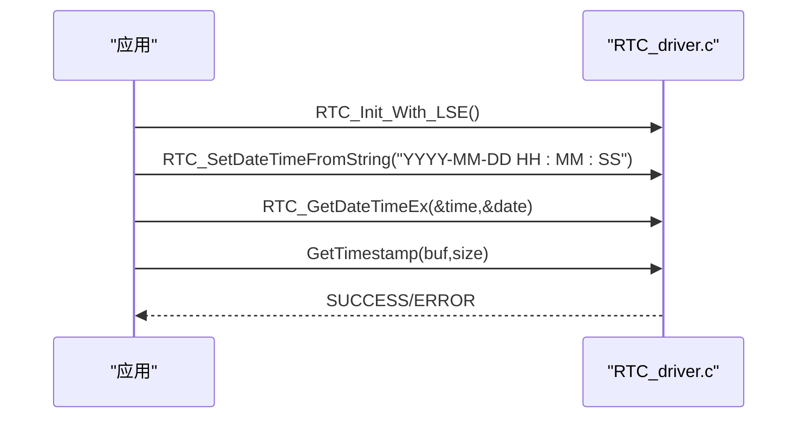
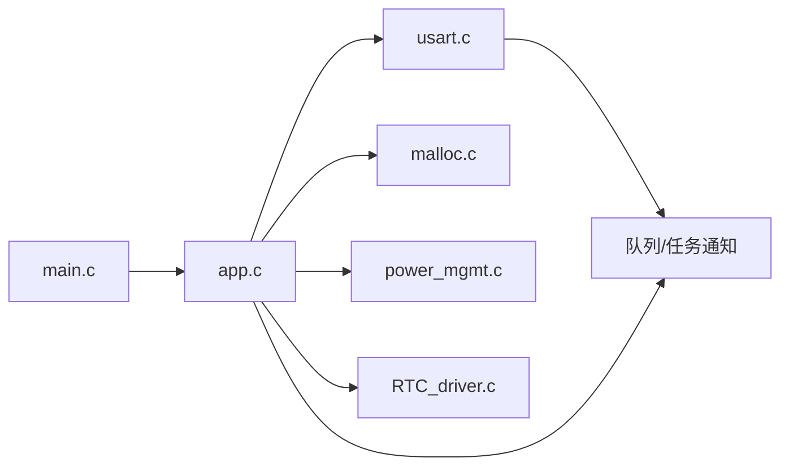

# 系统服务API

<cite>
**本文引用的文件**   
- [usart.c](file://_gbk_backup/Driver/SYSTEM/usart.c)
- [usart.h](file://_gbk_backup/Driver/SYSTEM/usart.h)
- [delay.c](file://_gbk_backup/Driver/SYSTEM/delay.c)
- [delay.h](file://_gbk_backup/Driver/SYSTEM/delay.h)
- [sys.c](file://_gbk_backup/Driver/SYSTEM/sys.c)
- [sys.h](file://_gbk_backup/Driver/SYSTEM/sys.h)
- [power_mgmt.c](file://_gbk_backup/Driver/BSP/power_mgmt.c)
- [power_mgmt.h](file://_gbk_backup/Driver/BSP/power_mgmt.h)
- [RTC_driver.c](file://_gbk_backup/Driver/BSP/RTC_driver.c)
- [malloc.c](file://_gbk_backup/Middle/MALLOC/malloc.c)
- [malloc.h](file://_gbk_backup/Middle/MALLOC/malloc.h)
- [app.c](file://_gbk_backup/User/app.c)
- [app.h](file://_gbk_backup/User/app.h)
- [main.c](file://_gbk_backup/User/main.c)
</cite>

## 目录
1. [简介](#简介)
2. [项目结构](#项目结构)
3. [核心组件](#核心组件)
4. [架构总览](#架构总览)
5. [详细组件分析](#详细组件分析)
6. [依赖关系分析](#依赖关系分析)
7. [性能与资源管理](#性能与资源管理)
8. [故障排查指南](#故障排查指南)
9. [结论](#结论)
10. [附录：代码示例路径](#附录：代码示例路径)

## 简介
本文件面向STM32F407 FreeRTOS工程，系统化整理并文档化以下系统服务与工具函数API：
- UART串口通信（DMA+空闲中断+FreeRTOS任务通知）
- 延时函数（SysTick驱动，支持FreeRTOS调度）
- 内存管理（多池块分配器）
- FreeRTOS任务、队列、信号量、定时器使用范式
- 电源管理（VBAT采样、低功耗模式）
- RTC时钟（初始化、读写时间、格式化时间戳）
- 系统监控（任务栈高水位、队列深度等）

目标读者包括嵌入式工程师与有一定C语言基础的开发者，内容从高层到代码级逐步展开，并提供可视化图示与可定位的代码片段路径。

## 项目结构
本项目采用分层组织方式：
- Driver/SYSTEM：系统基础服务（UART、延时、系统控制）
- Driver/BSP：板级外设（电源管理、RTC）
- Middle/MALLOC：内存管理中间件
- User：应用层（任务创建、业务逻辑、系统集成）

图表来源
- [main.c:34-60](file://_gbk_backup/User/main.c#L34-L60)
- [app.c:529-541](file://_gbk_backup/User/app.c#L529-L541)
- [usart.c:101-166](file://_gbk_backup/Driver/SYSTEM/usart.c#L101-L166)
- [delay.c:22-35](file://_gbk_backup/Driver/SYSTEM/delay.c#L22-L35)
- [sys.c:34-93](file://_gbk_backup/Driver/SYSTEM/sys.c#L34-L93)
- [power_mgmt.c:8-81](file://_gbk_backup/Driver/BSP/power_mgmt.c#L8-L81)
- [RTC_driver.c:9-67](file://_gbk_backup/Driver/BSP/RTC_driver.c#L9-L67)
- [malloc.c:28-51](file://_gbk_backup/Middle/MALLOC/malloc.c#L28-L51)

章节来源
- [main.c:34-60](file://_gbk_backup/User/main.c#L34-L60)
- [app.c:529-541](file://_gbk_backup/User/app.c#L529-L541)

## 核心组件
本节概述各子系统对外暴露的API职责与调用约定，便于快速查阅。

- UART串口通信
  - 初始化与发送：USART1_Init()、USART1_SendByte()、USART1_SendString()
  - 接收机制：DMA循环接收 + 空闲中断 + 任务通知；vUART1Task()处理数据分发
  - Ymodem命令识别：USART1_IsYmodemCommand()
  - 关键常量：DMA_RX_BUFFER_SIZE、USART_MODE_CAN

- 延时函数
  - delay_init()：配置SysTick与FreeRTOS Tick
  - delay_us()/delay_ms()/delay_xms()：微秒/毫秒延时，支持OS调度

- 内存管理
  - my_mem_init()：初始化指定内存池
  - mymalloc()/myfree()/myrealloc()：分配/释放/扩容
  - my_mem_perused()：统计内存使用率

- 电源管理
  - adc_vbat_init()/adc_read_vbat()：VBAT通道ADC初始化与读取
  - enter_low_power_mode()：进入Stop/Standby低功耗模式

- RTC时钟
  - RTC_Init_With_LSE()：基于LSE初始化RTC
  - RTC_SetDateTimeEx()/RTC_GetDateTimeEx()：设置/获取时间与日期
  - RTC_SetDateTimeFromString()：字符串解析设置时间
  - GetTimestamp()：生成“HH:MM:SS.mmm”格式时间戳

- 系统控制
  - sys_wfi_set()/sys_intx_disable()/sys_intx_enable()：WFI/关中断/开中断
  - sys_standby()/sys_soft_reset()：待机/软复位

章节来源
- [usart.h:13-35](file://_gbk_backup/Driver/SYSTEM/usart.h#L13-L35)
- [usart.c:84-90](file://_gbk_backup/Driver/SYSTEM/usart.c#L84-L90)
- [usart.c:101-166](file://_gbk_backup/Driver/SYSTEM/usart.c#L101-L166)
- [usart.c:184-205](file://_gbk_backup/Driver/SYSTEM/usart.c#L184-L205)
- [usart.c:213-244](file://_gbk_backup/Driver/SYSTEM/usart.c#L213-L244)
- [usart.c:251-283](file://_gbk_backup/Driver/SYSTEM/usart.c#L251-L283)
- [usart.c:286-301](file://_gbk_backup/Driver/SYSTEM/usart.c#L286-L301)
- [delay.h:6-9](file://_gbk_backup/Driver/SYSTEM/delay.h#L6-L9)
- [delay.c:22-35](file://_gbk_backup/Driver/SYSTEM/delay.c#L22-L35)
- [delay.c:38-79](file://_gbk_backup/Driver/SYSTEM/delay.c#L38-L79)
- [malloc.h:34-78](file://_gbk_backup/Middle/MALLOC/malloc.h#L34-L78)
- [malloc.c:85-109](file://_gbk_backup/Middle/MALLOC/malloc.c#L85-L109)
- [malloc.c:119-159](file://_gbk_backup/Middle/MALLOC/malloc.c#L119-L159)
- [malloc.c:171-194](file://_gbk_backup/Middle/MALLOC/malloc.c#L171-L194)
- [malloc.c:202-258](file://_gbk_backup/Middle/MALLOC/malloc.c#L202-L258)
- [power_mgmt.h:6-10](file://_gbk_backup/Driver/BSP/power_mgmt.h#L6-L10)
- [power_mgmt.c:8-63](file://_gbk_backup/Driver/BSP/power_mgmt.c#L8-L63)
- [power_mgmt.c:66-81](file://_gbk_backup/Driver/BSP/power_mgmt.c#L66-L81)
- [RTC_driver.c:9-67](file://_gbk_backup/Driver/BSP/RTC_driver.c#L9-L67)
- [RTC_driver.c:75-100](file://_gbk_backup/Driver/BSP/RTC_driver.c#L75-L100)
- [RTC_driver.c:108-121](file://_gbk_backup/Driver/BSP/RTC_driver.c#L108-L121)
- [RTC_driver.c:128-172](file://_gbk_backup/Driver/BSP/RTC_driver.c#L128-L172)
- [RTC_driver.c:198-226](file://_gbk_backup/Driver/BSP/RTC_driver.c#L198-L226)
- [sys.h:83-91](file://_gbk_backup/Driver/SYSTEM/sys.h#L83-L91)
- [sys.c:34-93](file://_gbk_backup/Driver/SYSTEM/sys.c#L34-L93)

## 架构总览
下图展示系统初始化与任务调度的整体流程，以及UART接收的数据流向。

图表来源
- [main.c:34-60](file://_gbk_backup/User/main.c#L34-L60)
- [delay.c:22-35](file://_gbk_backup/Driver/SYSTEM/delay.c#L22-L35)
- [usart.c:101-166](file://_gbk_backup/Driver/SYSTEM/usart.c#L101-L166)
- [usart.c:184-205](file://_gbk_backup/Driver/SYSTEM/usart.c#L184-L205)
- [usart.c:251-283](file://_gbk_backup/Driver/SYSTEM/usart.c#L251-L283)
- [app.c:529-541](file://_gbk_backup/User/app.c#L529-L541)

## 详细组件分析

### UART串口通信（DMA+空闲中断+任务通知）
- 初始化流程
  - 使能GPIOA、USART1、DMA2时钟
  - 配置PA9(TX)/PA10(RX)复用功能
  - 配置USART1参数（8N1，收发模式）
  - 配置DMA2 Stream5 Channel4循环接收至dma_rx_buffer
  - 使能USART1 DMA接收与空闲中断，NVIC优先级配置
  - 启用USART1

- 接收与分发
  - 空闲中断服务函数中清除标志、停止DMA、计算received_len、重启DMA
  - 通过vTaskNotifyGiveFromISR()通知vUART1Task()
  - vUART1Task()根据策略将数据推送到ymodem_rx_queue和lcd_display_queue

- 发送接口
  - fputc重定向实现printf输出
  - USART1_SendByte()/USART1_SendString()阻塞式发送

- Ymodem命令检测
  - USART1_IsYmodemCommand()对首词进行大小写归一化并与命令表匹配

图表来源
- [usart.c:184-205](file://_gbk_backup/Driver/SYSTEM/usart.c#L184-L205)

章节来源
- [usart.c:101-166](file://_gbk_backup/Driver/SYSTEM/usart.c#L101-L166)
- [usart.c:184-205](file://_gbk_backup/Driver/SYSTEM/usart.c#L184-L205)
- [usart.c:213-244](file://_gbk_backup/Driver/SYSTEM/usart.c#L213-L244)
- [usart.c:251-283](file://_gbk_backup/Driver/SYSTEM/usart.c#L251-L283)
- [usart.c:286-301](file://_gbk_backup/Driver/SYSTEM/usart.c#L286-L301)
- [usart.h:13-35](file://_gbk_backup/Driver/SYSTEM/usart.h#L13-L35)

### 延时函数（SysTick与FreeRTOS集成）
- delay_init()
  - 选择HCLK为SysTick源
  - 计算fac_us/fac_ms，配置SysTick周期与中断
- delay_us()
  - 基于SysTick计数器轮询精确延时
- delay_ms()
  - 若调度器已启动且nms>=fac_ms，则调用vTaskDelay()避免忙等
  - 剩余部分用delay_us()完成
- delay_xms()
  - 纯忙等延时，不触发任务调度

图表来源
- [delay.c:22-35](file://_gbk_backup/Driver/SYSTEM/delay.c#L22-L35)
- [delay.c:38-79](file://_gbk_backup/Driver/SYSTEM/delay.c#L38-L79)

章节来源
- [delay.h:6-9](file://_gbk_backup/Driver/SYSTEM/delay.h#L6-L9)
- [delay.c:22-35](file://_gbk_backup/Driver/SYSTEM/delay.c#L22-L35)
- [delay.c:38-79](file://_gbk_backup/Driver/SYSTEM/delay.c#L38-L79)

### 内存管理（多池块分配器）
- 内存池布局
  - SRAMIN内部SRAM池、SRAMCCM仅CPU访问池、SRAMEX外部SRAM池
  - 每池维护membase（数据区）、memmap（状态表）、memsize（总大小）、memblksize（块大小）、memtblsize（表项数）
- 关键API
  - my_mem_init(memx)：清零状态表与数据区，标记就绪
  - my_mem_malloc(memx,size)：按块粒度搜索连续空闲块，更新memmap
  - my_mem_free(memx,offset)：根据偏移反查块数并清零memmap
  - mymalloc()/myfree()/myrealloc()：对外封装，返回实际指针或NULL
  - my_mem_perused(memx)：统计已占用块比例

图表来源
- [malloc.h:56-78](file://_gbk_backup/Middle/MALLOC/malloc.h#L56-L78)
- [malloc.c:28-51](file://_gbk_backup/Middle/MALLOC/malloc.c#L28-L51)

章节来源
- [malloc.h:34-78](file://_gbk_backup/Middle/MALLOC/malloc.h#L34-L78)
- [malloc.c:85-109](file://_gbk_backup/Middle/MALLOC/malloc.c#L85-L109)
- [malloc.c:119-159](file://_gbk_backup/Middle/MALLOC/malloc.c#L119-L159)
- [malloc.c:171-194](file://_gbk_backup/Middle/MALLOC/malloc.c#L171-L194)
- [malloc.c:202-258](file://_gbk_backup/Middle/MALLOC/malloc.c#L202-L258)

### 电源管理与低功耗
- VBAT ADC
  - adc_vbat_init()：配置ADC1公共参数与VBAT通道
  - adc_read_vbat()：单次转换，换算为mV
- 低功耗模式
  - enter_low_power_mode()：关闭LCD背光/显示，使能WKUP唤醒，清除标志后进入Stop/Standby

图表来源
- [power_mgmt.c:8-63](file://_gbk_backup/Driver/BSP/power_mgmt.c#L8-L63)
- [power_mgmt.c:66-81](file://_gbk_backup/Driver/BSP/power_mgmt.c#L66-L81)
- [power_mgmt.h:6-10](file://_gbk_backup/Driver/BSP/power_mgmt.h#L6-L10)

章节来源
- [power_mgmt.c:8-63](file://_gbk_backup/Driver/BSP/power_mgmt.c#L8-L63)
- [power_mgmt.c:66-81](file://_gbk_backup/Driver/BSP/power_mgmt.c#L66-L81)
- [power_mgmt.h:6-10](file://_gbk_backup/Driver/BSP/power_mgmt.h#L6-L10)

### RTC时钟
- 初始化
  - RTC_Init_With_LSE()：使能PWR/BKPSRAM，允许备份域访问，配置LSE，选择RTC时钟源，解除写保护，配置预分频，退出初始化模式，恢复写保护，写入标记位
- 设置/获取时间
  - RTC_SetDateTimeEx()/RTC_GetDateTimeEx()：带参数有效性检查与写保护开关
- 字符串设置
  - RTC_SetDateTimeFromString()：解析“YYYY-MM-DD HH:MM:SS”，转换为RTC结构体并设置
- 时间戳格式化
  - GetTimestamp()：读取RTC时间与亚秒，计算毫秒，输出“HH:MM:SS.mmm”

图表来源
- [RTC_driver.c:9-67](file://_gbk_backup/Driver/BSP/RTC_driver.c#L9-L67)
- [RTC_driver.c:75-100](file://_gbk_backup/Driver/BSP/RTC_driver.c#L75-L100)
- [RTC_driver.c:108-121](file://_gbk_backup/Driver/BSP/RTC_driver.c#L108-L121)
- [RTC_driver.c:128-172](file://_gbk_backup/Driver/BSP/RTC_driver.c#L128-L172)
- [RTC_driver.c:198-226](file://_gbk_backup/Driver/BSP/RTC_driver.c#L198-L226)

章节来源
- [RTC_driver.c:9-67](file://_gbk_backup/Driver/BSP/RTC_driver.c#L9-L67)
- [RTC_driver.c:75-100](file://_gbk_backup/Driver/BSP/RTC_driver.c#L75-L100)
- [RTC_driver.c:108-121](file://_gbk_backup/Driver/BSP/RTC_driver.c#L108-L121)
- [RTC_driver.c:128-172](file://_gbk_backup/Driver/BSP/RTC_driver.c#L128-L172)
- [RTC_driver.c:198-226](file://_gbk_backup/Driver/BSP/RTC_driver.c#L198-L226)

### 系统控制与监控
- 系统控制
  - sys_wfi_set()/sys_intx_disable()/sys_intx_enable()：汇编指令封装
  - sys_standby()/sys_soft_reset()：进入待机/软复位
- 任务监控
  - vTaskMonitor()：打印任务列表与特定任务最小栈空间
  - 按键触发打印任务栈信息

章节来源
- [sys.h:83-91](file://_gbk_backup/Driver/SYSTEM/sys.h#L83-L91)
- [sys.c:34-93](file://_gbk_backup/Driver/SYSTEM/sys.c#L34-L93)
- [app.c:74-91](file://_gbk_backup/User/app.c#L74-L91)
- [app.c:370-412](file://_gbk_backup/User/app.c#L370-L412)

## 依赖关系分析
- main.c负责全局对象与队列/互斥量的创建，并启动任务调度
- app.c集中创建任务，串联UART、SD卡、LCD、BMS记录、Ymodem协议等模块
- usart.c依赖FreeRTOS队列与任务通知，向ymodem与lcd队列分发数据
- power_mgmt.c与RTC_driver.c被app.c用于电池监测与时序记录
- malloc.c提供跨任务共享的动态内存分配能力

图表来源
- [main.c:34-60](file://_gbk_backup/User/main.c#L34-L60)
- [app.c:529-541](file://_gbk_backup/User/app.c#L529-L541)
- [usart.c:251-283](file://_gbk_backup/Driver/SYSTEM/usart.c#L251-L283)

章节来源
- [main.c:34-60](file://_gbk_backup/User/main.c#L34-L60)
- [app.c:529-541](file://_gbk_backup/User/app.c#L529-L541)
- [usart.c:251-283](file://_gbk_backup/Driver/SYSTEM/usart.c#L251-L283)

## 性能与资源管理
- UART接收
  - 使用DMA循环接收+空闲中断，降低CPU占用
  - 通过任务通知避免在中断中进行复杂处理
  - 建议合理设置DMA_RX_BUFFER_SIZE与队列深度，防止溢出
- 延时与调度
  - delay_ms()在OS环境下优先使用vTaskDelay，减少忙等
  - 短延时使用delay_us()保证精度
- 内存管理
  - 按块粒度分配，减少碎片；对外提供myrealloc以安全扩容
  - 使用my_mem_perused()定期评估内存压力
- 电源管理
  - 低电量时及时进入低功耗模式，延长续航
  - 注意在进入低功耗前清空队列/刷新外设状态
- 任务监控
  - 使用vTaskList()与uxTaskGetStackHighWaterMark()评估栈使用
  - 针对高频任务（如LCD显示）关注队列积压情况

[本节为通用指导，无需具体文件引用]

## 故障排查指南
- UART无数据或乱码
  - 检查USART1_Init()引脚映射与波特率配置
  - 确认DMA与空闲中断已正确使能
  - 验证vUART1Task()是否被创建且收到任务通知
  - 参考：[usart.c:101-166](file://_gbk_backup/Driver/SYSTEM/usart.c#L101-L166)、[usart.c:184-205](file://_gbk_backup/Driver/SYSTEM/usart.c#L184-L205)
- printf无输出
  - 确认fputc重定向已启用
  - 参考：[usart.c:84-90](file://_gbk_backup/Driver/SYSTEM/usart.c#L84-L90)
- 延时不准或卡顿
  - 检查delay_init()是否正确配置SysTick
  - 在OS环境下使用delay_ms()而非busy-wait
  - 参考：[delay.c:22-35](file://_gbk_backup/Driver/SYSTEM/delay.c#L22-L35)、[delay.c:60-71](file://_gbk_backup/Driver/SYSTEM/delay.c#L60-L71)
- 内存泄漏或分配失败
  - 确保每次mymalloc()都有对应的myfree()
  - 使用my_mem_perused()监控内存使用率
  - 参考：[malloc.c:202-258](file://_gbk_backup/Middle/MALLOC/malloc.c#L202-L258)、[malloc.c:97-109](file://_gbk_backup/Middle/MALLOC/malloc.c#L97-L109)
- 无法进入低功耗
  - 检查WKUP唤醒引脚与标志清除
  - 确认进入模式前外设状态符合预期
  - 参考：[power_mgmt.c:66-81](file://_gbk_backup/Driver/BSP/power_mgmt.c#L66-L81)
- RTC时间不正确
  - 检查LSE是否就绪与写保护状态
  - 确认字符串格式与年份偏移
  - 参考：[RTC_driver.c:9-67](file://_gbk_backup/Driver/BSP/RTC_driver.c#L9-L67)、[RTC_driver.c:128-172](file://_gbk_backup/Driver/BSP/RTC_driver.c#L128-L172)

章节来源
- [usart.c:84-90](file://_gbk_backup/Driver/SYSTEM/usart.c#L84-L90)
- [usart.c:101-166](file://_gbk_backup/Driver/SYSTEM/usart.c#L101-L166)
- [usart.c:184-205](file://_gbk_backup/Driver/SYSTEM/usart.c#L184-L205)
- [delay.c:22-35](file://_gbk_backup/Driver/SYSTEM/delay.c#L22-L35)
- [delay.c:60-71](file://_gbk_backup/Driver/SYSTEM/delay.c#L60-L71)
- [malloc.c:97-109](file://_gbk_backup/Middle/MALLOC/malloc.c#L97-L109)
- [malloc.c:202-258](file://_gbk_backup/Middle/MALLOC/malloc.c#L202-L258)
- [power_mgmt.c:66-81](file://_gbk_backup/Driver/BSP/power_mgmt.c#L66-L81)
- [RTC_driver.c:9-67](file://_gbk_backup/Driver/BSP/RTC_driver.c#L9-L67)
- [RTC_driver.c:128-172](file://_gbk_backup/Driver/BSP/RTC_driver.c#L128-L172)

## 结论
本系统服务API围绕UART、延时、内存管理、电源管理、RTC与FreeRTOS任务/队列/同步机制构建，形成稳定可靠的嵌入式软件基座。通过DMA+空闲中断的任务通知机制、SysTick驱动的延时、多池块内存分配器与完善的低功耗/RTC支持，可满足数据采集、存储、交互与运维监控等多场景需求。建议在工程中结合任务监控与内存使用率评估，持续优化队列深度与内存分配策略，以获得更优的性能与稳定性。

[本节为总结性内容，无需具体文件引用]

## 附录：代码示例路径
- UART初始化与发送
  - [USART1_Init:101-166](file://_gbk_backup/Driver/SYSTEM/usart.c#L101-L166)
  - [USART1_SendByte/USART1_SendString:286-301](file://_gbk_backup/Driver/SYSTEM/usart.c#L286-L301)
- UART接收与任务分发
  - [USART1_IRQHandler:184-205](file://_gbk_backup/Driver/SYSTEM/usart.c#L184-L205)
  - [vUART1Task:269-283](file://_gbk_backup/Driver/SYSTEM/usart.c#L269-L283)
  - [USART1_IsYmodemCommand:213-244](file://_gbk_backup/Driver/SYSTEM/usart.c#L213-L244)
- 延时函数
  - [delay_init:22-35](file://_gbk_backup/Driver/SYSTEM/delay.c#L22-L35)
  - [delay_us/delay_ms/delay_xms:38-79](file://_gbk_backup/Driver/SYSTEM/delay.c#L38-L79)
- 内存管理
  - [my_mem_init:85-90](file://_gbk_backup/Middle/MALLOC/malloc.c#L85-L90)
  - [my_mem_malloc:119-159](file://_gbk_backup/Middle/MALLOC/malloc.c#L119-L159)
  - [my_mem_free:171-194](file://_gbk_backup/Middle/MALLOC/malloc.c#L171-L194)
  - [mymalloc/myfree/myrealloc:202-258](file://_gbk_backup/Middle/MALLOC/malloc.c#L202-L258)
- 电源管理
  - [adc_vbat_init/adc_read_vbat:8-63](file://_gbk_backup/Driver/BSP/power_mgmt.c#L8-L63)
  - [enter_low_power_mode:66-81](file://_gbk_backup/Driver/BSP/power_mgmt.c#L66-L81)
- RTC时钟
  - [RTC_Init_With_LSE:9-67](file://_gbk_backup/Driver/BSP/RTC_driver.c#L9-L67)
  - [RTC_SetDateTimeEx/RTC_GetDateTimeEx:75-121](file://_gbk_backup/Driver/BSP/RTC_driver.c#L75-L121)
  - [RTC_SetDateTimeFromString:128-172](file://_gbk_backup/Driver/BSP/RTC_driver.c#L128-L172)
  - [GetTimestamp:198-226](file://_gbk_backup/Driver/BSP/RTC_driver.c#L198-L226)
- 系统控制
  - [sys_wfi_set/sys_intx_disable/sys_intx_enable:34-57](file://_gbk_backup/Driver/SYSTEM/sys.c#L34-L57)
  - [sys_standby/sys_soft_reset:75-93](file://_gbk_backup/Driver/SYSTEM/sys.c#L75-L93)
- FreeRTOS任务/队列/定时器
  - [vTaskCreateFunction:529-541](file://_gbk_backup/User/app.c#L529-L541)
  - [vLEDTimerCallback/vLED1Task:155-198](file://_gbk_backup/User/app.c#L155-L198)
  - [vKeyScanTask/vKeyProcessTask:94-152](file://_gbk_backup/User/app.c#L94-L152)
  - [BMS27930_RecordTask/SDCard_WriteTask:201-366](file://_gbk_backup/User/app.c#L201-L366)
  - [vLCDDisplayTask:454-521](file://_gbk_backup/User/app.c#L454-L521)
  - [vTaskMonitor:74-91](file://_gbk_backup/User/app.c#L74-L91)
- 主程序入口
  - [main:34-60](file://_gbk_backup/User/main.c#L34-L60)