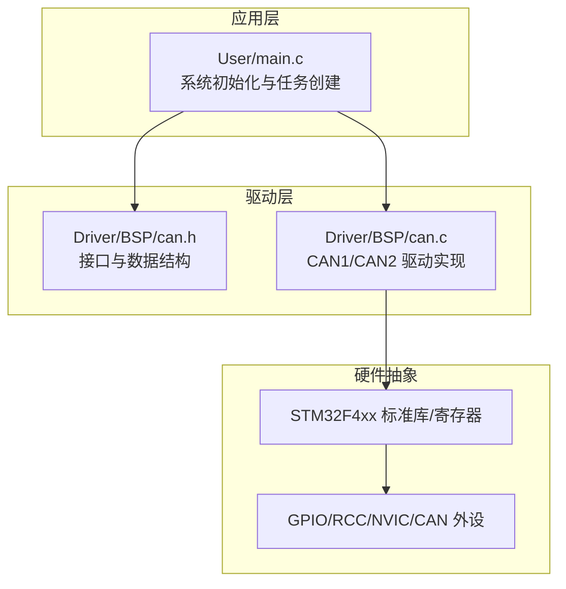
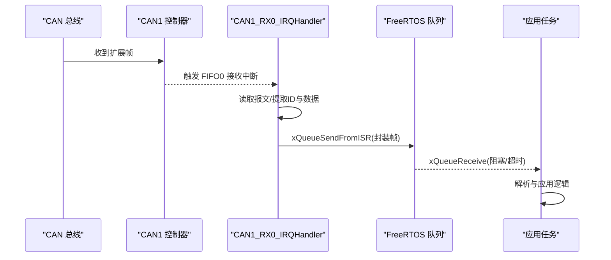
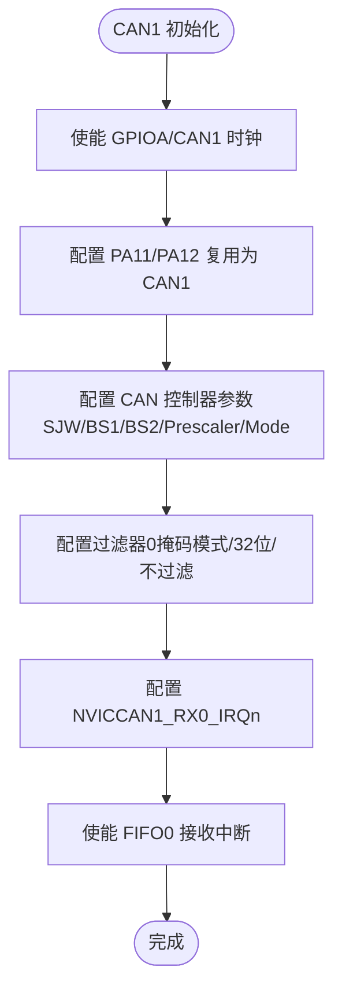
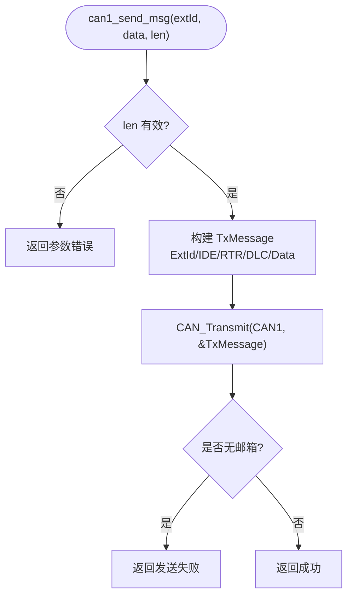
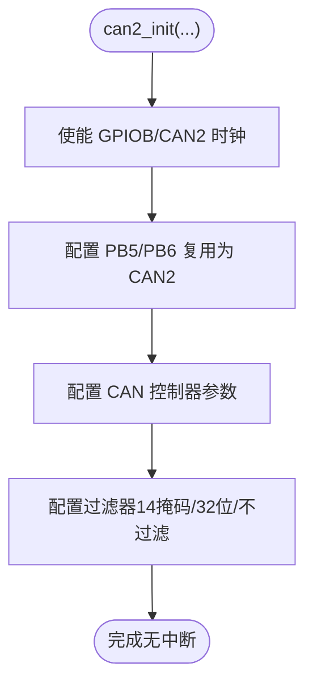
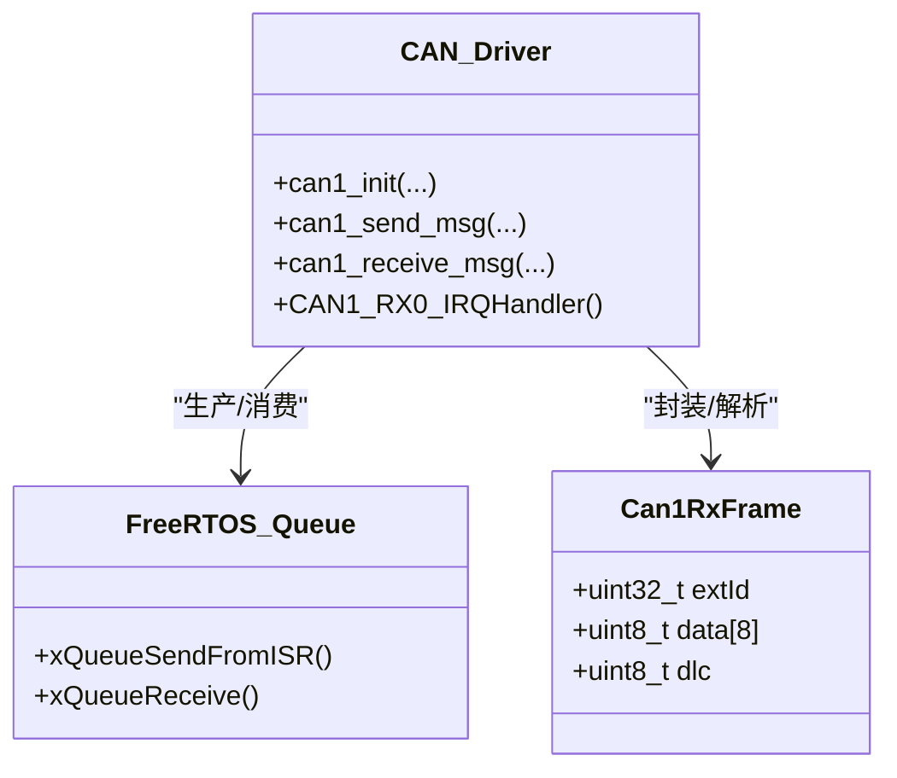
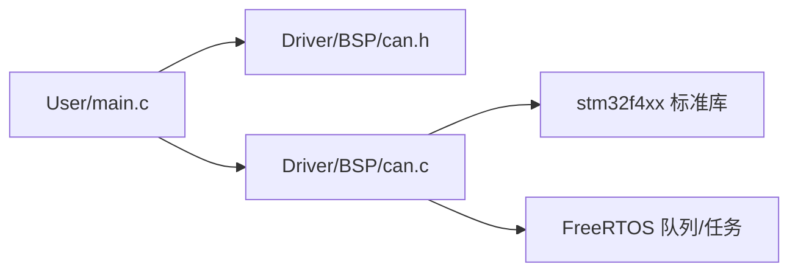

# CAN总线通信系统

<cite>
**本文引用的文件**   
- [can.c](file://_gbk_backup/Driver/BSP/can.c)
- [can.h](file://_gbk_backup/Driver/BSP/can.h)
- [main.c](file://_gbk_backup/User/main.c)
</cite>

## 目录
1. [简介](#简介)
2. [项目结构](#项目结构)
3. [核心组件](#核心组件)
4. [架构总览](#架构总览)
5. [详细组件分析](#详细组件分析)
6. [依赖关系分析](#依赖关系分析)
7. [性能与优化](#性能与优化)
8. [故障排查与诊断](#故障排查与诊断)
9. [结论](#结论)
10. [附录：物理层与电气特性](#附录物理层与电气特性)

## 简介
本技术文档面向基于 STM32F407 的 CAN 总线通信系统，围绕 CAN1/CAN2 控制器配置、波特率与时序参数、过滤器与中断使能、标准帧/扩展帧处理、中断驱动的接收机制、数据队列实现、以及物理层连接与诊断方法进行系统化说明。代码采用 STM32 标准外设库 + FreeRTOS，CAN1 使用中断接收并通过队列将报文交给任务消费；CAN2 当前仅用于发送（无中断）。

## 项目结构
本项目中与 CAN 相关的核心文件位于 Driver/BSP 与 User 目录：
- Driver/BSP/can.c：CAN1/CAN2 驱动实现（初始化、发送、中断接收、队列集成）
- Driver/BSP/can.h：CAN 接口定义、数据结构与全局句柄声明
- User/main.c：系统初始化入口，创建 FreeRTOS 任务与队列，调用 CAN 初始化

图表来源
- [main.c:34-59](file://_gbk_backup/User/main.c#L34-L59)
- [can.h:1-55](file://_gbk_backup/Driver/BSP/can.h#L1-L55)
- [can.c:1-342](file://_gbk_backup/Driver/BSP/can.c#L1-L342)

章节来源
- [main.c:34-59](file://_gbk_backup/User/main.c#L34-L59)
- [can.h:1-55](file://_gbk_backup/Driver/BSP/can.h#L1-L55)
- [can.c:1-342](file://_gbk_backup/Driver/BSP/can.c#L1-L342)

## 核心组件
- CAN1 驱动
  - 初始化：时钟、GPIO、CAN 控制器参数、过滤器、NVIC、FIFO0 接收中断
  - 发送：固定扩展帧发送 API
  - 接收：中断服务函数将报文入队，任务侧通过队列阻塞/非阻塞读取
- CAN2 驱动
  - 初始化：时钟、GPIO、CAN 控制器参数、过滤器（未启用中断）
  - 发送：固定扩展帧发送 API
- FreeRTOS 集成
  - 队列：CAN1 接收队列，深度可配置
  - 中断优先级：满足 FreeRTOS 要求的中断优先级设置

章节来源
- [can.c:40-106](file://_gbk_backup/Driver/BSP/can.c#L40-L106)
- [can.c:116-179](file://_gbk_backup/Driver/BSP/can.c#L116-L179)
- [can.c:186-224](file://_gbk_backup/Driver/BSP/can.c#L186-L224)
- [can.c:245-303](file://_gbk_backup/Driver/BSP/can.c#L245-L303)
- [can.c:312-341](file://_gbk_backup/Driver/BSP/can.c#L312-L341)
- [can.h:17-41](file://_gbk_backup/Driver/BSP/can.h#L17-L41)
- [main.c:50-55](file://_gbk_backup/User/main.c#L50-L55)

## 架构总览
下图展示从硬件到应用的完整数据流：CAN 总线报文进入 CAN1 控制器，触发 FIFO0 接收中断，ISR 将报文封装后发送到 FreeRTOS 队列，应用任务从队列中取出并处理。

图表来源
- [can.c:186-224](file://_gbk_backup/Driver/BSP/can.c#L186-L224)
- [can.c:116-141](file://_gbk_backup/Driver/BSP/can.c#L116-L141)

## 详细组件分析

### CAN1 控制器配置与中断接收
- 时钟与 GPIO
  - 使能 GPIOA 与 CAN1 时钟
  - PA11(RX)/PA12(TX) 复用为 CAN1，推挽输出，上拉
- CAN 控制器参数
  - 关闭时间触发、手动离线、手动唤醒
  - 自动重传开启，报文不锁定，发送优先级由 ID 决定
  - SJW/BS1/BS2/Prescaler 由参数传入，内部减一
  - 工作模式支持普通/回环/静默等
- 过滤器
  - 使用过滤器0，掩码模式，32位宽，不过滤（匹配所有扩展帧），关联 FIFO0
- NVIC 与中断
  - 配置 CAN1_RX0_IRQn，抢占优先级5（满足 FreeRTOS 要求）
  - 使能 FIFO0 接收中断
- 中断服务函数
  - 检查 FIFO0 标志，读取报文，复制扩展ID与数据
  - 通过 xQueueSendFromISR 将帧送入队列，若队列满则丢包计数+1
  - 清除中断挂起标志，必要时请求任务切换

图表来源
- [can.c:40-106](file://_gbk_backup/Driver/BSP/can.c#L40-L106)

章节来源
- [can.c:40-106](file://_gbk_backup/Driver/BSP/can.c#L40-L106)
- [can.c:186-224](file://_gbk_backup/Driver/BSP/can.c#L186-L224)

### CAN1 发送与接收 API
- 发送 API
  - 固定扩展帧发送，校验长度与指针有效性
  - 填充 TxMessage（ExtId/IDE/RTR/DLC/Data），调用 CAN_Transmit
  - 返回码：成功/参数错误/无可用邮箱
- 接收 API
  - 从 FreeRTOS 队列阻塞/非阻塞读取 Can1RxFrame
  - 拷贝 DLC 字节到用户缓冲区，返回实际长度或0（超时/空）

图表来源
- [can.c:150-179](file://_gbk_backup/Driver/BSP/can.c#L150-L179)

章节来源
- [can.c:150-179](file://_gbk_backup/Driver/BSP/can.c#L150-L179)
- [can.c:116-141](file://_gbk_backup/Driver/BSP/can.c#L116-L141)

### CAN2 控制器配置与发送
- 时钟与 GPIO
  - 使能 GPIOB 与 CAN2 时钟
  - PB5(RX)/PB6(TX) 复用为 CAN2，推挽输出，上拉
- CAN 控制器参数
  - 同 CAN1 的参数结构与时序计算方式
- 过滤器
  - 使用过滤器14，掩码模式，32位宽，不过滤，关联 FIFO0
- 中断
  - 未配置中断，仅用于发送

图表来源
- [can.c:245-303](file://_gbk_backup/Driver/BSP/can.c#L245-L303)

章节来源
- [can.c:245-303](file://_gbk_backup/Driver/BSP/can.c#L245-L303)
- [can.c:312-341](file://_gbk_backup/Driver/BSP/can.c#L312-L341)

### FreeRTOS 队列与高优先级数据处理
- 队列定义
  - can1_rx_queue：类型为 Can1RxFrame，深度可配置（默认10）
- 生产者-消费者模型
  - 生产者：CAN1_RX0_IRQHandler 在中断中将帧入队
  - 消费者：应用任务调用 can1_receive_msg 阻塞/非阻塞取帧
- 丢包保护
  - 队列满时记录丢包计数，便于监控与告警

图表来源
- [can.h:21-41](file://_gbk_backup/Driver/BSP/can.h#L21-L41)
- [can.c:18-19](file://_gbk_backup/Driver/BSP/can.c#L18-L19)
- [can.c:116-141](file://_gbk_backup/Driver/BSP/can.c#L116-L141)
- [can.c:186-224](file://_gbk_backup/Driver/BSP/can.c#L186-L224)

章节来源
- [can.h:17-41](file://_gbk_backup/Driver/BSP/can.h#L17-L41)
- [can.c:18-19](file://_gbk_backup/Driver/BSP/can.c#L18-L19)
- [can.c:116-141](file://_gbk_backup/Driver/BSP/can.c#L116-L141)
- [can.c:186-224](file://_gbk_backup/Driver/BSP/can.c#L186-L224)

### 标准帧与扩展帧处理
- 当前实现
  - 注释与发送 API 均固定使用扩展帧（IDE=Extended）
  - 过滤器配置为“不过滤”，但 ISR 中仅提取 ExtId，隐含只处理扩展帧
- 建议
  - 如需支持标准帧，可在 ISR 中根据 IDE 字段分支处理，并在过滤器中按需求配置标准/扩展过滤规则

章节来源
- [can.c:150-179](file://_gbk_backup/Driver/BSP/can.c#L150-L179)
- [can.c:186-224](file://_gbk_backup/Driver/BSP/can.c#L186-L224)

## 依赖关系分析
- 模块耦合
  - main.c 依赖 can.h 暴露的接口与全局队列句柄
  - can.c 依赖 stm32f4xx 标准库与 FreeRTOS 队列/任务 API
- 外部依赖
  - STM32F4xx 标准库：RCC/GPIO/CAN/NVIC 等
  - FreeRTOS：队列、任务调度、中断安全 API

图表来源
- [main.c:1-20](file://_gbk_backup/User/main.c#L1-L20)
- [can.h:1-55](file://_gbk_backup/Driver/BSP/can.h#L1-L55)
- [can.c:11-15](file://_gbk_backup/Driver/BSP/can.c#L11-L15)

章节来源
- [main.c:1-20](file://_gbk_backup/User/main.c#L1-L20)
- [can.h:1-55](file://_gbk_backup/Driver/BSP/can.h#L1-L55)
- [can.c:11-15](file://_gbk_backup/Driver/BSP/can.c#L11-L15)

## 性能与优化
- 波特率与时序
  - APB1 时钟 42MHz，波特率 = 42M / ((SJW + BS1 + BS2) * Prescaler)
  - 合理选择 SJW/BS1/BS2 以平衡采样点与同步能力
- 队列深度与丢包
  - 增大 CAN1_RX_QUEUE_SIZE 可降低丢包概率
  - 监控 can1_rx_lost_count，结合业务负载调整队列深度或提升任务优先级
- 中断优先级
  - 确保 CAN1_RX0_IRQn 的抢占优先级满足 FreeRTOS 要求，避免被更高优先级任务长时间占用
- 发送策略
  - 批量发送前检查邮箱可用性，必要时退避重试
  - 对关键帧提高 ID 优先级（CAN 仲裁由 ID 决定）

章节来源
- [can.c:40-106](file://_gbk_backup/Driver/BSP/can.c#L40-L106)
- [can.c:150-179](file://_gbk_backup/Driver/BSP/can.c#L150-L179)
- [can.c:18-19](file://_gbk_backup/Driver/BSP/can.c#L18-L19)

## 故障排查与诊断
- 常见问题
  - 无法接收：检查过滤器配置、中断使能、GPIO 复用是否正确
  - 频繁丢包：检查队列深度、任务优先级、总线负载
  - 发送失败：检查邮箱是否忙、总线状态、终端电阻与拓扑
- 诊断步骤
  - 使用 CAN 分析仪抓取总线波形与报文，确认 ID、DLC、数据内容
  - 在 ISR 中增加日志（谨慎开销）或使用 LED/调试器观察丢包计数变化
  - 验证波特率与时序一致性（两端设备必须一致）

章节来源
- [can.c:186-224](file://_gbk_backup/Driver/BSP/can.c#L186-L224)
- [can.c:150-179](file://_gbk_backup/Driver/BSP/can.c#L150-L179)

## 结论
该 CAN 通信系统基于 STM32F407 标准库与 FreeRTOS，实现了 CAN1 中断接收 + 队列缓冲 + 任务消费，以及 CAN2 纯发送能力。当前实现聚焦扩展帧，具备清晰的初始化流程、过滤器配置与中断处理机制。通过合理配置时序参数、队列深度与中断优先级，可满足多数工业场景的实时性与可靠性需求。后续可扩展标准帧支持、增强诊断统计与多过滤器管理。

## 附录：物理层与电气特性
- 物理层
  - 典型拓扑：总线型，两端各需 120Ω 终端电阻
  - 线缆：双绞线，屏蔽层单端接地以减少干扰
- 电气特性
  - 电平：差分信号，显性为低电平，隐性为高电平
  - 速率：常见 125kbps~1Mbps，距离与速率成反比
- 连接要点
  - 正确区分 CANH/CANL，避免反接
  - 控制节点数量与总线电容，避免反射与衰减
- 工具与测试
  - 使用 CAN 分析仪（如 Kvaser、PCAN）进行抓包与回放
  - 利用回环模式进行本地自测（注意与实际网络隔离）