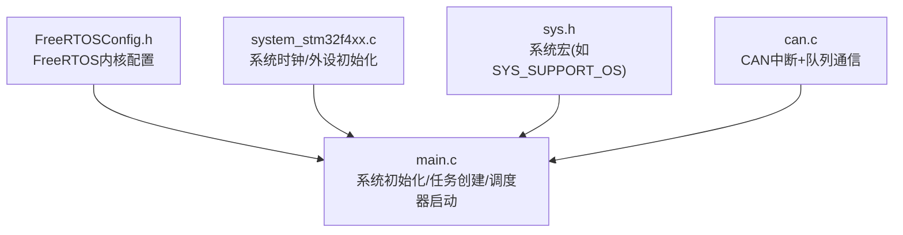
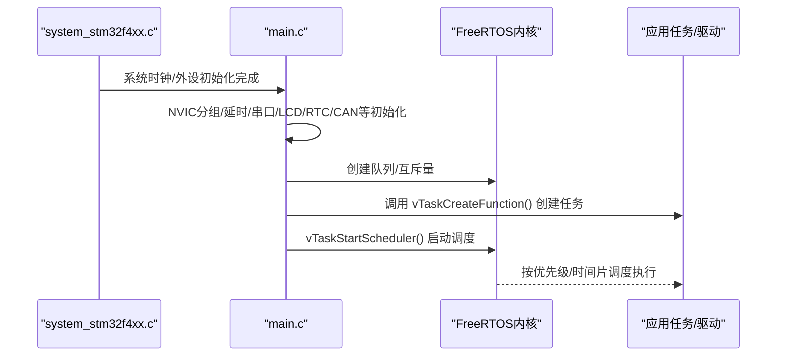
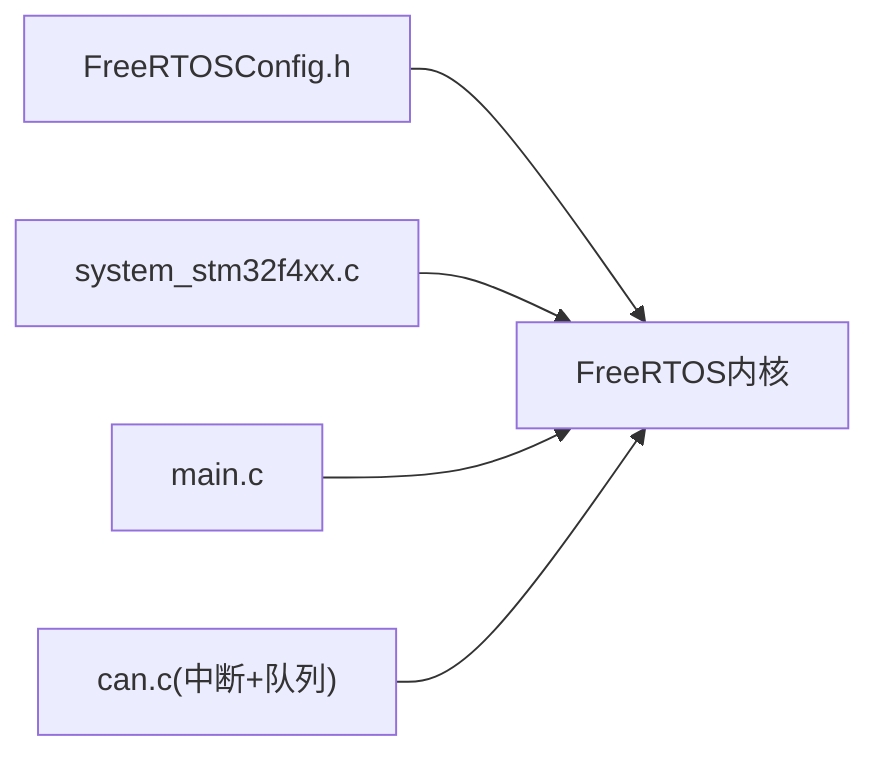

# FreeRTOS内核配置

<cite>
**本文引用的文件**   
- [FreeRTOSConfig.h](file://_gbk_backup/User/FreeRTOSConfig.h)
- [main.c](file://_gbk_backup/User/main.c)
- [sys.h](file://_gbk_backup/Driver/SYSTEM/sys.h)
- [system_stm32f4xx.c](file://_gbk_backup/Driver/CMSIS/system_stm32f4xx.c)
- [CAN驱动 can.c](file://_gbk_backup/Driver/BSP/can.c)
</cite>

## 目录
1. [引言](#引言)
2. [项目结构](#项目结构)
3. [核心组件](#核心组件)
4. [架构总览](#架构总览)
5. [详细组件分析](#详细组件分析)
6. [依赖关系分析](#依赖关系分析)
7. [性能与资源优化](#性能与资源优化)
8. [故障诊断与排错](#故障诊断与排错)
9. [结论](#结论)
10. [附录：STM32F407硬件约束与推荐配置](#附录stm32f407硬件约束与推荐配置)

## 引言
本文面向在 STM32F407 上移植和使用 FreeRTOS 的工程师，系统梳理 FreeRTOSConfig.h 中的全部关键配置项，解释其作用、影响与取舍，并结合本项目的实际使用（任务、队列、互斥量、软件定时器、中断等）给出不同应用场景下的推荐值。同时提供基于 STM32F407 的 RAM/Flash 资源优化建议与常见配置错误的诊断方法。

## 项目结构
本项目为 Keil uVision 工程，目标芯片为 STM32F407ZG，包含用户应用、BSP 驱动、CMSIS 系统初始化以及 FreeRTOS 配置文件。FreeRTOS 相关的关键入口和配置集中在以下文件：
- FreeRTOSConfig.h：FreeRTOS 内核配置
- main.c：系统初始化与任务创建、调度器启动
- system_stm32f4xx.c：系统时钟与外设初始化（含 FPU、RCC、PLL 等）
- sys.h：系统级宏定义（如是否支持 OS）
- CAN 驱动：演示中断+队列的中断生产/任务消费模式

图表来源
- [FreeRTOSConfig.h:1-125](file://_gbk_backup/User/FreeRTOSConfig.h#L1-L125)
- [main.c:34-60](file://_gbk_backup/User/main.c#L34-L60)
- [system_stm32f4xx.c:476-760](file://_gbk_backup/Driver/CMSIS/system_stm32f4xx.c#L476-L760)
- [sys.h:30-35](file://_gbk_backup/Driver/SYSTEM/sys.h#L30-L35)
- [CAN驱动 can.c:1-31](file://_gbk_backup/Driver/BSP/can.c#L1-L31)

章节来源
- [FreeRTOSConfig.h:1-125](file://_gbk_backup/User/FreeRTOSConfig.h#L1-L125)
- [main.c:34-60](file://_gbk_backup/User/main.c#L34-L60)

## 核心组件
本节聚焦 FreeRTOSConfig.h 中各配置类别，逐项说明其含义、默认行为、对运行时与内存的影响，并给出在本项目中的现状与调整建议。

- 基础调度与时钟
  - configUSE_PREEMPTION：抢占式调度开关。开启后高优先级任务可抢占低优先级任务；关闭则为协作式调度。本项目启用抢占式调度。
  - configUSE_PORT_OPTIMISED_TASK_SELECTION：是否使用硬件优先查找（如 __CLZ）。Cortex-M4 通常启用以提升调度效率。
  - configUSE_TICKLESS_IDLE：低功耗 tickless 模式开关。关闭时由 SysTick 固定节拍驱动；开启后可降低空闲功耗但需正确实现底层回调。
  - configCPU_CLOCK_HZ：CPU 主频（Hz），应与 system_stm32f4xx.c 中 SystemCoreClock 一致。
  - configTICK_RATE_HZ：系统节拍频率（Hz）。本项目设为 1000 Hz，即 1ms 节拍。
  - configMAX_PRIORITIES：最大优先级数。本项目设为 32，满足多任务场景。
  - configMINIMAL_STACK_SIZE：空闲任务栈大小（单位：字）。用于估算最小栈需求。
  - configUSE_16_BIT_TICKS：16位节拍计数器开关。Cortex-M4 通常使用 32位。
  - configIDLE_SHOULD_YIELD：同优先级任务切换策略。

- 同步与通信机制
  - configUSE_TASK_NOTIFICATIONS：任务通知（轻量信号/事件/邮箱）。本项目启用。
  - configTASK_NOTIFICATION_ARRAY_ENTRIES：每个任务的通知数组条目数。
  - configUSE_MUTEXES / configUSE_RECURSIVE_MUTEXES / configUSE_COUNTING_SEMAPHORES：互斥量、递归互斥量、计数信号量开关。
  - configQUEUE_REGISTRY_SIZE：注册队列/信号量的数量上限（调试用）。
  - configUSE_QUEUE_SETS：队列集开关。
  - configUSE_TIME_SLICING：时间片轮转开关。

- 内存分配
  - configSUPPORT_STATIC_ALLOCATION：静态内存支持。
  - configSUPPORT_DYNAMIC_ALLOCATION：动态内存支持。本项目启用。
  - configTOTAL_HEAP_SIZE：FreeRTOS 堆大小（字节）。本项目设置为 30KB。
  - configAPPLICATION_ALLOCATED_HEAP：用户自定义堆区。
  - configSTACK_ALLOCATION_FROM_SEPARATE_HEAP：任务栈从独立堆分配。

- 钩子函数与调试
  - configUSE_IDLE_HOOK / configUSE_TICK_HOOK：空闲/节拍钩子。
  - configCHECK_FOR_STACK_OVERFLOW：栈溢出检测（1或2）。
  - configUSE_MALLOC_FAILED_HOOK：动态内存失败钩子。
  - configGENERATE_RUN_TIME_STATS / configUSE_TRACE_FACILITY / configUSE_STATS_FORMATTING_FUNCTIONS：运行时间统计与可视化跟踪。

- 软件定时器
  - configUSE_TIMERS：软件定时器开关。
  - configTIMER_TASK_PRIORITY / configTIMER_QUEUE_LENGTH / configTIMER_TASK_STACK_DEPTH：定时器任务优先级、命令队列长度、任务栈深度。

- 可选 API 开关
  - INCLUDE_xxx：按需编译 API（如 vTaskDelete、vTaskDelay、xTaskGetIdleTaskHandle 等）。

- 中断优先级与端口映射
  - configPRIO_BITS / configLIBRARY_LOWEST_INTERRUPT_PRIORITY / configLIBRARY_MAX_SYSCALL_INTERRUPT_PRIORITY：中断优先级范围与最高可用优先级。
  - xPortPendSVHandler / vPortSVCHandler：端口中断向量映射。

- 断言与MPU/安全侧
  - vAssertCalled / configASSERT：断言处理。
  - MPU/ARMv8-M 安全侧：当前未启用。

章节来源
- [FreeRTOSConfig.h:11-124](file://_gbk_backup/User/FreeRTOSConfig.h#L11-L124)

## 架构总览
下图展示 FreeRTOS 在本项目中的启动流程与关键交互：系统初始化 → 外设初始化 → 队列/互斥量创建 → 任务创建 → 调度器启动。

图表来源
- [system_stm32f4xx.c:476-760](file://_gbk_backup/Driver/CMSIS/system_stm32f4xx.c#L476-L760)
- [main.c:34-60](file://_gbk_backup/User/main.c#L34-L60)

## 详细组件分析

### 基础调度与时钟配置
- 抢占式调度与硬件优化
  - 抢占式调度提升实时性，适合多任务并发与中断密集场景。
  - 硬件优先查找减少调度开销，建议在 Cortex-M4 上保持启用。
- Tickless 低功耗
  - 若产品需要极低功耗待机，可启用 tickless 并在底层实现合适的回调；否则保持关闭以降低复杂度。
- CPU 主频与节拍
  - configCPU_CLOCK_HZ 必须与 system_stm32f4xx.c 中 SystemCoreClock 一致，否则定时不准确。
  - configTICK_RATE_HZ=1000 提供 1ms 精度，兼顾实时性与开销；若仅需秒级控制可降低至 100~250。
- 优先级与时间片
  - configMAX_PRIORITIES=32 可满足大多数中等规模任务；若任务较少可降至 8~16 以节省内存。
  - 时间片轮转确保同优先级任务公平执行。

章节来源
- [FreeRTOSConfig.h:12-22](file://_gbk_backup/User/FreeRTOSConfig.h#L12-L22)
- [FreeRTOSConfig.h:15-18](file://_gbk_backup/User/FreeRTOSConfig.h#L15-L18)

### 同步与通信机制配置
- 任务通知
  - 任务通知是轻量级的“信号/事件/邮箱”三合一机制，适合高频小数据传递；本项目启用。
- 互斥量/计数信号量/队列集
  - 根据实际需求启用；本项目启用了互斥量与计数信号量，便于资源保护与流量控制。
- 队列注册与统计
  - 队列注册有助于调试；若追求极致体积可关闭。

章节来源
- [FreeRTOSConfig.h:23-31](file://_gbk_backup/User/FreeRTOSConfig.h#L23-L31)

### 内存分配策略
- 动态/静态混合
  - 本项目启用动态分配，configTOTAL_HEAP_SIZE=30KB。需结合任务栈、全局变量、队列缓冲区评估是否足够。
- 用户自定义堆
  - 若需将堆放置于特定地址段（如外部 SRAM），可启用 APPLICATION_ALLOCATED_HEAP 并自行定义 ucHeap。
- 任务栈独立堆
  - 当任务栈与数据堆隔离有利于稳定性时可启用，但会增加管理开销。

章节来源
- [FreeRTOSConfig.h:38-43](file://_gbk_backup/User/FreeRTOSConfig.h#L38-L43)

### 钩子函数与调试能力
- 空闲/节拍钩子
  - 可用于低功耗管理、看门狗喂狗、统计采样等；本项目关闭。
- 栈溢出检测
  - 开发阶段建议启用（方法1或2），上线前根据风险决定是否保留。
- 运行时间与可视化跟踪
  - 开发调试建议开启；发布版本可关闭以减少代码体积与开销。

章节来源
- [FreeRTOSConfig.h:46-61](file://_gbk_backup/User/FreeRTOSConfig.h#L46-L61)

### 软件定时器
- 定时器任务优先级应高于业务任务但低于关键中断，避免阻塞关键路径。
- 队列长度与栈深度需根据定时器命令量与任务复杂度设置。

章节来源
- [FreeRTOSConfig.h:67-71](file://_gbk_backup/User/FreeRTOSConfig.h#L67-L71)

### 可选 API 与中断优先级
- 按需编译 API 可减少代码体积；本项目启用了常用 API（删除、延时、获取句柄等）。
- 中断优先级范围需与 NVIC 分组匹配；本项目使用全抢占优先级分组，最高可管理中断优先级为 5。

章节来源
- [FreeRTOSConfig.h:73-103](file://_gbk_backup/User/FreeRTOSConfig.h#L73-L103)

### 端口与断言
- PendSV/SVC 中断向量映射必须与启动文件一致。
- 断言在开发期帮助快速定位错误；发布版可关闭或替换为轻日志。

章节来源
- [FreeRTOSConfig.h:105-111](file://_gbk_backup/User/FreeRTOSConfig.h#L105-L111)

## 依赖关系分析
FreeRTOS 的配置与系统初始化紧密耦合：
- system_stm32f4xx.c 决定 SystemCoreClock 与外设时钟树，直接影响 FreeRTOS 的定时准确性。
- main.c 负责外设初始化、队列/互斥量创建、任务创建与调度器启动。
- FreeRTOSConfig.h 决定内核功能、内存与调度行为。

图表来源
- [FreeRTOSConfig.h:1-125](file://_gbk_backup/User/FreeRTOSConfig.h#L1-L125)
- [system_stm32f4xx.c:476-760](file://_gbk_backup/Driver/CMSIS/system_stm32f4xx.c#L476-L760)
- [main.c:34-60](file://_gbk_backup/User/main.c#L34-L60)
- [CAN驱动 can.c:1-31](file://_gbk_backup/Driver/BSP/can.c#L1-L31)

章节来源
- [FreeRTOSConfig.h:1-125](file://_gbk_backup/User/FreeRTOSConfig.h#L1-L125)
- [system_stm32f4xx.c:476-760](file://_gbk_backup/Driver/CMSIS/system_stm32f4xx.c#L476-L760)
- [main.c:34-60](file://_gbk_backup/User/main.c#L34-L60)
- [CAN驱动 can.c:1-31](file://_gbk_backup/Driver/BSP/can.c#L1-L31)

## 性能与资源优化
- 节拍频率与实时性
  - 1000Hz 提供 1ms 精度；若无需高精度，可降低至 100~250Hz 以减少中断开销。
- 任务栈与堆
  - 通过 INCLUDE_uxTaskGetStackHighWaterMark 监控任务栈水位，合理缩小栈尺寸。
  - 评估全局队列/缓冲区占用，必要时减小队列深度或改用环形缓冲。
- 功能裁剪
  - 关闭不使用的 API（INCLUDE_xxx）、统计与跟踪功能，减少 Flash/RAM 占用。
- 中断优先级
  - 将关键中断置于较高优先级，避免被 FreeRTOS 临界区屏蔽导致抖动。
- Tickless 低功耗
  - 在空闲态启用 tickless 可降低功耗；需确保底层回调正确实现。

[本节为通用指导，不直接分析具体文件]

## 故障诊断与排错
- 现象：定时不准或任务延迟异常
  - 检查 configCPU_CLOCK_HZ 是否与 system_stm32f4xx.c 中 SystemCoreClock 一致。
  - 确认 SysTick 初始化与中断优先级未被覆盖。
- 现象：任务崩溃或 HardFault
  - 启用栈溢出检测（configCHECK_FOR_STACK_OVERFLOW），排查任务栈不足。
  - 检查中断优先级是否超过 configMAX_SYSCALL_INTERRUPT_PRIORITY。
- 现象：内存耗尽或动态分配失败
  - 增大 configTOTAL_HEAP_SIZE 或改用静态分配。
  - 启用 configUSE_MALLOC_FAILED_HOOK 捕获失败点。
- 现象：队列丢包
  - 增加队列深度或提高消费者任务优先级；在中断中使用队列发送需注意临界区与优先级。
- 现象：软件定时器不触发
  - 检查 configUSE_TIMERS 与定时器任务优先级/队列长度/栈深度是否合理。

章节来源
- [FreeRTOSConfig.h:46-61](file://_gbk_backup/User/FreeRTOSConfig.h#L46-L61)
- [FreeRTOSConfig.h:67-71](file://_gbk_backup/User/FreeRTOSConfig.h#L67-L71)
- [FreeRTOSConfig.h:99-103](file://_gbk_backup/User/FreeRTOSConfig.h#L99-L103)

## 结论
通过对 FreeRTOSConfig.h 的系统化梳理，结合本项目在 STM32F407 上的实际使用，可以明确：
- 抢占式调度、硬件优先查找、任务通知与互斥量/计数信号量均符合多任务与中断+队列的典型用法。
- 动态堆 30KB 需结合任务栈与队列缓冲区进行容量评估；必要时可裁剪功能或调整堆大小。
- 中断优先级与系统时钟一致性是稳定性的关键；开发期建议开启栈溢出检测与统计功能，发布期按需裁剪。

[本节为总结性内容，不直接分析具体文件]

## 附录：STM32F407硬件约束与推荐配置
- 硬件约束
  - 芯片：STM32F407ZG（Keil 工程中已指定）
  - 内核：Cortex-M4，带 FPU
  - 时钟：SystemInit 中配置 PLL 为主时钟源，SystemCoreClock 由 CMSIS 维护
- 推荐配置（按场景）
  - 一般嵌入式实时控制
    - configTICK_RATE_HZ=1000，configMAX_PRIORITIES=16~32
    - 启用抢占式调度、硬件优先查找、任务通知、互斥量
    - 动态堆 20~64KB（视任务栈与队列而定）
  - 低功耗设备
    - 启用 tickless，关闭不必要的统计与跟踪功能
    - 降低节拍频率至 100~250Hz
  - 大数据吞吐（如 LCD/SD卡）
    - 增大队列深度，适当提高消费者任务优先级
    - 监控栈水位，必要时增大栈或拆分任务
- 资源优化要点
  - 关闭未使用的 INCLUDE_xxx API
  - 关闭 configGENERATE_RUN_TIME_STATS、configUSE_TRACE_FACILITY（发布版）
  - 使用静态分配替代部分动态分配（如队列缓冲区）
  - 将关键中断优先级置于较高范围，避免被 FreeRTOS 临界区长时间屏蔽

章节来源
- [main.c:34-60](file://_gbk_backup/User/main.c#L34-L60)
- [system_stm32f4xx.c:476-760](file://_gbk_backup/Driver/CMSIS/system_stm32f4xx.c#L476-L760)
- [FreeRTOSConfig.h:38-43](file://_gbk_backup/User/FreeRTOSConfig.h#L38-L43)
- [FreeRTOSConfig.h:52-61](file://_gbk_backup/User/FreeRTOSConfig.h#L52-L61)