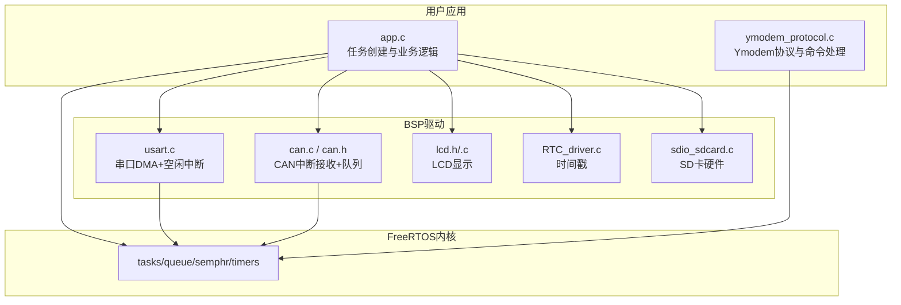
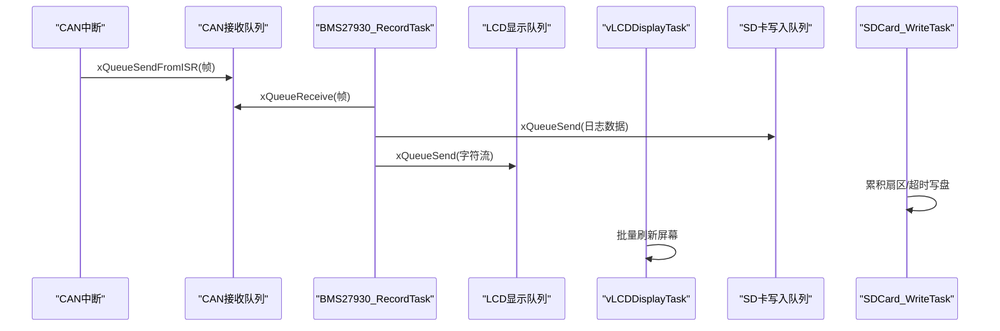
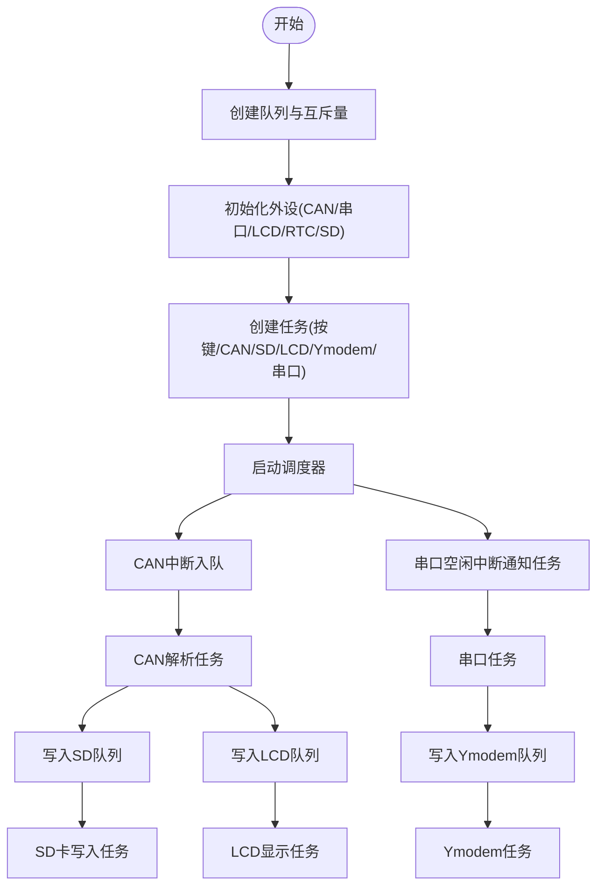
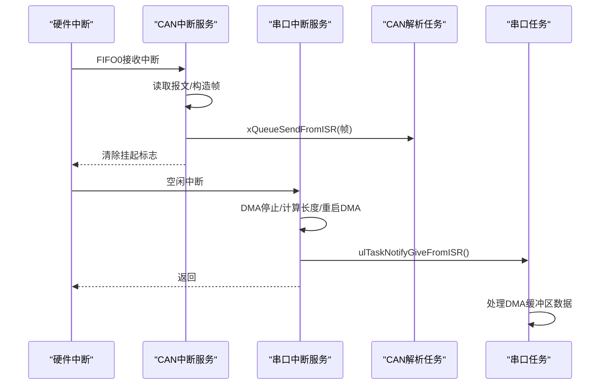
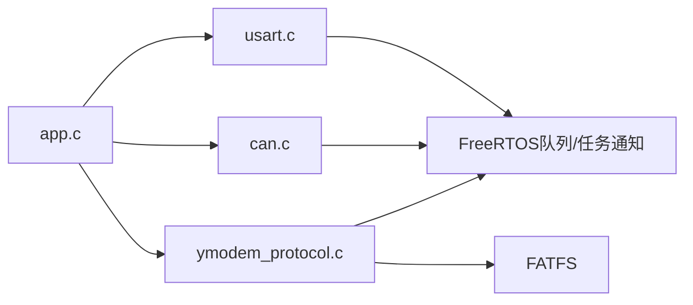

# FreeRTOS实时操作系统

<cite>
**本文引用的文件**   
- [FreeRTOSConfig.h](file://_gbk_backup/User/FreeRTOSConfig.h)
- [main.c](file://_gbk_backup/User/main.c)
- [app.c](file://_gbk_backup/User/app.c)
- [ymodem_protocol.c](file://_gbk_backup/User/ymodem_protocol.c)
- [usart.c](file://_gbk_backup/Driver/SYSTEM/usart.c)
- [can.c](file://_gbk_backup/Driver/BSP/can.c)
- [can.h](file://_gbk_backup/Driver/BSP/can.h)
</cite>

## 目录
1. [引言](#引言)
2. [项目结构](#项目结构)
3. [核心组件](#核心组件)
4. [架构总览](#架构总览)
5. [详细组件分析](#详细组件分析)
6. [依赖关系分析](#依赖关系分析)
7. [性能与调优建议](#性能与调优建议)
8. [故障排查指南](#故障排查指南)
9. [结论](#结论)

## 引言
本文件面向基于 STM32F407 的 CAN Tracker 项目，系统化梳理 FreeRTOS 内核配置、任务模型、通信同步机制、中断处理与上下文切换、优先级与资源分配策略，并给出性能优化与常见问题解决方案。文档既适合初学者快速上手，也便于有经验的工程师进行深度调优与维护。

## 项目结构
本项目采用“用户应用 + BSP驱动 + FreeRTOS”的分层组织方式：
- 用户应用层：任务创建、业务逻辑（CAN记录、SD卡写入、LCD显示、按键处理、Ymodem传输）
- BSP驱动层：CAN、串口、LCD、RTC、电源管理等外设驱动
- FreeRTOS内核：调度器、队列、信号量、定时器、任务通知等

图表来源
- [app.c:529-541](file://_gbk_backup/User/app.c#L529-L541)
- [ymodem_protocol.c:711-748](file://_gbk_backup/User/ymodem_protocol.c#L711-L748)
- [usart.c:101-166](file://_gbk_backup/Driver/SYSTEM/usart.c#L101-L166)
- [can.c:27-100](file://_gbk_backup/Driver/BSP/can.c#L27-L100)
- [can.h:17-42](file://_gbk_backup/Driver/BSP/can.h#L17-L42)

章节来源
- [main.c:34-60](file://_gbk_backup/User/main.c#L34-L60)
- [app.c:529-541](file://_gbk_backup/User/app.c#L529-L541)

## 核心组件
- FreeRTOS内核配置：抢占式调度、Tick频率、最大优先级、内存堆大小、互斥量/计数信号量/软件定时器等开关与参数
- 任务集合：CAN接收与解析任务、SD卡写入任务、LCD显示任务、按键扫描与处理任务、Ymodem传输任务、串口接收任务、LED闪烁任务
- 通信与同步：队列（CAN接收、按键、LCD显示、Ymodem）、互斥量（SD卡访问）、任务通知（串口空闲中断唤醒）
- 中断与上下文切换：CAN中断入队、串口空闲中断通过任务通知唤醒任务、PendSV/SVC钩子映射

章节来源
- [FreeRTOSConfig.h:11-103](file://_gbk_backup/User/FreeRTOSConfig.h#L11-L103)
- [app.c:94-152](file://_gbk_backup/User/app.c#L94-L152)
- [app.c:200-309](file://_gbk_backup/User/app.c#L200-L309)
- [app.c:311-366](file://_gbk_backup/User/app.c#L311-L366)
- [app.c:452-521](file://_gbk_backup/User/app.c#L452-L521)
- [ymodem_protocol.c:711-748](file://_gbk_backup/User/ymodem_protocol.c#L711-L748)
- [usart.c:184-205](file://_gbk_backup/Driver/SYSTEM/usart.c#L184-L205)
- [can.c:186-220](file://_gbk_backup/Driver/BSP/can.c#L186-L220)

## 架构总览
系统以 FreeRTOS 为中枢，各任务通过队列和信号量协作；外设中断将数据快速入队或触发任务通知，避免在中断中执行耗时操作。

图表来源
- [can.c:186-220](file://_gbk_backup/Driver/BSP/can.c#L186-L220)
- [app.c:200-309](file://_gbk_backup/User/app.c#L200-L309)
- [app.c:311-366](file://_gbk_backup/User/app.c#L311-L366)
- [app.c:452-521](file://_gbk_backup/User/app.c#L452-L521)

## 详细组件分析

### FreeRTOS内核配置
- 调度与Tick
  - 抢占式调度开启，支持同优先级时间片轮转
  - Tick频率设置为1000Hz，SysTick每毫秒中断一次
  - 使用硬件优化的任务选择算法
- 优先级与中断
  - 最大优先级数32，最高可用中断优先级为5（对应configLIBRARY_MAX_SYSCALL_INTERRUPT_PRIORITY=5）
  - 最低中断优先级15，内核中断优先级由宏计算得出
- 内存管理
  - 动态内存分配启用，堆大小为30KB
  - 未启用静态分配与应用自定义堆
- 同步原语
  - 启用互斥量、递归互斥量、计数信号量、队列集、任务通知
- 软件定时器
  - 启用软件定时器，默认任务优先级为最高优先级-1，队列长度5，栈深为最小栈的两倍
- 调试与跟踪
  - 启用可视化跟踪与统计格式化函数，便于任务列表与运行时间统计

章节来源
- [FreeRTOSConfig.h:11-71](file://_gbk_backup/User/FreeRTOSConfig.h#L11-L71)
- [FreeRTOSConfig.h:73-103](file://_gbk_backup/User/FreeRTOSConfig.h#L73-L103)

### 任务定义与职责
- CAN接收与解析任务（BMS27930_RecordTask）
  - 从CAN队列读取报文，去重后解析BMS27930协议，生成CSV日志
  - 将日志数据发送到SD卡写入队列，同时将字符流发送到LCD显示队列
- SD卡写入任务（SDCard_WriteTask）
  - 缓冲最多一个扇区（512字节），或在无新数据超时后落盘，降低频繁写入对SD卡的损耗
  - 通过互斥量保护FATFS文件系统对象与文件句柄
- LCD显示任务（vLCDDisplayTask）
  - 批量消费LCD队列字符，按行缓存与滚动更新，周期性刷新屏幕
- 按键扫描任务（vKeyScanTask）
  - 状态机识别短按、双击、长按，发送按键事件到按键队列
- 按键处理任务（vKeyProcessTask）
  - 消费按键队列，控制背光、打印任务栈信息等
- Ymodem传输任务（Ymodem_Task）
  - 消费串口接收队列，实现命令行交互与Ymodem文件传输
- 串口接收任务（vUART1Task）
  - 等待串口空闲中断的任务通知，将DMA缓冲区数据分发到Ymodem队列与LCD队列
- LED闪烁任务（vLED1Task）
  - 创建周期定时器回调，翻转LED并根据电池电压进入低功耗模式

章节来源
- [app.c:94-152](file://_gbk_backup/User/app.c#L94-L152)
- [app.c:200-309](file://_gbk_backup/User/app.c#L200-L309)
- [app.c:311-366](file://_gbk_backup/User/app.c#L311-L366)
- [app.c:452-521](file://_gbk_backup/User/app.c#L452-L521)
- [ymodem_protocol.c:711-748](file://_gbk_backup/User/ymodem_protocol.c#L711-L748)
- [usart.c:269-283](file://_gbk_backup/Driver/SYSTEM/usart.c#L269-L283)
- [app.c:154-198](file://_gbk_backup/User/app.c#L154-L198)

### 任务间通信机制
- 队列
  - CAN接收队列：中断生产者，任务消费者，深度10
  - 按键队列：按键扫描任务生产，按键处理任务消费
  - LCD显示队列：CAN解析任务与串口任务共同生产，LCD任务消费
  - SD卡写入队列：CAN解析任务生产，SD卡任务消费
  - Ymodem接收队列：串口任务生产，Ymodem任务消费
- 信号量与互斥量
  - SD卡互斥量：保护FATFS挂载、打开、读写、关闭等临界区
- 任务通知
  - 串口空闲中断通过ulTaskNotifyGiveFromISR唤醒串口任务，避免忙轮询

图表来源
- [main.c:50-58](file://_gbk_backup/User/main.c#L50-L58)
- [app.c:529-541](file://_gbk_backup/User/app.c#L529-L541)
- [can.c:186-220](file://_gbk_backup/Driver/BSP/can.c#L186-L220)
- [usart.c:184-205](file://_gbk_backup/Driver/SYSTEM/usart.c#L184-L205)

章节来源
- [can.h:17-42](file://_gbk_backup/Driver/BSP/can.h#L17-L42)
- [app.c:26-32](file://_gbk_backup/User/app.c#L26-L32)
- [app.c:50-70](file://_gbk_backup/User/app.c#L50-L70)
- [ymodem_protocol.c:690-706](file://_gbk_backup/User/ymodem_protocol.c#L690-L706)

### 中断处理与上下文切换
- CAN中断
  - 在CAN1_RX0_IRQHandler中读取FIFO0报文，构造帧结构并通过xQueueSendFromISR入队
  - 若队列满则丢包计数增加，避免阻塞中断
- 串口中断
  - USART1_IRQHandler处理空闲中断，停止DMA、计算接收长度、重启DMA
  - 通过ulTaskNotifyGiveFromISR唤醒vUART1Task，并在必要时调用portYIELD_FROM_ISR触发上下文切换
- 调度器与异常向量
  - FreeRTOSConfig.h中映射SVC_Handler与PendSV_Handler，确保任务切换与系统调用正确执行

图表来源
- [can.c:186-220](file://_gbk_backup/Driver/BSP/can.c#L186-L220)
- [usart.c:184-205](file://_gbk_backup/Driver/SYSTEM/usart.c#L184-L205)
- [FreeRTOSConfig.h:105-107](file://_gbk_backup/User/FreeRTOSConfig.h#L105-L107)

章节来源
- [can.c:186-220](file://_gbk_backup/Driver/BSP/can.c#L186-L220)
- [usart.c:184-205](file://_gbk_backup/Driver/SYSTEM/usart.c#L184-L205)
- [FreeRTOSConfig.h:92-103](file://_gbk_backup/User/FreeRTOSConfig.h#L92-L103)

### 任务优先级配置原则与资源分配策略
- 优先级原则
  - 高优先级：CAN解析任务（及时解析与转发）、Ymodem任务（交互式命令响应）
  - 中优先级：串口任务（中断唤醒后的数据处理）、按键相关任务（扫描与处理）
  - 低优先级：SD卡写入任务（批处理与I/O合并）、LCD显示任务（周期性刷新）
- 资源分配
  - 队列深度：CAN队列较小（10），LCD队列较大（512），Ymodem队列中等（256），SD卡队列较小（3）
  - 任务栈大小：关键任务（如CAN解析、Ymodem、LCD）分配更大栈空间（512字），轻量任务（按键扫描）较小（128字）
  - 互斥量粒度：仅对FATFS与文件句柄加锁，减少临界区范围

章节来源
- [app.c:529-541](file://_gbk_backup/User/app.c#L529-L541)
- [main.c:52-55](file://_gbk_backup/User/main.c#L52-L55)
- [app.c:311-366](file://_gbk_backup/User/app.c#L311-L366)
- [ymodem_protocol.c:690-706](file://_gbk_backup/User/ymodem_protocol.c#L690-L706)

## 依赖关系分析
- 模块耦合
  - app.c依赖usart.c、can.c、ymodem_protocol.c、LCD与RTC驱动
  - ymodem_protocol.c依赖FATFS与互斥量，间接依赖SD卡驱动
  - usart.c依赖FreeRTOS队列与任务通知
  - can.c依赖FreeRTOS队列与NVIC中断
- 外部依赖
  - FATFS文件系统用于SD卡读写
  - HAL/标准库外设驱动用于CAN、串口、GPIO、DMA、NVIC

图表来源
- [app.c:1-21](file://_gbk_backup/User/app.c#L1-L21)
- [ymodem_protocol.c:9-19](file://_gbk_backup/User/ymodem_protocol.c#L9-L19)
- [usart.c:19-25](file://_gbk_backup/Driver/SYSTEM/usart.c#L19-L25)
- [can.c:11-15](file://_gbk_backup/Driver/BSP/can.c#L11-L15)

章节来源
- [app.c:1-21](file://_gbk_backup/User/app.c#L1-L21)
- [ymodem_protocol.c:9-19](file://_gbk_backup/User/ymodem_protocol.c#L9-L19)
- [usart.c:19-25](file://_gbk_backup/Driver/SYSTEM/usart.c#L19-L25)
- [can.c:11-15](file://_gbk_backup/Driver/BSP/can.c#L11-L15)

## 性能与调优建议
- 队列与缓冲
  - 根据峰值数据率调整队列深度，避免频繁丢包；LCD队列已较大，可监控剩余空间告警阈值
  - SD卡写入采用扇区级累积与超时落盘，进一步降低写放大
- 任务栈与内存
  - 使用uxTaskGetStackHighWaterMark评估任务栈水位，适当增大关键任务栈
  - 合理设置configTOTAL_HEAP_SIZE，避免动态分配失败
- 中断与调度
  - 保持中断服务函数尽量简短，使用队列或任务通知卸载工作负载
  - 合理设置NVIC抢占优先级，确保FreeRTOS可管理的最高中断优先级不被超过
- I/O与文件系统
  - 避免在高频路径中进行大量字符串格式化与printf输出
  - FATFS操作尽量批量化，减少f_open/f_close次数

[本节为通用指导，不直接分析具体文件]

## 故障排查指南
- CAN丢包
  - 现象：CAN接收队列满导致丢包计数增加
  - 排查：检查CAN总线波特率与过滤器配置，确认下游任务是否及时处理
  - 参考：[can.c:186-220](file://_gbk_backup/Driver/BSP/can.c#L186-L220)
- SD卡写入失败
  - 现象：f_open/f_write返回错误码
  - 排查：确认互斥量获取成功、文件系统挂载正常、文件名与路径有效
  - 参考：[app.c:35-71](file://_gbk_backup/User/app.c#L35-L71)、[app.c:414-450](file://_gbk_backup/User/app.c#L414-L450)
- LCD显示卡顿或丢失
  - 现象：LCD队列使用率高，刷新不及时
  - 排查：检查LCD任务刷新周期与队列消费速度，必要时增大队列或降低输入速率
  - 参考：[app.c:452-521](file://_gbk_backup/User/app.c#L452-L521)
- Ymodem传输中断
  - 现象：握手超时或ACK缺失
  - 排查：检查串口队列是否被填满、终端软件是否正确发起Ymodem接收
  - 参考：[ymodem_protocol.c:160-191](file://_gbk_backup/User/ymodem_protocol.c#L160-L191)、[ymodem_protocol.c:303-428](file://_gbk_backup/User/ymodem_protocol.c#L303-L428)
- 任务栈溢出
  - 现象：HardFault或任务崩溃
  - 排查：启用栈溢出检测或使用uxTaskGetStackHighWaterMark观察水位
  - 参考：[FreeRTOSConfig.h:48-49](file://_gbk_backup/User/FreeRTOSConfig.h#L48-L49)、[app.c:74-91](file://_gbk_backup/User/app.c#L74-L91)

章节来源
- [can.c:186-220](file://_gbk_backup/Driver/BSP/can.c#L186-L220)
- [app.c:35-71](file://_gbk_backup/User/app.c#L35-L71)
- [app.c:414-450](file://_gbk_backup/User/app.c#L414-L450)
- [app.c:452-521](file://_gbk_backup/User/app.c#L452-L521)
- [ymodem_protocol.c:160-191](file://_gbk_backup/User/ymodem_protocol.c#L160-L191)
- [ymodem_protocol.c:303-428](file://_gbk_backup/User/ymodem_protocol.c#L303-L428)
- [FreeRTOSConfig.h:48-49](file://_gbk_backup/User/FreeRTOSConfig.h#L48-L49)
- [app.c:74-91](file://_gbk_backup/User/app.c#L74-L91)

## 结论
本项目以FreeRTOS为核心，构建了稳定的CAN数据采集、协议解析、SD卡持久化、LCD显示、按键交互与Ymodem传输的多任务系统。通过队列与互斥量解耦各模块，结合中断与任务通知提升实时性。合理的优先级与资源分配策略确保了系统在有限资源下的稳定运行。后续可根据实际数据率与功耗需求进一步优化队列深度、任务栈与I/O批处理策略。