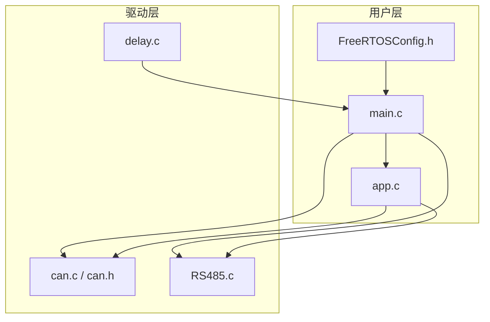
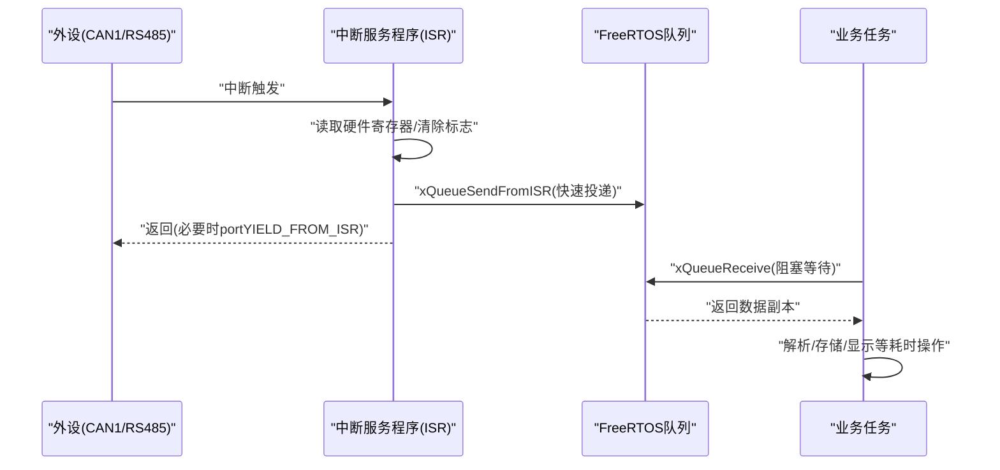
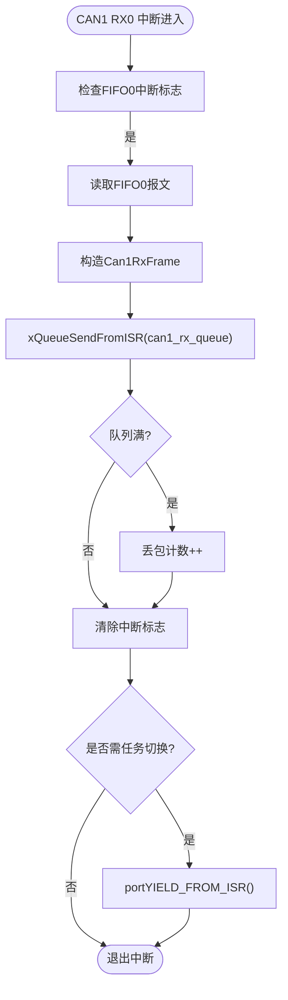
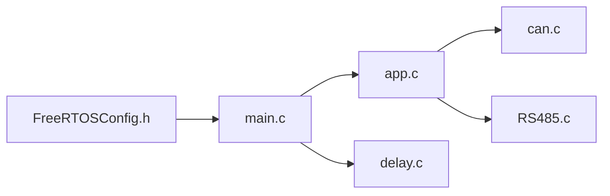

# 中断处理机制

<cite>
**本文引用的文件**   
- [FreeRTOSConfig.h](file://_gbk_backup\User\FreeRTOSConfig.h)
- [main.c](file://_gbk_backup\User\main.c)
- [app.c](file://_gbk_backup\User\app.c)
- [can.c](file://_gbk_backup\Driver\BSP\can.c)
- [can.h](file://_gbk_backup\Driver\BSP\can.h)
- [RS485.c](file://_gbk_backup\Driver\BSP\RS485.c)
- [delay.c](file://_gbk_backup\Driver\SYSTEM\delay.c)
</cite>

## 目录
1. [引言](#引言)
2. [项目结构](#项目结构)
3. [核心组件](#核心组件)
4. [架构总览](#架构总览)
5. [详细组件分析](#详细组件分析)
6. [依赖关系分析](#依赖关系分析)
7. [性能与实时性](#性能与实时性)
8. [故障排查指南](#故障排查指南)
9. [结论](#结论)

## 引言
本文面向在 STM32F407 上运行 FreeRTOS 的嵌入式开发者，系统性地梳理本仓库中的中断处理机制。重点包括：
- 中断服务程序（ISR）与 FreeRTOS 的集成方式
- 中断优先级配置与上下文切换机制
- 在 ISR 中安全调用 FreeRTOS API 的方法（以队列发送为例）
- 中断延迟对系统实时性的影响及优化策略
- 中断嵌套与中断屏蔽技术
- 中断相关的调试技巧与性能分析方法

本仓库采用“硬件驱动 + FreeRTOS 任务/队列”的典型架构：外设中断在 ISR 中快速拷贝数据并投递到队列，业务逻辑在任务中消费队列数据，从而将耗时操作移出中断上下文，保证系统的实时性与稳定性。

## 项目结构
本项目为基于 STM32F407 的 CAN 跟踪器示例，包含以下关键目录与文件：
- User：应用层与 FreeRTOS 配置、任务创建、系统初始化
- Driver/BSP：外设驱动（CAN、RS485、SDIO SD卡等）
- Driver/SYSTEM：系统级工具（SysTick 延时、串口等）

图表来源
- [main.c:34-59](file://_gbk_backup\User\main.c#L34-L59)
- [app.c:529-541](file://_gbk_backup\User\app.c#L529-L541)
- [FreeRTOSConfig.h:12-103](file://_gbk_backup\User\FreeRTOSConfig.h#L12-L103)
- [can.c:40-106](file://_gbk_backup\Driver\BSP\can.c#L40-L106)
- [RS485.c:15-102](file://_gbk_backup\Driver\BSP\RS485.c#L15-L102)
- [delay.c:14-35](file://_gbk_backup\Driver\SYSTEM\delay.c#L14-L35)

章节来源
- [main.c:34-59](file://_gbk_backup\User\main.c#L34-L59)
- [app.c:529-541](file://_gbk_backup\User\app.c#L529-L541)
- [FreeRTOSConfig.h:12-103](file://_gbk_backup\User\FreeRTOSConfig.h#L12-L103)

## 核心组件
- FreeRTOS 配置与中断优先级边界
  - 抢占式调度器启用，Tick 频率 1kHz，最大优先级数 32
  - 定义可被 FreeRTOS API 调用的最高中断优先级阈值
  - 映射 PendSV/SVC 处理器入口
- 系统初始化与任务创建
  - main 中设置 NVIC 优先级分组、外设初始化、队列/互斥量创建、任务创建与调度启动
- 外设中断与 FreeRTOS 队列
  - CAN1 RX0 中断：读取报文、构造帧结构、通过 xQueueSendFromISR 投递队列，必要时请求任务切换
  - RS485 USART 空闲中断：DMA+USART 组合接收，ISR 中打包数据包并投递队列
- 任务侧消费
  - BMS 记录任务从 CAN 队列取数、解析、写入 SD 卡与 LCD 显示
  - LCD 显示任务周期性刷新显示
  - 按键扫描/处理任务通过队列解耦按键事件

章节来源
- [FreeRTOSConfig.h:12-103](file://_gbk_backup\User\FreeRTOSConfig.h#L12-L103)
- [main.c:34-59](file://_gbk_backup\User\main.c#L34-L59)
- [can.c:186-224](file://_gbk_backup\Driver\BSP\can.c#L186-L224)
- [RS485.c:160-198](file://_gbk_backup\Driver\BSP\RS485.c#L160-L198)
- [app.c:201-309](file://_gbk_backup\User\app.c#L201-L309)
- [app.c:454-521](file://_gbk_backup\User\app.c#L454-L521)

## 架构总览
下图展示中断到任务的典型数据流：外设触发中断 → ISR 快速拷贝数据 → 通过 FromISR API 投递队列 → 任务阻塞等待队列 → 任务执行耗时逻辑。

图表来源
- [can.c:186-224](file://_gbk_backup\Driver\BSP\can.c#L186-L224)
- [RS485.c:160-198](file://_gbk_backup\Driver\BSP\RS485.c#L160-L198)
- [app.c:201-309](file://_gbk_backup\User\app.c#L201-L309)

## 详细组件分析

### FreeRTOS 中断优先级与内核边界
- 关键配置项
  - configUSE_PREEMPTION=1：启用抢占式调度
  - configTICK_RATE_HZ=1000：系统 Tick 频率
  - configMAX_PRIORITIES=32：最大优先级数量
  - configLIBRARY_MAX_SYSCALL_INTERRUPT_PRIORITY=5：可调用 FreeRTOS API 的最高中断优先级
  - configKERNEL_INTERRUPT_PRIORITY/configMAX_SYSCALL_INTERRUPT_PRIORITY：由上述宏推导出的内核/系统中断优先级
  - xPortPendSVHandler/vPortSVCHandler：映射 PendSV/SVC 处理器
- 设计要点
  - 所有需要调用 FreeRTOS API（如队列、信号量、定时器）的中断，其 NVIC 抢占优先级必须不低于（数值上不大于）configMAX_SYSCALL_INTERRUPT_PRIORITY
  - 低于该阈值的“高优先级中断”不应直接调用 FreeRTOS API，应仅做最小化处理并通过标志位或 DMA 缓冲交由低优先级中断或任务处理

章节来源
- [FreeRTOSConfig.h:12-103](file://_gbk_backup\User\FreeRTOSConfig.h#L12-L103)

### 系统初始化与 NVIC 优先级分组
- main 中设置 NVIC_PriorityGroup_4：全部使用抢占优先级，无子优先级
- 外设初始化顺序：延时初始化、串口、内存、RTC、OLED、按键、LED、LCD、RS485、CAN、队列/互斥量创建、任务创建、调度启动

章节来源
- [main.c:34-59](file://_gbk_backup\User\main.c#L34-L59)

### SysTick 与 FreeRTOS Tick 处理
- delay.c 中 SysTick_Handler 检查调度器状态后调用 xPortSysTickHandler，确保 FreeRTOS 节拍中断正常工作
- 这保证了 vTaskDelay、软件定时器等时间相关功能正确工作

章节来源
- [delay.c:14-35](file://_gbk_backup\Driver\SYSTEM\delay.c#L14-L35)

### CAN1 中断与 FreeRTOS 队列集成
- 初始化阶段
  - 配置 GPIO、CAN 控制器、过滤器、NVIC 中断（抢占优先级=5，满足 FreeRTOS 要求）
  - 使能 FIFO0 接收中断
- 中断服务程序
  - 读取 FIFO0 报文，构造自定义帧结构
  - 使用 xQueueSendFromISR 投递到 can1_rx_queue
  - 若队列满则丢包计数递增
  - 清除中断挂起标志
  - 若有更高优先级任务被唤醒，调用 portYIELD_FROM_ISR 请求任务切换
- 任务侧消费
  - BMS 记录任务通过 can1_receive_msg 阻塞等待队列，超时返回；收到数据后进行解析、日志格式化、SD 卡写入与 LCD 显示

图表来源
- [can.c:40-106](file://_gbk_backup\Driver\BSP\can.c#L40-L106)
- [can.c:186-224](file://_gbk_backup\Driver\BSP\can.c#L186-L224)
- [can.c:116-141](file://_gbk_backup\Driver\BSP\can.c#L116-L141)
- [app.c:201-309](file://_gbk_backup\User\app.c#L201-L309)

章节来源
- [can.c:40-106](file://_gbk_backup\Driver\BSP\can.c#L40-L106)
- [can.c:186-224](file://_gbk_backup\Driver\BSP\can.c#L186-L224)
- [can.c:116-141](file://_gbk_backup\Driver\BSP\can.c#L116-L141)
- [app.c:201-309](file://_gbk_backup\User\app.c#L201-L309)

### RS485 中断与 FreeRTOS 队列集成
- 初始化阶段
  - 配置 GPIO、USART、DMA、NVIC（抢占优先级=5）
  - 使能 USART 空闲中断与 DMA 接收
  - 创建 rs485_rx_queue
- 中断服务程序
  - 处理 USART_IT_IDLE：清空 SR/DR、停止 DMA、清理 DMA 标志、计算接收长度
  - 将数据复制到数据包结构并通过 xQueueSendFromISR 投递队列
  - 重新配置 DMA 计数器并重新启动 DMA
  - 必要时调用 portYIELD_FROM_ISR 请求任务切换

章节来源
- [RS485.c:15-102](file://_gbk_backup\Driver\BSP\RS485.c#L15-L102)
- [RS485.c:160-198](file://_gbk_backup\Driver\BSP\RS485.c#L160-L198)

### 任务侧数据处理与输出
- BMS 记录任务
  - 从 CAN 队列取数，比较是否与上一帧相同，决定记录原始数据或解析后的详细信息
  - 通过 SDCard_WriteTask 队列通知 SD 卡写入任务
  - 同时向 LCD 显示队列逐字节推送显示内容
- LCD 显示任务
  - 周期性收集队列数据，按行缓存并刷新 LCD
- SD 卡写入任务
  - 累积数据至扇区大小或超时后批量写入，降低频繁写盘损耗

章节来源
- [app.c:201-309](file://_gbk_backup\User\app.c#L201-L309)
- [app.c:313-366](file://_gbk_backup\User\app.c#L313-L366)
- [app.c:454-521](file://_gbk_backup\User\app.c#L454-L521)

## 依赖关系分析
- 模块耦合
  - main.c 负责全局初始化与任务创建，依赖 FreeRTOSConfig.h 的配置
  - app.c 依赖队列/信号量/定时器 API，依赖 can.c、RS485.c 提供的数据源
  - can.c、RS485.c 依赖 FreeRTOS 队列 API 与 NVIC 配置
- 外部依赖
  - STM32 HAL/标准库外设驱动
  - FreeRTOS 内核与端口适配（PendSV/SVC、SysTick）

图表来源
- [FreeRTOSConfig.h:12-103](file://_gbk_backup\User\FreeRTOSConfig.h#L12-L103)
- [main.c:34-59](file://_gbk_backup\User\main.c#L34-L59)
- [app.c:529-541](file://_gbk_backup\User\app.c#L529-L541)
- [can.c:40-106](file://_gbk_backup\Driver\BSP\can.c#L40-L106)
- [RS485.c:15-102](file://_gbk_backup\Driver\BSP\RS485.c#L15-L102)
- [delay.c:14-35](file://_gbk_backup\Driver\SYSTEM\delay.c#L14-L35)

章节来源
- [FreeRTOSConfig.h:12-103](file://_gbk_backup\User\FreeRTOSConfig.h#L12-L103)
- [main.c:34-59](file://_gbk_backup\User\main.c#L34-L59)
- [app.c:529-541](file://_gbk_backup\User\app.c#L529-L541)
- [can.c:40-106](file://_gbk_backup\Driver\BSP\can.c#L40-L106)
- [RS485.c:15-102](file://_gbk_backup\Driver\BSP\RS485.c#L15-L102)
- [delay.c:14-35](file://_gbk_backup\Driver\SYSTEM\delay.c#L14-L35)

## 性能与实时性

### 中断延迟对系统实时性的影响
- ISR 应尽量短小：只完成寄存器读取、数据拷贝、队列投递与必要的任务切换请求
- 队列容量与丢包
  - CAN1 接收队列深度较小（默认 10），在高负载下可能丢包；可通过监控丢包计数与队列剩余空间评估瓶颈
  - 建议根据峰值吞吐调整队列深度，或在 ISR 中增加统计指标（丢包率、平均投递时延）
- 任务消费速率
  - BMS 记录任务与 LCD 显示任务需及时消费队列，避免积压导致 ISR 频繁丢包
  - 可使用 uxQueueSpacesAvailable/uxQueueMessagesWaiting 进行运行时监控

优化策略
- 合理分配任务优先级：高频数据通道（如 CAN 接收）的任务应具有较高优先级，确保及时消费
- 批处理与缓冲：在任务侧进行数据聚合（如 SD 卡扇区级写入、LCD 行缓存刷新），减少 I/O 抖动
- 中断优先级规划：确保调用 FreeRTOS API 的中断优先级不高于 configMAX_SYSCALL_INTERRUPT_PRIORITY；非 FreeRTOS API 的高优先级中断仅做最小化处理

章节来源
- [can.c:186-224](file://_gbk_backup\Driver\BSP\can.c#L186-L224)
- [app.c:201-309](file://_gbk_backup\User\app.c#L201-L309)
- [app.c:454-521](file://_gbk_backup\User\app.c#L454-L521)

### 中断嵌套与中断屏蔽
- 中断嵌套
  - 本仓库未显式实现复杂的中断嵌套管理；不同外设中断各自独立处理，通过队列解耦
  - 若引入更高优先级中断，应避免在其中调用 FreeRTOS API，仅做最小化处理
- 中断屏蔽
  - 代码中未直接使用 __disable_irq/__enable_irq；主要依靠 NVIC 优先级控制与 ISR 内快速处理
  - 对于临界区保护，建议使用 FreeRTOS 的临界区 API（如 taskENTER_CRITICAL/taskEXIT_CRITICAL）或信号量/互斥量

章节来源
- [FreeRTOSConfig.h:92-103](file://_gbk_backup\User\FreeRTOSConfig.h#L92-L103)
- [can.c:186-224](file://_gbk_backup\Driver\BSP\can.c#L186-L224)
- [RS485.c:160-198](file://_gbk_backup\Driver\BSP\RS485.c#L160-L198)

### 上下文切换机制
- 中断上下文切换
  - ISR 中通过 portYIELD_FROM_ISR 请求切换到更高优先级任务
  - FreeRTOS 内核在合适的时机（如 PendSV）执行上下文保存/恢复
- 系统节拍
  - SysTick 中断驱动 FreeRTOS Tick，vTaskDelay 与软件定时器依赖此机制

章节来源
- [can.c:222-224](file://_gbk_backup\Driver\BSP\can.c#L222-L224)
- [RS485.c:196-198](file://_gbk_backup\Driver\BSP\RS485.c#L196-L198)
- [delay.c:14-35](file://_gbk_backup\Driver\SYSTEM\delay.c#L14-L35)
- [FreeRTOSConfig.h:105-107](file://_gbk_backup\User\FreeRTOSConfig.h#L105-L107)

## 故障排查指南
常见问题与定位方法
- 中断无法进入或重复进入
  - 确认已清除中断挂起标志（如 CAN_ClearITPendingBit、USART_SR/DR 读清）
  - 检查 NVIC 中断使能与优先级配置是否正确
- 队列满导致丢包
  - 监控丢包计数与队列剩余空间；适当增大队列深度或提升任务消费优先级
- 任务栈溢出
  - 使用 uxTaskGetStackHighWaterMark 检查任务栈水位；必要时增大栈大小
- 调度异常
  - 确认 SysTick 中断正常触发，xPortSysTickHandler 被调用
  - 检查 FreeRTOS 配置项（如 configTICK_RATE_HZ、configMAX_PRIORITIES）

实用技巧
- 在 ISR 中仅做最小化处理，避免阻塞与复杂逻辑
- 使用 FromISR API（如 xQueueSendFromISR）而非阻塞版本
- 使用任务监控函数打印任务列表与栈水位，辅助定位问题

章节来源
- [can.c:186-224](file://_gbk_backup\Driver\BSP\can.c#L186-L224)
- [RS485.c:160-198](file://_gbk_backup\Driver\BSP\RS485.c#L160-L198)
- [app.c:74-91](file://_gbk_backup\User\app.c#L74-L91)
- [app.c:370-412](file://_gbk_backup\User\app.c#L370-L412)

## 结论
本仓库在中断处理方面遵循了 FreeRTOS 的最佳实践：
- 通过 FreeRTOSConfig.h 明确中断优先级边界，确保 ISR 中可安全调用 FreeRTOS API
- 在 ISR 中快速拷贝数据并投递队列，避免阻塞与复杂逻辑
- 使用任务侧消费队列数据，将耗时操作移出中断上下文
- 借助 SysTick 与 PendSV/SVC 机制实现可靠的上下文切换与时间基准

建议在后续迭代中：
- 量化监控中断延迟与丢包率，持续优化队列深度与任务优先级
- 引入更精细的中断优先级规划，区分实时通道与非实时通道
- 完善错误处理与诊断接口，便于生产环境的问题定位与性能分析