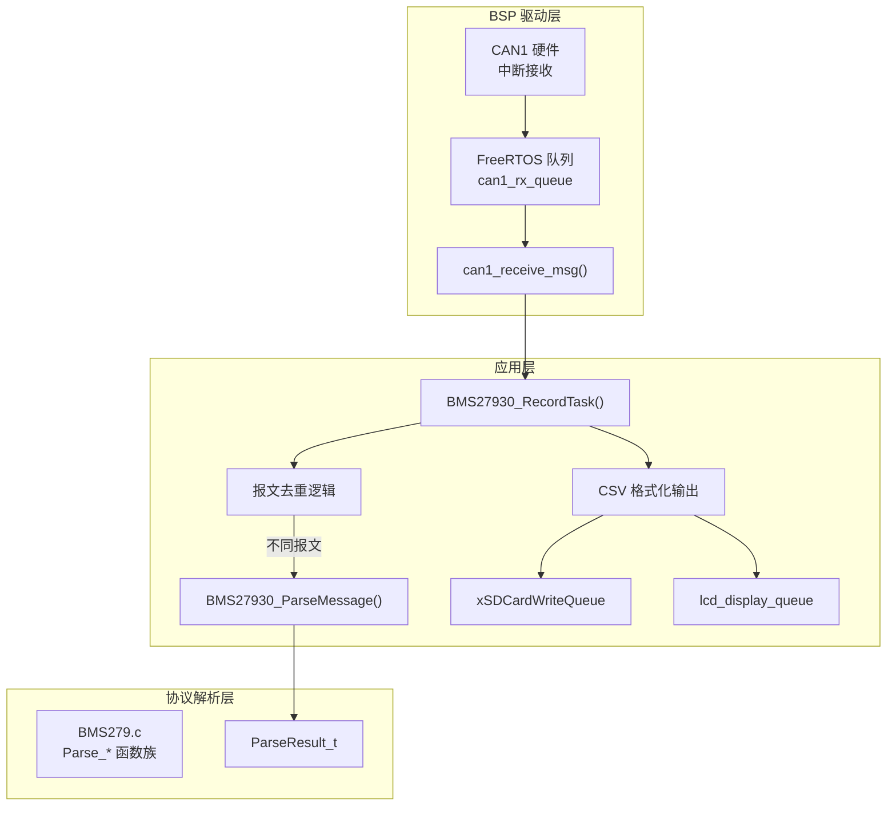
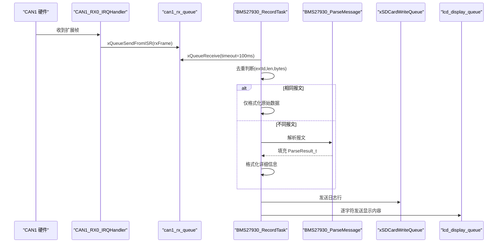
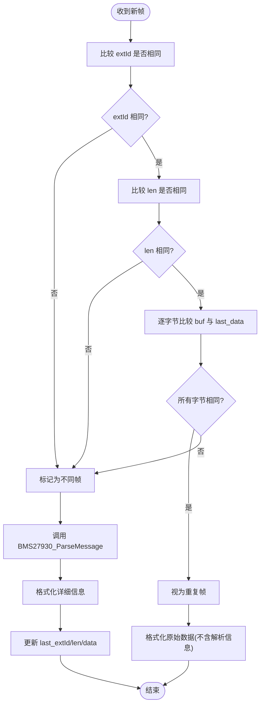
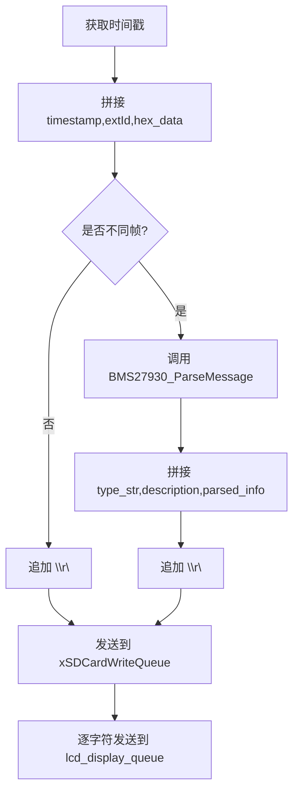
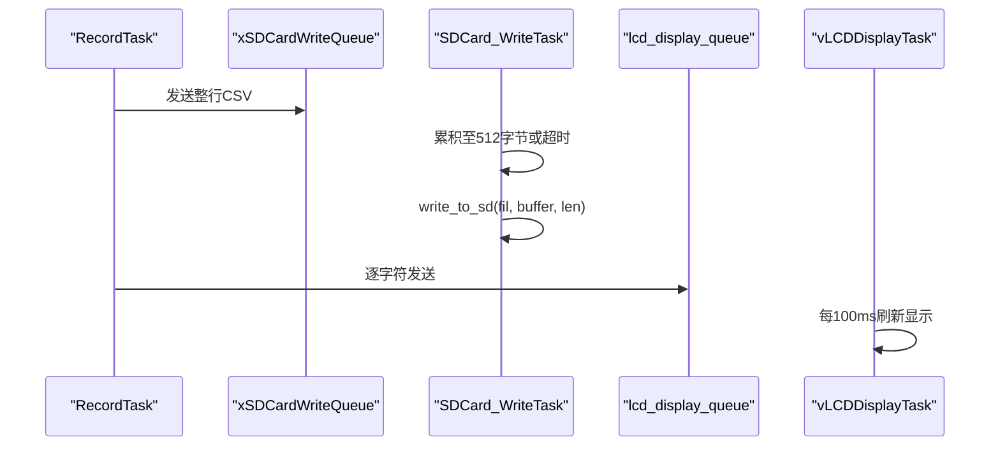
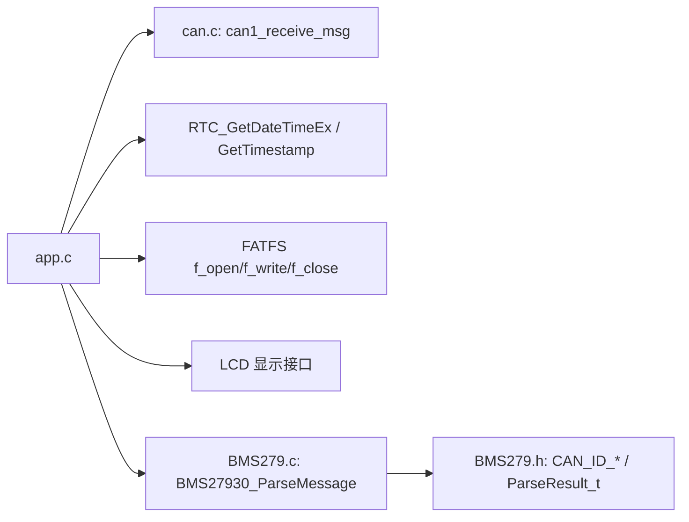

# CAN接收与解析任务

<cite>
**本文引用的文件**   
- [app.c](file://_gbk_backup/User/app.c)
- [BMS279.c](file://_gbk_backup/User/BMS279.c)
- [BMS279.h](file://_gbk_backup/User/BMS279.h)
- [can.c](file://_gbk_backup/Driver/BSP/can.c)
- [can.h](file://_gbk_backup/Driver/BSP/can.h)
</cite>

## 目录
1. [引言](#引言)
2. [项目结构](#项目结构)
3. [核心组件](#核心组件)
4. [架构总览](#架构总览)
5. [详细组件分析](#详细组件分析)
6. [依赖关系分析](#依赖关系分析)
7. [性能考虑](#性能考虑)
8. [故障排查指南](#故障排查指南)
9. [结论](#结论)

## 引言
本文围绕 BMS27930_RecordTask 的实现，系统性说明 CAN 数据接收、报文去重、协议解析、数据格式化输出以及队列通信机制。重点覆盖：
- can1_receive_msg 的调用方式与数据获取机制
- 基于扩展ID、数据长度和字节数组比较的去重算法
- BMS27930_ParseMessage 的解析流程与 ParseResult_t 的使用
- 时间戳生成、十六进制数据转换与 CSV 构建
- SD 卡写入队列与 LCD 显示队列的数据发送策略
- 性能优化建议与错误处理策略

## 项目结构
本实现位于 FreeRTOS 应用层与 BSP 驱动层之间：
- BSP 层（can.c/can.h）提供 CAN1 中断接收、队列生产与 can1_receive_msg 消费接口
- 应用层（app.c）实现 BMS27930_RecordTask，负责接收、去重、解析、格式化与队列分发
- 协议解析层（BMS279.c/BMS279.h）实现 GB/T 27930 多类型报文解析与 J1939 多包组包逻辑

**图表来源**
- [can.c:18-141](file://_gbk_backup/Driver/BSP/can.c#L18-L141)
- [app.c:201-309](file://_gbk_backup/User/app.c#L201-L309)
- [BMS279.c:42-114](file://_gbk_backup/User/BMS279.c#L42-L114)

**章节来源**
- [can.c:18-141](file://_gbk_backup/Driver/BSP/can.c#L18-L141)
- [app.c:201-309](file://_gbk_backup/User/app.c#L201-L309)
- [BMS279.c:42-114](file://_gbk_backup/User/BMS279.c#L42-L114)

## 核心组件
- CAN 接收接口：can1_receive_msg 从 FreeRTOS 队列中阻塞读取 CAN 帧，返回 DLC 与数据负载
- 记录任务：BMS27930_RecordTask 周期性拉取 CAN 帧，执行去重、解析、格式化，并发送到 SD/LCD 队列
- 协议解析：BMS27930_ParseMessage 根据 CAN ID 分派到具体 Parse_* 函数，填充 ParseResult_t
- 存储与显示：SD 卡写入任务聚合数据按扇区或超时写入；LCD 任务定时刷新显示

**章节来源**
- [can.c:116-141](file://_gbk_backup/Driver/BSP/can.c#L116-L141)
- [app.c:201-309](file://_gbk_backup/User/app.c#L201-L309)
- [BMS279.c:42-114](file://_gbk_backup/User/BMS279.c#L42-L114)

## 架构总览
下图展示从 CAN 中断到最终输出（CSV 与 LCD）的完整数据流。

**图表来源**
- [can.c:186-224](file://_gbk_backup/Driver/BSP/can.c#L186-L224)
- [app.c:201-309](file://_gbk_backup/User/app.c#L201-L309)
- [BMS279.c:42-114](file://_gbk_backup/User/BMS279.c#L42-L114)

## 详细组件分析

### CAN 接收与数据获取（can1_receive_msg）
- 中断侧：CAN1_RX0_IRQHandler 从 FIFO0 读取帧，提取 ExtId、DLC 与 Data，通过 xQueueSendFromISR 投递到 can1_rx_queue
- 应用侧：BMS27930_RecordTask 调用 can1_receive_msg(&extId, buf, 100)，阻塞等待最多 100ms，成功时返回 DLC 并将数据复制到 buf

关键点：
- 队列深度有限，若中断速率过高会导致丢包计数增加
- can1_receive_msg 对空指针进行保护，避免崩溃

**章节来源**
- [can.c:186-224](file://_gbk_backup/Driver/BSP/can.c#L186-L224)
- [can.c:116-141](file://_gbk_backup/Driver/BSP/can.c#L116-L141)

### 报文去重算法
BMS27930_RecordTask 维护 last_extId、last_len 与 last_data[8]，对新帧执行三步比较：
1. extId 相等
2. len 相等
3. 逐个字节比较 buf[i] 与 last_data[i]

若全部相同，则视为重复帧，仅记录原始数据；否则进入解析流程，并更新 last_* 缓存。

**图表来源**
- [app.c:201-262](file://_gbk_backup/User/app.c#L201-L262)

**章节来源**
- [app.c:201-262](file://_gbk_backup/User/app.c#L201-L262)

### 协议解析过程（BMS27930_ParseMessage 与 ParseResult_t）
- BMS27930_ParseMessage 根据 canId 分派到对应 Parse_* 函数（如 CHM、BHM、CRM、CTS、CML、BRO、CRO、BCL、CCS、BSM、BMV、BMT、BSP、BST、CST、BSD、CSD、BEM、CEM）
- 每个解析函数设置 result->type_str、result->description 与 result->parsed_info
- 未知 CAN ID 走默认分支，进入 J1939 多包解析（Parse_1939），支持连接管理、确认与数据传送的多包重组

```mermaid
classDiagram
class ParseResult_t {
+char type_str[16]
+char description[64]
+char parsed_info[512]
}
class BMS27930_ParseMessage {
+void(uint32_t canId, uint8_t* data, uint8_t len, ParseResult_t* result)
}
class Parse_CHM
class Parse_BHM
class Parse_CRM
class Parse_CTS
class Parse_CML
class Parse_BRO
class Parse_CRO
class Parse_BCL
class Parse_CCS
class Parse_BSM
class Parse_BMV
class Parse_BMT
class Parse_BSP
class Parse_BST
class Parse_CST
class Parse_BSD
class Parse_CSD
class Parse_BEM
class Parse_CEM
class Parse_1939
BMS27930_ParseMessage --> Parse_CHM : "分发"
BMS27930_ParseMessage --> Parse_BHM : "分发"
BMS27930_ParseMessage --> Parse_CRM : "分发"
BMS27930_ParseMessage --> Parse_CTS : "分发"
BMS27930_ParseMessage --> Parse_CML : "分发"
BMS27930_ParseMessage --> Parse_BRO : "分发"
BMS27930_ParseMessage --> Parse_CRO : "分发"
BMS27930_ParseMessage --> Parse_BCL : "分发"
BMS27930_ParseMessage --> Parse_CCS : "分发"
BMS27930_ParseMessage --> Parse_BSM : "分发"
BMS27930_ParseMessage --> Parse_BMV : "分发"
BMS27930_ParseMessage --> Parse_BMT : "分发"
BMS27930_ParseMessage --> Parse_BSP : "分发"
BMS27930_ParseMessage --> Parse_BST : "分发"
BMS27930_ParseMessage --> Parse_CST : "分发"
BMS27930_ParseMessage --> Parse_BSD : "分发"
BMS27930_ParseMessage --> Parse_CSD : "分发"
BMS27930_ParseMessage --> Parse_BEM : "分发"
BMS27930_ParseMessage --> Parse_CEM : "分发"
BMS27930_ParseMessage --> Parse_1939 : "默认分支"
```

**图表来源**
- [BMS279.c:42-114](file://_gbk_backup/User/BMS279.c#L42-L114)
- [BMS279.h:47-51](file://_gbk_backup/User/BMS279.h#L47-L51)

**章节来源**
- [BMS279.c:42-114](file://_gbk_backup/User/BMS279.c#L42-L114)
- [BMS279.h:47-51](file://_gbk_backup/User/BMS279.h#L47-L51)

### 数据格式化输出（时间戳、十六进制、CSV）
- 时间戳：GetTimestamp(timestamp, sizeof(timestamp)) 生成可读时间字符串
- 十六进制数据：将 buf 中的每个字节以 %02X 格式拼接，中间用空格分隔
- CSV 构建：
  - 重复帧：timestamp,extId,hex_data\r\n
  - 不同帧：timestamp,extId,hex_data,type_str,description,parsed_info\r\n
- 同时向两个队列发送：
  - xSDCardWriteQueue：整行 CSV 数据
  - lcd_display_queue：逐字符发送，LCD 任务每 100ms 刷新一次

**图表来源**
- [app.c:217-301](file://_gbk_backup/User/app.c#L217-L301)

**章节来源**
- [app.c:217-301](file://_gbk_backup/User/app.c#L217-L301)

### 队列通信机制（SD 卡写入队列与 LCD 显示队列）
- SD 卡写入队列：
  - BMS27930_RecordTask 使用 xQueueSend(xSDCardWriteQueue, &sd_data, pdMS_TO_TICKS(10)) 发送日志行
  - SDCard_WriteTask 累积数据至 512 字节或 1 分钟无新增数据时写入 SD 卡，减少频繁写盘
- LCD 显示队列：
  - RecordTask 逐字符发送到 lcd_display_queue
  - vLCDDisplayTask 每 100ms 批量读取并刷新屏幕，支持非打印字符转义显示

**图表来源**
- [app.c:264-301](file://_gbk_backup/User/app.c#L264-L301)
- [app.c:312-366](file://_gbk_backup/User/app.c#L312-L366)
- [app.c:454-521](file://_gbk_backup/User/app.c#L454-L521)

**章节来源**
- [app.c:264-301](file://_gbk_backup/User/app.c#L264-L301)
- [app.c:312-366](file://_gbk_backup/User/app.c#L312-L366)
- [app.c:454-521](file://_gbk_backup/User/app.c#L454-L521)

## 依赖关系分析
- app.c 依赖：
  - FreeRTOS 队列/信号量/任务
  - BSP can.c 提供的 can1_receive_msg
  - RTC 时间获取（GetTimestamp）
  - FATFS 文件系统（f_open/f_write/f_close）
  - LCD 显示库（lcd_fill/lcd_show_string）
- BMS279.c 依赖：
  - BMS279.h 中的 CAN ID 常量与 ParseResult_t
  - 标准库 string/stdio 用于格式化

**图表来源**
- [app.c:1-21](file://_gbk_backup/User/app.c#L1-L21)
- [can.h:45-52](file://_gbk_backup/Driver/BSP/can.h#L45-L52)
- [BMS279.h:21-51](file://_gbk_backup/User/BMS279.h#L21-L51)

**章节来源**
- [app.c:1-21](file://_gbk_backup/User/app.c#L1-L21)
- [can.h:45-52](file://_gbk_backup/Driver/BSP/can.h#L45-L52)
- [BMS279.h:21-51](file://_gbk_backup/User/BMS279.h#L21-L51)

## 性能考虑
- 队列深度与丢包：
  - can1_rx_queue 深度较小，高吞吐场景可能触发丢包计数增长；可评估增大队列深度或提高消费优先级
- 解析开销：
  - 对重复帧跳过解析，降低 CPU 占用；确保 last_data 拷贝与比较仅在必要时执行
- 磁盘写入频率：
  - SDCard_WriteTask 采用扇区级缓冲与超时合并写入，显著降低写放大；可根据实际流量调整 WRITE_TIMEOUT_MS
- LCD 刷新频率：
  - vLCDDisplayTask 每 100ms 刷新一次，避免高频刷屏导致卡顿；若数据量大，可适当增大缓冲区或降低刷新频率
- 内存分配：
  - FIL/FATFS 对象在初始化阶段静态分配，避免运行时碎片化

[本节为通用性能建议，不直接分析具体代码行]

## 故障排查指南
- CAN 接收异常：
  - 检查 can1_init 配置（波特率、过滤器、NVIC 优先级）
  - 观察 can1_rx_lost_count 是否持续增长，提示队列溢出
- 解析结果异常：
  - 确认 CAN ID 与 BMS279.h 定义一致
  - 校验数据长度是否符合各 Parse_* 函数的最小长度要求
- SD 卡写入失败：
  - 检查 f_mount 是否成功，互斥量创建是否成功
  - 查看 f_open/f_write 返回值与已写字节数
- LCD 显示异常：
  - 检查 lcd_display_queue 是否满，适当调整刷新周期或缓冲区大小
  - 注意非打印字符转义显示逻辑

**章节来源**
- [can.c:40-106](file://_gbk_backup/Driver/BSP/can.c#L40-L106)
- [app.c:35-71](file://_gbk_backup/User/app.c#L35-L71)
- [app.c:414-450](file://_gbk_backup/User/app.c#L414-L450)

## 结论
BMS27930_RecordTask 通过 can1_receive_msg 高效获取 CAN 帧，结合扩展ID、长度与字节数组的比较实现稳健的报文去重；随后调用 BMS27930_ParseMessage 完成 GB/T 27930 协议解析，并以 CSV 形式输出至 SD 卡，同时实时推送至 LCD 显示。系统利用 FreeRTOS 队列解耦生产者与消费者，配合扇区级缓冲与定时刷新策略，兼顾了实时性与存储效率。建议在高频数据场景下进一步优化队列深度、解析路径与显示刷新策略，以获得更稳定的性能表现。