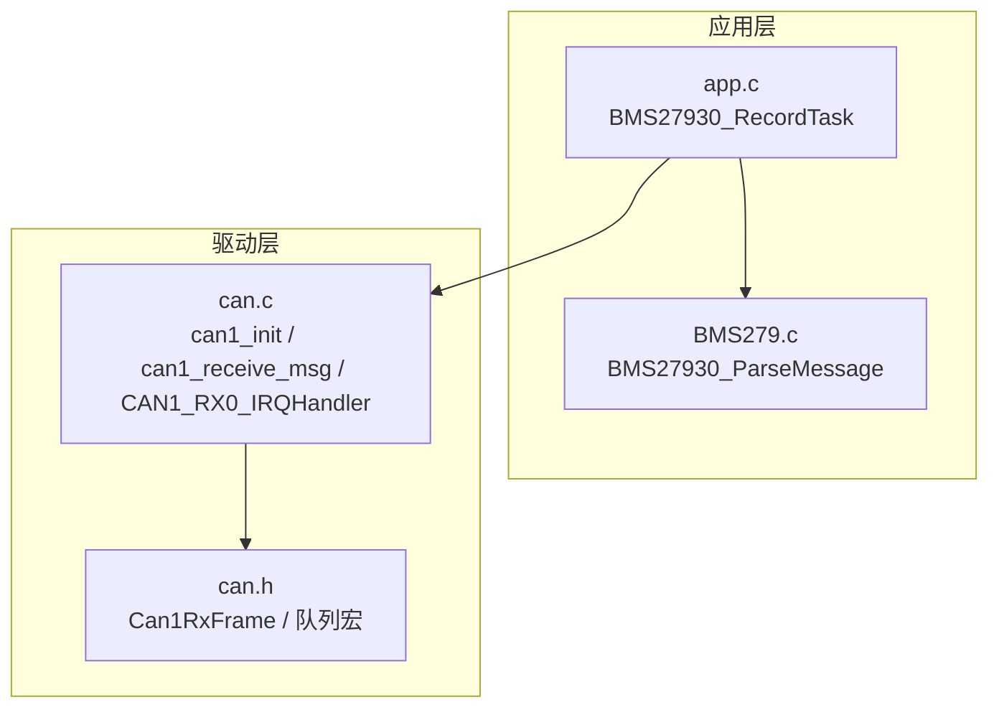
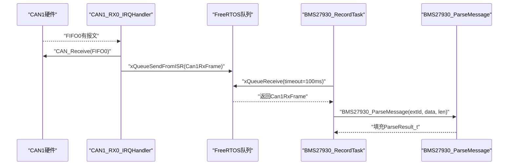
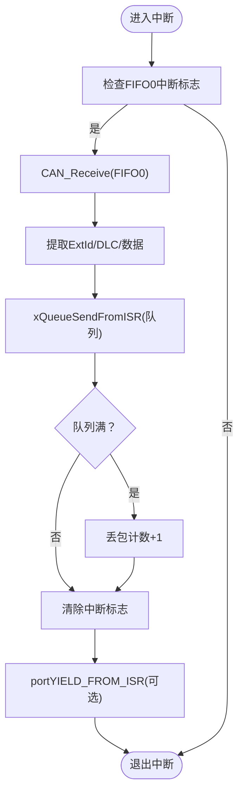
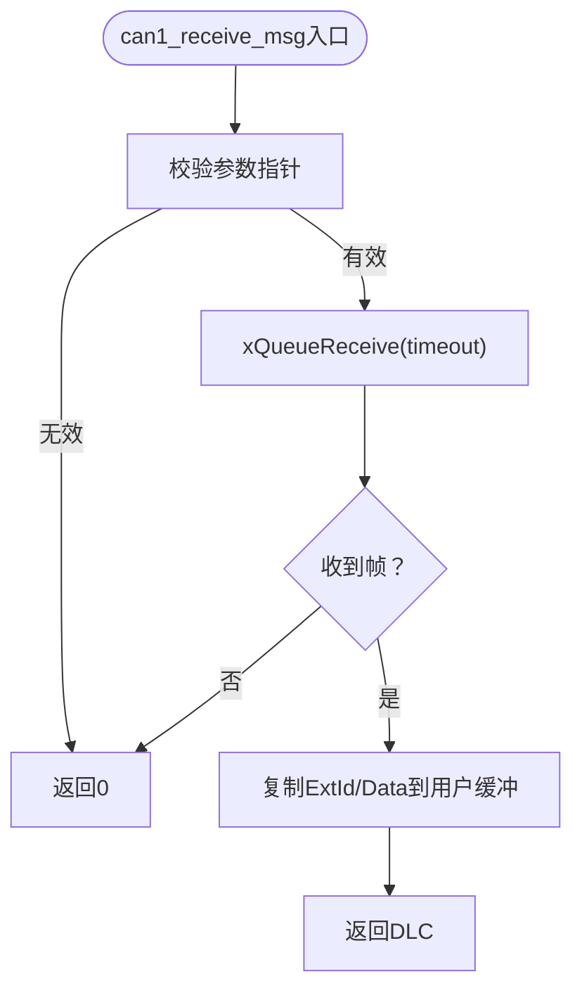
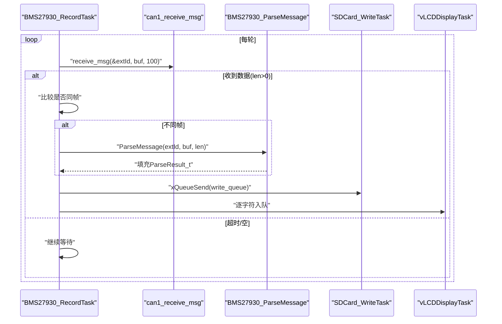
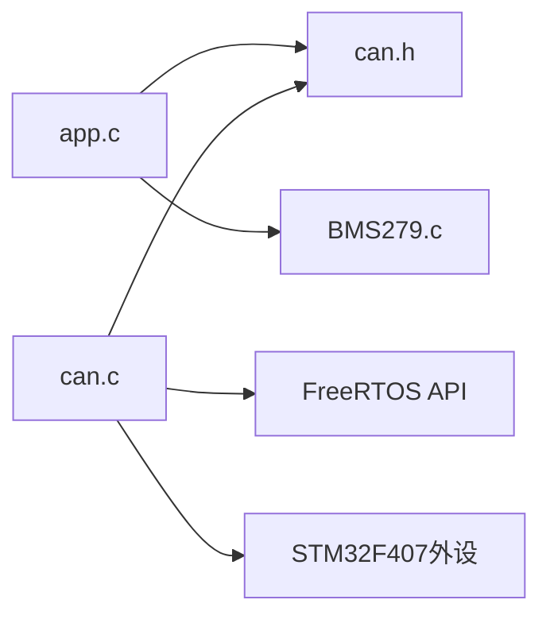

# CAN数据接收机制

<cite>
**本文引用的文件**   
- [can.c](file://_gbk_backup/Driver/BSP/can.c)
- [can.h](file://_gbk_backup/Driver/BSP/can.h)
- [BMS279.c](file://_gbk_backup/User/BMS279.c)
- [app.c](file://_gbk_backup/User/app.c)
</cite>

## 目录
1. [引言](#引言)
2. [项目结构](#项目结构)
3. [核心组件](#核心组件)
4. [架构总览](#架构总览)
5. [详细组件分析](#详细组件分析)
6. [依赖关系分析](#依赖关系分析)
7. [性能与配置建议](#性能与配置建议)
8. [故障排查指南](#故障排查指南)
9. [结论](#结论)

## 引言
本文围绕STM32F407上的CAN数据接收机制进行系统化说明，重点包括：
- can1_receive_msg函数的调用方式、超时处理与返回值解析
- 中断驱动的数据接收流程与FreeRTOS队列缓冲机制
- BMS27930_RecordTask中如何调用CAN接收函数并处理超时与错误
- CAN帧标准帧与扩展帧的处理差异
- FreeRTOS队列在CAN接收中的作用（创建、入队、出队）
- 性能优化建议（超时时间、队列深度等）

本说明面向不同技术背景的读者，既提供高层概览，也给出代码级细节与图示。

## 项目结构
本项目采用分层组织方式：
- Driver/BSP：底层硬件驱动（CAN1/CAN2初始化、中断、发送、接收队列）
- User：应用层逻辑（BMS279协议解析、任务调度、SD卡写入、LCD显示）

图表来源
- [app.c:200-309](file://_gbk_backup/User/app.c#L200-L309)
- [BMS279.c:42-114](file://_gbk_backup/User/BMS279.c#L42-L114)
- [can.c:40-106](file://_gbk_backup/Driver/BSP/can.c#L40-L106)
- [can.c:116-141](file://_gbk_backup/Driver/BSP/can.c#L116-L141)
- [can.c:186-224](file://_gbk_backup/Driver/BSP/can.c#L186-L224)
- [can.h:17-28](file://_gbk_backup/Driver/BSP/can.h#L17-L28)

章节来源
- [app.c:200-309](file://_gbk_backup/User/app.c#L200-L309)
- [can.c:40-106](file://_gbk_backup/Driver/BSP/can.c#L40-L106)
- [can.h:17-28](file://_gbk_backup/Driver/BSP/can.h#L17-L28)

## 核心组件
- CAN1驱动（中断接收 + FreeRTOS队列）
  - can1_init：硬件初始化、过滤器配置、NVIC中断使能
  - CAN1_RX0_IRQHandler：中断服务函数，从FIFO读取报文，封装为自定义帧结构，入队到FreeRTOS队列
  - can1_receive_msg：阻塞式从队列取帧，返回DLC或0（超时/空）
- BMS279协议解析
  - BMS27930_ParseMessage：根据CAN ID分发到具体报文解析器
- 应用任务
  - BMS27930_RecordTask：循环调用can1_receive_msg，解析并记录日志，同时推送至SD卡与LCD显示队列

章节来源
- [can.c:40-106](file://_gbk_backup/Driver/BSP/can.c#L40-L106)
- [can.c:116-141](file://_gbk_backup/Driver/BSP/can.c#L116-L141)
- [can.c:186-224](file://_gbk_backup/Driver/BSP/can.c#L186-L224)
- [BMS279.c:42-114](file://_gbk_backup/User/BMS279.c#L42-L114)
- [app.c:200-309](file://_gbk_backup/User/app.c#L200-L309)

## 架构总览
下图展示从硬件中断到应用任务的完整数据流：

图表来源
- [can.c:186-224](file://_gbk_backup/Driver/BSP/can.c#L186-L224)
- [can.c:116-141](file://_gbk_backup/Driver/BSP/can.c#L116-L141)
- [app.c:200-309](file://_gbk_backup/User/app.c#L200-L309)
- [BMS279.c:42-114](file://_gbk_backup/User/BMS279.c#L42-L114)

## 详细组件分析

### CAN1中断接收与队列缓冲
- 硬件初始化
  - 使能GPIOA复用功能（PA11 RX / PA12 TX）
  - 配置CAN1控制器参数（波特率、模式、重传等）
  - 配置过滤器（掩码模式，不过滤，关联FIFO0）
  - 配置NVIC中断优先级（满足FreeRTOS要求），使能FIFO0接收中断
- 中断服务函数
  - 检查FIFO0中断标志
  - 从FIFO0读取报文（自动释放FIFO空间）
  - 提取扩展ID和数据长度，复制有效数据
  - 使用xQueueSendFromISR将帧入队；若队列满则丢包计数+1
  - 清除中断挂起位，必要时请求任务切换
- 队列数据结构
  - Can1RxFrame包含扩展ID、数据负载、数据长度码
  - 全局队列句柄can1_rx_queue由驱动层维护

图表来源
- [can.c:186-224](file://_gbk_backup/Driver/BSP/can.c#L186-L224)
- [can.h:17-28](file://_gbk_backup/Driver/BSP/can.h#L17-L28)

章节来源
- [can.c:40-106](file://_gbk_backup/Driver/BSP/can.c#L40-L106)
- [can.c:186-224](file://_gbk_backup/Driver/BSP/can.c#L186-L224)
- [can.h:17-28](file://_gbk_backup/Driver/BSP/can.h#L17-L28)

### can1_receive_msg调用方式、超时与返回值
- 调用方式
  - 传入extId指针、buf缓冲区、timeout_ms（毫秒）
  - 内部通过xQueueReceive阻塞等待指定时长
- 返回值解析
  - 成功：返回实际DLC（1~8），extId和buf被填充
  - 失败：返回0（超时或队列为空）
- 典型用法
  - 在BMS27930_RecordTask中以固定周期轮询，超时时间100ms

图表来源
- [can.c:116-141](file://_gbk_backup/Driver/BSP/can.c#L116-L141)

章节来源
- [can.c:116-141](file://_gbk_backup/Driver/BSP/can.c#L116-L141)

### BMS27930_RecordTask中的CAN接收与处理
- 主循环
  - 调用can1_receive_msg(&extId, buf, 100)
  - 若len > 0：
    - 获取时间戳
    - 判断是否与上一帧相同（ID、长度、内容一致）
    - 相同帧：仅记录原始数据
    - 不同帧：调用BMS27930_ParseMessage解析，格式化输出
  - 将结果推送到SD卡写队列与LCD显示队列
- 超时与错误处理
  - 当返回0时，表示无新数据（超时或队列空），继续下一轮轮询
  - 对SD卡队列满的情况打印警告（示例中已有处理）

图表来源
- [app.c:200-309](file://_gbk_backup/User/app.c#L200-L309)
- [BMS279.c:42-114](file://_gbk_backup/User/BMS279.c#L42-L114)

章节来源
- [app.c:200-309](file://_gbk_backup/User/app.c#L200-L309)
- [BMS279.c:42-114](file://_gbk_backup/User/BMS279.c#L42-L114)

### CAN帧数据处理：标准帧与扩展帧的差异
- 当前实现仅支持扩展帧
  - 过滤器配置为“不过滤”，但中断服务函数中明确只提取ExtId，忽略标准帧
  - 发送函数固定IDE=扩展帧
- 影响
  - 标准帧不会被应用层解析（需修改过滤器与中断处理以兼容）
  - 如需同时处理标准帧，应：
    - 在中断中区分IDE标志
    - 扩展帧使用ExtId，标准帧使用StdId
    - 调整Can1RxFrame结构体以容纳两种ID类型

章节来源
- [can.c:186-224](file://_gbk_backup/Driver/BSP/can.c#L186-L224)
- [can.c:150-179](file://_gbk_backup/Driver/BSP/can.c#L150-L179)

### FreeRTOS队列在CAN接收中的作用
- 作用
  - 解耦中断与应用任务：中断快速入队，任务按需出队
  - 提供阻塞等待能力：can1_receive_msg可设置超时
  - 丢包统计：队列满时中断侧丢弃并计数
- 关键操作
  - 入队：xQueueSendFromISR（中断上下文）
  - 出队：xQueueReceive（任务上下文）
  - 队列深度：CAN1_RX_QUEUE_SIZE（头文件中定义）

章节来源
- [can.c:17-19](file://_gbk_backup/Driver/BSP/can.c#L17-L19)
- [can.c:186-224](file://_gbk_backup/Driver/BSP/can.c#L186-L224)
- [can.h:17-18](file://_gbk_backup/Driver/BSP/can.h#L17-L18)

## 依赖关系分析
- 模块耦合
  - app.c依赖can.h（接口）、BMS279.c（协议解析）
  - can.c依赖FreeRTOS队列API与STM32 HAL/标准库
- 外部依赖
  - FreeRTOS：任务、队列、定时器
  - STM32F407：CAN外设、NVIC、GPIO、RCC

图表来源
- [app.c:1-22](file://_gbk_backup/User/app.c#L1-L22)
- [can.c:11-15](file://_gbk_backup/Driver/BSP/can.c#L11-L15)
- [can.h:13-15](file://_gbk_backup/Driver/BSP/can.h#L13-L15)

章节来源
- [app.c:1-22](file://_gbk_backup/User/app.c#L1-L22)
- [can.c:11-15](file://_gbk_backup/Driver/BSP/can.c#L11-L15)
- [can.h:13-15](file://_gbk_backup/Driver/BSP/can.h#L13-L15)

## 性能与配置建议
- 超时时间设置
  - BMS27930_RecordTask中当前为100ms，适合一般采集频率
  - 若系统实时性要求更高，可降低至50ms；若CPU紧张，可适当提高
- 队列深度配置
  - CAN1_RX_QUEUE_SIZE默认10，适用于中等负载
  - 高吞吐场景建议增大至20~32，并结合丢包计数监控
- 丢包监控
  - 关注can1_rx_lost_count增长趋势，必要时提升队列深度或降低业务处理延迟
- 过滤器策略
  - 当前“不过滤”会接收所有扩展帧，若总线负载高，可增加过滤器减少无关报文
- 标准帧兼容
  - 如需支持标准帧，需扩展Can1RxFrame结构体并在中断中区分IDE

章节来源
- [app.c:200-309](file://_gbk_backup/User/app.c#L200-L309)
- [can.h:17-18](file://_gbk_backup/Driver/BSP/can.h#L17-L18)
- [can.c:186-224](file://_gbk_backup/Driver/BSP/can.c#L186-L224)

## 故障排查指南
- 现象：长时间无数据
  - 检查can1_init是否正确初始化（时钟、GPIO、过滤器、NVIC）
  - 确认CAN总线物理连接与终端电阻
  - 检查过滤器配置是否误过滤了目标ID
- 现象：频繁超时
  - 检查BMS27930_RecordTask的CAN接收超时设置是否合理
  - 观察SD卡写队列与LCD队列是否拥塞导致任务阻塞
- 现象：丢包计数增加
  - 增大CAN1_RX_QUEUE_SIZE
  - 优化下游任务处理速度（SD/LCD）
- 现象：标准帧无法解析
  - 当前实现仅处理扩展帧，需扩展中断与数据结构以支持标准帧

章节来源
- [can.c:40-106](file://_gbk_backup/Driver/BSP/can.c#L40-L106)
- [can.c:186-224](file://_gbk_backup/Driver/BSP/can.c#L186-L224)
- [app.c:200-309](file://_gbk_backup/User/app.c#L200-L309)

## 结论
本项目实现了基于STM32F407的CAN1中断接收与FreeRTOS队列缓冲机制，并通过BMS27930_RecordTask完成数据采集、解析与存储。当前实现专注于扩展帧，具备清晰的职责分离与良好的可扩展性。通过合理配置超时时间与队列深度，并结合丢包计数监控，可在不同负载场景下获得稳定可靠的CAN数据接收体验。未来如需支持标准帧或更复杂的过滤策略，可在现有架构上平滑扩展。