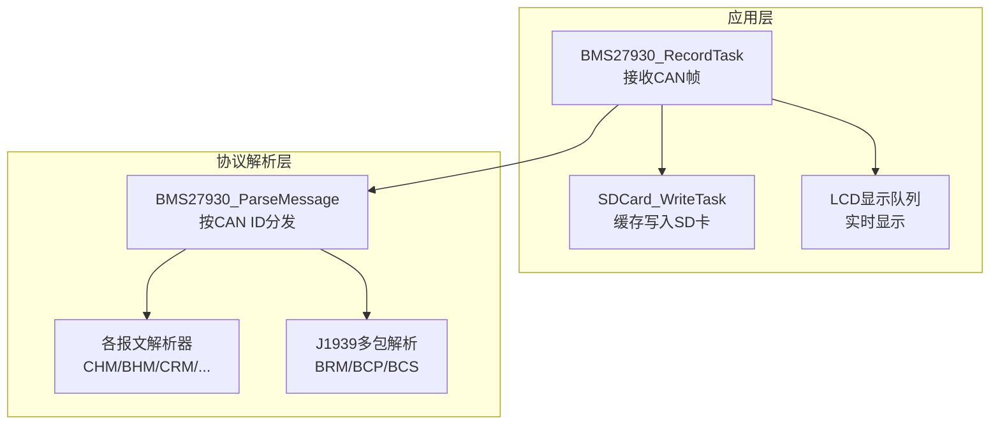
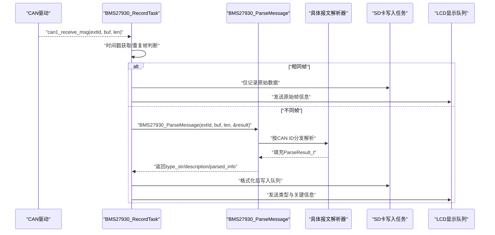
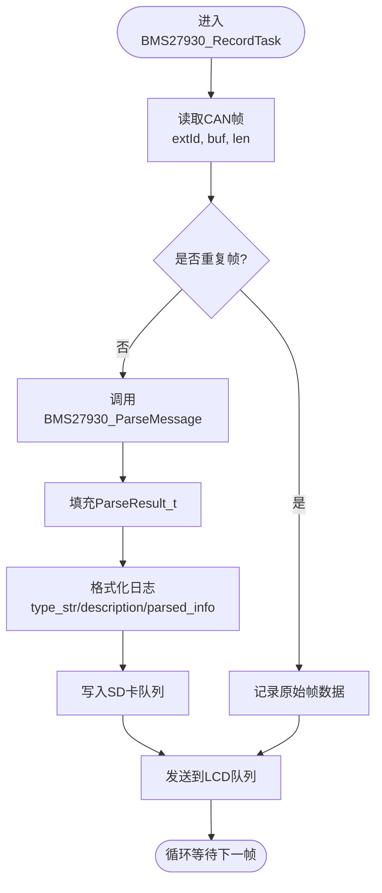
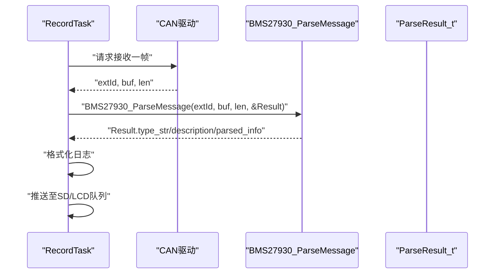
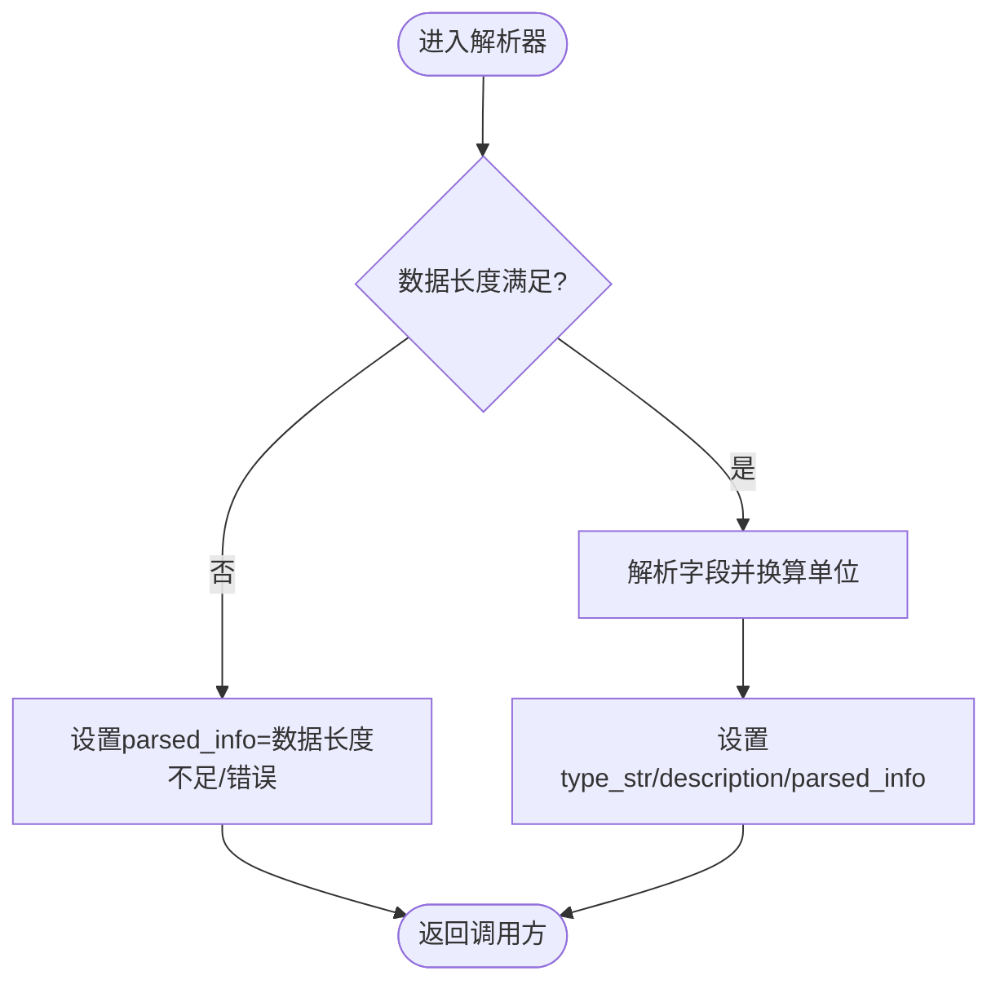
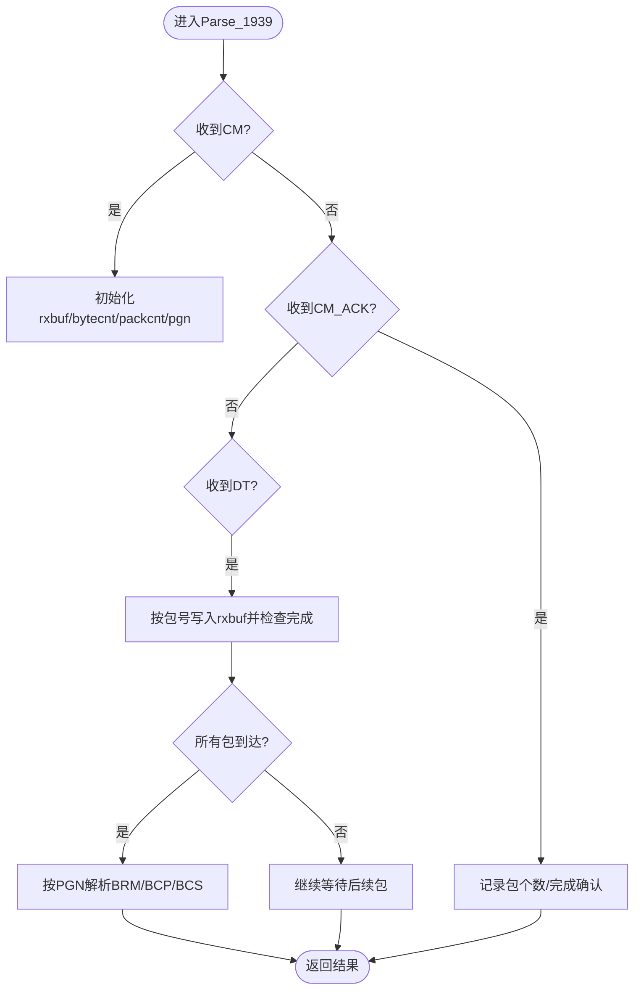
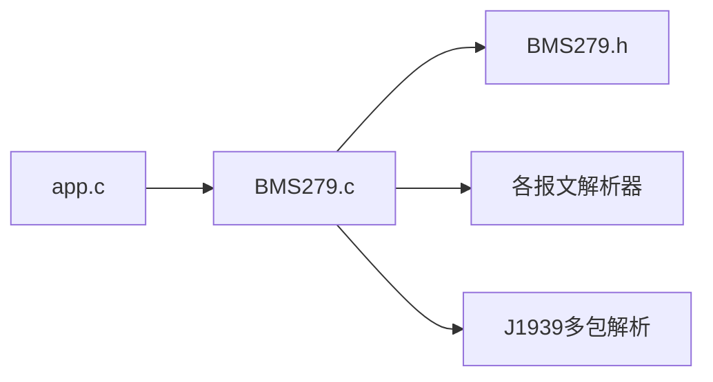

# 协议解析集成

<cite>
**本文引用的文件**   
- [BMS279.h](file://_gbk_backup/User/BMS279.h)
- [BMS279.c](file://_gbk_backup/User/BMS279.c)
- [app.c](file://_gbk_backup/User/app.c)
</cite>

## 目录
1. [引言](#引言)
2. [项目结构](#项目结构)
3. [核心组件](#核心组件)
4. [架构总览](#架构总览)
5. [详细组件分析](#详细组件分析)
6. [依赖关系分析](#依赖关系分析)
7. [性能与内存优化](#性能与内存优化)
8. [故障诊断与处理](#故障诊断与处理)
9. [结论](#结论)

## 引言
本文面向GB/T 27930-2015电动汽车充电协议的解析集成，重点说明：
- BMS27930_ParseMessage的调用时机、参数传递与结果处理
- ParseResult_t结构体的字段含义与使用方法
- 从CAN数据构建协议消息并调用解析函数的完整流程
- 解析成功/失败的处理分支与错误码含义
- 解析结果到可读格式的转换（数值换算、单位换算）
- 解析性能优化建议与内存使用最佳实践
- 常见解析错误的诊断与解决方法

## 项目结构
本项目在用户层包含协议解析模块与FreeRTOS任务调度：
- 协议解析头文件定义：BMS279.h
- 协议解析实现：BMS279.c
- FreeRTOS任务中接收CAN帧并调用解析函数：app.c

图表来源
- [app.c:200-309](file://_gbk_backup/User/app.c#L200-L309)
- [BMS279.c:42-114](file://_gbk_backup/User/BMS279.c#L42-L114)
- [BMS279.c:557-708](file://_gbk_backup/User/BMS279.c#L557-L708)

章节来源
- [app.c:200-309](file://_gbk_backup/User/app.c#L200-L309)
- [BMS279.c:42-114](file://_gbk_backup/User/BMS279.c#L42-L114)

## 核心组件
- BMS27930_ParseMessage：根据CAN ID将原始数据分发给具体报文解析器，填充ParseResult_t。
- ParseResult_t：统一输出结构体，包含报文类型字符串、描述文本与解析详情。
- 各报文解析器：针对GB/T 27930定义的报文类型进行字节级解析与单位换算。
- J1939多包解析：支持连接管理、确认与数据包的组包与重组，再交由具体PGN解析。

章节来源
- [BMS279.h:46-51](file://_gbk_backup/User/BMS279.h#L46-L51)
- [BMS279.c:42-114](file://_gbk_backup/User/BMS279.c#L42-L114)
- [BMS279.c:557-708](file://_gbk_backup/User/BMS279.c#L557-L708)

## 架构总览
下图展示从CAN接收到解析输出的端到端流程：

图表来源
- [app.c:200-309](file://_gbk_backup/User/app.c#L200-L309)
- [BMS279.c:42-114](file://_gbk_backup/User/BMS279.c#L42-L114)

## 详细组件分析

### BMS27930_ParseMessage 调用时机、参数与结果处理
- 调用时机
  - 在BMS27930_RecordTask中，每次收到非重复帧时调用。
  - 对重复帧仅记录原始数据，避免重复解析开销。
- 参数传递
  - canId：扩展CAN ID，用于识别报文类型。
  - data：指向8字节数据的指针。
  - len：数据长度。
  - result：指向ParseResult_t的输出指针。
- 结果处理
  - 解析成功后，task读取parse_result.type_str、description、parsed_info，格式化后写入SD卡队列与LCD队列。

图表来源
- [app.c:200-309](file://_gbk_backup/User/app.c#L200-L309)
- [BMS279.c:42-114](file://_gbk_backup/User/BMS279.c#L42-L114)

章节来源
- [app.c:200-309](file://_gbk_backup/User/app.c#L200-L309)
- [BMS279.c:42-114](file://_gbk_backup/User/BMS279.c#L42-L114)

### ParseResult_t 结构体字段含义与使用方法
- type_str[16]：报文类型字符串，如“CHM”“BHM”“CRM”等。
- description[64]：报文中文描述，如“充电机握手”“车辆握手”等。
- parsed_info[512]：解析后的详细信息，包含数值换算后的可读文本。

使用方法
- 在task中声明局部变量ParseResult_t parse_result。
- 调用BMS27930_ParseMessage后，直接读取三个字段进行日志与显示。

章节来源
- [BMS279.h:46-51](file://_gbk_backup/User/BMS279.h#L46-L51)
- [app.c:200-309](file://_gbk_backup/User/app.c#L200-L309)

### 从CAN数据构建协议消息并调用解析函数
- 步骤
  1) 通过can1_receive_msg获取extId、buf、len。
  2) 若为不同帧，调用BMS27930_ParseMessage(extId, buf, len, &parse_result)。
  3) 将parse_result.type_str、description、parsed_info格式化到日志缓冲区。
  4) 将日志推送到SD卡队列与LCD队列。

图表来源
- [app.c:200-309](file://_gbk_backup/User/app.c#L200-L309)
- [BMS279.c:42-114](file://_gbk_backup/User/BMS279.c#L42-L114)

章节来源
- [app.c:200-309](file://_gbk_backup/User/app.c#L200-L309)
- [BMS279.c:42-114](file://_gbk_backup/User/BMS279.c#L42-L114)

### 解析成功与失败的处理流程
- 成功路径
  - 解析器设置type_str、description与parsed_info。
  - task格式化并输出。
- 失败路径
  - 多数解析器在数据长度不足或格式异常时，会在parsed_info中写入“数据长度不足”或“数据长度错误”。
  - 对于未知CAN ID，默认走J1939多包解析分支；若不符合J1939流程，则不会填充有效信息。
- 错误码含义
  - 本实现未返回显式错误码，而是通过parsed_info中的文本提示与空/默认值表达失败状态。
  - 建议在调用方检查parsed_info是否为“数据长度不足/错误”，或type_str是否为空以判定失败。

图表来源
- [BMS279.c:119-146](file://_gbk_backup/User/BMS279.c#L119-L146)
- [BMS279.c:151-170](file://_gbk_backup/User/BMS279.c#L151-L170)
- [BMS279.c:199-211](file://_gbk_backup/User/BMS279.c#L199-L211)

章节来源
- [BMS279.c:119-146](file://_gbk_backup/User/BMS279.c#L119-L146)
- [BMS279.c:151-170](file://_gbk_backup/User/BMS279.c#L151-L170)
- [BMS279.c:199-211](file://_gbk_backup/User/BMS279.c#L199-L211)

### 解析结果转换为可读格式（数值转换与单位换算）
- 电压换算
  - 0.1V系数：例如最高允许电压、输出电压等，乘以0.1得到伏特。
  - 0.01V系数：单体电池电压，乘以0.01得到伏特。
- 电流换算
  - 偏移400A：实际电流 = 400 - (raw * 0.1)，或( raw - 400 ) * 0.1，依报文而定。
- 温度换算
  - 偏移50℃：实际温度 = raw - 50。
- SOC
  - 百分比：通常raw即为百分比或需乘以0.1%。
- 能量
  - 0.1kWh：输出能量乘以0.1得到千瓦时。

示例（不展示代码内容，仅给出路径）
- CHM：协议版本直接拼接。
- BHM：最高允许电压 = raw * 0.1V。
- CRM：辨识结果与充电机编号拼接。
- CTS：时间拼装为“年-月-日 时:分:秒”。
- CML：最大/最小电压与电流换算。
- BCL/CCS：需求/输出电流按偏移400A换算。
- BSM/BMT：温度偏移50℃。
- BSD/CSD：统计信息与能量换算。

章节来源
- [BMS279.c:119-146](file://_gbk_backup/User/BMS279.c#L119-L146)
- [BMS279.c:151-170](file://_gbk_backup/User/BMS279.c#L151-L170)
- [BMS279.c:199-211](file://_gbk_backup/User/BMS279.c#L199-L211)
- [BMS279.c:216-234](file://_gbk_backup/User/BMS279.c#L216-L234)
- [BMS279.c:271-312](file://_gbk_backup/User/BMS279.c#L271-L312)
- [BMS279.c:317-344](file://_gbk_backup/User/BMS279.c#L317-L344)
- [BMS279.c:349-392](file://_gbk_backup/User/BMS279.c#L349-L392)
- [BMS279.c:469-510](file://_gbk_backup/User/BMS279.c#L469-L510)

### J1939多包解析流程
- 连接管理（CM）：开启传输，提取总字节数、包个数、PGN。
- 确认（CM_ACK）：确认接收与完成。
- 数据（DT）：按包序号写入缓冲，完成后按PGN解析BRM/BCP/BCS。

图表来源
- [BMS279.c:557-708](file://_gbk_backup/User/BMS279.c#L557-L708)

章节来源
- [BMS279.c:557-708](file://_gbk_backup/User/BMS279.c#L557-L708)

## 依赖关系分析
- app.c依赖BMS279.c提供的BMS27930_ParseMessage接口。
- BMS279.c内部依赖BMS279.h中的CAN ID常量与ParseResult_t结构体。
- J1939解析逻辑作为默认分支，处理非标准27930报文。

图表来源
- [app.c:200-309](file://_gbk_backup/User/app.c#L200-L309)
- [BMS279.c:42-114](file://_gbk_backup/User/BMS279.c#L42-L114)
- [BMS279.h:21-44](file://_gbk_backup/User/BMS279.h#L21-L44)

章节来源
- [app.c:200-309](file://_gbk_backup/User/app.c#L200-L309)
- [BMS279.c:42-114](file://_gbk_backup/User/BMS279.c#L42-L114)
- [BMS279.h:21-44](file://_gbk_backup/User/BMS279.h#L21-L44)

## 性能与内存优化
- 减少重复解析
  - 已在task中对重复帧跳过解析，仅记录原始数据，降低CPU占用。
- 控制sprintf频率
  - 解析器内部频繁使用sprintf，建议在高频场景下考虑预分配缓冲区或使用轻量级格式化函数。
- 静态缓冲复用
  - J1939解析使用静态rxbuf与packReceived数组，避免动态分配，提升实时性。
- 队列背压保护
  - SD卡与LCD队列满时打印警告，避免阻塞主循环。
- 内存使用最佳实践
  - 尽量使用栈上小对象（如ParseResult_t），避免堆分配。
  - 大缓冲区（如rxbuf）使用静态存储，减少碎片化。
  - 限制parsed_info长度，防止溢出（当前512字节）。

章节来源
- [app.c:200-309](file://_gbk_backup/User/app.c#L200-L309)
- [BMS279.c:557-708](file://_gbk_backup/User/BMS279.c#L557-L708)

## 故障诊断与处理
- 数据长度不足/错误
  - 现象：parsed_info中出现“数据长度不足”或“数据长度错误”。
  - 原因：CAN帧长度不符合报文定义。
  - 处理：检查CAN驱动过滤配置与设备端报文长度。
- 未知CAN ID
  - 现象：进入J1939分支但无有效解析结果。
  - 原因：非GB/T 27930标准ID或未正确配置PGN。
  - 处理：核对CAN ID表与PGN映射。
- J1939组包不完整
  - 现象：DT包序号非法或未完成。
  - 原因：丢包或顺序错乱。
  - 处理：增加重传机制或超时复位组包状态。
- 数值异常
  - 现象：电流为负或温度超出范围。
  - 原因：偏移量或符号位处理不当。
  - 处理：校验raw取值范围与符号扩展。

章节来源
- [BMS279.c:119-146](file://_gbk_backup/User/BMS279.c#L119-L146)
- [BMS279.c:151-170](file://_gbk_backup/User/BMS279.c#L151-L170)
- [BMS279.c:557-708](file://_gbk_backup/User/BMS279.c#L557-L708)

## 结论
- BMS27930_ParseMessage提供统一的解析入口，按CAN ID分发到具体报文解析器，填充ParseResult_t供上层使用。
- 解析结果通过type_str、description、parsed_info呈现，便于日志与显示。
- 数值换算遵循协议规范（0.1V/0.01V、偏移400A、偏移50℃等）。
- J1939多包解析支持BRM/BCP/BCS等PGN的重组与解析。
- 建议在高频场景下优化格式化与缓冲策略，确保实时性与稳定性。