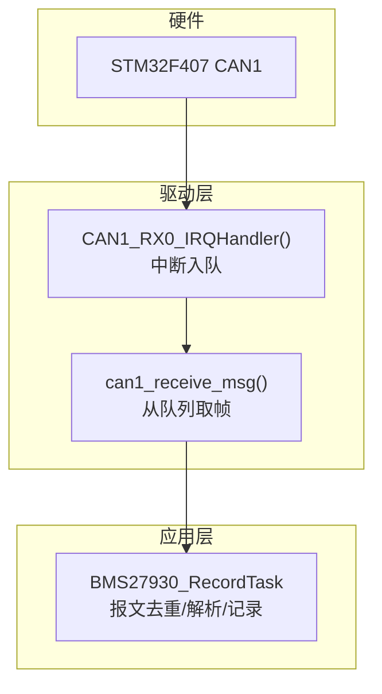
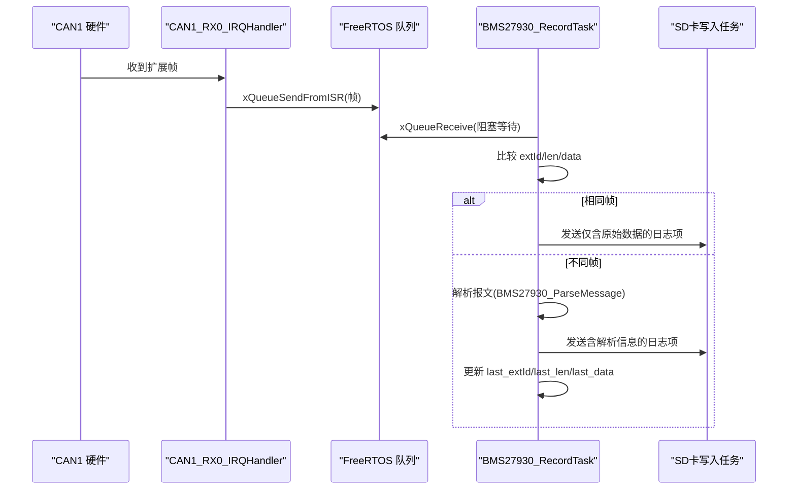
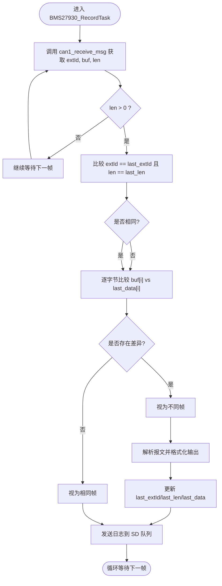
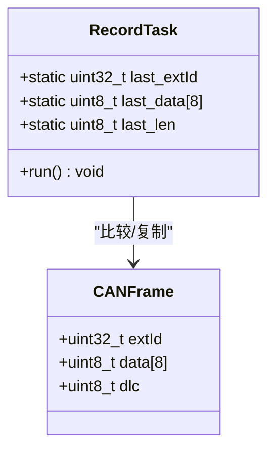

# 报文去重算法

<cite>
**本文引用的文件**   
- [app.c](file://_gbk_backup/User/app.c)
- [can.c](file://_gbk_backup/Driver/BSP/can.c)
- [can.h](file://_gbk_backup/Driver/BSP/can.h)
</cite>

## 目录
1. [简介](#简介)
2. [项目结构](#项目结构)
3. [核心组件](#核心组件)
4. [架构总览](#架构总览)
5. [详细组件分析](#详细组件分析)
6. [依赖关系分析](#依赖关系分析)
7. [性能与复杂度分析](#性能与复杂度分析)
8. [边界条件与异常处理](#边界条件与异常处理)
9. [优化建议](#优化建议)
10. [故障排查指南](#故障排查指南)
11. [结论](#结论)

## 简介
本文围绕 STM32F407 + FreeRTOS 的 CAN 数据采集系统中的“报文去重”逻辑进行系统化说明。重点包括：
- 扩展 ID 比较、数据长度检查与字节数组对比的实现原理
- 静态变量 last_extId、last_data、last_len 的作用与内存管理
- 去重对系统性能的影响与必要性
- 时间/空间复杂度分析与优化方向（如哈希表替代线性比较）
- 边界条件与异常处理策略

## 项目结构
本项目的报文去重逻辑位于应用层任务中，底层由 CAN 驱动提供中断接收与队列转发能力。关键文件职责如下：
- app.c：包含 BMS27930_RecordTask，实现 CAN 报文接收、去重判断、解析与记录
- can.c：CAN1/CAN2 驱动，负责硬件初始化、中断接收、队列发送与 API 封装
- can.h：定义 CAN 帧结构体与函数接口

图表来源
- [can.c:186-224](file://_gbk_backup/Driver/BSP/can.c#L186-L224)
- [can.c:116-141](file://_gbk_backup/Driver/BSP/can.c#L116-L141)
- [app.c:201-309](file://_gbk_backup/User/app.c#L201-L309)

章节来源
- [app.c:201-309](file://_gbk_backup/User/app.c#L201-L309)
- [can.c:116-141](file://_gbk_backup/Driver/BSP/can.c#L116-L141)
- [can.c:186-224](file://_gbk_backup/Driver/BSP/can.c#L186-L224)

## 核心组件
- 报文去重任务：BMS27930_RecordTask
  - 使用静态变量缓存上一帧的扩展ID、数据长度与数据内容
  - 新帧到达时先比较扩展ID与长度，再逐字节比较数据
  - 相同则仅记录原始帧；不同则解析并记录详细信息，同时更新缓存
- CAN 驱动：can1_receive_msg / CAN1_RX0_IRQHandler
  - 中断中将收到的扩展帧复制到自定义帧结构，并通过 FreeRTOS 队列发送到应用层
  - 应用层通过 can1_receive_msg 阻塞式读取帧

章节来源
- [app.c:201-309](file://_gbk_backup/User/app.c#L201-L309)
- [can.c:116-141](file://_gbk_backup/Driver/BSP/can.c#L116-L141)
- [can.c:186-224](file://_gbk_backup/Driver/BSP/can.c#L186-L224)

## 架构总览
下图展示了从硬件接收到应用层去重的完整流程。

图表来源
- [can.c:186-224](file://_gbk_backup/Driver/BSP/can.c#L186-L224)
- [can.c:116-141](file://_gbk_backup/Driver/BSP/can.c#L116-L141)
- [app.c:201-309](file://_gbk_backup/User/app.c#L201-L309)

## 详细组件分析

### 报文去重算法流程
该算法的核心是“三要素”比较：扩展ID、数据长度、数据内容。

图表来源
- [app.c:217-260](file://_gbk_backup/User/app.c#L217-L260)

章节来源
- [app.c:217-260](file://_gbk_backup/User/app.c#L217-L260)

### 静态变量与内存管理
- last_extId：保存上一帧的扩展ID（uint32_t），用于快速过滤
- last_len：保存上一帧的数据长度（uint8_t），在字节比较前先做长度校验
- last_data：保存上一帧的数据负载（uint8_t[8]），用于逐字节比对
- 这些变量为 static，生命周期贯穿任务运行期，避免重复分配/释放开销
- 当判定为“不同帧”时，会更新 last_extId、last_len，并用 memcpy 拷贝最新数据到 last_data

图表来源
- [app.c:203-260](file://_gbk_backup/User/app.c#L203-L260)
- [can.h:24-28](file://_gbk_backup/Driver/BSP/can.h#L24-L28)

章节来源
- [app.c:203-260](file://_gbk_backup/User/app.c#L203-L260)
- [can.h:24-28](file://_gbk_backup/Driver/BSP/can.h#L24-L28)

### 扩展ID比较与数据长度检查
- 扩展ID比较：直接比较两个 uint32_t 值，O(1)
- 数据长度检查：比较当前帧的 len 与 last_len，O(1)
- 若两者均相等，再进行字节级比较；否则直接判定为不同帧

章节来源
- [app.c:225-233](file://_gbk_backup/User/app.c#L225-L233)

### 字节数组对比逻辑
- 在确认 extId 与 len 一致后，遍历 buf 与 last_data 对应位置字节
- 一旦发现不相等，立即标记为不同帧并退出循环
- 若全部相等，则判定为相同帧，仅记录原始数据

章节来源
- [app.c:227-233](file://_gbk_backup/User/app.c#L227-L233)

### CAN 驱动与队列交互
- 中断服务函数将接收到的扩展帧复制到 Can1RxFrame，并通过 xQueueSendFromISR 入队
- 应用层通过 can1_receive_msg 从队列取出 extId、data、dlc，并返回实际长度
- 若队列满，中断侧丢弃报文并累加丢包计数

章节来源
- [can.c:186-224](file://_gbk_backup/Driver/BSP/can.c#L186-L224)
- [can.c:116-141](file://_gbk_backup/Driver/BSP/can.c#L116-L141)

## 依赖关系分析
- BMS27930_RecordTask 依赖 can1_receive_msg 获取帧
- can1_receive_msg 依赖 FreeRTOS 队列与 CAN1 中断
- 去重逻辑不依赖解析模块，但“不同帧”分支会调用解析并更新缓存

图表来源
- [app.c:217-260](file://_gbk_backup/User/app.c#L217-L260)
- [can.c:116-141](file://_gbk_backup/Driver/BSP/can.c#L116-L141)
- [can.c:186-224](file://_gbk_backup/Driver/BSP/can.c#L186-L224)

章节来源
- [app.c:217-260](file://_gbk_backup/User/app.c#L217-L260)
- [can.c:116-141](file://_gbk_backup/Driver/BSP/can.c#L116-L141)
- [can.c:186-224](file://_gbk_backup/Driver/BSP/can.c#L186-L224)

## 性能与复杂度分析
- 时间复杂度
  - 扩展ID比较：O(1)
  - 长度比较：O(1)
  - 字节数组对比：O(k)，其中 k = min(len, 8)
  - 整体最坏 O(k)，平均取决于数据变化频率
- 空间复杂度
  - 静态缓存 last_data 固定占用 8 字节
  - 无额外动态分配，空间开销恒定 O(1)
- 去重必要性
  - 减少重复解析与存储开销，降低 SD 写入压力
  - 提升显示与日志吞吐，避免队列拥塞
- 对系统性能的影响
  - 相同帧路径跳过解析与复杂格式化，显著降低 CPU 占用
  - 不同帧路径执行解析与格式化，CPU 开销较高，但只发生在数据变化时

章节来源
- [app.c:225-260](file://_gbk_backup/User/app.c#L225-L260)

## 边界条件与异常处理
- 空指针与无效长度
  - can1_receive_msg 对 extId/buf 空指针进行检查，返回 0
  - 应用层仅在 len > 0 时进入去重逻辑
- 长度越界保护
  - 中断侧复制数据时双重保护：i < DLC 且 i < 8
  - 应用层逐字节比较以 len 为上限，避免访问未初始化区域
- 队列满丢包
  - 中断侧 xQueueSendFromISR 失败时累加丢包计数
  - 应用层向 SD 队列发送失败时打印警告
- 首次运行状态
  - last_extId 初始为 0，last_len 初始为 0，last_data 全 0
  - 首个有效帧必然被视为“不同帧”，从而正确初始化缓存

章节来源
- [can.c:120-141](file://_gbk_backup/Driver/BSP/can.c#L120-L141)
- [can.c:204-216](file://_gbk_backup/Driver/BSP/can.c#L204-L216)
- [app.c:217-260](file://_gbk_backup/User/app.c#L217-L260)

## 优化建议
- 使用哈希表替代线性比较
  - 以 (extId, len) 作为键，计算哈希并存储最近一次的数据指纹或完整数据
  - 可支持多通道/多源去重，避免单点缓存导致的误判
- 增量校验
  - 引入 CRC 或滚动哈希，先比较摘要再比较字节，减少大数据量时的比较成本
- 滑动窗口去重
  - 维护一个小型 FIFO 或环形缓冲区，结合时间戳与序列号，避免历史重复
- 并发安全
  - 若未来存在多生产者/消费者场景，需对 last_* 静态变量加互斥锁或使用原子操作
- 自适应阈值
  - 根据队列深度与丢包率动态调整去重策略，例如在高负载时放宽去重条件

[本节为通用优化建议，不直接分析具体文件]

## 故障排查指南
- 现象：日志中出现大量重复行
  - 检查 last_extId/last_len/last_data 是否正确更新
  - 确认不同帧分支是否被触发
- 现象：丢包计数增长
  - 检查 CAN1 接收队列深度是否过小
  - 检查下游 SD 写入任务是否阻塞
- 现象：LCD 队列接近满载
  - 观察队列剩余空间与等待消息数
  - 考虑降低采集频率或增大队列容量

章节来源
- [can.c:212-216](file://_gbk_backup/Driver/BSP/can.c#L212-L216)
- [app.c:264-302](file://_gbk_backup/User/app.c#L264-L302)

## 结论
该系统的报文去重算法以“扩展ID + 长度 + 字节数组”的三段式比较为核心，借助静态缓存实现低开销的去重判断。其时间复杂度为 O(k)，空间复杂度为 O(1)，在高频重复帧场景下能显著降低解析与存储压力。通过引入哈希表、增量校验与并发安全机制，可进一步提升可扩展性与鲁棒性。