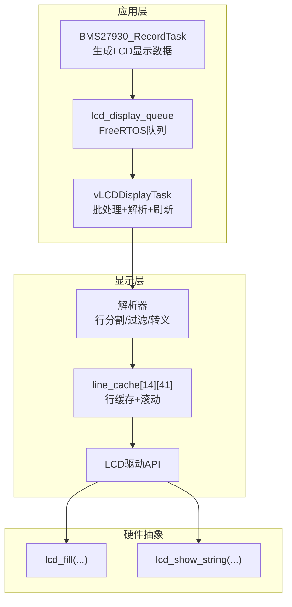
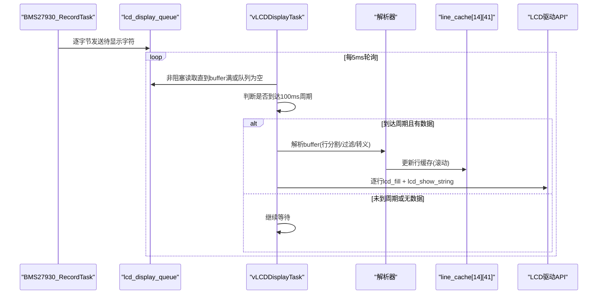
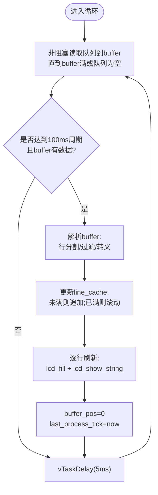
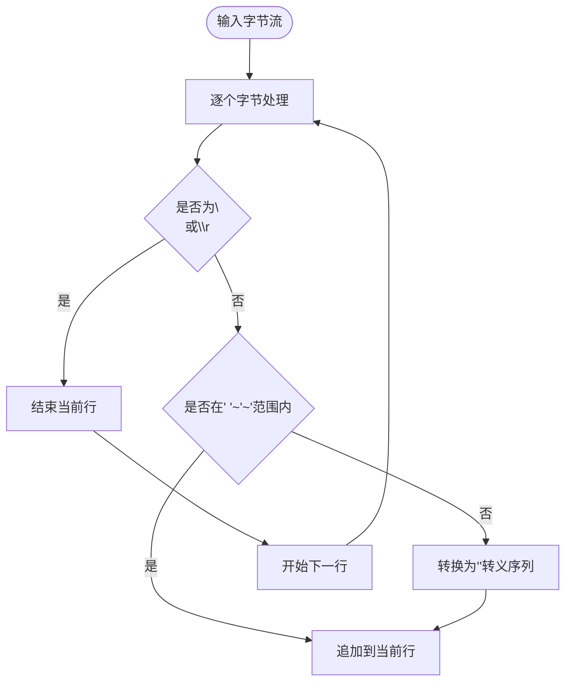
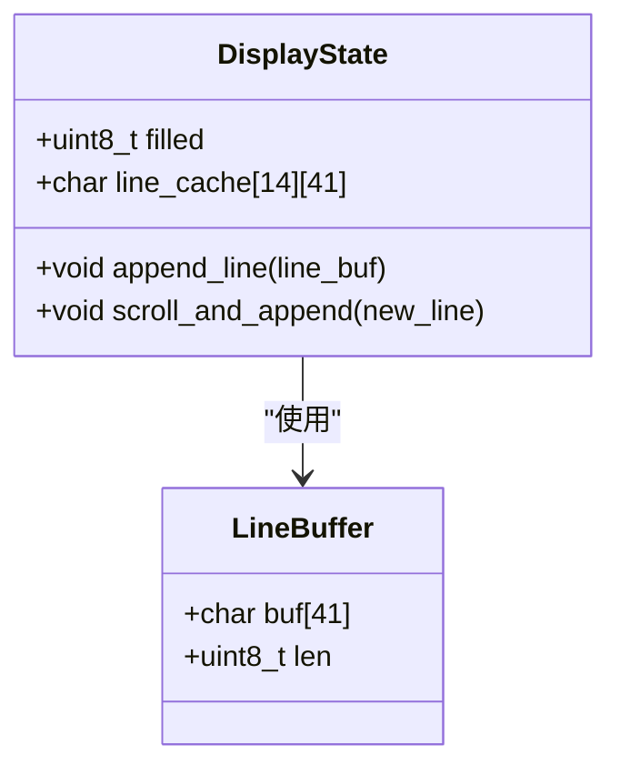
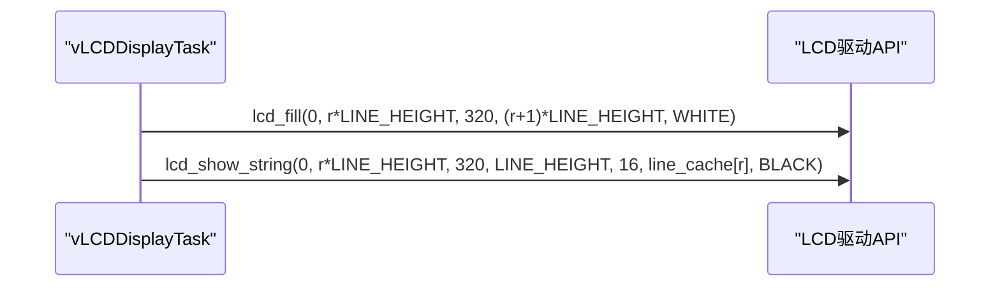
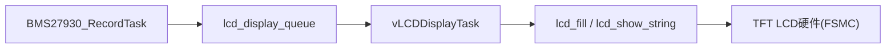

# LCD显示任务

<cite>
**本文引用的文件**   
- [app.c](file://_gbk_backup/User/app.c)
- [lcd.c](file://_gbk_backup/Driver/BSP/LCD/lcd.c)
- [lcd.h](file://_gbk_backup/Driver/BSP/LCD/lcd.h)
</cite>

## 目录
1. [简介](#简介)
2. [项目结构](#项目结构)
3. [核心组件](#核心组件)
4. [架构总览](#架构总览)
5. [详细组件分析](#详细组件分析)
6. [依赖关系分析](#依赖关系分析)
7. [性能与内存优化](#性能与内存优化)
8. [故障排查指南](#故障排查指南)
9. [结论](#结论)

## 简介
本文围绕 vLCDDisplayTask 的实现进行系统化文档化，重点说明：
- LCD 数据的批处理机制与 100ms 刷新周期
- 缓冲区管理与行缓存 line_cache 的滚动显示算法
- 字符解析逻辑（行分割、特殊字符处理、转义序列转换）
- LCD 硬件操作（lcd_fill、lcd_show_string）
- 显示性能优化与内存管理策略

该任务运行在 FreeRTOS 环境下，通过队列从 BMS 记录任务接收待显示数据，周期性批量解析并渲染到 LCD。

## 项目结构
与本任务直接相关的代码位于以下位置：
- 应用层任务与队列交互：User/app.c
- LCD 驱动与绘图 API：Driver/BSP/LCD/lcd.c、lcd.h

图表来源
- [app.c:200-309](file://_gbk_backup/User/app.c#L200-L309)
- [app.c:454-521](file://_gbk_backup/User/app.c#L454-L521)
- [lcd.c:885-901](file://_gbk_backup/Driver/BSP/LCD/lcd.c#L885-L901)
- [lcd.c:1271-1291](file://_gbk_backup/Driver/BSP/LCD/lcd.c#L1271-L1291)

章节来源
- [app.c:200-309](file://_gbk_backup/User/app.c#L200-L309)
- [app.c:454-521](file://_gbk_backup/User/app.c#L454-L521)
- [lcd.c:885-901](file://_gbk_backup/Driver/BSP/LCD/lcd.c#L885-L901)
- [lcd.c:1271-1291](file://_gbk_backup/Driver/BSP/LCD/lcd.c#L1271-L1291)

## 核心组件
- vLCDDisplayTask：主显示任务，负责从队列拉取数据、按 100ms 周期批处理、解析文本、维护行缓存并刷新屏幕。
- BMS27930_RecordTask：生产者任务，将 CAN 报文解析结果格式化后逐字节发送到 lcd_display_queue。
- LCD 驱动 API：lcd_fill 用于区域清屏，lcd_show_string 用于字符串绘制。

章节来源
- [app.c:454-521](file://_gbk_backup/User/app.c#L454-L521)
- [app.c:200-309](file://_gbk_backup/User/app.c#L200-L309)
- [lcd.c:885-901](file://_gbk_backup/Driver/BSP/LCD/lcd.c#L885-L901)
- [lcd.c:1271-1291](file://_gbk_backup/Driver/BSP/LCD/lcd.c#L1271-L1291)

## 架构总览
下图展示了从数据生产到屏幕刷新的完整流程，包括队列缓冲、批处理窗口、解析与渲染。

图表来源
- [app.c:200-309](file://_gbk_backup/User/app.c#L200-L309)
- [app.c:454-521](file://_gbk_backup/User/app.c#L454-L521)
- [lcd.c:885-901](file://_gbk_backup/Driver/BSP/LCD/lcd.c#L885-L901)
- [lcd.c:1271-1291](file://_gbk_backup/Driver/BSP/LCD/lcd.c#L1271-L1291)

## 详细组件分析

### vLCDDisplayTask 实现要点
- 批处理窗口
  - 使用固定大小 buffer[512] 收集来自队列的数据，采用非阻塞 xQueueReceive 快速累积。
  - 以 last_process_tick 为基准，当 now - last_process_tick >= 100ms 且 buffer_pos > 0 时触发解析与刷新。
- 行缓存与滚动显示
  - line_cache[14][41] 保存最多 14 行，每行最多 40 个可见字符加终止符。
  - filled 表示当前已填充行数；超过上限时执行滚动：前 MAX_LINES-1 行整体前移，最后一行写入新行。
- 刷新策略
  - 对每一行先调用 lcd_fill 清空背景，再调用 lcd_show_string 绘制文本。
  - 每次刷新完成后重置 buffer_pos 并更新时间戳。

图表来源
- [app.c:454-521](file://_gbk_backup/User/app.c#L454-L521)

章节来源
- [app.c:454-521](file://_gbk_backup/User/app.c#L454-L521)

### 字符解析逻辑
- 行分割
  - 遇到 '\n' 或 '\r' 即结束当前行，跳过空行。
- 可见字符过滤
  - 仅接受 ASCII 可打印范围 ' ' ~ '~'，其他字符被忽略。
- 转义序列转换
  - 对于不可见或非可打印字符，转换为 "<XX>" 形式的十六进制转义串，其中 XX 为该字节的十六进制表示。
  - 例如：字节 0x0A 会被转为 "<0A>"，便于在 LCD 上直观查看控制字符。

图表来源
- [app.c:478-507](file://_gbk_backup/User/app.c#L478-L507)

章节来源
- [app.c:478-507](file://_gbk_backup/User/app.c#L478-L507)

### 显示缓冲区管理
- line_cache 数组
  - 二维静态数组 line_cache[14][41]，用于缓存最近 14 行文本。
  - 使用 strncpy 安全拷贝，确保每行以 '\0' 结尾。
- 滚动算法
  - 当 filled < MAX_LINES 时，直接写入新行并递增 filled。
  - 否则，将第 1..MAX_LINES-2 行复制到第 0..MAX_LINES-2 位置，最后一行写入新行。
- 刷新范围
  - 仅对 filled 范围内的行进行 lcd_fill 和 lcd_show_string，避免无效绘制。

图表来源
- [app.c:458-516](file://_gbk_backup/User/app.c#L458-L516)

章节来源
- [app.c:458-516](file://_gbk_backup/User/app.c#L458-L516)

### LCD 硬件操作
- lcd_fill
  - 功能：在指定矩形区域内用单一颜色填充。
  - 参数：起始坐标(sx,sy)、结束坐标(ex,ey)、颜色(color)。
  - 用途：在每行绘制前先清屏，保证背景一致。
- lcd_show_string
  - 功能：在指定区域绘制字符串，支持自动换行与边界检查。
  - 参数：起始坐标(x,y)、区域宽高(width,height)、字体大小(size)、字符串指针(p)、颜色(color)。
  - 用途：将 line_cache 中的每行文本绘制到对应行高位置。

图表来源
- [app.c:510-513](file://_gbk_backup/User/app.c#L510-L513)
- [lcd.c:885-901](file://_gbk_backup/Driver/BSP/LCD/lcd.c#L885-L901)
- [lcd.c:1271-1291](file://_gbk_backup/Driver/BSP/LCD/lcd.c#L1271-L1291)

章节来源
- [app.c:510-513](file://_gbk_backup/User/app.c#L510-L513)
- [lcd.c:885-901](file://_gbk_backup/Driver/BSP/LCD/lcd.c#L885-L901)
- [lcd.c:1271-1291](file://_gbk_backup/Driver/BSP/LCD/lcd.c#L1271-L1291)

## 依赖关系分析
- 任务间通信
  - BMS27930_RecordTask 通过 lcd_display_queue 向 vLCDDisplayTask 发送数据。
  - 队列容量与使用率监控：当剩余空间小于阈值时输出警告日志。
- 模块耦合
  - vLCDDisplayTask 依赖 LCD 驱动 API（lcd_fill、lcd_show_string）。
  - 字体与点阵数据由 lcdfont.h 提供（包含于 lcd.c）。

图表来源
- [app.c:200-309](file://_gbk_backup/User/app.c#L200-L309)
- [app.c:454-521](file://_gbk_backup/User/app.c#L454-L521)
- [lcd.c:885-901](file://_gbk_backup/Driver/BSP/LCD/lcd.c#L885-L901)
- [lcd.c:1271-1291](file://_gbk_backup/Driver/BSP/LCD/lcd.c#L1271-L1291)

章节来源
- [app.c:200-309](file://_gbk_backup/User/app.c#L200-L309)
- [app.c:454-521](file://_gbk_backup/User/app.c#L454-L521)

## 性能与内存优化
- 批处理与定时刷新
  - 100ms 周期聚合多帧数据，减少频繁解析与刷屏开销。
  - 使用 vTaskDelay(5ms) 降低 CPU 占用，同时保持响应性。
- 缓冲区设计
  - 512 字节 buffer 足够容纳短时间内的数据突发；若出现丢帧，可适当增大 buffer 或提高队列容量。
- 行缓存与滚动
  - 静态数组 line_cache 避免动态分配，减少碎片与分配开销。
  - 滚动复制使用 strncpy，保证安全与效率。
- 绘制优化
  - 先 lcd_fill 再 lcd_show_string，避免重叠绘制导致的闪烁。
  - 仅对有效行（filled）进行刷新，减少不必要的像素写入。
- 队列监控
  - 当队列使用率超过 80% 时输出警告，便于定位上游数据过快或下游处理瓶颈。

章节来源
- [app.c:270-302](file://_gbk_backup/User/app.c#L270-L302)
- [app.c:454-521](file://_gbk_backup/User/app.c#L454-L521)

## 故障排查指南
- 现象：LCD 显示空白或乱码
  - 检查 lcd_display_queue 是否有数据，确认 BMS27930_RecordTask 是否正常发送。
  - 检查队列使用率告警，必要时增大队列长度或调整 producer 速率。
- 现象：刷新卡顿或掉帧
  - 观察 100ms 周期是否稳定；若 buffer 频繁溢出，考虑增大 buffer 或提升队列容量。
  - 检查 LCD 初始化与背光状态，确保 lcd_backlight_on 已调用。
- 现象：特殊字符显示异常
  - 确认转义序列 "<XX>" 是否正确生成；检查字符过滤逻辑是否误删必要字符。
- 现象：滚动错乱
  - 检查 filled 计数与滚动逻辑；确保 strncpy 目标长度正确，避免越界。

章节来源
- [app.c:270-302](file://_gbk_backup/User/app.c#L270-L302)
- [app.c:454-521](file://_gbk_backup/User/app.c#L454-L521)

## 结论
vLCDDisplayTask 通过“队列缓冲 + 100ms 批处理 + 行缓存滚动”的组合策略，实现了高效稳定的 LCD 文本显示。其字符解析逻辑兼顾可读性与健壮性，LCD 驱动 API 调用清晰明确。在实际部署中，建议根据数据吞吐情况调优 buffer 与队列大小，并结合队列使用率告警进行性能监控与容量规划。