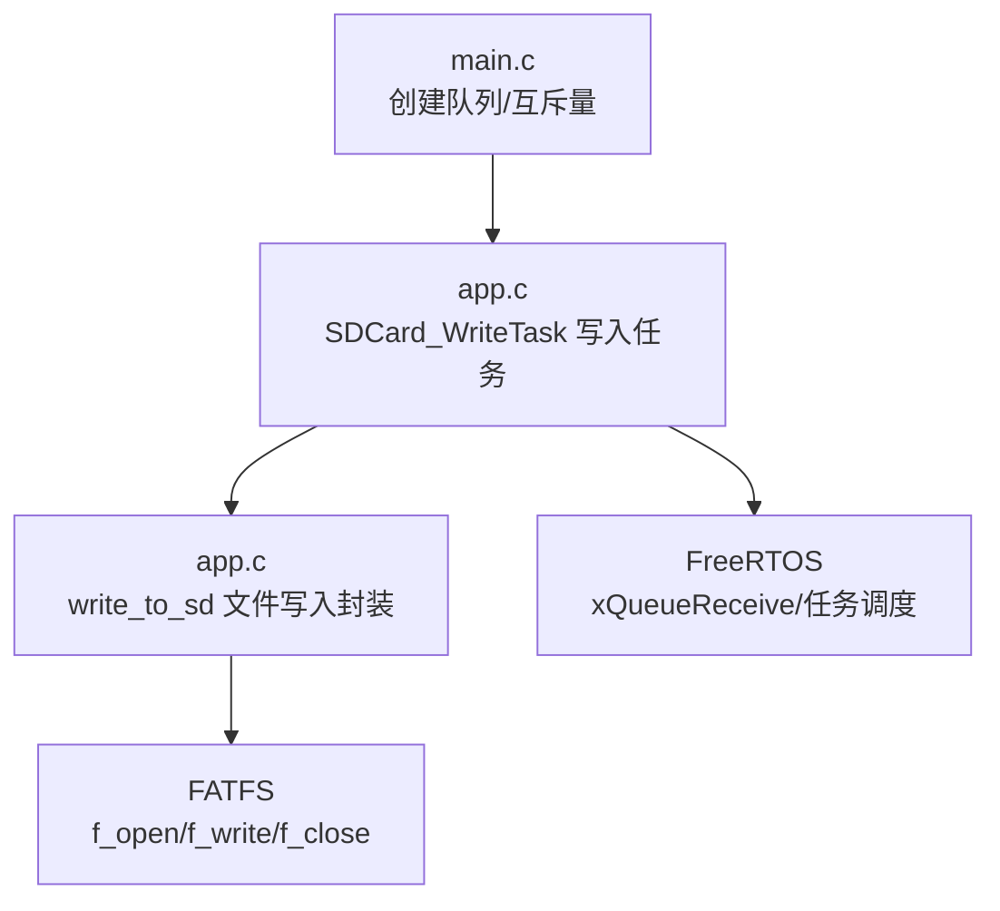
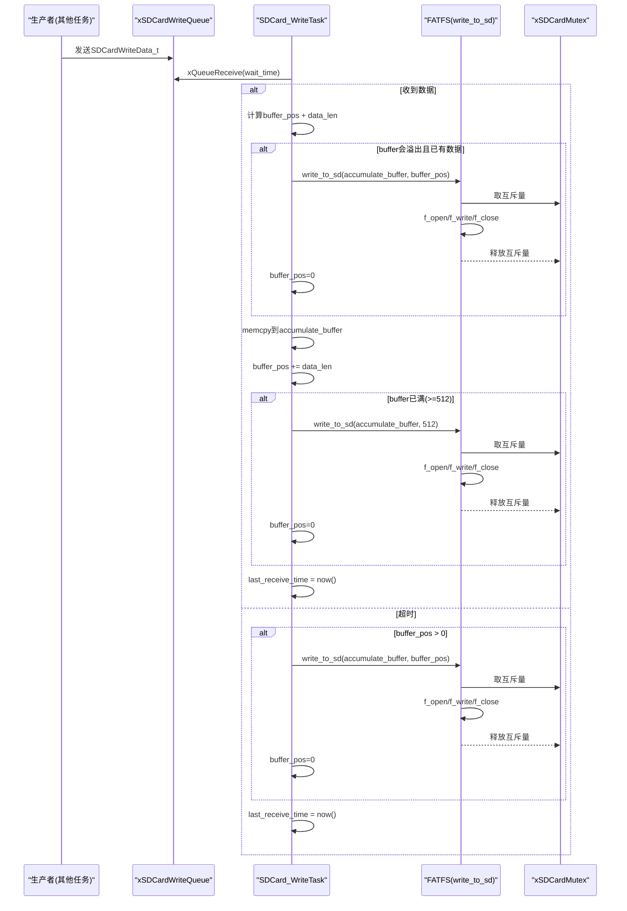
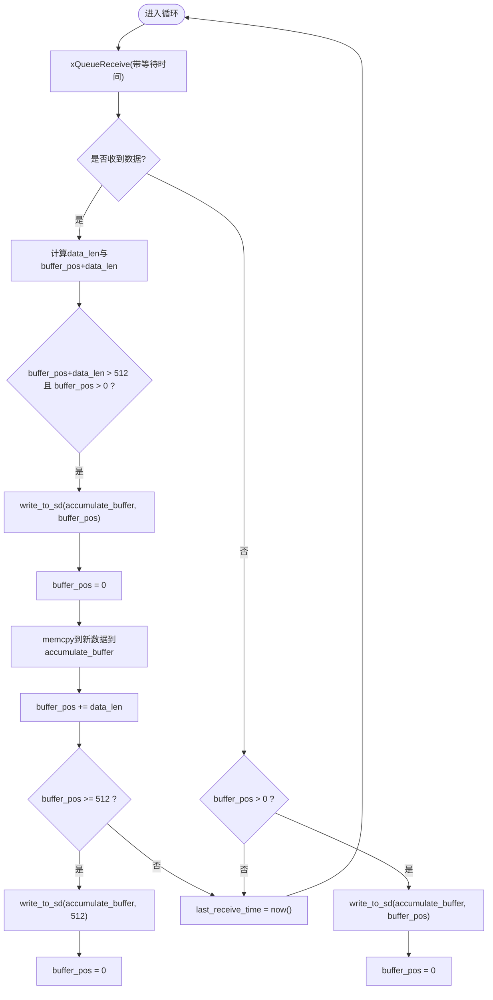
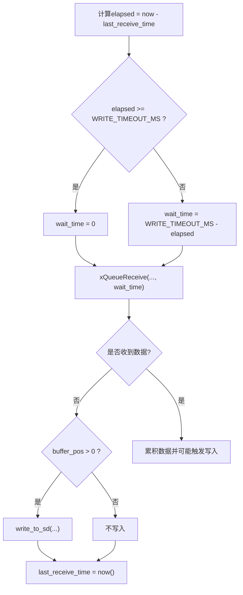
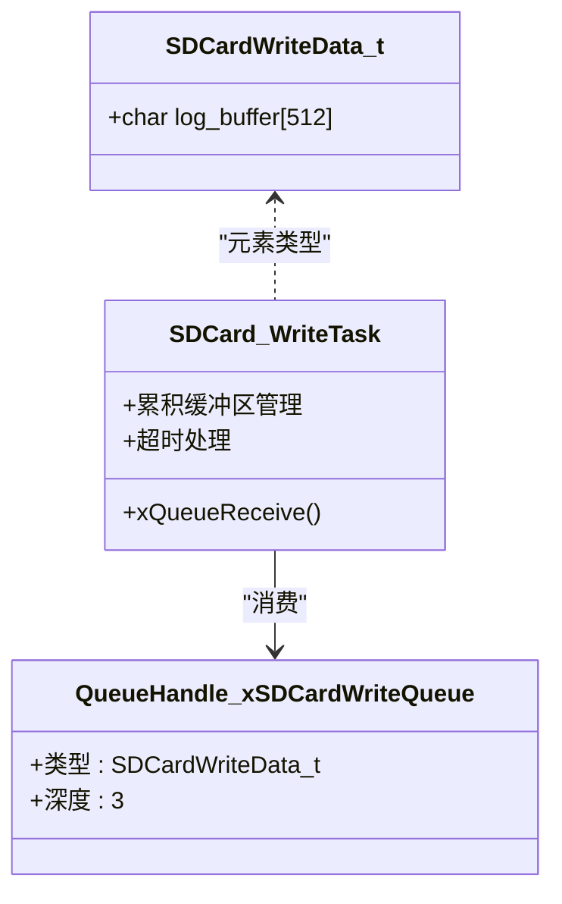
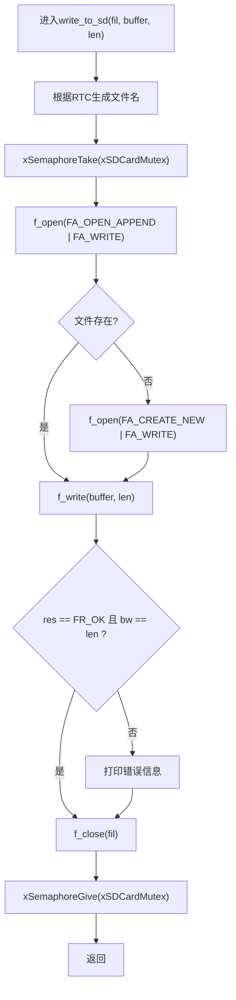
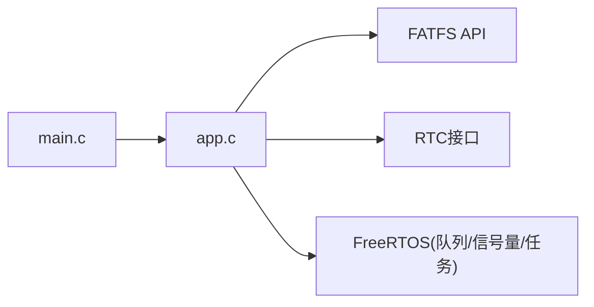

# SD卡写入任务

<cite>
**本文引用的文件**   
- [app.c](file://_gbk_backup/User/app.c)
- [app.h](file://_gbk_backup/User/app.h)
- [main.c](file://_gbk_backup/User/main.c)
</cite>

## 目录
1. [简介](#简介)
2. [项目结构](#项目结构)
3. [核心组件](#核心组件)
4. [架构总览](#架构总览)
5. [详细组件分析](#详细组件分析)
6. [依赖关系分析](#依赖关系分析)
7. [性能与可靠性考量](#性能与可靠性考量)
8. [故障排查指南](#故障排查指南)
9. [结论](#结论)

## 简介
本文面向SD卡写入任务的实现细节，重点说明扇区级数据缓存机制、超时写入策略、队列接收处理、文件操作封装以及SD卡保护与错误处理。该任务通过FreeRTOS队列缓冲日志数据，按512字节扇区大小进行批量累积写入，并在1分钟无新数据时自动落盘，以降低对SD卡的频繁写放大，提升系统稳定性与寿命。

## 项目结构
本功能位于用户层应用代码中，涉及以下关键文件：
- app.c：包含SD卡写入任务、文件写入封装、SD卡初始化等逻辑
- app.h：定义扇区大小、超时参数与队列数据结构
- main.c：创建全局队列与互斥量句柄，并启动任务调度

图表来源
- [main.c:20-64](file://_gbk_backup/User/main.c#L20-L64)
- [app.c:35-71](file://_gbk_backup/User/app.c#L35-L71)
- [app.c:310-366](file://_gbk_backup/User/app.c#L310-L366)

章节来源
- [main.c:20-64](file://_gbk_backup/User/main.c#L20-L64)
- [app.c:310-366](file://_gbk_backup/User/app.c#L310-L366)
- [app.c:35-71](file://_gbk_backup/User/app.c#L35-L71)

## 核心组件
- SDCardWriteData_t：队列项结构体，用于承载单条待写入日志（最大512字节）
- xSDCardWriteQueue：FreeRTOS队列，生产者将日志条目入队，消费者为SDCard_WriteTask
- SDCard_WriteTask：读取队列数据，维护512字节累积缓冲区，触发批量写入或超时写入
- write_to_sd：封装FATFS文件打开、追加写入、关闭流程，并使用互斥量保护SD卡访问
- SD_Card_Init：挂载文件系统，创建互斥量，确保后续文件操作安全

章节来源
- [app.h:4-10](file://_gbk_backup/User/app.h#L4-L10)
- [app.c:310-366](file://_gbk_backup/User/app.c#L310-L366)
- [app.c:35-71](file://_gbk_backup/User/app.c#L35-L71)
- [app.c:414-450](file://_gbk_backup/User/app.c#L414-L450)

## 架构总览
下图展示从数据入队到落盘的完整时序，包括超时判断与扇区满触发写入。

图表来源
- [app.c:310-366](file://_gbk_backup/User/app.c#L310-L366)
- [app.c:35-71](file://_gbk_backup/User/app.c#L35-L71)

## 详细组件分析

### 扇区级数据缓存机制（512字节缓冲区与批量写入）
- 使用固定大小的累积缓冲区 accumulate_buffer[512]，以 buffer_pos 跟踪已填充长度
- 当新数据加入会导致溢出且当前已有数据时，先写入现有累积数据，再清空位置指针
- 每次接收数据后更新 last_receive_time，避免误判超时
- 当累积达到512字节时立即触发一次写入，保证扇区对齐与批量写入效率

图表来源
- [app.c:310-366](file://_gbk_backup/User/app.c#L310-L366)

章节来源
- [app.c:310-366](file://_gbk_backup/User/app.c#L310-L366)

### 超时写入逻辑（WRITE_TIMEOUT_MS与1分钟无数据自动写入）
- WRITE_TIMEOUT_MS 定义为60000毫秒（1分钟），作为“无新数据”的阈值
- wait_time 的计算考虑自上次接收以来的耗时 elapsed：
  - 若 elapsed >= WRITE_TIMEOUT_MS，则 wait_time = 0，立即检查并处理缓冲区
  - 否则 wait_time = WRITE_TIMEOUT_MS - elapsed，在剩余时间内阻塞等待队列
- 当xQueueReceive返回非成功（即超时），若缓冲区仍有数据，则执行一次写入，防止数据丢失

图表来源
- [app.c:310-366](file://_gbk_backup/User/app.c#L310-L366)
- [app.h:4-5](file://_gbk_backup/User/app.h#L4-L5)

章节来源
- [app.c:310-366](file://_gbk_backup/User/app.c#L310-L366)
- [app.h:4-5](file://_gbk_backup/User/app.h#L4-L5)

### 队列接收处理（xQueueReceive调用与等待时间计算）
- 队列类型为 xSDCardWriteQueue，元素大小为 sizeof(SDCardWriteData_t)，队列深度为3
- 生产者侧使用 xQueueSend 将日志条目入队，设置较短的阻塞超时以避免阻塞生产流程
- 消费者侧根据 elapsed 动态调整等待时间，兼顾实时性与批量化写入

图表来源
- [app.h:4-10](file://_gbk_backup/User/app.h#L4-L10)
- [main.c:55-55](file://_gbk_backup/User/main.c#L55-L55)
- [app.c:310-366](file://_gbk_backup/User/app.c#L310-L366)

章节来源
- [main.c:55-55](file://_gbk_backup/User/main.c#L55-L55)
- [app.c:310-366](file://_gbk_backup/User/app.c#L310-L366)

### 文件操作封装（write_to_sd与FATFS使用）
- write_to_sd 负责：
  - 基于RTC时间生成文件名（如 BMS_log_YYYYMMDD.csv）
  - 优先尝试 FA_OPEN_APPEND；若不存在则 FA_CREATE_NEW 创建
  - 使用 f_write 写入累积缓冲区，记录写入字节数
  - 统一 f_close 关闭文件
- 所有文件操作被 xSDCardMutex 互斥量保护，避免多任务并发访问导致文件系统损坏

图表来源
- [app.c:35-71](file://_gbk_backup/User/app.c#L35-L71)

章节来源
- [app.c:35-71](file://_gbk_backup/User/app.c#L35-L71)

### SD卡保护机制与错误处理策略
- 互斥量保护：所有文件操作均通过 xSDCardMutex 串行化，避免并发写导致的文件系统不一致
- 文件系统挂载：SD_Card_Init 中创建互斥量并挂载文件系统，失败时删除自身任务，避免后续无效操作
- 写入错误检测：write_to_sd 中对 f_write 返回值与写入字节数进行检查，打印错误码便于定位问题
- 内存分配保护：FIL对象通过 mymalloc 分配，失败时删除任务，避免悬挂指针

章节来源
- [app.c:414-450](file://_gbk_backup/User/app.c#L414-L450)
- [app.c:35-71](file://_gbk_backup/User/app.c#L35-L71)

## 依赖关系分析
- 模块耦合
  - SDCard_WriteTask 依赖 FreeRTOS队列与任务调度API
  - write_to_sd 依赖 FATFS API与RTC时间接口
  - 全局互斥量 xSDCardMutex 由 SD_Card_Init 创建，供所有文件操作使用
- 外部依赖
  - FATFS：提供 f_mount/f_open/f_write/f_close
  - RTC：提供日期时间，用于生成文件名
  - FreeRTOS：队列、信号量、任务调度

图表来源
- [app.c:35-71](file://_gbk_backup/User/app.c#L35-L71)
- [app.c:414-450](file://_gbk_backup/User/app.c#L414-L450)
- [main.c:20-64](file://_gbk_backup/User/main.c#L20-L64)

章节来源
- [app.c:35-71](file://_gbk_backup/User/app.c#L35-L71)
- [app.c:414-450](file://_gbk_backup/User/app.c#L414-L450)
- [main.c:20-64](file://_gbk_backup/User/main.c#L20-L64)

## 性能与可靠性考量
- 批量写入减少写放大：按512字节扇区累积后再写，降低频繁小写对SD卡的磨损
- 超时落盘保障数据不丢失：1分钟无新数据即触发写入，平衡实时性与持久性
- 队列深度限制：队列长度为3，控制内存占用，同时避免生产者过快堆积
- 互斥量串行化：确保文件系统一致性，但会增加临界区等待时间；建议尽量缩短临界区内操作
- 文件名按日滚动：避免单文件过大，便于管理与备份

## 故障排查指南
- 无法挂载文件系统
  - 现象：SD mount失败，任务删除自身
  - 排查：检查SD卡插拔状态、驱动初始化、电源稳定性
  - 参考：[app.c:414-450](file://_gbk_backup/User/app.c#L414-L450)
- 写入失败或写入字节数不符
  - 现象：打印错误码，bw != len
  - 排查：检查文件系统空间、文件权限、SD卡健康状态
  - 参考：[app.c:35-71](file://_gbk_backup/User/app.c#L35-L71)
- 数据未落盘
  - 现象：长时间无新数据，缓冲区未写入
  - 排查：确认WRITE_TIMEOUT_MS配置与任务运行状态，检查last_receive_time更新逻辑
  - 参考：[app.c:310-366](file://_gbk_backup/User/app.c#L310-L366)
- 队列阻塞或丢数据
  - 现象：生产者入队失败或消费者长时间阻塞
  - 排查：检查队列深度、生产者发送超时、消费者优先级
  - 参考：[main.c:55-55](file://_gbk_backup/User/main.c#L55-L55), [app.c:310-366](file://_gbk_backup/User/app.c#L310-L366)

## 结论
SDCard_WriteTask通过扇区级累积与超时落盘策略，有效降低了对SD卡的频繁写入，提升了系统可靠性与寿命。配合FATFS与互斥量保护，实现了安全的文件操作封装。建议在业务侧合理控制日志频率与队列深度，以确保整体系统的稳定与高效。