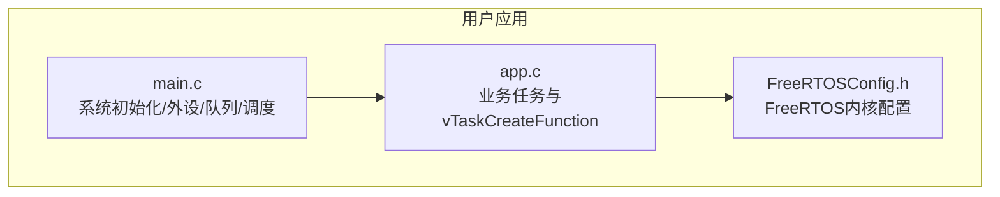
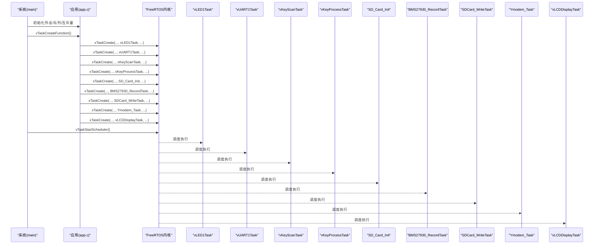
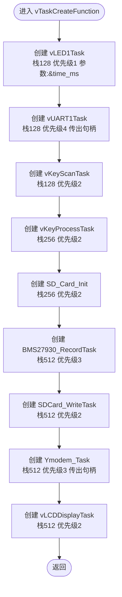
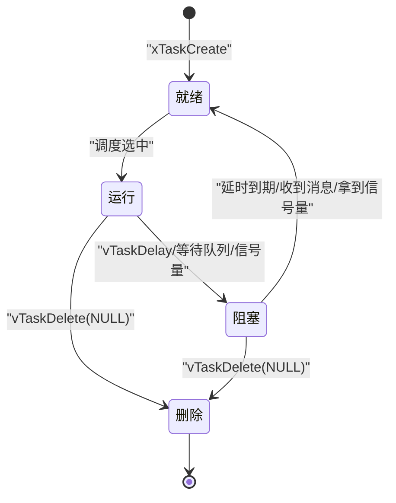
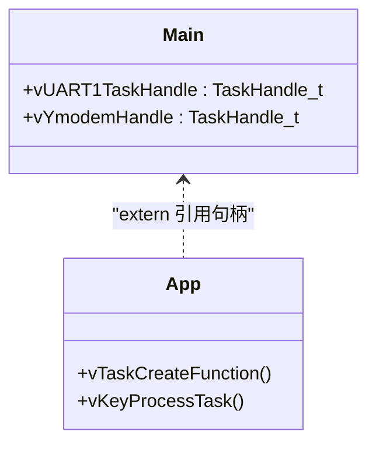
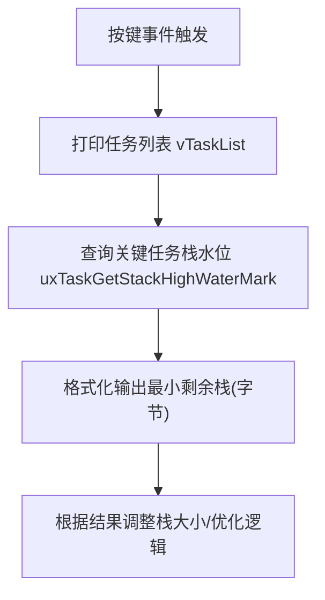
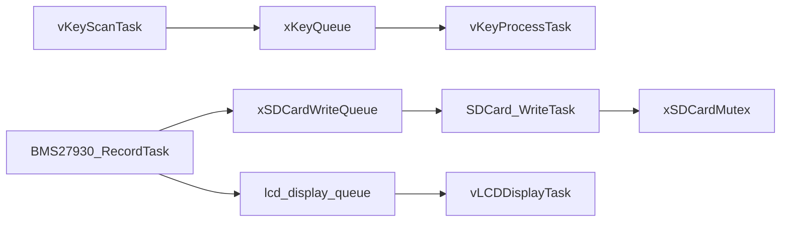

# 任务创建与生命周期管理

<cite>
**本文引用的文件**   
- [app.c](file://_gbk_backup/User/app.c)
- [FreeRTOSConfig.h](file://_gbk_backup/User/FreeRTOSConfig.h)
- [main.c](file://_gbk_backup/User/main.c)
</cite>

## 目录
1. [简介](#简介)
2. [项目结构](#项目结构)
3. [核心组件](#核心组件)
4. [架构总览](#架构总览)
5. [详细组件分析](#详细组件分析)
6. [依赖关系分析](#依赖关系分析)
7. [性能与资源考量](#性能与资源考量)
8. [故障排查指南](#故障排查指南)
9. [结论](#结论)
10. [附录：最佳实践清单](#附录最佳实践清单)

## 简介
本文围绕 FreeRTOS 在 STM32F4 工程中的任务创建与生命周期管理展开，重点解析 vTaskCreateFunction 中所有任务的创建过程、优先级与栈大小配置、参数传递机制，以及任务从启动到运行、阻塞、删除的完整生命周期。同时给出任务句柄的管理方式、监控与调试技巧（任务列表打印、栈使用量检查），并总结任务创建的最佳实践与常见问题解决方案。

## 项目结构
本仓库为基于 STM32F4 的 CAN Tracker 工程，FreeRTOS 相关代码集中在 User 层：
- main.c：系统初始化、外设与队列/信号量创建、调用任务创建函数并启动调度器
- app.c：业务任务实现与统一的任务创建入口 vTaskCreateFunction
- FreeRTOSConfig.h：FreeRTOS 内核配置（优先级数量、堆大小、钩子、统计接口开关等）

图表来源
- [main.c:34-60](file://_gbk_backup/User/main.c#L34-L60)
- [app.c:529-541](file://_gbk_backup/User/app.c#L529-L541)
- [FreeRTOSConfig.h:11-103](file://_gbk_backup/User/FreeRTOSConfig.h#L11-L103)

章节来源
- [main.c:34-60](file://_gbk_backup/User/main.c#L34-L60)
- [app.c:529-541](file://_gbk_backup/User/app.c#L529-L541)
- [FreeRTOSConfig.h:11-103](file://_gbk_backup/User/FreeRTOSConfig.h#L11-L103)

## 核心组件
- 任务创建入口
  - vTaskCreateFunction：集中创建所有业务任务，定义任务名、栈深度、优先级和参数
- 关键任务
  - vLED1Task：LED闪烁任务，内部创建软件定时器后自删
  - vUART1Task：串口接收任务（句柄通过参数传出）
  - vKeyScanTask：按键扫描任务
  - vKeyProcessTask：按键处理任务（支持打印任务列表与栈水位）
  - SD_Card_Init：SD卡初始化任务（完成后自删）
  - BMS27930_RecordTask：BMS数据记录任务
  - SDCard_WriteTask：SD卡写入任务（缓冲合并写）
  - Ymodem_Task：Ymodem协议任务（句柄通过参数传出）
  - vLCDDisplayTask：LCD显示任务
- 全局句柄与同步原语
  - TaskHandle_t：vUART1TaskHandle、vYmodemHandle
  - QueueHandle_t：xKeyQueue、lcd_display_queue、xSDCardWriteQueue
  - SemaphoreHandle_t：xSDCardMutex

章节来源
- [app.c:74-91](file://_gbk_backup/User/app.c#L74-L91)
- [app.c:181-198](file://_gbk_backup/User/app.c#L181-L198)
- [app.c:200-309](file://_gbk_backup/User/app.c#L200-L309)
- [app.c:311-366](file://_gbk_backup/User/app.c#L311-L366)
- [app.c:368-412](file://_gbk_backup/User/app.c#L368-L412)
- [app.c:414-450](file://_gbk_backup/User/app.c#L414-L450)
- [app.c:452-521](file://_gbk_backup/User/app.c#L452-L521)
- [app.c:529-541](file://_gbk_backup/User/app.c#L529-L541)
- [main.c:23-31](file://_gbk_backup/User/main.c#L23-L31)

## 架构总览
下图展示 main 启动流程、任务创建与调度器启动的关系，以及各任务之间的交互。

图表来源
- [main.c:34-60](file://_gbk_backup/User/main.c#L34-L60)
- [app.c:529-541](file://_gbk_backup/User/app.c#L529-L541)

## 详细组件分析

### vTaskCreateFunction 任务创建详解
- 功能职责
  - 集中创建全部业务任务，统一维护任务名、栈深度、优先级与参数
- 参数传递机制
  - 通过 xTaskCreate 的 pvParameters 传入指针，任务内解引用使用
  - 示例：vLED1Task 通过参数获取延时时间；vUART1Task/Ymodem_Task 通过参数传出任务句柄
- 优先级与调度
  - 优先级范围由 configMAX_PRIORITIES=32 决定，数值越大优先级越高
  - 当前任务优先级分布：vUART1Task(4)、BMS27930_RecordTask(3)、Ymodem_Task(3)、其他多数为1或2
- 栈大小配置
  - 以“字”为单位分配，常见值：128/256/512
  - 建议结合 uxTaskGetStackHighWaterMark 评估实际最小需求，避免过大浪费或过小溢出

图表来源
- [app.c:529-541](file://_gbk_backup/User/app.c#L529-L541)

章节来源
- [app.c:529-541](file://_gbk_backup/User/app.c#L529-L541)
- [FreeRTOSConfig.h:18-20](file://_gbk_backup/User/FreeRTOSConfig.h#L18-L20)

### 任务生命周期管理（启动/运行/阻塞/删除）
- 启动
  - 调用 xTaskCreate 后任务进入就绪态，等待调度器调度
- 运行
  - 获得 CPU 后执行任务主循环或一次性逻辑
- 阻塞
  - 通过 vTaskDelay、队列/信号量等待等方式进入阻塞态，释放 CPU
- 删除
  - 任务主动调用 vTaskDelete(NULL) 结束自身，或在异常路径中删除自身

图表来源
- [app.c:181-198](file://_gbk_backup/User/app.c#L181-L198)
- [app.c:414-450](file://_gbk_backup/User/app.c#L414-L450)

章节来源
- [app.c:181-198](file://_gbk_backup/User/app.c#L181-L198)
- [app.c:414-450](file://_gbk_backup/User/app.c#L414-L450)

### 任务句柄管理与使用
- 全局句柄定义
  - vUART1TaskHandle、vYmodemHandle 在 main.c 中定义，供其他模块 extern 引用
- 句柄获取方式
  - 通过 xTaskCreate 的最后一个参数直接传出句柄
  - 或通过 xTaskGetHandle 按名称查找（需启用相应宏）
- 典型用法
  - 用于查询任务状态、栈水位、动态调整优先级等

图表来源
- [main.c:23-31](file://_gbk_backup/User/main.c#L23-L31)
- [app.c:529-541](file://_gbk_backup/User/app.c#L529-L541)
- [app.c:368-412](file://_gbk_backup/User/app.c#L368-L412)

章节来源
- [main.c:23-31](file://_gbk_backup/User/main.c#L23-L31)
- [app.c:368-412](file://_gbk_backup/User/app.c#L368-L412)
- [app.c:529-541](file://_gbk_backup/User/app.c#L529-L541)

### 任务监控与调试技巧
- 任务列表打印
  - 使用 vTaskList 输出任务名、状态、优先级、剩余栈空间、CPU核
  - 可在按键处理任务中触发，便于按需查看
- 栈使用量检查
  - 使用 uxTaskGetStackHighWaterMark 获取历史最小剩余栈空间，结合 sizeof(uint32_t) 换算字节数
  - 针对关键任务（如 vUART1Task、vYmodemHandle）定期采样，评估栈是否足够
- 周期性监控任务
  - 可启用 vTaskMonitor 周期打印任务列表与关键任务栈水位（工程中已提供实现）

图表来源
- [app.c:368-412](file://_gbk_backup/User/app.c#L368-L412)
- [app.c:74-91](file://_gbk_backup/User/app.c#L74-L91)

章节来源
- [app.c:74-91](file://_gbk_backup/User/app.c#L74-L91)
- [app.c:368-412](file://_gbk_backup/User/app.c#L368-L412)

### 关键任务行为要点
- vLED1Task
  - 创建周期软件定时器控制 LED 翻转，随后删除自身，交由定时器回调驱动
- SD_Card_Init
  - 延迟初始化后挂载文件系统，完成后删除自身
- BMS27930_RecordTask
  - 接收 CAN 报文，解析并写入日志，通过队列通知 SDCard_WriteTask
- SDCard_WriteTask
  - 聚合数据至扇区大小后批量写入，降低频繁 I/O
- vLCDDisplayTask
  - 定时刷新 LCD，将队列中的字符流渲染到屏幕

章节来源
- [app.c:181-198](file://_gbk_backup/User/app.c#L181-L198)
- [app.c:200-309](file://_gbk_backup/User/app.c#L200-L309)
- [app.c:311-366](file://_gbk_backup/User/app.c#L311-L366)
- [app.c:414-450](file://_gbk_backup/User/app.c#L414-L450)
- [app.c:452-521](file://_gbk_backup/User/app.c#L452-L521)

## 依赖关系分析
- 任务间通信
  - 按键：vKeyScanTask -> xKeyQueue -> vKeyProcessTask
  - 日志：BMS27930_RecordTask -> xSDCardWriteQueue -> SDCard_WriteTask
  - 显示：BMS27930_RecordTask -> lcd_display_queue -> vLCDDisplayTask
- 同步与互斥
  - SD 卡访问通过 xSDCardMutex 保护 f_open/f_write/f_close
- 外部库
  - FATFS（ff.h）用于 SD 卡文件系统操作

图表来源
- [app.c:94-152](file://_gbk_backup/User/app.c#L94-L152)
- [app.c:200-309](file://_gbk_backup/User/app.c#L200-L309)
- [app.c:311-366](file://_gbk_backup/User/app.c#L311-L366)
- [app.c:414-450](file://_gbk_backup/User/app.c#L414-L450)

章节来源
- [app.c:94-152](file://_gbk_backup/User/app.c#L94-L152)
- [app.c:200-309](file://_gbk_backup/User/app.c#L200-L309)
- [app.c:311-366](file://_gbk_backup/User/app.c#L311-L366)
- [app.c:414-450](file://_gbk_backup/User/app.c#L414-L450)

## 性能与资源考量
- 栈大小与内存
  - 栈以“字”为单位，注意 sizeof(uint32_t) 换算字节
  - 使用 uxTaskGetStackHighWaterMark 评估最小需求，避免过大浪费或过小溢出
- 优先级设计
  - 高优先级任务应短小、快速完成，避免长时间占用 CPU
  - 合理设置优先级，确保关键任务优先响应
- 队列与互斥量
  - 队列长度与元素大小需权衡吞吐与内存占用
  - 互斥量临界区尽量短，减少持有时间
- 定时器与任务卸载
  - 使用软件定时器接管周期性动作，任务创建后立即删除，降低常驻开销

[本节为通用指导，不直接分析具体文件]

## 故障排查指南
- 现象：任务未启动或调度异常
  - 检查是否在 vTaskCreateFunction 之后调用了 vTaskStartScheduler
  - 确认 xTaskCreate 返回值非 NULL（若启用错误检测）
- 现象：任务栈溢出
  - 使用 uxTaskGetStackHighWaterMark 检查关键任务的最小剩余栈
  - 增大对应任务的栈大小或优化局部变量/递归深度
- 现象：SD 卡写入失败或卡顿
  - 检查 xSDCardMutex 是否正确创建与释放
  - 观察队列积压情况，必要时增大队列长度或优化写入策略
- 现象：LCD 显示丢帧或卡顿
  - 检查 lcd_display_queue 的使用率与缓冲区大小
  - 适当增加队列深度或降低发送频率

章节来源
- [app.c:311-366](file://_gbk_backup/User/app.c#L311-L366)
- [app.c:414-450](file://_gbk_backup/User/app.c#L414-L450)
- [app.c:452-521](file://_gbk_backup/User/app.c#L452-L521)

## 结论
本工程通过 vTaskCreateFunction 统一管理任务创建，清晰划分了任务职责与优先级，配合队列与互斥量实现了松耦合的数据流转与资源保护。借助 FreeRTOS 提供的任务列表与栈水位工具，可有效进行监控与调优。建议在后续迭代中持续评估栈使用、队列积压与优先级合理性，确保系统在长期运行下的稳定性与实时性。

[本节为总结性内容，不直接分析具体文件]

## 附录：最佳实践清单
- 任务命名与注释
  - 为每个任务赋予明确名称，便于调试与定位
- 优先级规划
  - 仅对真正需要高实时性的任务设置高优先级
  - 同优先级任务之间使用时间片轮转
- 栈大小评估
  - 使用 uxTaskGetStackHighWaterMark 定期采样，逐步收敛到合适值
- 参数传递
  - 通过 xTaskCreate 的 pvParameters 传递指针，避免全局变量滥用
- 同步与互斥
  - 共享资源必须加锁，临界区尽量短
- 任务卸载
  - 一次性任务在完成逻辑后主动删除自身，释放资源
- 监控与日志
  - 保留任务列表打印与栈水位检查能力，便于现场问题复现与分析

[本节为通用指导，不直接分析具体文件]