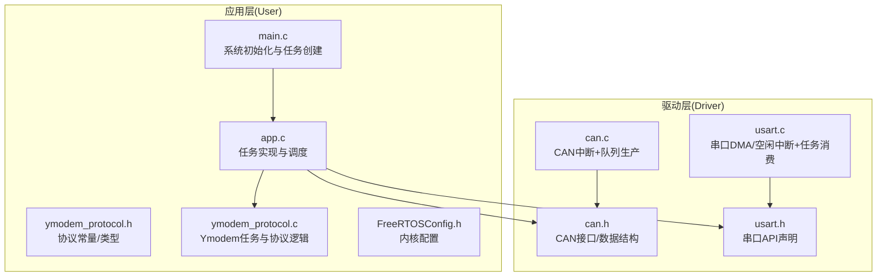
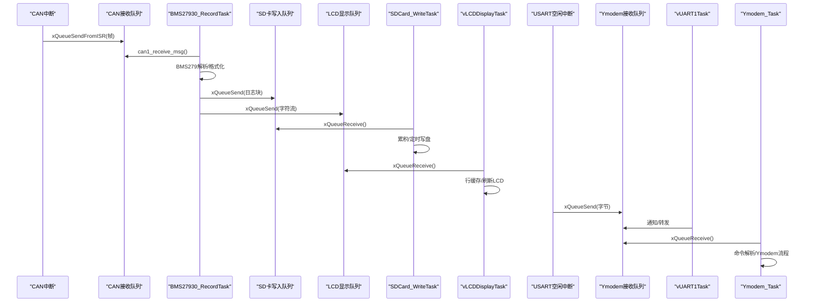
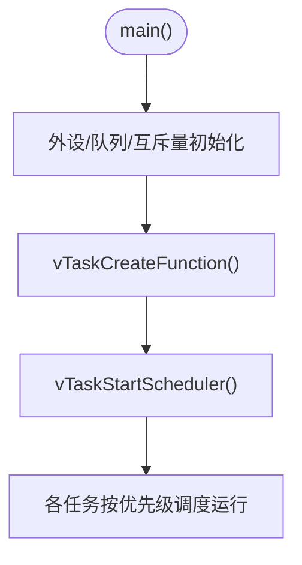
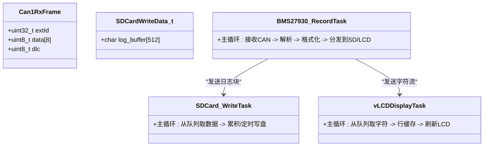
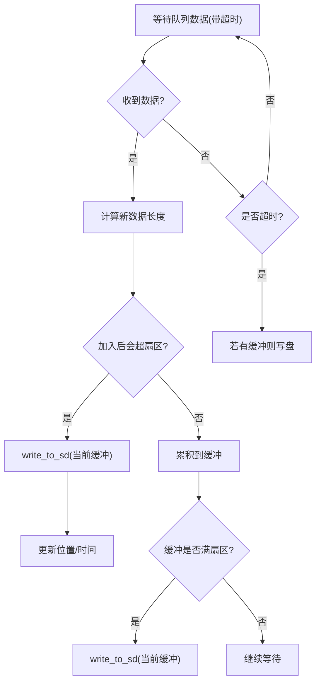
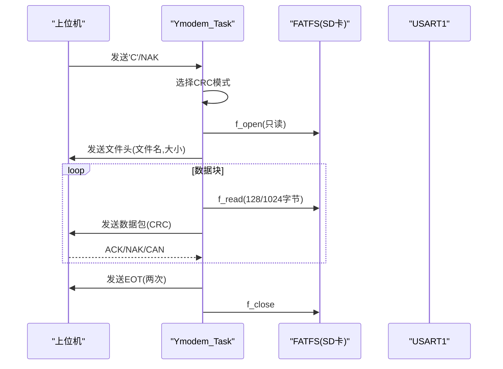
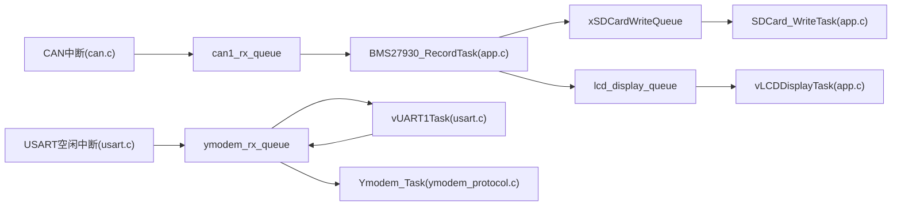

# 任务管理系统

<cite>
**本文引用的文件**   
- [main.c](file://_gbk_backup/User/main.c)
- [app.c](file://_gbk_backup/User/app.c)
- [app.h](file://_gbk_backup/User/app.h)
- [FreeRTOSConfig.h](file://_gbk_backup/User/FreeRTOSConfig.h)
- [ymodem_protocol.c](file://_gbk_backup/User/ymodem_protocol.c)
- [ymodem_protocol.h](file://_gbk_backup/User/ymodem_protocol.h)
- [can.c](file://_gbk_backup/Driver/BSP/can.c)
- [can.h](file://_gbk_backup/Driver/BSP/can.h)
- [usart.c](file://_gbk_backup/Driver/SYSTEM/usart.c)
- [usart.h](file://_gbk_backup/Driver/SYSTEM/usart.h)
</cite>

## 目录
1. [引言](#引言)
2. [项目结构](#项目结构)
3. [核心组件](#核心组件)
4. [架构总览](#架构总览)
5. [详细组件分析](#详细组件分析)
6. [依赖关系分析](#依赖关系分析)
7. [性能与优化建议](#性能与优化建议)
8. [故障排查指南](#故障排查指南)
9. [结论](#结论)

## 引言
本文件系统性地梳理并文档化基于 FreeRTOS 的任务管理子系统，覆盖以下关键任务：CAN 接收、协议解析（BMS279）、SD 卡写入、LCD 显示、按键处理以及 Ymodem 传输。文档重点说明任务的创建、启动、优先级设置与生命周期管理；任务间通过队列、信号量等机制进行数据传递与同步；并提供状态监控、调试方法与性能优化建议。

## 项目结构
本项目采用“应用层 + BSP 驱动层”的分层组织方式：
- 应用层位于 User 目录，包含 FreeRTOS 任务定义、Ymodem 协议实现、系统初始化与任务调度入口。
- BSP 驱动层位于 Driver 目录，提供 CAN、串口、LCD、RTC、电源管理等底层能力。

图表来源
- [main.c:34-59](file://_gbk_backup/User/main.c#L34-L59)
- [app.c:529-541](file://_gbk_backup/User/app.c#L529-L541)
- [ymodem_protocol.c:711-748](file://_gbk_backup/User/ymodem_protocol.c#L711-L748)
- [can.h:17-47](file://_gbk_backup/Driver/BSP/can.h#L17-L47)
- [can.c:186-220](file://_gbk_backup/Driver/BSP/can.c#L186-L220)
- [usart.h:22-35](file://_gbk_backup/Driver/SYSTEM/usart.h#L22-L35)
- [usart.c:269-283](file://_gbk_backup/Driver/SYSTEM/usart.c#L269-L283)

章节来源
- [main.c:34-59](file://_gbk_backup/User/main.c#L34-L59)
- [app.c:529-541](file://_gbk_backup/User/app.c#L529-L541)

## 核心组件
- FreeRTOS 内核配置：抢占式调度、Tick 频率、最大优先级、互斥量/队列/定时器支持、栈溢出检测开关等。
- 全局资源：
  - 队列：CAN 接收队列、按键队列、LCD 显示队列、Ymodem 接收队列、SD 卡写入队列。
  - 信号量：SD 卡互斥量，保护 FATFS 访问。
  - 任务句柄：UART1 任务、Ymodem 任务句柄用于栈水位统计。
- 任务集合：
  - vUART1Task：串口数据接收与分发。
  - BMS27930_RecordTask：CAN 报文接收、BMS279 协议解析、日志生成与多路分发。
  - SDCard_WriteTask：批量累积后写入 SD 卡。
  - vLCDDisplayTask：从队列取字符并刷新 LCD。
  - vKeyScanTask/vKeyProcessTask：按键扫描与事件处理。
  - Ymodem_Task：命令解析与文件传输控制。

章节来源
- [FreeRTOSConfig.h:11-111](file://_gbk_backup/User/FreeRTOSConfig.h#L11-L111)
- [main.c:23-31](file://_gbk_backup/User/main.c#L23-L31)
- [app.c:74-91](file://_gbk_backup/User/app.c#L74-L91)

## 架构总览
下图展示任务间的数据流与同步关系：

图表来源
- [can.c:186-220](file://_gbk_backup/Driver/BSP/can.c#L186-L220)
- [app.c:201-309](file://_gbk_backup/User/app.c#L201-L309)
- [app.c:313-366](file://_gbk_backup/User/app.c#L313-L366)
- [app.c:454-521](file://_gbk_backup/User/app.c#L454-L521)
- [usart.c:269-283](file://_gbk_backup/Driver/SYSTEM/usart.c#L269-L283)
- [ymodem_protocol.c:711-748](file://_gbk_backup/User/ymodem_protocol.c#L711-L748)

## 详细组件分析

### 任务创建、启动与生命周期
- 系统初始化：在 main 中完成外设初始化、队列/互斥量创建，然后调用 vTaskCreateFunction 创建所有任务，最后 vTaskStartScheduler 启动调度器。
- 任务创建参数：名称、栈大小、参数指针、优先级、任务句柄输出。
- 生命周期：
  - 一次性初始化任务（如 SD_Card_Init）在完成挂载后主动删除自身。
  - LED 闪烁任务创建软件定时器后删除自身，由定时器回调接管。
  - 常驻任务（记录、SD写入、LCD显示、按键、Ymodem、串口）以 while(1) 循环运行。

图表来源
- [main.c:34-59](file://_gbk_backup/User/main.c#L34-L59)
- [app.c:529-541](file://_gbk_backup/User/app.c#L529-L541)

章节来源
- [main.c:34-59](file://_gbk_backup/User/main.c#L34-L59)
- [app.c:529-541](file://_gbk_backup/User/app.c#L529-L541)

### CAN 接收任务（生产者：中断，消费者：BMS27930_RecordTask）
- 中断侧：CAN1 FIFO0 接收中断将扩展帧封装为 Can1RxFrame，并通过 xQueueSendFromISR 投递到 can1_rx_queue；队列满时丢包计数增加。
- 应用侧：BMS27930_RecordTask 使用 can1_receive_msg 阻塞读取队列，超时时间 100ms。
- 协议解析：对每帧调用 BMS27930_ParseMessage，生成结构化信息；若与上一帧完全相同则仅记录原始数据，否则记录解析结果。
- 数据分发：
  - 将日志文本发送到 SDCardWriteData_t 结构体并通过 xSDCardWriteQueue 通知 SD 写入任务。
  - 同时将字符流逐字节推送到 lcd_display_queue，供 LCD 任务刷新。

图表来源
- [can.h:24-28](file://_gbk_backup/Driver/BSP/can.h#L24-L28)
- [app.h:7-10](file://_gbk_backup/User/app.h#L7-L10)
- [app.c:201-309](file://_gbk_backup/User/app.c#L201-L309)
- [app.c:313-366](file://_gbk_backup/User/app.c#L313-L366)
- [app.c:454-521](file://_gbk_backup/User/app.c#L454-L521)

章节来源
- [can.c:186-220](file://_gbk_backup/Driver/BSP/can.c#L186-L220)
- [app.c:201-309](file://_gbk_backup/User/app.c#L201-L309)

### 协议解析任务（BMS27930_RecordTask）
- 功能要点：
  - 去重判断：比较 ID、长度与数据内容，避免重复记录。
  - 时间戳：使用 RTC 获取时间，拼接 CSV 行。
  - 解析与格式化：根据 BMS279 协议生成可读字段，便于后续分析与展示。
  - 双通道输出：日志写入队列、字符流进入 LCD 队列。
- 错误处理：
  - SD 写入队列满时打印警告。
  - LCD 队列使用率接近上限时打印告警。

章节来源
- [app.c:201-309](file://_gbk_backup/User/app.c#L201-L309)

### SD 卡写入任务（SDCard_WriteTask）
- 设计目标：减少频繁写盘，保护 SD 卡寿命。
- 策略：
  - 累积缓冲区（512 字节扇区大小），达到阈值或超过 WRITE_TIMEOUT_MS（60s）无新数据时触发写盘。
  - 使用互斥量 xSDCardMutex 保护 FATFS 操作，打开/关闭文件，追加写入。
- 内存管理：动态分配 FIL 对象，失败时删除任务。

图表来源
- [app.c:313-366](file://_gbk_backup/User/app.c#L313-L366)
- [app.c:35-71](file://_gbk_backup/User/app.c#L35-L71)

章节来源
- [app.c:313-366](file://_gbk_backup/User/app.c#L313-L366)
- [app.c:35-71](file://_gbk_backup/User/app.c#L35-L71)

### LCD 显示任务（vLCDDisplayTask）
- 输入：lcd_display_queue（单字节流）。
- 处理：
  - 非阻塞地收集字符至临时缓冲，直到 100ms 周期到达。
  - 按行解析，过滤不可见字符，构建行缓存（最多 14 行，每行 40 字符）。
  - 刷新 LCD：清屏区域并绘制各行。
- 特性：高吞吐下可能丢字符（队列满），可通过增大队列深度缓解。

章节来源
- [app.c:454-521](file://_gbk_backup/User/app.c#L454-L521)

### 按键处理任务（vKeyScanTask / vKeyProcessTask）
- vKeyScanTask：
  - 状态机：空闲 -> 按下 -> 释放一次 -> 等待松开。
  - 长按/双击识别：基于 Tick 计数与阈值。
  - 输出：按键事件值发送到 xKeyQueue。
- vKeyProcessTask：
  - 短按1次：点亮屏幕背光。
  - 短按2次：打印任务列表与指定任务栈水位。
  - 长按：关闭屏幕背光。

章节来源
- [app.c:94-152](file://_gbk_backup/User/app.c#L94-L152)
- [app.c:370-412](file://_gbk_backup/User/app.c#L370-L412)

### Ymodem 传输任务（Ymodem_Task）
- 职责：
  - 从 ymodem_rx_queue 读取字符，回显到串口。
  - 命令解析：help/ls/cd/pwd/get/settime/exit。
  - get 命令：发起 Ymodem 文件传输，使用 FATFS 读取文件并通过 UART 发送数据包。
- 传输流程：
  - 等待接收端 'C' 或 NAK，选择 CRC 模式。
  - 发送文件头（文件名+大小），随后分块发送数据，等待 ACK/NAK/CAN。
  - 发送 EOT 两次并收尾。
- 资源保护：
  - 使用 xSDCardMutex 保护 FATFS 的打开/读取/关闭等操作。

图表来源
- [ymodem_protocol.c:303-428](file://_gbk_backup/User/ymodem_protocol.c#L303-L428)
- [ymodem_protocol.c:711-748](file://_gbk_backup/User/ymodem_protocol.c#L711-L748)

章节来源
- [ymodem_protocol.c:303-428](file://_gbk_backup/User/ymodem_protocol.c#L303-L428)
- [ymodem_protocol.c:711-748](file://_gbk_backup/User/ymodem_protocol.c#L711-L748)

### 串口接收任务（vUART1Task）
- 工作模式：
  - DMA + 空闲中断：在中断中将接收到的数据放入 ymodem_rx_queue。
  - vUART1Task 通过任务通知等待，收到通知后将 DMA 缓冲区数据转发到 ymodem_rx_queue。
- 与 Ymodem 任务配合：Ymodem_Task 从 ymodem_rx_queue 取字符，进行命令解析与回显。

章节来源
- [usart.c:269-283](file://_gbk_backup/Driver/SYSTEM/usart.c#L269-L283)
- [ymodem_protocol.c:711-748](file://_gbk_backup/User/ymodem_protocol.c#L711-L748)

## 依赖关系分析
- 模块耦合：
  - app.c 作为应用中枢，依赖 can.h、usart.h、ymodem_protocol.h 提供的接口。
  - can.c 通过队列向应用层提供 CAN 数据。
  - usart.c 通过队列向 Ymodem 任务提供串口数据。
  - Ymodem 协议实现依赖 FATFS（外部提供）和 SD 卡互斥量。
- 同步机制：
  - 队列：CAN 接收、按键、LCD、Ymodem、SD 写入。
  - 互斥量：SD 卡 FATFS 访问。
  - 任务通知：vUART1Task 使用 ulTaskNotifyTake 等待中断通知。

图表来源
- [can.c:186-220](file://_gbk_backup/Driver/BSP/can.c#L186-L220)
- [app.c:201-309](file://_gbk_backup/User/app.c#L201-L309)
- [app.c:313-366](file://_gbk_backup/User/app.c#L313-L366)
- [app.c:454-521](file://_gbk_backup/User/app.c#L454-L521)
- [usart.c:269-283](file://_gbk_backup/Driver/SYSTEM/usart.c#L269-L283)
- [ymodem_protocol.c:711-748](file://_gbk_backup/User/ymodem_protocol.c#L711-L748)

章节来源
- [can.c:186-220](file://_gbk_backup/Driver/BSP/can.c#L186-L220)
- [app.c:201-309](file://_gbk_backup/User/app.c#L201-L309)
- [app.c:313-366](file://_gbk_backup/User/app.c#L313-L366)
- [app.c:454-521](file://_gbk_backup/User/app.c#L454-L521)
- [usart.c:269-283](file://_gbk_backup/Driver/SYSTEM/usart.c#L269-L283)
- [ymodem_protocol.c:711-748](file://_gbk_backup/User/ymodem_protocol.c#L711-L748)

## 性能与优化建议
- 队列深度与丢弃策略：
  - CAN 接收队列较小（10），在高负载下易丢包。建议结合业务峰值评估是否增大队列深度，或在应用层增加丢包统计与告警。
  - LCD 显示队列较大（512），但逐字节推送开销较高。可考虑批量推送字符串或使用环形缓冲降低拷贝次数。
- 写盘策略：
  - 当前扇区累积+超时写盘策略合理，有助于延长 SD 卡寿命。可根据实际数据速率调整 WRITE_TIMEOUT_MS 与扇区大小。
- 任务优先级：
  - 当前优先级：Ymodem=3，BMSRecord=3，其他多为2。若需保证实时性，可提高 CAN 相关任务优先级，确保解析与显示及时。
- 内存与栈空间：
  - 使用 uxTaskGetStackHighWaterMark 定期监测关键任务栈水位，必要时增大栈大小。
  - Ymodem 传输中动态分配 1024 字节缓冲区，注意内存碎片与分配失败处理。
- 中断与临界区：
  - CAN 中断中使用 FromISR 版本队列 API，避免阻塞；确保中断服务函数尽量短小。
  - FATFS 访问统一通过互斥量保护，避免并发导致文件系统损坏。

[本节为通用指导，不直接分析具体文件]

## 故障排查指南
- 任务监控：
  - 通过按键短按2次触发任务列表与栈水位打印，快速定位瓶颈任务。
  - 可启用 vTaskMonitor 周期性打印任务状态（已注释）。
- 常见问题：
  - SD 卡写入失败：检查 xSDCardMutex 是否正确获取/释放，确认 FATFS 挂载成功。
  - LCD 显示卡顿：检查 lcd_display_queue 使用率告警，适当增大队列或降低数据源频率。
  - Ymodem 传输中断：检查接收端是否发送 'C'，确认超时与重试逻辑。
- 调试手段：
  - 串口输出关键路径日志（队列满、写盘失败、FATFS 错误码）。
  - 使用 FreeRTOS 跟踪与统计功能（已在配置中开启部分选项）。

章节来源
- [app.c:74-91](file://_gbk_backup/User/app.c#L74-L91)
- [app.c:370-412](file://_gbk_backup/User/app.c#L370-L412)
- [app.c:313-366](file://_gbk_backup/User/app.c#L313-L366)
- [ymodem_protocol.c:303-428](file://_gbk_backup/User/ymodem_protocol.c#L303-L428)

## 结论
本任务管理系统以 FreeRTOS 为核心，围绕 CAN 数据采集、协议解析、SD 卡持久化、LCD 显示、按键交互与 Ymodem 文件传输构建了清晰的任务边界与数据通路。通过队列与互斥量实现松耦合通信与资源保护，具备较好的可扩展性与可维护性。建议在真实场景中结合流量特征调优队列深度、任务优先级与写盘策略，并持续监控任务栈水位与队列使用率，以确保系统稳定高效运行。