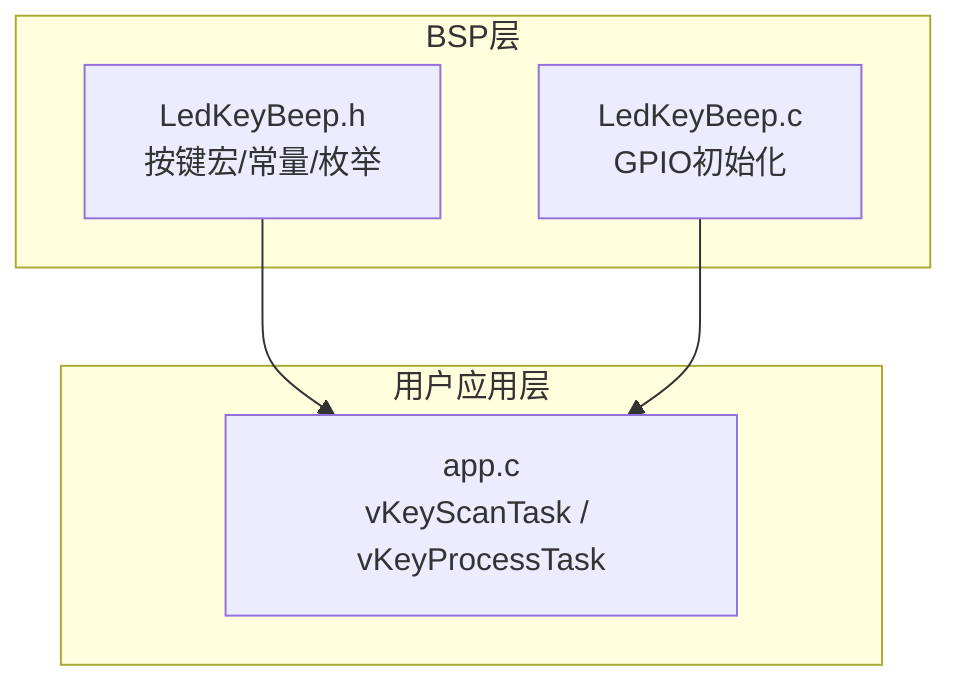
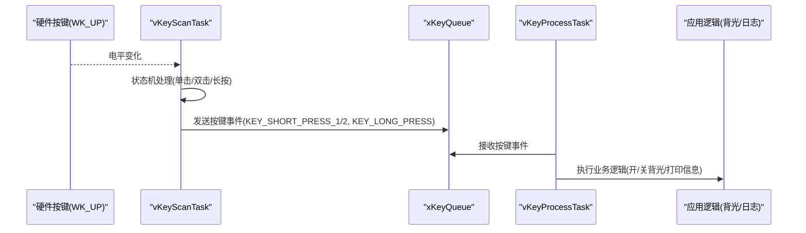
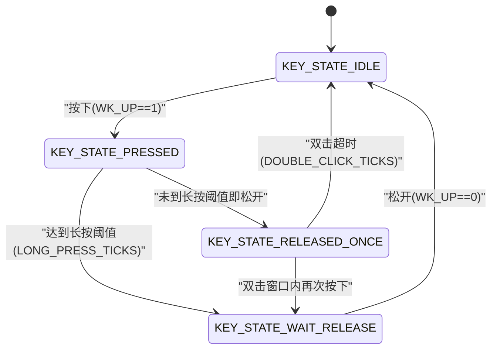
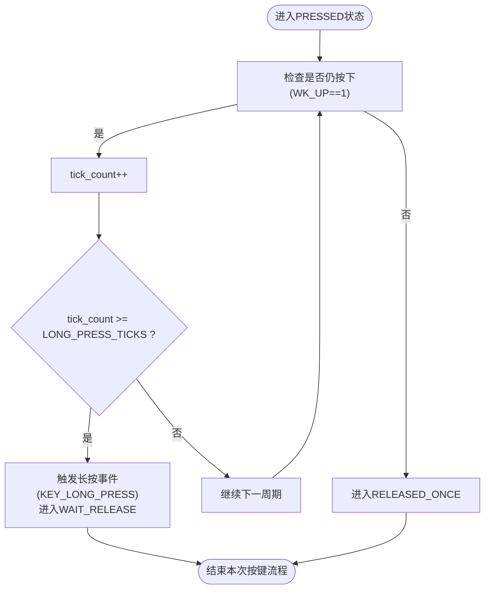
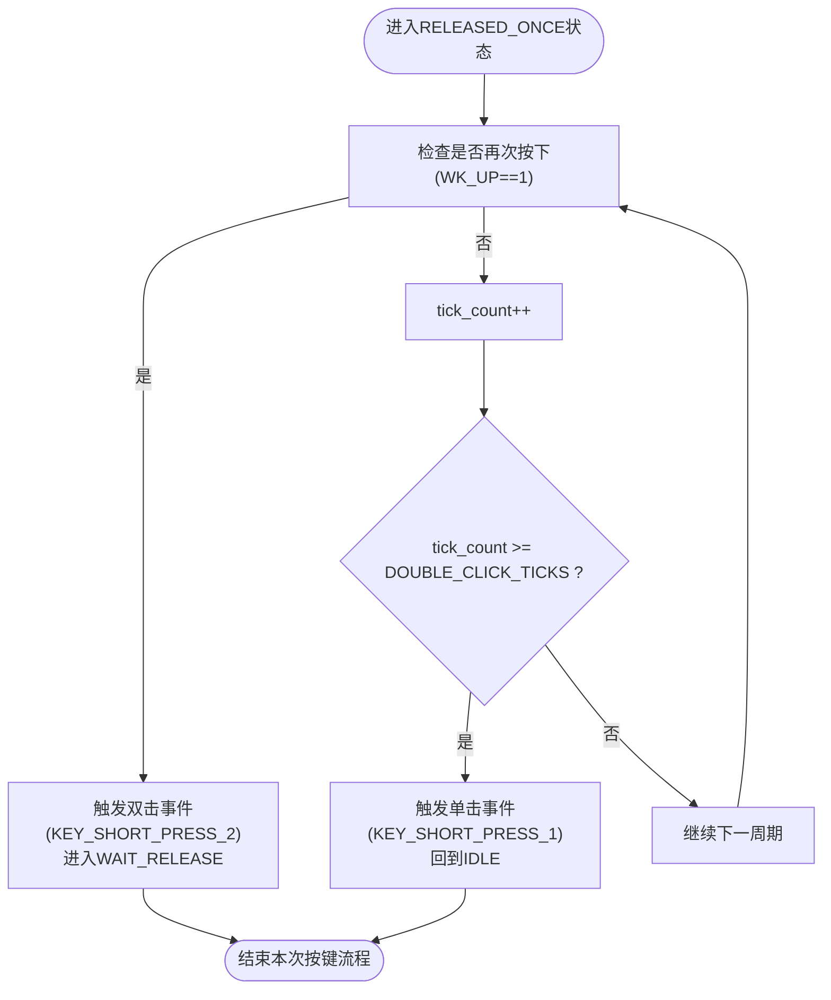
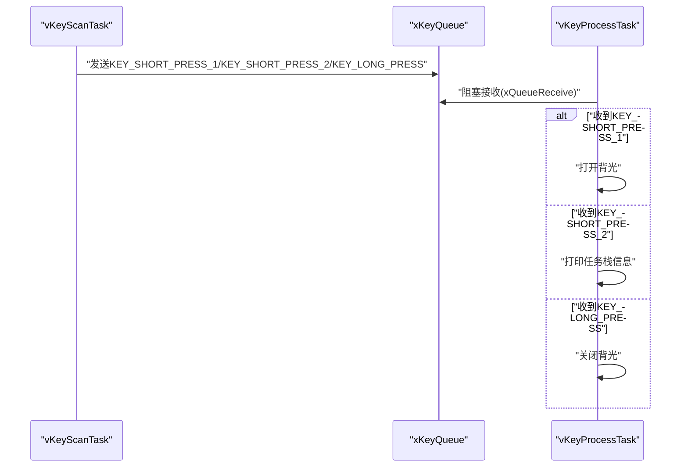
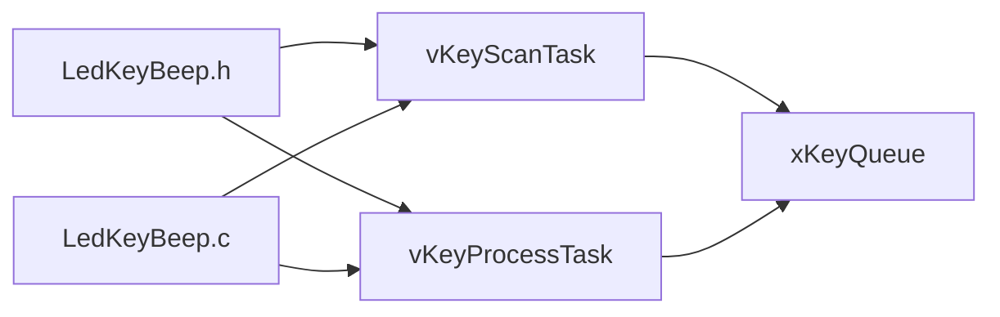

# 按键处理任务

<cite>
**本文引用的文件**   
- [app.c](file://_gbk_backup/User/app.c)
- [LedKeyBeep.h](file://_gbk_backup/Driver/BSP/LedKeyBeep.h)
- [LedKeyBeep.c](file://_gbk_backup/Driver/BSP/LedKeyBeep.c)
</cite>

## 目录
1. [简介](#简介)
2. [项目结构](#项目结构)
3. [核心组件](#核心组件)
4. [架构总览](#架构总览)
5. [详细组件分析](#详细组件分析)
6. [依赖关系分析](#依赖关系分析)
7. [性能与实时性考虑](#性能与实时性考虑)
8. [故障排查指南](#故障排查指南)
9. [结论](#结论)

## 简介
本文件面向按键处理相关任务，重点说明：
- vKeyScanTask（按键扫描）与 vKeyProcessTask（按键事件处理）的职责分工与协作方式
- 按键状态机实现：KEY_STATE_IDLE、KEY_STATE_PRESSED、KEY_STATE_RELEASED_ONCE、KEY_STATE_WAIT_RELEASE 的状态转换逻辑
- 长按检测算法：LONG_PRESS_TICKS 阈值判断与时间计数机制
- 双击检测逻辑：DOUBLE_CLICK_TICKS 超时判断与状态转换
- 按键事件分发：xKeyQueue 队列的使用与不同按键事件的响应处理
- 按键消抖与防误触机制

## 项目结构
按键功能由 BSP 层与用户应用层共同实现：
- BSP 层（LedKeyBeep.*）提供按键宏定义、常量、枚举以及 GPIO 初始化
- 用户应用层（User/app.c）实现按键扫描任务、按键处理任务及系统任务创建

图表来源
- [LedKeyBeep.h:6-21](file://_gbk_backup/Driver/BSP/LedKeyBeep.h#L6-L21)
- [LedKeyBeep.c:53-68](file://_gbk_backup/Driver/BSP/LedKeyBeep.c#L53-L68)
- [app.c:94-152](file://_gbk_backup/User/app.c#L94-L152)
- [app.c:370-412](file://_gbk_backup/User/app.c#L370-L412)

章节来源
- [LedKeyBeep.h:6-21](file://_gbk_backup/Driver/BSP/LedKeyBeep.h#L6-L21)
- [LedKeyBeep.c:53-68](file://_gbk_backup/Driver/BSP/LedKeyBeep.c#L53-L68)
- [app.c:94-152](file://_gbk_backup/User/app.c#L94-L152)
- [app.c:370-412](file://_gbk_backup/User/app.c#L370-L412)

## 核心组件
- vKeyScanTask：周期性读取硬件按键电平，驱动按键状态机，产生按键事件并发送到 xKeyQueue
- vKeyProcessTask：从 xKeyQueue 消费按键事件，执行具体业务逻辑（如点亮/关闭背光、打印任务栈信息等）
- LedKeyBeep.h：定义按键宏 WK_UP、按键事件码 KEY_SHORT_PRESS_1/KEY_SHORT_PRESS_2/KEY_LONG_PRESS、周期 TASK_PERIOD_MS、长按阈值 LONG_PRESS_TICKS、双击阈值 DOUBLE_CLICK_TICKS、按键状态枚举 KeyState
- LedKeyBeep.c：按键 GPIO 初始化（内部下拉，高电平有效）

章节来源
- [app.c:94-152](file://_gbk_backup/User/app.c#L94-L152)
- [app.c:370-412](file://_gbk_backup/User/app.c#L370-L412)
- [LedKeyBeep.h:6-21](file://_gbk_backup/Driver/BSP/LedKeyBeep.h#L6-L21)
- [LedKeyBeep.c:53-68](file://_gbk_backup/Driver/BSP/LedKeyBeep.c#L53-L68)

## 架构总览
按键处理采用“扫描+处理”的解耦设计，通过 FreeRTOS 队列进行跨任务通信。

图表来源
- [app.c:94-152](file://_gbk_backup/User/app.c#L94-L152)
- [app.c:370-412](file://_gbk_backup/User/app.c#L370-L412)

## 详细组件分析

### 按键状态机（vKeyScanTask）
按键状态机包含四个状态：
- KEY_STATE_IDLE：空闲等待按下
- KEY_STATE_PRESSED：已按下，计时中（用于长按检测）
- KEY_STATE_RELEASED_ONCE：松开一次，等待是否双击
- KEY_STATE_WAIT_RELEASE：等待松开（长按或双击后防止立即重入）

状态转换要点：
- IDLE → PRESSED：检测到按键按下（WK_UP == 1），清零 tick_count
- PRESSED → WAIT_RELEASE：持续按住且 tick_count >= LONG_PRESS_TICKS，触发长按事件
- PRESSED → RELEASED_ONCE：未达长按阈值即松开，进入双击观察窗口
- RELEASED_ONCE → WAIT_RELEASE：在 DOUBLE_CLICK_TICKS 内再次按下，触发双击事件
- RELEASED_ONCE → IDLE：超过 DOUBLE_CLICK_TICKS 仍未再次按下，触发单击事件
- WAIT_RELEASE → IDLE：检测到按键松开，回到空闲

图表来源
- [app.c:94-152](file://_gbk_backup/User/app.c#L94-L152)
- [LedKeyBeep.h:16-21](file://_gbk_backup/Driver/BSP/LedKeyBeep.h#L16-L21)

章节来源
- [app.c:94-152](file://_gbk_backup/User/app.c#L94-L152)
- [LedKeyBeep.h:16-21](file://_gbk_backup/Driver/BSP/LedKeyBeep.h#L16-L21)

### 长按检测算法
- 时间基准：TASK_PERIOD_MS（20ms）
- 长按阈值：LONG_PRESS_TICKS = 800ms / 20ms = 40个周期
- 计数机制：在 PRESSED 状态下，每次循环若仍为按下则 tick_count++；当 tick_count >= LONG_PRESS_TICKS 时，判定为长按，发送 KEY_LONG_PRESS 并进入 WAIT_RELEASE

图表来源
- [app.c:109-123](file://_gbk_backup/User/app.c#L109-L123)
- [LedKeyBeep.h:11-13](file://_gbk_backup/Driver/BSP/LedKeyBeep.h#L11-L13)

章节来源
- [app.c:109-123](file://_gbk_backup/User/app.c#L109-L123)
- [LedKeyBeep.h:11-13](file://_gbk_backup/Driver/BSP/LedKeyBeep.h#L11-L13)

### 双击检测逻辑
- 双击窗口：DOUBLE_CLICK_TICKS = 300ms / 20ms = 15个周期
- 在 RELEASED_ONCE 状态下：
  - 若在 DOUBLE_CLICK_TICKS 内再次按下，判定为双击，发送 KEY_SHORT_PRESS_2，进入 WAIT_RELEASE
  - 若超时仍未再次按下，判定为单击，发送 KEY_SHORT_PRESS_1，回到 IDLE

图表来源
- [app.c:125-140](file://_gbk_backup/User/app.c#L125-L140)
- [LedKeyBeep.h:11-13](file://_gbk_backup/Driver/BSP/LedKeyBeep.h#L11-L13)

章节来源
- [app.c:125-140](file://_gbk_backup/User/app.c#L125-L140)
- [LedKeyBeep.h:11-13](file://_gbk_backup/Driver/BSP/LedKeyBeep.h#L11-L13)

### 按键事件分发（xKeyQueue）
- vKeyScanTask 将识别到的按键事件（KEY_SHORT_PRESS_1、KEY_SHORT_PRESS_2、KEY_LONG_PRESS）通过 xQueueSend 发送到全局队列 xKeyQueue
- vKeyProcessTask 通过 xQueueReceive 阻塞等待并消费事件，根据事件类型执行相应业务逻辑：
  - KEY_SHORT_PRESS_1：打开背光
  - KEY_SHORT_PRESS_2：打印任务列表与关键任务栈高水位
  - KEY_LONG_PRESS：关闭背光

图表来源
- [app.c:94-152](file://_gbk_backup/User/app.c#L94-L152)
- [app.c:370-412](file://_gbk_backup/User/app.c#L370-L412)

章节来源
- [app.c:94-152](file://_gbk_backup/User/app.c#L94-L152)
- [app.c:370-412](file://_gbk_backup/User/app.c#L370-L412)

### 按键消抖与防误触机制
- 消抖策略：
  - 固定周期轮询（TASK_PERIOD_MS=20ms）对按键电平采样，天然具备一定抗抖动能力
  - 在 PRESSED 状态需连续满足长按阈值才触发长按，避免瞬时抖动造成误判
- 防误触策略：
  - WAIT_RELEASE 状态强制要求松开后才允许下一次按键被识别，防止长按或双击后立即重复触发
  - 双击窗口（DOUBLE_CLICK_TICKS）限制两次短按的时间间隔，避免将非意图操作误判为双击

章节来源
- [app.c:94-152](file://_gbk_backup/User/app.c#L94-L152)
- [LedKeyBeep.h:11-13](file://_gbk_backup/Driver/BSP/LedKeyBeep.h#L11-L13)

## 依赖关系分析
- vKeyScanTask 依赖：
  - LedKeyBeep.h：按键宏 WK_UP、按键事件码、周期与阈值常量、状态枚举
  - FreeRTOS：任务延时 pdMS_TO_TICKS、队列 API xQueueSend
- vKeyProcessTask 依赖：
  - FreeRTOS：队列 API xQueueReceive
  - 外设接口：LCD 背光控制函数、串口打印等
- BSP 层（LedKeyBeep.c）负责 GPIO 初始化，确保按键引脚配置正确（内部下拉，高电平有效）

图表来源
- [LedKeyBeep.h:6-21](file://_gbk_backup/Driver/BSP/LedKeyBeep.h#L6-L21)
- [LedKeyBeep.c:53-68](file://_gbk_backup/Driver/BSP/LedKeyBeep.c#L53-L68)
- [app.c:94-152](file://_gbk_backup/User/app.c#L94-L152)
- [app.c:370-412](file://_gbk_backup/User/app.c#L370-L412)

章节来源
- [LedKeyBeep.h:6-21](file://_gbk_backup/Driver/BSP/LedKeyBeep.h#L6-L21)
- [LedKeyBeep.c:53-68](file://_gbk_backup/Driver/BSP/LedKeyBeep.c#L53-L68)
- [app.c:94-152](file://_gbk_backup/User/app.c#L94-L152)
- [app.c:370-412](file://_gbk_backup/User/app.c#L370-L412)

## 性能与实时性考虑
- 扫描周期：TASK_PERIOD_MS=20ms，兼顾实时性与 CPU 占用
- 长按阈值：800ms，适合常规长按场景
- 双击窗口：300ms，符合常见人机交互习惯
- 队列通信：使用 FreeRTOS 队列异步传递事件，降低任务间耦合
- 建议：
  - 若需要更精细的消抖，可在硬件侧增加 RC 滤波或在软件侧引入多次采样一致判定
  - 若双击灵敏度不足，可适当调整 DOUBLE_CLICK_TICKS
  - 若长按不够灵敏，可适当调整 LONG_PRESS_TICKS

[本节为通用指导，不直接分析具体文件]

## 故障排查指南
- 现象：按键无响应
  - 检查按键 GPIO 初始化是否正确（内部下拉，高电平有效）
  - 确认 WK_UP 宏对应的引脚电平在按下时为高
- 现象：误触发长按
  - 检查长按阈值 LONG_PRESS_TICKS 是否过小
  - 检查是否存在外部干扰导致电平抖动
- 现象：双击无法识别
  - 检查双击窗口 DOUBLE_CLICK_TICKS 是否过短
  - 确认两次按下间隔是否在窗口内
- 现象：按键重复触发
  - 检查 WAIT_RELEASE 状态是否生效（必须松开后才能重新识别）
- 现象：事件丢失
  - 检查 xKeyQueue 是否满（可增大队列长度或提高处理任务优先级）

章节来源
- [LedKeyBeep.c:53-68](file://_gbk_backup/Driver/BSP/LedKeyBeep.c#L53-L68)
- [LedKeyBeep.h:11-13](file://_gbk_backup/Driver/BSP/LedKeyBeep.h#L11-L13)
- [app.c:94-152](file://_gbk_backup/User/app.c#L94-L152)
- [app.c:370-412](file://_gbk_backup/User/app.c#L370-L412)

## 结论
本项目通过 vKeyScanTask 与 vKeyProcessTask 的解耦设计，结合按键状态机、长按与双击检测算法以及 FreeRTOS 队列通信，实现了稳定可靠的按键处理方案。其优势在于：
- 状态机清晰，易于扩展新的按键行为
- 长按与双击阈值可配置，便于适配不同使用场景
- 队列通信降低任务耦合，提升系统可维护性
- 消抖与防误触机制提升了用户体验与鲁棒性

[本节为总结性内容，不直接分析具体文件]