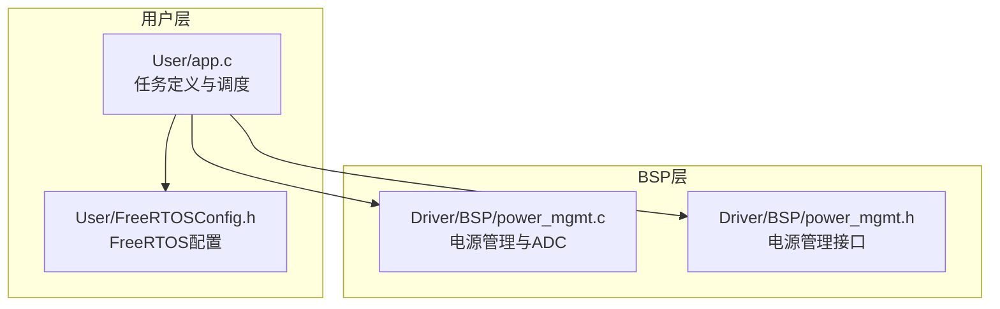
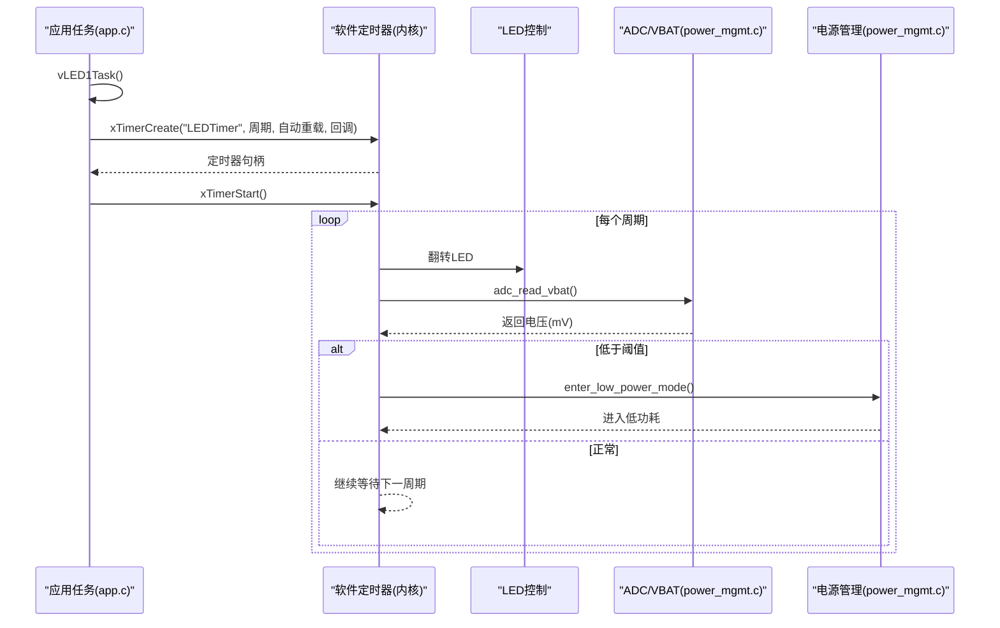
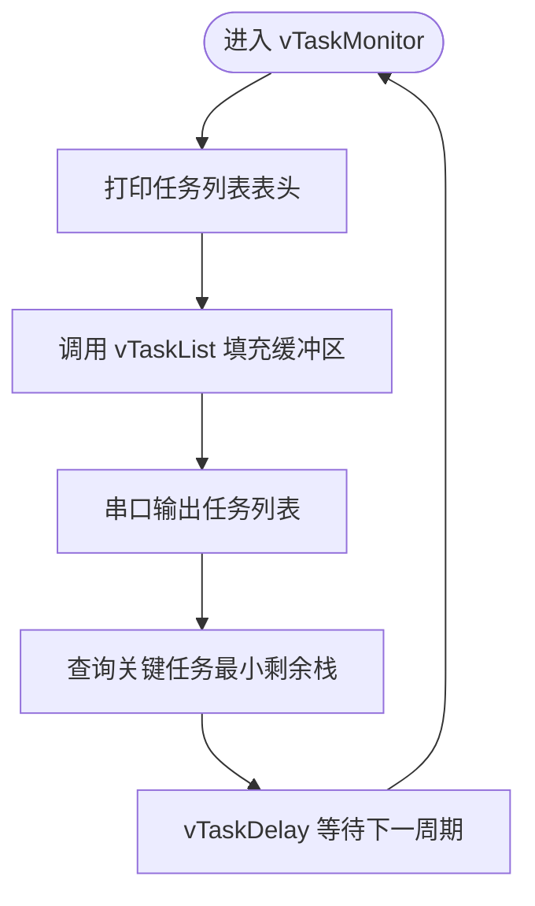
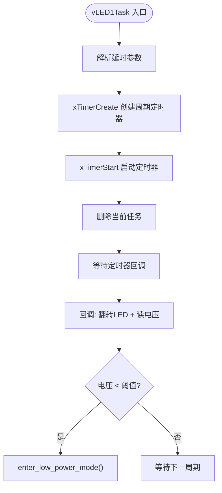
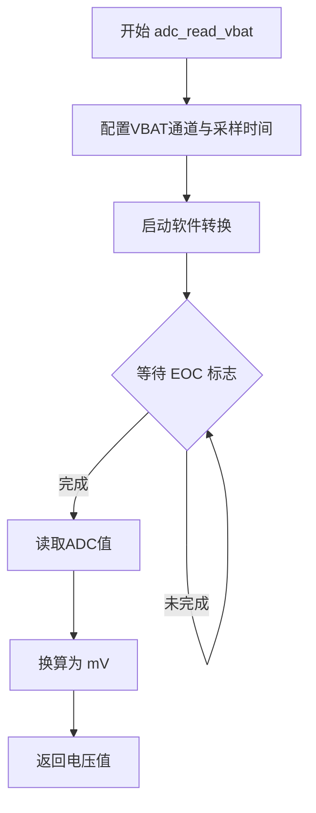
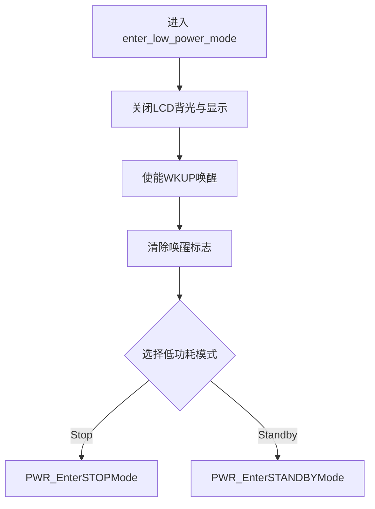
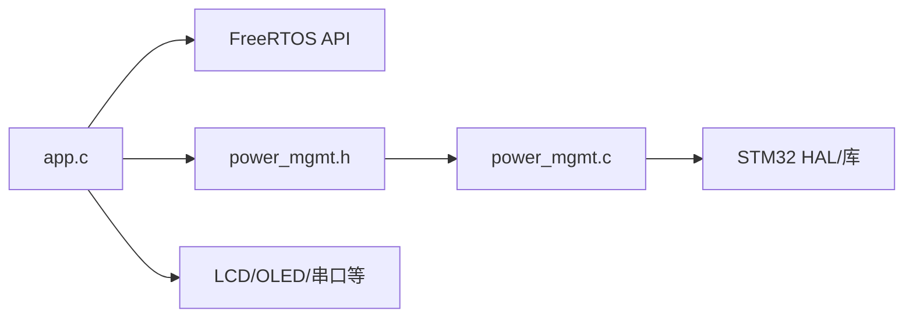

# 系统监控任务

<cite>
**本文引用的文件**   
- [app.c](file://_gbk_backup/User/app.c)
- [power_mgmt.c](file://_gbk_backup/Driver/BSP/power_mgmt.c)
- [power_mgmt.h](file://_gbk_backup/Driver/BSP/power_mgmt.h)
- [FreeRTOSConfig.h](file://_gbk_backup/User/FreeRTOSConfig.h)
</cite>

## 目录
1. [简介](#简介)
2. [项目结构](#项目结构)
3. [核心组件](#核心组件)
4. [架构总览](#架构总览)
5. [详细组件分析](#详细组件分析)
6. [依赖关系分析](#依赖关系分析)
7. [性能与功耗考量](#性能与功耗考量)
8. [故障诊断与健康检查](#故障诊断与健康检查)
9. [结论](#结论)

## 简介
本文面向系统监控相关任务的实现与使用，重点覆盖以下能力：
- vTaskMonitor：周期性打印任务列表、栈使用情况等运行时信息。
- vLED1Task：创建并启动周期性软件定时器，驱动LED闪烁与电池电压监测。
- 电池电压监测：通过adc_read_vbat读取VBAT，结合低电量阈值触发低功耗模式。
- 低功耗模式进入：enter_low_power_mode关闭外设、配置唤醒源并进入Stop/Standby模式。
- 系统健康检查与故障诊断：基于FreeRTOS统计接口与日志输出进行问题定位。

## 项目结构
本仓库采用分层组织方式：
- User层：应用任务、FreeRTOS配置、协议处理等。
- Driver/BSP层：硬件抽象与电源管理、显示、通信等外设驱动。
- Middle层：中间件（如FATFS、内存分配）。

图表来源
- [app.c:74-91](file://_gbk_backup/User/app.c#L74-L91)
- [app.c:155-198](file://_gbk_backup/User/app.c#L155-L198)
- [power_mgmt.c:40-81](file://_gbk_backup/Driver/BSP/power_mgmt.c#L40-L81)
- [power_mgmt.h:6-10](file://_gbk_backup/Driver/BSP/power_mgmt.h#L6-L10)
- [FreeRTOSConfig.h:67-71](file://_gbk_backup/User/FreeRTOSConfig.h#L67-L71)

章节来源
- [app.c:1-22](file://_gbk_backup/User/app.c#L1-L22)
- [power_mgmt.h:1-13](file://_gbk_backup/Driver/BSP/power_mgmt.h#L1-L13)

## 核心组件
- vTaskMonitor：周期性调用vTaskList打印任务状态，同时查询关键任务的最小剩余栈空间。
- vLED1Task：创建周期软件定时器，回调中翻转LED、读取电池电压、判断低电量并进入低功耗模式。
- adc_read_vbat：配置并读取VBAT通道，将ADC值转换为mV。
- enter_low_power_mode：关闭LCD背光与显示，使能WKUP唤醒，进入Stop或Standby低功耗模式。

章节来源
- [app.c:74-91](file://_gbk_backup/User/app.c#L74-L91)
- [app.c:155-198](file://_gbk_backup/User/app.c#L155-L198)
- [power_mgmt.c:40-81](file://_gbk_backup/Driver/BSP/power_mgmt.c#L40-L81)
- [power_mgmt.h:6-10](file://_gbk_backup/Driver/BSP/power_mgmt.h#L6-L10)

## 架构总览
系统以FreeRTOS为内核，应用任务负责业务逻辑与监控；BSP提供电源管理与ADC采样能力；软件定时器在独立任务中周期性执行，完成LED控制与电池监测。

图表来源
- [app.c:182-198](file://_gbk_backup/User/app.c#L182-L198)
- [app.c:155-179](file://_gbk_backup/User/app.c#L155-L179)
- [power_mgmt.c:40-81](file://_gbk_backup/Driver/BSP/power_mgmt.c#L40-L81)

## 详细组件分析

### vTaskMonitor：任务监控与栈健康检查
- 功能要点
  - 周期性打印任务列表头与vTaskList输出，便于观察任务名、状态、优先级、剩余栈与运行核。
  - 针对关键任务（如串口任务）查询历史最小剩余栈空间，辅助评估栈溢出风险。
  - 延时策略使用非阻塞的vTaskDelay，避免阻塞调度器。
- 关键流程
  - 打印表头 → 调用vTaskList填充缓冲区 → 输出缓冲内容 → 查询指定任务最小栈 → 延时等待下一轮。
- 注意事项
  - vTaskList输出长度可能较大，需确保串口发送不丢数据。
  - 若未启用FreeRTOS统计格式化函数，vTaskList不可用；需在配置中开启相应宏。

图表来源
- [app.c:74-91](file://_gbk_backup/User/app.c#L74-L91)

章节来源
- [app.c:74-91](file://_gbk_backup/User/app.c#L74-L91)
- [FreeRTOSConfig.h:60-61](file://_gbk_backup/User/FreeRTOSConfig.h#L60-L61)

### vLED1Task：LED闪烁与电池监测定时器
- 功能要点
  - 接收延时参数（毫秒），创建周期软件定时器，自动重载。
  - 定时器回调中翻转LED、读取VBAT电压、判断是否低于阈值，必要时进入低功耗模式。
  - 任务自身在定时器创建成功后删除，由定时器服务任务接管工作。
- 关键流程
  - 解析参数 → xTimerCreate → xTimerStart → 删除当前任务 → 回调周期性执行。
- 回调行为
  - 翻转LED → 读取电压 → 比较阈值 → 若低电量则延时后进入低功耗。

图表来源
- [app.c:182-198](file://_gbk_backup/User/app.c#L182-L198)
- [app.c:155-179](file://_gbk_backup/User/app.c#L155-L179)

章节来源
- [app.c:155-198](file://_gbk_backup/User/app.c#L155-L198)
- [FreeRTOSConfig.h:67-71](file://_gbk_backup/User/FreeRTOSConfig.h#L67-L71)

### 电池电压监测：adc_read_vbat
- 功能要点
  - 配置ADC1的VBAT通道（内部通道），单次转换，等待EOC标志位。
  - 将ADC结果按参考电压与分压比换算为mV。
- 计算说明
  - VBAT通道内部2分频，参考电压3.3V，12位ADC分辨率，计算公式为：实际电压 = (ADC值 / 4095) × 3.3V × 2。
- 集成点
  - 在定时器回调中周期性调用，获取实时电池电压用于低电量判断。

图表来源
- [power_mgmt.c:40-63](file://_gbk_backup/Driver/BSP/power_mgmt.c#L40-L63)

章节来源
- [power_mgmt.c:40-63](file://_gbk_backup/Driver/BSP/power_mgmt.c#L40-L63)

### 低功耗模式进入：enter_low_power_mode
- 功能要点
  - 关闭LCD背光与显示以降低功耗。
  - 使能WKUP引脚作为唤醒源。
  - 清除唤醒标志，随后进入Stop或Standby模式。
- 模式选择
  - Stop模式：保留SRAM与寄存器，可由中断唤醒。
  - Standby模式：最低功耗，仅支持WKUP或RTC唤醒。
- 安全步骤
  - 必须先清除PWR_FLAG_WU与PWR_FLAG_SB，否则无法进入Standby。

图表来源
- [power_mgmt.c:66-81](file://_gbk_backup/Driver/BSP/power_mgmt.c#L66-L81)

章节来源
- [power_mgmt.c:66-81](file://_gbk_backup/Driver/BSP/power_mgmt.c#L66-L81)

## 依赖关系分析
- app.c依赖
  - FreeRTOS API：task、timers、queue、semphr等。
  - BSP接口：LedKeyBeep、OLED、usart、power_mgmt等。
  - 文件系统与CAN、RTC、BMS等模块（与本主题关联度较低）。
- power_mgmt.c/h
  - 暴露adc_read_vbat与enter_low_power_mode供上层调用。
  - 依赖底层HAL/库函数（如RCC、ADC、PWR、LCD等）。
- FreeRTOSConfig.h
  - 启用软件定时器与任务统计格式化函数，保证vTaskList可用。

图表来源
- [app.c:1-22](file://_gbk_backup/User/app.c#L1-L22)
- [power_mgmt.h:1-13](file://_gbk_backup/Driver/BSP/power_mgmt.h#L1-L13)
- [power_mgmt.c:1-4](file://_gbk_backup/Driver/BSP/power_mgmt.c#L1-L4)
- [FreeRTOSConfig.h:60-71](file://_gbk_backup/User/FreeRTOSConfig.h#L60-L71)

章节来源
- [app.c:1-22](file://_gbk_backup/User/app.c#L1-L22)
- [power_mgmt.h:1-13](file://_gbk_backup/Driver/BSP/power_mgmt.h#L1-L13)
- [power_mgmt.c:1-4](file://_gbk_backup/Driver/BSP/power_mgmt.c#L1-L4)
- [FreeRTOSConfig.h:60-71](file://_gbk_backup/User/FreeRTOSConfig.h#L60-L71)

## 性能与功耗考量
- 定时器周期
  - 建议根据LED闪烁频率与电池采样需求合理设置周期，避免频繁ADC转换与串口输出造成CPU占用过高。
- ADC采样
  - 单次转换+等待EOC的方式简单可靠，但会阻塞回调线程；可考虑DMA或中断方式降低阻塞影响（需改造BSP）。
- 低功耗策略
  - 低电量时优先关闭显示与外设，再进入Standby以获得最低功耗；Wake-up引脚唤醒后可恢复系统运行。
- 任务栈健康
  - 定期查询关键任务的最小剩余栈，发现接近耗尽时及时增大栈空间或优化函数调用链。

[本节为通用指导，不直接分析具体文件]

## 故障诊断与健康检查
- 任务列表不可用
  - 现象：串口无任务列表输出。
  - 排查：确认FreeRTOSConfig.h中已启用configUSE_TRACE_FACILITY与configUSE_STATS_FORMATTING_FUNCTIONS。
- 定时器未触发
  - 现象：LED不闪烁、电压不更新。
  - 排查：检查xTimerCreate返回值是否为NULL；确认configUSE_TIMERS已启用且定时器队列长度足够。
- 低电量未进入低功耗
  - 现象：电压低于阈值但未休眠。
  - 排查：确认VBAT_LOW_THRESHOLD设置合理；检查adc_read_vbat返回值是否正确；确认enter_low_power_mode被调用。
- 串口输出丢失
  - 现象：任务列表或日志不完整。
  - 排查：提高串口波特率；减少printf频率；确保vTaskMonitor延时合理。

章节来源
- [FreeRTOSConfig.h:60-71](file://_gbk_backup/User/FreeRTOSConfig.h#L60-L71)
- [app.c:182-198](file://_gbk_backup/User/app.c#L182-L198)
- [power_mgmt.c:40-81](file://_gbk_backup/Driver/BSP/power_mgmt.c#L40-L81)

## 结论
本系统通过FreeRTOS软件定时器实现了LED闪烁与电池电压监测，并在低电量时自动进入低功耗模式，有效延长设备续航。vTaskMonitor提供了任务运行状态的可视化手段，配合最小剩余栈查询，有助于早期发现栈溢出风险。建议在量产前对定时器周期、ADC采样策略与低功耗唤醒路径进行全面验证，并结合日志与串口输出建立完善的健康检查机制。