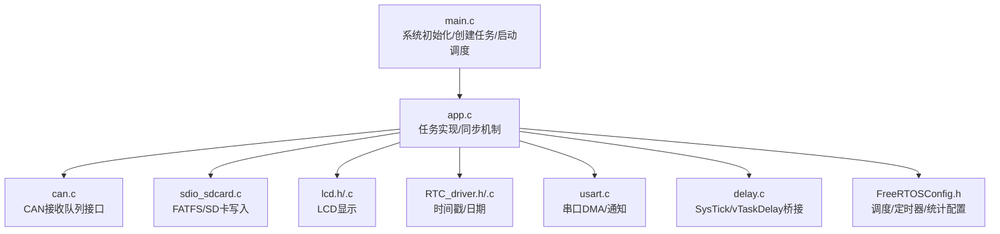
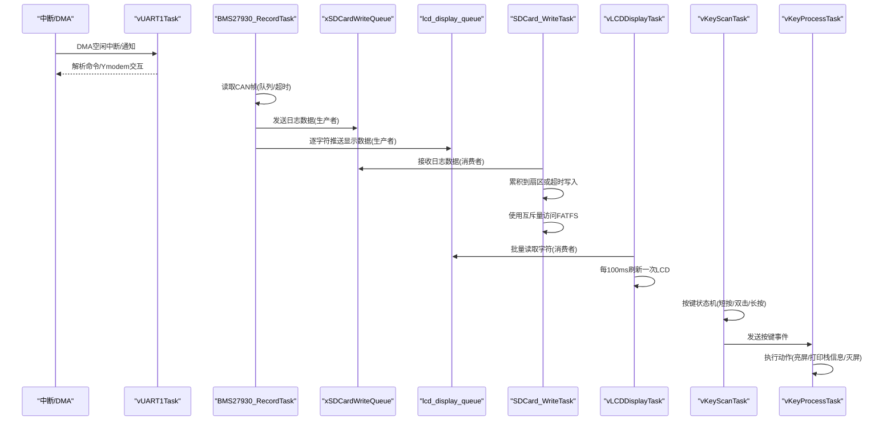
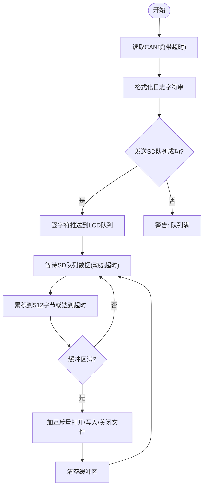
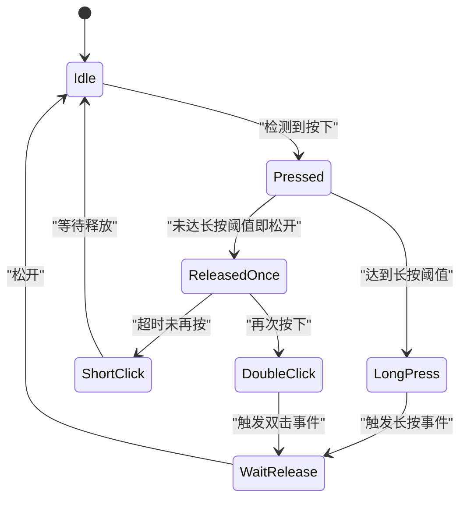
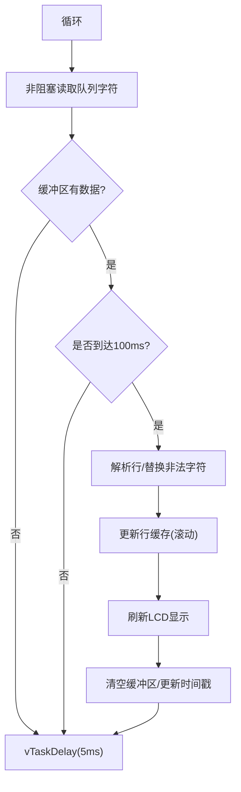
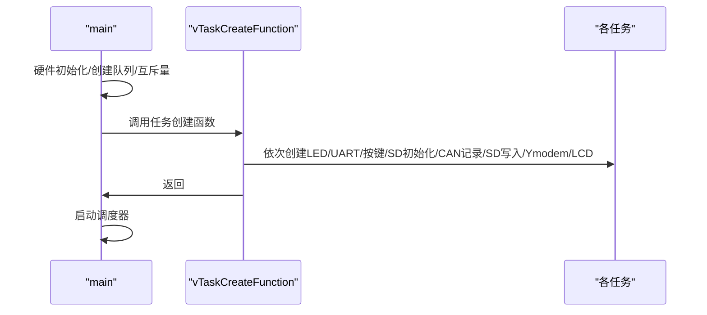
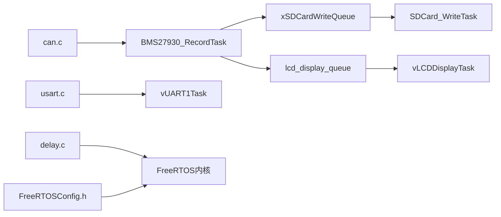

# 任务同步模式

<cite>
**本文引用的文件**   
- [main.c](file://_gbk_backup/User/main.c)
- [app.c](file://_gbk_backup/User/app.c)
- [app.h](file://_gbk_backup/User/app.h)
- [FreeRTOSConfig.h](file://_gbk_backup/User/FreeRTOSConfig.h)
- [delay.c](file://_gbk_backup/Driver/SYSTEM/delay.c)
- [usart.c](file://_gbk_backup/Driver/SYSTEM/usart.c)
- [can.c](file://_gbk_backup/Driver/BSP/can.c)
</cite>

## 目录
1. [引言](#引言)
2. [项目结构](#项目结构)
3. [核心组件](#核心组件)
4. [架构总览](#架构总览)
5. [详细组件分析](#详细组件分析)
6. [依赖关系分析](#依赖关系分析)
7. [性能与实时性](#性能与实时性)
8. [故障排查指南](#故障排查指南)
9. [结论](#结论)

## 引言
本文件面向FreeRTOS在STM32F407上的任务同步模式，重点说明：
- 生产者-消费者模式：CAN数据生产者到SD卡消费者的数据流
- 按键事件处理模式：按键扫描与处理的解耦
- 显示刷新同步：LCD显示任务的批量刷新策略
- 任务间依赖关系与启动顺序控制
- vTaskDelay与TickType_t在时间同步中的应用
- 任务状态监控与调试方法（栈空间检查、任务列表输出）
- 实时性保证与调度优化策略

## 项目结构
本项目采用“应用层任务+外设驱动”的分层组织方式。关键入口位于main函数中完成系统初始化、队列/互斥量创建，随后调用任务创建函数并启动调度器。应用逻辑集中在app.c中，包含多个任务实现；FreeRTOS内核配置在FreeRTOSConfig.h中；底层驱动（如串口、CAN、延时）位于Driver目录。

图表来源
- [main.c:34-60](file://_gbk_backup/User/main.c#L34-L60)
- [app.c:529-541](file://_gbk_backup/User/app.c#L529-L541)
- [FreeRTOSConfig.h:12-21](file://_gbk_backup/User/FreeRTOSConfig.h#L12-L21)

章节来源
- [main.c:34-60](file://_gbk_backup/User/main.c#L34-L60)
- [app.c:529-541](file://_gbk_backup/User/app.c#L529-L541)

## 核心组件
- 任务与句柄
  - UART任务句柄、Ymodem任务句柄
  - 按键队列xKeyQueue、SD写队列xSDCardWriteQueue、LCD显示队列lcd_display_queue
  - SD卡互斥量xSDCardMutex、全局文件系统对象g_fs
- 关键数据结构
  - SDCardWriteData_t：单条日志缓冲（512字节），用于生产者-消费者传递
- 主要任务
  - BMS27930_RecordTask：CAN数据生产者
  - SDCard_WriteTask：SD卡消费者
  - vLCDDisplayTask：LCD显示消费者
  - vKeyScanTask/vKeyProcessTask：按键扫描与处理
  - SD_Card_Init：SD卡挂载与互斥量创建
  - vLED1Task/vLEDTimerCallback：LED闪烁与低电量检测
  - vTaskMonitor：任务监控（可选）

章节来源
- [main.c:23-31](file://_gbk_backup/User/main.c#L23-L31)
- [app.h:4-10](file://_gbk_backup/User/app.h#L4-L10)
- [app.c:74-91](file://_gbk_backup/User/app.c#L74-L91)
- [app.c:200-309](file://_gbk_backup/User/app.c#L200-L309)
- [app.c:311-366](file://_gbk_backup/User/app.c#L311-L366)
- [app.c:414-450](file://_gbk_backup/User/app.c#L414-L450)
- [app.c:452-521](file://_gbk_backup/User/app.c#L452-L521)

## 架构总览
下图展示任务间的同步关系与数据流向：

图表来源
- [app.c:200-309](file://_gbk_backup/User/app.c#L200-L309)
- [app.c:311-366](file://_gbk_backup/User/app.c#L311-L366)
- [app.c:452-521](file://_gbk_backup/User/app.c#L452-L521)
- [app.c:93-152](file://_gbk_backup/User/app.c#L93-L152)
- [app.c:368-412](file://_gbk_backup/User/app.c#L368-L412)
- [usart.c:186-204](file://_gbk_backup/Driver/SYSTEM/usart.c#L186-L204)

## 详细组件分析

### 生产者-消费者模式：CAN数据生产者到SD卡消费者
- 生产者：BMS27930_RecordTask
  - 从CAN接收队列获取报文，格式化日志字符串
  - 通过xSDCardWriteQueue将日志发送给SD卡任务
  - 同时向lcd_display_queue逐字符推送显示内容
- 消费者：SDCard_WriteTask
  - 从xSDCardWriteQueue接收数据，累积至512字节缓冲区或等待超时（默认1分钟）后统一写入
  - 使用xSDCardMutex保护FATFS操作，避免并发冲突
  - 文件名基于RTC日期生成，支持追加/新建

图表来源
- [app.c:200-309](file://_gbk_backup/User/app.c#L200-L309)
- [app.c:311-366](file://_gbk_backup/User/app.c#L311-L366)
- [app.c:34-71](file://_gbk_backup/User/app.c#L34-L71)

章节来源
- [app.c:200-309](file://_gbk_backup/User/app.c#L200-L309)
- [app.c:311-366](file://_gbk_backup/User/app.c#L311-L366)
- [app.c:34-71](file://_gbk_backup/User/app.c#L34-L71)

### 按键事件处理模式
- vKeyScanTask：按键状态机
  - 识别短按、双击、长按，并通过xKeyQueue发送事件
  - 使用vTaskDelay周期性扫描
- vKeyProcessTask：按键处理
  - 阻塞式接收按键事件
  - 短按1次：点亮屏幕背光
  - 短按2次：打印任务列表与指定任务栈高水位
  - 长按：关闭屏幕背光

图表来源
- [app.c:93-152](file://_gbk_backup/User/app.c#L93-L152)
- [app.c:368-412](file://_gbk_backup/User/app.c#L368-L412)

章节来源
- [app.c:93-152](file://_gbk_backup/User/app.c#L93-L152)
- [app.c:368-412](file://_gbk_backup/User/app.c#L368-L412)

### 显示刷新同步
- vLCDDisplayTask：LCD显示消费者
  - 非阻塞地从lcd_display_queue读取字符，累积到本地缓冲区
  - 每100ms进行一次解析与刷新，减少频繁刷屏开销
  - 行缓存滚动更新，保持最多14行可见
- 生产者：BMS27930_RecordTask
  - 将日志逐字符推入lcd_display_queue，必要时进行队列使用率告警

图表来源
- [app.c:452-521](file://_gbk_backup/User/app.c#L452-L521)
- [app.c:264-302](file://_gbk_backup/User/app.c#L264-L302)

章节来源
- [app.c:452-521](file://_gbk_backup/User/app.c#L452-L521)
- [app.c:264-302](file://_gbk_backup/User/app.c#L264-L302)

### 任务依赖关系与启动顺序控制
- 初始化阶段（main）
  - 硬件初始化（串口、内存、RTC、OLED、按键、LED、LCD、RS485、CAN）
  - 创建队列与互斥量（按键队列、SD写队列、LCD队列、SD卡互斥量）
  - 调用vTaskCreateFunction创建所有任务
  - 启动调度器
- 任务创建顺序（vTaskCreateFunction）
  - LED任务（软件定时器）
  - UART任务（串口接收）
  - 按键扫描与处理任务
  - SD卡初始化任务（延迟400ms后挂载文件系统）
  - CAN记录任务（生产者）
  - SD卡写入任务（消费者）
  - Ymodem任务（协议交互）
  - LCD显示任务（消费者）

图表来源
- [main.c:34-60](file://_gbk_backup/User/main.c#L34-L60)
- [app.c:529-541](file://_gbk_backup/User/app.c#L529-L541)

章节来源
- [main.c:34-60](file://_gbk_backup/User/main.c#L34-L60)
- [app.c:529-541](file://_gbk_backup/User/app.c#L529-L541)

### vTaskDelay与TickType_t在时间同步中的应用
- vTaskDelay
  - 用于周期性任务控制（按键扫描、LCD刷新周期、监控任务间隔）
  - 与pdMS_TO_TICKS宏配合，将毫秒转换为系统节拍数
- TickType_t
  - 用于计算相对时间差（如SD卡写入超时、LCD刷新周期）
  - 结合xTaskGetTickCount()实现非阻塞超时控制
- 典型用法
  - 按键扫描：vTaskDelay(pdMS_TO_TICKS(TASK_PERIOD_MS))
  - LCD刷新：vTaskDelay(pdMS_TO_TICKS(5))
  - SD卡写入：动态wait_time = pdMS_TO_TICKS(WRITE_TIMEOUT_MS) - elapsed
  - 任务监控：vTaskDelay(pdMS_TO_TICKS(5000))

章节来源
- [app.c:89-91](file://_gbk_backup/User/app.c#L89-L91)
- [app.c:150-151](file://_gbk_backup/User/app.c#L150-L151)
- [app.c:326-333](file://_gbk_backup/User/app.c#L326-L333)
- [app.c:465-476](file://_gbk_backup/User/app.c#L465-L476)
- [app.c:519-520](file://_gbk_backup/User/app.c#L519-L520)
- [delay.c:60-71](file://_gbk_backup/Driver/SYSTEM/delay.c#L60-L71)

### 任务状态监控与调试方法
- 任务列表输出
  - vTaskList()打印任务名、状态、优先级、剩余栈空间、核心号
  - 按键短按2次可触发打印
- 栈空间检查
  - uxTaskGetStackHighWaterMark()查询指定任务的最小剩余栈空间
  - 示例：查询UART任务与Ymodem任务的栈高水位
- 监控任务（可选）
  - vTaskMonitor周期性打印任务列表与特定任务栈信息

章节来源
- [app.c:74-91](file://_gbk_backup/User/app.c#L74-L91)
- [app.c:386-399](file://_gbk_backup/User/app.c#L386-L399)

## 依赖关系分析
- 模块耦合
  - BMS27930_RecordTask依赖CAN驱动（can.c）提供接收接口
  - SDCard_WriteTask依赖FATFS与SDIO驱动，受xSDCardMutex保护
  - vLCDDisplayTask依赖LCD驱动，消费lcd_display_queue
  - vKeyScanTask/vKeyProcessTask通过xKeyQueue解耦
  - UART任务通过中断通知机制与DMA协作
- 外部依赖
  - FreeRTOS内核（任务、队列、信号量、定时器、统计API）
  - STM32 HAL/LL库（SysTick、NVIC、DMA、RTC等）

图表来源
- [can.c:127-127](file://_gbk_backup/Driver/BSP/can.c#L127-L127)
- [app.c:200-309](file://_gbk_backup/User/app.c#L200-L309)
- [app.c:311-366](file://_gbk_backup/User/app.c#L311-L366)
- [app.c:452-521](file://_gbk_backup/User/app.c#L452-L521)
- [usart.c:186-204](file://_gbk_backup/Driver/SYSTEM/usart.c#L186-L204)
- [delay.c:60-71](file://_gbk_backup/Driver/SYSTEM/delay.c#L60-L71)
- [FreeRTOSConfig.h:12-21](file://_gbk_backup/User/FreeRTOSConfig.h#L12-L21)

章节来源
- [can.c:127-127](file://_gbk_backup/Driver/BSP/can.c#L127-L127)
- [app.c:200-309](file://_gbk_backup/User/app.c#L200-L309)
- [app.c:311-366](file://_gbk_backup/User/app.c#L311-L366)
- [app.c:452-521](file://_gbk_backup/User/app.c#L452-L521)
- [usart.c:186-204](file://_gbk_backup/Driver/SYSTEM/usart.c#L186-L204)
- [delay.c:60-71](file://_gbk_backup/Driver/SYSTEM/delay.c#L60-L71)
- [FreeRTOSConfig.h:12-21](file://_gbk_backup/User/FreeRTOSConfig.h#L12-L21)

## 性能与实时性
- 调度策略
  - 抢占式调度器启用，支持同优先级时间片轮转
  - 软件定时器使能，定时器任务优先级设为最高
- 时间基准
  - SysTick中断频率为configTICK_RATE_HZ=1000Hz，vTaskDelay精度约1ms
- 队列与互斥量
  - 使用队列进行任务间通信，降低耦合度
  - 使用互斥量保护共享资源（FATFS）
- 优化建议
  - 合理设置队列深度与任务栈大小，避免溢出与丢包
  - 对高频数据路径（如LCD刷新）采用批处理与节流
  - 根据实际负载调整任务优先级，确保关键路径优先执行
  - 启用栈溢出检测与运行时间统计以辅助调优

章节来源
- [FreeRTOSConfig.h:12-21](file://_gbk_backup/User/FreeRTOSConfig.h#L12-L21)
- [FreeRTOSConfig.h:67-71](file://_gbk_backup/User/FreeRTOSConfig.h#L67-L71)
- [FreeRTOSConfig.h:74-89](file://_gbk_backup/User/FreeRTOSConfig.h#L74-L89)
- [FreeRTOSConfig.h:109-111](file://_gbk_backup/User/FreeRTOSConfig.h#L109-L111)

## 故障排查指南
- 常见问题
  - SD卡写入失败：检查xSDCardMutex是否正确创建与释放，确认FATFS挂载成功
  - LCD显示卡顿：检查lcd_display_queue使用率，必要时增大缓冲区或降低生产者速率
  - 按键无响应：确认按键扫描任务是否正常运行，检查xKeyQueue是否被消费
  - 任务栈溢出：使用uxTaskGetStackHighWaterMark检查关键任务栈使用情况
- 调试步骤
  - 通过按键短按2次打印任务列表与栈信息
  - 启用vTaskMonitor周期性监控任务状态
  - 检查队列长度与消息数量，评估背压情况
  - 查看SD卡日志文件，验证数据完整性与时间戳准确性

章节来源
- [app.c:74-91](file://_gbk_backup/User/app.c#L74-L91)
- [app.c:386-399](file://_gbk_backup/User/app.c#L386-L399)
- [app.c:414-450](file://_gbk_backup/User/app.c#L414-L450)
- [app.c:264-302](file://_gbk_backup/User/app.c#L264-L302)

## 结论
本项目通过FreeRTOS的任务、队列与互斥量实现了清晰的职责分离与可靠的数据流控制。CAN数据生产者与SD卡消费者之间通过队列解耦，LCD显示任务采用批处理刷新策略提升实时性与用户体验。按键事件通过状态机与队列实现了解耦处理。时间同步通过vTaskDelay与TickType_t精确控制，任务监控与调试手段完善。整体架构具备良好的可扩展性与可维护性，适合在嵌入式实时系统中复用与优化。