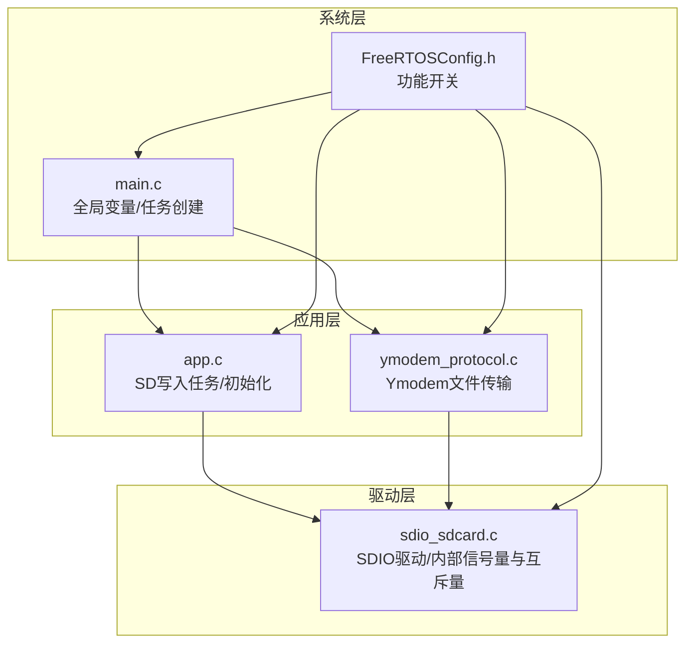
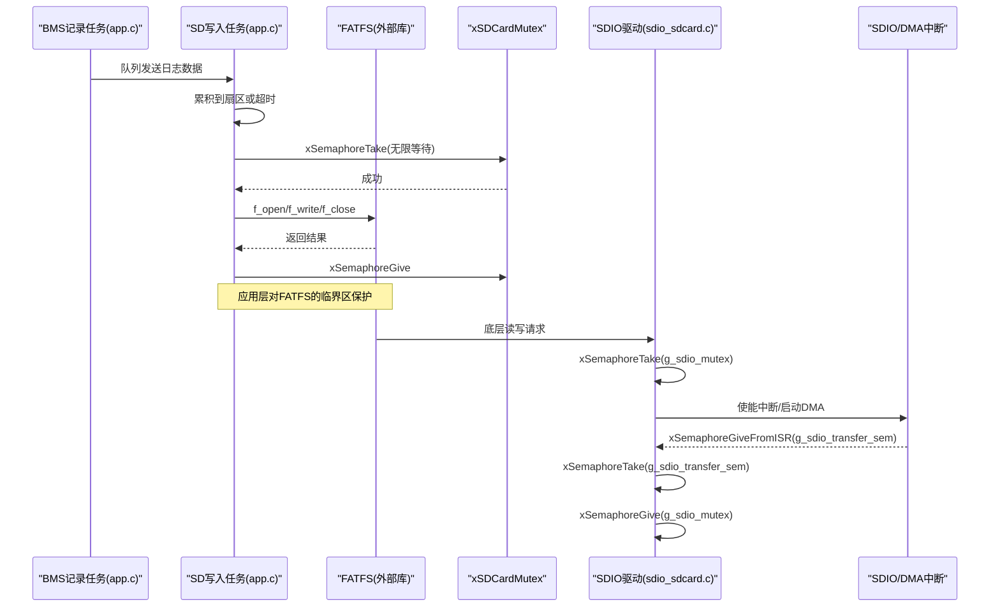
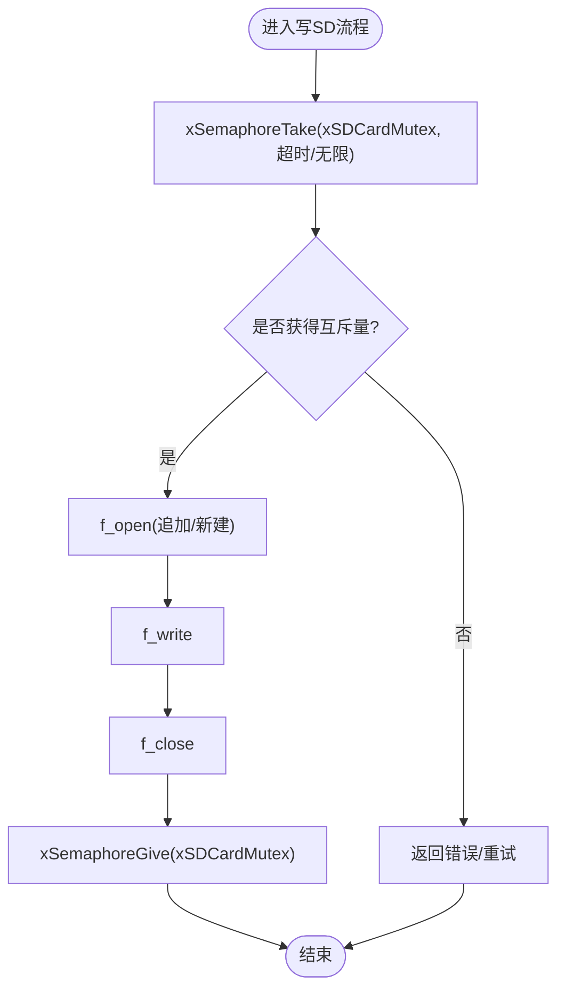
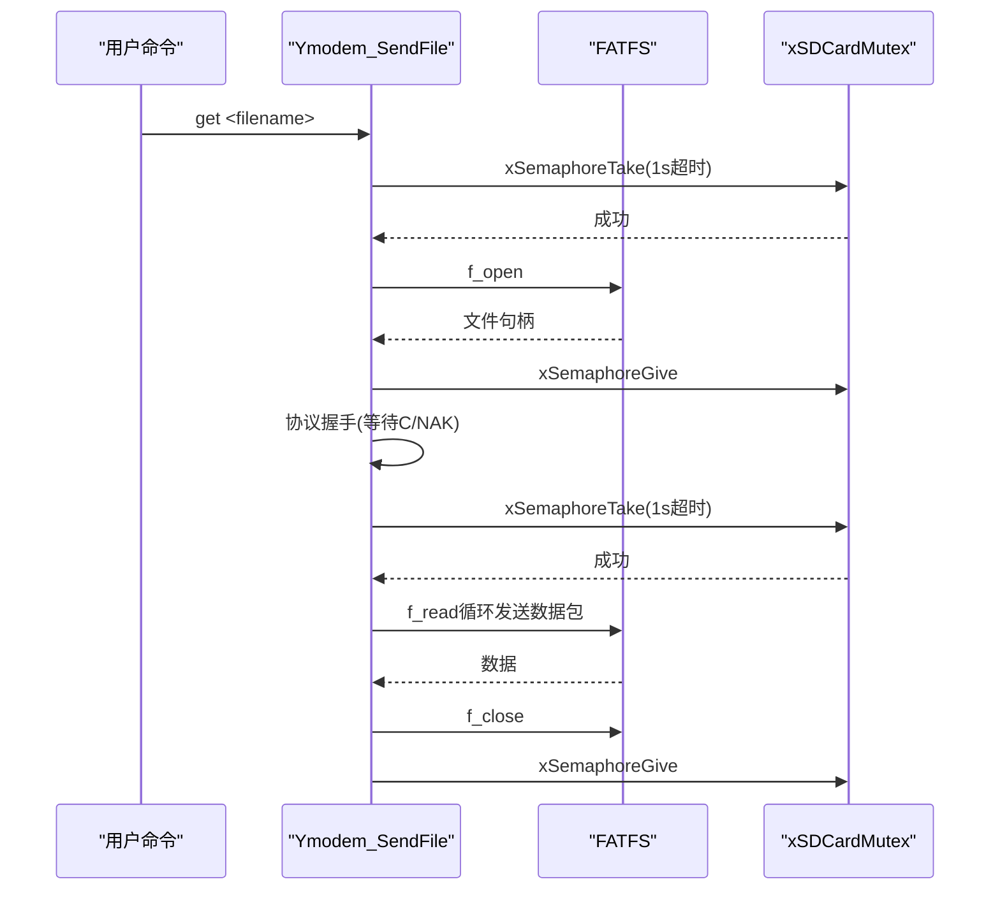
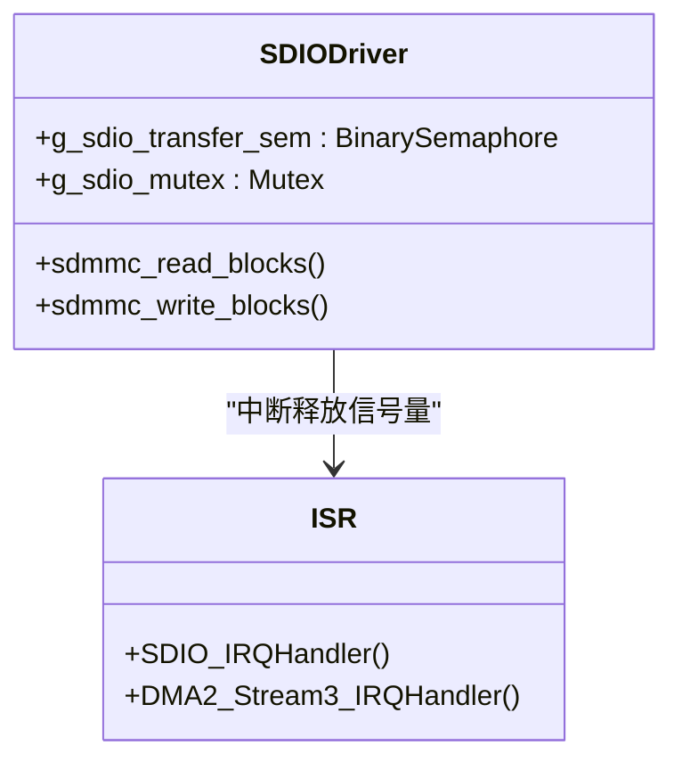
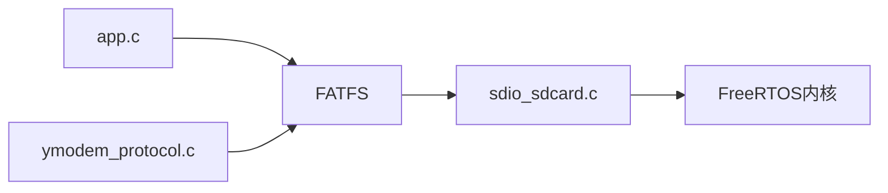

# 信号量与互斥锁

<cite>
**本文引用的文件**   
- [main.c](file://_gbk_backup/User/main.c)
- [app.c](file://_gbk_backup/User/app.c)
- [ymodem_protocol.c](file://_gbk_backup/User/ymodem_protocol.c)
- [sdio_sdcard.c](file://_gbk_backup/Driver/BSP/sdio_sdcard.c)
- [FreeRTOSConfig.h](file://_gbk_backup/User/FreeRTOSConfig.h)
</cite>

## 目录
1. [引言](#引言)
2. [项目结构](#项目结构)
3. [核心组件](#核心组件)
4. [架构总览](#架构总览)
5. [详细组件分析](#详细组件分析)
6. [依赖关系分析](#依赖关系分析)
7. [性能考量](#性能考量)
8. [故障排查指南](#故障排查指南)
9. [结论](#结论)

## 引言
本文围绕 FreeRTOS 中的信号量与互斥锁，结合本项目中 SD 卡访问的同步机制，系统性说明：
- 二进制信号量与计数信号量的区别
- 互斥锁在资源共享保护中的作用
- xSemaphoreTake/xSemaphoreGive 的使用方法、超时处理与优先级继承
- 死锁避免策略与资源竞争解决方案
- 同步原语选择指南与性能对比

重点聚焦项目中使用的 SD 卡互斥量 xSDCardMutex 的实现原理与使用场景。

## 项目结构
本项目的同步相关代码主要分布在以下位置：
- 全局互斥量声明与任务创建入口：User/main.c
- SD 卡文件系统挂载与互斥量创建、SD 写入逻辑：User/app.c
- Ymodem 协议通过串口传输 SD 卡文件时访问文件系统：User/ymodem_protocol.c
- SDIO 底层驱动层信号量与互斥量：Driver/BSP/sdio_sdcard.c
- FreeRTOS 功能开关配置（含互斥量、计数信号量等）：User/FreeRTOSConfig.h

图表来源
- [main.c:23-31](file://_gbk_backup/User/main.c#L23-L31)
- [app.c:30-31](file://_gbk_backup/User/app.c#L30-L31)
- [ymodem_protocol.c:23-28](file://_gbk_backup/User/ymodem_protocol.c#L23-L28)
- [sdio_sdcard.c:13-14](file://_gbk_backup/Driver/BSP/sdio_sdcard.c#L13-L14)
- [FreeRTOSConfig.h:25-27](file://_gbk_backup/User/FreeRTOSConfig.h#L25-L27)

章节来源
- [main.c:23-31](file://_gbk_backup/User/main.c#L23-L31)
- [app.c:30-31](file://_gbk_backup/User/app.c#L30-L31)
- [ymodem_protocol.c:23-28](file://_gbk_backup/User/ymodem_protocol.c#L23-L28)
- [sdio_sdcard.c:13-14](file://_gbk_backup/Driver/BSP/sdio_sdcard.c#L13-L14)
- [FreeRTOSConfig.h:25-27](file://_gbk_backup/User/FreeRTOSConfig.h#L25-L27)

## 核心组件
- 全局 SD 卡互斥量 xSDCardMutex
  - 定义于 main.c，作为全局共享资源访问的保护原语
  - 在 app.c 中创建并用于 FATFS 操作临界区
  - ymodem_protocol.c 通过 extern 引用并在文件读取/目录操作前获取
- SDIO 驱动层同步对象
  - g_sdio_transfer_sem：二进制信号量，用于中断与任务间“传输完成”同步
  - g_sdio_mutex：互斥量，保护 SDIO 驱动内部状态机与寄存器访问

章节来源
- [main.c:30](file://_gbk_backup/User/main.c#L30)
- [app.c:414-449](file://_gbk_backup/User/app.c#L414-L449)
- [ymodem_protocol.c:310-395](file://_gbk_backup/User/ymodem_protocol.c#L310-L395)
- [sdio_sdcard.c:13-14](file://_gbk_backup/Driver/BSP/sdio_sdcard.c#L13-L14)

## 架构总览
下图展示 SD 卡访问路径上的同步点：应用层通过 xSDCardMutex 保护 FATFS 调用；驱动层通过 g_sdio_mutex 和 g_sdio_transfer_sem 协调 DMA/中断与任务。

图表来源
- [app.c:35-71](file://_gbk_backup/User/app.c#L35-L71)
- [app.c:311-366](file://_gbk_backup/User/app.c#L311-L366)
- [sdio_sdcard.c:655-736](file://_gbk_backup/Driver/BSP/sdio_sdcard.c#L655-L736)
- [sdio_sdcard.c:747-800](file://_gbk_backup/Driver/BSP/sdio_sdcard.c#L747-L800)

## 详细组件分析

### 全局 SD 卡互斥量 xSDCardMutex
- 作用
  - 保护 FATFS 全局对象与文件句柄，防止多任务并发访问导致文件系统状态不一致
- 生命周期
  - 在 main.c 中声明为全局变量
  - 在 app.c 的 SD_Card_Init 任务中创建，随后挂载文件系统
- 使用模式
  - 所有涉及 FATFS 的操作（打开/写入/关闭、目录遍历等）均在获取互斥量后进行
  - 典型用法：xSemaphoreTake(xSDCardMutex, portMAX_DELAY) 或带超时的取锁

图表来源
- [app.c:35-71](file://_gbk_backup/User/app.c#L35-L71)
- [app.c:414-449](file://_gbk_backup/User/app.c#L414-L449)

章节来源
- [main.c:30](file://_gbk_backup/User/main.c#L30)
- [app.c:35-71](file://_gbk_backup/User/app.c#L35-L71)
- [app.c:414-449](file://_gbk_backup/User/app.c#L414-L449)

### Ymodem 协议中的 SD 卡访问
- 场景
  - 通过串口命令触发 Ymodem 发送 SD 卡文件
- 同步点
  - 在打开文件前获取 xSDCardMutex，释放后再进行协议握手与数据传输
  - 在读取数据阶段再次获取互斥量，完成后释放
- 超时处理
  - 使用 pdMS_TO_TICKS(1000) 作为取锁超时，避免长时间阻塞

图表来源
- [ymodem_protocol.c:303-428](file://_gbk_backup/User/ymodem_protocol.c#L303-L428)

章节来源
- [ymodem_protocol.c:303-428](file://_gbk_backup/User/ymodem_protocol.c#L303-L428)

### SDIO 驱动层同步对象
- g_sdio_transfer_sem（二进制信号量）
  - 用途：中断与任务之间“传输完成”的同步
  - 使用：任务侧 xSemaphoreTake 等待，中断侧 xSemaphoreGiveFromISR 释放
  - 超时：pdMS_TO_TICKS(SDIO_TRANSFER_TIMEOUT_MS)
- g_sdio_mutex（互斥量）
  - 用途：保护 SDIO 驱动内部状态机、寄存器与 DMA 配置
  - 使用：在读写块函数中取锁，完成后释放

图表来源
- [sdio_sdcard.c:13-14](file://_gbk_backup/Driver/BSP/sdio_sdcard.c#L13-L14)
- [sdio_sdcard.c:655-736](file://_gbk_backup/Driver/BSP/sdio_sdcard.c#L655-L736)
- [sdio_sdcard.c:747-800](file://_gbk_backup/Driver/BSP/sdio_sdcard.c#L747-L800)

章节来源
- [sdio_sdcard.c:13-14](file://_gbk_backup/Driver/BSP/sdio_sdcard.c#L13-L14)
- [sdio_sdcard.c:655-736](file://_gbk_backup/Driver/BSP/sdio_sdcard.c#L655-L736)
- [sdio_sdcard.c:747-800](file://_gbk_backup/Driver/BSP/sdio_sdcard.c#L747-L800)

### FreeRTOS 配置与能力
- 已启用特性
  - configUSE_MUTEXES=1：支持互斥信号量
  - configUSE_RECURSIVE_MUTEXES=1：支持递归互斥量
  - configUSE_COUNTING_SEMAPHORES=1：支持计数信号量
- 中断优先级
  - configMAX_SYSCALL_INTERRUPT_PRIORITY 限制可调用 FreeRTOS API 的最高中断优先级
- 建议
  - 在中断中使用 FromISR 系列 API（如 xSemaphoreGiveFromISR）
  - 合理设置中断优先级，避免高优先级中断频繁抢占调度器

章节来源
- [FreeRTOSConfig.h:25-27](file://_gbk_backup/User/FreeRTOSConfig.h#L25-L27)
- [FreeRTOSConfig.h:99-103](file://_gbk_backup/User/FreeRTOSConfig.h#L99-L103)

## 依赖关系分析
- 模块耦合
  - app.c 依赖 main.c 的全局 xSDCardMutex
  - ymodem_protocol.c 通过 extern 引用 xSDCardMutex
  - sdio_sdcard.c 提供底层 SDIO 访问，内部使用 g_sdio_mutex/g_sdio_transfer_sem
- 依赖方向
  - 应用层 -> 文件系统(FATFS) -> 驱动层
  - 驱动层 -> FreeRTOS 内核（信号量/互斥量）

图表来源
- [app.c:30-31](file://_gbk_backup/User/app.c#L30-L31)
- [ymodem_protocol.c:23-28](file://_gbk_backup/User/ymodem_protocol.c#L23-L28)
- [sdio_sdcard.c:13-14](file://_gbk_backup/Driver/BSP/sdio_sdcard.c#L13-L14)

章节来源
- [app.c:30-31](file://_gbk_backup/User/app.c#L30-L31)
- [ymodem_protocol.c:23-28](file://_gbk_backup/User/ymodem_protocol.c#L23-L28)
- [sdio_sdcard.c:13-14](file://_gbk_backup/Driver/BSP/sdio_sdcard.c#L13-L14)

## 性能考量
- 二进制信号量 vs 计数信号量
  - 二进制信号量：适合事件同步（如“传输完成”），开销小，语义清晰
  - 计数信号量：适合资源计数（如可用缓冲区数量），但需注意计数边界与一致性
- 互斥量 vs 二进制信号量
  - 互斥量具备优先级继承，避免优先级反转，适合保护共享资源
  - 二进制信号量无优先级继承，仅用于事件通知
- 本项目实践
  - g_sdio_transfer_sem 使用二进制信号量做中断-任务同步
  - g_sdio_mutex 与 xSDCardMutex 使用互斥量保护关键区
- 建议
  - 优先使用互斥量保护共享资源，避免优先级反转
  - 使用带超时的 xSemaphoreTake，防止长期阻塞
  - 将耗时操作（如磁盘 I/O）放在专用任务中，减少阻塞其他任务的时间

[本节为通用指导，不直接分析具体文件]

## 故障排查指南
- 常见问题
  - 未获取互斥量即访问 FATFS：导致文件系统损坏或崩溃
  - 忘记释放互斥量：造成后续任务永久阻塞
  - 中断中调用非 FromISR API：引发 HardFault
  - 超时时间过短：导致频繁取锁失败
- 定位方法
  - 检查所有 FATFS 调用是否被 xSDCardMutex 包裹
  - 检查中断回调中是否使用 xSemaphoreGiveFromISR
  - 打印取锁/释放锁的关键路径日志
- 改进措施
  - 统一封装 FATFS 访问接口，强制加锁/解锁
  - 增加互斥量持有时间与重入检测（谨慎使用递归互斥量）
  - 调整超时参数，平衡响应性与稳定性

章节来源
- [app.c:35-71](file://_gbk_backup/User/app.c#L35-L71)
- [ymodem_protocol.c:310-395](file://_gbk_backup/User/ymodem_protocol.c#L310-L395)
- [sdio_sdcard.c:655-736](file://_gbk_backup/Driver/BSP/sdio_sdcard.c#L655-L736)

## 结论
- 本项目通过 xSDCardMutex 保护 FATFS 全局状态，确保多任务并发访问 SD 卡的安全与一致性
- 驱动层通过 g_sdio_mutex 与 g_sdio_transfer_sem 实现 SDIO 内部状态与中断同步
- 推荐以互斥量保护共享资源，使用二进制信号量进行事件同步，并结合超时机制提升鲁棒性
- 遵循“先取锁、后访问、再释放”的原则，避免死锁与优先级反转

[本节为总结性内容，不直接分析具体文件]