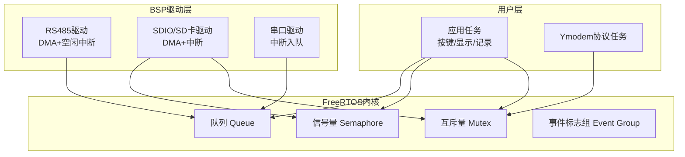
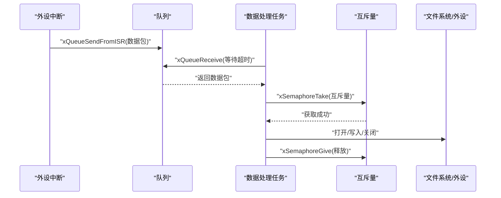
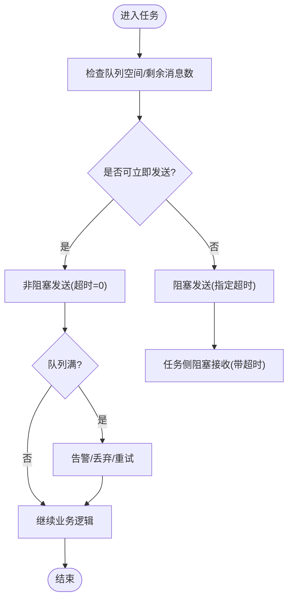
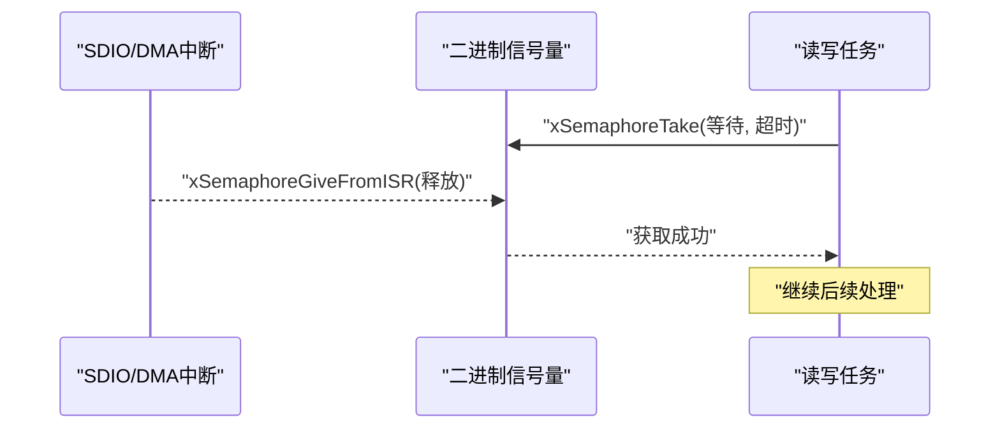
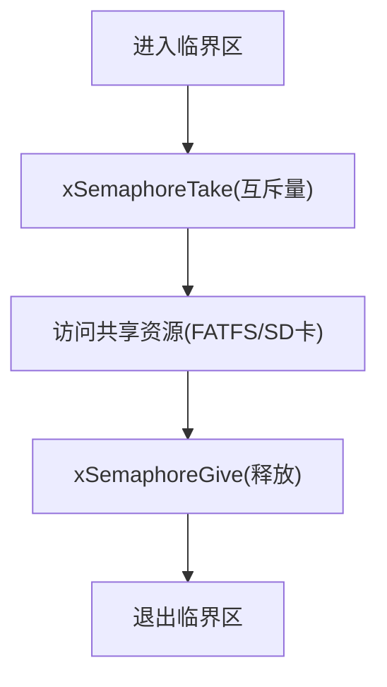
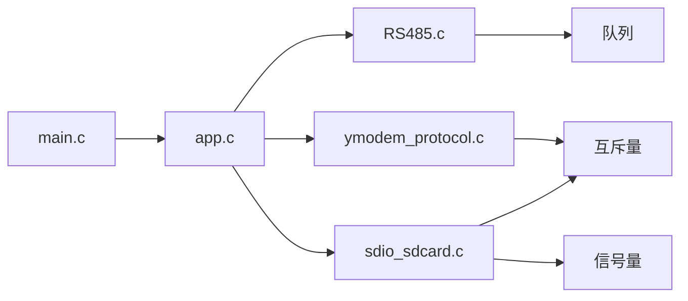

# 同步与通信机制

<cite>
**本文引用的文件**   
- [main.c](file://_gbk_backup/User/main.c)
- [app.c](file://_gbk_backup/User/app.c)
- [FreeRTOSConfig.h](file://_gbk_backup/User/FreeRTOSConfig.h)
- [RS485.c](file://_gbk_backup/Driver/BSP/RS485.c)
- [sdio_sdcard.c](file://_gbk_backup/Driver/BSP/sdio_sdcard.c)
- [ymodem_protocol.c](file://_gbk_backup/User/ymodem_protocol.c)
</cite>

## 目录
1. [引言](#引言)
2. [项目结构](#项目结构)
3. [核心组件](#核心组件)
4. [架构总览](#架构总览)
5. [详细组件分析](#详细组件分析)
6. [依赖关系分析](#依赖关系分析)
7. [性能考量](#性能考量)
8. [故障排查指南](#故障排查指南)
9. [结论](#结论)
10. [附录：选择指南与最佳实践](#附录选择指南与最佳实践)

## 引言
本文件面向在STM32+FreeRTOS平台上实现任务间同步与通信的工程师，结合仓库中的实际代码，系统讲解队列、信号量（二进制与计数）、互斥锁以及事件标志组的使用方式，并给出死锁避免策略、性能对比与选型建议。文档既适合初学者快速上手，也便于有经验的开发者进行架构优化。

## 项目结构
本项目采用分层组织：
- 用户层：任务创建、业务逻辑、协议处理（如Ymodem）
- BSP驱动层：RS485、SDIO/SD卡、串口等外设驱动
- FreeRTOS配置：调度器、中断优先级、特性开关

图表来源
- [main.c:34-60](file://_gbk_backup/User/main.c#L34-L60)
- [app.c:529-541](file://_gbk_backup/User/app.c#L529-L541)
- [RS485.c:100-102](file://_gbk_backup/Driver/BSP/RS485.c#L100-L102)
- [sdio_sdcard.c:146-157](file://_gbk_backup/Driver/BSP/sdio_sdcard.c#L146-L157)
- [ymodem_protocol.c:690-706](file://_gbk_backup/User/ymodem_protocol.c#L690-L706)

章节来源
- [main.c:34-60](file://_gbk_backup/User/main.c#L34-L60)
- [app.c:529-541](file://_gbk_backup/User/app.c#L529-L541)
- [FreeRTOSConfig.h:12-31](file://_gbk_backup/User/FreeRTOSConfig.h#L12-L31)

## 核心组件
- 队列（Queue）：用于任务间数据传递，支持阻塞与非阻塞发送/接收，支持从中断安全地入队。
- 信号量（Semaphore）：二进制信号量用于中断与任务间的“完成”通知；计数信号量可用于资源许可计数。
- 互斥锁（Mutex）：保护共享资源（如文件系统、LCD、SD卡）的临界区访问。
- 事件标志组（Event Group）：多事件同步与状态机控制（仓库未直接使用，但已启用相关宏）。

章节来源
- [FreeRTOSConfig.h:23-31](file://_gbk_backup/User/FreeRTOSConfig.h#L23-L31)

## 架构总览
下图展示典型的数据流：外设中断将数据放入队列，任务从队列取数据进行解析与显示或存储；同时使用互斥量保护共享资源，使用信号量协调中断与任务的时序。

图表来源
- [RS485.c:160-198](file://_gbk_backup/Driver/BSP/RS485.c#L160-L198)
- [app.c:311-366](file://_gbk_backup/User/app.c#L311-L366)
- [app.c:35-71](file://_gbk_backup/User/app.c#L35-L71)

## 详细组件分析

### 队列（Queue）用法与实践
- 创建队列
  - 在系统初始化阶段创建多个队列，分别用于CAN接收、按键、LCD显示、SD卡写入、Ymodem接收等。
  - 示例路径：[main.c:52-55](file://_gbk_backup/User/main.c#L52-L55)、[RS485.c:100-102](file://_gbk_backup/Driver/BSP/RS485.c#L100-L102)、[ymodem_protocol.c:690-694](file://_gbk_backup/User/ymodem_protocol.c#L690-L694)
- 非阻塞发送
  - 在中断或高频任务中，常使用超时为0的发送接口，避免阻塞；若队列满则丢弃或告警。
  - 示例路径：[app.c:115-137](file://_gbk_backup/User/app.c#L115-L137)、[app.c:264-301](file://_gbk_backup/User/app.c#L264-L301)
- 阻塞接收
  - 任务侧通常使用带超时的接收接口，既能及时响应，也能避免无限等待。
  - 示例路径：[app.c:335-363](file://_gbk_backup/User/app.c#L335-L363)、[ymodem_protocol.c:101-120](file://_gbk_backup/User/ymodem_protocol.c#L101-L120)
- 中断安全入队
  - 使用“FromISR”系列接口，确保在中断上下文安全地将数据推入队列。
  - 示例路径：[RS485.c:187-189](file://_gbk_backup/Driver/BSP/RS485.c#L187-L189)

图表来源
- [app.c:115-137](file://_gbk_backup/User/app.c#L115-L137)
- [app.c:264-301](file://_gbk_backup/User/app.c#L264-L301)
- [app.c:335-363](file://_gbk_backup/User/app.c#L335-L363)

章节来源
- [main.c:52-55](file://_gbk_backup/User/main.c#L52-L55)
- [RS485.c:100-102](file://_gbk_backup/Driver/BSP/RS485.c#L100-L102)
- [ymodem_protocol.c:690-694](file://_gbk_backup/User/ymodem_protocol.c#L690-L694)
- [app.c:115-137](file://_gbk_backup/User/app.c#L115-L137)
- [app.c:264-301](file://_gbk_backup/User/app.c#L264-L301)
- [app.c:335-363](file://_gbk_backup/User/app.c#L335-L363)
- [RS485.c:187-189](file://_gbk_backup/Driver/BSP/RS485.c#L187-L189)

### 信号量（Semaphore）：二进制与计数
- 二进制信号量
  - 用途：中断与任务之间的“传输完成”通知。
  - 实现要点：在中断中释放信号量，任务侧以超时等待获取；若超时则视为传输失败。
  - 示例路径：[sdio_sdcard.c:146-157](file://_gbk_backup/Driver/BSP/sdio_sdcard.c#L146-L157)、[sdio_sdcard.c:712-720](file://_gbk_backup/Driver/BSP/sdio_sdcard.c#L712-L720)、[sdio_sdcard.c:1319-1367](file://_gbk_backup/Driver/BSP/sdio_sdcard.c#L1319-L1367)
- 计数信号量
  - 仓库未直接创建计数信号量，但已通过配置启用该功能，适用于“N个资源可用”的场景。
  - 参考配置：[FreeRTOSConfig.h:27](file://_gbk_backup/User/FreeRTOSConfig.h#L27)

图表来源
- [sdio_sdcard.c:712-720](file://_gbk_backup/Driver/BSP/sdio_sdcard.c#L712-L720)
- [sdio_sdcard.c:1319-1367](file://_gbk_backup/Driver/BSP/sdio_sdcard.c#L1319-L1367)

章节来源
- [sdio_sdcard.c:146-157](file://_gbk_backup/Driver/BSP/sdio_sdcard.c#L146-L157)
- [sdio_sdcard.c:712-720](file://_gbk_backup/Driver/BSP/sdio_sdcard.c#L712-L720)
- [sdio_sdcard.c:1319-1367](file://_gbk_backup/Driver/BSP/sdio_sdcard.c#L1319-L1367)
- [FreeRTOSConfig.h:27](file://_gbk_backup/User/FreeRTOSConfig.h#L27)

### 互斥锁（Mutex）：资源共享保护
- 应用场景
  - 文件系统FATFS对象与文件句柄的并发访问保护。
  - 跨任务对同一SD卡设备的写操作串行化。
- 关键模式
  - 在临界区前获取互斥量，结束后释放；所有访问点统一遵循此约定。
  - 示例路径：[app.c:35-71](file://_gbk_backup/User/app.c#L35-L71)、[ymodem_protocol.c:310-395](file://_gbk_backup/User/ymodem_protocol.c#L310-L395)、[ymodem_protocol.c:442-499](file://_gbk_backup/User/ymodem_protocol.c#L442-L499)
- 注意事项
  - 避免长时间持有互斥量，减少临界区范围。
  - 防止嵌套加锁导致死锁；如需递归访问，应使用递归互斥量（仓库已启用相关宏）。

图表来源
- [app.c:35-71](file://_gbk_backup/User/app.c#L35-L71)
- [ymodem_protocol.c:310-395](file://_gbk_backup/User/ymodem_protocol.c#L310-L395)

章节来源
- [app.c:35-71](file://_gbk_backup/User/app.c#L35-L71)
- [ymodem_protocol.c:310-395](file://_gbk_backup/User/ymodem_protocol.c#L310-L395)
- [ymodem_protocol.c:442-499](file://_gbk_backup/User/ymodem_protocol.c#L442-L499)
- [FreeRTOSConfig.h:25-26](file://_gbk_backup/User/FreeRTOSConfig.h#L25-L26)

### 事件标志组（Event Group）
- 仓库未直接使用事件标志组API，但已在配置中启用相关宏，可在未来扩展多事件同步场景（如多外设就绪、状态机切换）。
- 参考配置：[FreeRTOSConfig.h:86](file://_gbk_backup/User/FreeRTOSConfig.h#L86)

章节来源
- [FreeRTOSConfig.h:86](file://_gbk_backup/User/FreeRTOSConfig.h#L86)

## 依赖关系分析
- 模块耦合
  - 应用任务依赖队列进行数据分发，依赖互斥量保护文件系统。
  - RS485驱动通过队列向任务层推送数据，使用中断安全接口。
  - SDIO驱动使用二进制信号量与互斥量协调DMA/SDIO中断与上层调用。
- 外部依赖
  - FATFS文件系统、STM32 HAL/标准库外设驱动。
- 潜在循环依赖
  - 当前代码未见循环依赖；各模块职责清晰，通过句柄与队列解耦。

图表来源
- [main.c:34-60](file://_gbk_backup/User/main.c#L34-L60)
- [app.c:529-541](file://_gbk_backup/User/app.c#L529-L541)
- [RS485.c:100-102](file://_gbk_backup/Driver/BSP/RS485.c#L100-L102)
- [sdio_sdcard.c:146-157](file://_gbk_backup/Driver/BSP/sdio_sdcard.c#L146-L157)
- [ymodem_protocol.c:690-706](file://_gbk_backup/User/ymodem_protocol.c#L690-L706)

章节来源
- [main.c:34-60](file://_gbk_backup/User/main.c#L34-L60)
- [app.c:529-541](file://_gbk_backup/User/app.c#L529-L541)

## 性能考量
- 队列
  - 非阻塞发送适合高频中断/任务，避免抖动；队列深度需根据峰值速率估算，避免频繁丢包。
  - 阻塞接收配合合理超时，平衡实时性与CPU占用。
- 信号量
  - 二进制信号量开销低，适合“一次完成”的通知；注意避免忙等。
- 互斥量
  - 临界区应尽量短，减少持锁时间；必要时拆分大临界区。
- 中断上下文
  - 仅使用“FromISR”系列API；避免在中断中进行复杂计算或长耗时操作。
- 内存与栈
  - 合理分配任务栈大小，监控最小栈余量；队列元素大小尽量小，降低拷贝成本。

[本节为通用指导，不直接分析具体文件]

## 故障排查指南
- 队列满
  - 现象：非阻塞发送失败，日志提示队列满。
  - 排查：增大队列深度或降低生产者频率；检查消费者是否及时处理。
  - 参考路径：[app.c:264-268](file://_gbk_backup/User/app.c#L264-L268)
- 互斥量未释放
  - 现象：其他任务长期阻塞在互斥量上。
  - 排查：检查所有分支路径是否都释放互斥量；缩短临界区。
  - 参考路径：[ymodem_protocol.c:310-395](file://_gbk_backup/User/ymodem_protocol.c#L310-L395)
- 信号量超时
  - 现象：SDIO读/写任务等待信号量超时。
  - 排查：确认中断是否正确释放信号量；检查DMA/SDIO错误处理。
  - 参考路径：[sdio_sdcard.c:712-720](file://_gbk_backup/Driver/BSP/sdio_sdcard.c#L712-L720)、[sdio_sdcard.c:1319-1367](file://_gbk_backup/Driver/BSP/sdio_sdcard.c#L1319-L1367)
- 任务栈不足
  - 现象：任务运行异常或崩溃。
  - 排查：使用任务监控打印最小栈余量，调整栈大小。
  - 参考路径：[app.c:74-91](file://_gbk_backup/User/app.c#L74-L91)

章节来源
- [app.c:264-268](file://_gbk_backup/User/app.c#L264-L268)
- [ymodem_protocol.c:310-395](file://_gbk_backup/User/ymodem_protocol.c#L310-L395)
- [sdio_sdcard.c:712-720](file://_gbk_backup/Driver/BSP/sdio_sdcard.c#L712-L720)
- [sdio_sdcard.c:1319-1367](file://_gbk_backup/Driver/BSP/sdio_sdcard.c#L1319-L1367)
- [app.c:74-91](file://_gbk_backup/User/app.c#L74-L91)

## 结论
本项目在FreeRTOS下通过队列、信号量与互斥量构建了稳定的任务间通信与同步机制：
- 队列承担数据搬运，兼顾中断与任务的高效协作；
- 二进制信号量解决中断与任务的时序同步；
- 互斥量保证共享资源的互斥访问；
- 事件标志组已启用，便于未来扩展多事件同步。
通过合理的队列深度、临界区设计与超时策略，系统在实时性、稳定性与资源占用之间取得良好平衡。

[本节为总结性内容，不直接分析具体文件]

## 附录：选择指南与最佳实践

- 何时使用队列
  - 需要传递数据或消息；生产者/消费者模型；中断到任务的数据桥接。
  - 建议：优先非阻塞发送+消费者阻塞接收；队列深度按峰值速率估算。
- 何时使用信号量
  - 二进制信号量：中断通知、一次性事件；
  - 计数信号量：资源许可计数（仓库已启用但未直接使用）。
- 何时使用互斥量
  - 保护共享资源（文件系统、外设寄存器、全局缓冲区）；
  - 避免长时间持锁，缩小临界区。
- 何时使用事件标志组
  - 多事件组合条件触发；状态机多标志位管理（仓库已启用相关宏）。
- 死锁避免策略
  - 固定加锁顺序；避免嵌套加锁；必要时使用递归互斥量；
  - 所有分支路径必须释放锁；设置合理超时检测异常。
- 性能优化建议
  - 队列元素尽量小；批量处理减少上下文切换；
  - 中断只做最少工作，尽快入队；
  - 监控任务栈与队列使用率，动态调优。

[本节为通用指导，不直接分析具体文件]