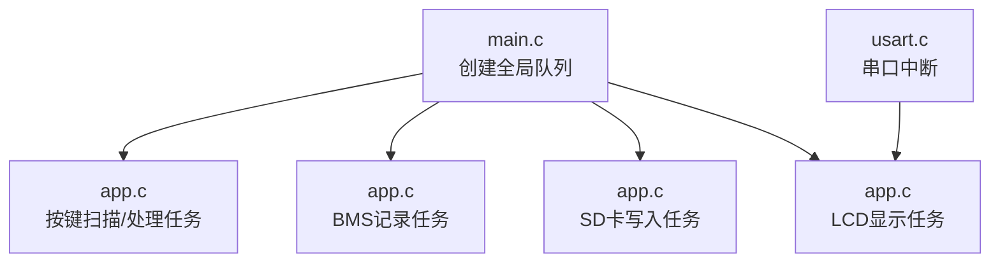
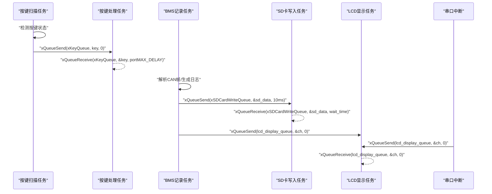
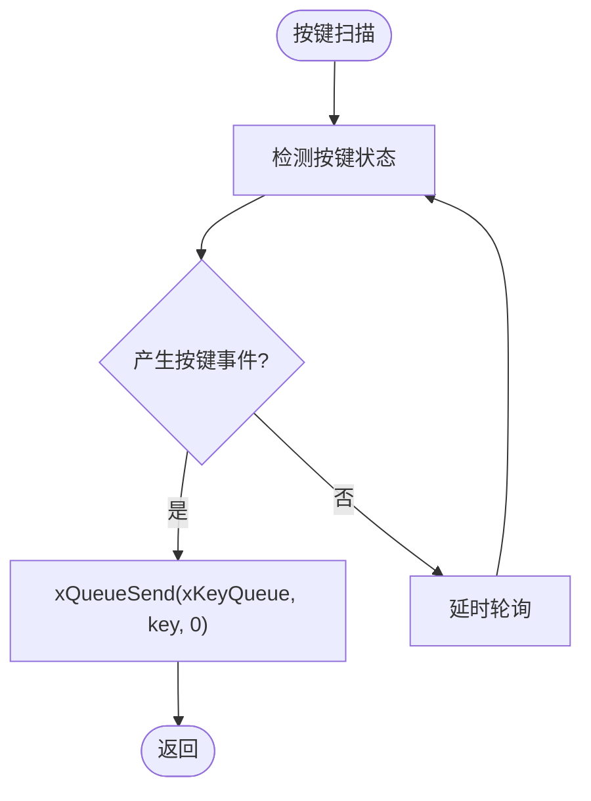
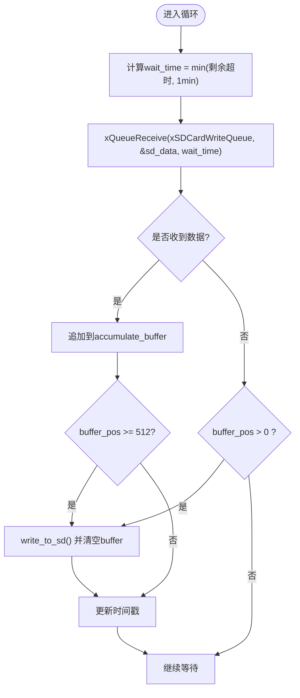
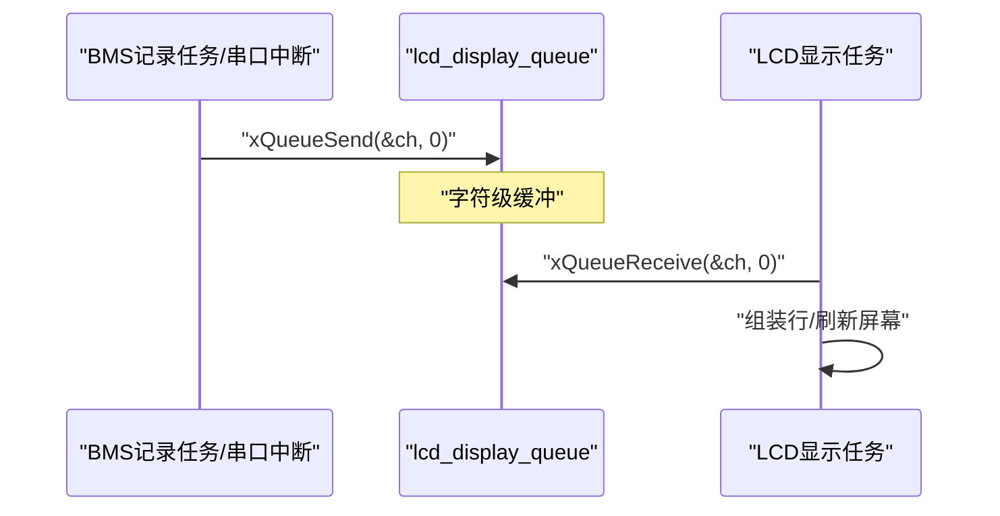
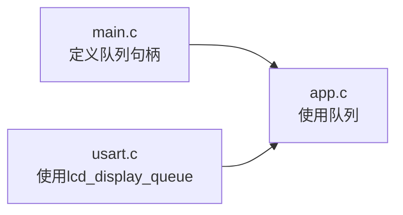

# 队列通信机制

<cite>
**本文引用的文件**   
- [main.c](file://_gbk_backup/User/main.c)
- [app.c](file://_gbk_backup/User/app.c)
- [app.h](file://_gbk_backup/User/app.h)
- [usart.c](file://_gbk_backup/Driver/SYSTEM/usart.c)
</cite>

## 目录
1. [简介](#简介)
2. [项目结构](#项目结构)
3. [核心组件](#核心组件)
4. [架构总览](#架构总览)
5. [详细组件分析](#详细组件分析)
6. [依赖关系分析](#依赖关系分析)
7. [性能与内存管理](#性能与内存管理)
8. [故障排查指南](#故障排查指南)
9. [结论](#结论)

## 简介
本文围绕 FreeRTOS 队列通信机制，系统梳理本项目中使用的三类队列：按键队列（xKeyQueue）、SD卡写入队列（xSDCardWriteQueue）和 LCD 显示队列（lcd_display_queue）。文档说明队列的创建、配置参数、数据项类型、生产者/消费者任务之间的交互流程，以及阻塞与非阻塞操作的使用场景。同时给出队列长度配置建议、内存管理最佳实践、队列满时的处理策略与性能优化技巧。

## 项目结构
本项目在 main 中集中创建全局队列句柄并初始化；在 app 模块中实现各业务任务对队列的读写；LCD 显示队列还通过串口中断进行字符级入队。

图示来源
- [main.c:52-55](file://_gbk_backup/User/main.c#L52-L55)
- [app.c:94-152](file://_gbk_backup/User/app.c#L94-L152)
- [app.c:200-309](file://_gbk_backup/User/app.c#L200-L309)
- [app.c:311-366](file://_gbk_backup/User/app.c#L311-L366)
- [app.c:452-521](file://_gbk_backup/User/app.c#L452-L521)
- [usart.c:262-263](file://_gbk_backup/Driver/SYSTEM/usart.c#L262-L263)

章节来源
- [main.c:34-59](file://_gbk_backup/User/main.c#L34-L59)
- [app.c:529-541](file://_gbk_backup/User/app.c#L529-L541)

## 核心组件
- 按键队列 xKeyQueue
  - 用途：按键扫描任务将按键事件（短按、双击、长按等）发送到按键处理任务。
  - 元素类型：uint8_t（按键码）
  - 队列深度：10
  - 生产者：vKeyScanTask
  - 消费者：vKeyProcessTask
  - 发送方式：非阻塞（超时为0）

- SD卡写入队列 xSDCardWriteQueue
  - 用途：BMS记录任务将待写入日志打包后通知 SD 写入任务批量落盘。
  - 元素类型：SDCardWriteData_t（包含512字节缓冲区的结构体）
  - 队列深度：3
  - 生产者：BMS27930_RecordTask
  - 消费者：SDCard_WriteTask
  - 发送方式：带超时（pdMS_TO_TICKS(10)），接收使用阻塞等待+超时合并逻辑

- LCD显示队列 lcd_display_queue
  - 用途：以字符为单位缓存待显示的文本流，由显示任务周期性刷新屏幕。
  - 元素类型：uint8_t（单字节字符）
  - 队列深度：512
  - 生产者：BMS27930_RecordTask、usart.c 串口中断
  - 消费者：vLCDDisplayTask
  - 发送方式：非阻塞（超时为0）

章节来源
- [main.c:52-55](file://_gbk_backup/User/main.c#L52-L55)
- [app.c:94-152](file://_gbk_backup/User/app.c#L94-L152)
- [app.c:200-309](file://_gbk_backup/User/app.c#L200-L309)
- [app.c:311-366](file://_gbk_backup/User/app.c#L311-L366)
- [app.c:452-521](file://_gbk_backup/User/app.c#L452-L521)
- [app.h:7-10](file://_gbk_backup/User/app.h#L7-L10)
- [usart.c:262-263](file://_gbk_backup/Driver/SYSTEM/usart.c#L262-L263)

## 架构总览
下图展示了三个队列在生产者与消费者之间的数据流向，以及关键调用点。

图示来源
- [app.c:115-136](file://_gbk_backup/User/app.c#L115-L136)
- [app.c:374-411](file://_gbk_backup/User/app.c#L374-L411)
- [app.c:264-301](file://_gbk_backup/User/app.c#L264-L301)
- [app.c:335-363](file://_gbk_backup/User/app.c#L335-L363)
- [app.c:467-472](file://_gbk_backup/User/app.c#L467-L472)
- [usart.c:262-263](file://_gbk_backup/Driver/SYSTEM/usart.c#L262-L263)

## 详细组件分析

### 按键队列 xKeyQueue
- 创建与类型
  - 在 main 中创建，长度为10，元素类型为 uint8_t。
- 生产端（按键扫描）
  - vKeyScanTask 根据按键状态机产生不同按键事件，并通过 xQueueSend 非阻塞发送。
- 消费端（按键处理）
  - vKeyProcessTask 使用 xQueueReceive 阻塞等待（portMAX_DELAY），收到后执行对应动作（如背光开关、打印任务栈信息等）。

图示来源
- [app.c:94-152](file://_gbk_backup/User/app.c#L94-L152)
- [app.c:374-411](file://_gbk_backup/User/app.c#L374-L411)

章节来源
- [main.c:53](file://_gbk_backup/User/main.c#L53)
- [app.c:94-152](file://_gbk_backup/User/app.c#L94-L152)
- [app.c:374-411](file://_gbk_backup/User/app.c#L374-L411)

### SD卡写入队列 xSDCardWriteQueue
- 创建与类型
  - 在 main 中创建，长度为3，元素类型为 SDCardWriteData_t（内部含512字节缓冲区）。
- 生产端（BMS记录）
  - BMS27930_RecordTask 将格式化后的日志字符串放入 sd_data.log_buffer，并通过 xQueueSend 带超时（10ms）发送。若队列满，打印警告。
- 消费端（SD写入）
  - SDCard_WriteTask 使用 xQueueReceive 阻塞等待，结合“距上次接收时间”的动态等待时长，达到以下目标：
    - 有数据时立即处理；
    - 无数据时最多等待剩余时间；
    - 超过 WRITE_TIMEOUT_MS（60s）仍无新数据则强制落盘当前累积缓冲。
  - 累积到扇区大小（512字节）或超时即写盘，减少频繁写入。

图示来源
- [app.c:264-301](file://_gbk_backup/User/app.c#L264-L301)
- [app.c:311-366](file://_gbk_backup/User/app.c#L311-L366)
- [app.h:4-10](file://_gbk_backup/User/app.h#L4-L10)

章节来源
- [main.c:55](file://_gbk_backup/User/main.c#L55)
- [app.c:200-309](file://_gbk_backup/User/app.c#L200-L309)
- [app.c:311-366](file://_gbk_backup/User/app.c#L311-L366)
- [app.h:4-10](file://_gbk_backup/User/app.h#L4-L10)

### LCD显示队列 lcd_display_queue
- 创建与类型
  - 在 main 中创建，长度为512，元素类型为 uint8_t（逐字符入队）。
- 生产端
  - BMS27930_RecordTask 将日志字符串逐字符入队；
  - usart.c 串口中断也将接收到的字符直接入队。
- 消费端（LCD显示）
  - vLCDDisplayTask 周期性地从队列中读取字符，填充行缓冲，每100ms刷新一次屏幕，支持滚动显示多行。

图示来源
- [app.c:270-301](file://_gbk_backup/User/app.c#L270-L301)
- [usart.c:262-263](file://_gbk_backup/Driver/SYSTEM/usart.c#L262-L263)
- [app.c:452-521](file://_gbk_backup/User/app.c#L452-L521)

章节来源
- [main.c:54](file://_gbk_backup/User/main.c#L54)
- [app.c:270-301](file://_gbk_backup/User/app.c#L270-L301)
- [app.c:452-521](file://_gbk_backup/User/app.c#L452-L521)
- [usart.c:262-263](file://_gbk_backup/Driver/SYSTEM/usart.c#L262-L263)

## 依赖关系分析
- 全局变量与 extern 引用
  - main.c 定义 xKeyQueue、xSDCardWriteQueue、lcd_display_queue；
  - app.c 通过 extern 引用这些句柄并使用；
  - usart.c 也通过 extern 引用 lcd_display_queue 用于中断入队。
- 耦合性
  - 生产者与消费者之间仅通过队列解耦，职责清晰；
  - SD写入路径额外使用互斥量保护 FATFS 对象访问，避免并发打开/关闭文件导致的问题。

图示来源
- [main.c:25-29](file://_gbk_backup/User/main.c#L25-L29)
- [app.c:26-32](file://_gbk_backup/User/app.c#L26-L32)
- [usart.c:32](file://_gbk_backup/Driver/SYSTEM/usart.c#L32)

章节来源
- [main.c:25-29](file://_gbk_backup/User/main.c#L25-L29)
- [app.c:26-32](file://_gbk_backup/User/app.c#L26-L32)
- [usart.c:32](file://_gbk_backup/Driver/SYSTEM/usart.c#L32)

## 性能与内存管理

### 队列长度配置建议
- 按键队列（xKeyQueue）
  - 当前深度10，足以容纳短时按键抖动与多次点击事件；
  - 若出现丢键，可适当增大至16~32，但需评估堆内存占用。
- SD卡写入队列（xSDCardWriteQueue）
  - 当前深度3，每个元素含512字节缓冲，整体占用约1.5KB；
  - 若日志峰值突发较大，可增至5~8，但需权衡内存与实时性；
  - 配合“扇区累积+超时落盘”策略，降低频繁IO。
- LCD显示队列（lcd_display_queue）
  - 当前深度512，适合字符流缓冲；
  - 若显示卡顿或丢字符，可适度增加；同时确保消费端刷新频率足够。

### 阻塞与非阻塞操作
- 非阻塞发送（超时=0）
  - 适用于高频、低延迟的生产者（如按键、LCD字符入队）；
  - 队列满时立即返回失败，调用方应做降级或丢弃策略。
- 阻塞发送（带超时）
  - 适用于对可靠性要求较高的路径（如SD卡写入）；
  - 合理设置超时，避免长时间阻塞影响上层任务。
- 阻塞接收（portMAX_DELAY）
  - 适用于消费者任务空闲等待（如按键处理、SD写入）；
  - 保证资源利用率与响应性的平衡。

### 队列满时的处理策略
- 按键队列
  - 非阻塞发送，若满则丢弃最新按键事件；可通过增大队列深度缓解。
- SD卡写入队列
  - 带超时发送，若满则打印警告；必要时可增加队列深度或提升消费端优先级。
- LCD显示队列
  - 非阻塞发送，若满则丢弃字符；可在生产端统计丢包率并告警。

### 内存管理最佳实践
- 队列元素尺寸尽量小
  - LCD队列采用 uint8_t 逐字符入队，显著降低单次拷贝开销；
  - SD队列使用固定大小结构体，便于预测内存占用。
- 动态分配谨慎使用
  - SD写入任务中对 FIL 指针做了动态分配与释放，需确保异常路径也能释放；
  - 建议在初始化阶段统一分配，运行期复用，减少碎片化。
- 避免在中断中进行复杂操作
  - 串口中断仅做字符入队，不执行耗时逻辑；
  - 所有重活交给任务处理。

### 性能优化技巧
- 批处理与聚合
  - SD写入任务将多条日志累积到扇区大小再写盘，减少文件系统开销；
  - LCD显示任务每100ms刷新一次，降低刷屏频率。
- 超时合并
  - SD写入任务根据“距上次接收时间”动态调整等待时长，兼顾实时性与吞吐。
- 监控与告警
  - 对LCD队列使用 uxQueueSpacesAvailable/uxQueueMessagesWaiting 监控水位，接近满载时打印告警；
  - 对SD队列满时打印警告，辅助定位瓶颈。

章节来源
- [app.c:270-281](file://_gbk_backup/User/app.c#L270-L281)
- [app.c:311-366](file://_gbk_backup/User/app.c#L311-L366)
- [app.c:452-521](file://_gbk_backup/User/app.c#L452-L521)

## 故障排查指南
- 现象：按键无响应或偶发丢失
  - 检查 xKeyQueue 是否为 NULL；
  - 确认 vKeyScanTask 与 vKeyProcessTask 优先级与调度；
  - 适当增大队列深度。
- 现象：SD卡写入丢数据或频繁写盘
  - 检查 xSDCardWriteQueue 是否满（打印警告）；
  - 调整队列深度或提高消费端优先级；
  - 确认 WRITE_TIMEOUT_MS 与 SD_SECTOR_SIZE 配置是否符合预期。
- 现象：LCD显示闪烁或丢字符
  - 检查 lcd_display_queue 水位，必要时增大深度；
  - 确认消费端刷新周期（100ms）与生产端速率匹配；
  - 避免在中断中进行耗时操作。

章节来源
- [app.c:264-281](file://_gbk_backup/User/app.c#L264-L281)
- [app.c:311-366](file://_gbk_backup/User/app.c#L311-L366)
- [app.c:452-521](file://_gbk_backup/User/app.c#L452-L521)

## 结论
本项目通过三类 FreeRTOS 队列实现了按键、SD卡写入与LCD显示的高效解耦通信。按键队列强调低延迟与高吞吐，SD卡写入队列强调可靠性与时序控制，LCD显示队列强调字符流缓冲与批量刷新。通过合理的队列深度、超时策略与批处理机制，系统在资源受限环境下保持了良好的实时性与稳定性。后续可根据实际负载微调队列长度与任务优先级，并结合监控指标持续优化。