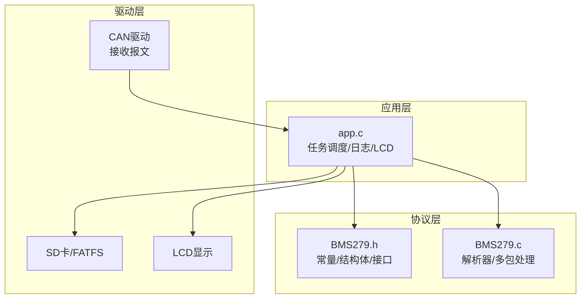
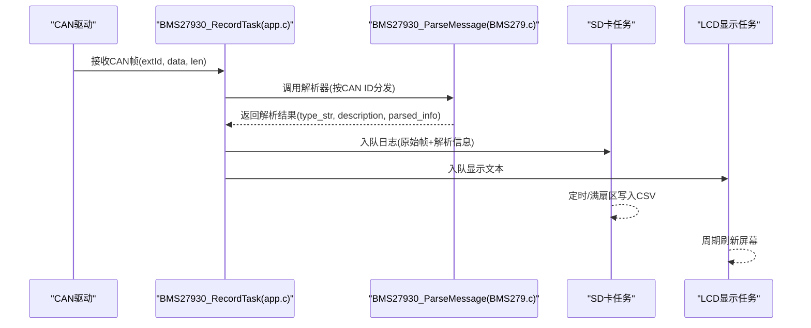
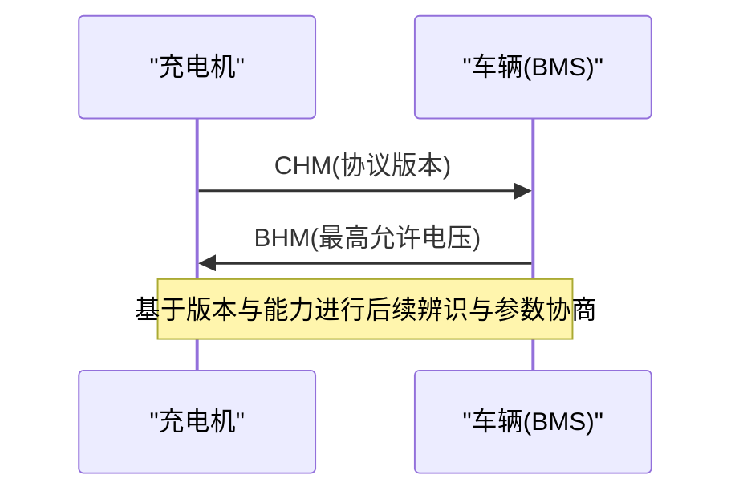
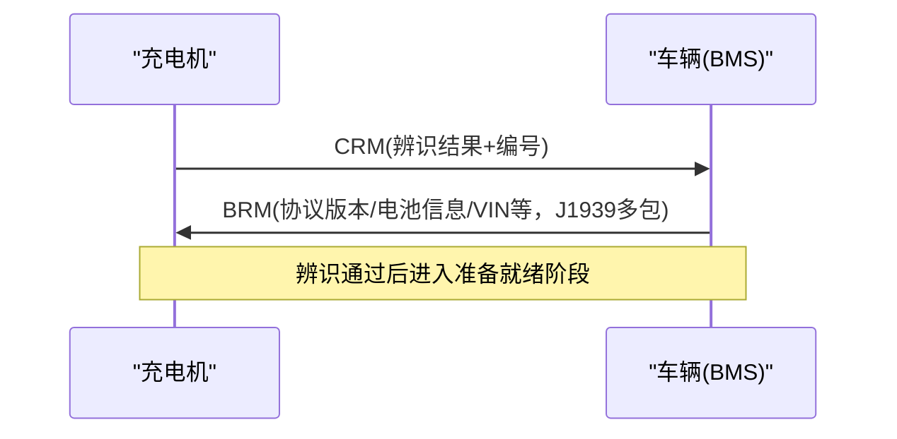
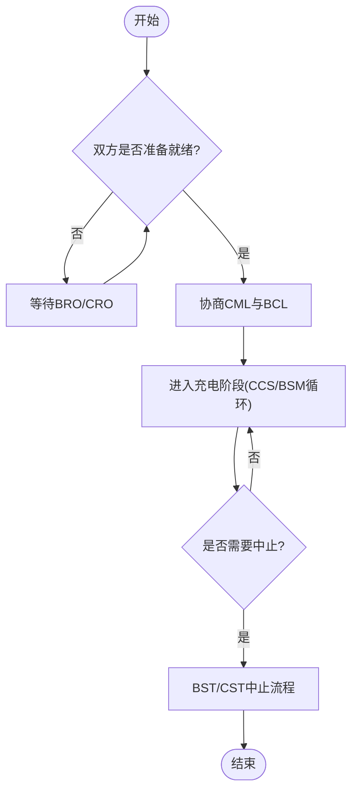
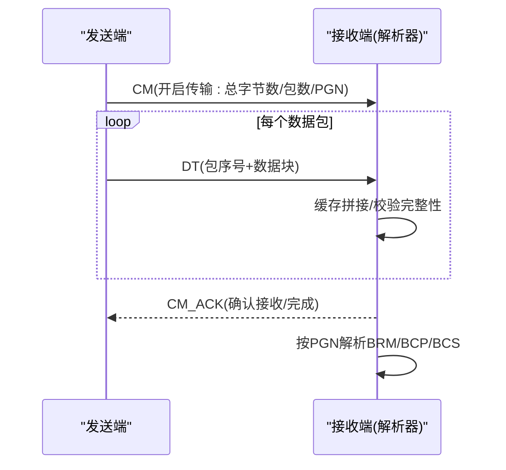
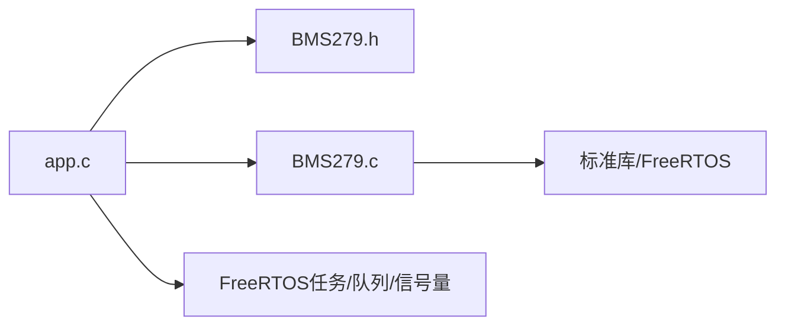

# GB/T 27930协议规范详解

<cite>
**本文引用的文件**   
- [BMS279.h](file://_gbk_backup/User/BMS279.h)
- [BMS279.c](file://_gbk_backup/User/BMS279.c)
- [app.c](file://_gbk_backup/User/app.c)
</cite>

## 目录
1. [引言](#引言)
2. [项目结构](#项目结构)
3. [核心组件](#核心组件)
4. [架构总览](#架构总览)
5. [详细组件分析](#详细组件分析)
6. [依赖关系分析](#依赖关系分析)
7. [性能与实时性考虑](#性能与实时性考虑)
8. [故障排查指南](#故障排查指南)
9. [结论](#结论)
10. [附录：报文格式与编码规则表](#附录报文格式与编码规则表)

## 引言
本文件面向GB/T 27930-2015电动汽车充电通信协议的工程实现，结合仓库中的解析代码，系统梳理协议的整体架构、CAN总线帧格式、报文类型分类、数据编码规则、握手流程（充电机握手CHM与车辆握手BHM）、版本协商与设备辨识、充电过程状态与时序要求、兼容性说明与扩展机制，并给出完整的报文格式定义表。文档既适合工程师快速定位实现细节，也便于非专业读者理解协议要点。

## 项目结构
本项目为STM32F4平台上的FreeRTOS应用，核心围绕CAN总线接收的GB/T 27930报文进行解析、记录与显示。关键目录与文件如下：
- User/BMS279.h：协议常量、数据结构与对外接口声明
- User/BMS279.c：协议解析主逻辑与各报文解析函数
- User/app.c：任务调度、CAN接收、SD卡日志写入、LCD显示等应用层逻辑

图表来源
- [BMS279.h:21-44](file://_gbk_backup/User/BMS279.h#L21-L44)
- [BMS279.c:42-114](file://_gbk_backup/User/BMS279.c#L42-L114)
- [app.c:200-309](file://_gbk_backup/User/app.c#L200-L309)

章节来源
- [BMS279.h:1-44](file://_gbk_backup/User/BMS279.h#L1-L44)
- [BMS279.c:1-114](file://_gbk_backup/User/BMS279.c#L1-L114)
- [app.c:200-309](file://_gbk_backup/User/app.c#L200-L309)

## 核心组件
- 协议常量与ID映射：在头文件中集中定义各类报文的CAN ID，包括握手、辨识、准备就绪、充电需求/状态、中止、统计、错误以及J1939多包传输相关PGN。
- 数据结构模型：为每类报文定义对应的C结构体，字段含义、单位换算与偏移量在注释中明确。
- 解析入口与分发：统一入口根据CAN ID分派到具体解析函数，输出可读的结构化信息。
- J1939多包重组：对BRM/BCP/BCS等大报文通过连接管理、数据传送和确认机制完成组包与解析。
- 应用集成：FreeRTOS任务从CAN接收报文，调用解析器，将原始帧与解析结果写入SD卡，同时推送至LCD显示队列。

章节来源
- [BMS279.h:21-44](file://_gbk_backup/User/BMS279.h#L21-L44)
- [BMS279.h:46-191](file://_gbk_backup/User/BMS279.h#L46-L191)
- [BMS279.c:42-114](file://_gbk_backup/User/BMS279.c#L42-L114)
- [BMS279.c:554-708](file://_gbk_backup/User/BMS279.c#L554-L708)
- [app.c:200-309](file://_gbk_backup/User/app.c#L200-L309)

## 架构总览
整体采用“驱动接收 → 应用任务 → 协议解析 → 存储/显示”的分层架构。协议解析模块独立于硬件驱动，通过统一的解析接口暴露给上层应用；J1939多包传输作为扩展通道，承载大报文（如BRM）的可靠传输。

图表来源
- [app.c:200-309](file://_gbk_backup/User/app.c#L200-L309)
- [BMS279.c:42-114](file://_gbk_backup/User/BMS279.c#L42-L114)

## 详细组件分析

### 协议常量与报文类型
- 充电机握手(CHM)、车辆握手(BHM)
- 充电机辨识(CRM)、BMS辨识(BRM，通过J1939多包)
- 时间同步(CTS)
- 充电机最大输出能力(CML)
- 车辆准备就绪(BRO)、充电机准备就绪(CRO)
- 电池充电需求(BCL)、充电机充电状态(CCS)
- 动力蓄电池状态(BSM)、单体电压(BMV)、温度(BMT)、预留(BSP)
- 车辆中止(BST)、充电机中止(CST)
- 车辆统计数据(BSD)、充电机统计数据(CSD)
- BMS错误(BEM)、充电机错误(CEM)
- J1939连接管理(CM/CM_ACK)与数据传送(DT)

章节来源
- [BMS279.h:21-44](file://_gbk_backup/User/BMS279.h#L21-L44)

### 数据结构与编码规则
- 数值单位与偏移：
  - 电压：0.1V或0.01V（不同报文不同精度）
  - 电流：0.1A，部分字段带400A偏移（需做减法还原）
  - 温度：偏移50℃（有符号差值）
  - SOC：百分比（1%分辨率）
  - 能量：0.1kWh
- 字节序：多数字段为大端序（高字节在前），解析时按位组合uint16/uint32。
- 布尔/状态码：常用0xAA表示“准备好/能辨识”，0x00表示“未准备好/不能辨识”。

章节来源
- [BMS279.h:53-191](file://_gbk_backup/User/BMS279.h#L53-L191)
- [BMS279.c:119-146](file://_gbk_backup/User/BMS279.c#L119-L146)
- [BMS279.c:175-194](file://_gbk_backup/User/BMS279.c#L175-L194)
- [BMS279.c:216-234](file://_gbk_backup/User/BMS279.c#L216-L234)
- [BMS279.c:271-290](file://_gbk_backup/User/BMS279.c#L271-L290)
- [BMS279.c:296-312](file://_gbk_backup/User/BMS279.c#L296-L312)
- [BMS279.c:317-344](file://_gbk_backup/User/BMS279.c#L317-L344)
- [BMS279.c:349-392](file://_gbk_backup/User/BMS279.c#L349-L392)
- [BMS279.c:469-510](file://_gbk_backup/User/BMS279.c#L469-L510)

### 握手流程与版本协商
- CHM（充电机握手）：由充电机发送，携带协议版本号（3字节）。
- BHM（车辆握手）：由车辆侧发送，携带最高允许充电总电压（0.1V）。
- 版本协商：双方通过CHM/BHM交换协议版本与能力上限，后续交互遵循共同支持的版本。

图表来源
- [BMS279.h:22-24](file://_gbk_backup/User/BMS279.h#L22-L24)
- [BMS279.c:119-146](file://_gbk_backup/User/BMS279.c#L119-L146)

章节来源
- [BMS279.h:22-24](file://_gbk_backup/User/BMS279.h#L22-L24)
- [BMS279.c:119-146](file://_gbk_backup/User/BMS279.c#L119-L146)

### 设备辨识流程
- CRM（充电机辨识）：充电机上报辨识结果与编号。
- BRM（BMS辨识）：通过J1939多包传输，包含协议版本、电池类型、额定容量/电压、厂商信息、VIN、BMS版本等。

图表来源
- [BMS279.h:24-25](file://_gbk_backup/User/BMS279.h#L24-L25)
- [BMS279.h:63-83](file://_gbk_backup/User/BMS279.h#L63-L83)
- [BMS279.c:149-170](file://_gbk_backup/User/BMS279.c#L149-L170)
- [BMS279.c:554-708](file://_gbk_backup/User/BMS279.c#L554-L708)

章节来源
- [BMS279.h:24-25](file://_gbk_backup/User/BMS279.h#L24-L25)
- [BMS279.h:63-83](file://_gbk_backup/User/BMS279.h#L63-L83)
- [BMS279.c:149-170](file://_gbk_backup/User/BMS279.c#L149-L170)
- [BMS279.c:554-708](file://_gbk_backup/User/BMS279.c#L554-L708)

### 准备就绪与充电控制
- BRO（车辆准备就绪）/CRO（充电机准备就绪）：双方互相通告准备状态（0xAA=已准备好）。
- CML（充电机最大输出能力）：上报可提供的电压/电流范围。
- BCL（电池充电需求）：BMS提出目标电压、电流与模式（恒压/恒流）。
- CCS（充电机充电状态）：反馈实际输出电压、电流与累计时间。
- BSM（动力蓄电池状态）：上报温度极值、异常状态位等。

图表来源
- [BMS279.h:26-31](file://_gbk_backup/User/BMS279.h#L26-L31)
- [BMS279.h:105-145](file://_gbk_backup/User/BMS279.h#L105-L145)
- [BMS279.c:216-312](file://_gbk_backup/User/BMS279.c#L216-L312)

章节来源
- [BMS279.h:26-31](file://_gbk_backup/User/BMS279.h#L26-L31)
- [BMS279.h:105-145](file://_gbk_backup/User/BMS279.h#L105-L145)
- [BMS279.c:216-312](file://_gbk_backup/User/BMS279.c#L216-L312)

### 中止与统计
- BST/CST：分别由车辆与充电机发起中止，携带中止原因、故障码、错误码。
- BSD/CSD：充电结束后上报统计信息（SOC变化、单体电压范围、温度范围、累计时间与输出能量）。

章节来源
- [BMS279.h:163-184](file://_gbk_backup/User/BMS279.h#L163-L184)
- [BMS279.c:407-510](file://_gbk_backup/User/BMS279.c#L407-L510)

### 错误处理
- BEM/CEM：分别用于BMS与充电机的错误上报，包含接收超时、格式错误与其他错误标志。

章节来源
- [BMS279.h:39-40](file://_gbk_backup/User/BMS279.h#L39-L40)
- [BMS279.h:186-191](file://_gbk_backup/User/BMS279.h#L186-L191)
- [BMS279.c:515-552](file://_gbk_backup/User/BMS279.c#L515-L552)

### J1939多包传输与BRM解析
- CM（连接管理）：发起方发送组包长度、包数、PGN等信息。
- DT（数据传送）：逐包发送数据块，含包序号。
- CM_ACK（连接管理确认）：确认接收与完成。
- 解析器内部维护静态缓冲区与包索引，完成重组后按PGN分支解析BRM/BCP/BCS。

图表来源
- [BMS279.c:554-708](file://_gbk_backup/User/BMS279.c#L554-L708)

章节来源
- [BMS279.c:554-708](file://_gbk_backup/User/BMS279.c#L554-L708)

## 依赖关系分析
- app.c依赖BMS279.h/c提供解析能力，并通过FreeRTOS队列与互斥量协调SD卡写入与LCD显示。
- BMS279.c依赖标准库字符串与格式化函数，无外部协议栈依赖。
- 所有CAN ID与数据结构集中在BMS279.h，便于统一维护与扩展。

图表来源
- [app.c:1-21](file://_gbk_backup/User/app.c#L1-L21)
- [BMS279.c:1-33](file://_gbk_backup/User/BMS279.c#L1-L33)

章节来源
- [app.c:1-21](file://_gbk_backup/User/app.c#L1-L21)
- [BMS279.c:1-33](file://_gbk_backup/User/BMS279.c#L1-L33)

## 性能与实时性考虑
- 解析路径短小直接：按CAN ID分派到固定解析函数，避免动态反射开销。
- 多包重组使用静态缓冲与数组标记，减少内存分配与拷贝次数。
- 应用层采用队列与互斥量解耦CAN接收、SD写入与LCD刷新，降低阻塞风险。
- 建议：
  - 在高负载场景下，适当增大LCD队列与SD写队列深度，避免丢帧。
  - 对频繁写入的CSV文件，保持扇区级聚合写入策略（已实现）。
  - 若需要更高吞吐，可在解析前过滤无关ID，减少无用解析调用。

[本节为通用指导，不直接分析具体文件]

## 故障排查指南
- 握手失败：检查CHM/BHM是否正确收发，确认协议版本与电压上限匹配。
- 辨识失败：核对CRM结果与BRM内容，确认PGN与包序号正确，CM_ACK响应正常。
- 充电无法启动：确认BRO/CRO均为“已准备好”，CML与BCL参数合理且一致。
- 充电异常中止：查看BST/CST的原因码与故障/错误码，定位具体异常点。
- 统计不一致：对比BSD与CSD的时间与能量，检查累计计数是否溢出或重置。
- 日志缺失：检查SD卡挂载与队列是否满，确认互斥量释放路径。

章节来源
- [BMS279.c:119-146](file://_gbk_backup/User/BMS279.c#L119-L146)
- [BMS279.c:149-170](file://_gbk_backup/User/BMS279.c#L149-L170)
- [BMS279.c:239-266](file://_gbk_backup/User/BMS279.c#L239-L266)
- [BMS279.c:407-510](file://_gbk_backup/User/BMS279.c#L407-L510)
- [app.c:311-366](file://_gbk_backup/User/app.c#L311-L366)

## 结论
该实现以清晰的模块化设计完成了GB/T 27930-2015的核心协议解析与工程落地，覆盖握手、辨识、准备就绪、充电控制、中止与统计、错误上报及J1939多包传输。通过统一的解析接口与结构化数据模型，既保证了可扩展性，也便于上层应用集成与调试。建议在量产环境中加强边界条件测试（超长报文、乱序包、重复包）与资源监控（队列水位、任务栈余量），以提升鲁棒性与可观测性。

[本节为总结性内容，不直接分析具体文件]

## 附录：报文格式与编码规则表

- CHM（充电机握手）
  - 字段：协议版本号（3字节）
  - 单位/换算：无
  - 备注：用于版本协商

- BHM（车辆握手）
  - 字段：最高允许充电总电压（2字节，0.1V）
  - 单位/换算：×0.1V

- CRM（充电机辨识）
  - 字段：辨识结果（0xAA=能辨识，否则不能辨识）、充电机编号（7字节）
  - 单位/换算：无

- BRM（BMS辨识，J1939多包）
  - 字段：协议版本（3字节）、电池类型（1字节）、额定容量（2字节，0.1Ah）、额定总电压（2字节，0.1V）、厂商（4字节）、电池组序号（4字节）、生产日期（3字节）、充电次数（4字节）、产权标识（1字节）、保留（1字节）、VIN（17字节）、BMS软件版本（3字节）
  - 单位/换算：按字段标注

- CTS（时间同步）
  - 字段：年/月/日/时/分/秒（各1字节）
  - 单位/换算：无

- CML（充电机最大输出能力）
  - 字段：最高/最低输出电压（2字节，0.1V）、最高/最低输出电流（2字节，0.1A，偏移400A）
  - 单位/换算：电压×0.1V；电流=(raw×0.1)-400A

- BRO（车辆准备就绪）
  - 字段：ready（0xAA=已准备好，否则未准备好）

- CRO（充电机准备就绪）
  - 字段：ready（同上）

- BCL（电池充电需求）
  - 字段：电压需求（2字节，0.1V）、电流需求（2字节，0.1A，偏移400A）、充电模式（1字节：0x01恒压，0x02恒流）
  - 单位/换算：电压×0.1V；电流=400-(raw×0.1)A

- CCS（充电机充电状态）
  - 字段：电压输出（2字节，0.1V）、电流输出（2字节，0.1A，偏移400A）、累计充电时间（2字节，分钟）
  - 单位/换算：电压×0.1V；电流=400-(raw×0.1)A

- BSM（动力蓄电池状态）
  - 字段：最高单体编号、最高温度（偏移50℃）、最高温度探测点号、最低温度（偏移50℃）、最低温度探测点号、异常状态位等
  - 单位/换算：温度=raw-50℃

- BMV（单体电池电压）
  - 字段：起始单体号、若干单体电压（每2字节，0.01V）
  - 单位/换算：×0.01V

- BMT（电池温度）
  - 字段：起始探测点号、若干温度（1字节，偏移50℃）
  - 单位/换算：温度=raw-50℃

- BSP（预留报文）
  - 字段：预留数据（长度可变）

- BST（车辆中止充电）/ CST（充电机中止充电）
  - 字段：中止原因、故障原因、错误原因（各1字节）
  - 单位/换算：无

- BSD（车辆统计数据）
  - 字段：中止前SOC、中止后SOC、最低单体电压（0.01V）、最高单体电压（0.01V）、最低/最高温度（偏移50℃）
  - 单位/换算：电压×0.01V；温度=raw-50℃

- CSD（充电机统计数据）
  - 字段：累计充电时间（分钟）、输出电能（2字节，0.1kWh）
  - 单位/换算：×0.1kWh

- BEM/CEM（错误报文）
  - 字段：接收超时、接收格式错误、其他错误（各1字节）

- J1939多包传输
  - CM：连接管理（开启传输，含总字节数、包数、PGN）
  - DT：数据传送（包序号+数据块）
  - CM_ACK：确认接收/完成

章节来源
- [BMS279.h:53-191](file://_gbk_backup/User/BMS279.h#L53-L191)
- [BMS279.c:119-146](file://_gbk_backup/User/BMS279.c#L119-L146)
- [BMS279.c:149-170](file://_gbk_backup/User/BMS279.c#L149-L170)
- [BMS279.c:175-194](file://_gbk_backup/User/BMS279.c#L175-L194)
- [BMS279.c:199-234](file://_gbk_backup/User/BMS279.c#L199-L234)
- [BMS279.c:239-312](file://_gbk_backup/User/BMS279.c#L239-L312)
- [BMS279.c:317-392](file://_gbk_backup/User/BMS279.c#L317-L392)
- [BMS279.c:397-510](file://_gbk_backup/User/BMS279.c#L397-L510)
- [BMS279.c:515-552](file://_gbk_backup/User/BMS279.c#L515-L552)
- [BMS279.c:554-708](file://_gbk_backup/User/BMS279.c#L554-L708)