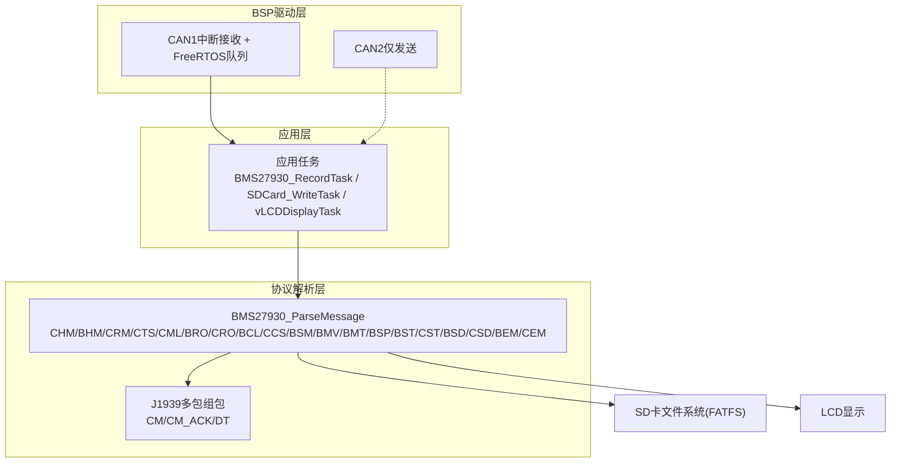
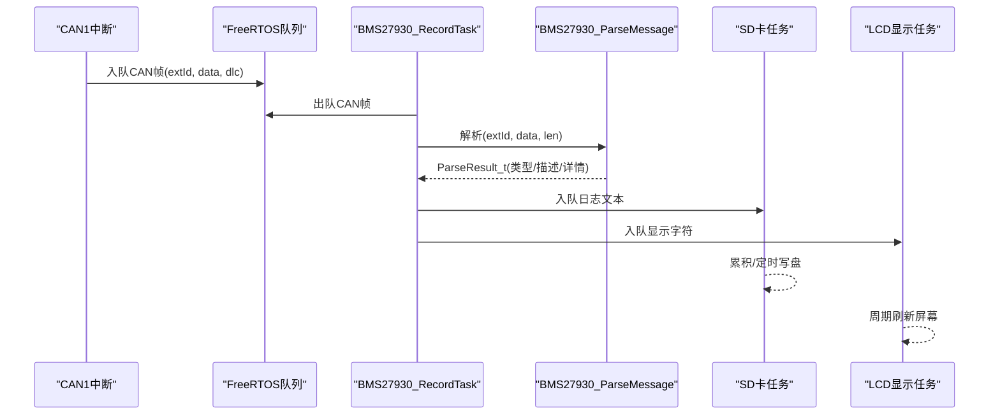
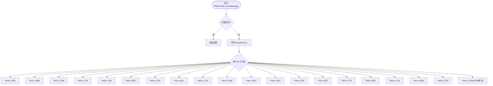
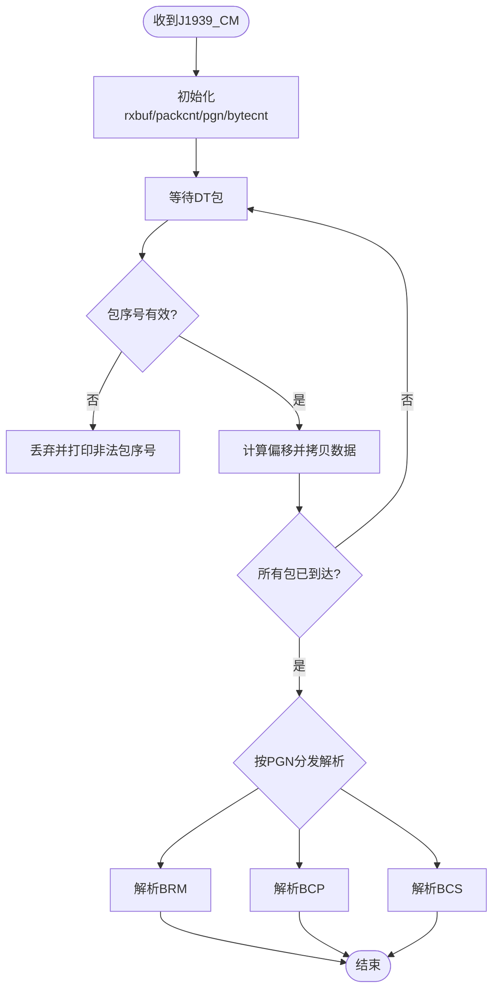
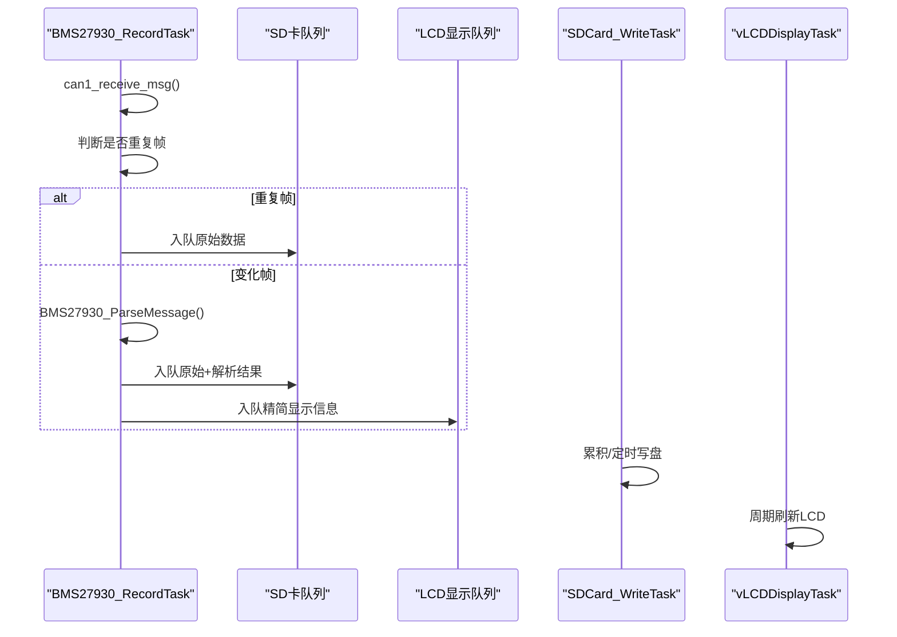
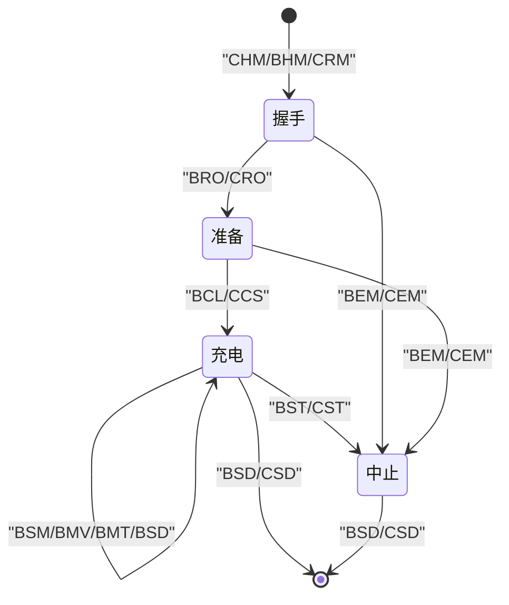
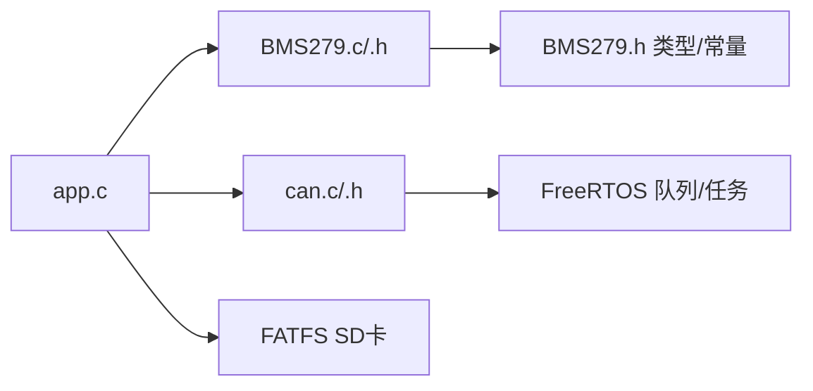

# GB/T 27930协议解析引擎

<cite>
**本文引用的文件**   
- [BMS279.c](file://_gbk_backup/User/BMS279.c)
- [BMS279.h](file://_gbk_backup/User/BMS279.h)
- [app.c](file://_gbk_backup/User/app.c)
- [app.h](file://_gbk_backup/User/app.h)
- [can.c](file://_gbk_backup/Driver/BSP/can.c)
- [can.h](file://_gbk_backup/Driver/BSP/can.h)
</cite>

## 目录
1. [简介](#简介)
2. [项目结构](#项目结构)
3. [核心组件](#核心组件)
4. [架构总览](#架构总览)
5. [详细组件分析](#详细组件分析)
6. [依赖关系分析](#依赖关系分析)
7. [性能与实时性](#性能与实时性)
8. [故障排查指南](#故障排查指南)
9. [结论](#结论)
10. [附录：报文定义与扩展方法](#附录报文定义与扩展方法)

## 简介
本仓库实现了一个面向GB/T 27930-2015电动汽车充电通信协议的解析引擎，运行在STM32F407+FreeRTOS平台上。系统通过CAN总线接收BMS与充电机之间的标准报文，按报文类型进行识别、字段解析、状态信息输出，并支持J1939多包组包传输的拼接与解析。应用层将解析结果记录到SD卡，同时以轻量格式显示到LCD，便于调试与现场验证。

该文档从系统架构、数据流、报文定义、解析算法、状态机流程、兼容性处理与异常容错等方面进行全面说明，并提供扩展新报文类型的指导。

## 项目结构
本项目采用分层组织方式：
- BSP驱动层：提供CAN收发、中断、队列等底层能力
- 协议解析层：实现GB/T 27930各报文的识别与解析，以及J1939多包组包逻辑
- 应用层：任务调度、日志记录、LCD显示、按键与电源管理等

图表来源
- [app.c:200-309](file://_gbk_backup/User/app.c#L200-L309)
- [BMS279.c:42-114](file://_gbk_backup/User/BMS279.c#L42-L114)
- [can.c:186-224](file://_gbk_backup/Driver/BSP/can.c#L186-L224)

章节来源
- [app.c:200-547](file://_gbk_backup/User/app.c#L200-L547)
- [BMS279.c:1-710](file://_gbk_backup/User/BMS279.c#L1-L710)
- [can.c:1-342](file://_gbk_backup/Driver/BSP/can.c#L1-L342)

## 核心组件
- BMS27930协议解析器
  - 入口函数：根据CAN ID分发到具体报文解析函数
  - 支持的报文类型：CHM、BHM、CRM、CTS、CML、BRO、CRO、BCL、CCS、BSM、BMV、BMT、BSP、BST、CST、BSD、CSD、BEM、CEM
  - J1939多包组包：连接管理(CM)、确认(ACK)、数据传输(DT)
- CAN驱动
  - CAN1中断接收，使用FreeRTOS队列缓冲帧
  - CAN2仅用于发送（当前解析路径主要依赖CAN1）
- 应用任务
  - BMS27930_RecordTask：读取CAN帧，调用解析器，格式化日志，写入SD卡队列，推送LCD显示队列
  - SDCard_WriteTask：累积扇区或超时后落盘
  - vLCDDisplayTask：周期性刷新LCD

章节来源
- [BMS279.c:42-114](file://_gbk_backup/User/BMS279.c#L42-L114)
- [BMS279.c:119-552](file://_gbk_backup/User/BMS279.c#L119-L552)
- [BMS279.c:557-708](file://_gbk_backup/User/BMS279.c#L557-L708)
- [can.c:116-141](file://_gbk_backup/Driver/BSP/can.c#L116-L141)
- [app.c:200-309](file://_gbk_backup/User/app.c#L200-L309)

## 架构总览
整体数据流如下：
- CAN1中断服务程序将接收到的扩展帧放入FreeRTOS队列
- BMS27930_RecordTask阻塞等待队列，取出帧后调用BMS27930_ParseMessage进行解析
- 解析结果包含报文类型、描述与解析后的详细信息字符串
- 应用层将原始帧与解析结果写入SD卡，同时将精简信息推送到LCD显示队列

图表来源
- [can.c:186-224](file://_gbk_backup/Driver/BSP/can.c#L186-L224)
- [app.c:200-309](file://_gbk_backup/User/app.c#L200-L309)
- [BMS279.c:42-114](file://_gbk_backup/User/BMS279.c#L42-L114)

## 详细组件分析

### 报文识别与分发机制
- 入口函数BMS27930_ParseMessage根据CAN ID进行switch分发，匹配预定义的常量（如CAN_ID_CHM、CAN_ID_BHM等），调用对应解析函数
- 未匹配的ID进入J1939多包处理分支，按PGN类型进一步区分BRM/BCP/BCS等多包报文

图表来源
- [BMS279.c:42-114](file://_gbk_backup/User/BMS279.c#L42-L114)

章节来源
- [BMS279.c:42-114](file://_gbk_backup/User/BMS279.c#L42-L114)

### 关键报文解析要点
- CHM（充电机握手）
  - 用途：充电机发起握手，携带协议版本
  - 关键字段：协议版本号（3字节）
  - 校验：长度检查，不足时返回“数据长度不足”
- BHM（车辆握手）
  - 用途：车辆响应握手，携带最高允许电压
  - 关键字段：最高允许电压（单位0.1V）
  - 校验：长度<=8时解析，否则提示长度错误
- CRM（充电机辨识）
  - 用途：充电机标识自身是否可辨识及编号
  - 关键字段：辨识结果（AA=能辨识）、充电机编号（7字节大端拼接为数值）
  - 校验：长度<=8时解析
- CTS（时间同步）
  - 用途：充电机下发时间，用于设备时间对齐
  - 关键字段：年/月/日/时/分/秒
  - 校验：长度>=7
- CML（充电机最大输出能力）
  - 用途：上报充电机输出能力范围（电压/电流）
  - 关键字段：最高/最低电压、最大/最小电流（带偏移量）
  - 校验：长度<=8
- BRO/CRO（准备就绪）
  - 用途：车辆/充电机准备状态标志（AA=准备好）
  - 校验：长度>=1
- BCL（电池充电需求）
  - 用途：BMS向充电机提出电压/电流需求与模式
  - 关键字段：电压需求、电流需求（带偏移）、充电模式（恒压/恒流）
  - 校验：长度>=5
- CCS（充电机充电状态）
  - 用途：充电机反馈实际输出电压/电流与累计时间
  - 关键字段：电压输出值、电流输出值（带偏移）、累计充电时间
  - 校验：长度>=6
- BSM（动力蓄电池状态）
  - 用途：BMS上报温度极值、单体电压极值与异常状态位
  - 关键字段：最高温度/探测点号、最低温度、最高电压单体号、异常状态
  - 校验：长度>=7，可选附加异常位
- BMV（单体电压）
  - 用途：上报起始单体号及其电压序列（每单体2字节，单位0.01V）
  - 校验：长度<=8
- BMT（温度）
  - 用途：上报起始探测点号及其温度序列（单位偏移50℃）
  - 校验：长度>=2
- BST/CST（中止充电）
  - 用途：车辆/充电机中止充电的原因码与故障/错误码
  - 关键字段：中止原因、故障原因、错误原因
  - 校验：长度>=4
- BSD/CSD（统计数据）
  - 用途：车辆/充电机统计中止前后的SOC、电压、温度、能量与时间
  - 校验：长度>=8或>=4
- BEM/CEM（错误报文）
  - 用途：BMS/充电机上报接收超时、格式错误与其他错误
  - 关键字段：接收超时、格式错误、其他错误
  - 校验：长度>=4

章节来源
- [BMS279.c:119-552](file://_gbk_backup/User/BMS279.c#L119-L552)

### J1939多包组包解析
- CM（连接管理）
  - 作用：车端开启组包传输，携带总字节数、包个数、PGN等
  - 处理：初始化接收缓冲区、记录PGN与包数
- CM_ACK（连接管理确认）
  - 作用：确认接收或完成接收
  - 处理：解析包个数或完成确认
- DT（数据传输）
  - 作用：逐包发送数据载荷
  - 处理：校验包序号、计算偏移、拷贝数据、检测完成；完成后根据PGN解析BRM/BCP/BCS

图表来源
- [BMS279.c:557-708](file://_gbk_backup/User/BMS279.c#L557-L708)

章节来源
- [BMS279.c:557-708](file://_gbk_backup/User/BMS279.c#L557-L708)

### 应用层数据处理与展示
- BMS27930_RecordTask
  - 从CAN1队列取帧，比较是否与上一帧相同（ID、长度、内容一致则视为重复）
  - 对重复帧仅记录原始数据；对变化帧调用解析器并记录类型、描述与解析详情
  - 将日志文本入队至SD卡任务，同时将精简信息入队至LCD显示任务
- SDCard_WriteTask
  - 累积数据至512字节扇区或1分钟无新增数据时写盘，避免频繁写入损坏SD卡
- vLCDDisplayTask
  - 每100ms批量处理显示队列，过滤不可见字符，滚动缓存最多14行，刷新LCD

图表来源
- [app.c:200-309](file://_gbk_backup/User/app.c#L200-L309)
- [app.c:311-366](file://_gbk_backup/User/app.c#L311-L366)
- [app.c:452-521](file://_gbk_backup/User/app.c#L452-L521)

章节来源
- [app.c:200-309](file://_gbk_backup/User/app.c#L200-L309)
- [app.c:311-366](file://_gbk_backup/User/app.c#L311-L366)
- [app.c:452-521](file://_gbk_backup/User/app.c#L452-L521)

### BMS27930协议状态机设计（概念性说明）
虽然代码未显式实现状态机对象，但协议流程可通过报文交互体现：
- 握手阶段：CHM（充电机握手）→ BHM（车辆握手）→ CRM（充电机辨识）
- 准备阶段：BRO（车辆准备就绪）→ CRO（充电机准备就绪）
- 充电阶段：BCL（电池充电需求）↔ CCS（充电机充电状态），期间周期性BSM/BMV/BMT/BSD等状态与统计报文
- 中止阶段：BST（车辆中止）/ CST（充电机中止）→ BSD/CSD（统计数据）
- 错误处理：BEM/CEM（错误报文）随时上报

[此图为概念性流程图，不直接映射具体源码结构]

## 依赖关系分析
- 模块耦合
  - app.c依赖BMS279.h提供的解析接口与CAN驱动接口
  - BMS279.c依赖BMS279.h中的CAN ID常量与数据结构
  - can.c提供CAN1中断接收与队列，供应用层消费
- 外部依赖
  - FreeRTOS：任务、队列、信号量、定时器
  - FATFS：SD卡文件系统
  - STM32 HAL/标准库：GPIO、CAN、RTC等

图表来源
- [app.c:1-22](file://_gbk_backup/User/app.c#L1-L22)
- [BMS279.h:21-44](file://_gbk_backup/User/BMS279.h#L21-L44)
- [can.c:1-16](file://_gbk_backup/Driver/BSP/can.c#L1-L16)

章节来源
- [app.c:1-22](file://_gbk_backup/User/app.c#L1-L22)
- [BMS279.h:21-44](file://_gbk_backup/User/BMS279.h#L21-L44)
- [can.c:1-16](file://_gbk_backup/Driver/BSP/can.c#L1-L16)

## 性能与实时性
- CAN中断路径
  - 中断中快速复制帧并发送到队列，避免在中断上下文做耗时操作
  - 丢包计数用于监控队列拥塞情况
- 应用任务
  - BMS27930_RecordTask优先保证解析与日志生成，通过队列异步写SD卡，降低I/O阻塞
  - SDCard_WriteTask采用扇区累积与超时写盘策略，减少频繁写入
  - vLCDDisplayTask批量处理显示队列，降低刷屏频率
- 建议优化
  - 若CAN流量较大，可适当增大CAN1接收队列深度
  - 对高频报文（如BMV/BMT）可在解析层做采样或降频处理
  - 对LCD显示队列进行容量监控，防止溢出导致丢帧

章节来源
- [can.c:186-224](file://_gbk_backup/Driver/BSP/can.c#L186-L224)
- [app.c:311-366](file://_gbk_backup/User/app.c#L311-L366)
- [app.c:452-521](file://_gbk_backup/User/app.c#L452-L521)

## 故障排查指南
- 无法解析报文
  - 检查CAN ID是否正确配置（参考BMS279.h中的常量）
  - 确认CAN1中断使能与过滤器配置正确（can.c）
  - 查看解析函数中的长度校验分支，确认数据长度满足要求
- J1939多包失败
  - 检查CM包的总字节数与包个数是否一致
  - 确认DT包序号连续且不超过packcnt
  - 观察是否出现“非法包序号”提示
- SD卡写入失败
  - 检查FATFS挂载与互斥量创建
  - 关注队列满警告与写盘超时
- LCD显示异常
  - 检查显示队列容量与刷新周期
  - 注意字符过滤逻辑，确保可见字符范围

章节来源
- [BMS279.c:557-708](file://_gbk_backup/User/BMS279.c#L557-L708)
- [can.c:186-224](file://_gbk_backup/Driver/BSP/can.c#L186-L224)
- [app.c:311-366](file://_gbk_backup/User/app.c#L311-L366)
- [app.c:452-521](file://_gbk_backup/User/app.c#L452-L521)

## 结论
本实现提供了一个完整且可扩展的GB/T 27930协议解析引擎，覆盖握手、辨识、准备、充电、中止与错误等全流程报文，并通过J1939多包机制支持更大数据量的传输。系统在STM32F407+FreeRTOS上实现了低延迟的CAN中断接收、高效的解析与稳定的日志记录与显示。通过合理的队列与缓冲策略，系统在实时性与可靠性之间取得良好平衡。后续可根据需要扩展新的报文类型或自定义协议。

## 附录：报文定义与扩展方法

### 报文类型与用途速查
- CHM：充电机握手（协议版本）
- BHM：车辆握手（最高允许电压）
- CRM：充电机辨识（辨识结果与编号）
- CTS：时间同步（年月日时分秒）
- CML：充电机最大输出能力（电压/电流范围）
- BRO：车辆准备就绪（状态标志）
- CRO：充电机准备就绪（状态标志）
- BCL：电池充电需求（电压/电流需求与模式）
- CCS：充电机充电状态（输出值与累计时间）
- BSM：动力蓄电池状态（温度/电压极值与异常）
- BMV：单体动力蓄电池电压（起始号与电压序列）
- BMT：动力蓄电池温度（起始号与温度序列）
- BSP：动力蓄电池预留报文（占位）
- BST：车辆中止充电（原因码）
- CST：充电机中止充电（原因码）
- BSD：车辆统计数据（SOC/电压/温度统计）
- CSD：充电机统计数据（时间与能量统计）
- BEM：BMS错误报文（超时/格式/其他错误）
- CEM：充电机错误报文（超时/格式/其他错误）

章节来源
- [BMS279.c:119-552](file://_gbk_backup/User/BMS279.c#L119-L552)
- [BMS279.h:21-44](file://_gbk_backup/User/BMS279.h#L21-L44)

### 扩展新报文类型的步骤
- 定义CAN ID常量
  - 在BMS279.h中添加新的CAN ID宏（例如CAN_ID_NEW_MSG）
- 添加解析函数
  - 在BMS279.c中声明并实现静态解析函数（例如Parse_NEW_MSG）
  - 在函数内填充ParseResult_t的type_str、description与parsed_info
- 注册分发逻辑
  - 在BMS279.c的主分发switch中添加对新CAN ID的处理分支
- 测试与验证
  - 使用CAN工具注入报文，观察解析结果与日志
  - 检查长度校验与边界条件，确保健壮性

章节来源
- [BMS279.h:21-44](file://_gbk_backup/User/BMS279.h#L21-L44)
- [BMS279.c:42-114](file://_gbk_backup/User/BMS279.c#L42-L114)
- [BMS279.c:119-552](file://_gbk_backup/User/BMS279.c#L119-L552)

### 数据格式与单位约定
- 电压：常见单位为0.1V或0.01V（依据报文类型）
- 电流：常见单位为0.1A，部分字段存在400A偏移（需减去偏移）
- 温度：常见为偏移50℃（需减去偏移得到实际温度）
- SOC：百分比，单位1%
- 时间：累计充电时间为分钟，CTS为年月日时分秒

章节来源
- [BMS279.c:119-552](file://_gbk_backup/User/BMS279.c#L119-L552)