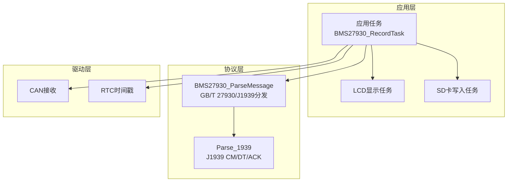
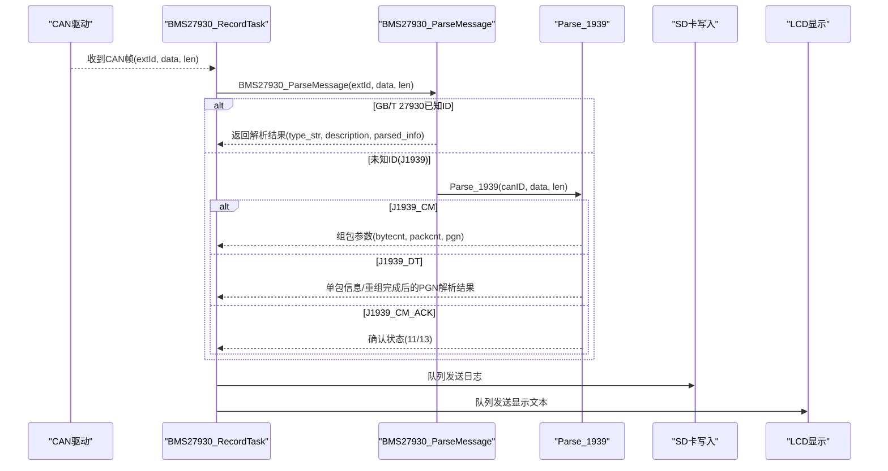
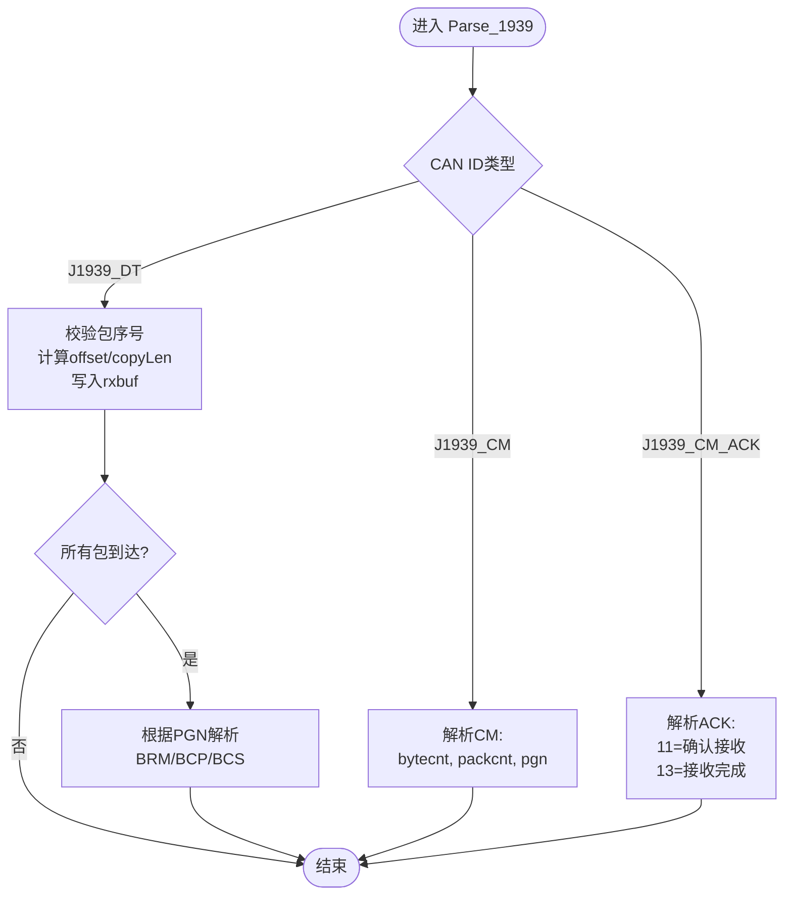

# J1939扩展协议支持

<cite>
**本文引用的文件**   
- [BMS279.h](file://_gbk_backup/User/BMS279.h)
- [BMS279.c](file://_gbk_backup/User/BMS279.c)
- [app.c](file://_gbk_backup/User/app.c)
</cite>

## 目录
1. [引言](#引言)
2. [项目结构](#项目结构)
3. [核心组件](#核心组件)
4. [架构总览](#架构总览)
5. [详细组件分析](#详细组件分析)
6. [依赖关系分析](#依赖关系分析)
7. [性能与内存优化](#性能与内存优化)
8. [故障排查指南](#故障排查指南)
9. [结论](#结论)
10. [附录：报文格式与解析示例](#附录报文格式与解析示例)

## 引言
本技术文档面向在GB/T 27930基础上扩展J1939多包传输能力的工程实现。仓库中的BMS279模块已原生支持GB/T 27930的多种报文，并在默认分支中通过“未知CAN ID”路径接入J1939扩展处理逻辑，完成连接管理、数据传输与确认流程，同时支持BRM/BCP/BCS三类PGN的数据重组与解析。应用层任务负责从CAN总线接收报文、调用解析器、记录日志并显示到LCD。

## 项目结构
本项目为STM32F4 + FreeRTOS的工程，关键代码位于_user_目录下的BMS279协议解析与应用任务中：
- BMS279.h：定义GB/T 27930与J1939相关的常量、数据结构与解析接口
- BMS279.c：实现各类型报文解析，包含J1939 CM/DT/CM_ACK的多包重组与PGN分发
- app.c：FreeRTOS任务调度，CAN接收、日志写入SD卡、LCD显示等

图表来源
- [app.c:200-309](file://_gbk_backup/User/app.c#L200-L309)
- [BMS279.c:42-114](file://_gbk_backup/User/BMS279.c#L42-L114)
- [BMS279.c:554-708](file://_gbk_backup/User/BMS279.c#L554-L708)

章节来源
- [app.c:200-309](file://_gbk_backup/User/app.c#L200-L309)
- [BMS279.c:42-114](file://_gbk_backup/User/BMS279.c#L42-L114)

## 核心组件
- GB/T 27930解析入口：BMS27930_ParseMessage，按CAN ID分派至具体解析函数
- J1939扩展处理：Parse_1939，处理J1939_CM（开启传输）、J1939_DT（数据块）、J1939_CM_ACK（确认）
- PGN类型支持：BRM(0x02)、BCP(0x06)、BCS(0x11)，在DT重组完成后进行字段解析
- 应用集成：BMS27930_RecordTask负责CAN接收、调用解析、格式化输出、队列投递至SD/LCD

章节来源
- [BMS279.c:42-114](file://_gbk_backup/User/BMS279.c#L42-L114)
- [BMS279.c:554-708](file://_gbk_backup/User/BMS279.c#L554-L708)
- [app.c:200-309](file://_gbk_backup/User/app.c#L200-L309)

## 架构总览
下图展示从CAN接收到协议解析、再到日志与显示的完整流程，以及J1939多包传输的关键交互。

图表来源
- [app.c:200-309](file://_gbk_backup/User/app.c#L200-L309)
- [BMS279.c:42-114](file://_gbk_backup/User/BMS279.c#L42-L114)
- [BMS279.c:554-708](file://_gbk_backup/User/BMS279.c#L554-L708)

## 详细组件分析

### J1939扩展处理组件（Parse_1939）
- 功能职责
  - 解析J1939_CM：提取总字节数、包个数、PGN，初始化重组缓冲区
  - 解析J1939_DT：校验包序号，按偏移写入重组缓冲区，检测是否全部到达
  - 重组完成后根据PGN解析BRM/BCP/BCS字段并填充解析结果
  - 解析J1939_CM_ACK：区分11（确认接收）与13（接收完成）

- 关键状态变量（静态局部）
  - rxbuf[128]：重组数据缓冲
  - packcnt/packID/pgn/bytecnt/pos：控制分组与位置
  - packReceived[7]：标记每个包是否到达

- 错误与边界处理
  - 包序号非法检查：receivedPackID == 0 或 > packcnt时直接返回
  - 最后一包长度计算：packcnt包使用剩余字节数拷贝
  - 重组完成后清空packReceived数组，避免污染下一轮

图表来源
- [BMS279.c:554-708](file://_gbk_backup/User/BMS279.c#L554-L708)

章节来源
- [BMS279.c:554-708](file://_gbk_backup/User/BMS279.c#L554-L708)

### GB/T 27930解析入口（BMS27930_ParseMessage）
- 功能职责
  - 统一入口，清空解析结果
  - 根据CAN ID分派到对应解析函数
  - 对未知ID走J1939扩展处理分支

- 设计要点
  - 防御性编程：空指针检查
  - 可扩展性强：新增CAN ID只需增加case分支

章节来源
- [BMS279.c:42-114](file://_gbk_backup/User/BMS279.c#L42-L114)

### 应用层集成（BMS27930_RecordTask）
- 功能职责
  - 周期性从CAN接收报文
  - 去重判断（相同extId/len/data）
  - 调用BMS27930_ParseMessage解析
  - 格式化日志并投递到SD卡队列与LCD队列

- 关键点
  - 时间戳来自RTC
  - 去重策略减少冗余日志
  - 非阻塞队列发送，避免阻塞CAN接收

章节来源
- [app.c:200-309](file://_gbk_backup/User/app.c#L200-L309)

## 依赖关系分析
- BMS279.c依赖BMS279.h中的常量与结构体定义
- app.c依赖BMS279.h提供的解析接口
- 运行时依赖FreeRTOS任务、队列、信号量、RTC、FATFS、LCD、RS485等外设驱动

图表来源
- [BMS279.h:1-201](file://_gbk_backup/User/BMS279.h#L1-L201)
- [BMS279.c:1-32](file://_gbk_backup/User/BMS279.c#L1-L32)
- [app.c:1-22](file://_gbk_backup/User/app.c#L1-L22)

章节来源
- [BMS279.h:1-201](file://_gbk_backup/User/BMS279.h#L1-L201)
- [BMS279.c:1-32](file://_gbk_backup/User/BMS279.c#L1-L32)
- [app.c:1-22](file://_gbk_backup/User/app.c#L1-L22)

## 性能与内存优化
- 静态缓冲区复用：Parse_1939内部使用静态rxbuf与packReceived数组，避免频繁分配
- 最小化字符串操作：仅在必要时构造解析结果字符串，降低CPU开销
- 去重机制：应用层对重复报文仅记录原始数据，减少日志体积
- 批量写入：SD卡任务累积至扇区大小或超时再写，降低Flash磨损
- 建议优化点
  - 将静态状态迁移到上下文结构体，支持并发会话与多通道
  - 引入超时与重试机制，提升抗干扰能力
  - 使用环形缓冲与零拷贝方式减少内存移动

[本节为通用指导，不直接分析具体文件]

## 故障排查指南
- 常见问题
  - 数据包丢失：检查packReceived是否全置位；确认未发生覆盖
  - 序列号异常：receivedPackID越界会直接返回，需检查发送端编号
  - 重组不完整：packcnt与实际到达包数不一致，需增加超时重置
  - 缓冲区溢出：确保bytecnt不超过rxbuf容量（当前128字节）
  - 确认报文缺失：CM_ACK 11/13未到达可能导致上层误判

- 定位方法
  - 观察result.type_str与parsed_info，确认CM/DT/ACK状态
  - 打印packcnt、bytecnt、pgn与receivedPackID
  - 检查应用层日志是否出现“组包接收完成”提示

章节来源
- [BMS279.c:554-708](file://_gbk_backup/User/BMS279.c#L554-L708)

## 结论
该工程在GB/T 27930基础上成功扩展了J1939多包传输能力，实现了CM/DT/ACK的基本流程与BRM/BCP/BCS三类PGN的重组与解析。整体架构清晰，解析入口统一，应用层任务分工明确。后续可进一步增强可靠性（超时、重传、会话隔离）与性能（零拷贝、动态缓冲）。

[本节为总结性内容，不直接分析具体文件]

## 附录：报文格式与解析示例

### J1939 CM（连接管理）
- 用途：发起多包传输，声明总字节数、包个数、PGN
- 关键字段
  - 总字节数：由data低位组合得到
  - 包个数：用于校验与重组计数
  - PGN：决定重组后数据的业务含义（BRM/BCP/BCS）

章节来源
- [BMS279.c:569-589](file://_gbk_backup/User/BMS279.c#L569-L589)

### J1939 DT（数据传输）
- 用途：携带实际数据块，按包序号顺序传输
- 关键字段
  - 包序号：用于偏移计算与完整性校验
  - 数据载荷：每包最多7字节，最后一包可能不足7字节
- 重组逻辑
  - 计算offset=(packID-1)*7
  - copyLen在最后一包时为剩余字节数
  - 到达标志packReceived[packID-1]=1
  - 当所有包到达后触发PGN解析

章节来源
- [BMS279.c:609-704](file://_gbk_backup/User/BMS279.c#L609-L704)

### J1939 CM_ACK（连接管理确认）
- 用途：通知发送方接收状态
- 类型
  - 11：确认接收（逐包确认）
  - 13：接收完成（整包完成）

章节来源
- [BMS279.c:591-607](file://_gbk_backup/User/BMS279.c#L591-L607)

### PGN类型与字段说明
- BRM（电池请求报文）
  - 协议版本、电池类型、额定容量、额定电压等
- BCP（电池充电参数）
  - 最高允许电流、最高允许总电压、SOC、当前电压等
- BCS（电池充电状态）
  - 充电电压测量值、电流测量值、最高单体电压、SOC等

章节来源
- [BMS279.c:649-699](file://_gbk_backup/User/BMS279.c#L649-L699)

### 解析结果输出示例（描述性）
- J1939_CM：显示“组包字节数、组包个数、PGN类型与编号”
- J1939_DT：显示“第X包”，重组完成后显示对应PGN的业务字段
- J1939_CM_ACK：显示“组包确认接收/组包接收完成确认”

章节来源
- [BMS279.c:572-589](file://_gbk_backup/User/BMS279.c#L572-L589)
- [BMS279.c:595-606](file://_gbk_backup/User/BMS279.c#L595-L606)
- [BMS279.c:639-641](file://_gbk_backup/User/BMS279.c#L639-L641)