# 协议状态机设计

<cite>
**本文引用的文件**   
- [BMS279.c](file://_gbk_backup/User/BMS279.c)
- [BMS279.h](file://_gbk_backup/User/BMS279.h)
- [app.c](file://_gbk_backup/User/app.c)
- [main.c](file://_gbk_backup/User/main.c)
</cite>

## 目录
1. [引言](#引言)
2. [项目结构](#项目结构)
3. [核心组件](#核心组件)
4. [架构总览](#架构总览)
5. [详细组件分析](#详细组件分析)
6. [依赖关系分析](#依赖关系分析)
7. [性能与实时性考虑](#性能与实时性考虑)
8. [故障排查指南](#故障排查指南)
9. [结论](#结论)
10. [附录：J1939多包传输实现要点](#附录j1939多包传输实现要点)

## 引言
本设计文档围绕GB/T 27930电动汽车充电通信协议的状态机进行系统化说明，结合仓库中已有的解析与记录实现，给出从初始连接到正常充电再到断开连接的完整生命周期。同时补充J1939多包传输（CM/DT/ACK）的实现要点，包括连接管理、数据传输、确认机制与组包重组算法。

需要特别说明的是：当前代码库实现了协议报文解析与数据记录，但未直接实现“协议状态机”的显式状态转换逻辑。因此，本文在“架构总览”和“详细组件分析”中，基于现有解析入口与报文类型，提出一套可落地的状态机设计方案，并在“附录”中严格映射到实际的多包传输实现。

## 项目结构
本项目为STM32F4 + FreeRTOS平台，主要涉及：
- 应用层任务：CAN报文接收、GB/T 27930解析、SD卡日志记录、LCD显示
- 协议解析模块：按CAN ID分发到各报文解析函数，并输出结构化结果
- J1939多包传输：在默认分支中处理CM/DT/ACK三类报文，完成组包与重组

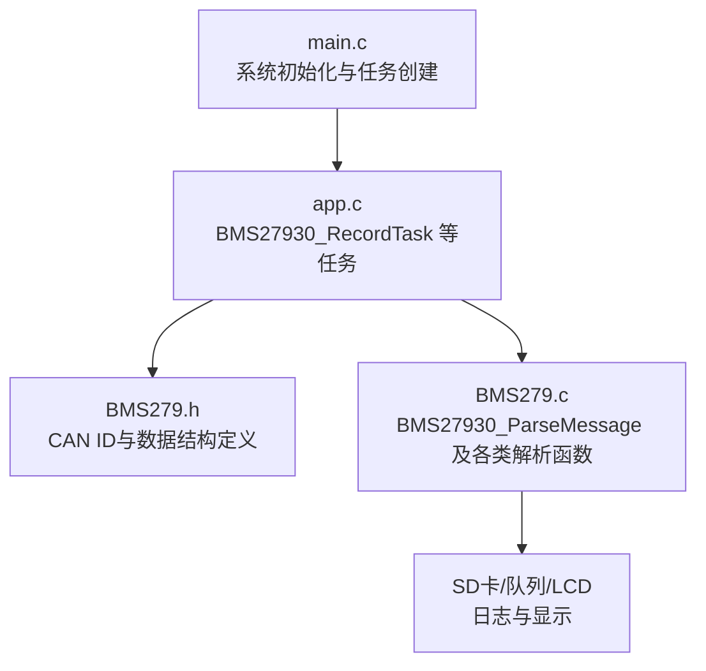

**图示来源**
- [main.c:34-60](file://_gbk_backup/User/main.c#L34-L60)
- [app.c:200-309](file://_gbk_backup/User/app.c#L200-L309)
- [BMS279.h:21-44](file://_gbk_backup/User/BMS279.h#L21-L44)
- [BMS279.c:42-114](file://_gbk_backup/User/BMS279.c#L42-L114)

**章节来源**
- [main.c:34-60](file://_gbk_backup/User/main.c#L34-L60)
- [app.c:200-309](file://_gbk_backup/User/app.c#L200-L309)
- [BMS279.h:21-44](file://_gbk_backup/User/BMS279.h#L21-L44)
- [BMS279.c:42-114](file://_gbk_backup/User/BMS279.c#L42-L114)

## 核心组件
- 协议解析入口：根据CAN ID将报文路由至对应解析函数，填充统一的结果结构体
- 报文类型覆盖：握手、辨识、准备就绪、充电需求/状态、电池状态/温度/单体电压、中止、统计、错误等
- J1939多包传输：支持连接管理(CM)、数据传送(DT)、确认(ACK)，含组包重组与PGN识别

关键接口与数据结构：
- 解析入口：BMS27930_ParseMessage
- 结果结构体：ParseResult_t（包含类型字符串、描述、解析信息）
- CAN ID常量：CHM/BHM/CRM/CTS/CML/BRO/CRO/BCL/CCS/BSM/BMV/BMT/BSP/BST/CST/BSD/CSD/BEM/CEM/J1939_CM/ACK/DT

**章节来源**
- [BMS279.c:42-114](file://_gbk_backup/User/BMS279.c#L42-L114)
- [BMS279.h:46-51](file://_gbk_backup/User/BMS279.h#L46-L51)
- [BMS279.h:21-44](file://_gbk_backup/User/BMS279.h#L21-L44)

## 架构总览
下图展示从CAN接收到解析、记录与显示的端到端流程，以及协议状态机应如何接入该流程。

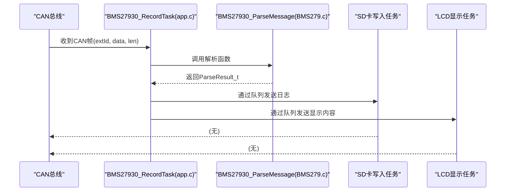

**图示来源**
- [app.c:200-309](file://_gbk_backup/User/app.c#L200-L309)
- [BMS279.c:42-114](file://_gbk_backup/User/BMS279.c#L42-L114)

### GB/T 27930 状态机设计（建议方案）
虽然当前代码未实现显式状态机，但基于已支持的报文类型，推荐如下状态与转换规则：

- 初始化状态：系统启动和设备检测
  - 触发：上电、CAN初始化完成
  - 行为：等待CHM/BHM握手报文；若超时则进入异常处理
- 握手阶段：CHM/BHM报文交换和参数协商
  - 触发：收到CHM或BHM
  - 行为：解析协议版本、最高允许电压等参数；校验兼容性
- 辨识阶段：CRM报文和设备身份确认
  - 触发：收到CRM
  - 行为：解析辨识结果与充电机编号；失败则重试或中止
- 准备阶段：BRO/CRO状态检查和能力匹配
  - 触发：收到BRO/CRO
  - 行为：检查双方“准备就绪”标志；匹配CML能力范围
- 充电阶段：BCL/CCS实时数据交换
  - 触发：BRO/CRO均就绪后开始
  - 行为：周期解析BCL(需求)/CCS(输出)，监控异常
- 统计阶段：BSD/CSD数据收集和记录
  - 触发：充电结束或定时采集
  - 行为：汇总SOC变化、能量输出、时间等
- 中止阶段：BST/CST异常处理和清理
  - 触发：BST/CST或错误报文(BEM/CEM)
  - 行为：记录原因码，清理资源，回到初始化或待机

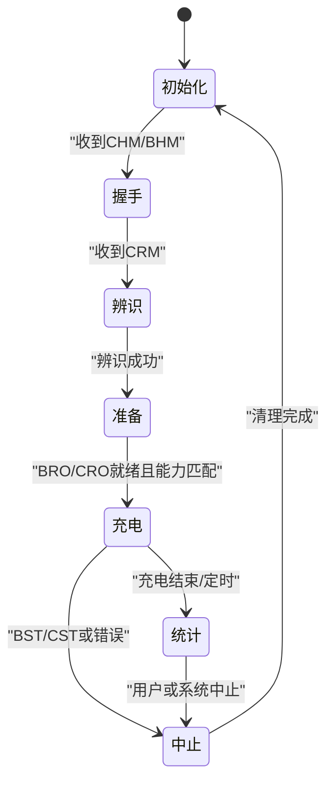

[此图为概念性设计，不直接映射具体源码文件]

## 详细组件分析

### 解析入口与分发逻辑
- 入口函数BMS27930_ParseMessage根据CAN ID分派到具体解析函数，统一填充ParseResult_t
- 对未知ID走J1939多包传输分支，支持CM/DT/ACK三类报文

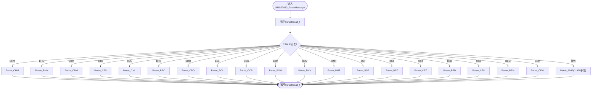

**图示来源**
- [BMS279.c:42-114](file://_gbk_backup/User/BMS279.c#L42-L114)

**章节来源**
- [BMS279.c:42-114](file://_gbk_backup/User/BMS279.c#L42-L114)

### 握手与辨识阶段解析
- CHM：解析协议版本号
- BHM：解析最高允许电压
- CRM：解析辨识结果与充电机编号

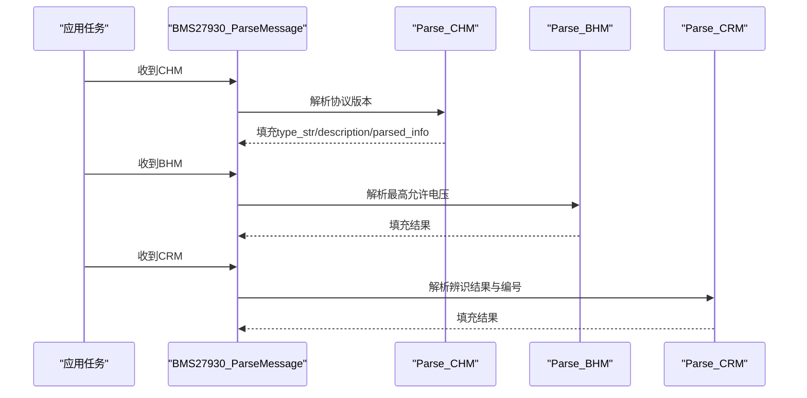

**图示来源**
- [BMS279.c:119-170](file://_gbk_backup/User/BMS279.c#L119-L170)

**章节来源**
- [BMS279.c:119-170](file://_gbk_backup/User/BMS279.c#L119-L170)

### 准备就绪与能力匹配
- BRO：车辆准备就绪标志
- CRO：充电机准备就绪标志
- CML：充电机最大输出能力（电压/电流范围）

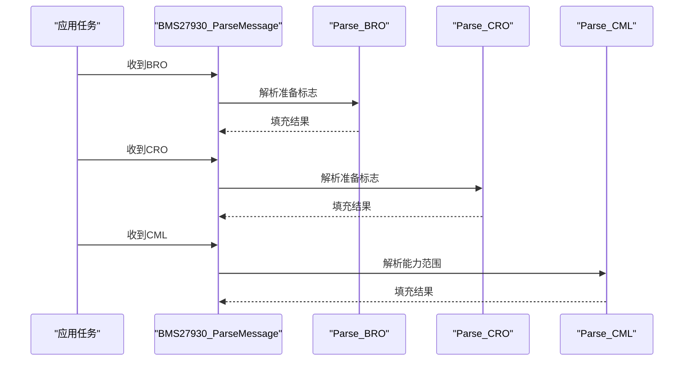

**图示来源**
- [BMS279.c:239-266](file://_gbk_backup/User/BMS279.c#L239-L266)
- [BMS279.c:216-234](file://_gbk_backup/User/BMS279.c#L216-L234)

**章节来源**
- [BMS279.c:216-266](file://_gbk_backup/User/BMS279.c#L216-L266)

### 充电阶段实时数据
- BCL：电池充电需求（电压/电流/模式）
- CCS：充电机充电状态（输出电压/电流/累计时间）

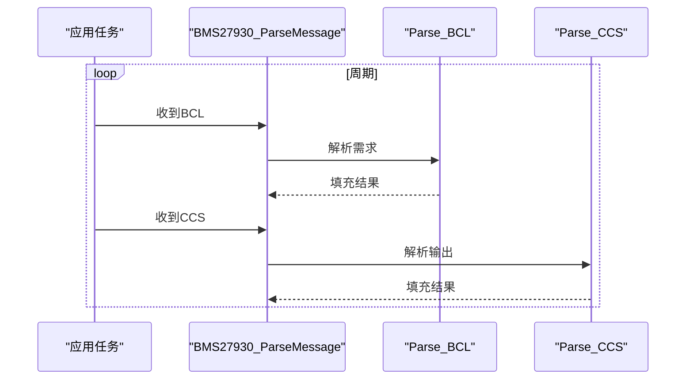

**图示来源**
- [BMS279.c:271-312](file://_gbk_backup/User/BMS279.c#L271-L312)

**章节来源**
- [BMS279.c:271-312](file://_gbk_backup/User/BMS279.c#L271-L312)

### 统计与中止阶段
- BSD：车辆统计数据（中止前后SOC、单体电压范围、温度范围）
- CSD：充电机统计数据（累计时间、输出能量）
- BST/CST：中止原因、故障码、错误码
- BEM/CEM：错误报文（接收超时、格式错误、其他错误）

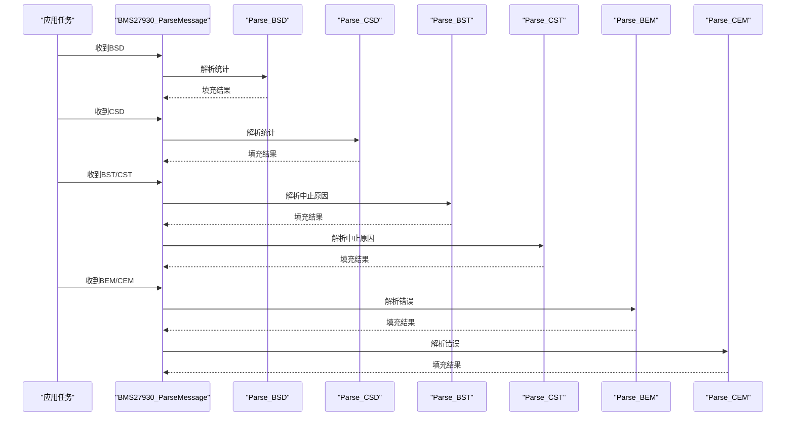

**图示来源**
- [BMS279.c:469-552](file://_gbk_backup/User/BMS279.c#L469-L552)

**章节来源**
- [BMS279.c:469-552](file://_gbk_backup/User/BMS279.c#L469-L552)

### J1939多包传输状态机（实际实现）
当前实现位于Parse_1939，包含：
- CM：连接管理，开启传输（携带总字节数、包个数、PGN）
- DT：数据传送，按包序号写入缓冲区，维护接收标记数组
- ACK：确认接收与接收完成
- 重组完成后根据PGN类型进一步解析BRM/BCP/BCS

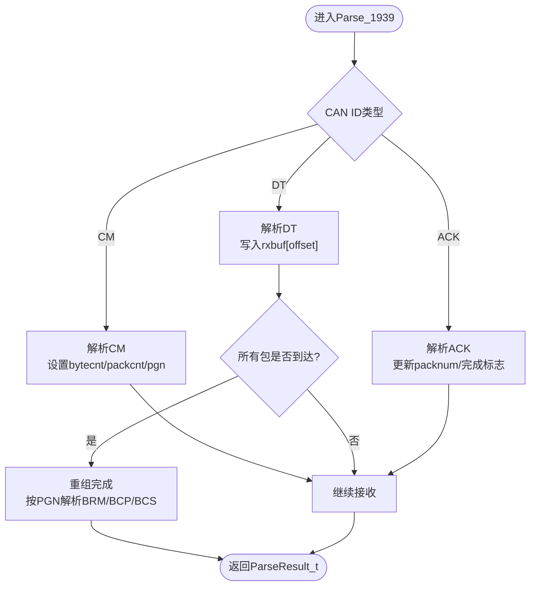

**图示来源**
- [BMS279.c:557-708](file://_gbk_backup/User/BMS279.c#L557-L708)

**章节来源**
- [BMS279.c:557-708](file://_gbk_backup/User/BMS279.c#L557-L708)

## 依赖关系分析
- app.c中的BMS27930_RecordTask负责CAN接收、调用BMS27930_ParseMessage、并通过队列向SD卡与LCD发送数据
- BMS279.c提供协议解析能力，依赖BMS279.h中的CAN ID与数据结构定义
- main.c负责外设初始化与FreeRTOS任务创建

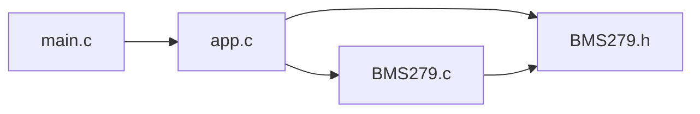

**图示来源**
- [main.c:34-60](file://_gbk_backup/User/main.c#L34-L60)
- [app.c:200-309](file://_gbk_backup/User/app.c#L200-L309)
- [BMS279.h:21-44](file://_gbk_backup/User/BMS279.h#L21-L44)
- [BMS279.c:42-114](file://_gbk_backup/User/BMS279.c#L42-L114)

**章节来源**
- [main.c:34-60](file://_gbk_backup/User/main.c#L34-L60)
- [app.c:200-309](file://_gbk_backup/User/app.c#L200-L309)
- [BMS279.h:21-44](file://_gbk_backup/User/BMS279.h#L21-L44)
- [BMS279.c:42-114](file://_gbk_backup/User/BMS279.c#L42-L114)

## 性能与实时性考虑
- 解析路径轻量：每个解析函数仅做字段提取与格式化，避免复杂计算
- 记录任务非阻塞：使用队列缓冲SD卡写入，避免频繁IO
- LCD显示节流：批量读取队列并按固定周期刷新，降低刷屏开销
- J1939重组静态缓冲：使用静态数组减少动态分配，提高实时性

[本节为通用指导，不直接分析具体文件]

## 故障排查指南
- 相同报文去重：RecordTask会判断extId、len与data是否完全一致，避免重复记录
- 队列满告警：当SD卡写队列满时打印警告，提示可能丢数据
- LCD队列水位监控：当队列使用率超过阈值时打印告警，提示显示压力过大
- 协议解析长度检查：多数解析函数对数据长度进行校验，不足时返回“数据长度不足”

**章节来源**
- [app.c:214-309](file://_gbk_backup/User/app.c#L214-L309)
- [BMS279.c:119-552](file://_gbk_backup/User/BMS279.c#L119-L552)

## 结论
当前代码库提供了完整的GB/T 27930报文解析与记录能力，并实现了J1939多包传输的CM/DT/ACK处理与重组。虽然未显式实现协议状态机，但基于现有解析入口与报文类型，可以方便地扩展出完整的状态机，涵盖握手、辨识、准备、充电、统计与中止等阶段。建议在应用层引入状态机控制器，以事件驱动的方式协调解析结果与系统行为，确保状态同步、超时恢复与资源清理的一致性。

[本节为总结性内容，不直接分析具体文件]

## 附录：J1939多包传输实现要点
- 连接管理(CM)
  - 解析总字节数、包个数、PGN
  - 初始化接收缓冲与状态
- 数据传输(DT)
  - 校验包序号有效性
  - 计算偏移与拷贝长度，写入rxbuf
  - 维护packReceived数组标记已接收包
- 确认机制(ACK)
  - 区分“确认接收”与“接收完成”
- 组包重组算法
  - 当所有包到达后，按PGN类型进一步解析BRM/BCP/BCS
  - 完成后清空接收标记数组

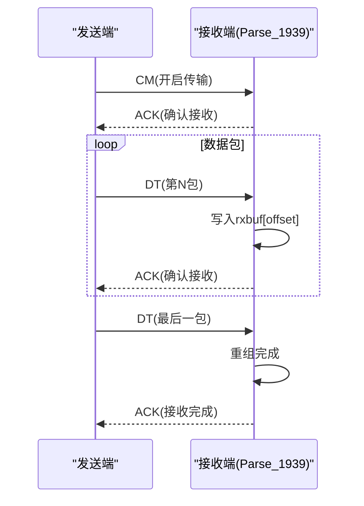

**图示来源**
- [BMS279.c:557-708](file://_gbk_backup/User/BMS279.c#L557-L708)

**章节来源**
- [BMS279.c:557-708](file://_gbk_backup/User/BMS279.c#L557-L708)