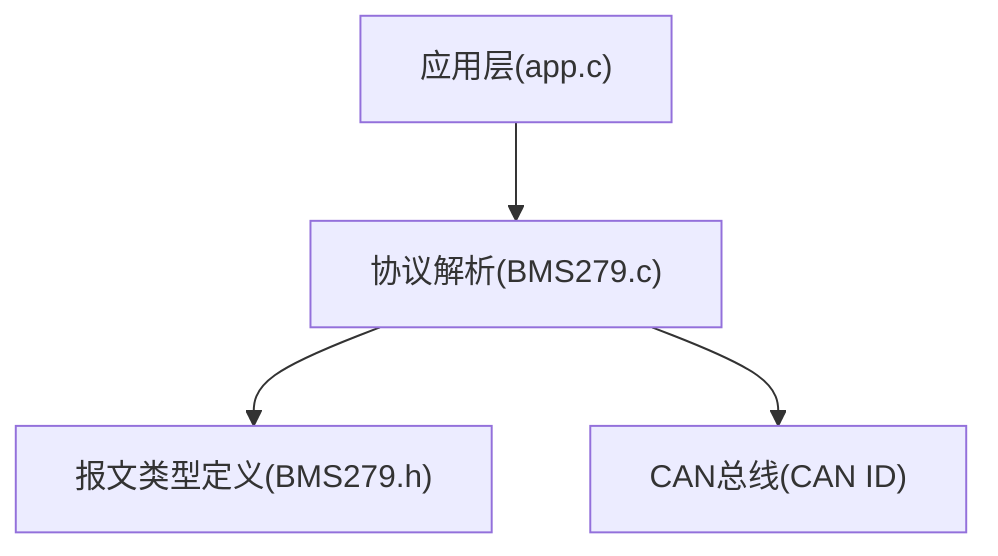
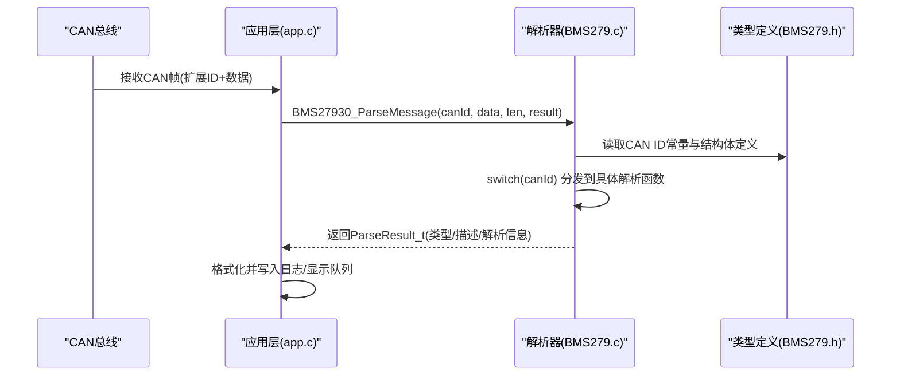
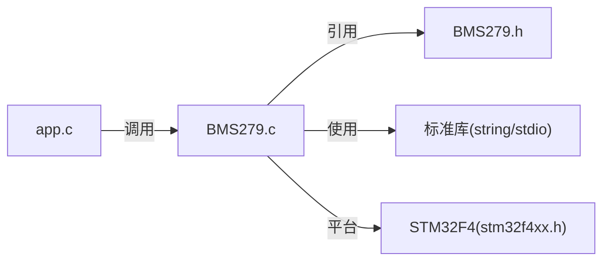

# 报文类型详解

<cite>
**本文引用的文件**   
- [BMS279.c](file://_gbk_backup/User/BMS279.c)
- [BMS279.h](file://_gbk_backup/User/BMS279.h)
- [app.c](file://_gbk_backup/User/app.c)
</cite>

## 目录
1. [简介](#简介)
2. [项目结构](#项目结构)
3. [核心组件](#核心组件)
4. [架构总览](#架构总览)
5. [详细报文解析](#详细报文解析)
6. [依赖关系分析](#依赖关系分析)
7. [性能与实现要点](#性能与实现要点)
8. [故障排查指南](#故障排查指南)
9. [结论](#结论)

## 简介
本文件面向GB/T 27930电动汽车充电通信协议，基于仓库中的解析实现，对握手阶段、充电控制、电池状态、统计与错误等报文进行系统化说明。文档按功能分类，逐条解释报文的用途、数据格式、字段含义与数值换算方法，并给出流程图与时序图帮助理解整体交互流程。

## 项目结构
本项目在用户层实现了GB/T 27930协议的CAN报文解析：
- BMS279.h：定义所有报文类型的结构体、CAN ID常量以及对外接口。
- BMS279.c：根据CAN ID分发到具体解析函数，完成字节级解析与人类可读信息输出。
- app.c：上层应用调用解析接口，将解析结果格式化后写入日志/显示队列。

图表来源
- [BMS279.c:42-114](file://_gbk_backup/User/BMS279.c#L42-L114)
- [BMS279.h:21-44](file://_gbk_backup/User/BMS279.h#L21-L44)

章节来源
- [BMS279.h:21-44](file://_gbk_backup/User/BMS279.h#L21-L44)
- [BMS279.c:42-114](file://_gbk_backup/User/BMS279.c#L42-L114)
- [app.c:243-277](file://_gbk_backup/User/app.c#L243-L277)

## 核心组件
- 报文分发器：根据CAN ID将原始数据路由至对应解析函数。
- 解析器集合：每种报文一个解析函数，负责字段提取、单位换算与文本化输出。
- 数据结构：头文件中为各报文定义了对应的结构体，便于上层使用。
- 多包传输支持：针对J1939风格的组包传输，提供连接管理与数据包重组逻辑。

章节来源
- [BMS279.c:42-114](file://_gbk_backup/User/BMS279.c#L42-L114)
- [BMS279.h:46-51](file://_gbk_backup/User/BMS279.h#L46-L51)

## 架构总览
下图展示从CAN接收到解析输出的完整路径，以及主要报文类别的归属。

图表来源
- [BMS279.c:42-114](file://_gbk_backup/User/BMS279.c#L42-L114)
- [BMS279.h:21-44](file://_gbk_backup/User/BMS279.h#L21-L44)
- [app.c:243-277](file://_gbk_backup/User/app.c#L243-L277)

## 详细报文解析

### 握手阶段报文
- CHM（充电机握手）
  - 用途：充电机向车辆宣告支持的协议版本。
  - 格式：包含3个版本号字节。
  - 字段与换算：
    - 协议版本 = [v1].[v2].[v3]（直接取字节值）。
  - 示例：若数据前3字节为“0x01, 0x00, 0x00”，则协议版本为“1.0.0”。

- BHM（车辆握手）
  - 用途：车辆向充电机声明最高允许充电总电压能力。
  - 格式：2字节大端表示的最高允许电压。
  - 字段与换算：
    - 最高允许电压(V) = raw * 0.1V。
  - 示例：raw=0x0D0E → 3342*0.1 = 334.2V。

- CRM（充电机辨识）
  - 用途：充电机标识自身是否可被辨识及编号。
  - 格式：首字节为辨识结果标志；后续7字节为大端拼接的充电机编号。
  - 字段与换算：
    - 辨识结果：0xAA=能辨识，其他=不能辨识。
    - 充电机编号：7字节大端拼接为无符号整数。
  - 示例：辨识结果为0xAA，编号为“0x0000000000012345”时，显示为十进制“1193049”。

章节来源
- [BMS279.c:119-170](file://_gbk_backup/User/BMS279.c#L119-L170)
- [BMS279.h:53-67](file://_gbk_backup/User/BMS279.h#L53-L67)

### 充电控制报文
- CML（充电机最大输出能力）
  - 用途：充电机告知其输出电压/电流范围。
  - 格式：4个16位大端字段，分别表示最高/最低电压、最大/最小电流。
  - 字段与换算：
    - 电压(V) = raw * 0.1V。
    - 电流(A) = (raw - 400) * 0.1A。
  - 示例：max_current_raw=0x01F4 → (500-400)*0.1 = 10.0A。

- BRO（车辆准备就绪）
  - 用途：车辆指示是否已准备好开始充电。
  - 格式：1字节标志。
  - 字段与换算：
    - 0xAA=已准备好，其他=未准备好。

- CRO（充电机准备就绪）
  - 用途：充电机指示是否已准备好输出。
  - 格式：1字节标志。
  - 字段与换算：
    - 0xAA=已准备好，其他=未准备好。

- BCL（电池充电需求）
  - 用途：车辆向充电机提出期望的电压、电流与充电模式。
  - 格式：2字节电压需求、2字节电流需求、1字节充电模式。
  - 字段与换算：
    - 电压需求(V) = raw * 0.1V。
    - 电流需求(A) = (400 - raw) * 0.1A。
    - 充电模式：0x01=恒压，0x02=恒流，其他=未知。
  - 示例：current_demand_raw=0x01F4 → (400-500)*0.1 = -10.0A（负值表示异常或反向，需结合上下文判断）。

- CCS（充电机充电状态）
  - 用途：充电机上报实时输出电压、电流与累计充电时间。
  - 格式：2字节电压、2字节电流、2字节累计时间。
  - 字段与换算：
    - 电压输出(V) = raw * 0.1V。
    - 电流输出(A) = (400 - raw) * 0.1A。
    - 累计充电时间(min) = raw。

章节来源
- [BMS279.c:216-312](file://_gbk_backup/User/BMS279.c#L216-L312)
- [BMS279.h:105-145](file://_gbk_backup/User/BMS279.h#L105-L145)

### 电池状态报文
- BSM（动力蓄电池状态）
  - 用途：上报电池系统的关键状态，包括最高/最低温度及其探测点号、最高单体电压所在编号，以及若干异常状态位。
  - 格式：至少7字节，含温度偏移编码与异常状态字节。
  - 字段与换算：
    - 最高/最低温度(℃) = raw - 50。
    - 异常状态：第5字节非零时表示存在异常状态码。
  - 示例：temp_raw=0x2C → 44-50 = -6℃。

- BMV（单体动力蓄电池电压）
  - 用途：上报一组单体的电压值，起始单体号位于首字节，其后每2字节为一个单体电压。
  - 格式：起始号 + N*(2字节)。
  - 字段与换算：
    - 单体电压(V) = raw * 0.01V。
  - 示例：raw=0x03E8 → 1000*0.01 = 10.00V。

- BMT（动力蓄电池温度）
  - 用途：上报多个温度传感器的温度值，起始探测点号位于首字节，其后每1字节为一个温度。
  - 格式：起始号 + N*(1字节)。
  - 字段与换算：
    - 温度(℃) = raw - 50。
  - 示例：temp_raw=0x3C → 60-50 = 10℃。

章节来源
- [BMS279.c:317-392](file://_gbk_backup/User/BMS279.c#L317-L392)
- [BMS279.h:147-161](file://_gbk_backup/User/BMS279.h#L147-L161)

### 统计和错误报文
- BSD/CSD（统计数据）
  - BSD（车辆统计数据）
    - 用途：记录中止充电时的SOC变化、单体电压范围与温度范围。
    - 字段与换算：
      - 中止前/后SOC：百分比。
      - 单体电压(V) = raw * 0.01V。
      - 温度(℃) = raw - 50。
  - CSD（充电机统计数据）
    - 用途：记录累计充电时间与输出能量。
    - 字段与换算：
      - 累计充电时间(min) = raw。
      - 输出能量(kWh) = raw * 0.1。

- BEM/CEM（错误报文）
  - 用途：报告通信层面的错误，如接收超时、格式错误与其他错误。
  - 字段：接收超时、格式错误、其他错误，均为字节码。

- BST/CST（中止充电）
  - 用途：车辆或充电机发起中止充电的原因上报。
  - 字段：中止原因、故障原因、错误原因。
  - 中止原因取值（示例）：
    - 正常、人工中止、故障中止、SOC达到需求、电压达到需求、电压异常、电流异常、其他。

章节来源
- [BMS279.c:407-552](file://_gbk_backup/User/BMS279.c#L407-L552)
- [BMS279.h:163-191](file://_gbk_backup/User/BMS279.h#L163-L191)

### 数值换算公式汇总
- 电压类：
  - V = raw * 0.1V（总电压、充电机输出/需求电压等）。
  - V_single = raw * 0.01V（单体电压）。
- 电流类：
  - I = (raw - 400) * 0.1A（充电机能力/输出电流）。
  - I_demand = (400 - raw) * 0.1A（电池侧电流需求）。
- 温度类：
  - T = raw - 50℃。
- 能量/时间类：
  - 能量(kWh) = raw * 0.1。
  - 时间(min) = raw。

章节来源
- [BMS279.c:216-312](file://_gbk_backup/User/BMS279.c#L216-L312)
- [BMS279.c:317-392](file://_gbk_backup/User/BMS279.c#L317-L392)
- [BMS279.c:469-552](file://_gbk_backup/User/BMS279.c#L469-L552)

## 依赖关系分析
- 模块耦合：
  - app.c依赖BMS279.c提供的解析接口，用于将CAN帧转换为结构化信息。
  - BMS279.c依赖BMS279.h中定义的CAN ID常量与结构体。
- 外部依赖：
  - 标准库string/stdio用于字符串处理与格式化输出。
  - STM32 HAL/寄存器抽象通过stm32f4xx.h引入。

图表来源
- [BMS279.c:10-11](file://_gbk_backup/User/BMS279.c#L10-L11)
- [BMS279.h:17-20](file://_gbk_backup/User/BMS279.h#L17-L20)
- [app.c:243-277](file://_gbk_backup/User/app.c#L243-L277)

章节来源
- [BMS279.c:10-11](file://_gbk_backup/User/BMS279.c#L10-L11)
- [BMS279.h:17-20](file://_gbk_backup/User/BMS279.h#L17-L20)
- [app.c:243-277](file://_gbk_backup/User/app.c#L243-L277)

## 性能与实现要点
- 解析效率：
  - 采用switch分发，O(1)路由到具体解析函数，避免条件链开销。
  - 每个解析函数仅做必要的数据长度检查与字段提取，减少分支与计算。
- 内存与缓冲：
  - J1939多包传输使用静态缓冲区rxbuf与packReceived数组，避免频繁分配。
  - 注意在多任务环境下对静态变量的并发访问保护（例如加锁或临界区）。
- 可扩展性：
  - 新增报文只需在头文件添加CAN ID与结构体，并在解析器中添加对应分支与解析函数。

章节来源
- [BMS279.c:42-114](file://_gbk_backup/User/BMS279.c#L42-L114)
- [BMS279.c:557-708](file://_gbk_backup/User/BMS279.c#L557-L708)

## 故障排查指南
- 数据长度不足：
  - 现象：解析函数输出“数据长度不足”。
  - 排查：确认CAN帧长度是否符合该报文的最小要求。
- 数值异常：
  - 现象：电流为负值或温度超出合理范围。
  - 排查：检查raw值与换算公式是否正确；确认发送端编码是否符合规范。
- 辨识失败：
  - 现象：CRM辨识结果不为0xAA。
  - 排查：检查充电机编号与辨识标志位是否正确设置。
- 多包传输不完整：
  - 现象：J1939 DT包未全部到达或序号非法。
  - 排查：检查CM/CM_ACK握手流程与DT包序号连续性；确认packcnt与bytecnt一致性。

章节来源
- [BMS279.c:119-170](file://_gbk_backup/User/BMS279.c#L119-L170)
- [BMS279.c:557-708](file://_gbk_backup/User/BMS279.c#L557-L708)

## 结论
本仓库提供了完整的GB/T 27930协议解析实现，覆盖握手、充电控制、电池状态、统计与错误等关键报文。通过清晰的CAN ID分发与统一的解析框架，能够快速将原始CAN帧转化为可读的结构化信息，便于上层应用进行日志记录、显示与诊断。建议在多任务环境中对静态缓冲与共享状态增加同步机制，以确保解析过程的线程安全与稳定性。