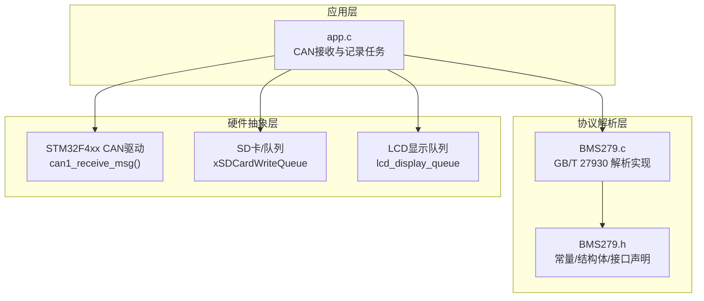
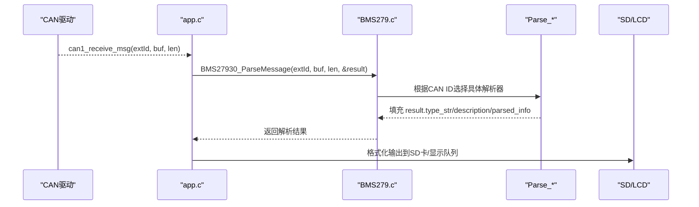
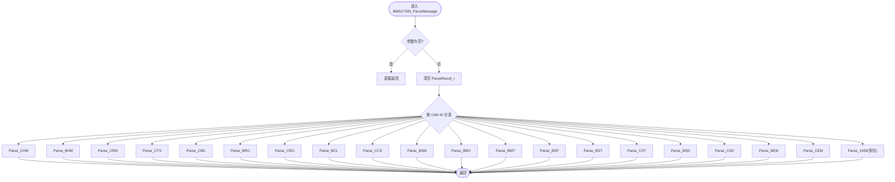
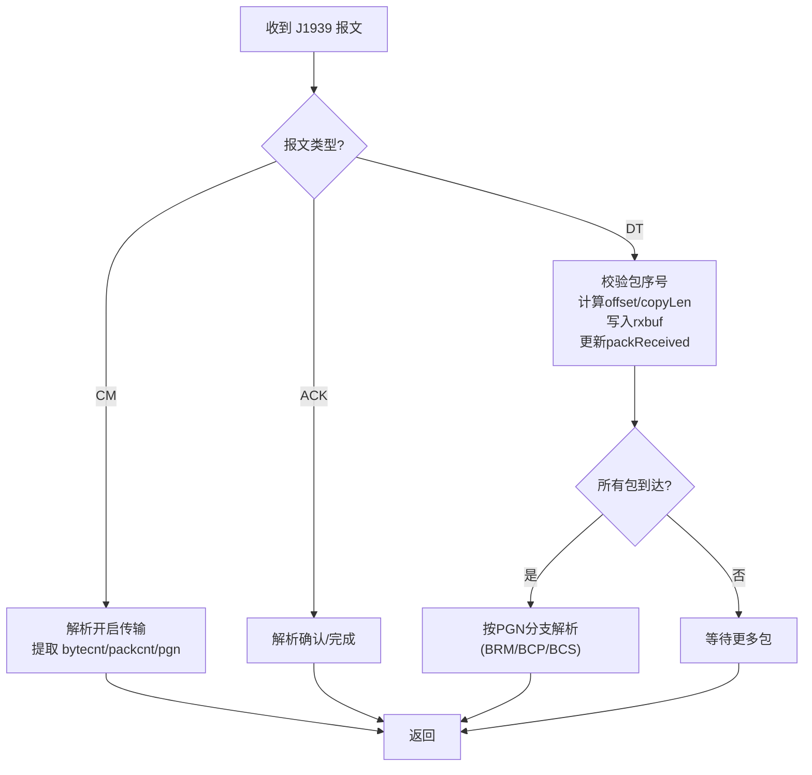
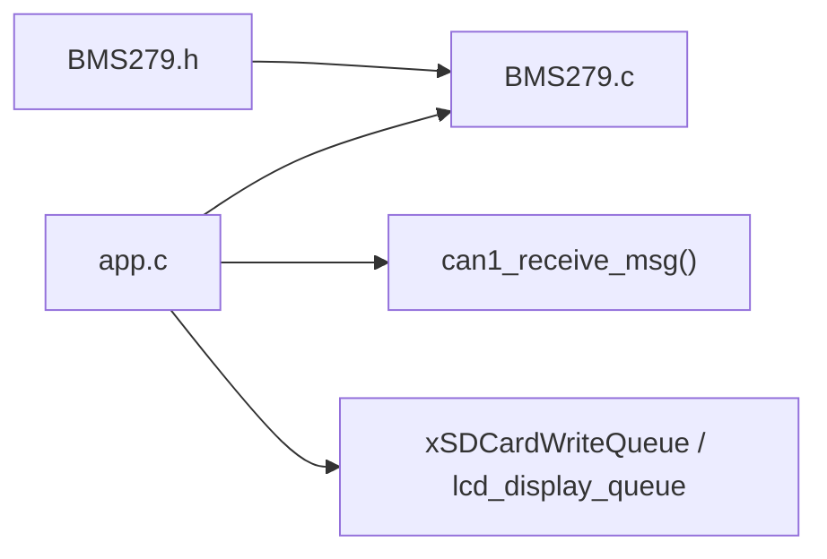

# 解析算法实现

<cite>
**本文引用的文件**   
- [BMS279.c](file://_gbk_backup/User/BMS279.c)
- [BMS279.h](file://_gbk_backup/User/BMS279.h)
- [app.c](file://_gbk_backup/User/app.c)
</cite>

## 目录
1. [引言](#引言)
2. [项目结构](#项目结构)
3. [核心组件](#核心组件)
4. [架构总览](#架构总览)
5. [详细组件分析](#详细组件分析)
6. [依赖关系分析](#依赖关系分析)
7. [性能与优化](#性能与优化)
8. [故障排查指南](#故障排查指南)
9. [结论](#结论)
10. [附录：调试技巧与示例](#附录调试技巧与示例)

## 引言
本技术文档围绕 GB/T 27930 电动汽车充电通信协议在嵌入式系统中的解析实现，重点剖析 BMS27930_ParseMessage 主函数的分发机制、基于 CAN ID 的智能路由算法，以及各报文解析函数（Parse_CHM、Parse_BHM、Parse_CRM、Parse_CTS、Parse_CML、Parse_BRO、Parse_CRO、Parse_BCL、Parse_CCS、Parse_BSM、Parse_BMV、Parse_BMT、Parse_BSP、Parse_BST、Parse_CST、Parse_BSD、Parse_CSD、Parse_BEM、Parse_CEM）的实现逻辑。同时涵盖数据验证、字节序处理、数值转换、格式化输出、错误处理与异常容错机制，并给出性能优化策略与调试实践建议。

## 项目结构
本项目为 STM32F4 + FreeRTOS 的 CAN 跟踪记录工程，GB/T 27930 协议解析位于用户层模块中，通过 CAN 接收任务采集报文后调用解析库生成可读结果，再写入 SD 卡或显示队列。

图表来源
- [app.c:200-277](file://_gbk_backup/User/app.c#L200-L277)
- [BMS279.c:42-114](file://_gbk_backup/User/BMS279.c#L42-L114)
- [BMS279.h:21-43](file://_gbk_backup/User/BMS279.h#L21-L43)

章节来源
- [app.c:200-277](file://_gbk_backup/User/app.c#L200-L277)
- [BMS279.c:1-33](file://_gbk_backup/User/BMS279.c#L1-L33)
- [BMS279.h:10-20](file://_gbk_backup/User/BMS279.h#L10-L20)

## 核心组件
- 解析入口：BMS27930_ParseMessage
- 报文类型常量：CAN_ID_* 与 J1939_*
- 解析结果结构：ParseResult_t
- 具体解析器：Parse_CHM、Parse_BHM、Parse_CRM、Parse_CTS、Parse_CML、Parse_BRO、Parse_CRO、Parse_BCL、Parse_CCS、Parse_BSM、Parse_BMV、Parse_BMT、Parse_BSP、Parse_BST、Parse_CST、Parse_BSD、Parse_CSD、Parse_BEM、Parse_CEM
- 多包传输：Parse_1939（J1939 CM/ACK/DT）

章节来源
- [BMS279.c:42-114](file://_gbk_backup/User/BMS279.c#L42-L114)
- [BMS279.h:21-43](file://_gbk_backup/User/BMS279.h#L21-L43)
- [BMS279.h:46-51](file://_gbk_backup/User/BMS279.h#L46-L51)

## 架构总览
整体流程：CAN 中断/任务接收报文 → app.c 读取帧 → 调用 BMS27930_ParseMessage 进行 CAN ID 分发 → 对应 Parse_* 解析 → 填充 ParseResult_t → 日志/显示。

图表来源
- [app.c:215-255](file://_gbk_backup/User/app.c#L215-L255)
- [BMS279.c:42-114](file://_gbk_backup/User/BMS279.c#L42-L114)

## 详细组件分析

### 主分发函数 BMS27930_ParseMessage
- 功能：依据 CAN ID 将报文路由到对应的解析函数；对未知 ID 走 J1939 多包解析分支。
- 关键点：
  - 参数校验：空指针保护
  - 结果清零：memset 初始化 ParseResult_t
  - 分发表：switch-case 映射 CAN_ID_* 到 Parse_*
  - 默认分支：Parse_1939(canId, data, len, result)

图表来源
- [BMS279.c:42-114](file://_gbk_backup/User/BMS279.c#L42-L114)

章节来源
- [BMS279.c:42-114](file://_gbk_backup/User/BMS279.c#L42-L114)

### 报文解析器详解

#### Parse_CHM（充电机握手）
- 输入：data[0..2] 协议版本三段
- 输出：type_str="CHM", description="充电机握手", parsed_info 包含版本号
- 边界检查：len >= 3

章节来源
- [BMS279.c:119-130](file://_gbk_backup/User/BMS279.c#L119-L130)

#### Parse_BHM（车辆握手）
- 输入：data[0..1] 最高允许电压（大端，单位 0.1V）
- 输出：parsed_info 含最高允许电压
- 边界检查：len <= 8

章节来源
- [BMS279.c:135-146](file://_gbk_backup/User/BMS279.c#L135-L146)

#### Parse_CRM（充电机辨识）
- 输入：data[0] 辨识标志（0xAA=能辨识），data[1..7] 充电机编号（大端拼接）
- 输出：parsed_info 含辨识结果与编号
- 边界检查：len <= 8

章节来源
- [BMS279.c:151-170](file://_gbk_backup/User/BMS279.c#L151-L170)

#### Parse_CTS（时间同步）
- 输入：data[0..5] 年/月/日/时/分/秒
- 输出：parsed_info 格式化时间字符串
- 边界检查：len >= 7

章节来源
- [BMS279.c:199-211](file://_gbk_backup/User/BMS279.c#L199-L211)

#### Parse_CML（充电机最大输出能力）
- 输入：data[0..7] 最高/最低电压、最大/最小电流（大端，单位 0.1V/0.1A，电流偏移400A）
- 输出：parsed_info 含四项能力值
- 边界检查：len <= 8

章节来源
- [BMS279.c:216-234](file://_gbk_backup/User/BMS279.c#L216-L234)

#### Parse_BRO（车辆准备就绪）
- 输入：data[0] 状态（0xAA=已准备好）
- 输出：parsed_info 含状态描述
- 边界检查：len >= 1

章节来源
- [BMS279.c:239-250](file://_gbk_backup/User/BMS279.c#L239-L250)

#### Parse_CRO（充电机准备就绪）
- 输入：data[0] 状态（0xAA=已准备好）
- 输出：parsed_info 含状态描述
- 边界检查：len >= 1

章节来源
- [BMS279.c:255-266](file://_gbk_backup/User/BMS279.c#L255-L266)

#### Parse_BCL（电池充电需求）
- 输入：data[0..4] 电压需求、电流需求（偏移400A）、充电模式（0x01恒压/0x02恒流）
- 输出：parsed_info 含需求值与模式
- 边界检查：len >= 5

章节来源
- [BMS279.c:271-290](file://_gbk_backup/User/BMS279.c#L271-L290)

#### Parse_CCS（充电机充电状态）
- 输入：data[0..5] 输出电压、电流（偏移400A）、累计充电时间
- 输出：parsed_info 含三项指标
- 边界检查：len >= 6

章节来源
- [BMS279.c:296-312](file://_gbk_backup/User/BMS279.c#L296-L312)

#### Parse_BSM（动力蓄电池状态）
- 输入：data[0..7] 最高温度/探测点、最低温度、最高电压单体号、异常状态等
- 输出：parsed_info 含温度范围、最高电压单体号及可选异常状态
- 边界检查：len >= 7，可选扩展字段 len >= 8

章节来源
- [BMS279.c:317-344](file://_gbk_backup/User/BMS279.c#L317-L344)

#### Parse_BMV（单体动力蓄电池电压）
- 输入：data[0] 起始单体号，data[1..n] 成对电压（大端，单位 0.01V）
- 输出：parsed_info 含起始号与多个电压值
- 边界检查：len <= 8，循环步进2

章节来源
- [BMS279.c:349-369](file://_gbk_backup/User/BMS279.c#L349-L369)

#### Parse_BMT（动力蓄电池温度）
- 输入：data[0] 起始探测点号，data[1..n] 温度（有符号，偏移50℃）
- 输出：parsed_info 含起始号与多个温度值
- 边界检查：len >= 2，循环步进1

章节来源
- [BMS279.c:374-392](file://_gbk_backup/User/BMS279.c#L374-L392)

#### Parse_BSP（动力蓄电池预留报文）
- 行为：仅记录长度信息
- 边界检查：无严格限制

章节来源
- [BMS279.c:397-402](file://_gbk_backup/User/BMS279.c#L397-L402)

#### Parse_BST（车辆中止充电）
- 输入：data[0..3] 中止原因、故障码、错误码
- 输出：parsed_info 含中止原因枚举与两码
- 边界检查：len >= 4

章节来源
- [BMS279.c:407-433](file://_gbk_backup/User/BMS279.c#L407-L433)

#### Parse_CST（充电机中止充电）
- 输入：data[0..3] 中止原因、故障码、错误码
- 输出：parsed_info 含中止原因枚举与两码
- 边界检查：len >= 4

章节来源
- [BMS279.c:438-464](file://_gbk_backup/User/BMS279.c#L438-L464)

#### Parse_BSD（车辆统计数据）
- 输入：data[0..7] 中止前后SOC、单体电压范围、温度范围
- 输出：parsed_info 含统计信息
- 边界检查：len >= 8

章节来源
- [BMS279.c:469-490](file://_gbk_backup/User/BMS279.c#L469-L490)

#### Parse_CSD（充电机统计数据）
- 输入：data[0..3] 累计充电时间、输出能量（单位 0.1kWh）
- 输出：parsed_info 含两项统计
- 边界检查：len >= 4

章节来源
- [BMS279.c:495-510](file://_gbk_backup/User/BMS279.c#L495-L510)

#### Parse_BEM / Parse_CEM（错误报文）
- 输入：data[0..3] 接收超时、格式错误、其他错误
- 输出：parsed_info 含三错误码
- 边界检查：len >= 4

章节来源
- [BMS279.c:515-552](file://_gbk_backup/User/BMS279.c#L515-L552)

#### Parse_1939（J1939 多包传输）
- 功能：处理连接管理（CM）、确认（ACK）、数据传输（DT）三类报文，完成组包与后续解析。
- 关键流程：
  - CM：解析开启传输参数（总字节数、包个数、PGN）
  - ACK：解析确认/完成信号
  - DT：按包序号写入 rxbuf，维护 packReceived 位图，完成后按 PGN 分支解析 BRM/BCP/BCS
- 静态变量：rxbuf、packcnt、pgn、packID、bytecnt、pos、packReceived
- 安全校验：包序号有效性、拷贝长度计算、完成检测

图表来源
- [BMS279.c:557-708](file://_gbk_backup/User/BMS279.c#L557-L708)

章节来源
- [BMS279.c:557-708](file://_gbk_backup/User/BMS279.c#L557-L708)

### 数据验证、字节序与数值转换要点
- 数据长度验证：每个解析器在进入业务逻辑前进行 len 检查，避免越界访问。
- 字节序处理：多数字段采用大端序（如 BHM、CML、BMV），通过 (data[i+1]<<8)|data[i] 组合。
- 定点数转换：
  - 电压：乘以 0.1f 或 0.01f（例如 BHM/CML/CCS 使用 0.1V，BMV/BSM 使用 0.01V）
  - 电流：部分字段以 0.1A 为单位且带偏移 400A（如 BCL、CCS、CML），需执行 400 - value*0.1f 或类似变换
  - 温度：有符号偏移 50℃（int8_t - 50）
- 字符串格式化：统一使用 sprintf/strcat 构建 parsed_info，注意缓冲区大小与拼接顺序。

章节来源
- [BMS279.c:135-146](file://_gbk_backup/User/BMS279.c#L135-L146)
- [BMS279.c:216-234](file://_gbk_backup/User/BMS279.c#L216-L234)
- [BMS279.c:271-290](file://_gbk_backup/User/BMS279.c#L271-L290)
- [BMS279.c:349-369](file://_gbk_backup/User/BMS279.c#L349-L369)
- [BMS279.c:374-392](file://_gbk_backup/User/BMS279.c#L374-L392)

## 依赖关系分析
- 头文件依赖：BMS279.c 依赖 BMS279.h 中的 CAN ID 常量、结构体定义与接口声明。
- 运行时依赖：app.c 通过 can1_receive_msg 获取 CAN 帧，调用 BMS27930_ParseMessage 解析，再将结果写入 SD 卡队列或 LCD 显示队列。

图表来源
- [BMS279.h:17-20](file://_gbk_backup/User/BMS279.h#L17-L20)
- [BMS279.h:21-43](file://_gbk_backup/User/BMS279.h#L21-L43)
- [app.c:215-277](file://_gbk_backup/User/app.c#L215-L277)

章节来源
- [BMS279.h:17-20](file://_gbk_backup/User/BMS279.h#L17-L20)
- [BMS279.h:21-43](file://_gbk_backup/User/BMS279.h#L21-L43)
- [app.c:215-277](file://_gbk_backup/User/app.c#L215-L277)

## 性能与优化
- 静态变量缓存减少内存分配：Parse_1939 使用静态数组 rxbuf 与状态位图 packReceived，避免频繁动态分配。
- 预计算常量提高执行效率：CAN ID 常量集中定义于头文件，便于编译器优化与统一维护。
- 条件编译支持不同配置：头文件包含 __cplusplus 保护与平台头 stm32f4xx.h，便于跨语言与平台集成。
- 中断安全的异步处理：app.c 中 CAN 接收与解析分离，解析结果入队，由后台任务消费，降低中断路径开销。

章节来源
- [BMS279.c:557-708](file://_gbk_backup/User/BMS279.c#L557-L708)
- [BMS279.h:13-20](file://_gbk_backup/User/BMS279.h#L13-L20)
- [app.c:215-277](file://_gbk_backup/User/app.c#L215-L277)

## 故障排查指南
- 常见错误：
  - 数据长度不足：多数解析器在 len 不满足时输出“数据长度不足”，需检查上层是否截断报文。
  - 非法包序号：J1939 DT 包序号不在 [1, packcnt] 范围内会打印“非法包序号”并返回，需检查发送端包序。
  - 缓冲区溢出风险：大量 strcat/sprintf 拼接可能超出 parsed_info 容量，应监控输出长度。
- 定位方法：
  - 在 app.c 中打印 extId、len 与原始 hex 数据，对照 CAN ID 常量判断路由是否正确。
  - 针对 J1939，打印 bytecnt、packcnt、pgn 与 packReceived 状态，确认组包完整性。
- 恢复策略：
  - 对无效包序号或长度不足，丢弃当前帧并继续接收。
  - 对 J1939 未完成组包，保持静态状态不变，等待后续包或超时复位。

章节来源
- [BMS279.c:119-130](file://_gbk_backup/User/BMS279.c#L119-L130)
- [BMS279.c:557-708](file://_gbk_backup/User/BMS279.c#L557-L708)
- [app.c:215-277](file://_gbk_backup/User/app.c#L215-L277)

## 结论
该实现以简洁清晰的 switch-case 分发机制实现了 GB/T 27930 协议的完整解析，覆盖握手、辨识、能力协商、充电控制、状态上报、统计与错误等全生命周期报文。通过严格的长度校验与大端序处理、定点数转换与格式化输出，保证了数据的正确性与可读性。J1939 多包传输支持进一步扩展了系统兼容性。结合静态缓存与任务化异步处理，系统在资源受限的 MCU 上具备较好的实时性与稳定性。

## 附录：调试技巧与示例
- 在 app.c 中增加日志打印：
  - 打印 extId、len、原始数据 hex 串，用于核对 CAN 帧内容与路由匹配。
  - 打印 parse_result.type_str、description、parsed_info，快速定位解析结果。
- 针对 J1939：
  - 打印 CM 阶段的 bytecnt、packcnt、pgn，确认组包参数。
  - 打印 DT 包的 receivedPackID、offset、copyLen，确认数据写入位置。
  - 打印 packReceived 状态，确认组包完成时机。
- 典型用例：
  - 模拟 CHM/BHM/CRM 报文，验证协议版本、最高电压与辨识结果。
  - 模拟 CML/BCL/CCS 报文，验证能力与需求/状态的数值转换（0.1V/0.1A 与偏移）。
  - 模拟 BSM/BMV/BMT 报文，验证温度偏移与单体电压精度。

章节来源
- [app.c:215-277](file://_gbk_backup/User/app.c#L215-L277)
- [BMS279.c:119-130](file://_gbk_backup/User/BMS279.c#L119-L130)
- [BMS279.c:135-146](file://_gbk_backup/User/BMS279.c#L135-L146)
- [BMS279.c:151-170](file://_gbk_backup/User/BMS279.c#L151-L170)
- [BMS279.c:216-234](file://_gbk_backup/User/BMS279.c#L216-L234)
- [BMS279.c:271-290](file://_gbk_backup/User/BMS279.c#L271-L290)
- [BMS279.c:296-312](file://_gbk_backup/User/BMS279.c#L296-L312)
- [BMS279.c:317-344](file://_gbk_backup/User/BMS279.c#L317-L344)
- [BMS279.c:349-369](file://_gbk_backup/User/BMS279.c#L349-L369)
- [BMS279.c:374-392](file://_gbk_backup/User/BMS279.c#L374-L392)
- [BMS279.c:557-708](file://_gbk_backup/User/BMS279.c#L557-L708)