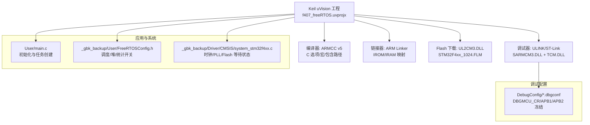
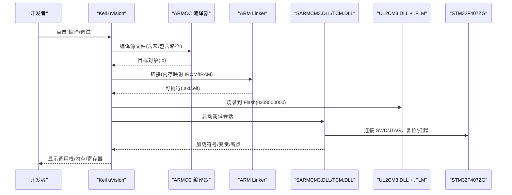
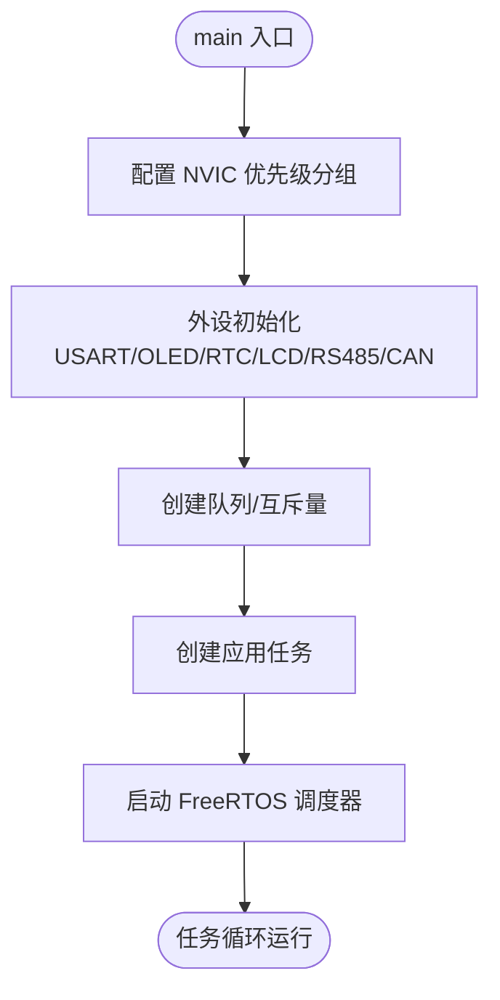
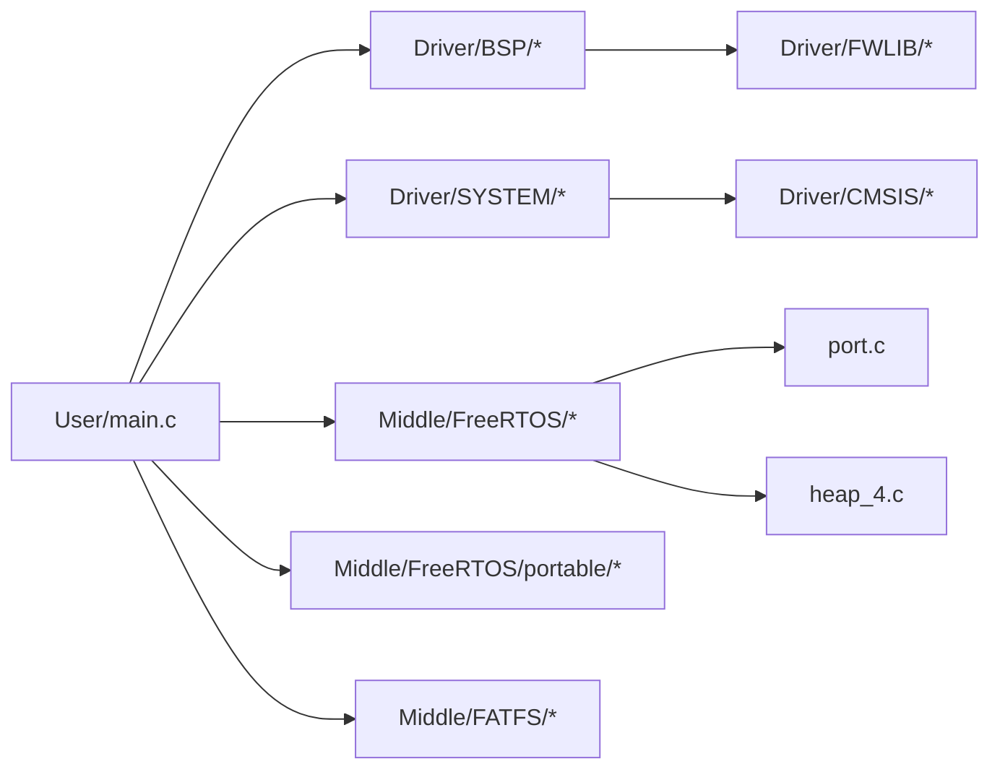

# 开发工具和调试

<cite>
**本文引用的文件**   
- [f407_freeRTOS.uvprojx](file://f407_freeRTOS.uvprojx)
- [1_STM32F407ZG.dbgconf](file://DebugConfig/1_STM32F407ZG.dbgconf)
- [F407_freeRTOS_STM32F407ZG.dbgconf](file://DebugConfig/F407_freeRTOS_STM32F407ZG.dbgconf)
- [main.c](file://_gbk_backup/User/main.c)
- [FreeRTOSConfig.h](file://_gbk_backup/User/FreeRTOSConfig.h)
- [system_stm32f4xx.c](file://_gbk_backup/Driver/CMSIS/system_stm32f4xx.c)
</cite>

## 目录
1. [简介](#简介)
2. [项目结构](#项目结构)
3. [核心组件](#核心组件)
4. [架构总览](#架构总览)
5. [详细组件分析](#详细组件分析)
6. [依赖关系分析](#依赖关系分析)
7. [性能考虑](#性能考虑)
8. [故障排查指南](#故障排查指南)
9. [结论](#结论)
10. [附录](#附录)

## 简介
本指南面向使用 Keil MDK 在 STM32F407 上开发 CAN Tracker 项目的工程师，系统说明：
- Keil MDK 工程与编译器、链接器、调试器的配置要点
- ST-Link 调试器的固件烧录、断点与变量监视
- 不同目标设备的调试配置文件（dbgconf）的作用与差异
- 性能分析方法：任务执行时间测量、内存使用分析与 CPU 负载监控
- 代码覆盖率与静态检查工具的使用建议
- 常见调试问题与优化技巧

## 项目结构
本项目基于 Keil uVision 工程，目标设备为 STM32F407ZG，采用 ARM Compiler 5（ARMCC），并集成 FreeRTOS。关键结构与职责如下：
- 工程定义与工具链：uVision 工程文件定义了目标设备、编译器版本、包含路径、宏定义、输出目录等
- 调试配置：DebugConfig 目录下提供针对不同目标的调试 MCU 寄存器初始化脚本
- 用户与应用：User 目录包含 main.c、FreeRTOS 配置、应用逻辑与协议实现
- 驱动与中间件：Driver 与 Middle 目录包含 CMSIS、标准外设库、FreeRTOS 内核与移植层、FATFS 等

图表来源
- [f407_freeRTOS.uvprojx:1-120](file://f407_freeRTOS.uvprojx#L1-L120)
- [f407_freeRTOS.uvprojx:148-380](file://f407_freeRTOS.uvprojx#L148-L380)
- [1_STM32F407ZG.dbgconf:1-48](file://DebugConfig/1_STM32F407ZG.dbgconf#L1-L48)
- [F407_freeRTOS_STM32F407ZG.dbgconf:1-48](file://DebugConfig/F407_freeRTOS_STM32F407ZG.dbgconf#L1-L48)
- [main.c:34-60](file://_gbk_backup/User/main.c#L34-L60)
- [FreeRTOSConfig.h:1-125](file://_gbk_backup/User/FreeRTOSConfig.h#L1-L125)
- [system_stm32f4xx.c:476-515](file://_gbk_backup/Driver/CMSIS/system_stm32f4xx.c#L476-L515)

章节来源
- [f407_freeRTOS.uvprojx:1-120](file://f407_freeRTOS.uvprojx#L1-L120)
- [f407_freeRTOS.uvprojx:148-380](file://f407_freeRTOS.uvprojx#L148-L380)

## 核心组件
- 编译器与构建选项
  - 编译器：ARM Compiler 5（V5.06 update 7）
  - 目标 CPU：Cortex-M4，启用 FPU
  - 宏定义：STM32F40_41xxx, USE_STDPERIPH_DRIVER
  - 包含路径：Driver/BSP、CMSIS、FWLIB、SYSTEM、Middle/FreeRTOS、Middle/MALLOC、Middle/FATFS、User 等
  - 输出目录：..\Output\，可生成调试信息与浏览信息
- 链接器与内存布局
  - IROM（Flash）：0x08000000，大小 0x100000（1MB）
  - IRAM（主 SRAM）：0x20000000，大小 0x20000（128KB）
  - IRAM2（备份 SRAM）：0x10000000，大小 0x10000（64KB）
  - 未使用 Scatter 文件，默认按 On-Chip Memories 映射
- 调试器与下载器
  - 调试 DLL：SARMCM3.DLL（仿真/调试）、TCM.DLL（调试通信）
  - Flash 驱动：UL2CM3.DLL + STM32F4xx_1024.FLM
  - 调试前自动更新 Flash
- 系统初始化
  - system_stm32f4xx.c 负责时钟树、PLL、Flash 等待状态、向量表位置等
- FreeRTOS 配置
  - 抢占式调度、Tick 频率 1000Hz、最大优先级 32
  - 动态内存分配开启，堆大小 30KB
  - 可选运行时间与任务统计功能开关

章节来源
- [f407_freeRTOS.uvprojx:11-21](file://f407_freeRTOS.uvprojx#L11-L21)
- [f407_freeRTOS.uvprojx:314-344](file://f407_freeRTOS.uvprojx#L314-L344)
- [f407_freeRTOS.uvprojx:215-311](file://f407_freeRTOS.uvprojx#L215-L311)
- [f407_freeRTOS.uvprojx:111-120](file://f407_freeRTOS.uvprojx#L111-L120)
- [f407_freeRTOS.uvprojx:130-147](file://f407_freeRTOS.uvprojx#L130-L147)
- [system_stm32f4xx.c:476-515](file://_gbk_backup/Driver/CMSIS/system_stm32f4xx.c#L476-L515)
- [FreeRTOSConfig.h:11-43](file://_gbk_backup/User/FreeRTOSConfig.h#L11-L43)

## 架构总览
下图展示从 Keil 工程到硬件的完整链路，包括编译、链接、调试与下载流程。

图表来源
- [f407_freeRTOS.uvprojx:111-120](file://f407_freeRTOS.uvprojx#L111-L120)
- [f407_freeRTOS.uvprojx:130-147](file://f407_freeRTOS.uvprojx#L130-L147)
- [f407_freeRTOS.uvprojx:215-311](file://f407_freeRTOS.uvprojx#L215-L311)

## 详细组件分析

### Keil MDK 环境配置
- 目标设备与工具链
  - 设备：STM32F407ZG
  - 工具集：ARM-ADS，编译器 V5.06 update 7
  - CPU：Cortex-M4，FPU 启用
- 编译器选项
  - 宏：STM32F40_41xxx, USE_STDPERIPH_DRIVER
  - 包含路径：覆盖 Driver、Middle、User 各模块头文件
  - 优化等级：已启用优化（Optim=1）
- 链接器选项
  - 文本段起始地址：0x08000000
  - 数据段起始地址：0x20000000
  - 未使用 Scatter 文件，依赖内置内存映射
- 调试与下载
  - 调试 DLL：SARMCM3.DLL（仿真/调试）、TCM.DLL（调试通信）
  - Flash 驱动：UL2CM3.DLL + STM32F4xx_1024.FLM
  - 调试前自动更新 Flash

章节来源
- [f407_freeRTOS.uvprojx:11-21](file://f407_freeRTOS.uvprojx#L11-L21)
- [f407_freeRTOS.uvprojx:314-344](file://f407_freeRTOS.uvprojx#L314-L344)
- [f407_freeRTOS.uvprojx:363-379](file://f407_freeRTOS.uvprojx#L363-L379)
- [f407_freeRTOS.uvprojx:111-120](file://f407_freeRTOS.uvprojx#L111-L120)
- [f407_freeRTOS.uvprojx:130-147](file://f407_freeRTOS.uvprojx#L130-L147)

### ST-Link 调试器配置与使用
- 连接与识别
  - 通过 SWD/JTAG 连接 ST-Link，Keil 自动加载 SARMCM3.DLL 与 TCM.DLL
  - 若无法连接，检查 USB 驱动、SWD 线序、电源与复位引脚
- 固件烧录
  - 使用 UL2CM3.DLL 与对应 Flash 算法（STM32F4xx_1024.FLM）
  - 确保“调试前更新 Flash”已启用
- 断点与变量监视
  - 设置源码级断点；查看调用栈、局部变量、全局变量
  - 使用 Watch 窗口添加表达式或内存地址
  - 使用 Memory 窗口查看 IROM/IRAM 内容
- 常见问题
  - 断点无效：确认未进行过度优化导致行号不匹配；必要时关闭优化或使用 -O0
  - 变量不可见：确认编译时生成了调试信息（DebugInformation=1）
  - 无法写入 Flash：检查 Flash 保护位、擦除失败、供电不足

章节来源
- [f407_freeRTOS.uvprojx:111-120](file://f407_freeRTOS.uvprojx#L111-L120)
- [f407_freeRTOS.uvprojx:130-147](file://f407_freeRTOS.uvprojx#L130-L147)
- [f407_freeRTOS.uvprojx:51-58](file://f407_freeRTOS.uvprojx#L51-L58)

### 调试配置文件（dbgconf）作用与差异
- 通用作用
  - 在调试会话开始时对 DBGMCU 相关寄存器进行初始化，控制外设行为在核心暂停时的冻结策略
  - 典型寄存器：
    - DBGMCU_CR：调试睡眠/停止/待机模式支持
    - DBGMCU_APB1_FZ：APB1 外设（定时器、看门狗、RTC、CAN 等）冻结位
    - DBGMCU_APB2_FZ：APB2 外设（定时器）冻结位
- 当前仓库中的两个 dbgconf
  - 1_STM32F407ZG.dbgconf
  - F407_freeRTOS_STM32F407ZG.dbgconf
  - 两者均设置 DBGMCU_CR = 0x00000007（允许调试 Sleep/Stop/Standby），APB1/APB2 冻结位均为 0
- 选择与切换
  - 在 Keil 调试配置中选择对应的 dbgconf 以适配不同目标或低功耗场景
  - 如需在调试时冻结特定定时器或看门狗，可按需置位相应冻结位

章节来源
- [1_STM32F407ZG.dbgconf:1-48](file://DebugConfig/1_STM32F407ZG.dbgconf#L1-L48)
- [F407_freeRTOS_STM32F407ZG.dbgconf:1-48](file://DebugConfig/F407_freeRTOS_STM32F407ZG.dbgconf#L1-L48)

### 系统初始化与时钟配置
- 启动流程
  - 复位后由 startup 文件调用 SystemInit()
  - SystemInit() 配置 FPU、RCC、PLL、Flash 等待状态、向量表位置
  - 随后进入 main() 完成外设与 FreeRTOS 初始化
- 时钟参数
  - 对于 STM32F40_41xxx，SYSCLK 通常为 168MHz（HSE 经 PLL）
  - Flash Latency 与缓存根据频率设置（例如 5WS）
- 注意事项
  - 外部晶振频率需与 HSE_VALUE 一致
  - 若修改 PLL 参数，需同步更新 SystemCoreClockUpdate() 的计算分支

章节来源
- [system_stm32f4xx.c:476-515](file://_gbk_backup/Driver/CMSIS/system_stm32f4xx.c#L476-L515)
- [system_stm32f4xx.c:647-756](file://_gbk_backup/Driver/CMSIS/system_stm32f4xx.c#L647-L756)

### FreeRTOS 配置与任务入口
- main.c 初始化顺序
  - 中断优先级分组、SysTick 延时、串口、内存池、RTC、OLED、按键、LED、LCD、RS485、CAN、队列/互斥量创建
  - 最后创建任务并启动调度器
- FreeRTOSConfig.h 关键点
  - 抢占式调度、Tick 1000Hz、最大优先级 32
  - 动态内存分配开启，堆大小 30KB
  - 可选运行时间统计与可视化跟踪开关（configGENERATE_RUN_TIME_STATS、configUSE_TRACE_FACILITY）

图表来源
- [main.c:34-60](file://_gbk_backup/User/main.c#L34-L60)
- [FreeRTOSConfig.h:11-43](file://_gbk_backup/User/FreeRTOSConfig.h#L11-L43)

章节来源
- [main.c:34-60](file://_gbk_backup/User/main.c#L34-L60)
- [FreeRTOSConfig.h:11-43](file://_gbk_backup/User/FreeRTOSConfig.h#L11-L43)

## 依赖关系分析
- 工程与模块依赖
  - User/main.c 依赖 Driver/SYSTEM、Driver/BSP、Middle/FreeRTOS、Middle/FATFS 等
  - FreeRTOS 内核与移植层（port.c、heap_4.c）被 User 应用调用
  - CMSIS 与标准外设库提供底层寄存器访问
- 工具链依赖
  - ARMCC 编译器与 ARM Linker 配合生成 .axf/.elf
  - SARMCM3.DLL/TCM.DLL 用于调试会话
  - UL2CM3.DLL + .FLM 用于 Flash 编程

图表来源
- [f407_freeRTOS.uvprojx:382-847](file://f407_freeRTOS.uvprojx#L382-L847)

章节来源
- [f407_freeRTOS.uvprojx:382-847](file://f407_freeRTOS.uvprojx#L382-L847)

## 性能考虑
- 任务执行时间测量
  - 启用 configGENERATE_RUN_TIME_STATS 并在 FreeRTOSConfig.h 中提供计时源（如 TIM 计数器）
  - 使用 vTaskGetRunTimeStats() 获取各任务运行时间占比
- 内存使用分析
  - 使用 INCLUDE_uxTaskGetStackHighWaterMark 获取任务栈高水位
  - 观察 FreeRTOS 堆使用（heap_4.c），避免碎片化与溢出
  - 结合 Keil 的 Map 文件分析 IROM/IRAM 占用
- CPU 负载监控
  - 使用 Tickless Idle（configUSE_TICKLESS_IDLE）降低空闲功耗
  - 利用 Keil 的 Performance Analyzer（若可用）或 RTOS Trace Facility 分析调度开销
- 优化建议
  - 合理分配任务栈与优先级，减少上下文切换
  - 将热点代码放入 IRAM 以提升执行效率
  - 调整 Flash Latency 与缓存命中策略

章节来源
- [FreeRTOSConfig.h:45-61](file://_gbk_backup/User/FreeRTOSConfig.h#L45-L61)
- [FreeRTOSConfig.h:73-90](file://_gbk_backup/User/FreeRTOSConfig.h#L73-L90)
- [f407_freeRTOS.uvprojx:215-311](file://f407_freeRTOS.uvprojx#L215-L311)

## 故障排查指南
- 无法连接调试器
  - 检查 SWD 接线、USB 驱动、ST-Link 固件版本
  - 确认 Keil 调试器选择为正确的 DLL（SARMCM3.DLL）
- 断点无效或变量不可见
  - 确认 DebugInformation 已启用
  - 临时关闭优化（-O0）验证是否为优化导致的行号/变量可见性问题
- Flash 烧录失败
  - 检查 Flash 保护位、擦除是否成功、供电是否稳定
  - 确认 Flash 算法（.FLM）与目标设备匹配
- 运行时 HardFault
  - 检查栈溢出（configCHECK_FOR_STACK_OVERFLOW）
  - 查看调用栈与最近访问的内存地址，定位非法指针或越界访问
- 低功耗模式下调试异常
  - 调整 DBGMCU_CR 与 APB 冻结位，确保在 Stop/Sleep 模式下外设行为符合预期

章节来源
- [f407_freeRTOS.uvprojx:111-120](file://f407_freeRTOS.uvprojx#L111-L120)
- [f407_freeRTOS.uvprojx:130-147](file://f407_freeRTOS.uvprojx#L130-L147)
- [1_STM32F407ZG.dbgconf:9-14](file://DebugConfig/1_STM32F407ZG.dbgconf#L9-L14)
- [F407_freeRTOS_STM32F407ZG.dbgconf:9-14](file://DebugConfig/F407_freeRTOS_STM32F407ZG.dbgconf#L9-L14)

## 结论
本指南基于现有 Keil uVision 工程与 FreeRTOS 配置，系统说明了编译器、链接器、调试器与 ST-Link 的配置方法，解释了 dbgconf 的作用与差异，并提供了性能分析与故障排查的实践建议。在实际项目中，可根据具体目标设备与低功耗需求调整 DBGMCU 冻结位与 FreeRTOS 统计功能，以获得更准确的调试体验与性能洞察。

## 附录
- 常用命令与操作
  - 编译：Build Target
  - 调试：Start/Stop Debug Session
  - 烧录：Download/Program
  - 查看 Map：Enable map generation in linker options
- 参考文件路径
  - 工程文件：[f407_freeRTOS.uvprojx](file://f407_freeRTOS.uvprojx)
  - 调试配置：[DebugConfig/*.dbgconf](file://DebugConfig/1_STM32F407ZG.dbgconf)
  - 应用入口：[User/main.c](file://_gbk_backup/User/main.c)
  - FreeRTOS 配置：[User/FreeRTOSConfig.h](file://_gbk_backup/User/FreeRTOSConfig.h)
  - 系统初始化：[Driver/CMSIS/system_stm32f4xx.c](file://_gbk_backup/Driver/CMSIS/system_stm32f4xx.c)