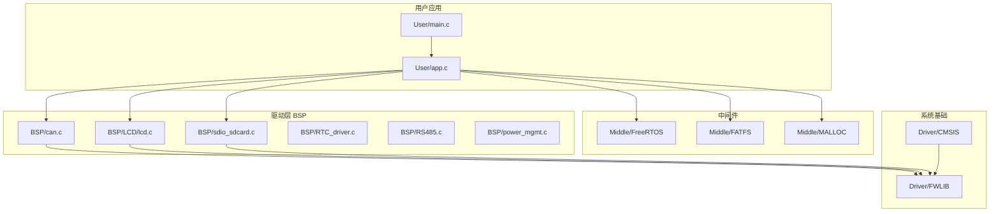
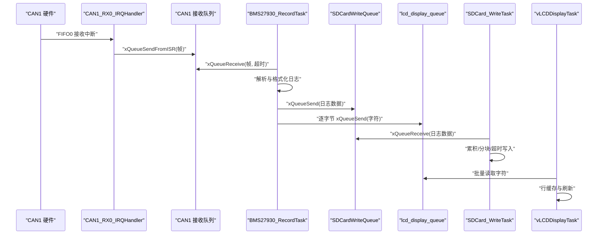
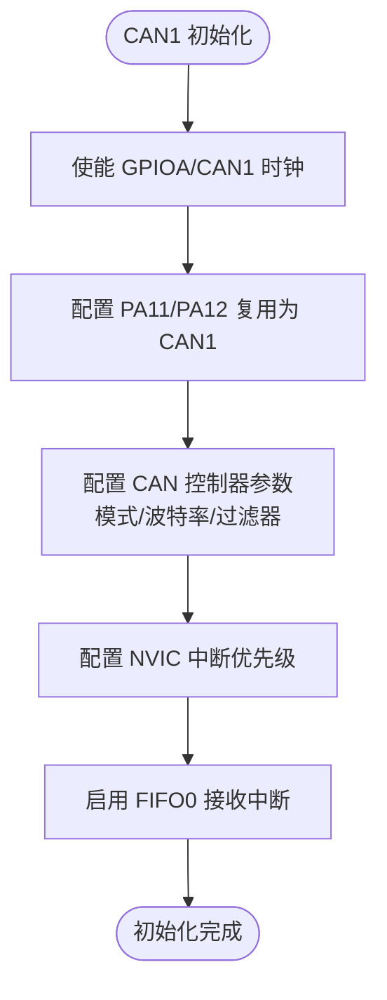
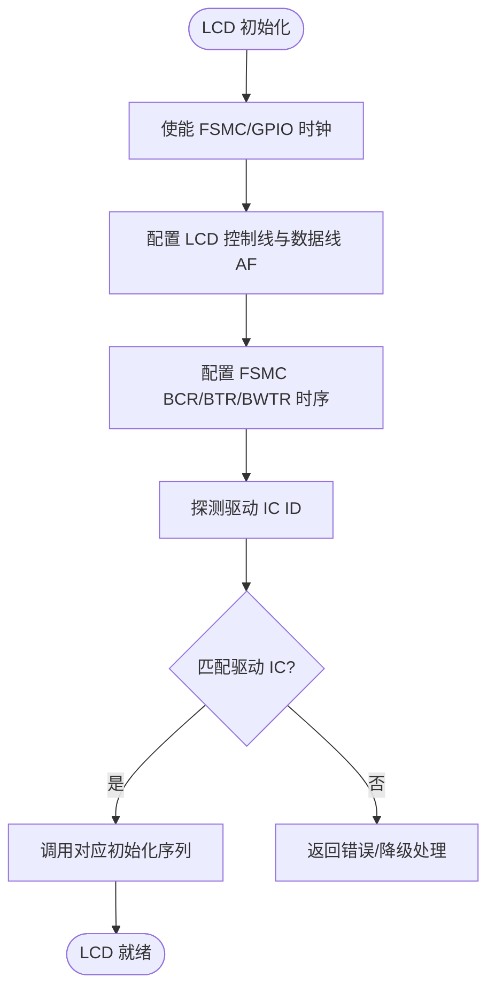
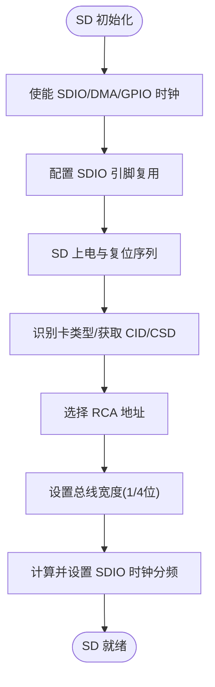
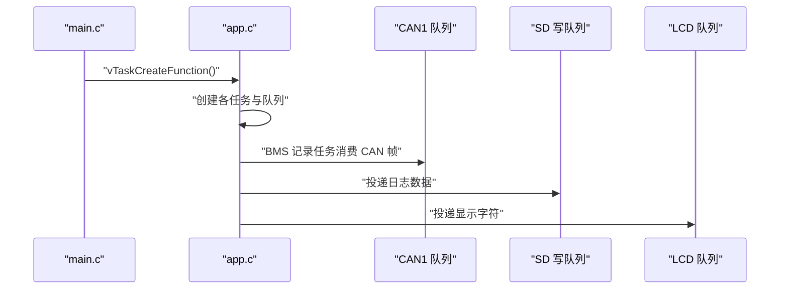
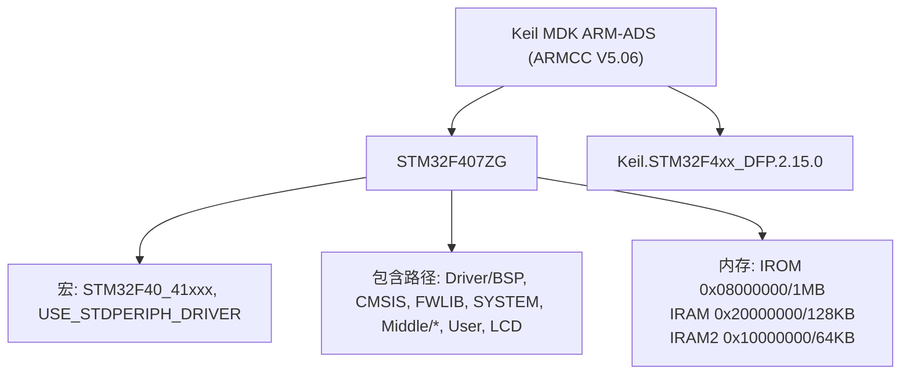

# 快速开始

<cite>
**本文引用的文件**   
- [f407_freeRTOS.uvprojx](file://f407_freeRTOS.uvprojx)
- [main.c](file://_gbk_backup/User/main.c)
- [app.c](file://_gbk_backup/User/app.c)
- [can.c](file://_gbk_backup/Driver/BSP/can.c)
- [lcd.c](file://_gbk_backup/Driver/BSP/LCD/lcd.c)
- [sdio_sdcard.c](file://_gbk_backup/Driver/BSP/sdio_sdcard.c)
- [F407_freeRTOS_STM32F407ZG.dbgconf](file://DebugConfig/F407_freeRTOS_STM32F407ZG.dbgconf)
</cite>

## 目录
1. [简介](#简介)
2. [项目结构](#项目结构)
3. [核心组件](#核心组件)
4. [架构总览](#架构总览)
5. [详细组件分析](#详细组件分析)
6. [依赖关系分析](#依赖关系分析)
7. [性能与稳定性要点](#性能与稳定性要点)
8. [故障排除指南](#故障排除指南)
9. [结论](#结论)
10. [附录：最小化运行示例](#附录最小化运行示例)

## 简介
本快速开始指南面向首次接触 STM32 CAN Tracker 项目的开发者，目标是帮助你在最短时间内完成开发环境搭建、工程导入、编译烧录与基本功能验证。本项目基于 STM32F407ZG，使用 Keil MDK（ARMCC）工具链，FreeRTOS 实时操作系统，以及标准外设库。系统通过 CAN 接收 BMS 数据，解析后以 CSV 形式写入 SD 卡，同时在 LCD 上显示关键信息；同时提供按键交互、串口调试输出与低功耗管理。

## 项目结构
仓库根目录包含 Keil 工程文件与源码备份目录。核心源码位于 `_gbk_backup` 下，按驱动层、中间件层与应用层组织：
- Driver/BSP：板级支持包，包含 CAN、LCD、SDIO/SD 卡、RTC、RS485、电源管理等
- Driver/CMSIS：CMSIS 头文件与系统初始化
- Driver/FWLIB：STM32 标准外设库源文件
- Middle：FreeRTOS、FATFS、内存分配等中间件
- User：应用入口 main.c 与业务逻辑 app.c

图表来源
- [f407_freeRTOS.uvprojx:382-800](file://f407_freeRTOS.uvprojx#L382-L800)
- [main.c:34-59](file://_gbk_backup/User/main.c#L34-L59)
- [app.c:529-541](file://_gbk_backup/User/app.c#L529-L541)

章节来源
- [f407_freeRTOS.uvprojx:382-800](file://f407_freeRTOS.uvprojx#L382-L800)

## 核心组件
- 启动与任务创建
  - main.c 负责系统时钟、串口、内存、RTC、OLED、按键、LED、ADC、LCD、RS485、CAN 初始化，并创建 FreeRTOS 任务与队列。
- 应用任务
  - app.c 中定义 LED 定时器任务、按键扫描与处理、BMS 记录任务、SD 卡写入任务、Ymodem 任务、LCD 显示任务等，并通过队列与互斥量进行任务间通信与资源保护。
- 硬件驱动
  - can.c：实现 CAN1 中断接收与队列投递，支持扩展帧过滤与发送。
  - lcd.c：FSMC 驱动的 TFT LCD，自动识别多种驱动 IC，支持横竖屏与背光控制。
  - sdio_sdcard.c：SDIO + DMA 的 SD 卡驱动，支持多块读写、宽总线模式与错误处理。

章节来源
- [main.c:34-59](file://_gbk_backup/User/main.c#L34-L59)
- [app.c:200-309](file://_gbk_backup/User/app.c#L200-L309)
- [app.c:311-366](file://_gbk_backup/User/app.c#L311-L366)
- [app.c:452-521](file://_gbk_backup/User/app.c#L452-L521)
- [can.c:40-106](file://_gbk_backup/Driver/BSP/can.c#L40-L106)
- [can.c:116-141](file://_gbk_backup/Driver/BSP/can.c#L116-L141)
- [can.c:186-224](file://_gbk_backup/Driver/BSP/can.c#L186-L224)
- [lcd.c:593-800](file://_gbk_backup/Driver/BSP/LCD/lcd.c#L593-L800)
- [sdio_sdcard.c:141-225](file://_gbk_backup/Driver/BSP/sdio_sdcard.c#L141-L225)

## 架构总览
系统采用“中断生产 + 任务消费”的经典架构：
- CAN1 中断服务函数将接收到的报文封装为帧结构，投递到 FreeRTOS 队列。
- BMS 记录任务从队列取帧，解析并格式化日志，再投递到 SD 写队列与 LCD 显示队列。
- SD 写任务累积数据并按扇区或超时策略写入 SD 卡。
- LCD 显示任务定时刷新屏幕，避免高频刷屏导致卡顿。

图表来源
- [can.c:186-224](file://_gbk_backup/Driver/BSP/can.c#L186-L224)
- [app.c:200-309](file://_gbk_backup/User/app.c#L200-L309)
- [app.c:311-366](file://_gbk_backup/User/app.c#L311-L366)
- [app.c:452-521](file://_gbk_backup/User/app.c#L452-L521)

## 详细组件分析

### CAN 驱动与数据流
- 初始化流程
  - 使能 GPIOA 与 CAN1 时钟，配置 PA11/PA12 复用为 CAN1。
  - 设置 CAN 工作模式、波特率参数（tsjw/tbs1/tbs2/brp），配置过滤器接收所有扩展帧。
  - 配置 NVIC 中断优先级，启用 FIFO0 接收中断。
- 接收流程
  - 中断中读取 FIFO0，封装为自定义帧结构，投递到 FreeRTOS 队列。
  - 若队列满则丢包计数增加，避免阻塞中断。
- 发送流程
  - 仅支持扩展帧发送，返回状态码指示成功或失败。

图表来源
- [can.c:40-106](file://_gbk_backup/Driver/BSP/can.c#L40-L106)

章节来源
- [can.c:40-106](file://_gbk_backup/Driver/BSP/can.c#L40-L106)
- [can.c:116-141](file://_gbk_backup/Driver/BSP/can.c#L116-L141)
- [can.c:186-224](file://_gbk_backup/Driver/BSP/can.c#L186-L224)

### LCD 显示子系统
- 初始化流程
  - 使能 FSMC 与相关 GPIO，配置 LCD_CS/WR/RD/RS 及数据线 D0-D15。
  - 配置 FSMC 时序寄存器，确保读写时序满足 LCD 驱动 IC 要求。
  - 自动探测驱动 IC ID（如 ILI9341/ST7789/NT35310/SSD1963/ST7796/ILI9806），调用对应初始化序列。
- 显示流程
  - 支持横竖屏切换，设置扫描方向与窗口大小。
  - 提供画点、清屏、字符串显示等接口。

图表来源
- [lcd.c:593-800](file://_gbk_backup/Driver/BSP/LCD/lcd.c#L593-L800)

章节来源
- [lcd.c:593-800](file://_gbk_backup/Driver/BSP/LCD/lcd.c#L593-L800)

### SD 卡文件系统
- 初始化流程
  - 使能 SDIO、DMA2、GPIOC/GPIOD，配置 SDIO 引脚复用。
  - 执行 SD 卡上电、CMD0/CMD8/ACMD41 等初始化序列，获取 CID/CSD 信息。
  - 选择相对地址，设置总线宽度（1位/4位），计算最佳时钟分频。
- 数据传输
  - 使用 DMA 传输，支持单块/多块读写，配置 SDIO 数据超时与中断。
  - 通过信号量同步传输完成，错误时返回具体错误码。

图表来源
- [sdio_sdcard.c:141-225](file://_gbk_backup/Driver/BSP/sdio_sdcard.c#L141-L225)
- [sdio_sdcard.c:287-387](file://_gbk_backup/Driver/BSP/sdio_sdcard.c#L287-L387)
- [sdio_sdcard.c:655-737](file://_gbk_backup/Driver/BSP/sdio_sdcard.c#L655-L737)

章节来源
- [sdio_sdcard.c:141-225](file://_gbk_backup/Driver/BSP/sdio_sdcard.c#L141-L225)
- [sdio_sdcard.c:287-387](file://_gbk_backup/Driver/BSP/sdio_sdcard.c#L287-L387)
- [sdio_sdcard.c:655-737](file://_gbk_backup/Driver/BSP/sdio_sdcard.c#L655-L737)

### 应用任务与数据路径
- 任务创建
  - main.c 调用 vTaskCreateFunction 创建 LED、串口、按键、SD 卡、BMS 记录、Ymodem、LCD 显示等任务。
- 数据路径
  - BMS 记录任务从 CAN 队列取帧，解析后生成 CSV 日志，投递到 SD 写队列与 LCD 显示队列。
  - SD 写任务累积数据，按扇区或超时写入 SD 卡，避免频繁写入损坏 SD。
  - LCD 显示任务每 100ms 刷新一次，批量渲染行缓存，降低刷屏开销。

图表来源
- [main.c:34-59](file://_gbk_backup/User/main.c#L34-L59)
- [app.c:529-541](file://_gbk_backup/User/app.c#L529-L541)
- [app.c:200-309](file://_gbk_backup/User/app.c#L200-L309)

章节来源
- [main.c:34-59](file://_gbk_backup/User/main.c#L34-L59)
- [app.c:529-541](file://_gbk_backup/User/app.c#L529-L541)
- [app.c:200-309](file://_gbk_backup/User/app.c#L200-L309)

## 依赖关系分析
- 工具链与设备
  - Keil MDK ARM-ADS（ARMCC V5.06 update 7），目标设备 STM32F407ZG，Pack ID Keil.STM32F4xx_DFP.2.15.0。
- 编译器宏与包含路径
  - 定义宏：STM32F40_41xxx, USE_STDPERIPH_DRIVER。
  - 包含路径涵盖 Driver/BSP、Driver/CMSIS、Driver/FWLIB、Driver/SYSTEM、Middle/FreeRTOS、Middle/MALLOC、Middle/FATFS、User、Driver/BSP/LCD。
- 链接器与内存布局
  - IROM 起始 0x08000000，大小 0x100000（1MB）。
  - IRAM 起始 0x20000000，大小 0x20000（128KB）。
  - IRAM2 起始 0x10000000，大小 0x10000（64KB）。

图表来源
- [f407_freeRTOS.uvprojx:10-25](file://f407_freeRTOS.uvprojx#L10-L25)
- [f407_freeRTOS.uvprojx:314-343](file://f407_freeRTOS.uvprojx#L314-L343)
- [f407_freeRTOS.uvprojx:215-311](file://f407_freeRTOS.uvprojx#L215-L311)

章节来源
- [f407_freeRTOS.uvprojx:10-25](file://f407_freeRTOS.uvprojx#L10-L25)
- [f407_freeRTOS.uvprojx:314-343](file://f407_freeRTOS.uvprojx#L314-L343)
- [f407_freeRTOS.uvprojx:215-311](file://f407_freeRTOS.uvprojx#L215-L311)

## 性能与稳定性要点
- CAN 中断与队列
  - 中断中仅做最小化处理，使用 FromISR 版本投递队列，避免阻塞；队列满时丢包计数增加，便于监控拥塞。
- SD 写入策略
  - 累积至 512 字节扇区或 1 分钟无新数据时写入，减少频繁写入对 SD 卡的磨损。
- LCD 刷新频率
  - 每 100ms 批量刷新一次，避免高频刷屏造成卡顿；队列使用率超过 80% 时打印警告。
- 低功耗管理
  - 电池电压低于阈值时进入低功耗模式，防止重复触发。

章节来源
- [can.c:186-224](file://_gbk_backup/Driver/BSP/can.c#L186-L224)
- [app.c:311-366](file://_gbk_backup/User/app.c#L311-L366)
- [app.c:452-521](file://_gbk_backup/User/app.c#L452-L521)
- [app.c:154-179](file://_gbk_backup/User/app.c#L154-L179)

## 故障排除指南
- Keil MDK 无法连接调试器
  - 检查 DebugConfig 中的 ST-Link/J-Link 配置，确认 USB 驱动已安装且设备被识别。
  - 在 Keil 中打开 Target Options -> Debug，选择正确的调试器与接口（SWD/JTAG）。
  - 若仍失败，尝试重置目标板或更换调试线缆。
- 编译错误：找不到头文件或库
  - 确认 IncludePath 与 LibPath 配置正确，尤其是 Driver/BSP、Driver/CMSIS、Driver/FWLIB、Middle/FreeRTOS、Middle/FATFS、Middle/MALLOC、User、Driver/BSP/LCD。
  - 检查是否安装了 Keil.STM32F4xx_DFP.2.15.0 Pack。
- 烧录失败或 Flash 写入无效
  - 检查 Flash Driver DLL 配置是否正确指向 STM32F4xx_1024.FLM。
  - 确认目标芯片型号为 STM32F407ZG，Flash 大小与起始地址匹配。
- SD 卡无法挂载或写入失败
  - 检查 SD 卡格式（FAT32）、容量与接触情况。
  - 查看 f_mount 返回值与错误日志，确认 FS 对象分配成功。
- LCD 无显示或花屏
  - 确认 FSMC 时序配置与 LCD 驱动 IC 匹配，查看 LCD ID 打印值。
  - 检查背光控制与横竖屏设置是否正确。
- CAN 无数据或丢包严重
  - 检查 CAN 波特率与过滤器配置是否与对端一致。
  - 观察 CAN1 接收队列长度与丢包计数，必要时增大队列深度。

章节来源
- [f407_freeRTOS.uvprojx:21-25](file://f407_freeRTOS.uvprojx#L21-L25)
- [f407_freeRTOS.uvprojx:314-343](file://f407_freeRTOS.uvprojx#L314-L343)
- [app.c:414-450](file://_gbk_backup/User/app.c#L414-L450)
- [lcd.c:794-800](file://_gbk_backup/Driver/BSP/LCD/lcd.c#L794-L800)
- [can.c:186-224](file://_gbk_backup/Driver/BSP/can.c#L186-L224)

## 结论
本指南提供了 STM32 CAN Tracker 项目的快速上手路径，涵盖环境搭建、工程导入、编译烧录与基本测试方法。通过理解 CAN 中断+队列、SD 累积写入、LCD 批量刷新等关键机制，开发者可快速定位问题并进行优化。建议在实际项目中结合串口日志与 LCD 显示进行联调，逐步完善功能与稳定性。

## 附录：最小化运行示例
以下是最小化运行步骤，帮助你快速验证系统基本功能：
- 环境准备
  - 安装 Keil MDK（ARMCC V5.06 或更高版本）。
  - 安装 Keil.STM32F4xx_DFP.2.15.0 Pack。
  - 安装 ST-Link 或 J-Link 驱动。
- 工程导入
  - 使用 Keil MDK 打开 f407_freeRTOS.uvprojx。
  - 确认目标设备为 STM32F407ZG，工具链为 ARM-ADS。
- 编译
  - 点击 Build，确保无编译错误。
  - 检查 Output 目录下生成的 .hex/.bin 文件。
- 烧录
  - 连接 ST-Link/J-Link 到目标板。
  - 在 Keil 中选择 Debug -> Download，或点击 Load。
  - 若失败，检查调试器配置与 Flash 驱动。
- 基本测试
  - 连接充电器，观察 LCD 是否显示“STM32_CAN_Tracker”。
  - 通过 CAN 注入测试数据，观察 LCD 是否滚动显示解析结果。
  - 插入 SD 卡，检查是否生成 BMS_log_YYYYMMDD.csv 文件。
  - 使用串口终端（115200bps）查看调试输出与任务栈信息。

章节来源
- [main.c:34-59](file://_gbk_backup/User/main.c#L34-L59)
- [app.c:529-541](file://_gbk_backup/User/app.c#L529-L541)
- [f407_freeRTOS.uvprojx:10-25](file://f407_freeRTOS.uvprojx#L10-L25)