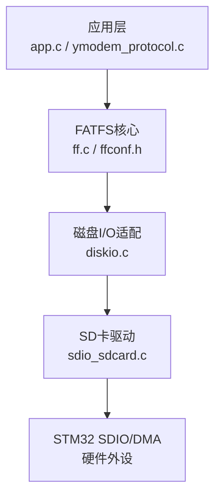
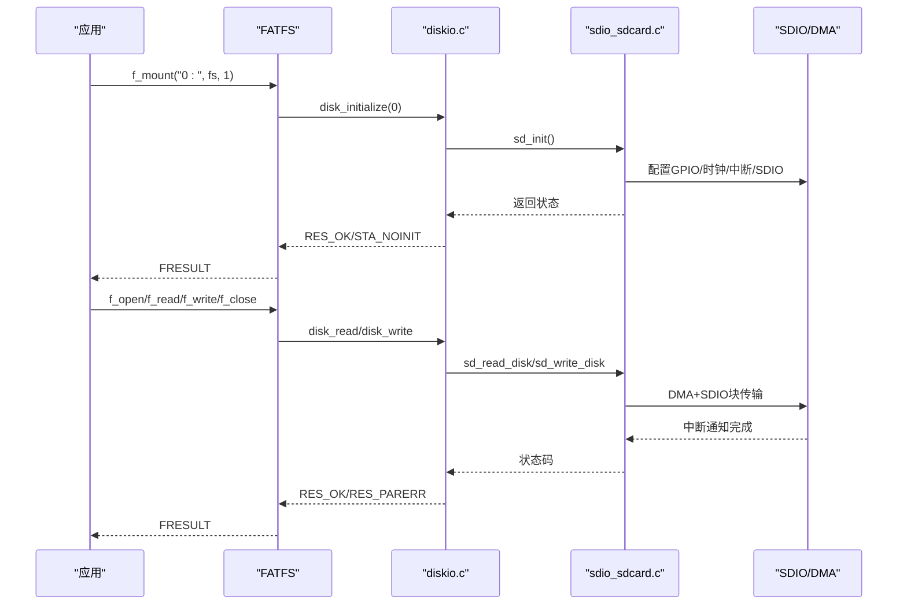
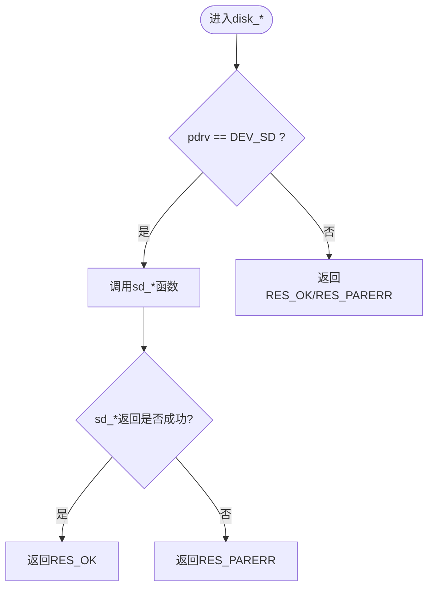
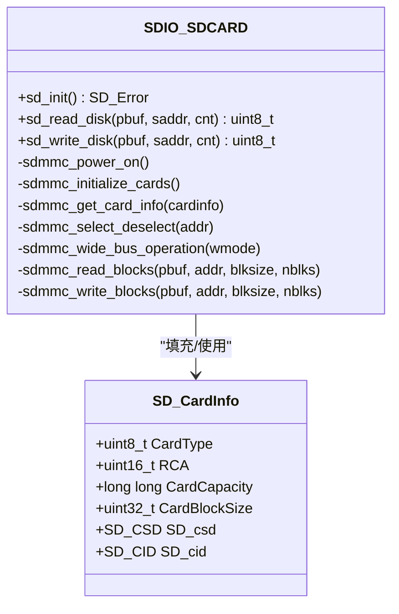
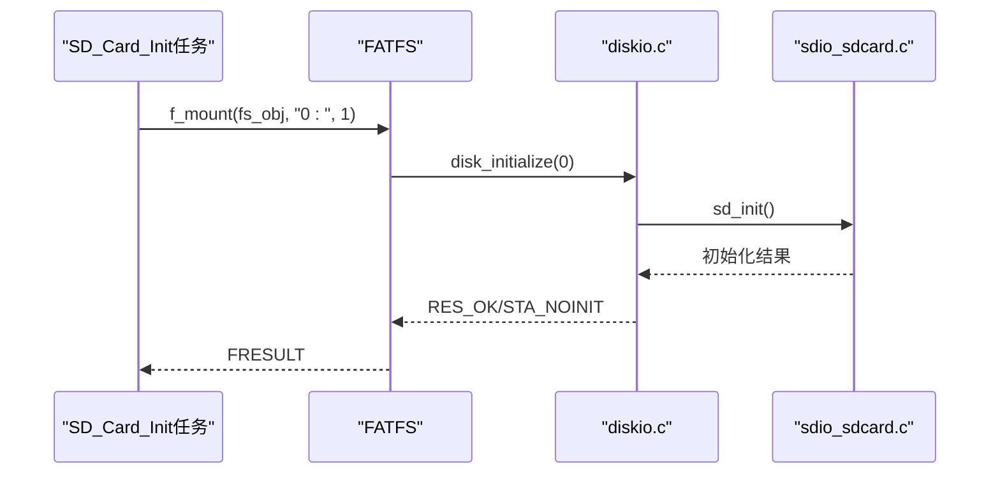
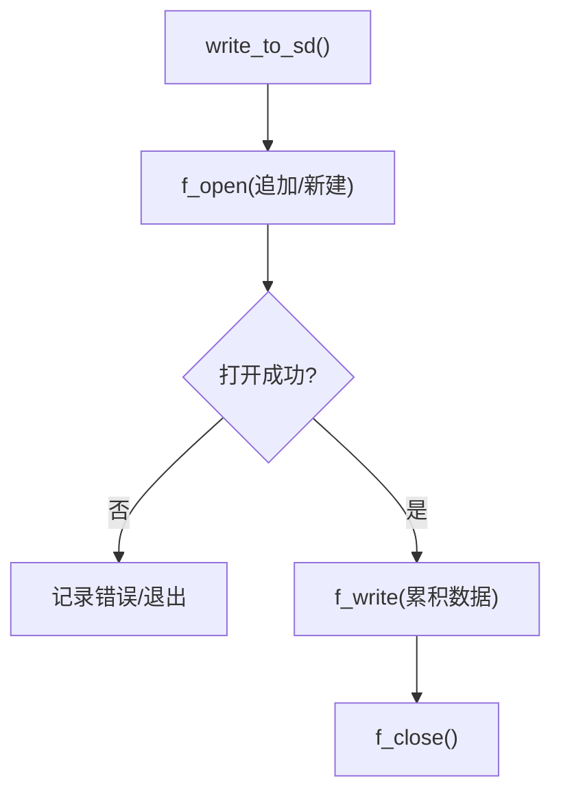
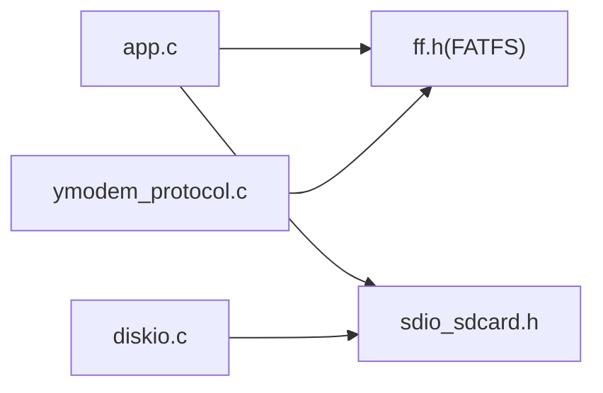

# FATFS文件系统集成

<cite>
**本文引用的文件**   
- [diskio.c](file://_gbk_backup/Middle/FATFS/diskio.c)
- [sdio_sdcard.h](file://_gbk_backup/Driver/BSP/sdio_sdcard.h)
- [sdio_sdcard.c](file://_gbk_backup/Driver/BSP/sdio_sdcard.c)
- [app.c](file://_gbk_backup/User/app.c)
- [ymodem_protocol.c](file://_gbk_backup/User/ymodem_protocol.c)
</cite>

## 目录
1. [简介](#简介)
2. [项目结构](#项目结构)
3. [核心组件](#核心组件)
4. [架构总览](#架构总览)
5. [详细组件分析](#详细组件分析)
6. [依赖关系分析](#依赖关系分析)
7. [性能与缓存策略](#性能与缓存策略)
8. [故障恢复与一致性](#故障恢复与一致性)
9. [常见问题排查](#常见问题排查)
10. [结论](#结论)

## 简介
本文件为FATFS文件系统在本STM32F4 SDIO方案中的集成技术文档。重点说明底层磁盘接口（diskio.c）如何桥接SD卡驱动，以及应用层如何通过FATFS API完成挂载、文件读写、目录遍历等典型操作。同时给出缓存合并策略、错误处理与一致性建议，帮助在资源受限的嵌入式环境中获得稳定可靠的存储体验。

## 项目结构
本项目将FATFS作为中间件集成到FreeRTOS应用中，底层通过SDIO DMA方式访问SD卡。关键路径如下：
- 用户任务与应用逻辑：User/app.c、User/ymodem_protocol.c
- FATFS适配层：Middle/FATFS/diskio.c
- SD卡硬件抽象：Driver/BSP/sdio_sdcard.{h,c}

图表来源
- [app.c:414-450](file://_gbk_backup/User/app.c#L414-L450)
- [diskio.c:38-144](file://_gbk_backup/Middle/FATFS/diskio.c#L38-L144)
- [sdio_sdcard.c:141-225](file://_gbk_backup/Driver/BSP/sdio_sdcard.c#L141-L225)

章节来源
- [app.c:414-450](file://_gbk_backup/User/app.c#L414-L450)
- [diskio.c:38-144](file://_gbk_backup/Middle/FATFS/diskio.c#L38-L144)
- [sdio_sdcard.c:141-225](file://_gbk_backup/Driver/BSP/sdio_sdcard.c#L141-L225)

## 核心组件
- diskio.c：实现FATFS要求的底层磁盘接口，包括设备初始化、扇区读/写、控制命令查询等。
- sdio_sdcard.c/h：封装SDIO控制器与DMA，提供上电、识别、选择、块读写等能力，并维护SD卡信息结构体。
- app.c：演示FATFS挂载、文件创建/打开/写入/关闭流程，并提供数据累积与扇区级落盘策略。
- ymodem_protocol.c：演示文件读取与目录遍历等API使用。

章节来源
- [diskio.c:38-144](file://_gbk_backup/Middle/FATFS/diskio.c#L38-L144)
- [sdio_sdcard.h:140-151](file://_gbk_backup/Driver/BSP/sdio_sdcard.h#L140-L151)
- [sdio_sdcard.c:141-225](file://_gbk_backup/Driver/BSP/sdio_sdcard.c#L141-L225)
- [app.c:35-71](file://_gbk_backup/User/app.c#L35-L71)
- [ymodem_protocol.c:248-392](file://_gbk_backup/User/ymodem_protocol.c#L248-L392)

## 架构总览
FATFS通过统一的disk_*接口与具体介质解耦。本项目中，disk_*调用SD卡驱动提供的sd_*函数，后者基于SDIO+DMA完成实际传输。

图表来源
- [app.c:414-450](file://_gbk_backup/User/app.c#L414-L450)
- [diskio.c:38-144](file://_gbk_backup/Middle/FATFS/diskio.c#L38-L144)
- [sdio_sdcard.c:141-225](file://_gbk_backup/Driver/BSP/sdio_sdcard.c#L141-L225)

## 详细组件分析

### 底层磁盘接口（diskio.c）
- disk_status：返回设备状态，当前直接返回成功。
- disk_initialize：根据物理驱动器号路由到对应设备；本项目映射DEV_SD=0，调用sd_init进行SD卡初始化，失败返回STA_NOINIT。
- disk_read：按LBA扇区地址和数量调用sd_read_disk，出错返回RES_PARERR。
- disk_write：在非只读模式下，调用sd_write_disk写出数据，出错返回RES_PARERR。
- disk_ioctl：支持CTRL_SYNC、GET_SECTOR_SIZE（固定512）、GET_BLOCK_SIZE（来自g_sd_card_info.CardBlockSize）、GET_SECTOR_COUNT（CardCapacity/512）。

图表来源
- [diskio.c:38-144](file://_gbk_backup/Middle/FATFS/diskio.c#L38-L144)

章节来源
- [diskio.c:24-144](file://_gbk_backup/Middle/FATFS/diskio.c#L24-L144)

### SD卡驱动（sdio_sdcard.c/h）
- 初始化流程：
  - 创建FreeRTOS信号量与互斥量，用于传输同步与并发保护。
  - 使能GPIO、SDIO、DMA时钟，配置引脚复用。
  - 上电并执行SD/MMC初始化序列（CMD0/CMD8/ACMD41或CMD1），识别卡类型与容量。
  - 获取CID/CSD，计算容量与块大小，设置RCA并选择卡。
  - 尝试启用4位总线模式，并根据卡类型优化SDIO时钟分频。
- 数据传输：
  - 单块/多块读写通过SDIO命令配合DMA完成。
  - 使用中断标志与信号量等待传输完成，超时则返回错误。
  - 写路径对SDHC/SDXC使用CMD23预置块数以提升吞吐。
- 对外接口：
  - sd_init：完整初始化流程入口。
  - sd_read_disk/sd_write_disk：面向FATFS的扇区级读写。
  - g_sd_card_info：包含容量、块大小、RCA、类型等信息，供上层查询。

图表来源
- [sdio_sdcard.h:140-151](file://_gbk_backup/Driver/BSP/sdio_sdcard.h#L140-L151)
- [sdio_sdcard.c:141-225](file://_gbk_backup/Driver/BSP/sdio_sdcard.c#L141-L225)
- [sdio_sdcard.c:655-737](file://_gbk_backup/Driver/BSP/sdio_sdcard.c#L655-L737)
- [sdio_sdcard.c:747-800](file://_gbk_backup/Driver/BSP/sdio_sdcard.c#L747-L800)

章节来源
- [sdio_sdcard.h:140-151](file://_gbk_backup/Driver/BSP/sdio_sdcard.h#L140-L151)
- [sdio_sdcard.c:141-225](file://_gbk_backup/Driver/BSP/sdio_sdcard.c#L141-L225)
- [sdio_sdcard.c:655-737](file://_gbk_backup/Driver/BSP/sdio_sdcard.c#L655-L737)
- [sdio_sdcard.c:747-800](file://_gbk_backup/Driver/BSP/sdio_sdcard.c#L747-L800)

### 文件系统挂载与卷管理
- 挂载入口：app.c中创建FATFS对象后调用f_mount(fs_obj, "0:", 1)，表示挂载物理驱动器0。
- 卷管理：FATFS内部维护卷表与挂载状态；本项目仅使用一个卷“0:”，未涉及多卷或分区切换。
- 分区检测与文件系统类型识别：由FATFS在挂载时自动完成（MBR/GPT解析、FAT/FATFS签名识别），本项目未自定义扩展。

图表来源
- [app.c:414-450](file://_gbk_backup/User/app.c#L414-L450)
- [diskio.c:38-50](file://_gbk_backup/Middle/FATFS/diskio.c#L38-L50)
- [sdio_sdcard.c:141-225](file://_gbk_backup/Driver/BSP/sdio_sdcard.c#L141-L225)

章节来源
- [app.c:414-450](file://_gbk_backup/User/app.c#L414-L450)
- [diskio.c:38-50](file://_gbk_backup/Middle/FATFS/diskio.c#L38-L50)

### 文件操作API使用示例
- 创建/打开：优先尝试追加打开，若不存在则新建。
- 写入：批量写入前累积至扇区大小（512字节）或超时触发落盘。
- 关闭：每次写入完成后及时关闭句柄，减少锁持有时间。
- 读取：ymodem协议中演示了f_read循环读取数据包。
- 目录遍历：ymodem协议中演示了f_opendir/f_readdir/f_closedir遍历目录。

图表来源
- [app.c:35-71](file://_gbk_backup/User/app.c#L35-L71)

章节来源
- [app.c:35-71](file://_gbk_backup/User/app.c#L35-L71)
- [ymodem_protocol.c:248-392](file://_gbk_backup/User/ymodem_protocol.c#L248-L392)

### 目录管理与路径解析
- 目录遍历：使用f_opendir打开目录，f_readdir迭代条目，f_closedir释放资源。
- 路径解析：FATFS默认使用“0:/path”形式，根目录为“0:/”。本项目日志文件位于“0:/BMS_log_YYYYMMDD.csv”。

章节来源
- [ymodem_protocol.c:455-491](file://_gbk_backup/User/ymodem_protocol.c#L455-L491)
- [ymodem_protocol.c:536-544](file://_gbk_backup/User/ymodem_protocol.c#L536-L544)
- [app.c:43-48](file://_gbk_backup/User/app.c#L43-L48)

## 依赖关系分析
- diskio.c依赖sdio_sdcard.h/c提供的sd_*接口。
- app.c依赖ff.h（FATFS API）与sdio_sdcard.h（SD卡信息）。
- ymodem_protocol.c依赖ff.h进行文件与目录操作。

图表来源
- [app.c:1-21](file://_gbk_backup/User/app.c#L1-L21)
- [ymodem_protocol.c:1-20](file://_gbk_backup/User/ymodem_protocol.c#L1-L20)
- [diskio.c:10-14](file://_gbk_backup/Middle/FATFS/diskio.c#L10-L14)

章节来源
- [app.c:1-21](file://_gbk_backup/User/app.c#L1-L21)
- [ymodem_protocol.c:1-20](file://_gbk_backup/User/ymodem_protocol.c#L1-L20)
- [diskio.c:10-14](file://_gbk_backup/Middle/FATFS/diskio.c#L10-L14)

## 性能与缓存策略
- 扇区级合并：应用层在SDCard_WriteTask中将数据累积至512字节（一个扇区）后再调用f_write，降低频繁小写带来的开销。
- 超时刷新：若无新数据到达，超过WRITE_TIMEOUT_MS即强制落盘，避免数据长期滞留内存。
- DMA与4位总线：SD驱动在初始化阶段尝试启用4位总线模式并按卡类型优化SDIO时钟，提升吞吐。
- 预置块数：写多块时使用CMD23预置块数，减少握手次数，提高连续写效率。

章节来源
- [app.c:311-366](file://_gbk_backup/User/app.c#L311-L366)
- [sdio_sdcard.c:187-225](file://_gbk_backup/Driver/BSP/sdio_sdcard.c#L187-L225)
- [sdio_sdcard.c:772-787](file://_gbk_backup/Driver/BSP/sdio_sdcard.c#L772-L787)

## 故障恢复与一致性
- 错误码映射：
  - disk_read/disk_write对sd_*返回的非成功值统一返回RES_PARERR，FATFS据此判定I/O错误。
  - disk_ioctl对未知命令返回RES_PARERR，保证上层行为可预期。
- 传输超时：
  - SD驱动在读/写路径中使用信号量等待传输完成，超时返回SD_DATA_TIMEOUT，最终向上层暴露为I/O错误。
- 一致性建议：
  - 建议在关键写操作后调用f_sync或确保f_close被正确调用，以触发FATFS的刷盘与元数据更新。
  - 对于断电保护场景，可在应用层增加事务日志与校验（如CRC），并在启动时进行一致性检查与修复。
  - 定期备份重要数据，或在文件系统层面启用更严格的配置（如FF_FS_READONLY=0且开启必要的FSCONF选项）。

章节来源
- [diskio.c:58-98](file://_gbk_backup/Middle/FATFS/diskio.c#L58-L98)
- [diskio.c:107-144](file://_gbk_backup/Middle/FATFS/diskio.c#L107-L144)
- [sdio_sdcard.c:655-737](file://_gbk_backup/Driver/BSP/sdio_sdcard.c#L655-L737)
- [sdio_sdcard.c:747-800](file://_gbk_backup/Driver/BSP/sdio_sdcard.c#L747-L800)

## 常见问题排查
- 挂载失败（mount fail）：
  - 检查sd_init是否成功，确认GPIO/时钟/中断配置无误。
  - 确认SD卡插入与供电正常，必要时增大SDIO_TRANSFER_CLK_DIV以降低频率。
- 读写错误（RES_PARERR）：
  - 检查sd_read_disk/sd_write_disk返回值，定位是否为DMA或SDIO超时。
  - 确认缓冲区对齐与长度符合要求（512字节扇区对齐）。
- 目录遍历异常：
  - 检查路径格式是否正确（“0:/...”），确认目录存在且权限允许。
- 性能问题：
  - 确认已启用4位总线模式与合适的SDIO时钟分频。
  - 检查应用层是否合理合并写操作，避免频繁小写。

章节来源
- [app.c:414-450](file://_gbk_backup/User/app.c#L414-L450)
- [sdio_sdcard.h:7-12](file://_gbk_backup/Driver/BSP/sdio_sdcard.h#L7-L12)
- [sdio_sdcard.c:655-737](file://_gbk_backup/Driver/BSP/sdio_sdcard.c#L655-L737)

## 结论
本项目通过diskio.c将FATFS与SDIO驱动的sd_*接口对接，实现了稳定的文件系统挂载与文件操作。应用层采用扇区级数据累积与超时刷新策略，结合SD驱动的DMA与4位总线优化，兼顾了可靠性与性能。在生产环境中，建议补充f_sync调用、事务日志与一致性检查机制，以进一步提升断电安全与数据完整性。