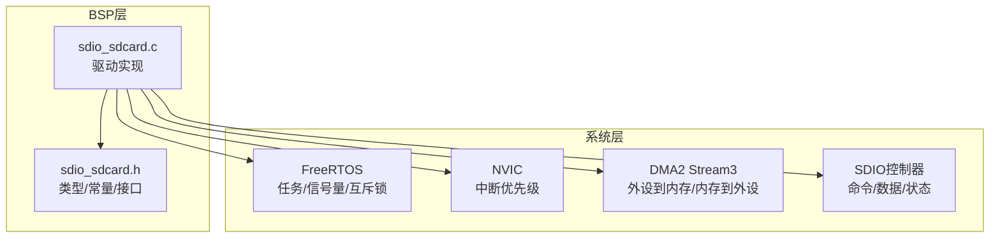
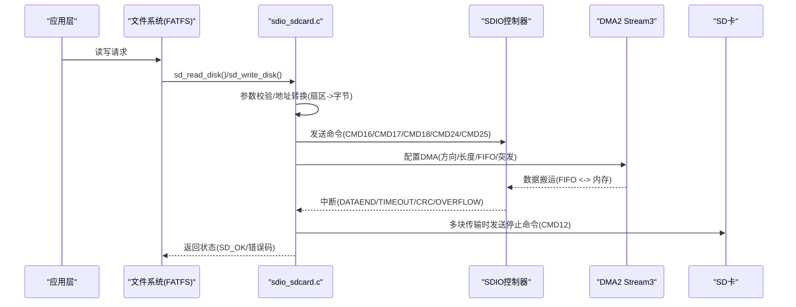
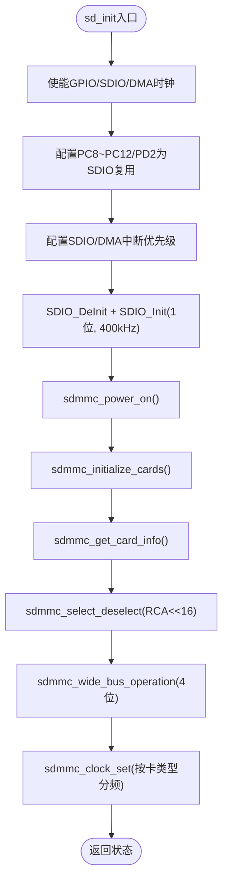
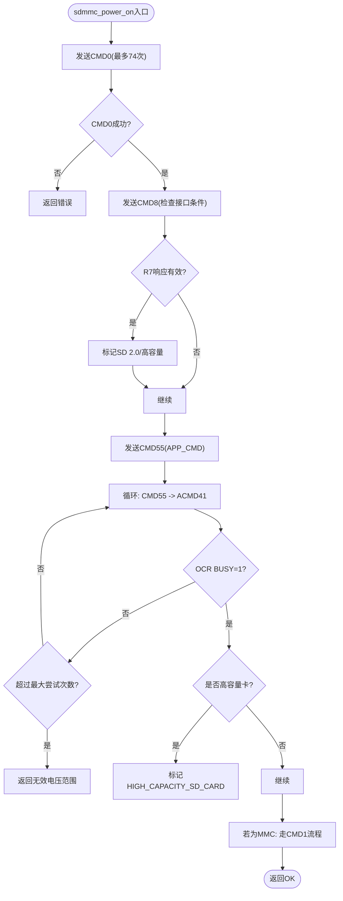
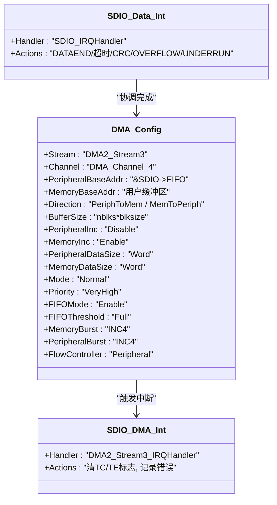
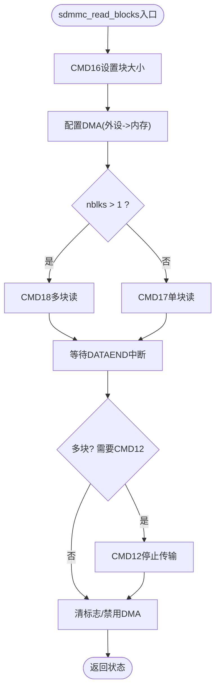
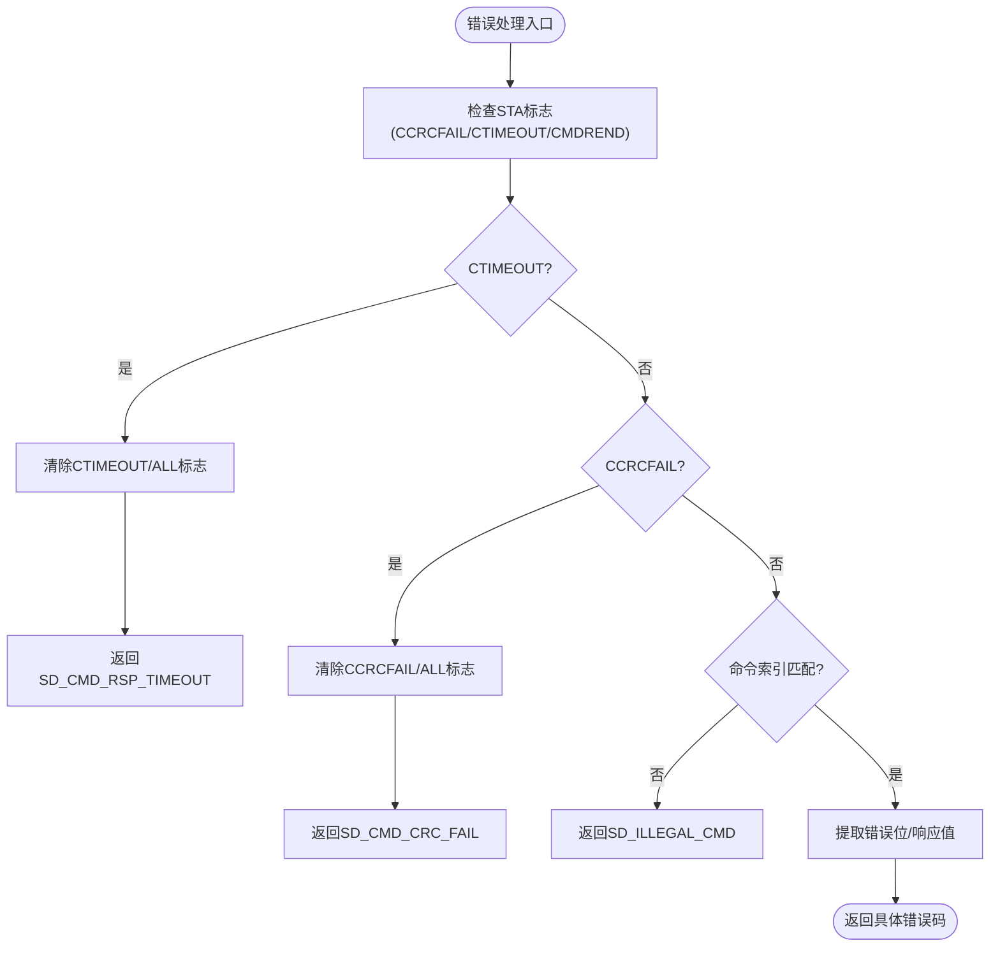
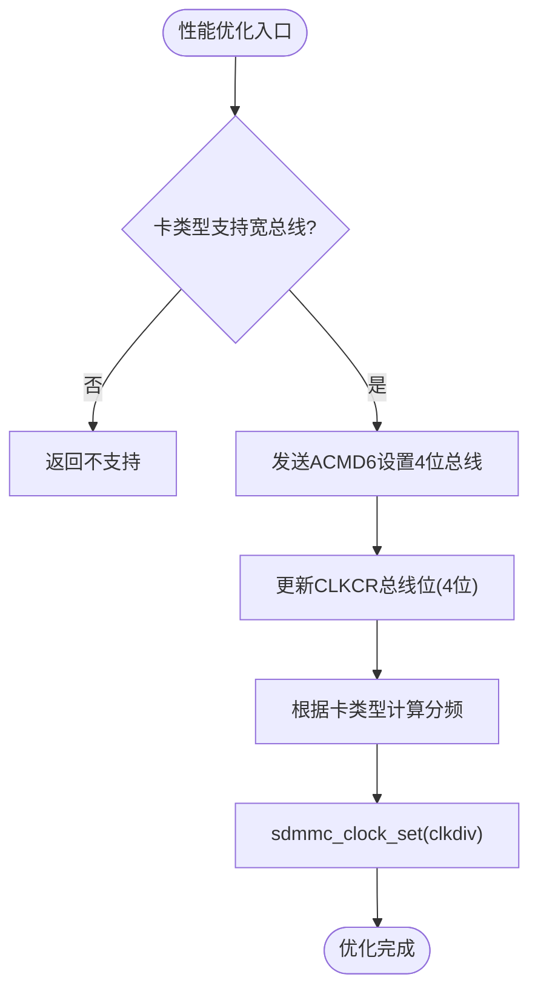
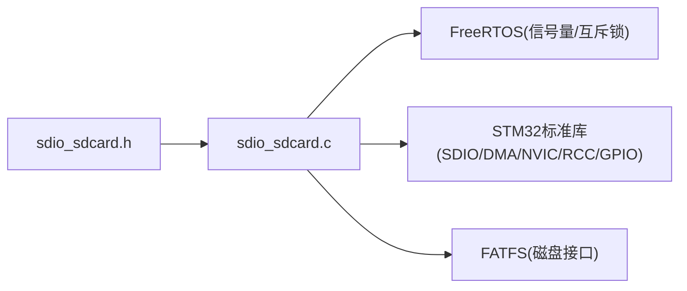

# SD卡驱动层

<cite>
**本文引用的文件**   
- [sdio_sdcard.c](file://_gbk_backup/Driver/BSP/sdio_sdcard.c)
- [sdio_sdcard.h](file://_gbk_backup/Driver/BSP/sdio_sdcard.h)
</cite>

## 目录
1. [简介](#简介)
2. [项目结构](#项目结构)
3. [核心组件](#核心组件)
4. [架构总览](#架构总览)
5. [详细组件分析](#详细组件分析)
6. [依赖关系分析](#依赖关系分析)
7. [性能考虑](#性能考虑)
8. [故障排查指南](#故障排查指南)
9. [结论](#结论)

## 简介
本技术文档面向STM32 SDIO控制器驱动的SD卡驱动层，聚焦以下目标：
- STM32 SDIO控制器的初始化配置：GPIO引脚、时钟与中断优先级。
- SD卡识别流程：CMD0、CMD8、ACMD41等命令序列的实现与状态机。
- DMA传输机制：DMA通道配置、FIFO模式与突发传输优化。
- 块读写操作：单块与多块读写的差异处理。
- 错误处理机制：超时检测、CRC校验与状态查询。
- 性能优化技巧：总线宽度（1位/4位）与时钟频率调优。

该实现基于FreeRTOS环境，使用信号量与互斥锁进行同步，并通过SDIO中断与DMA中断协同完成数据传输。

## 项目结构
本项目中SD卡驱动位于BSP层，主要包含两个文件：
- sdio_sdcard.c：驱动实现，涵盖初始化、命令发送、数据读写、中断处理、DMA配置等。
- sdio_sdcard.h：头文件，定义错误码、寄存器结构体、命令常量、DMA宏与对外接口。

图表来源
- [sdio_sdcard.c:141-224](file://_gbk_backup/Driver/BSP/sdio_sdcard.c#L141-L224)
- [sdio_sdcard.h:153-160](file://_gbk_backup/Driver/BSP/sdio_sdcard.h#L153-L160)

章节来源
- [sdio_sdcard.c:141-224](file://_gbk_backup/Driver/BSP/sdio_sdcard.c#L141-L224)
- [sdio_sdcard.h:153-160](file://_gbk_backup/Driver/BSP/sdio_sdcard.h#L153-L160)

## 核心组件
- SDIO初始化与上电：
  - GPIO复用为SDIO功能，使能SDIO与DMA时钟。
  - 配置SDIO初始时钟分频，进入IDLE状态。
- 卡识别与初始化：
  - 执行CMD0、CMD8、ACMD41序列，判断SD卡版本与容量类型。
  - 获取CID/CSD，分配RCA地址，选择卡并设置总线宽度。
- 数据传输：
  - 通过DMA2 Stream3进行块读写，支持单块和多块模式。
  - 使用SDIO中断与DMA中断协同，信号量同步等待传输完成。
- 错误处理：
  - 针对命令响应（R1/R2/R3/R6/R7）和数据传输的错误标志进行检测与清理。
  - 超时、CRC失败、FIFO溢出/欠载等错误统一上报。
- 性能优化：
  - 根据卡类型自动切换1位或4位总线宽度。
  - 按卡能力调整SDIO时钟分频系数，提升吞吐率。

章节来源
- [sdio_sdcard.c:141-224](file://_gbk_backup/Driver/BSP/sdio_sdcard.c#L141-L224)
- [sdio_sdcard.c:287-387](file://_gbk_backup/Driver/BSP/sdio_sdcard.c#L287-L387)
- [sdio_sdcard.c:655-737](file://_gbk_backup/Driver/BSP/sdio_sdcard.c#L655-L737)
- [sdio_sdcard.c:747-870](file://_gbk_backup/Driver/BSP/sdio_sdcard.c#L747-L870)
- [sdio_sdcard.c:875-1106](file://_gbk_backup/Driver/BSP/sdio_sdcard.c#L875-L1106)
- [sdio_sdcard.c:1113-1142](file://_gbk_backup/Driver/BSP/sdio_sdcard.c#L1113-L1142)
- [sdio_sdcard.c:1298-1394](file://_gbk_backup/Driver/BSP/sdio_sdcard.c#L1298-L1394)

## 架构总览
下图展示SD卡驱动的整体交互：应用层调用sd_read_disk/sd_write_disk，内部通过sdmmc_read_blocks/sdmmc_write_blocks发起SDIO命令与DMA传输；SDIO中断与DMA中断协同完成数据搬运与状态同步。

图表来源
- [sdio_sdcard.c:1403-1449](file://_gbk_backup/Driver/BSP/sdio_sdcard.c#L1403-L1449)
- [sdio_sdcard.c:655-737](file://_gbk_backup/Driver/BSP/sdio_sdcard.c#L655-L737)
- [sdio_sdcard.c:747-870](file://_gbk_backup/Driver/BSP/sdio_sdcard.c#L747-L870)
- [sdio_sdcard.c:1298-1394](file://_gbk_backup/Driver/BSP/sdio_sdcard.c#L1298-L1394)

## 详细组件分析

### SDIO控制器初始化与GPIO配置
- 时钟与GPIO：
  - 使能GPIOC/GPIOD与SDIO、DMA2时钟。
  - PC8~PC12、PD2复用为SDIO功能，推挽输出，上拉。
- NVIC中断优先级：
  - SDIO_IRQn抢占优先级6，子优先级0。
  - DMA2_Stream3_IRQn抢占优先级5，子优先级0。
- SDIO初始化：
  - 初始时钟分频设置为SDIO_INIT_CLK_DIV，确保不超过400kHz。
  - 总线宽度初始为1位，硬件流控关闭。
  - 开启电源状态与SDIO时钟。

图表来源
- [sdio_sdcard.c:141-224](file://_gbk_backup/Driver/BSP/sdio_sdcard.c#L141-L224)
- [sdio_sdcard.c:287-307](file://_gbk_backup/Driver/BSP/sdio_sdcard.c#L287-L307)

章节来源
- [sdio_sdcard.c:141-224](file://_gbk_backup/Driver/BSP/sdio_sdcard.c#L141-L224)
- [sdio_sdcard.c:287-307](file://_gbk_backup/Driver/BSP/sdio_sdcard.c#L287-L307)

### SD卡识别流程（CMD0、CMD8、ACMD41）
- CMD0（GO_IDLE_STATE）：
  - 循环发送至少74个时钟周期后进入IDLE状态。
  - 检查命令发送标志，无响应但需确认时序正确。
- CMD8（SEND_IF_COND）：
  - 短响应R7，用于检查SD卡接口特性与电压范围。
  - 若成功，判定为SD 2.0卡，并标记高容量支持。
- ACMD41（SD_APP_OP_COND）：
  - 在CMD55之后发送，轮询OCR的BUSY位，直到上电完成或达到最大尝试次数。
  - 若不支持ACMD41，则回退到MMC卡的CMD1流程。

图表来源
- [sdio_sdcard.c:287-387](file://_gbk_backup/Driver/BSP/sdio_sdcard.c#L287-L387)

章节来源
- [sdio_sdcard.c:287-387](file://_gbk_backup/Driver/BSP/sdio_sdcard.c#L287-L387)

### DMA传输机制（通道、FIFO、突发）
- DMA通道与流：
  - 使用DMA2 Stream3，通道4，映射到SDIO FIFO。
- FIFO模式与突发：
  - 启用DMA FIFO模式，阈值设为满触发，减少CPU干预。
  - 内存与外设突发均为INC4，匹配32位总线宽度。
- 传输方向：
  - 读：外设到内存（SDIO FIFO -> 缓冲区）。
  - 写：内存到外设（缓冲区 -> SDIO FIFO）。
- 中断与同步：
  - DMA完成中断仅清标志，实际完成由SDIO DATAEND中断通知。
  - 使用二进制信号量等待传输结束，带超时保护。

图表来源
- [sdio_sdcard.c:90-134](file://_gbk_backup/Driver/BSP/sdio_sdcard.c#L90-L134)
- [sdio_sdcard.c:1298-1394](file://_gbk_backup/Driver/BSP/sdio_sdcard.c#L1298-L1394)

章节来源
- [sdio_sdcard.c:90-134](file://_gbk_backup/Driver/BSP/sdio_sdcard.c#L90-L134)
- [sdio_sdcard.c:1298-1394](file://_gbk_backup/Driver/BSP/sdio_sdcard.c#L1298-L1394)

### 块读写操作（单块与多块差异）
- 单块读（CMD17）：
  - 设置块大小（CMD16），配置DMA，发送CMD17，等待DATAEND中断。
- 多块读（CMD18）：
  - 设置块大小（CMD16），配置DMA，发送CMD18，接收多个块，最后发送CMD12停止。
- 单块写（CMD24）：
  - 先查询卡状态（CMD13），等待READY_FOR_DATA，再发送CMD24。
- 多块写（CMD25）：
  - 可选发送ACMD55+CMD23设置块数量，然后发送CMD25连续写入，最后发送CMD12停止。

图表来源
- [sdio_sdcard.c:655-737](file://_gbk_backup/Driver/BSP/sdio_sdcard.c#L655-L737)
- [sdio_sdcard.c:1298-1320](file://_gbk_backup/Driver/BSP/sdio_sdcard.c#L1298-L1320)

章节来源
- [sdio_sdcard.c:655-737](file://_gbk_backup/Driver/BSP/sdio_sdcard.c#L655-L737)
- [sdio_sdcard.c:1298-1320](file://_gbk_backup/Driver/BSP/sdio_sdcard.c#L1298-L1320)

### 错误处理机制（超时、CRC、状态查询）
- 命令响应错误：
  - R1：检查CCRCFAIL/CTIMEOUT/CMDREND，提取错误位。
  - R2/R3/R6/R7：分别处理长响应、OCR、RCA与接口条件检查的错误。
- 数据传输错误：
  - DATAEND：正常完成，多块传输需发送CMD12。
  - DTIMEOUT：数据超时，置错误标志并释放信号量。
  - DCRCFAIL：数据CRC失败，多块传输需发送CMD12。
  - RXOVERR/TXUNDERR：FIFO溢出/欠载，置错误标志。
- 状态查询：
  - 通过CMD13读取R1状态，解析编程/接收状态位。

图表来源
- [sdio_sdcard.c:875-1106](file://_gbk_backup/Driver/BSP/sdio_sdcard.c#L875-L1106)
- [sdio_sdcard.c:1150-1189](file://_gbk_backup/Driver/BSP/sdio_sdcard.c#L1150-L1189)

章节来源
- [sdio_sdcard.c:875-1106](file://_gbk_backup/Driver/BSP/sdio_sdcard.c#L875-L1106)
- [sdio_sdcard.c:1150-1189](file://_gbk_backup/Driver/BSP/sdio_sdcard.c#L1150-L1189)

### 性能优化技巧（总线宽度与时钟频率）
- 总线宽度：
  - 通过ACMD6设置1位或4位总线宽度，MC卡不支持宽总线。
  - 根据SCR寄存器判断是否支持宽总线，成功后更新CLKCR总线位。
- 时钟频率：
  - 根据卡类型计算最佳分频：标准容量卡使用SDIO_TRANSFER_CLK_DIV+2，其他使用SDIO_TRANSFER_CLK_DIV。
  - 通过sdmmc_clock_set直接写入CLKCR寄存器。

图表来源
- [sdio_sdcard.c:588-633](file://_gbk_backup/Driver/BSP/sdio_sdcard.c#L588-L633)
- [sdio_sdcard.c:230-236](file://_gbk_backup/Driver/BSP/sdio_sdcard.c#L230-L236)

章节来源
- [sdio_sdcard.c:588-633](file://_gbk_backup/Driver/BSP/sdio_sdcard.c#L588-L633)
- [sdio_sdcard.c:230-236](file://_gbk_backup/Driver/BSP/sdio_sdcard.c#L230-L236)

## 依赖关系分析
- 模块耦合：
  - sdio_sdcard.c依赖sdio_sdcard.h中的类型、常量与宏。
  - 依赖FreeRTOS提供信号量与互斥锁。
  - 依赖STM32标准库的SDIO、DMA、NVIC、RCC、GPIO接口。
- 外部集成点：
  - FATFS通过sd_read_disk/sd_write_disk访问SD卡。
  - FreeRTOS任务通过信号量等待传输完成，避免忙等。

图表来源
- [sdio_sdcard.h:331-336](file://_gbk_backup/Driver/BSP/sdio_sdcard.h#L331-L336)
- [sdio_sdcard.c:1403-1449](file://_gbk_backup/Driver/BSP/sdio_sdcard.c#L1403-L1449)

章节来源
- [sdio_sdcard.h:331-336](file://_gbk_backup/Driver/BSP/sdio_sdcard.h#L331-L336)
- [sdio_sdcard.c:1403-1449](file://_gbk_backup/Driver/BSP/sdio_sdcard.c#L1403-L1449)

## 性能考虑
- 总线宽度：优先启用4位模式以提升带宽，前提是卡支持且硬件布线满足要求。
- 时钟频率：根据卡类型与能力调整分频，避免过高导致不稳定。
- DMA优化：使用FIFO满触发与INC4突发，减少CPU负载，提高吞吐。
- 多块传输：合理使用CMD23预置块数，减少握手开销。
- 超时与重试：合理设置SDIO_TRANSFER_TIMEOUT_MS，避免长时间阻塞。

[本节为通用指导，不直接分析具体文件]

## 故障排查指南
- 常见问题定位：
  - 无法识别卡：检查CMD0/CMD8/ACMD41序列是否正确，确认电压窗口与HCS标志。
  - 读写超时：检查SDIO_IT_DTIMEOUT与DMA中断是否正常触发，确认FIFO与DMA配置。
  - CRC错误：检查总线宽度与时钟频率是否匹配，确认信号完整性。
  - FIFO溢出/欠载：检查DMA缓冲大小与传输长度是否一致，确认多块传输的CMD12发送时机。
- 调试建议：
  - 打印R1/R2/R3/R6/R7响应值，核对错误位。
  - 使用逻辑分析仪抓取SDIO时钟与数据线，验证时序。
  - 逐步降低时钟频率或切换1位总线，验证稳定性。

章节来源
- [sdio_sdcard.c:875-1106](file://_gbk_backup/Driver/BSP/sdio_sdcard.c#L875-L1106)
- [sdio_sdcard.c:1298-1394](file://_gbk_backup/Driver/BSP/sdio_sdcard.c#L1298-L1394)

## 结论
该SD卡驱动层实现了完整的STM32 SDIO控制器初始化、SD卡识别流程、DMA数据传输、块读写操作与错误处理机制，并通过总线宽度与时钟频率调优提升性能。结合FreeRTOS的信号量与互斥锁，确保了多线程环境下的安全访问。建议在部署前根据硬件布线与卡能力进行参数调优，并结合日志与示波器进行稳定性验证。

[本节为总结性内容，不直接分析具体文件]