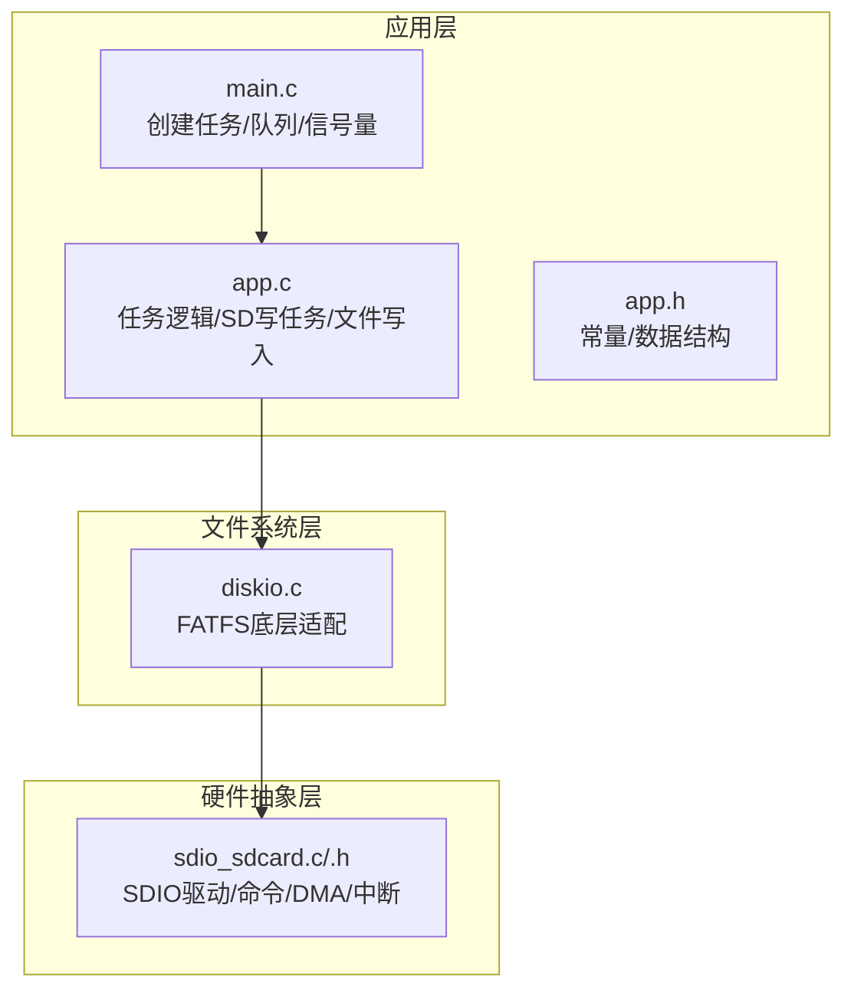
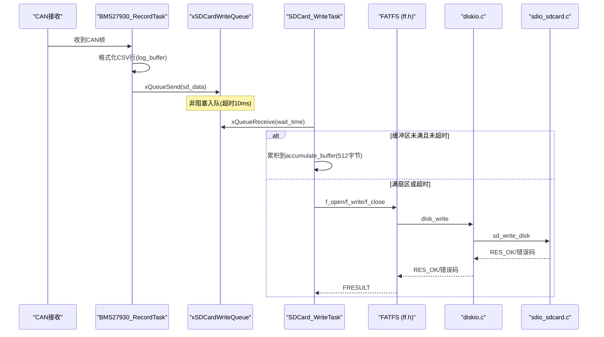
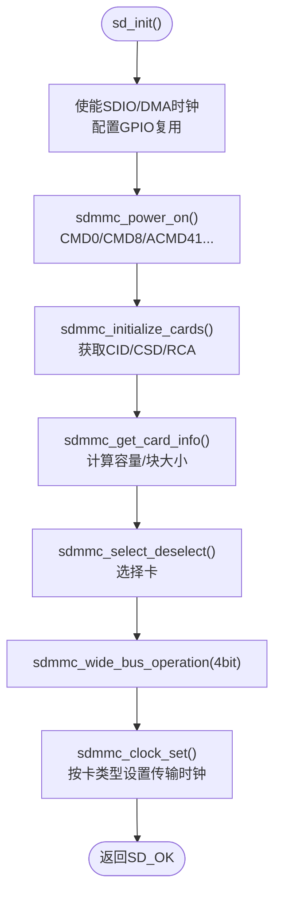
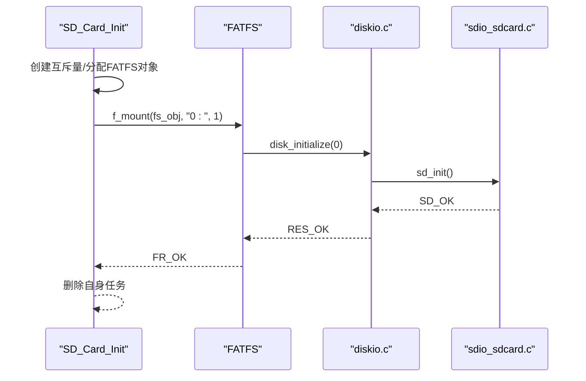
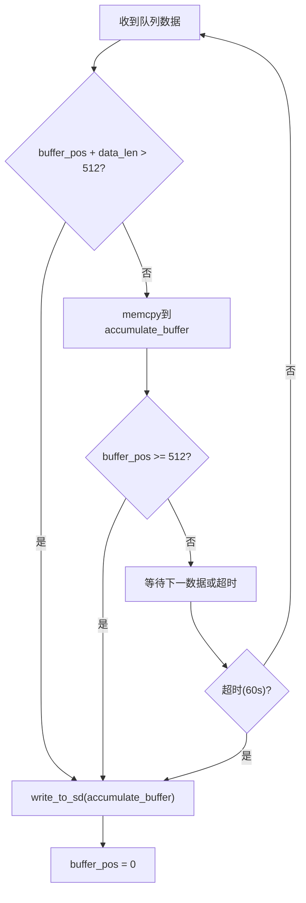
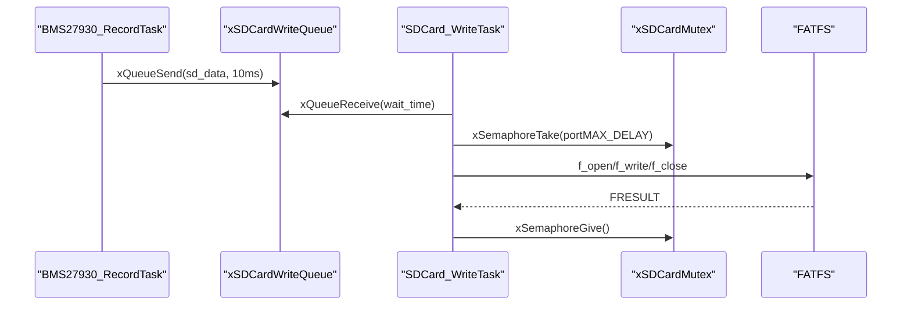

# 数据存储管理系统

<cite>
**本文引用的文件**   
- [main.c](file://_gbk_backup\User\main.c)
- [app.c](file://_gbk_backup\User\app.c)
- [app.h](file://_gbk_backup\User\app.h)
- [sdio_sdcard.c](file://_gbk_backup\Driver\BSP\sdio_sdcard.c)
- [sdio_sdcard.h](file://_gbk_backup\Driver\BSP\sdio_sdcard.h)
- [diskio.c](file://_gbk_backup\Middle\FATFS\diskio.c)
</cite>

## 目录
1. [简介](#简介)
2. [项目结构](#项目结构)
3. [核心组件](#核心组件)
4. [架构总览](#架构总览)
5. [详细组件分析](#详细组件分析)
6. [依赖关系分析](#依赖关系分析)
7. [性能与优化](#性能与优化)
8. [故障处理与数据完整性](#故障处理与数据完整性)
9. [结论](#结论)
10. [附录：命名、格式与管理策略](#附录命名格式与管理策略)

## 简介
本文件系统面向STM32F4平台，基于FreeRTOS实现异步、非阻塞的SD卡日志记录。系统通过SDIO接口驱动SD卡，使用FATFS进行文件系统管理，采用队列+互斥量的机制完成CAN数据的采集、格式化与落盘。文档重点说明：
- SD卡驱动初始化与检测流程（SDIO时钟、总线宽度、命令序列）
- FATFS挂载、目录与文件操作API的使用方式
- 扇区级缓冲（512字节）与批量写入优化
- FreeRTOS队列实现的异步写入机制
- 文件命名规则、数据格式定义与存储空间管理策略
- SD卡故障处理、数据完整性检查与性能优化建议

## 项目结构
本项目在工程配置中包含了FATFS中间件与底层SDIO驱动，应用层任务负责数据采集、缓存与落盘。关键路径如下：
- 用户应用：User/main.c、User/app.c、User/app.h
- 底层驱动：Driver/BSP/sdio_sdcard.c、Driver/BSP/sdio_sdcard.h
- FATFS适配：Middle/FATFS/diskio.c

图表来源
- [main.c:23-31](file://_gbk_backup\User\main.c#L23-L31)
- [app.c:311-366](file://_gbk_backup\User\app.c#L311-L366)
- [app.h:4-10](file://_gbk_backup\User\app.h#L4-L10)
- [diskio.c:38-49](file://_gbk_backup\Middle\FATFS\diskio.c#L38-L49)
- [sdio_sdcard.c:141-224](file://_gbk_backup\Driver\BSP\sdio_sdcard.c#L141-L224)

章节来源
- [main.c:23-31](file://_gbk_backup\User\main.c#L23-L31)
- [app.c:311-366](file://_gbk_backup\User\app.c#L311-L366)
- [app.h:4-10](file://_gbk_backup\User\app.h#L4-L10)
- [diskio.c:38-49](file://_gbk_backup\Middle\FATFS\diskio.c#L38-L49)
- [sdio_sdcard.c:141-224](file://_gbk_backup\Driver\BSP\sdio_sdcard.c#L141-L224)

## 核心组件
- SDIO驱动层：提供SD卡上电、识别、初始化、读写块、状态查询等能力，并通过DMA与中断提升吞吐与实时性。
- FATFS适配层：将底层sd_read_disk/sd_write_disk映射到FATFS的disk_read/disk_write接口，并暴露扇区大小、块大小、容量等信息。
- 应用层任务：
  - BMS27930_RecordTask：接收CAN帧，解析或透传，生成CSV文本行，入队。
  - SDCard_WriteTask：从队列取数据，按512字节扇区累积，定时或满扇区触发写入。
  - SD_Card_Init：创建互斥量，分配FATFS对象，挂载驱动器“0:”。
  - write_to_sd：以日期为文件名追加写入CSV。

章节来源
- [sdio_sdcard.c:141-224](file://_gbk_backup\Driver\BSP\sdio_sdcard.c#L141-L224)
- [diskio.c:38-146](file://_gbk_backup\Middle\FATFS\diskio.c#L38-L146)
- [app.c:200-366](file://_gbk_backup\User\app.c#L200-L366)
- [app.c:414-450](file://_gbk_backup\User\app.c#L414-L450)

## 架构总览
下图展示从CAN数据到SD卡文件的完整调用链，包括FreeRTOS队列、互斥量保护与FATFS文件API。

图表来源
- [app.c:200-366](file://_gbk_backup\User\app.c#L200-L366)
- [diskio.c:81-99](file://_gbk_backup\Middle\FATFS\diskio.c#L81-L99)
- [sdio_sdcard.c:747-870](file://_gbk_backup\Driver\BSP\sdio_sdcard.c#L747-L870)

## 详细组件分析

### SD卡驱动初始化与检测（SDIO）
- 时钟与GPIO：使能SDIO与DMA2时钟，配置PC/ PD引脚复用为SDIO，设置初始分频（约400kHz），识别后根据卡类型调整传输时钟。
- 上电与识别：执行CMD0/CMD8/ACMD41等命令序列，判断SD2.0/SD1.1/MMC，读取CID/CSD，计算容量与块大小。
- 总线宽度：尝试启用4位宽模式以提升带宽。
- DMA与中断：配置DMA2 Stream3用于数据传输，SDIO中断处理多块读写的停止命令与错误标志，使用二进制信号量同步传输完成。

图表来源
- [sdio_sdcard.c:141-224](file://_gbk_backup\Driver\BSP\sdio_sdcard.c#L141-L224)
- [sdio_sdcard.c:287-387](file://_gbk_backup\Driver\BSP\sdio_sdcard.c#L287-L387)
- [sdio_sdcard.c:392-449](file://_gbk_backup\Driver\BSP\sdio_sdcard.c#L392-L449)
- [sdio_sdcard.c:456-578](file://_gbk_backup\Driver\BSP\sdio_sdcard.c#L456-L578)
- [sdio_sdcard.c:588-633](file://_gbk_backup\Driver\BSP\sdio_sdcard.c#L588-L633)

章节来源
- [sdio_sdcard.c:141-224](file://_gbk_backup\Driver\BSP\sdio_sdcard.c#L141-L224)
- [sdio_sdcard.c:287-387](file://_gbk_backup\Driver\BSP\sdio_sdcard.c#L287-L387)
- [sdio_sdcard.c:392-449](file://_gbk_backup\Driver\BSP\sdio_sdcard.c#L392-L449)
- [sdio_sdcard.c:456-578](file://_gbk_backup\Driver\BSP\sdio_sdcard.c#L456-L578)
- [sdio_sdcard.c:588-633](file://_gbk_backup\Driver\BSP\sdio_sdcard.c#L588-L633)

### FATFS集成与文件系统挂载
- 适配层：diskio.c将物理驱动器号0映射到SD卡，实现disk_initialize/disk_read/disk_write/disk_ioctl。
- 挂载流程：SD_Card_Init任务延迟启动，创建互斥量，分配FATFS对象，调用f_mount挂载驱动器“0:”，成功后删除自身任务。
- 目录与文件：write_to_sd根据RTC时间生成文件名“0:/BMS_log_YYYYMMDD.csv”，优先以追加模式打开，不存在则新建；写入完成后关闭文件句柄。

图表来源
- [app.c:414-450](file://_gbk_backup\User\app.c#L414-L450)
- [diskio.c:38-49](file://_gbk_backup\Middle\FATFS\diskio.c#L38-L49)
- [sdio_sdcard.c:141-224](file://_gbk_backup\Driver\BSP\sdio_sdcard.c#L141-L224)

章节来源
- [app.c:414-450](file://_gbk_backup\User\app.c#L414-L450)
- [diskio.c:38-49](file://_gbk_backup\Middle\FATFS\diskio.c#L38-L49)
- [sdio_sdcard.c:141-224](file://_gbk_backup\Driver\BSP\sdio_sdcard.c#L141-L224)

### 数据缓存策略与批量写入优化
- 扇区级缓冲：应用层维护accumulate_buffer（512字节），当新数据加入会溢出时先写入当前缓冲；达到512字节立即落盘。
- 超时刷新：若超过WRITE_TIMEOUT_MS（60秒）无新数据，也强制刷新缓冲，避免长时间驻留内存。
- 队列深度：xSDCardWriteQueue长度为3，防止生产者过快导致内存压力；队列满时打印警告。
- 批量写：FATFS层通过disk_write调用底层sd_write_blocks，支持单块/多块写，多块写前可设置块数量（CMD23）以减少开销。

图表来源
- [app.c:311-366](file://_gbk_backup\User\app.c#L311-L366)
- [app.h:4-10](file://_gbk_backup\User\app.h#L4-L10)
- [sdio_sdcard.c:747-870](file://_gbk_backup\Driver\BSP\sdio_sdcard.c#L747-L870)

章节来源
- [app.c:311-366](file://_gbk_backup\User\app.c#L311-L366)
- [app.h:4-10](file://_gbk_backup\User\app.h#L4-L10)
- [sdio_sdcard.c:747-870](file://_gbk_backup\Driver\BSP\sdio_sdcard.c#L747-L870)

### 异步写入机制（FreeRTOS队列）
- 生产者：BMS27930_RecordTask解析或透传CAN帧，构造CSV行，调用xQueueSend入队，超时10ms丢弃以避免阻塞。
- 消费者：SDCard_WriteTask以动态超时等待队列，兼顾突发数据与空闲刷新。
- 互斥保护：所有FATFS文件操作被xSDCardMutex保护，确保多线程安全。

图表来源
- [app.c:200-366](file://_gbk_backup\User\app.c#L200-L366)
- [app.c:414-450](file://_gbk_backup\User\app.c#L414-L450)

章节来源
- [app.c:200-366](file://_gbk_backup\User\app.c#L200-L366)
- [app.c:414-450](file://_gbk_backup\User\app.c#L414-L450)

### 文件命名规则与数据格式
- 命名规则：文件名形如“0:/BMS_log_YYYYMMDD.csv”，由RTC日期生成；若RTC失败则回退默认名“0:/BMS_log_default.csv”。
- 数据格式：CSV每行包含时间戳、扩展ID、原始数据字节（空格分隔）、可选解析字段（类型、描述、解析信息）。相同报文仅记录原始数据，不同报文附加解析结果。

章节来源
- [app.c:35-71](file://_gbk_backup\User\app.c#L35-L71)
- [app.c:235-262](file://_gbk_backup\User\app.c#L235-L262)

### 存储空间管理策略
- 扇区大小：通过disk_ioctl的GET_SECTOR_SIZE返回512字节，FATFS据此组织文件簇。
- 块大小与容量：GET_BLOCK_SIZE返回g_sd_card_info.CardBlockSize，GET_SECTOR_COUNT返回CardCapacity/512，供FATFS统计与分配。
- 文件增长：以追加模式写入，避免频繁创建/删除文件；按日切分文件，便于管理与清理。

章节来源
- [diskio.c:107-146](file://_gbk_backup\Middle\FATFS\diskio.c#L107-L146)
- [sdio_sdcard.c:456-578](file://_gbk_backup\Driver\BSP\sdio_sdcard.c#L456-L578)

## 依赖关系分析
- 应用层依赖FreeRTOS队列/信号量与FATFS API。
- FATFS依赖diskio.c提供的底层接口。
- diskio.c依赖sdio_sdcard.c提供的sd_init/sd_read_disk/sd_write_disk。
- sdio_sdcard.c依赖HAL/寄存器访问、DMA与中断。

图表来源
- [app.c:1-21](file://_gbk_backup\User\app.c#L1-L21)
- [diskio.c:10-17](file://_gbk_backup\Middle\FATFS\diskio.c#L10-L17)
- [sdio_sdcard.h:331-337](file://_gbk_backup\Driver\BSP\sdio_sdcard.h#L331-L337)

章节来源
- [app.c:1-21](file://_gbk_backup\User\app.c#L1-L21)
- [diskio.c:10-17](file://_gbk_backup\Middle\FATFS\diskio.c#L10-L17)
- [sdio_sdcard.h:331-337](file://_gbk_backup\Driver\BSP\sdio_sdcard.h#L331-L337)

## 性能与优化
- 总线宽度：启用4位SDIO总线模式提升带宽。
- DMA与中断：使用DMA2 Stream3搬运数据，SDIO中断处理多块传输停止命令与错误标志，降低CPU占用。
- 批量写：多块写前发送CMD23指定块数，减少协议开销。
- 扇区对齐：FATFS按512字节扇区组织，应用层累积至512字节再写，减少碎片与写放大。
- 队列深度与超时：队列长度3与10ms超时平衡吞吐与丢包风险；60秒超时保证空闲刷新。

章节来源
- [sdio_sdcard.c:588-633](file://_gbk_backup\Driver\BSP\sdio_sdcard.c#L588-L633)
- [sdio_sdcard.c:747-870](file://_gbk_backup\Driver\BSP\sdio_sdcard.c#L747-L870)
- [app.c:311-366](file://_gbk_backup\User\app.c#L311-L366)

## 故障处理与数据完整性
- SDIO错误：中断中检测数据超时、CRC失败、FIFO溢出等，设置错误标志并通过信号量唤醒等待任务。
- 状态轮询：写操作后轮询卡状态（编程/接收），直到就绪。
- FATFS错误：f_open/f_write返回FRESULT，应用层打印错误码；文件操作受互斥量保护。
- 队列满：生产者侧打印警告，避免阻塞主流程。

章节来源
- [sdio_sdcard.c:1298-1345](file://_gbk_backup\Driver\BSP\sdio_sdcard.c#L1298-L1345)
- [sdio_sdcard.c:860-870](file://_gbk_backup\Driver\BSP\sdio_sdcard.c#L860-L870)
- [app.c:35-71](file://_gbk_backup\User\app.c#L35-L71)
- [app.c:264-268](file://_gbk_backup\User\app.c#L264-L268)

## 结论
本系统通过SDIO驱动+FATFS+FreeRTOS的组合，实现了高可靠、低耦合的数据存储方案。扇区级缓冲与批量写优化显著提升了写入效率；队列与互斥量确保了异步与非阻塞特性；按日命名的CSV文件便于后续分析与归档。建议在量产环境中增加文件系统健康检查与坏块管理，并引入日志轮转策略以控制存储空间增长。

## 附录：命名、格式与管理策略
- 文件命名：0:/BMS_log_YYYYMMDD.csv（日期来自RTC），失败时使用默认名。
- 数据格式：CSV行包含时间戳、扩展ID、原始数据字节串、可选解析字段。
- 存储策略：按日切分文件，追加写入；空闲超时刷新；扇区对齐；队列限流。

章节来源
- [app.c:35-71](file://_gbk_backup\User\app.c#L35-L71)
- [app.c:235-262](file://_gbk_backup\User\app.c#L235-L262)
- [app.c:311-366](file://_gbk_backup\User\app.c#L311-L366)