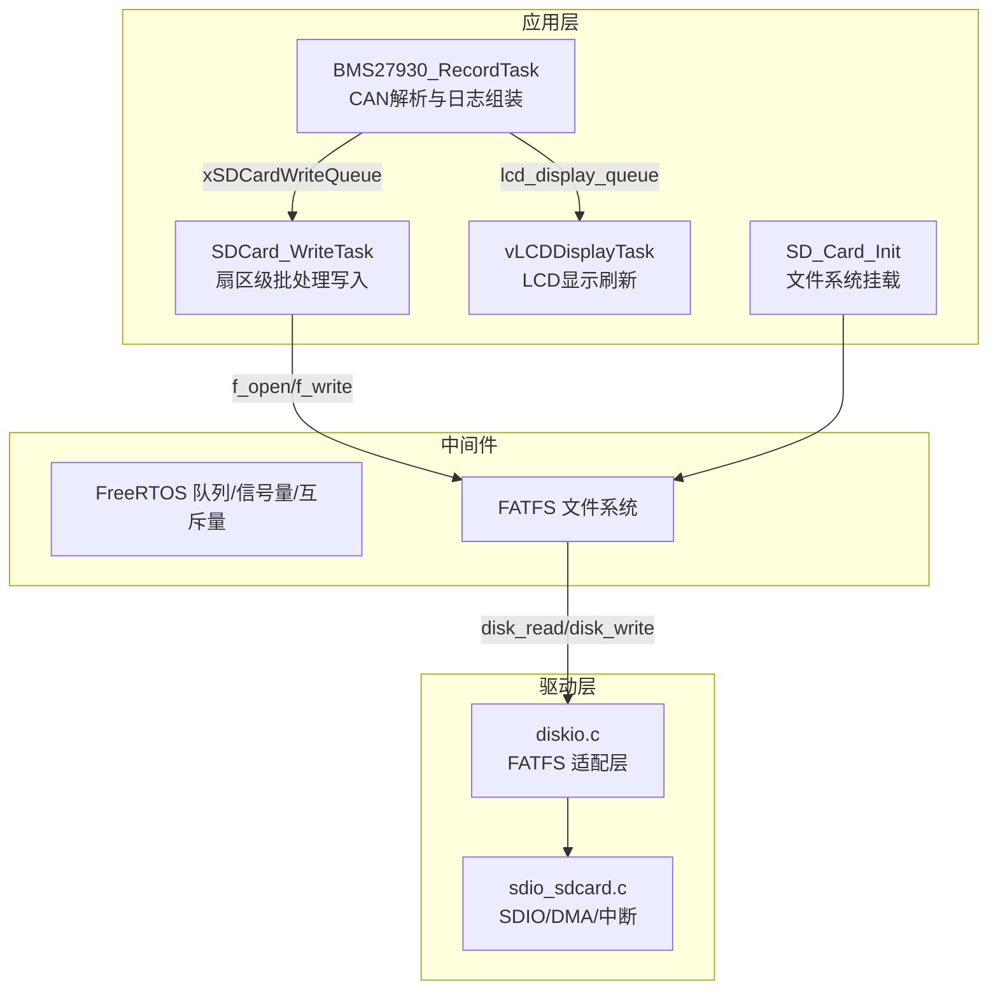
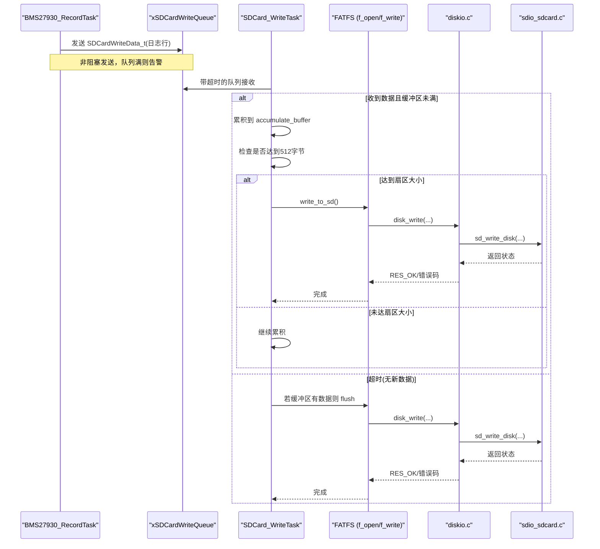
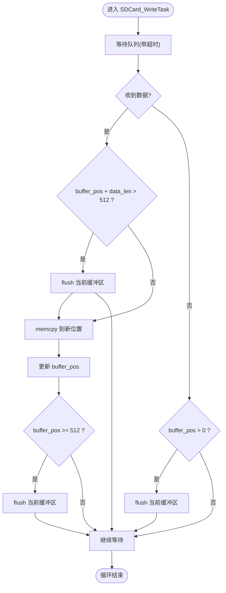
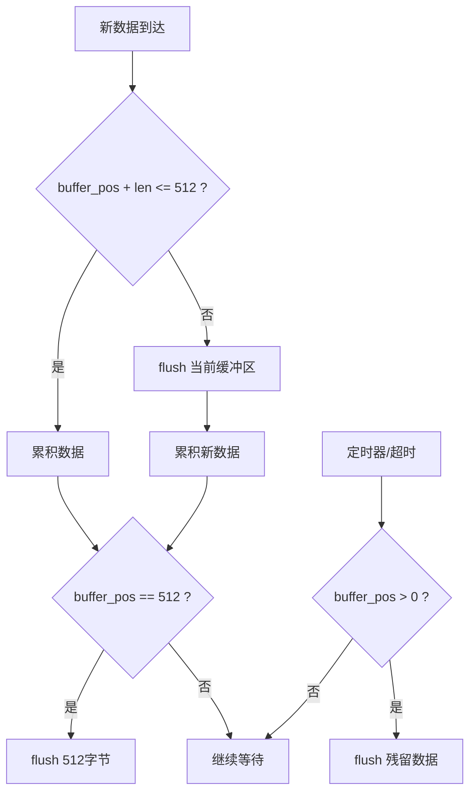
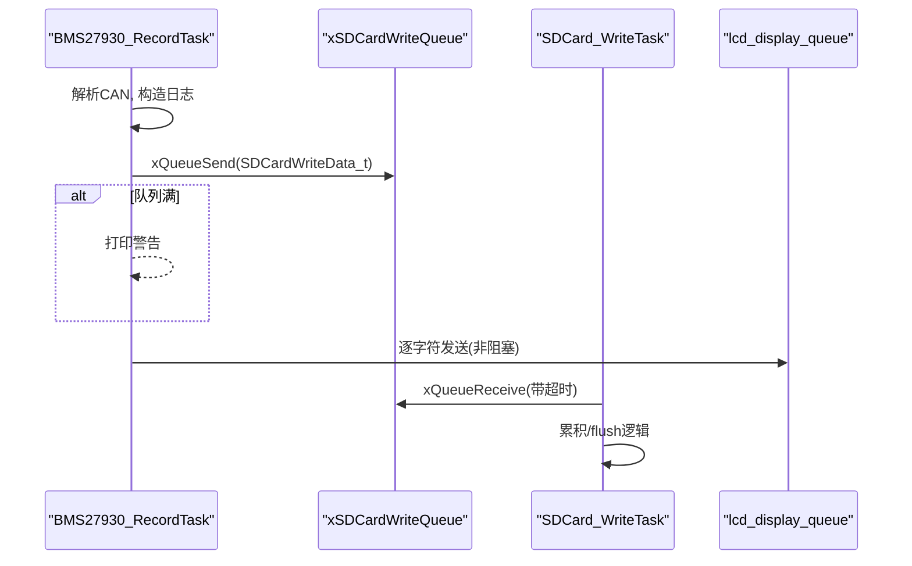
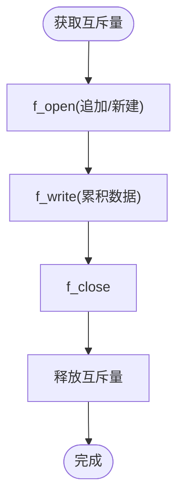
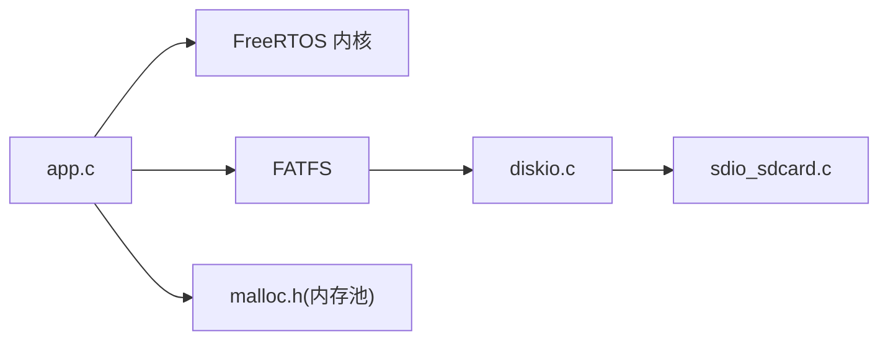

# 数据缓存管理

<cite>
**本文引用的文件**   
- [app.c](file://_gbk_backup/User/app.c)
- [app.h](file://_gbk_backup/User/app.h)
- [main.c](file://_gbk_backup/User/main.c)
- [sdio_sdcard.c](file://_gbk_backup/Driver/BSP/sdio_sdcard.c)
- [sdio_sdcard.h](file://_gbk_backup/Driver/BSP/sdio_sdcard.h)
- [diskio.c](file://_gbk_backup/Middle/FATFS/diskio.c)
- [malloc.h](file://_gbk_backup/Middle/MALLOC/malloc.h)
</cite>

## 目录
1. [引言](#引言)
2. [项目结构](#项目结构)
3. [核心组件](#核心组件)
4. [架构总览](#架构总览)
5. [详细组件分析](#详细组件分析)
6. [依赖关系分析](#依赖关系分析)
7. [性能与优化](#性能与优化)
8. [故障排查指南](#故障排查指南)
9. [结论](#结论)

## 引言
本技术文档围绕“数据缓存管理”展开，聚焦于扇区级缓冲机制、批量写入优化、基于 FreeRTOS 队列的异步写入、缓存一致性（刷新策略与脏标记）、内存管理优化以及性能监控指标。系统以 STM32F407 + FreeRTOS 为基础，通过 CAN 采集 BMS 数据，经任务间队列缓冲后，按 512 字节扇区对齐进行批量落盘，最终由 FATFS 驱动 SDIO/SD 卡完成持久化存储。

## 项目结构
本项目在应用层采用多任务协作：CAN 接收任务负责解析并格式化日志，SD 写任务负责将日志累积到 512 字节扇区后统一写入；显示任务从独立队列消费数据并以固定周期刷新 LCD；底层通过 FATFS 适配层对接 SDIO 驱动，使用 DMA 和中断实现高效传输。

图表来源
- [app.c:200-366](file://_gbk_backup/User/app.c#L200-L366)
- [app.c:452-521](file://_gbk_backup/User/app.c#L452-L521)
- [app.c:414-450](file://_gbk_backup/User/app.c#L414-L450)
- [diskio.c:38-98](file://_gbk_backup/Middle/FATFS/diskio.c#L38-L98)
- [sdio_sdcard.c:647-800](file://_gbk_backup/Driver/BSP/sdio_sdcard.c#L647-L800)

章节来源
- [app.c:200-366](file://_gbk_backup/User/app.c#L200-L366)
- [app.c:414-521](file://_gbk_backup/User/app.c#L414-L521)
- [diskio.c:38-98](file://_gbk_backup/Middle/FATFS/diskio.c#L38-L98)
- [sdio_sdcard.c:647-800](file://_gbk_backup/Driver/BSP/sdio_sdcard.c#L647-L800)

## 核心组件
- 扇区级缓冲与批量写入：SDCard_WriteTask 维护一个 512 字节的累积缓冲区，达到扇区大小或超时（默认 60 秒）即触发一次写入，避免频繁小写对 SD 卡的磨损。
- 异步写入机制：生产者（BMS27930_RecordTask）通过 FreeRTOS 队列 xSDCardWriteQueue 非阻塞发送待写数据；消费者（SDCard_WriteTask）在指定超时内等待队列，保证实时性与吞吐量的平衡。
- 缓存一致性：通过互斥量 xSDCardMutex 保护 f_open/f_write/f_close 序列，确保同一时刻仅一个任务访问文件系统对象，避免并发写导致的文件损坏。
- 内存管理：FIL 与 FATFS 对象通过自定义内存池 mymalloc/myfree 分配释放，降低碎片风险；队列项 SDCardWriteData_t 固定为 512 字节，便于对齐与预测内存占用。
- 性能监控：提供任务栈高水位打印、队列剩余空间检测等基础监控手段，便于评估系统负载与瓶颈。

章节来源
- [app.c:311-366](file://_gbk_backup/User/app.c#L311-L366)
- [app.c:34-71](file://_gbk_backup/User/app.c#L34-L71)
- [app.c:200-309](file://_gbk_backup/User/app.c#L200-L309)
- [app.c:73-91](file://_gbk_backup/User/app.c#L73-L91)
- [app.h:1-10](file://_gbk_backup/User/app.h#L1-L10)
- [malloc.h:34-79](file://_gbk_backup/Middle/MALLOC/malloc.h#L34-L79)

## 架构总览
下图展示了从 CAN 数据到 SD 卡落盘的完整调用链，包括 FreeRTOS 队列、FATFS 与 SDIO 驱动的交互。

图表来源
- [app.c:200-309](file://_gbk_backup/User/app.c#L200-L309)
- [app.c:311-366](file://_gbk_backup/User/app.c#L311-L366)
- [app.c:34-71](file://_gbk_backup/User/app.c#L34-L71)
- [diskio.c:81-98](file://_gbk_backup/Middle/FATFS/diskio.c#L81-L98)
- [sdio_sdcard.c:739-800](file://_gbk_backup/Driver/BSP/sdio_sdcard.c#L739-L800)

## 详细组件分析

### 扇区级别缓冲机制（512 字节）与数据对齐
- 扇区大小常量：SD_SECTOR_SIZE = 512，所有累积与写入均以该值为粒度。
- 累积策略：
  - 当新数据加入会导致 exceed 512 字节时，先 flush 当前累积缓冲区。
  - 每次成功累积后检查 buffer_pos >= 512，满足则立即 flush。
- 超时刷新：若 WRITE_TIMEOUT_MS（默认 60 秒）内无新数据，则 flush 当前缓冲区，防止数据长期滞留。
- 数据对齐：FATFS 通过 disk_ioctl 报告 GET_SECTOR_SIZE=512，底层 SDIO 驱动对大容量卡设置 blksize=512，确保上层写入与物理扇区对齐。

图表来源
- [app.c:311-366](file://_gbk_backup/User/app.c#L311-L366)
- [diskio.c:107-144](file://_gbk_backup/Middle/FATFS/diskio.c#L107-L144)
- [sdio_sdcard.c:647-737](file://_gbk_backup/Driver/BSP/sdio_sdcard.c#L647-L737)

章节来源
- [app.c:311-366](file://_gbk_backup/User/app.c#L311-L366)
- [app.h:1-10](file://_gbk_backup/User/app.h#L1-L10)
- [diskio.c:107-144](file://_gbk_backup/Middle/FATFS/diskio.c#L107-L144)
- [sdio_sdcard.c:647-737](file://_gbk_backup/Driver/BSP/sdio_sdcard.c#L647-L737)

### 批量写入优化算法（累积策略与触发条件）
- 触发条件一：累积缓冲区达到 512 字节，立即 flush。
- 触发条件二：WRITE_TIMEOUT_MS 内无新数据，flush 残留数据。
- 触发条件三：新数据导致溢出，先 flush 再累积，避免跨扇区写入。
- 优势：减少 f_open/f_write/f_close 次数，降低 SD 卡磨损，提高吞吐量。

图表来源
- [app.c:311-366](file://_gbk_backup/User/app.c#L311-L366)

章节来源
- [app.c:311-366](file://_gbk_backup/User/app.c#L311-L366)

### 异步写入机制（FreeRTOS 队列）
- 生产者：BMS27930_RecordTask 解析 CAN 报文后构造日志字符串，并通过 xQueueSend 发送到 xSDCardWriteQueue。
- 消费者：SDCard_WriteTask 使用 xQueueReceive 带超时等待，既保证低延迟又避免忙等。
- 队列深度：初始化为 3，避免过多积压导致内存压力；队列满时记录警告。
- 显示通道：同时向 lcd_display_queue 发送字符，用于实时显示。

图表来源
- [app.c:200-309](file://_gbk_backup/User/app.c#L200-L309)
- [app.c:311-366](file://_gbk_backup/User/app.c#L311-L366)
- [main.c:52-55](file://_gbk_backup/User/main.c#L52-L55)

章节来源
- [app.c:200-309](file://_gbk_backup/User/app.c#L200-L309)
- [app.c:311-366](file://_gbk_backup/User/app.c#L311-L366)
- [main.c:52-55](file://_gbk_backup/User/main.c#L52-L55)

### 缓存一致性保证（刷新策略与脏标记）
- 互斥保护：write_to_sd 中通过 xSemaphoreTake/Give(xSDCardMutex) 保护 f_open/f_write/f_close 序列，确保单任务访问文件系统对象。
- 刷新策略：
  - 显式 flush：达到扇区大小或溢出时立即 flush。
  - 隐式 flush：超时后 flush 残留数据。
- 脏标记：代码未引入显式脏标记位，但通过“缓冲区长度 > 0”作为隐式脏标志，决定是否 flush。
- 建议增强：可引入 dirty_flag 与 last_flush_tick，结合时间戳与变更计数，支持更精细的一致性控制与诊断。

图表来源
- [app.c:34-71](file://_gbk_backup/User/app.c#L34-L71)

章节来源
- [app.c:34-71](file://_gbk_backup/User/app.c#L34-L71)

### 内存管理优化（动态缓冲区与内存池）
- FIL 与 FATFS 对象：通过 mymalloc(myfree) 从内部 SRAM 池分配/释放，避免标准 malloc 的碎片问题。
- 队列项结构：SDCardWriteData_t 固定 512 字节，便于对齐与预测内存占用。
- 内存池配置：SRAMIN 池块大小为 32 字节，最大容量可配置，适合嵌入式场景。
- 建议：对高频分配的对象（如队列项）考虑静态分配或使用固定大小的内存池，进一步降低分配开销。

章节来源
- [app.c:311-366](file://_gbk_backup/User/app.c#L311-L366)
- [app.h:1-10](file://_gbk_backup/User/app.h#L1-L10)
- [malloc.h:34-79](file://_gbk_backup/Middle/MALLOC/malloc.h#L34-L79)

### 性能监控指标（命中率、延迟、吞吐量）
- 队列使用率：通过 uxQueueSpacesAvailable/uxQueueMessagesWaiting 监测 lcd_display_queue 的使用情况，超过阈值打印告警。
- 任务栈高水位：vTaskList 与 uxTaskGetStackHighWaterMark 输出各任务栈使用情况，辅助评估堆栈配置是否合理。
- 写入延迟：可通过在 BMS27930_RecordTask 与 SDCard_WriteTask 之间增加时间戳统计（例如记录 xTaskGetTickCount() 差值），计算端到端延迟分布。
- 吞吐量：统计单位时间内 flush 次数与累计字节数，计算平均写入速率（字节/秒）。
- 建议：引入轻量级计数器与环形缓冲区保存最近 N 次延迟样本，定期上报至串口/LCD。

章节来源
- [app.c:264-302](file://_gbk_backup/User/app.c#L264-L302)
- [app.c:73-91](file://_gbk_backup/User/app.c#L73-L91)

## 依赖关系分析
- 应用层依赖 FreeRTOS 队列/信号量/互斥量进行任务间通信与同步。
- FATFS 通过 diskio.c 适配层调用 sdio_sdcard.c 提供的底层读写接口。
- sdio_sdcard.c 使用 DMA 与中断提升传输效率，并通过信号量同步传输完成。
- 内存管理依赖自定义内存池，避免标准库分配带来的碎片与不确定性。

图表来源
- [app.c:200-366](file://_gbk_backup/User/app.c#L200-L366)
- [diskio.c:38-98](file://_gbk_backup/Middle/FATFS/diskio.c#L38-L98)
- [sdio_sdcard.c:647-800](file://_gbk_backup/Driver/BSP/sdio_sdcard.c#L647-L800)
- [malloc.h:34-79](file://_gbk_backup/Middle/MALLOC/malloc.h#L34-L79)

章节来源
- [app.c:200-366](file://_gbk_backup/User/app.c#L200-L366)
- [diskio.c:38-98](file://_gbk_backup/Middle/FATFS/diskio.c#L38-L98)
- [sdio_sdcard.c:647-800](file://_gbk_backup/Driver/BSP/sdio_sdcard.c#L647-L800)
- [malloc.h:34-79](file://_gbk_backup/Middle/MALLOC/malloc.h#L34-L79)

## 性能与优化
- 扇区对齐与批量写入：保持 512 字节对齐，减少小写放大，延长 SD 卡寿命。
- 队列深度调优：根据峰值数据率调整 xSDCardWriteQueue 深度，平衡延迟与内存占用。
- 超时参数调优：WRITE_TIMEOUT_MS 可根据业务需求调整，短间隔提升实时性，长间隔提升吞吐。
- DMA 与中断：底层 SDIO 驱动已启用 DMA 与中断，确保高吞吐与低 CPU 占用。
- 内存池：优先使用内部 SRAM 池，减少外部 SRAM 访问延迟；对热点对象考虑静态分配。
- 监控增强：建议在关键路径添加延迟采样与吞吐统计，形成闭环优化。

[本节为通用指导，不直接分析具体文件]

## 故障排查指南
- 队列满告警：检查生产者速度是否过快或消费者处理过慢；适当增大队列深度或优化 SDCard_WriteTask 逻辑。
- 写入失败：检查 f_open/f_write 返回值与错误码；确认 SD 卡挂载成功与互斥量正常释放。
- 数据丢失：确认超时刷新逻辑是否生效；必要时缩短 WRITE_TIMEOUT_MS。
- 内存不足：检查 mymalloc 分配是否成功；观察任务栈高水位，避免栈溢出。
- 传输超时：查看 sdio_sdcard.c 中的超时处理与错误标志；检查 DMA 与中断配置。

章节来源
- [app.c:264-309](file://_gbk_backup/User/app.c#L264-L309)
- [app.c:34-71](file://_gbk_backup/User/app.c#L34-L71)
- [sdio_sdcard.c:739-800](file://_gbk_backup/Driver/BSP/sdio_sdcard.c#L739-L800)

## 结论
本方案通过扇区级缓冲与批量写入显著降低了 SD 卡的小写放大与磨损，借助 FreeRTOS 队列实现了非阻塞的数据流控，配合互斥量保障文件系统访问的一致性。底层 SDIO 驱动利用 DMA 与中断提升传输效率，整体架构清晰、可扩展性强。建议后续引入更完善的性能监控与脏标记机制，进一步提升系统的可观测性与可靠性。

[本节为总结性内容，不直接分析具体文件]