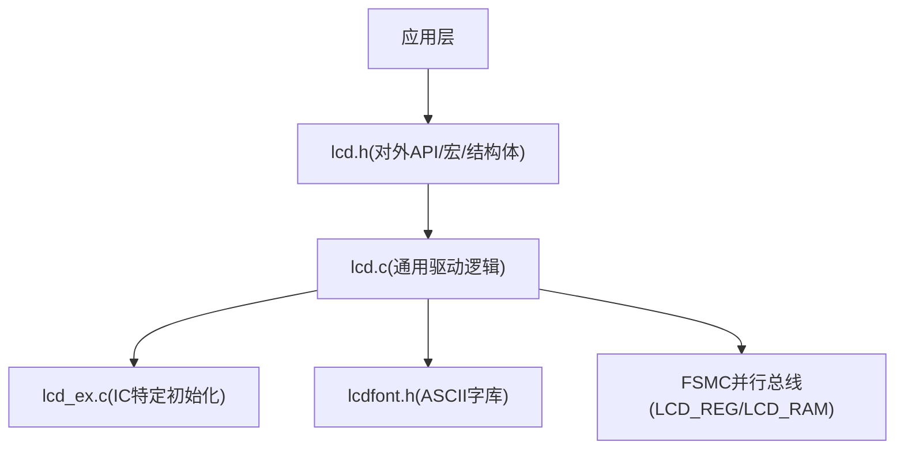
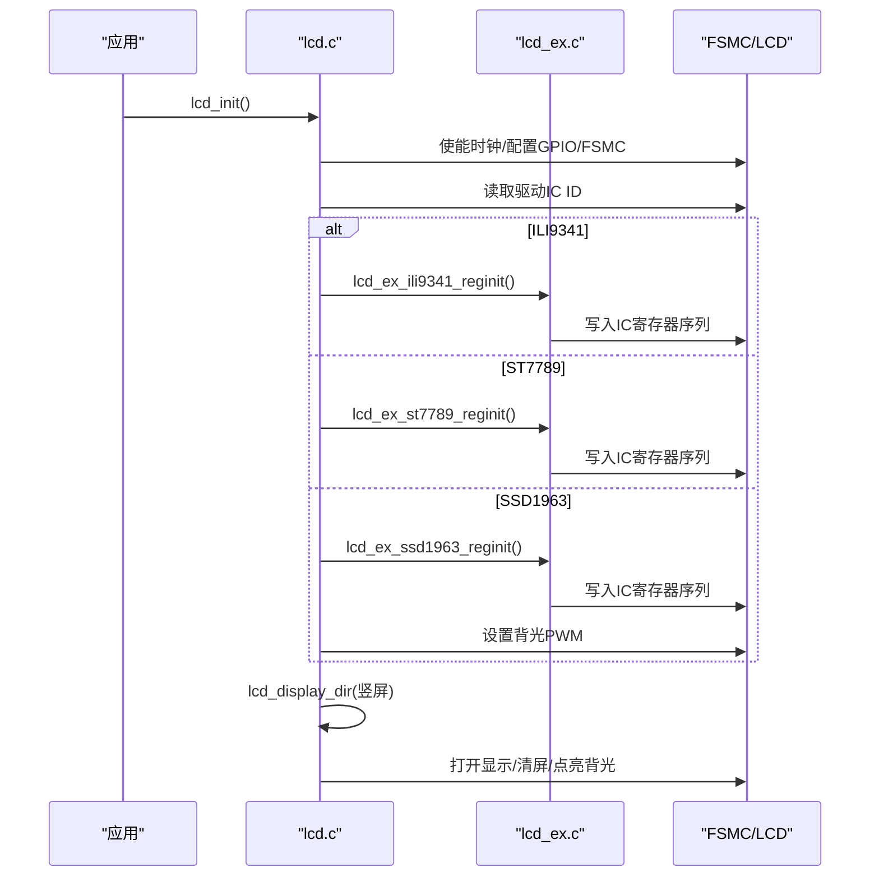
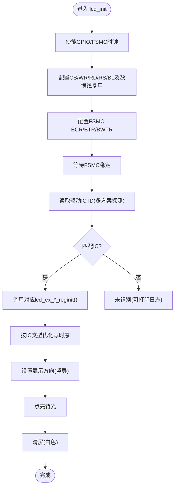
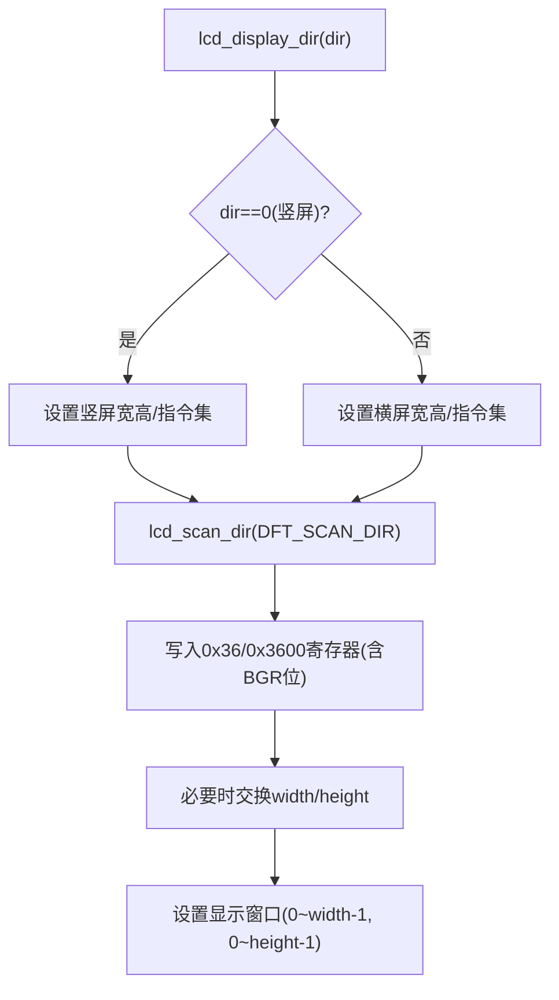
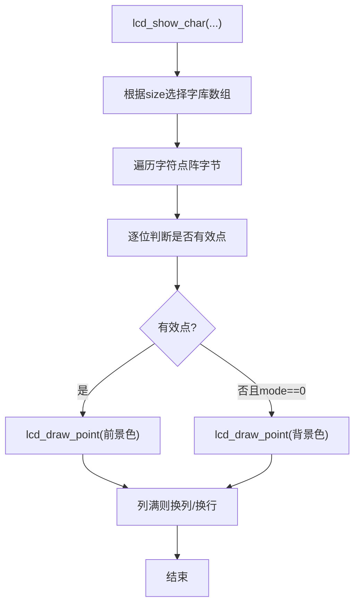
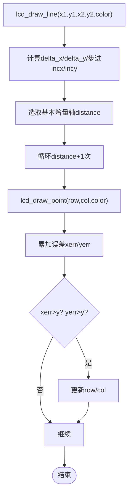
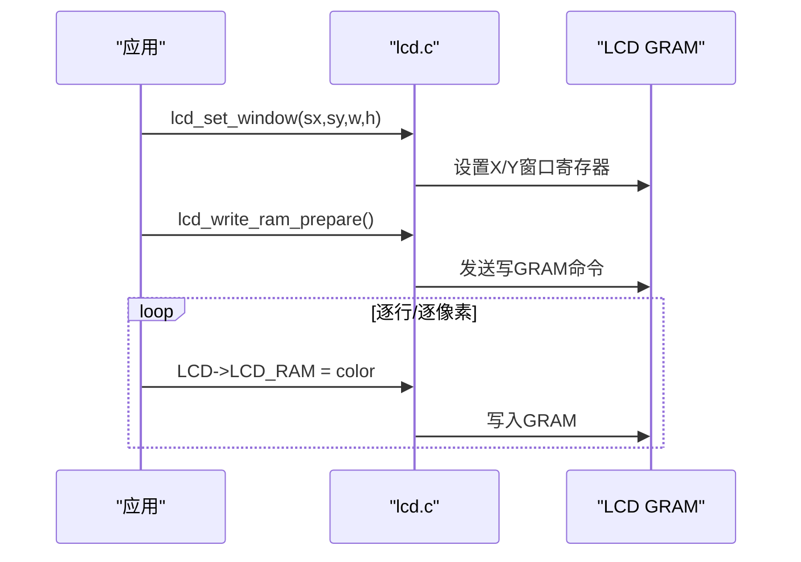
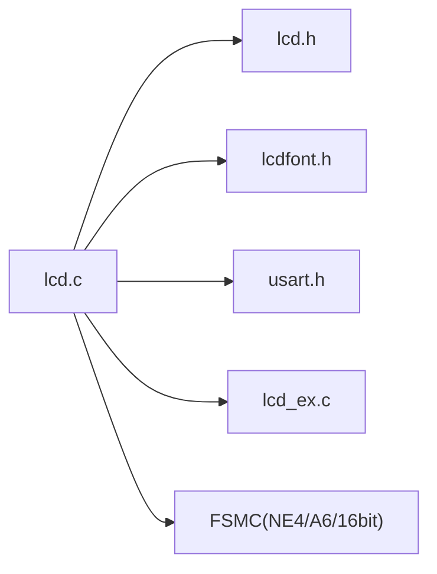

# LCD显示驱动

<cite>
**本文引用的文件**   
- [lcd.c](file://_gbk_backup/Driver/BSP/LCD/lcd.c)
- [lcd.h](file://_gbk_backup/Driver/BSP/LCD/lcd.h)
- [lcd_ex.c](file://_gbk_backup/Driver/BSP/LCD/lcd_ex.c)
- [lcdfont.h](file://_gbk_backup/Driver/BSP/LCD/lcdfont.h)
</cite>

## 目录
1. [简介](#简介)
2. [项目结构](#项目结构)
3. [核心组件](#核心组件)
4. [架构总览](#架构总览)
5. [详细组件分析](#详细组件分析)
6. [依赖关系分析](#依赖关系分析)
7. [性能与优化](#性能与优化)
8. [故障排查](#故障排查)
9. [结论](#结论)
10. [附录：API速查与示例](#附录api速查与示例)

## 简介
本技术文档面向STM32F407平台上的TFT-LCD显示驱动，覆盖以下关键主题：
- 控制器初始化流程（FSMC并行总线、GPIO复用、时序配置）
- 屏幕方向设置（横屏/竖屏切换）
- 字符显示（ASCII字体库、渲染算法）
- 图形绘制（点、线、矩形、圆）
- 缓冲区管理与刷新策略（GRAM直写、窗口化批量写入）
- 性能优化（部分刷新、批量操作、时序调优）
- API使用示例与常见问题解决方案

该驱动通过FSMC并行接口直接访问LCD控制器GRAM，支持多种常见驱动IC（如ILI9341、ST7789、NT35310、SSD1963、ST7796、NT35510、ILI9806等），并提供统一的绘图与文本API。

## 项目结构
本项目LCD相关代码位于BSP层，主要包含以下文件：
- lcd.h：对外API声明、宏定义、数据结构、FSMC地址映射
- lcd.c：通用驱动逻辑（初始化、方向、窗口、绘图、文本）
- lcd_ex.c：各驱动IC的寄存器初始化序列
- lcdfont.h：内置ASCII点阵字库（12×12、16×16、24×24、32×32）

图表来源
- [lcd.h:88-146](file://_gbk_backup/Driver/BSP/LCD/lcd.h#L88-L146)
- [lcd.c:593-857](file://_gbk_backup/Driver/BSP/LCD/lcd.c#L593-L857)
- [lcd_ex.c:35-230](file://_gbk_backup/Driver/BSP/LCD/lcd_ex.c#L35-L230)
- [lcdfont.h:27-453](file://_gbk_backup/Driver/BSP/LCD/lcdfont.h#L27-L453)

章节来源
- [lcd.h:88-146](file://_gbk_backup/Driver/BSP/LCD/lcd.h#L88-L146)
- [lcd.c:593-857](file://_gbk_backup/Driver/BSP/LCD/lcd.c#L593-L857)

## 核心组件
- 设备参数结构体_lcd_dev：维护宽度、高度、ID、扫描方向、GRAM写命令及坐标设置命令等
- FSMC地址映射：将LCD_REG和LCD_RAM映射到MCU地址空间，实现寄存器/数据快速读写
- 底层IO封装：lcd_wr_regno、lcd_write_reg、lcd_wr_data、lcd_rd_data
- 高级功能：清屏、区域填充、画线/矩形/圆、字符/数字/字符串显示、背光控制

章节来源
- [lcd.h:88-146](file://_gbk_backup/Driver/BSP/LCD/lcd.h#L88-L146)
- [lcd.c:55-105](file://_gbk_backup/Driver/BSP/LCD/lcd.c#L55-L105)

## 架构总览
驱动采用“通用逻辑 + IC特定初始化”的分层设计：
- 通用层（lcd.c）：处理FSMC初始化、ID识别、方向设置、窗口管理、绘图与文本API
- IC特定层（lcd_ex.c）：为不同驱动IC提供寄存器初始化序列
- 字库层（lcdfont.h）：提供ASCII点阵数据供文本渲染使用

图表来源
- [lcd.c:593-857](file://_gbk_backup/Driver/BSP/LCD/lcd.c#L593-L857)
- [lcd_ex.c:35-230](file://_gbk_backup/Driver/BSP/LCD/lcd_ex.c#L35-L230)

## 详细组件分析

### 1) 控制器初始化流程（FSMC并行总线）
- GPIO与时钟：使能LCD_CS/WR/RD/RS/BL引脚时钟，配置复用功能至FSMC；同时使能GPIOD/GPIOE的数据线复用
- FSMC配置：
  - 选择NE4作为片选，A6作为RS
  - 配置BCR/BTR/BWTR寄存器，设置异步模式、16位数据宽度、读写时序
- ID识别：按顺序尝试ILI9341、ST7789、NT35310、ST7796、NT35510、ILI9806、SSD1963
- IC初始化：根据ID调用对应lcd_ex_*_reginit()
- 时序优化：根据IC类型调整BWTR写时序以提升刷屏速度
- 默认状态：设置为竖屏、点亮背光、清屏为白色

图表来源
- [lcd.c:593-857](file://_gbk_backup/Driver/BSP/LCD/lcd.c#L593-L857)

章节来源
- [lcd.c:593-857](file://_gbk_backup/Driver/BSP/LCD/lcd.c#L593-L857)

### 2) 屏幕方向设置（横屏/竖屏）
- lcd_display_dir(dir)：
  - dir=0：竖屏；dir=1：横屏
  - 根据ID与方向更新width/height/wramcmd/setxcmd/setycmd
  - 调用lcd_scan_dir(DFT_SCAN_DIR)设置内部扫描方向
- lcd_scan_dir(dir)：
  - 根据目标方向计算并写入0x36/0x3600寄存器（不同IC略有差异）
  - 自动交换width/height以匹配物理方向
  - 设置显示窗口（开窗）范围

图表来源
- [lcd.c:441-521](file://_gbk_backup/Driver/BSP/LCD/lcd.c#L441-L521)
- [lcd.c:254-405](file://_gbk_backup/Driver/BSP/LCD/lcd.c#L254-L405)

章节来源
- [lcd.c:441-521](file://_gbk_backup/Driver/BSP/LCD/lcd.c#L441-L521)
- [lcd.c:254-405](file://_gbk_backup/Driver/BSP/LCD/lcd.c#L254-L405)

### 3) 字符显示函数（ASCII字体与渲染）
- 支持的字体大小：12/16/24/32，对应lcdfont.h中的asc2_1206/1608/2412/3216数组
- lcd_show_char(x,y,chr,size,mode,color)：
  - 根据size选择字库指针
  - 逐字节解析点阵，按列扫描像素，调用lcd_draw_point绘制
  - mode=0时非叠加（背景色填充），mode=1时叠加
- lcd_show_num / lcd_show_xnum：基于lcd_show_char格式化显示数字
- lcd_show_string：在指定区域内换行显示字符串

注意：当前字库仅包含ASCII字符集，不包含中文字符。如需中文显示，需扩展字库或引入外部中文字库（例如GB2312/GBK点阵或矢量字库）。

图表来源
- [lcd.c:1098-1161](file://_gbk_backup/Driver/BSP/LCD/lcd.c#L1098-L1161)
- [lcdfont.h:27-453](file://_gbk_backup/Driver/BSP/LCD/lcdfont.h#L27-L453)

章节来源
- [lcd.c:1098-1161](file://_gbk_backup/Driver/BSP/LCD/lcd.c#L1098-L1161)
- [lcdfont.h:27-453](file://_gbk_backup/Driver/BSP/LCD/lcdfont.h#L27-L453)

### 4) 图形绘制功能（点、线、矩形、圆）
- 点：lcd_draw_point(x,y,color) → 设置光标+写GRAM
- 水平线：lcd_draw_hline → 基于lcd_fill
- 线：lcd_draw_line → Bresenham直线算法
- 矩形：lcd_draw_rectangle → 四条边组合
- 圆：lcd_draw_circle → 中点圆算法（八分法）
- 实心圆：lcd_fill_circle → 基于水平线填充

图表来源
- [lcd.c:935-982](file://_gbk_backup/Driver/BSP/LCD/lcd.c#L935-L982)
- [lcd.c:1020-1051](file://_gbk_backup/Driver/BSP/LCD/lcd.c#L1020-L1051)
- [lcd.c:1060-1087](file://_gbk_backup/Driver/BSP/LCD/lcd.c#L1060-L1087)

章节来源
- [lcd.c:935-982](file://_gbk_backup/Driver/BSP/LCD/lcd.c#L935-L982)
- [lcd.c:1020-1051](file://_gbk_backup/Driver/BSP/LCD/lcd.c#L1020-L1051)
- [lcd.c:1060-1087](file://_gbk_backup/Driver/BSP/LCD/lcd.c#L1060-L1087)

### 5) 缓冲区管理与刷新策略
- 显存映射：通过FSMC将LCD_REG/LCD_RAM映射到MCU地址空间，直接写入GRAM
- 窗口化写入：
  - lcd_set_window(sx,sy,width,height)：设置X/Y窗口的起止坐标
  - lcd_write_ram_prepare()：发送写GRAM命令，随后连续写入像素数据
- 批量刷新：
  - lcd_fill/sx,sy,ex,ey,color：纯色区域填充
  - lcd_color_fill：按颜色数组进行彩色块填充
- 全刷：lcd_clear(color)：从(0,0)开始全屏写入

图表来源
- [lcd.c:531-584](file://_gbk_backup/Driver/BSP/LCD/lcd.c#L531-L584)
- [lcd.c:864-926](file://_gbk_backup/Driver/BSP/LCD/lcd.c#L864-L926)

章节来源
- [lcd.c:531-584](file://_gbk_backup/Driver/BSP/LCD/lcd.c#L531-L584)
- [lcd.c:864-926](file://_gbk_backup/Driver/BSP/LCD/lcd.c#L864-L926)

## 依赖关系分析
- lcd.c依赖：
  - lcd.h：宏定义、结构体、FSMC地址映射、API声明
  - lcdfont.h：ASCII字库数据
  - usart.h：调试输出（printf）
  - lcd_ex.c：IC特定初始化（通过include方式嵌入）
- 硬件依赖：
  - STM32F4 FSMC外设（NE4/A6/16位数据）
  - LCD CS/RS/WR/RD/BL引脚复用

图表来源
- [lcd.c:29-39](file://_gbk_backup/Driver/BSP/LCD/lcd.c#L29-L39)
- [lcd.h:88-146](file://_gbk_backup/Driver/BSP/LCD/lcd.h#L88-L146)

章节来源
- [lcd.c:29-39](file://_gbk_backup/Driver/BSP/LCD/lcd.c#L29-L39)
- [lcd.h:88-146](file://_gbk_backup/Driver/BSP/LCD/lcd.h#L88-L146)

## 性能与优化
- 写时序优化：
  - 针对ST7789/ILI9341/NT35510/SSD1963/ST7796/ILI9806等不同IC，在初始化后调整BWTR的ADDSET/DATAST以降低写周期
- 批量写入：
  - 优先使用lcd_fill/lcd_color_fill进行区域填充，减少多次lcd_set_cursor开销
  - 使用lcd_set_window配合连续GRAM写入，提高吞吐
- 部分刷新：
  - 通过lcd_set_window限制刷新区域，避免全屏刷新
- 字体渲染：
  - 对于频繁显示的静态文本，建议预渲染到缓冲区或使用更大的字体缓存
- 背光控制：
  - SSD1963可通过lcd_ssd_backlight_set(pwm)调节亮度，降低功耗

章节来源
- [lcd.c:829-852](file://_gbk_backup/Driver/BSP/LCD/lcd.c#L829-L852)
- [lcd.c:864-926](file://_gbk_backup/Driver/BSP/LCD/lcd.c#L864-L926)
- [lcd.c:421-434](file://_gbk_backup/Driver/BSP/LCD/lcd.c#L421-L434)

## 故障排查
- 无显示或花屏：
  - 检查FSMC地址映射是否正确（NE4/A6）
  - 确认GPIO复用配置与引脚一致
  - 核对IC ID识别结果与初始化序列是否匹配
- 颜色异常：
  - 某些IC需要设置BGR位（已在lcd_scan_dir中处理）
  - 检查颜色格式（16位RGB565 vs 32位兼容）
- 刷新缓慢：
  - 确认已执行BWTR时序优化
  - 尽量使用lcd_fill/lcd_color_fill批量写入
- 字符显示乱码：
  - 当前仅支持ASCII，若显示中文需扩展字库
  - 检查mode参数（叠加/非叠加）与背景色设置
- 背光不亮：
  - 检查LCD_BL引脚电平控制
  - SSD1963需额外设置背光PWM寄存器

章节来源
- [lcd.c:593-857](file://_gbk_backup/Driver/BSP/LCD/lcd.c#L593-L857)
- [lcd.c:1098-1161](file://_gbk_backup/Driver/BSP/LCD/lcd.c#L1098-L1161)
- [lcd.c:421-434](file://_gbk_backup/Driver/BSP/LCD/lcd.c#L421-L434)

## 结论
该LCD驱动通过FSMC并行总线高效访问GRAM，提供统一的初始化、方向设置、窗口管理、绘图与文本API，并针对不同驱动IC提供专用初始化序列。其设计兼顾了易用性与性能，适合在嵌入式项目中快速构建人机界面。对于中文显示需求，可在现有框架上扩展中文字库；对于高性能场景，应充分利用窗口化批量写入与写时序优化。

## 附录：API速查与示例

### 常用API
- 初始化与控制
  - lcd_init()
  - lcd_display_on()/lcd_display_off()
  - lcd_display_dir(dir)
  - lcd_ssd_backlight_set(pwm)
- 绘图
  - lcd_draw_point(x,y,color)
  - lcd_draw_line(x1,y1,x2,y2,color)
  - lcd_draw_hline(x,y,len,color)
  - lcd_draw_rectangle(x1,y1,x2,y2,color)
  - lcd_draw_circle(x0,y0,r,color)
  - lcd_fill_circle(x,y,r,color)
  - lcd_fill(sx,sy,ex,ey,color)
  - lcd_color_fill(sx,sy,ex,ey,*color)
  - lcd_clear(color)
- 文本
  - lcd_show_char(x,y,chr,size,mode,color)
  - lcd_show_num(x,y,num,len,size,color)
  - lcd_show_xnum(x,y,num,len,size,mode,color)
  - lcd_show_string(x,y,width,height,size,p,color)

### 使用示例（描述性）
- 初始化并清屏：
  - 调用lcd_init()
  - 调用lcd_display_dir(0)设置为竖屏
  - 调用lcd_clear(WHITE)
- 绘制红色横线：
  - 调用lcd_draw_hline(10,50,100,RED)
- 显示数字：
  - 调用lcd_show_num(10,10,12345,5,16,WHITE)
- 显示字符串：
  - 调用lcd_show_string(10,30,200,100,16,"Hello",BLUE)

章节来源
- [lcd.h:211-242](file://_gbk_backup/Driver/BSP/LCD/lcd.h#L211-L242)
- [lcd.c:864-1291](file://_gbk_backup/Driver/BSP/LCD/lcd.c#L864-L1291)