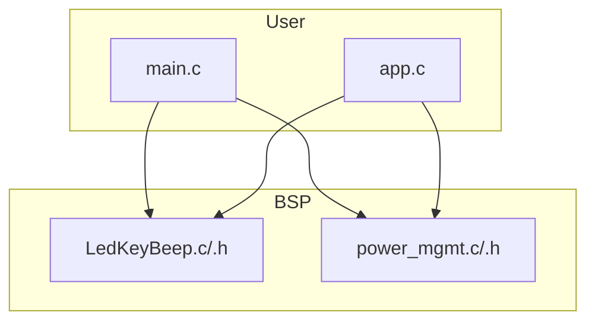
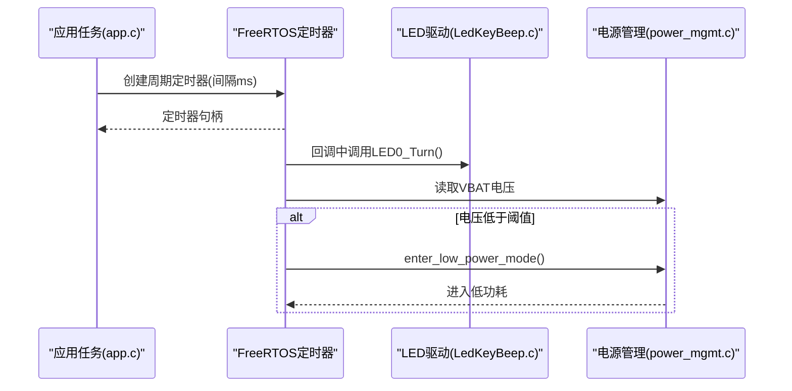
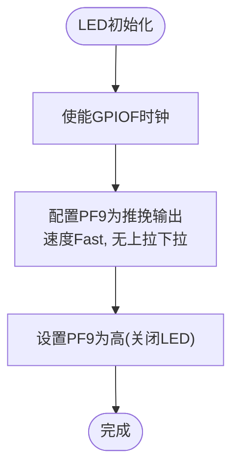
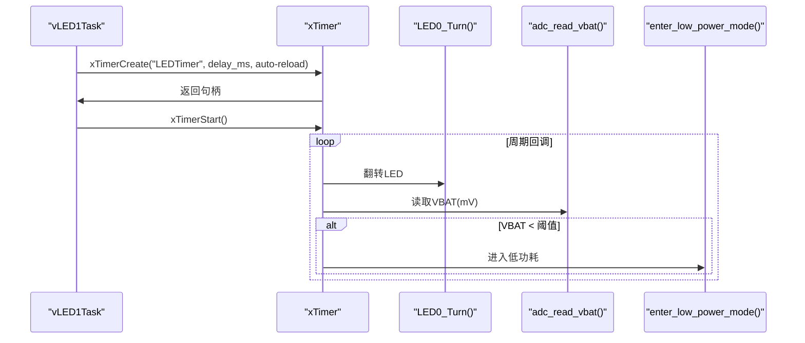
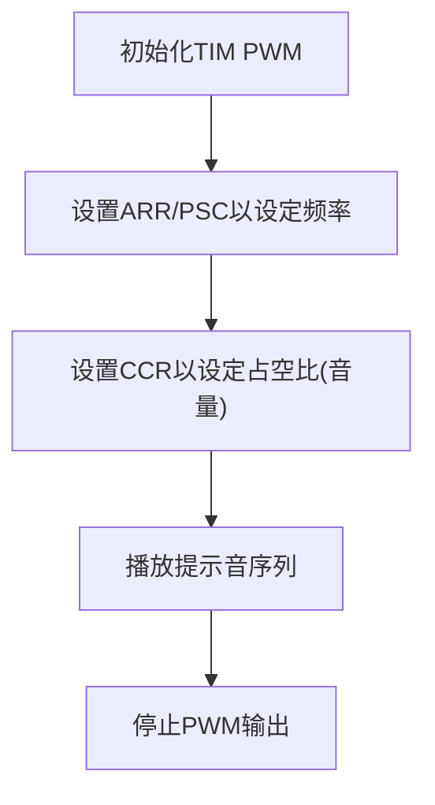
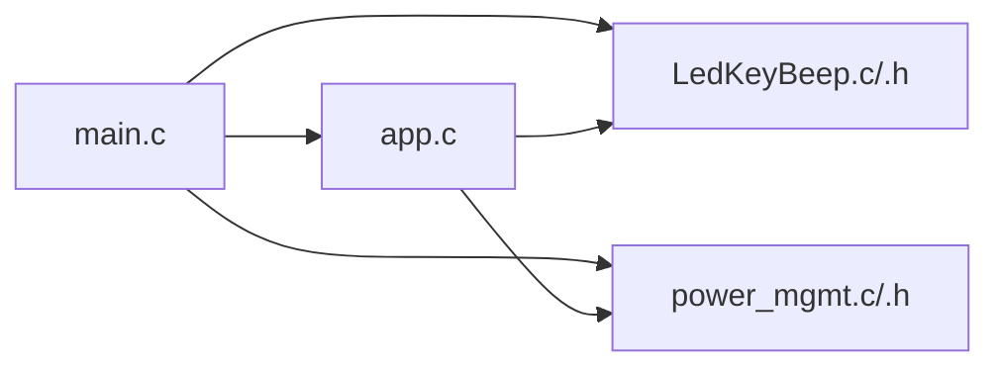

# LED指示器和蜂鸣器控制

<cite>
**本文引用的文件**   
- [LedKeyBeep.c](file://_gbk_backup/Driver/BSP/LedKeyBeep.c)
- [LedKeyBeep.h](file://_gbk_backup/Driver/BSP/LedKeyBeep.h)
- [main.c](file://_gbk_backup/User/main.c)
- [app.c](file://_gbk_backup/User/app.c)
- [power_mgmt.c](file://_gbk_backup/Driver/BSP/power_mgmt.c)
- [power_mgmt.h](file://_gbk_backup/Driver/BSP/power_mgmt.h)
</cite>

## 目录
1. [简介](#简介)
2. [项目结构](#项目结构)
3. [核心组件](#核心组件)
4. [架构总览](#架构总览)
5. [详细组件分析](#详细组件分析)
6. [依赖关系分析](#依赖关系分析)
7. [性能与资源管理](#性能与资源管理)
8. [故障排查指南](#故障排查指南)
9. [结论](#结论)
10. [附录：用户自定义指示模式配置](#附录用户自定义指示模式配置)

## 简介
本技术文档聚焦于LED指示器与蜂鸣器的硬件驱动与控制逻辑，覆盖以下方面：
- LED GPIO配置与控制接口（开关、翻转）
- 基于FreeRTOS软件定时器的LED闪烁模式
- 系统状态指示逻辑（电源、充电、错误）的扩展方案
- 蜂鸣器PWM驱动的规划与实现建议（频率与音量控制）
- 提示音设计与音效反馈策略
- LED与蜂鸣器的资源管理与互斥访问、优先级调度
- 用户自定义指示模式的配置方法

当前代码库中已实现LED基础GPIO控制与基于定时器的闪烁任务；蜂鸣器相关初始化被注释掉，未启用。本文在现有实现基础上给出可扩展的设计与最佳实践。

## 项目结构
与本主题相关的源文件分布如下：
- BSP层：LED/GPIO与按键驱动、电源管理（含VBAT ADC与低功耗）
- User层：FreeRTOS任务创建、LED闪烁定时器任务、按键扫描与处理
- 系统初始化：在main中完成外设初始化并启动FreeRTOS

图表来源
- [main.c:34-59](file://_gbk_backup/User/main.c#L34-L59)
- [app.c:25-31](file://_gbk_backup/User/app.c#L25-L31)
- [LedKeyBeep.c:6-42](file://_gbk_backup/Driver/BSP/LedKeyBeep.c#L6-L42)
- [power_mgmt.c:8-63](file://_gbk_backup/Driver/BSP/power_mgmt.c#L8-L63)

章节来源
- [main.c:34-59](file://_gbk_backup/User/main.c#L34-L59)
- [app.c:25-31](file://_gbk_backup/User/app.c#L25-L31)

## 核心组件
- LED GPIO驱动
  - 初始化：使能GPIOF时钟，配置PF9为推挽输出，默认高电平关闭LED
  - 控制接口：开灯、关灯、翻转
- 按键驱动与状态机
  - 支持单击、双击、长按检测，使用FreeRTOS延时周期轮询
- FreeRTOS LED闪烁任务
  - 通过xTimerCreate创建周期定时器，回调中翻转LED并读取VBAT电压
  - 低电量阈值触发进入低功耗模式
- 电源管理
  - VBAT通道ADC初始化与读取（单位mV）
  - 低电量时关闭LCD背光与显示，进入Standby模式

章节来源
- [LedKeyBeep.c:6-42](file://_gbk_backup/Driver/BSP/LedKeyBeep.c#L6-L42)
- [LedKeyBeep.h:6-32](file://_gbk_backup/Driver/BSP/LedKeyBeep.h#L6-L32)
- [app.c:154-198](file://_gbk_backup/User/app.c#L154-L198)
- [power_mgmt.c:8-63](file://_gbk_backup/Driver/BSP/power_mgmt.c#L8-L63)
- [power_mgmt.h:6-10](file://_gbk_backup/Driver/BSP/power_mgmt.h#L6-L10)

## 架构总览
下图展示从应用任务到BSP驱动的调用链路与数据流：

图表来源
- [app.c:154-198](file://_gbk_backup/User/app.c#L154-L198)
- [LedKeyBeep.c:6-42](file://_gbk_backup/Driver/BSP/LedKeyBeep.c#L6-L42)
- [power_mgmt.c:8-63](file://_gbk_backup/Driver/BSP/power_mgmt.c#L8-L63)

## 详细组件分析

### LED GPIO配置与控制接口
- 硬件引脚
  - PF9：红色LED，推挽输出，默认高电平关闭
- 初始化流程
  - 使能GPIOF时钟
  - 配置PF9为输出模式、推挽、无上下拉
  - 初始置高（LED关闭）
- 控制接口
  - 开灯：拉低PF9
  - 关灯：拉高PF9
  - 翻转：根据当前输出位取反

图表来源
- [LedKeyBeep.c:6-20](file://_gbk_backup/Driver/BSP/LedKeyBeep.c#L6-L20)

章节来源
- [LedKeyBeep.c:6-42](file://_gbk_backup/Driver/BSP/LedKeyBeep.c#L6-L42)

### 基于FreeRTOS的LED闪烁模式
- 任务与定时器
  - vLED1Task：接收delay_ms参数，创建周期定时器，回调中翻转LED
  - vLEDTimerCallback：翻转LED，读取VBAT，若低于阈值则进入低功耗
- 关键特性
  - 非阻塞：通过xTimerStart启动定时器
  - 自动重载：周期模式持续翻转
  - 低电量保护：达到阈值后进入低功耗

图表来源
- [app.c:154-198](file://_gbk_backup/User/app.c#L154-L198)
- [power_mgmt.c:8-63](file://_gbk_backup/Driver/BSP/power_mgmt.c#L8-L63)

章节来源
- [app.c:154-198](file://_gbk_backup/User/app.c#L154-L198)

### 系统状态指示逻辑（扩展方案）
当前代码仅实现周期性闪烁与低电量保护。可在此基础上扩展状态指示：
- 电源状态
  - 正常供电：慢闪（如500ms）
  - 电池供电：快闪（如200ms）
- 充电状态
  - 充电中：呼吸式渐变（需PWM或软件模拟）
  - 充满：常亮
- 错误状态
  - 严重错误：快速连续闪烁
  - 警告：间歇性短闪

为实现上述模式，建议在LED驱动层增加“模式”与“参数”抽象，由上层状态机统一调度。

[本节为概念性扩展说明，不直接分析具体文件]

### 蜂鸣器PWM驱动实现（规划与建议）
当前工程未启用蜂鸣器驱动（Beep_Init被注释）。建议采用STM32F4的TIM PWM通道进行驱动，实现频率与音量控制：
- 硬件选择
  - 选择一个通用定时器（如TIM3/TIM4）的一个通道作为PWM输出
  - 连接至有源蜂鸣器或经三极管/NPN驱动无源蜂鸣器
- 频率控制
  - 通过ARR/PSC配置定时器分频与周期，得到目标频率f = TIM_CLK / ((ARR+1)*(PSC+1))
- 音量调节
  - 通过CCR占空比控制平均功率，实现音量调节
- 提示音设计
  - 预定义音调序列（频率+时长），按节拍播放
  - 支持不同操作音效（确认、告警、提示）

[本节为概念性实现建议，不直接分析具体文件]

### 资源管理与互斥访问
- 互斥访问
  - LED与蜂鸣器均为短时IO操作，通常无需互斥量
  - 若引入共享缓冲区（如提示音队列），建议使用信号量或队列保护
- 优先级调度
  - LED闪烁任务优先级较低（示例中为1），避免抢占关键任务
  - 按键扫描与处理任务优先级适中（示例中为2），保证交互响应
  - 蜂鸣器播放任务可根据紧急程度提升优先级（如告警音）

章节来源
- [app.c:529-541](file://_gbk_backup/User/app.c#L529-L541)

## 依赖关系分析
- main.c
  - 初始化外设（USART、RTC、OLED、Key、LED、LCD、RS485、CAN等）
  - 创建队列与互斥量
  - 启动FreeRTOS调度
- app.c
  - 创建LED闪烁任务（定时器回调翻转LED）
  - 按键扫描与处理任务
  - LCD显示任务、SD卡写入任务等
- LedKeyBeep.c/.h
  - LED GPIO初始化与控制
  - 按键GPIO初始化与宏定义
- power_mgmt.c/.h
  - VBAT ADC初始化与读取
  - 低电量阈值与低功耗模式

图表来源
- [main.c:34-59](file://_gbk_backup/User/main.c#L34-L59)
- [app.c:529-541](file://_gbk_backup/User/app.c#L529-L541)
- [LedKeyBeep.c:6-42](file://_gbk_backup/Driver/BSP/LedKeyBeep.c#L6-L42)
- [power_mgmt.c:8-63](file://_gbk_backup/Driver/BSP/power_mgmt.c#L8-L63)

章节来源
- [main.c:34-59](file://_gbk_backup/User/main.c#L34-L59)
- [app.c:529-541](file://_gbk_backup/User/app.c#L529-L541)

## 性能与资源管理
- LED闪烁
  - 使用FreeRTOS定时器回调，CPU占用极低
  - 可通过调整delay_ms改变闪烁频率
- 低电量检测
  - 每次回调读取VBAT，注意ADC采样时间较长，可能影响实时性
  - 建议降低采样频率或在空闲任务中执行
- 低功耗模式
  - 关闭LCD背光与显示，进入Standby模式，功耗最低
  - 唤醒源：WKUP引脚或RTC中断

章节来源
- [app.c:154-198](file://_gbk_backup/User/app.c#L154-L198)
- [power_mgmt.c:65-81](file://_gbk_backup/Driver/BSP/power_mgmt.c#L65-L81)

## 故障排查指南
- LED不亮
  - 检查PF9是否配置为输出且初始为高（关闭）
  - 确认LED0_ON/LED0_OFF调用是否正确
- 闪烁异常
  - 检查定时器创建与启动是否成功
  - 确认回调函数中LED翻转逻辑
- 低电量未触发
  - 检查VBAT阈值定义与ADC读取值
  - 确认enter_low_power_mode是否被调用
- 蜂鸣器无声
  - 确认Beep_Init未被注释且PWM通道配置正确
  - 检查频率与占空比设置是否在有效范围

章节来源
- [LedKeyBeep.c:6-42](file://_gbk_backup/Driver/BSP/LedKeyBeep.c#L6-L42)
- [app.c:154-198](file://_gbk_backup/User/app.c#L154-L198)
- [power_mgmt.c:8-63](file://_gbk_backup/Driver/BSP/power_mgmt.c#L8-L63)

## 结论
本项目已实现LED的基础GPIO控制与基于FreeRTOS定时器的闪烁功能，并结合VBAT电压检测提供低电量保护与低功耗模式。蜂鸣器驱动尚未启用，但提供了清晰的扩展路径：通过TIM PWM实现频率与音量控制，结合预设音调序列实现多样化提示音。建议在BSP层抽象LED与蜂鸣器的控制接口，并在应用层通过状态机统一管理指示模式与音效反馈，确保资源互斥与优先级调度合理。

[本节为总结性内容，不直接分析具体文件]

## 附录：用户自定义指示模式配置
- 定义指示模式枚举
  - 例如：NORMAL_SLOW_BLINK、CHARGING_BREATH、ERROR_FAST_BLINK等
- 配置参数结构体
  - 包含闪烁周期、占空比（亮度）、持续时间、循环次数
- 调度器
  - 根据系统状态切换模式，更新定时器参数
- 蜂鸣器音效
  - 定义音效模板（频率序列、时长、重复次数）
  - 通过队列或事件触发播放，避免阻塞主流程

[本节为概念性配置指导，不直接分析具体文件]