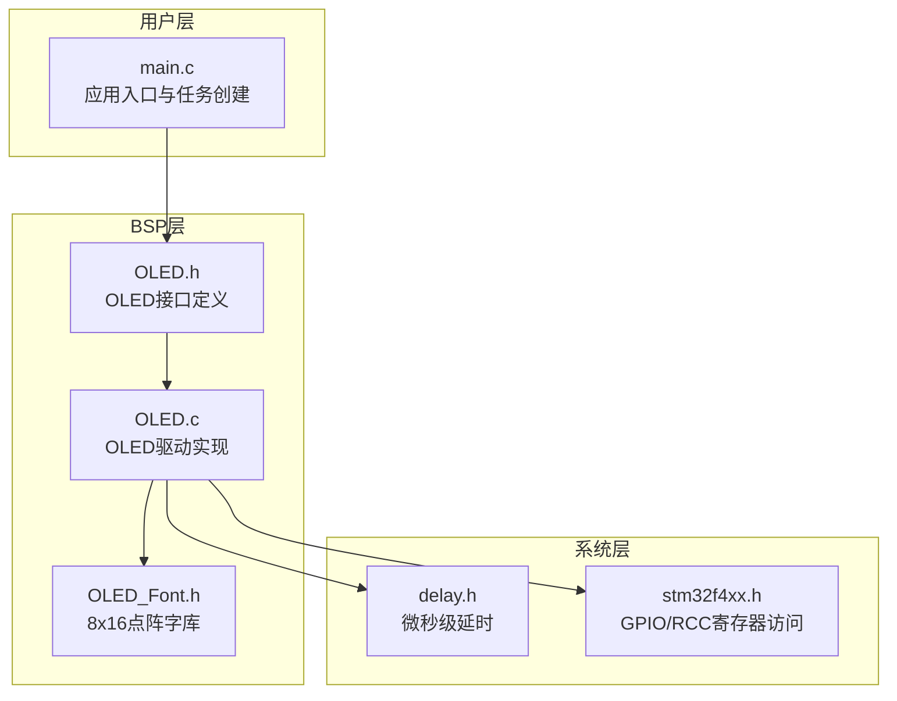
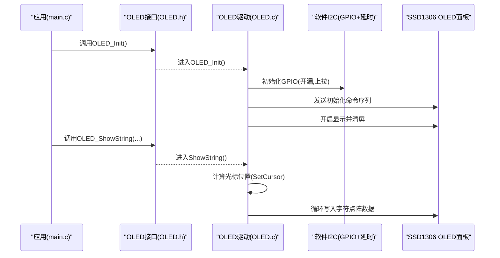
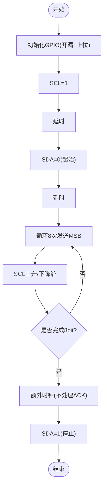
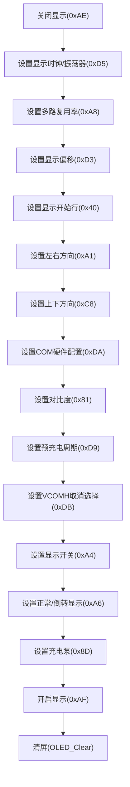
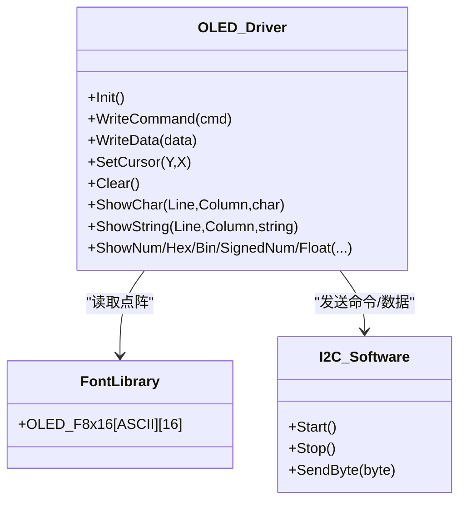
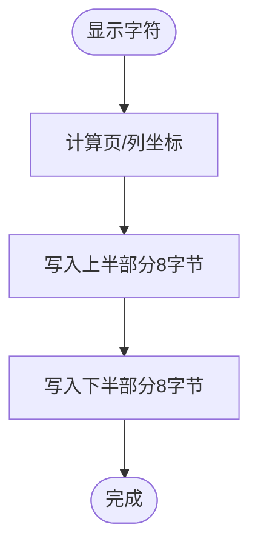
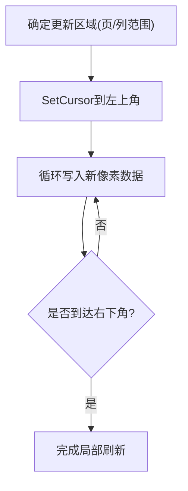
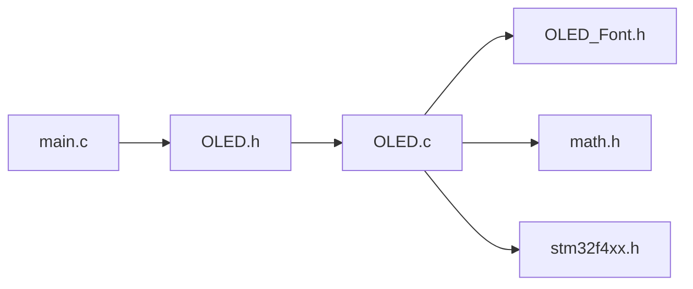

# OLED显示支持

<cite>
**本文引用的文件**   
- [OLED.c](file://_gbk_backup/Driver/BSP/OLED.c)
- [OLED.h](file://_gbk_backup/Driver/BSP/OLED.h)
- [OLED_Font.h](file://_gbk_backup/Driver/BSP/OLED_Font.h)
- [main.c](file://_gbk_backup/User/main.c)
</cite>

## 目录
1. [简介](#简介)
2. [项目结构](#项目结构)
3. [核心组件](#核心组件)
4. [架构总览](#架构总览)
5. [详细组件分析](#详细组件分析)
6. [依赖关系分析](#依赖关系分析)
7. [性能与功耗优化](#性能与功耗优化)
8. [故障排除指南](#故障排除指南)
9. [结论](#结论)

## 简介
本技术文档围绕项目中基于软件模拟I2C的0.96英寸单色OLED（SSD1306兼容）驱动实现，系统说明如下内容：
- I2C通信接口配置与数据传输协议
- SSD1306控制器初始化序列与显示参数设置
- 显示缓冲区管理机制、内存分配与像素数据映射
- 字符与图形显示函数实现及自定义字体使用方法
- 显示更新策略（全屏刷新与部分刷新优化）
- 性能调优方法与功耗优化技巧
- 具体代码示例路径与常见问题排查

## 项目结构
本项目采用分层组织方式：
- BSP层：提供底层外设驱动，包括OLED驱动、LCD驱动、RTC、CAN等
- 用户层：应用逻辑与任务调度（FreeRTOS）
- 中间件：延时、串口、内存管理等通用模块

图表来源
- [main.c:34-60](file://_gbk_backup/User/main.c#L34-L60)
- [OLED.h:1-18](file://_gbk_backup/Driver/BSP/OLED.h#L1-L18)
- [OLED.c:1-374](file://_gbk_backup/Driver/BSP/OLED.c#L1-L374)
- [OLED_Font.h:1-294](file://_gbk_backup/Driver/BSP/OLED_Font.h#L1-L294)

章节来源
- [main.c:34-60](file://_gbk_backup/User/main.c#L34-L60)
- [OLED.h:1-18](file://_gbk_backup/Driver/BSP/OLED.h#L1-L18)

## 核心组件
- I2C软件模拟层：通过GPIO开漏输出与延时实现起始、停止、字节发送
- 命令/数据写入封装：区分写命令与写数据帧
- 光标定位与清屏：按页/列寻址与批量清零
- 字符/数字/浮点数显示：基于8x16点阵字库逐行写入GRAM
- 控制器初始化：SSD1306寄存器配置序列

章节来源
- [OLED.c:10-115](file://_gbk_backup/Driver/BSP/OLED.c#L10-L115)
- [OLED.c:123-146](file://_gbk_backup/Driver/BSP/OLED.c#L123-L146)
- [OLED.c:155-317](file://_gbk_backup/Driver/BSP/OLED.c#L155-L317)
- [OLED.c:323-373](file://_gbk_backup/Driver/BSP/OLED.c#L323-L373)

## 架构总览
下图展示从应用调用到OLED面板的数据流与控制流。

图表来源
- [main.c:41-41](file://_gbk_backup/User/main.c#L41-L41)
- [OLED.h:9-17](file://_gbk_backup/Driver/BSP/OLED.h#L9-L17)
- [OLED.c:323-373](file://_gbk_backup/Driver/BSP/OLED.c#L323-L373)
- [OLED.c:155-184](file://_gbk_backup/Driver/BSP/OLED.c#L155-L184)

## 详细组件分析

### I2C通信接口配置与数据传输协议
- GPIO配置
  - 端口：GPIOD，引脚PD6(SCL)、PD7(SDA)
  - 模式：开漏输出，带上拉，速度50MHz
  - 时序：使用微秒级延时控制SCL高/低电平宽度，保证在约250kHz以内稳定工作
- 传输协议
  - 起始条件：SDA由高到低，SCL保持高
  - 停止条件：SCL高时SDA由低到高
  - 字节发送：MSB先行，每bit一个时钟周期；额外一时钟用于ACK（当前未处理ACK）
  - 写命令帧：地址0x78 + 控制位0x00 + 命令字节
  - 写数据帧：地址0x78 + 控制位0x40 + 数据字节

图表来源
- [OLED.c:10-33](file://_gbk_backup/Driver/BSP/OLED.c#L10-L33)
- [OLED.c:40-87](file://_gbk_backup/Driver/BSP/OLED.c#L40-L87)

章节来源
- [OLED.c:10-33](file://_gbk_backup/Driver/BSP/OLED.c#L10-L33)
- [OLED.c:40-87](file://_gbk_backup/Driver/BSP/OLED.c#L40-L87)
- [OLED.c:94-115](file://_gbk_backup/Driver/BSP/OLED.c#L94-L115)

### SSD1306控制器初始化序列与显示参数设置
初始化流程要点：
- 关闭显示
- 设置显示时钟分频比/振荡器频率
- 设置多路复用率（Mux Ratio）
- 设置显示偏移与显示开始行
- 设置左右方向（水平扫描方向）
- 设置上下方向（垂直扫描方向）
- 设置COM引脚硬件配置
- 设置对比度
- 设置预充电周期与VCOMH取消选择级别
- 设置显示模式（正常/反显）
- 开启电荷泵
- 开启显示
- 清屏

图表来源
- [OLED.c:323-373](file://_gbk_backup/Driver/BSP/OLED.c#L323-L373)

章节来源
- [OLED.c:323-373](file://_gbk_backup/Driver/BSP/OLED.c#L323-L373)

### 显示缓冲区管理与像素数据映射
- 无显式RAM缓冲：驱动直接通过I2C将像素数据写入SSD1306内部GRAM，未维护外部显示缓冲区
- 内存分配：不使用动态分配，所有数据为即时写入
- 像素映射
  - 屏幕分辨率：128×64
  - 分页模式：8页（Y=0~7），每页对应8行像素
  - 列寻址：X=0~127
  - 每个字节对应一列的一页像素（低位在下）
- 光标定位
  - 设置页：0xB0 | Y
  - 设置列高位：0x10 | (X >> 4)
  - 设置列低位：0x00 | (X & 0x0F)
- 清屏：遍历所有页和列写入0x00

图表来源
- [OLED.c:123-146](file://_gbk_backup/Driver/BSP/OLED.c#L123-L146)
- [OLED.c:155-184](file://_gbk_backup/Driver/BSP/OLED.c#L155-L184)
- [OLED_Font.h:1-294](file://_gbk_backup/Driver/BSP/OLED_Font.h#L1-L294)

章节来源
- [OLED.c:123-146](file://_gbk_backup/Driver/BSP/OLED.c#L123-L146)
- [OLED.c:155-184](file://_gbk_backup/Driver/BSP/OLED.c#L155-L184)
- [OLED_Font.h:1-294](file://_gbk_backup/Driver/BSP/OLED_Font.h#L1-L294)

### 字符与图形显示函数实现及自定义字体使用方法
- 字符显示
  - 输入：行号Line(1~4)，列号Column(1~16)，字符Char(ASCII可见字符)
  - 过程：根据Line/Column计算页/列坐标，分别写入上半部分与下半部分点阵
- 字符串显示
  - 逐个字符调用字符显示函数
- 数字显示
  - 十进制正数、带符号数、十六进制、二进制均通过分解数位后调用字符显示
- 浮点数显示
  - 处理负号、整数部分、小数点、小数部分位数控制
- 自定义字体
  - 使用OLED_F8x16二维数组，索引为ASCII码减去空格偏移，每字符16字节（两页）
  - 扩展方法：新增字符点阵数据并按ASCII顺序追加至数组

图表来源
- [OLED.c:155-168](file://_gbk_backup/Driver/BSP/OLED.c#L155-L168)
- [OLED.c:177-184](file://_gbk_backup/Driver/BSP/OLED.c#L177-L184)
- [OLED.c:208-317](file://_gbk_backup/Driver/BSP/OLED.c#L208-L317)
- [OLED_Font.h:1-294](file://_gbk_backup/Driver/BSP/OLED_Font.h#L1-L294)

章节来源
- [OLED.c:155-184](file://_gbk_backup/Driver/BSP/OLED.c#L155-L184)
- [OLED.c:208-317](file://_gbk_backup/Driver/BSP/OLED.c#L208-L317)
- [OLED_Font.h:1-294](file://_gbk_backup/Driver/BSP/OLED_Font.h#L1-L294)

### 显示更新策略：全屏刷新与部分刷新优化
- 全屏刷新
  - 使用OLED_Clear遍历全部页与列写入0x00
  - 适用于启动或需要整体重置的场景
- 部分刷新优化
  - 通过SetCursor精确定位目标区域，仅向该区域的GRAM写入必要数据
  - 建议：对频繁更新的数值或状态字段，只重绘其所在矩形区域，减少I2C传输量
  - 注意：由于当前未维护外部缓冲，局部更新需确保覆盖区域完整且不会遗留旧像素

图表来源
- [OLED.c:123-146](file://_gbk_backup/Driver/BSP/OLED.c#L123-L146)

章节来源
- [OLED.c:123-146](file://_gbk_backup/Driver/BSP/OLED.c#L123-L146)

## 依赖关系分析
- main.c
  - 包含OLED头文件并在初始化阶段调用OLED_Init
- OLED.h
  - 声明OLED公共接口，依赖delay_us与STM32 HAL类型
- OLED.c
  - 依赖OLED.h、OLED_Font.h、math.h
  - 依赖RCC/GPIO进行GPIO配置
- OLED_Font.h
  - 提供ASCII字符的点阵数据

图表来源
- [main.c:1-20](file://_gbk_backup/User/main.c#L1-L20)
- [OLED.h:1-18](file://_gbk_backup/Driver/BSP/OLED.h#L1-L18)
- [OLED.c:1-3](file://_gbk_backup/Driver/BSP/OLED.c#L1-L3)

章节来源
- [main.c:1-20](file://_gbk_backup/User/main.c#L1-L20)
- [OLED.h:1-18](file://_gbk_backup/Driver/BSP/OLED.h#L1-L18)
- [OLED.c:1-3](file://_gbk_backup/Driver/BSP/OLED.c#L1-L3)

## 性能与功耗优化
- 性能优化
  - 减少I2C传输次数：合并连续数据写入，避免频繁Start/Stop
  - 局部刷新：仅更新变化区域，降低总线负载
  - 调整对比度与预充电参数：在保证可视性的前提下降低刷新开销
  - 使用DMA或硬件I2C替代软件模拟：提高吞吐并释放CPU
- 功耗优化
  - 合理设置对比度与VCOMH：降低面板功耗
  - 关闭不必要的功能：如关闭显示（0xAE）在非活跃时段
  - 降低刷新频率：对静态信息降低更新间隔
  - 降低I2C速率：在稳定环境下适当降低速率以减少边沿损耗

章节来源
- [OLED.c:323-373](file://_gbk_backup/Driver/BSP/OLED.c#L323-L373)

## 故障排除指南
- 无法点亮或显示异常
  - 检查GPIO配置是否正确（开漏、上拉、端口与引脚）
  - 检查I2C时序延时是否满足要求（约250kHz以内）
  - 确认SSD1306初始化序列顺序与参数正确
- 显示乱码或错位
  - 检查列/页寻址是否正确（SetCursor）
  - 检查字符点阵索引是否越界（ASCII范围）
  - 检查显示方向设置（左右/上下方向）
- 刷新缓慢或卡顿
  - 评估I2C速率与软件模拟开销，考虑改用硬件I2C或DMA
  - 使用局部刷新减少数据量
- 功耗偏高
  - 调整对比度与预充电参数
  - 在非活跃时段关闭显示

章节来源
- [OLED.c:10-33](file://_gbk_backup/Driver/BSP/OLED.c#L10-L33)
- [OLED.c:40-87](file://_gbk_backup/Driver/BSP/OLED.c#L40-L87)
- [OLED.c:123-146](file://_gbk_backup/Driver/BSP/OLED.c#L123-L146)
- [OLED.c:323-373](file://_gbk_backup/Driver/BSP/OLED.c#L323-L373)

## 结论
本项目实现了基于软件I2C的SSD1306 OLED驱动，具备完整的初始化、字符/数字/浮点显示能力，并通过页/列寻址实现灵活的区域更新。当前实现未维护外部显示缓冲，适合轻量级嵌入式场景。为进一步优化性能与功耗，建议引入硬件I2C/DMA、局部刷新策略以及合理的电源管理。