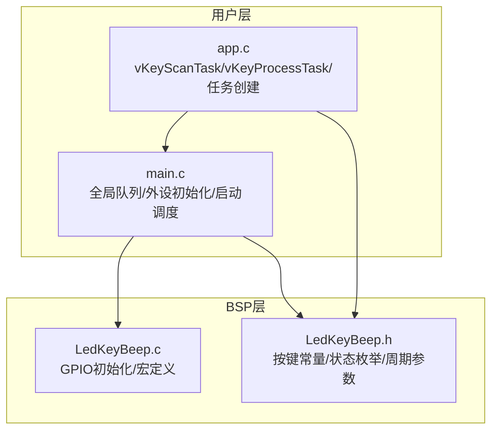
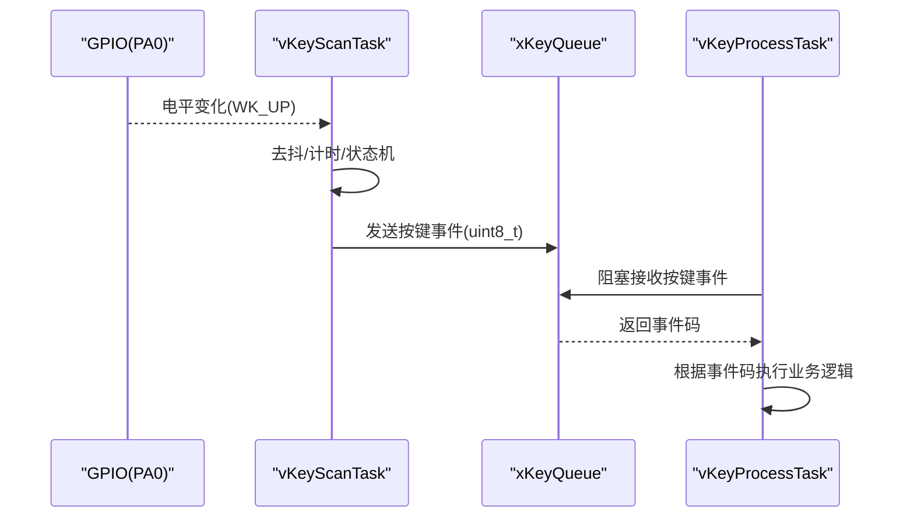
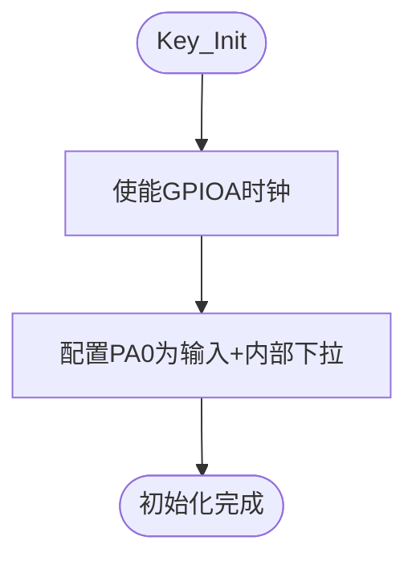
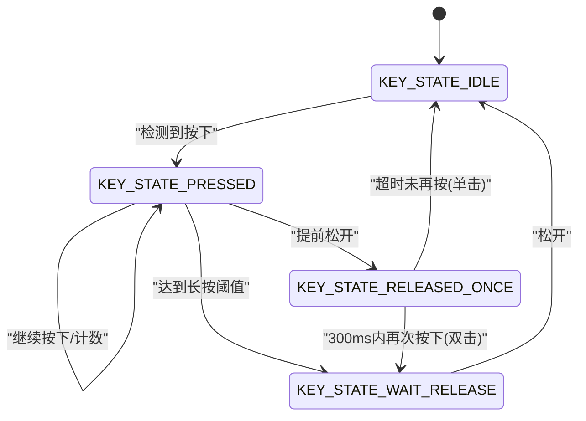
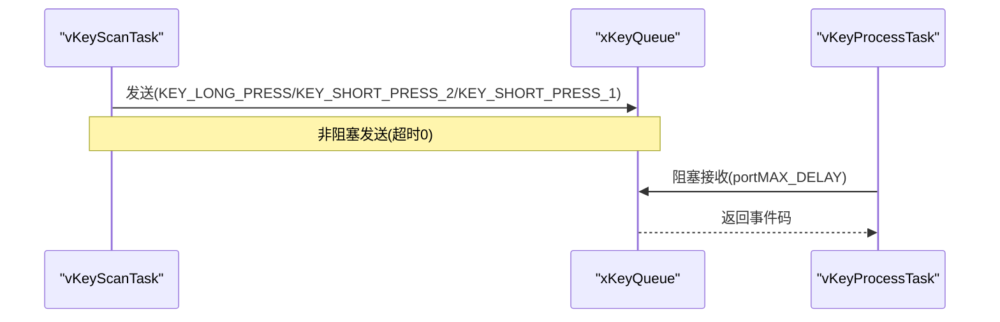
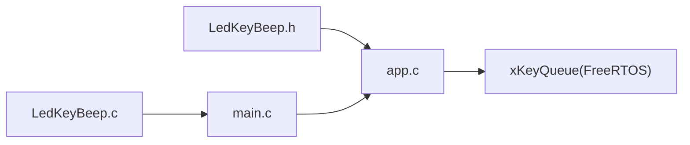

# 按键输入处理

<cite>
**本文引用的文件**   
- [LedKeyBeep.c](file://_gbk_backup/Driver/BSP/LedKeyBeep.c)
- [LedKeyBeep.h](file://_gbk_backup/Driver/BSP/LedKeyBeep.h)
- [app.c](file://_gbk_backup/User/app.c)
- [main.c](file://_gbk_backup/User/main.c)
</cite>

## 目录
1. [引言](#引言)
2. [项目结构](#项目结构)
3. [核心组件](#核心组件)
4. [架构总览](#架构总览)
5. [详细组件分析](#详细组件分析)
6. [依赖关系分析](#依赖关系分析)
7. [性能与资源考量](#性能与资源考量)
8. [故障排查指南](#故障排查指南)
9. [结论](#结论)
10. [附录：API与配置参考](#附录api与配置参考)

## 引言
本技术文档聚焦于STM32F407工程中的按键输入处理子系统，涵盖GPIO引脚配置、按键扫描算法、去抖机制、按键事件状态机（短按、长按、双击）、按键事件队列与任务间通信、多按键扩展思路与优先级策略、回调注册方式建议，以及测试与调试方法。该实现基于FreeRTOS，采用“扫描任务 + 处理任务”的解耦设计，通过队列传递按键事件，保证高内聚低耦合与可维护性。

## 项目结构
按键相关代码主要分布在BSP层与用户应用层：
- BSP层：LED/按键/蜂鸣器驱动封装，提供GPIO初始化与宏定义
- 用户层：按键扫描任务、按键处理任务、系统初始化与任务创建



图表来源
- [LedKeyBeep.c:1-74](file://_gbk_backup/Driver/BSP/LedKeyBeep.c#L1-L74)
- [LedKeyBeep.h:1-37](file://_gbk_backup/Driver/BSP/LedKeyBeep.h#L1-L37)
- [main.c:34-60](file://_gbk_backup/User/main.c#L34-L60)
- [app.c:93-152](file://_gbk_backup/User/app.c#L93-L152)

章节来源
- [LedKeyBeep.c:1-74](file://_gbk_backup/Driver/BSP/LedKeyBeep.c#L1-L74)
- [LedKeyBeep.h:1-37](file://_gbk_backup/Driver/BSP/LedKeyBeep.h#L1-L37)
- [main.c:34-60](file://_gbk_backup/User/main.c#L34-L60)
- [app.c:93-152](file://_gbk_backup/User/app.c#L93-L152)

## 核心组件
- GPIO按键初始化与读取宏
  - 按键引脚：PA0，内部下拉，高电平有效
  - 读取宏：WK_UP，用于扫描任务中直接判断电平
- 按键事件常量与状态机
  - 事件类型：单击、双击、长按
  - 状态：空闲、按下计时、松开等待双击、等待释放
- 扫描任务 vKeyScanTask
  - 周期性轮询（默认20ms），完成去抖与时间窗口判定
  - 将识别到的按键事件发送到全局队列 xKeyQueue
- 处理任务 vKeyProcessTask
  - 从队列接收按键事件，执行业务逻辑（如背光开关、打印任务栈等）
- 全局队列 xKeyQueue
  - 长度10，元素为uint8_t按键事件码
  - 由main.c创建，供扫描任务发送、处理任务接收

章节来源
- [LedKeyBeep.c:48-68](file://_gbk_backup/Driver/BSP/LedKeyBeep.c#L48-L68)
- [LedKeyBeep.h:6-21](file://_gbk_backup/Driver/BSP/LedKeyBeep.h#L6-L21)
- [app.c:93-152](file://_gbk_backup/User/app.c#L93-L152)
- [app.c:368-412](file://_gbk_backup/User/app.c#L368-L412)
- [main.c:52-55](file://_gbk_backup/User/main.c#L52-L55)

## 架构总览
按键子系统采用“硬件抽象 + 扫描任务 + 处理任务”的分层架构，关键数据流如下：
- main.c 初始化外设并创建全局队列 xKeyQueue
- LedKeyBeep.c/h 提供GPIO初始化与按键宏
- vKeyScanTask 周期性扫描WK_UP，进行去抖与时间窗口判定，产生事件并写入xKeyQueue
- vKeyProcessTask 从xKeyQueue取出事件，执行具体业务逻辑



图表来源
- [LedKeyBeep.c:48-68](file://_gbk_backup/Driver/BSP/LedKeyBeep.c#L48-L68)
- [app.c:93-152](file://_gbk_backup/User/app.c#L93-L152)
- [app.c:368-412](file://_gbk_backup/User/app.c#L368-L412)
- [main.c:52-55](file://_gbk_backup/User/main.c#L52-L55)

## 详细组件分析

### GPIO引脚配置与按键读取
- 引脚与模式
  - PA0配置为输入模式，内部下拉，高电平有效
  - 时钟使能GPIOA
- 读取宏
  - WK_UP宏直接读取PA0电平，便于在扫描任务中快速判断



图表来源
- [LedKeyBeep.c:48-68](file://_gbk_backup/Driver/BSP/LedKeyBeep.c#L48-L68)

章节来源
- [LedKeyBeep.c:48-68](file://_gbk_backup/Driver/BSP/LedKeyBeep.c#L48-L68)
- [LedKeyBeep.h:6-6](file://_gbk_backup/Driver/BSP/LedKeyBeep.h#L6-L6)

### 按键扫描算法与去抖机制
- 扫描周期
  - TASK_PERIOD_MS = 20ms，作为基础时间单位
- 去抖策略
  - 使用固定周期轮询，忽略抖动期间的瞬时电平跳变
  - 仅在连续多个周期保持同一电平时才认为状态稳定
- 时间窗口
  - 长按阈值：LONG_PRESS_TICKS = 800ms / 20ms = 40个周期
  - 双击间隔：DOUBLE_CLICK_TICKS = 300ms / 20ms = 15个周期

```mermaid
flowchart TD
S0["空闲(IDLE)"] --> |检测到按下| S1["已按下(PRESSED)<br/>tick_count=0"]
S1 --> |持续按下| S1
S1 --> |达到长按阈值| EVT_LONG["触发长按事件"]
EVT_LONG --> S3["等待释放(WAIT_RELEASE)"]
S1 --> |提前松开| S2["松开一次(RELEASED_ONCE)<br/>tick_count=0"]
S2 --> |再次按下(<=300ms)| EVT_DBL["触发双击事件"]
EVT_DBL --> S3
S2 --> |超时未再按| EVT_SGL["触发单击事件"]
EVT_SGL --> S0
S3 --> |松开| S0
```

图表来源
- [app.c:93-152](file://_gbk_backup/User/app.c#L93-L152)
- [LedKeyBeep.h:11-13](file://_gbk_backup/Driver/BSP/LedKeyBeep.h#L11-L13)

章节来源
- [app.c:93-152](file://_gbk_backup/User/app.c#L93-L152)
- [LedKeyBeep.h:11-13](file://_gbk_backup/Driver/BSP/LedKeyBeep.h#L11-L13)

### 按键事件状态机设计
- 状态定义
  - KEY_STATE_IDLE：等待按下
  - KEY_STATE_PRESSED：已按下，开始计时
  - KEY_STATE_RELEASED_ONCE：松开一次，等待是否双击
  - KEY_STATE_WAIT_RELEASE：长按或双击后进入，防止立即重入
- 事件输出
  - KEY_SHORT_PRESS_1：单击
  - KEY_SHORT_PRESS_2：双击
  - KEY_LONG_PRESS：长按



图表来源
- [LedKeyBeep.h:16-21](file://_gbk_backup/Driver/BSP/LedKeyBeep.h#L16-L21)
- [app.c:93-152](file://_gbk_backup/User/app.c#L93-L152)

章节来源
- [LedKeyBeep.h:16-21](file://_gbk_backup/Driver/BSP/LedKeyBeep.h#L16-L21)
- [app.c:93-152](file://_gbk_backup/User/app.c#L93-L152)

### 按键事件队列与任务间通信
- 队列创建
  - xKeyQueue：长度10，元素类型为uint8_t
  - 在main.c中创建，供扫描任务发送、处理任务接收
- 发送策略
  - 扫描任务在识别到长按、双击、单击时，调用非阻塞发送（超时0）
- 接收策略
  - 处理任务阻塞接收（portMAX_DELAY），确保不丢事件



图表来源
- [main.c:52-55](file://_gbk_backup/User/main.c#L52-L55)
- [app.c:93-152](file://_gbk_backup/User/app.c#L93-L152)
- [app.c:368-412](file://_gbk_backup/User/app.c#L368-L412)

章节来源
- [main.c:52-55](file://_gbk_backup/User/main.c#L52-L55)
- [app.c:93-152](file://_gbk_backup/User/app.c#L93-L152)
- [app.c:368-412](file://_gbk_backup/User/app.c#L368-L412)

### 多按键优先级与冲突解决（扩展方案）
当前工程仅实现单按键（PA0）。若扩展到多按键，建议：
- 统一扫描入口
  - 在扫描任务中依次读取各按键引脚电平，合并为位掩码或数组
- 去抖与时间窗口
  - 每个按键独立维护tick_count与状态，避免相互干扰
- 优先级与冲突
  - 为不同按键分配优先级（例如：紧急键优先）
  - 当同时按下时，按优先级选择最高键的事件；或组合事件（如Shift+Enter）
- 队列与缓冲
  - 若事件突发较多，可增加队列深度或使用环形缓冲区
  - 处理任务可按优先级消费事件

[本节为概念性扩展说明，不直接分析具体源码文件]

### 按键回调函数的注册与使用（建议）
当前实现采用“事件码分发”的方式，而非回调函数。若需引入回调机制，建议：
- 定义回调接口
  - typedef void (*KeyCallback)(uint8_t event);
- 注册表
  - KeyCallback table[MAX_KEYS];
- 扫描任务
  - 识别事件后，查找对应回调并调用
- 优点
  - 解耦业务逻辑，便于扩展与替换
- 注意
  - 回调函数应尽量轻量，避免阻塞；复杂逻辑交由任务处理

[本节为概念性建议，不直接分析具体源码文件]

## 依赖关系分析
- 模块耦合
  - app.c依赖LedKeyBeep.h（常量、状态、宏）
  - main.c依赖LedKeyBeep.c（初始化顺序）
  - 扫描任务与处理任务通过xKeyQueue解耦
- 外部依赖
  - FreeRTOS：任务、队列、定时器
  - HAL/标准库：GPIO、RCC



图表来源
- [LedKeyBeep.h:1-37](file://_gbk_backup/Driver/BSP/LedKeyBeep.h#L1-L37)
- [LedKeyBeep.c:1-74](file://_gbk_backup/Driver/BSP/LedKeyBeep.c#L1-L74)
- [main.c:34-60](file://_gbk_backup/User/main.c#L34-L60)
- [app.c:93-152](file://_gbk_backup/User/app.c#L93-L152)

章节来源
- [LedKeyBeep.h:1-37](file://_gbk_backup/Driver/BSP/LedKeyBeep.h#L1-L37)
- [LedKeyBeep.c:1-74](file://_gbk_backup/Driver/BSP/LedKeyBeep.c#L1-L74)
- [main.c:34-60](file://_gbk_backup/User/main.c#L34-L60)
- [app.c:93-152](file://_gbk_backup/User/app.c#L93-L152)

## 性能与资源考量
- 扫描周期
  - 20ms周期对CPU占用极低，适合实时响应
- 队列深度
  - 长度10足以应对常规按键频率；若高频操作可增加至20~50
- 内存与栈
  - 扫描任务栈较小即可；处理任务可根据业务复杂度调整
- 功耗
  - 可在空闲时降低扫描频率或进入低功耗模式（结合RTC/定时器）

[本节为通用指导，不直接分析具体源码文件]

## 故障排查指南
- 现象：按键无响应
  - 检查PA0是否配置为输入且内部下拉
  - 确认WK_UP宏取值是否符合硬件逻辑
- 现象：误触发/抖动
  - 增大TASK_PERIOD_MS或增加去抖周期数
  - 检查按键上拉/下拉配置是否与硬件一致
- 现象：长按/双击阈值异常
  - 核对LONG_PRESS_TICKS与DOUBLE_CLICK_TICKS计算是否正确
- 现象：事件丢失
  - 检查xKeyQueue是否过浅；必要时增加深度
  - 确认处理任务是否被其他高优先级任务长时间抢占
- 现象：任务崩溃
  - 检查队列发送/接收指针与数据类型一致性
  - 查看FreeRTOS堆栈溢出标志与最小栈空间

章节来源
- [LedKeyBeep.c:48-68](file://_gbk_backup/Driver/BSP/LedKeyBeep.c#L48-L68)
- [LedKeyBeep.h:11-13](file://_gbk_backup/Driver/BSP/LedKeyBeep.h#L11-L13)
- [main.c:52-55](file://_gbk_backup/User/main.c#L52-L55)
- [app.c:93-152](file://_gbk_backup/User/app.c#L93-L152)
- [app.c:368-412](file://_gbk_backup/User/app.c#L368-L412)

## 结论
该按键输入处理子系统以清晰的层次划分与FreeRTOS任务/队列机制实现了可靠的按键检测与事件分发。通过固定周期扫描与时间窗口判定，兼顾了去抖与长按/双击识别。当前单按键实现简洁高效，后续可扩展为多按键、回调注册与优先级管理，以满足更复杂的交互需求。

[本节为总结性内容，不直接分析具体源码文件]

## 附录：API与配置参考
- GPIO初始化
  - Key_Init：初始化按键GPIO（PA0，内部下拉）
- 宏与常量
  - WK_UP：按键电平读取宏
  - KEY_SHORT_PRESS_1/KEY_SHORT_PRESS_2/KEY_LONG_PRESS：事件码
  - TASK_PERIOD_MS：扫描周期（20ms）
  - LONG_PRESS_TICKS：长按阈值周期数（40）
  - DOUBLE_CLICK_TICKS：双击间隔周期数（15）
- 任务
  - vKeyScanTask：按键扫描与事件生成
  - vKeyProcessTask：按键事件消费与业务处理
- 队列
  - xKeyQueue：按键事件队列（长度10，uint8_t）

章节来源
- [LedKeyBeep.c:48-68](file://_gbk_backup/Driver/BSP/LedKeyBeep.c#L48-L68)
- [LedKeyBeep.h:6-21](file://_gbk_backup/Driver/BSP/LedKeyBeep.h#L6-L21)
- [app.c:93-152](file://_gbk_backup/User/app.c#L93-L152)
- [app.c:368-412](file://_gbk_backup/User/app.c#L368-L412)
- [main.c:52-55](file://_gbk_backup/User/main.c#L52-L55)