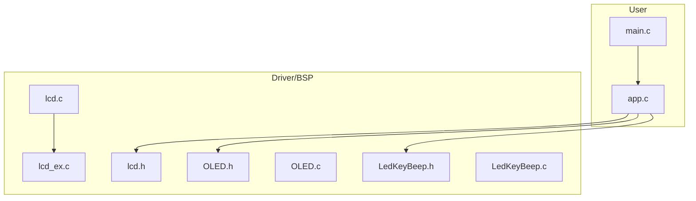
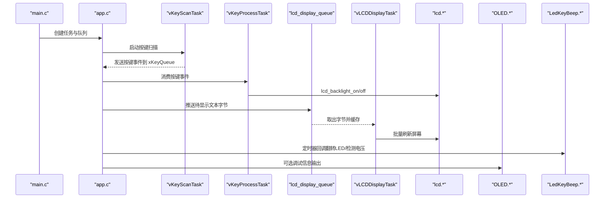
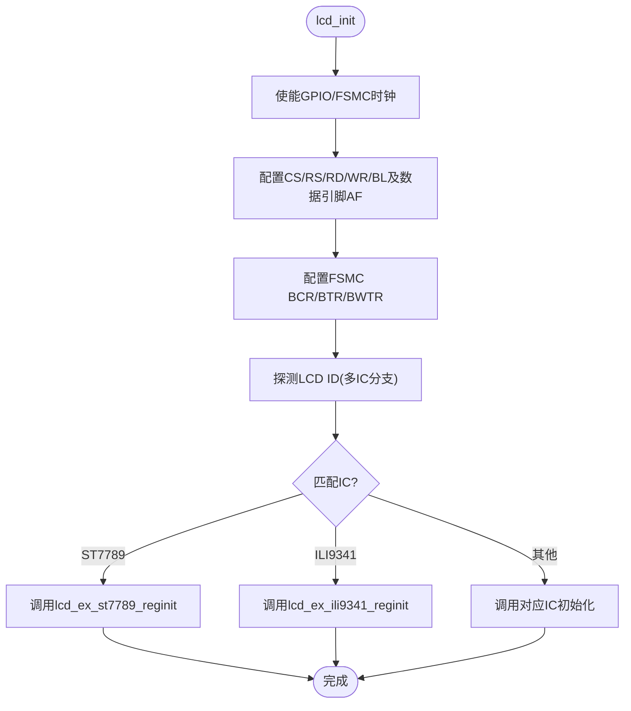
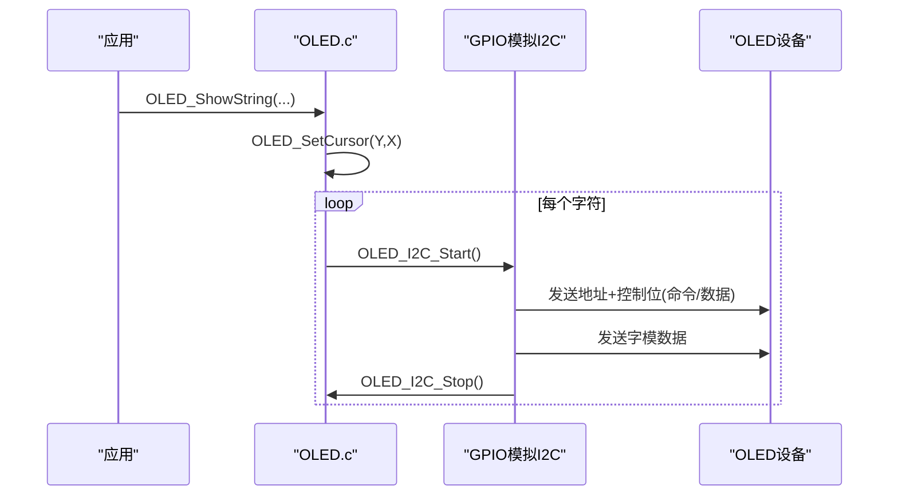
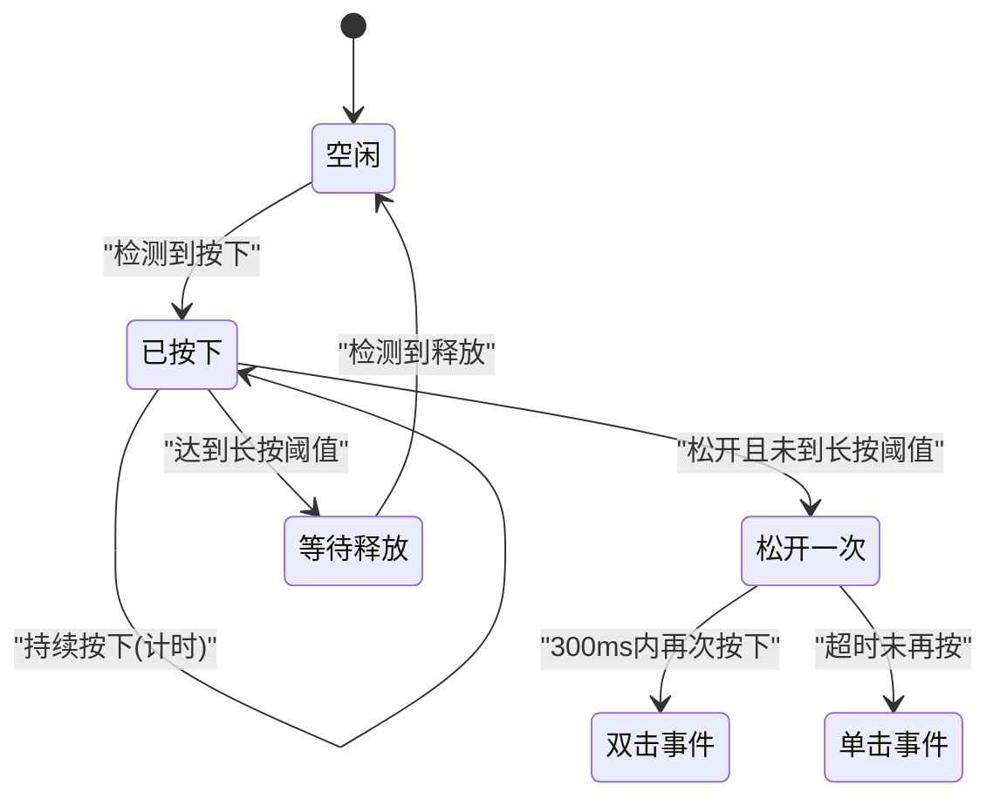
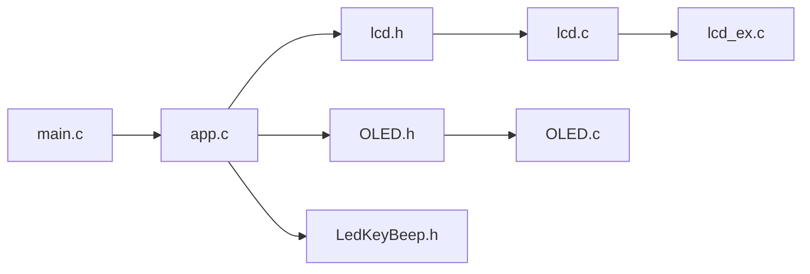

# 用户界面系统

<cite>
**本文引用的文件**   
- [main.c](file://_gbk_backup/User/main.c)
- [app.c](file://_gbk_backup/User/app.c)
- [lcd.h](file://_gbk_backup/Driver/BSP/LCD/lcd.h)
- [lcd.c](file://_gbk_backup/Driver/BSP/LCD/lcd.c)
- [lcd_ex.c](file://_gbk_backup/Driver/BSP/LCD/lcd_ex.c)
- [OLED.h](file://_gbk_backup/Driver/BSP/OLED.h)
- [OLED.c](file://_gbk_backup/Driver/BSP/OLED.c)
- [LedKeyBeep.h](file://_gbk_backup/Driver/BSP/LedKeyBeep.h)
- [LedKeyBeep.c](file://_gbk_backup/Driver/BSP/LedKeyBeep.c)
</cite>

## 目录
1. [简介](#简介)
2. [项目结构](#项目结构)
3. [核心组件](#核心组件)
4. [架构总览](#架构总览)
5. [详细组件分析](#详细组件分析)
6. [依赖关系分析](#依赖关系分析)
7. [性能与优化](#性能与优化)
8. [故障排查指南](#故障排查指南)
9. [结论](#结论)
10. [附录](#附录)

## 简介
本技术文档面向 STM32F407 人机界面子系统，覆盖 LCD 显示驱动、OLED 显示支持、按键输入处理、LED 指示器与蜂鸣器控制（接口定义）、以及 FreeRTOS 任务化的人机交互流程。重点说明：
- LCD 初始化、方向设置、字符与图形绘制函数族
- OLED I2C 通信与显示缓冲区管理
- 按键扫描、去抖与事件分发机制
- LED 闪烁与低功耗联动逻辑
- 基于队列的显示刷新流水线与性能优化策略
- 主题切换与界面定制方法（概念性指导）

## 项目结构
本项目采用分层组织方式：
- User 层：应用任务、FreeRTOS 任务创建、队列与定时器使用
- Driver/BSP 层：LCD、OLED、按键/LED/蜂鸣器、串口、SD卡等外设驱动
- Middle 层：内存分配、文件系统适配等中间件

图表来源
- [main.c:34-60](file://_gbk_backup/User/main.c#L34-L60)
- [app.c:529-541](file://_gbk_backup/User/app.c#L529-L541)
- [lcd.h:215-242](file://_gbk_backup/Driver/BSP/LCD/lcd.h#L215-L242)
- [OLED.h:9-17](file://_gbk_backup/Driver/BSP/OLED.h#L9-L17)
- [LedKeyBeep.h:25-32](file://_gbk_backup/Driver/BSP/LedKeyBeep.h#L25-L32)

章节来源
- [main.c:34-60](file://_gbk_backup/User/main.c#L34-L60)
- [app.c:529-541](file://_gbk_backup/User/app.c#L529-L541)

## 核心组件
- LCD 驱动：FSMC 并行总线驱动，支持多型号 IC（ILI9341/ST7789/NT35310/SSD1963/ST7796/ILI9806），提供初始化、方向设置、窗口设置、点/线/矩形/圆绘制、字符显示、背光控制等 API。
- OLED 驱动：软件 I2C（GPIO 模拟），实现命令/数据写入、光标定位、清屏、ASCII 字符与数字显示。
- 按键与 LED：按键 GPIO 配置与宏定义；LED 初始化与控制；蜂鸣器接口在头文件中声明（具体实现未在本仓库中）。
- 人机交互任务：按键扫描与事件分发、LCD 显示任务（队列缓冲+定时刷新）、LED 闪烁与低电量保护。

章节来源
- [lcd.h:89-105](file://_gbk_backup/Driver/BSP/LCD/lcd.h#L89-L105)
- [lcd.h:215-242](file://_gbk_backup/Driver/BSP/LCD/lcd.h#L215-L242)
- [OLED.h:9-17](file://_gbk_backup/Driver/BSP/OLED.h#L9-L17)
- [LedKeyBeep.h:6-13](file://_gbk_backup/Driver/BSP/LedKeyBeep.h#L6-L13)
- [LedKeyBeep.h:25-32](file://_gbk_backup/Driver/BSP/LedKeyBeep.h#L25-L32)

## 架构总览
系统以 FreeRTOS 为调度核心，主要任务包括：
- vKeyScanTask：按键扫描与去抖，产生短按/双击/长按事件
- vKeyProcessTask：按键事件消费，控制 LCD 背光开关
- vLCDDisplayTask：从队列取数据，行缓存后批量刷新 LCD
- vLED1Task + vLEDTimerCallback：LED 闪烁与电池电压检测，触发低功耗模式
- SD_Card_Init / SDCard_WriteTask：SD 卡挂载与异步写入
- BMS27930_RecordTask：CAN 数据解析与记录，同时推送至 LCD 显示队列

图表来源
- [main.c:34-60](file://_gbk_backup/User/main.c#L34-L60)
- [app.c:94-152](file://_gbk_backup/User/app.c#L94-L152)
- [app.c:368-412](file://_gbk_backup/User/app.c#L368-L412)
- [app.c:452-521](file://_gbk_backup/User/app.c#L452-L521)
- [app.c:154-198](file://_gbk_backup/User/app.c#L154-L198)

## 详细组件分析

### LCD 显示驱动
- 硬件接口：通过 FSMC 块1（NE4/A6）连接 LCD_CS/LCD_RS，16位数据线 PD/PE，背光 PB15。
- 初始化流程：时钟使能、GPIO 复用、FSMC 时序配置、ID 探测（多 IC 兼容）、调用各 IC 专属初始化序列。
- 方向与分辨率：lcd_display_dir 根据横竖屏设置 width/height 与寄存器指令；lcd_scan_dir 设置扫描方向与窗口范围。
- 绘图 API：点、线、矩形、圆、纯色填充、窗口设置、字符/数字显示、背光控制。

图表来源
- [lcd.c:593-800](file://_gbk_backup/Driver/BSP/LCD/lcd.c#L593-L800)
- [lcd_ex.c:40-129](file://_gbk_backup/Driver/BSP/LCD/lcd_ex.c#L40-L129)
- [lcd_ex.c:136-230](file://_gbk_backup/Driver/BSP/LCD/lcd_ex.c#L136-L230)

关键函数与职责
- lcd_init：硬件初始化与 IC 识别
- lcd_display_dir：横竖屏切换，更新 width/height 与写GRAM/坐标指令
- lcd_scan_dir：设置扫描方向与显示窗口
- lcd_set_window：设置绘图区域
- lcd_fill/lcd_draw_line/lcd_draw_rectangle/lcd_draw_circle：基础图形绘制
- lcd_show_string/lcd_show_num：字符与数字显示
- lcd_backlight_on/off：背光控制

章节来源
- [lcd.h:89-105](file://_gbk_backup/Driver/BSP/LCD/lcd.h#L89-L105)
- [lcd.h:215-242](file://_gbk_backup/Driver/BSP/LCD/lcd.h#L215-L242)
- [lcd.c:194-242](file://_gbk_backup/Driver/BSP/LCD/lcd.c#L194-L242)
- [lcd.c:254-405](file://_gbk_backup/Driver/BSP/LCD/lcd.c#L254-L405)
- [lcd.c:441-521](file://_gbk_backup/Driver/BSP/LCD/lcd.c#L441-L521)
- [lcd.c:531-584](file://_gbk_backup/Driver/BSP/LCD/lcd.c#L531-L584)
- [lcd.c:593-800](file://_gbk_backup/Driver/BSP/LCD/lcd.c#L593-L800)

### OLED 显示支持（I2C）
- 通信：软件 I2C（PD6 SCL, PD7 SDA），开漏输出+上拉，速度限制在约 250kHz。
- 协议：起始/停止、单字节发送、命令/数据帧封装（地址+控制位）。
- 显示：光标定位（Y行/X列），清屏，ASCII 字符与数字（十进制/十六进制/二进制/浮点）显示。
- 缓冲区：直接逐像素写入显存（无本地帧缓冲），每次显示操作均通过 I2C 传输。

图表来源
- [OLED.c:40-115](file://_gbk_backup/Driver/BSP/OLED.c#L40-L115)
- [OLED.c:123-146](file://_gbk_backup/Driver/BSP/OLED.c#L123-L146)
- [OLED.c:155-184](file://_gbk_backup/Driver/BSP/OLED.c#L155-L184)

章节来源
- [OLED.h:9-17](file://_gbk_backup/Driver/BSP/OLED.h#L9-L17)
- [OLED.c:10-33](file://_gbk_backup/Driver/BSP/OLED.c#L10-L33)
- [OLED.c:40-115](file://_gbk_backup/Driver/BSP/OLED.c#L40-L115)
- [OLED.c:123-146](file://_gbk_backup/Driver/BSP/OLED.c#L123-L146)
- [OLED.c:155-184](file://_gbk_backup/Driver/BSP/OLED.c#L155-L184)
- [OLED.c:323-373](file://_gbk_backup/Driver/BSP/OLED.c#L323-L373)

### 按键输入处理机制
- 硬件：WK_UP 接 PA0，高电平有效，内部下拉。
- 状态机：空闲→按下→松开一次→等待释放，支持单击、双击、长按。
- 去抖：基于固定周期任务延时（TASK_PERIOD_MS=20ms）计数阈值（长按800ms、双击300ms）。
- 事件分发：按键事件通过 FreeRTOS 队列 xKeyQueue 发送到 vKeyProcessTask。

图表来源
- [LedKeyBeep.h:16-21](file://_gbk_backup/Driver/BSP/LedKeyBeep.h#L16-L21)
- [app.c:94-152](file://_gbk_backup/User/app.c#L94-L152)

章节来源
- [LedKeyBeep.h:6-13](file://_gbk_backup/Driver/BSP/LedKeyBeep.h#L6-L13)
- [LedKeyBeep.h:16-21](file://_gbk_backup/Driver/BSP/LedKeyBeep.h#L16-L21)
- [LedKeyBeep.c:53-68](file://_gbk_backup/Driver/BSP/LedKeyBeep.c#L53-L68)
- [app.c:94-152](file://_gbk_backup/User/app.c#L94-L152)
- [app.c:368-412](file://_gbk_backup/User/app.c#L368-L412)

### LED 指示器与蜂鸣器控制
- LED：PF9 推挽输出，提供 ON/OFF/Turn 控制；在定时器回调中翻转，用于运行指示与低电量提示。
- 蜂鸣器：接口在 LedKeyBeep.h 中声明（如 Beep_Init 等），但当前工程未包含实现文件，需自行补充。

章节来源
- [LedKeyBeep.c:6-42](file://_gbk_backup/Driver/BSP/LedKeyBeep.c#L6-L42)
- [app.c:154-198](file://_gbk_backup/User/app.c#L154-L198)
- [LedKeyBeep.h:25-32](file://_gbk_backup/Driver/BSP/LedKeyBeep.h#L25-L32)

### 人机交互界面设计
- 菜单结构：当前工程未实现完整菜单树，主要通过 LCD 显示实时日志与状态；可通过扩展 vLCDDisplayTask 的行缓存与布局逻辑实现多级菜单。
- 状态显示：LCD 任务将 CAN 解析结果与时间戳格式化后滚动显示，每行固定高度与最大行数，超出自动上滚。
- 用户操作流程：
  - 短按：点亮 LCD 背光
  - 双击：打印任务栈使用情况（调试）
  - 长按：关闭 LCD 背光

章节来源
- [app.c:452-521](file://_gbk_backup/User/app.c#L452-L521)
- [app.c:368-412](file://_gbk_backup/User/app.c#L368-L412)

### 界面定制与主题切换（概念性指导）
- 颜色主题：利用 lcd.h 中预定义的颜色常量（WHITE/BLACK/RED/GREEN/BLUE/YELLOW/CYAN/MAGENTA 等），在显示字符串或填充矩形时传入不同颜色参数即可切换主题。
- 字体与字号：lcd_show_string 支持 size 参数，可切换不同字号；如需中文或自定义字形，可在 lcdfont.h 中扩展字库。
- 布局模板：在 vLCDDisplayTask 中维护多行缓存 line_cache，可按业务字段划分区域（标题区、数据区、状态栏），实现“主题”式布局。
- 动态背景：使用 lcd_fill 对整屏或局部区域进行背景色填充，配合半透明效果（若驱动支持）可实现更丰富的视觉层次。

[本节为通用设计建议，不直接分析具体代码文件]

## 依赖关系分析
- main.c 负责系统初始化与任务创建，依赖 LCD/OLED/RTC/CAN/SD/Power 等模块。
- app.c 集中 FreeRTOS 任务逻辑，依赖队列、信号量、定时器、LCD/OLED/SD/RTC/CAN/BMS 等。
- LCD 驱动依赖 FSMC、GPIO、usart（调试输出）与 lcd_ex.c 中的 IC 初始化序列。
- OLED 驱动依赖 delay.h 与 OLED_Font.h 字模。
- LedKeyBeep 模块独立于显示，提供按键与 LED 的基础能力。

图表来源
- [main.c:34-60](file://_gbk_backup/User/main.c#L34-L60)
- [app.c:529-541](file://_gbk_backup/User/app.c#L529-L541)
- [lcd.h:215-242](file://_gbk_backup/Driver/BSP/LCD/lcd.h#L215-L242)
- [OLED.h:9-17](file://_gbk_backup/Driver/BSP/OLED.h#L9-L17)
- [LedKeyBeep.h:25-32](file://_gbk_backup/Driver/BSP/LedKeyBeep.h#L25-L32)

章节来源
- [main.c:34-60](file://_gbk_backup/User/main.c#L34-L60)
- [app.c:529-541](file://_gbk_backup/User/app.c#L529-L541)

## 性能与优化
- LCD 刷新批量化：vLCDDisplayTask 每 100ms 聚合一行数据，减少刷屏次数；行缓存 line_cache 避免频繁重绘。
- 队列缓冲：lcd_display_queue 容量 512，生产者（BMSRecord）与消费者（vLCDDisplayTask）解耦，降低阻塞风险。
- 队列监控：当剩余空间低于阈值时打印警告，便于调优队列深度与刷新频率。
- SD 写入合并：SDCard_WriteTask 累积至扇区大小或超时才写入，降低频繁 IO 对寿命的影响。
- 触摸输入：当前工程未实现触摸屏驱动与触摸事件处理；如需支持，可在 LCD 驱动层增加触摸控制器（如 XPT2046/FT6236）驱动，并在 vKeyScanTask 附近新增触摸任务，统一事件分发。

章节来源
- [app.c:452-521](file://_gbk_backup/User/app.c#L452-L521)
- [app.c:311-366](file://_gbk_backup/User/app.c#L311-L366)

## 故障排查指南
- LCD 无显示：
  - 检查 FSMC 时钟与 GPIO 复用配置是否正确
  - 确认 LCD ID 探测是否成功（串口打印）
  - 校验 lcd_display_dir 与 lcd_scan_dir 的参数是否与硬件一致
- OLED 无显示：
  - 检查 I2C 引脚（PD6/PD7）与上拉电阻
  - 确认 OLED 初始化序列是否完整执行
  - 验证命令/数据帧的控制位（0x00/0x40）是否正确
- 按键误触发：
  - 调整 TASK_PERIOD_MS、LONG_PRESS_TICKS、DOUBLE_CLICK_TICKS 阈值
  - 检查 WK_UP 引脚电平与内部下拉配置
- LED 不亮/常亮：
  - 检查 PF9 引脚输出状态与定时器回调是否启动
- 低电量未进入低功耗：
  - 检查 VBAT_LOW_THRESHOLD 与 adc_read_vbat 返回值
  - 确认 enter_low_power_mode 实现是否生效

章节来源
- [lcd.c:593-800](file://_gbk_backup/Driver/BSP/LCD/lcd.c#L593-L800)
- [OLED.c:323-373](file://_gbk_backup/Driver/BSP/OLED.c#L323-L373)
- [app.c:94-152](file://_gbk_backup/User/app.c#L94-L152)
- [app.c:154-198](file://_gbk_backup/User/app.c#L154-L198)

## 结论
本 UI 子系统以 FreeRTOS 为核心，通过 LCD 与 OLED 双显示通道、按键事件流与 LED 指示，构建了稳定的人机交互基础。LCD 驱动具备多 IC 兼容与完善的绘图 API；OLED 驱动提供轻量级 ASCII 显示能力；按键处理采用状态机与队列解耦，具备良好的可扩展性。后续可在现有基础上扩展触摸输入、菜单系统与主题切换，进一步提升用户体验。

## 附录
- 常用 LCD 颜色常量：WHITE/BLACK/RED/GREEN/BLUE/YELLOW/CYAN/MAGENTA/BROWN/GRAY 等
- 常用 LCD 方向常量：L2R_U2D/L2R_D2U/R2L_U2D/R2L_D2U/U2D_L2R/U2D_R2L/D2U_L2R/D2U_R2L
- 按键事件常量：KEY_SHORT_PRESS_1/KEY_SHORT_PRESS_2/KEY_LONG_PRESS

[本节为通用参考，不直接分析具体代码文件]