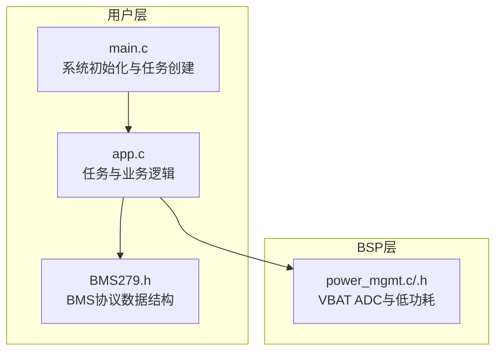
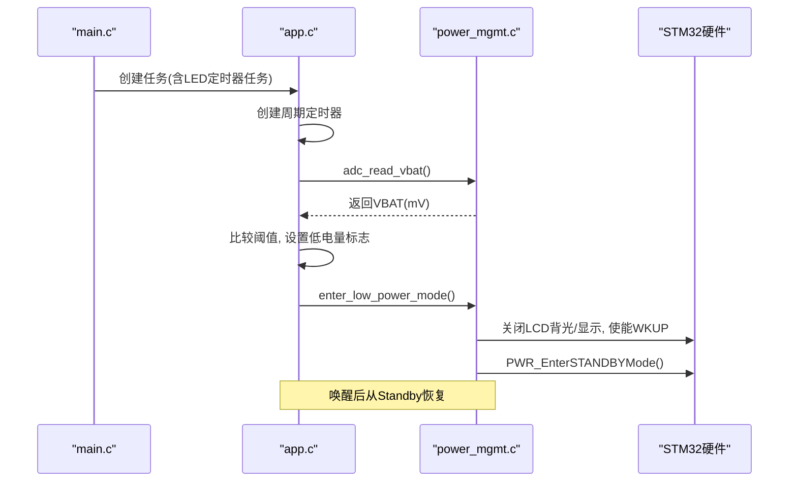
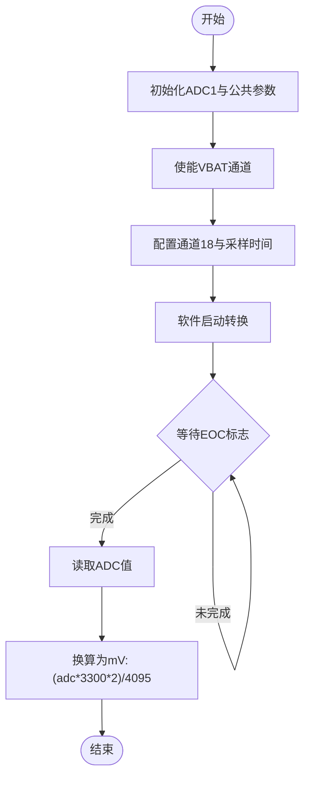
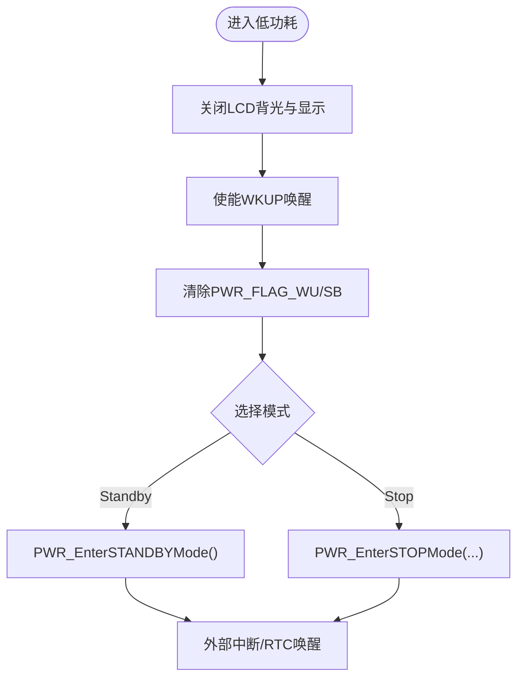
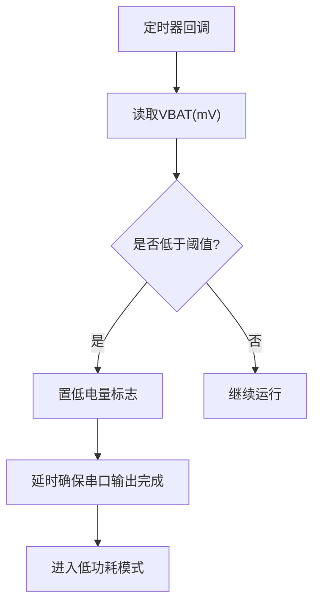
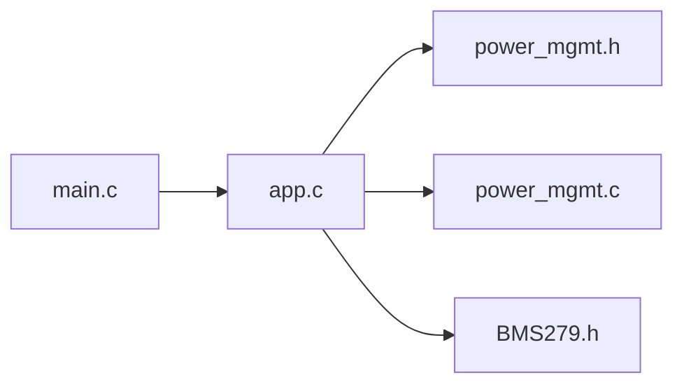

# 电源管理系统

<cite>
**本文引用的文件**   
- [power_mgmt.c](file://_gbk_backup/Driver/BSP/power_mgmt.c)
- [power_mgmt.h](file://_gbk_backup/Driver/BSP/power_mgmt.h)
- [main.c](file://_gbk_backup/User/main.c)
- [app.c](file://_gbk_backup/User/app.c)
- [BMS279.h](file://_gbk_backup/User/BMS279.h)
</cite>

## 目录
1. [简介](#简介)
2. [项目结构](#项目结构)
3. [核心组件](#核心组件)
4. [架构总览](#架构总览)
5. [详细组件分析](#详细组件分析)
6. [依赖关系分析](#依赖关系分析)
7. [性能与功耗考量](#性能与功耗考量)
8. [故障检测与恢复](#故障检测与恢复)
9. [结论](#结论)
10. [附录：校准与精度优化建议](#附录校准与精度优化建议)

## 简介
本技术文档围绕STM32F4平台的电源管理子系统，系统性说明电池电压监测（ADC配置、采样与换算）、低功耗模式（Stop/Standby）与唤醒机制、电源状态监控与基础保护（低电量阈值、休眠触发）、以及基于BMS279的扩展能力（温度、SOC、充放电限制等）。同时给出动态功耗调节与节能策略的实践建议，并提供电池校准方法与电量估算精度优化思路。

## 项目结构
本项目采用分层组织方式：
- BSP层：提供外设驱动与电源管理接口（ADC VBAT、低功耗模式控制）
- 用户层：FreeRTOS任务调度、按键处理、CAN数据记录、LCD显示、SD卡写入等
- 系统初始化：在main中完成外设初始化并创建任务

图表来源
- [main.c:34-60](file://_gbk_backup/User/main.c#L34-L60)
- [app.c:529-541](file://_gbk_backup/User/app.c#L529-L541)
- [power_mgmt.c:8-37](file://_gbk_backup/Driver/BSP/power_mgmt.c#L8-L37)
- [BMS279.h:147-161](file://_gbk_backup/User/BMS279.h#L147-L161)

章节来源
- [main.c:34-60](file://_gbk_backup/User/main.c#L34-L60)
- [app.c:529-541](file://_gbk_backup/User/app.c#L529-L541)

## 核心组件
- 电池电压监测
  - ADC初始化与VBAT通道使能
  - 软件触发单次转换，读取12位ADC值并换算为mV
- 低功耗模式管理
  - 关闭LCD背光与显示
  - 启用WKUP引脚唤醒
  - 进入Standby模式（最低功耗）
- 电量监控与保护
  - 周期性定时器回调中读取VBAT
  - 低于阈值时标记并进入低功耗
- BMS279扩展
  - 通过CAN解析BMS报文，获取温度、SOC、电压状态等

章节来源
- [power_mgmt.c:8-63](file://_gbk_backup/Driver/BSP/power_mgmt.c#L8-L63)
- [power_mgmt.c:66-81](file://_gbk_backup/Driver/BSP/power_mgmt.c#L66-L81)
- [app.c:154-179](file://_gbk_backup/User/app.c#L154-L179)
- [BMS279.h:147-161](file://_gbk_backup/User/BMS279.h#L147-L161)

## 架构总览
电源管理在系统中的调用链如下：
- main初始化外设后创建任务
- app中创建周期定时器，定时回调中读取VBAT并判断是否低电量
- 低电量时调用BSP层的低功耗入口，进入Standby
- 唤醒后可由按键或RTC中断恢复运行

图表来源
- [main.c:34-60](file://_gbk_backup/User/main.c#L34-L60)
- [app.c:154-179](file://_gbk_backup/User/app.c#L154-L179)
- [power_mgmt.c:66-81](file://_gbk_backup/Driver/BSP/power_mgmt.c#L66-L81)

## 详细组件分析

### 电池电压监测（ADC配置、采样与换算）
- ADC公共参数
  - 独立模式、分频系数、禁用DMA访问、两次采样延迟
- ADC1参数
  - 12位分辨率、非扫描、非连续、软件触发、右对齐、单通道
- VBAT通道
  - 内部2分频，参考电压3.3V，通道号18
- 采样流程
  - 配置通道与采样时间
  - 软件启动转换
  - 等待EOC标志
  - 读取转换值并换算为mV

图表来源
- [power_mgmt.c:8-37](file://_gbk_backup/Driver/BSP/power_mgmt.c#L8-L37)
- [power_mgmt.c:40-63](file://_gbk_backup/Driver/BSP/power_mgmt.c#L40-L63)

章节来源
- [power_mgmt.c:8-63](file://_gbk_backup/Driver/BSP/power_mgmt.c#L8-L63)

### 低功耗模式管理（睡眠/待机与唤醒）
- 关闭高功耗外设：LCD背光与显示
- 启用唤醒源：WKUP引脚
- 清除唤醒/停机标志位
- 选择低功耗模式：当前实现进入Standby（最低功耗）

图表来源
- [power_mgmt.c:66-81](file://_gbk_backup/Driver/BSP/power_mgmt.c#L66-L81)

章节来源
- [power_mgmt.c:66-81](file://_gbk_backup/Driver/BSP/power_mgmt.c#L66-L81)

### 电源状态监控与电池保护（低电量阈值、温度与SOC）
- 低电量阈值
  - 定义常量：3200 mV
  - 定时器回调中读取VBAT，若低于阈值且未重复触发，则进入低功耗
- 温度与SOC
  - 通过BMS279 CAN报文解析，可获得最高/最低温度、SOC、电压状态等
  - 可在应用层扩展：当温度过高或SOC过低时采取保护动作（如限流、报警、休眠）

图表来源
- [app.c:154-179](file://_gbk_backup/User/app.c#L154-L179)
- [power_mgmt.h:6-10](file://_gbk_backup/Driver/BSP/power_mgmt.h#L6-L10)
- [BMS279.h:147-161](file://_gbk_backup/User/BMS279.h#L147-L161)

章节来源
- [app.c:154-179](file://_gbk_backup/User/app.c#L154-L179)
- [power_mgmt.h:6-10](file://_gbk_backup/Driver/BSP/power_mgmt.h#L6-L10)
- [BMS279.h:147-161](file://_gbk_backup/User/BMS279.h#L147-L161)

### 电源管理策略（动态功耗调节与节能模式切换）
- 动态功耗调节
  - 根据VBAT与BMS信息（温度、SOC）调整任务频率或外设使用
  - 例如：低电量或高温时降低CAN收发频率、减少LCD刷新、关闭非必要外设
- 节能模式切换
  - 正常模式：全速运行，频繁采集与显示
  - 节能模式：降低采样率、关闭显示、仅保留必要通信
  - 深度休眠：Standby，仅保留WKUP或RTC唤醒

章节来源
- [app.c:154-179](file://_gbk_backup/User/app.c#L154-L179)
- [power_mgmt.c:66-81](file://_gbk_backup/Driver/BSP/power_mgmt.c#L66-L81)

### 电池校准与电量估算精度优化
- 硬件校准
  - 使用高精度万用表测量实际VBAT，修正换算公式中的参考电压与分压比
  - 对ADC偏移进行零点校准（短路输入测零偏）
- 软件优化
  - 多次采样取平均或滑动滤波，抑制噪声
  - 分段线性拟合或查表法映射ADC到真实电压
  - 结合BMS SOC与温度补偿，提升电量估算准确性
- 工程实践
  - 上电自学习：记录不同负载下的电压降曲线，建立补偿模型
  - 在线标定：在已知充电截止点与空载点之间插值更新SOC-VOC曲线

[本节为通用方法建议，不直接分析具体代码文件]

## 依赖关系分析
- main.c负责系统初始化与任务创建，依赖power_mgmt.h提供的电源管理接口
- app.c通过定时器回调周期性读取VBAT，并在低电量时调用enter_low_power_mode
- power_mgmt.c封装ADC与低功耗操作，依赖HAL/标准库外设寄存器
- BMS279.h提供BMS数据结构，供上层解析CAN报文以获取温度、SOC等信息

图表来源
- [main.c:34-60](file://_gbk_backup/User/main.c#L34-L60)
- [app.c:529-541](file://_gbk_backup/User/app.c#L529-L541)
- [power_mgmt.h:1-12](file://_gbk_backup/Driver/BSP/power_mgmt.h#L1-L12)
- [power_mgmt.c:1-81](file://_gbk_backup/Driver/BSP/power_mgmt.c#L1-L81)
- [BMS279.h:147-161](file://_gbk_backup/User/BMS279.h#L147-L161)

章节来源
- [main.c:34-60](file://_gbk_backup/User/main.c#L34-L60)
- [app.c:529-541](file://_gbk_backup/User/app.c#L529-L541)
- [power_mgmt.h:1-12](file://_gbk_backup/Driver/BSP/power_mgmt.h#L1-L12)
- [power_mgmt.c:1-81](file://_gbk_backup/Driver/BSP/power_mgmt.c#L1-L81)
- [BMS279.h:147-161](file://_gbk_backup/User/BMS279.h#L147-L161)

## 性能与功耗考量
- ADC采样
  - 采样时间较长（480周期），有利于提高精度但增加功耗与时延
  - 建议在低电量模式下降低采样频率
- LCD显示
  - 低功耗前关闭背光与显示，显著降低功耗
- 低功耗模式
  - Standby模式功耗最低，但需通过WKUP或RTC唤醒
  - 如需保留RAM与中断，可选择Stop模式（当前代码注释中保留）
- 任务调度
  - 合理分配任务优先级与栈大小，避免堆栈溢出导致异常复位

章节来源
- [power_mgmt.c:40-63](file://_gbk_backup/Driver/BSP/power_mgmt.c#L40-L63)
- [power_mgmt.c:66-81](file://_gbk_backup/Driver/BSP/power_mgmt.c#L66-L81)
- [app.c:529-541](file://_gbk_backup/User/app.c#L529-L541)

## 故障检测与恢复
- 低电量保护
  - 检测到VBAT低于阈值时，置位低电量标志并进入低功耗
  - 防止重复触发：使用静态标志位避免反复休眠
- 唤醒恢复
  - WKUP引脚或RTC中断可唤醒系统
  - 唤醒后应重新初始化必要外设（如LCD、UART、CAN）
- 日志与诊断
  - 通过串口打印低电量信息与进入低功耗前的状态，便于调试
  - 将关键事件写入SD卡，用于离线分析

章节来源
- [app.c:154-179](file://_gbk_backup/User/app.c#L154-L179)
- [power_mgmt.c:66-81](file://_gbk_backup/Driver/BSP/power_mgmt.c#L66-L81)

## 结论
本电源管理系统以VBAT ADC监测为基础，结合BMS279的扩展信息，实现了低电量保护与低功耗模式切换。通过合理的任务调度与外设管理，系统在正常运行与节能模式之间灵活切换，满足车载追踪设备的功耗与可靠性要求。后续可通过电池校准与SOC算法优化进一步提升电量估算精度与系统鲁棒性。

## 附录：校准与精度优化建议
- 校准步骤
  - 上电零点校准：短接VBAT输入，记录ADC偏移
  - 满量程校准：施加已知电压，修正增益误差
  - 温度补偿：在不同温度下采集多点数据，建立温度-电压补偿表
- 算法优化
  - 滑动平均滤波：平滑瞬时波动
  - 分段线性拟合：提高非线性区间的拟合精度
  - SOC-VOC曲线：结合BMS SOC与开路电压进行在线标定
- 工程落地
  - 定期自检：周期性执行校准流程，跟踪漂移
  - 自适应阈值：根据历史数据动态调整低电量阈值，避免误报

[本节为通用方法建议，不直接分析具体代码文件]