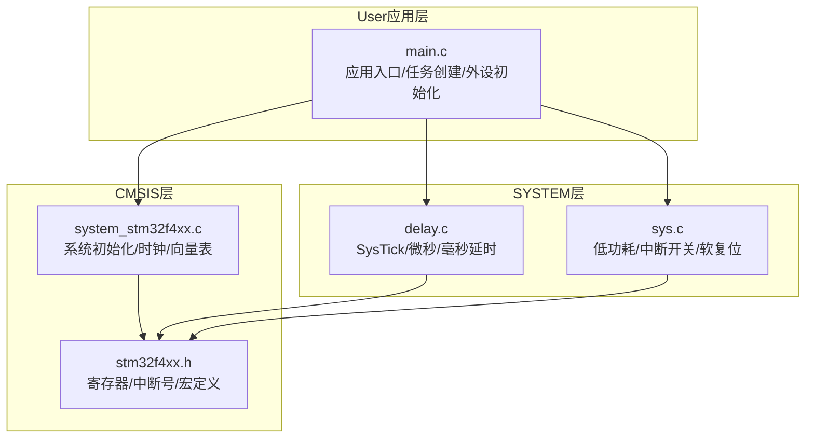
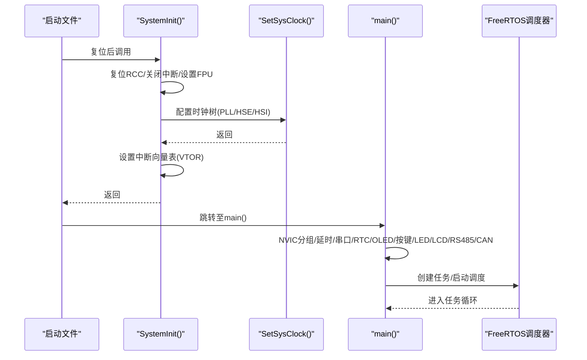
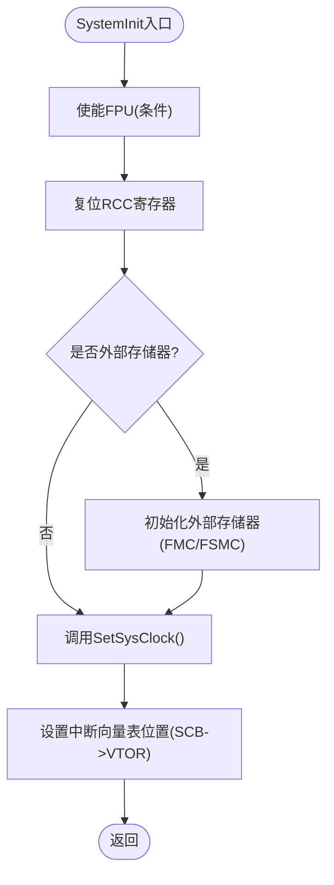
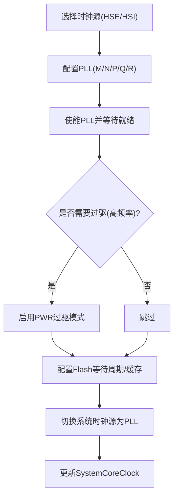
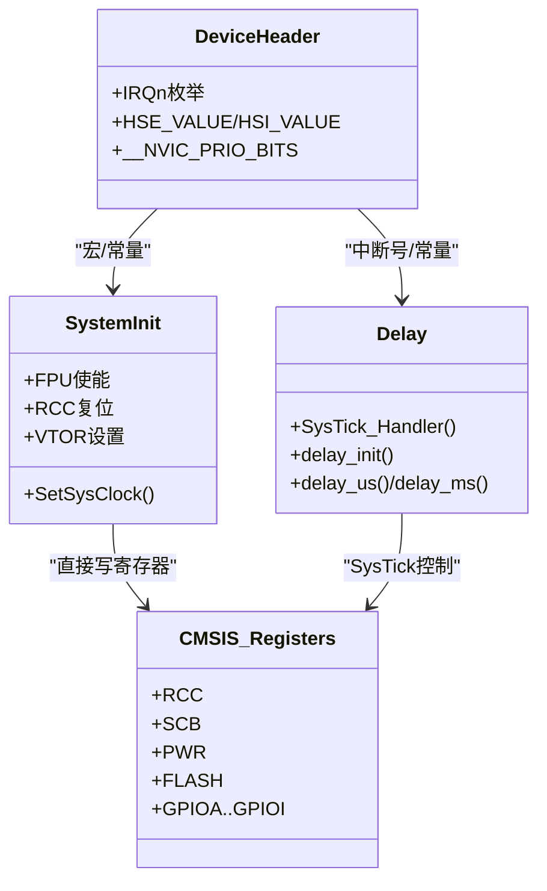
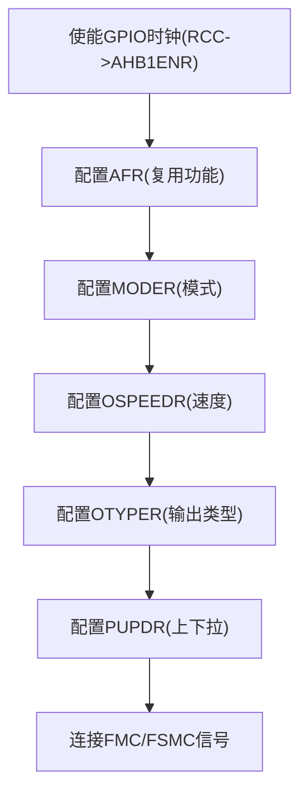
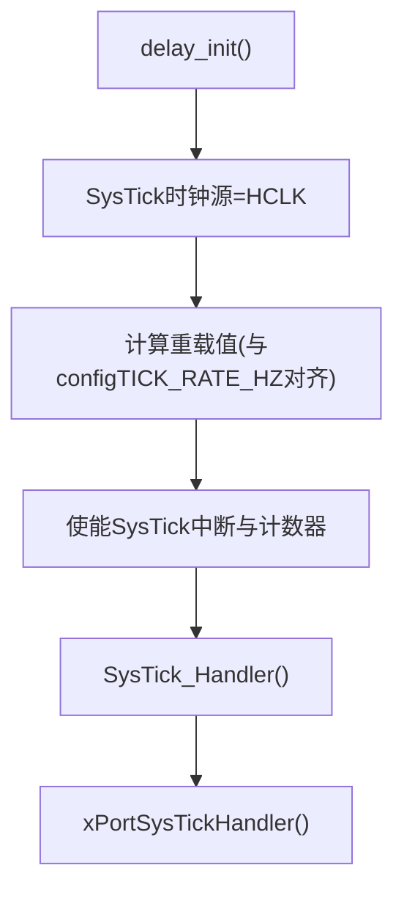
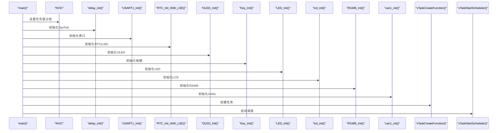
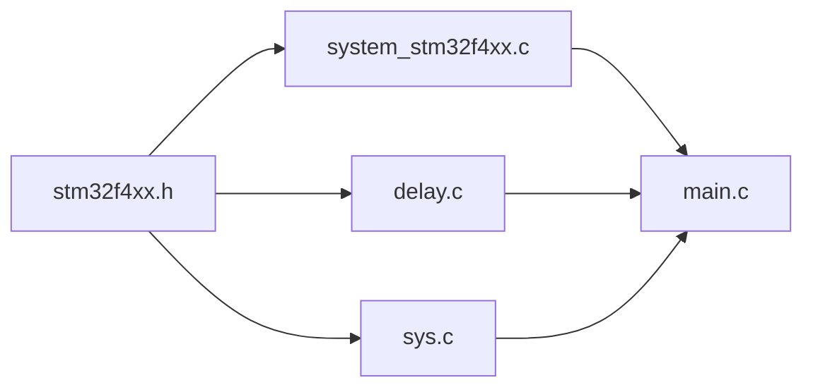

# 硬件抽象层

<cite>
**本文引用的文件**   
- [system_stm32f4xx.c](file://_gbk_backup/Driver/CMSIS/system_stm32f4xx.c)
- [stm32f4xx.h](file://_gbk_backup/Driver/CMSIS/stm32f4xx.h)
- [main.c](file://_gbk_backup/User/main.c)
- [sys.c](file://_gbk_backup/Driver/SYSTEM/sys.c)
- [delay.c](file://_gbk_backup/Driver/SYSTEM/delay.c)
</cite>

## 目录
1. [引言](#引言)
2. [项目结构](#项目结构)
3. [核心组件](#核心组件)
4. [架构总览](#架构总览)
5. [详细组件分析](#详细组件分析)
6. [依赖关系分析](#依赖关系分析)
7. [性能与功耗考量](#性能与功耗考量)
8. [故障排查指南](#故障排查指南)
9. [结论](#结论)
10. [附录：移植与兼容性指南](#附录移植与兼容性指南)

## 引言
本技术文档面向STM32F407的硬件抽象层（HAL）实现，聚焦系统初始化流程、时钟树配置、外设复位策略、中断向量表设置、CMSIS接口使用（寄存器访问、中断处理、系统服务调用）、GPIO复用与功能映射，以及不同STM32系列的移植与兼容注意事项。文档以仓库中的CMSIS系统启动代码、设备头文件、系统基础库与应用入口为依据进行系统化梳理，帮助读者快速理解并扩展该硬件抽象层。

## 项目结构
本项目采用分层组织方式：
- CMSIS层：提供系统初始化、时钟配置、中断向量表设置与寄存器定义
- SYSTEM层：封装系统级通用能力（低功耗、中断开关、软复位、SysTick延时）
- User应用层：业务入口与任务调度（FreeRTOS）
- BSP驱动层：LED/按键/OLED/CAN等外设驱动（本专题重点不在其内部实现）

**图示来源**
- [system_stm32f4xx.c:476-515](file://_gbk_backup/Driver/CMSIS/system_stm32f4xx.c#L476-L515)
- [stm32f4xx.h:176-200](file://_gbk_backup/Driver/CMSIS/stm32f4xx.h#L176-L200)
- [sys.c:34-93](file://_gbk_backup/Driver/SYSTEM/sys.c#L34-L93)
- [delay.c:22-35](file://_gbk_backup/Driver/SYSTEM/delay.c#L22-L35)
- [main.c:34-60](file://_gbk_backup/User/main.c#L34-L60)

**章节来源**
- [main.c:34-60](file://_gbk_backup/User/main.c#L34-L60)

## 核心组件
- 系统初始化与时钟配置：SystemInit()与SetSysClock()负责复位RCC、选择时钟源、配置PLL、AHB/APB分频、Flash等待状态，并设置中断向量表位置
- CMSIS设备头：stm32f4xx.h提供寄存器宏、中断号枚举、核心特性宏（如FPU、NVIC优先级位数）
- 系统基础库：sys.c提供WFI、全局中断开关、待机模式、软复位；delay.c基于SysTick提供us/ms延时并与FreeRTOS集成
- 应用入口：main.c完成NVIC分组、SysTick延时初始化、串口、RTC、OLED、按键、LED、LCD、RS485、CAN等外设初始化，随后创建任务并启动调度器

**章节来源**
- [system_stm32f4xx.c:476-515](file://_gbk_backup/Driver/CMSIS/system_stm32f4xx.c#L476-L515)
- [stm32f4xx.h:176-200](file://_gbk_backup/Driver/CMSIS/stm32f4xx.h#L176-L200)
- [sys.c:34-93](file://_gbk_backup/Driver/SYSTEM/sys.c#L34-L93)
- [delay.c:22-35](file://_gbk_backup/Driver/SYSTEM/delay.c#L22-L35)
- [main.c:34-60](file://_gbk_backup/User/main.c#L34-L60)

## 架构总览
下图展示从复位到应用主循环的关键路径：启动后由启动文件调用SystemInit()完成底层系统初始化，再进入main()完成外设与RTOS初始化，最终进入任务调度。

**图示来源**
- [system_stm32f4xx.c:476-515](file://_gbk_backup/Driver/CMSIS/system_stm32f4xx.c#L476-L515)
- [system_stm32f4xx.c:647-868](file://_gbk_backup/Driver/CMSIS/system_stm32f4xx.c#L647-L868)
- [main.c:34-60](file://_gbk_backup/User/main.c#L34-L60)

## 详细组件分析

### 系统初始化与中断向量表
- FPU使能：若目标芯片支持且启用FPU，则在SystemInit中开启CP10/CP11完全访问权限
- RCC复位：将RCC相关寄存器恢复默认值，确保后续时钟配置在干净状态下进行
- 时钟配置：调用SetSysClock()根据编译宏选择HSE或HSI作为PLL输入，配置PLL_M/N/P/Q/R参数，设置AHB/APB分频，配置Flash预取指、指令缓存、数据缓存与等待周期
- 向量表设置：根据VECT_TAB_SRAM宏决定将中断向量表置于SRAM还是FLASH，并通过SCB->VTOR设置偏移地址

**图示来源**
- [system_stm32f4xx.c:476-515](file://_gbk_backup/Driver/CMSIS/system_stm32f4xx.c#L476-L515)
- [system_stm32f4xx.c:880-1032](file://_gbk_backup/Driver/CMSIS/system_stm32f4xx.c#L880-L1032)

**章节来源**
- [system_stm32f4xx.c:476-515](file://_gbk_backup/Driver/CMSIS/system_stm32f4xx.c#L476-L515)

### 时钟树配置（HSE/HSI与PLL）
- HSE/HSI选择：SetSysClock()根据平台宏分支，优先尝试HSE，失败则回退；对部分系列支持HSI作为PLL输入
- PLL参数：通过宏定义PLL_M/N/P/Q/R，计算VCO频率并输出SYSCLK；同时为USB/SDIO/RNG提供48MHz时钟（Q分频）
- 分频配置：AHB不分频（HCLK=SYSCLK），APB1/APB2按系列设定分频系数
- Flash时序：根据运行频率配置Flash等待周期、预取指与缓存，保证稳定读取
- 电压调节：在高频率场景下启用PWR过驱模式（Over-drive）以满足更高时钟需求

**图示来源**
- [system_stm32f4xx.c:647-868](file://_gbk_backup/Driver/CMSIS/system_stm32f4xx.c#L647-L868)

**章节来源**
- [system_stm32f4xx.c:647-868](file://_gbk_backup/Driver/CMSIS/system_stm32f4xx.c#L647-L868)

### CMSIS接口使用（寄存器访问、中断处理、系统服务）
- 寄存器访问：通过RCC/SCB/PWR/FLASH/GPIO等结构体指针直接操作寄存器，例如RCC->CFGR、SCB->VTOR、PWR->CR、FLASH->ACR、GPIOx->MODER/AFR等
- 中断处理：中断号在stm32f4xx.h中枚举定义；SysTick_Handler在delay.c中转发给FreeRTOS内核
- 系统服务：SystemCoreClockUpdate()用于运行时重新计算核心时钟；SysTick_CLKSourceConfig()选择SysTick时钟源

**图示来源**
- [stm32f4xx.h:176-200](file://_gbk_backup/Driver/CMSIS/stm32f4xx.h#L176-L200)
- [system_stm32f4xx.c:476-515](file://_gbk_backup/Driver/CMSIS/system_stm32f4xx.c#L476-L515)
- [delay.c:14-35](file://_gbk_backup/Driver/SYSTEM/delay.c#L14-L35)

**章节来源**
- [stm32f4xx.h:176-200](file://_gbk_backup/Driver/CMSIS/stm32f4xx.h#L176-L200)
- [delay.c:14-35](file://_gbk_backup/Driver/SYSTEM/delay.c#L14-L35)

### GPIO端口复用与功能映射
- 复用功能：当使用FMC/FSMC或外部存储器时，需将对应GPIO引脚配置为复用功能（AFR[0]/AFR[1]），并设置模式（MODER）、速度（OSPEEDR）、输出类型（OTYPER）、上下拉（PUPDR）
- 时钟使能：先使能GPIO端口时钟（RCC->AHB1ENR），再配置引脚
- 典型场景：外部SDRAM/SRAM初始化中，对PD/PE/PF/PG/PH/PI等端口进行批量复用配置，并连接至FMC总线信号

**图示来源**
- [system_stm32f4xx.c:880-1032](file://_gbk_backup/Driver/CMSIS/system_stm32f4xx.c#L880-L1032)
- [system_stm32f4xx.c:1049-1194](file://_gbk_backup/Driver/CMSIS/system_stm32f4xx.c#L1049-L1194)
- [system_stm32f4xx.c:1204-1373](file://_gbk_backup/Driver/CMSIS/system_stm32f4xx.c#L1204-L1373)

**章节来源**
- [system_stm32f4xx.c:880-1032](file://_gbk_backup/Driver/CMSIS/system_stm32f4xx.c#L880-L1032)
- [system_stm32f4xx.c:1049-1194](file://_gbk_backup/Driver/CMSIS/system_stm32f4xx.c#L1049-L1194)
- [system_stm32f4xx.c:1204-1373](file://_gbk_backup/Driver/CMSIS/system_stm32f4xx.c#L1204-L1373)

### 系统服务与低功耗
- 全局中断开关：sys_intx_disable()/sys_intx_enable()通过CPSID/CPSIE指令屏蔽/开启中断
- 低功耗模式：sys_standby()配置PWR待机模式，配合WFI进入深度睡眠
- 软复位：sys_soft_reset()通过AIRCR触发系统复位
- SysTick延时：delay_init()配置SysTick为HCLK源，计算重载值并与FreeRTOS tick对齐；SysTick_Handler在中断中转发给RTOS内核

**图示来源**
- [delay.c:22-35](file://_gbk_backup/Driver/SYSTEM/delay.c#L22-L35)
- [delay.c:14-20](file://_gbk_backup/Driver/SYSTEM/delay.c#L14-L20)
- [sys.c:34-93](file://_gbk_backup/Driver/SYSTEM/sys.c#L34-L93)

**章节来源**
- [sys.c:34-93](file://_gbk_backup/Driver/SYSTEM/sys.c#L34-L93)
- [delay.c:22-35](file://_gbk_backup/Driver/SYSTEM/delay.c#L22-L35)

### 应用入口与外设初始化顺序
- main()首先设置NVIC优先级分组，然后依次初始化延时、串口、内存管理、RTC、OLED、按键、LED、ADC_VBAT、LCD、RS485、CAN，并创建队列与互斥量
- 最后创建任务并启动FreeRTOS调度器

**图示来源**
- [main.c:34-60](file://_gbk_backup/User/main.c#L34-L60)

**章节来源**
- [main.c:34-60](file://_gbk_backup/User/main.c#L34-L60)

## 依赖关系分析
- system_stm32f4xx.c依赖stm32f4xx.h提供的宏与寄存器定义
- delay.c依赖stm32f4xx.h与FreeRTOS内核API
- sys.c依赖stm32f4xx.h与系统寄存器
- main.c依赖所有上述模块，并引入BSP驱动与FreeRTOS

**图示来源**
- [stm32f4xx.h:176-200](file://_gbk_backup/Driver/CMSIS/stm32f4xx.h#L176-L200)
- [system_stm32f4xx.c:310-311](file://_gbk_backup/Driver/CMSIS/system_stm32f4xx.c#L310-L311)
- [delay.c:1-6](file://_gbk_backup/Driver/SYSTEM/delay.c#L1-L6)
- [sys.c:24-25](file://_gbk_backup/Driver/SYSTEM/sys.c#L24-L25)
- [main.c:1-21](file://_gbk_backup/User/main.c#L1-L21)

**章节来源**
- [stm32f4xx.h:176-200](file://_gbk_backup/Driver/CMSIS/stm32f4xx.h#L176-L200)
- [system_stm32f4xx.c:310-311](file://_gbk_backup/Driver/CMSIS/system_stm32f4xx.c#L310-L311)
- [delay.c:1-6](file://_gbk_backup/Driver/SYSTEM/delay.c#L1-L6)
- [sys.c:24-25](file://_gbk_backup/Driver/SYSTEM/sys.c#L24-L25)
- [main.c:1-21](file://_gbk_backup/User/main.c#L1-L21)

## 性能与功耗考量
- 时钟与Flash时序：在高频率（如168MHz/180MHz）下必须正确配置Flash等待周期与缓存，避免总线错误与性能下降
- 过驱模式：对于需要更高频率的系列（如F427/F429/F446/F469/F479），启用PWR过驱模式可提升稳定性
- 低功耗：合理使用WFI与待机模式降低功耗；注意在进入低功耗前关闭不必要的外设时钟
- SysTick与RTOS：确保SysTick重载值与configTICK_RATE_HZ匹配，避免任务调度抖动

**章节来源**
- [system_stm32f4xx.c:647-868](file://_gbk_backup/Driver/CMSIS/system_stm32f4xx.c#L647-L868)
- [delay.c:22-35](file://_gbk_backup/Driver/SYSTEM/delay.c#L22-L35)
- [sys.c:75-83](file://_gbk_backup/Driver/SYSTEM/sys.c#L75-L83)

## 故障排查指南
- 时钟未起振：检查HSE_STARTUP_TIMEOUT与HSE_VALUE是否与硬件晶振一致；确认SetSysClock()中HSE就绪标志位
- 系统崩溃或HardFault：核对Flash等待周期与缓存配置；确认NVIC优先级分组与中断优先级设置合理
- 外设无响应：确认外设时钟已使能（RCC->APBxENR/AHBxENR），GPIO复用与模式配置正确
- 延时不准：检查SystemCoreClock是否正确更新；确认SysTick重载值与configTICK_RATE_HZ匹配
- 向量表异常：确认SCB->VTOR设置正确，且偏移量为0x200的倍数

**章节来源**
- [system_stm32f4xx.c:476-515](file://_gbk_backup/Driver/CMSIS/system_stm32f4xx.c#L476-L515)
- [system_stm32f4xx.c:647-868](file://_gbk_backup/Driver/CMSIS/system_stm32f4xx.c#L647-L868)
- [delay.c:22-35](file://_gbk_backup/Driver/SYSTEM/delay.c#L22-L35)

## 结论
本硬件抽象层以CMSIS为核心，通过system_stm32f4xx.c完成系统初始化、时钟树配置与中断向量表设置；stm32f4xx.h提供统一的寄存器与中断定义；SYSTEM层封装系统级能力；应用层main.c负责外设初始化与RTOS调度。整体架构清晰、可扩展性强，适合在不同STM32系列间进行移植与适配。

## 附录：移植与兼容性指南
- 设备选择：在stm32f4xx.h中通过编译宏选择具体系列（如STM32F40_41xxx、STM32F427_437xx等）
- HSE/HSI频率：根据实际晶振修改HSE_VALUE或HSI_VALUE；必要时启用USE_HSE_BYPASS
- PLL参数：依据目标频率调整PLL_M/N/P/Q/R，确保USB/SDIO/RNG的48MHz时钟可用
- 向量表位置：如需在SRAM调试，启用VECT_TAB_SRAM并设置VECT_TAB_OFFSET
- 外部存储器：若使用FMC/FSMC，参考SystemInit_ExtMemCtl()中的GPIO复用与时序配置
- 低功耗与复位：利用sys.c提供的WFI、待机与软复位接口，结合外设时钟管理优化功耗

**章节来源**
- [stm32f4xx.h:118-154](file://_gbk_backup/Driver/CMSIS/stm32f4xx.h#L118-L154)
- [system_stm32f4xx.c:329-358](file://_gbk_backup/Driver/CMSIS/system_stm32f4xx.c#L329-L358)
- [system_stm32f4xx.c:880-1032](file://_gbk_backup/Driver/CMSIS/system_stm32f4xx.c#L880-L1032)
- [sys.c:34-93](file://_gbk_backup/Driver/SYSTEM/sys.c#L34-L93)