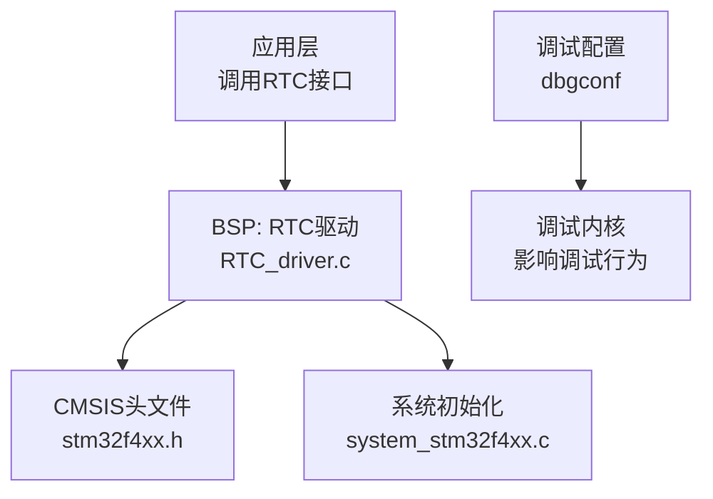
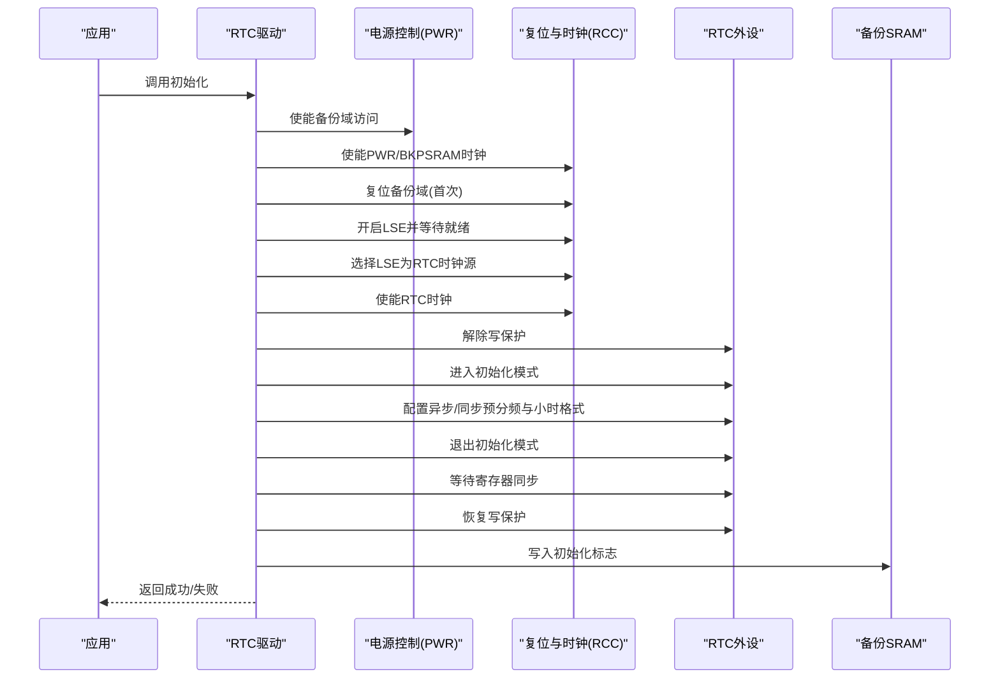
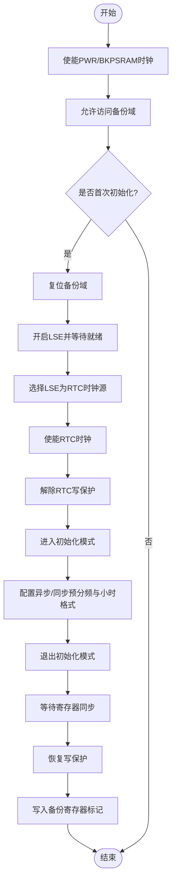
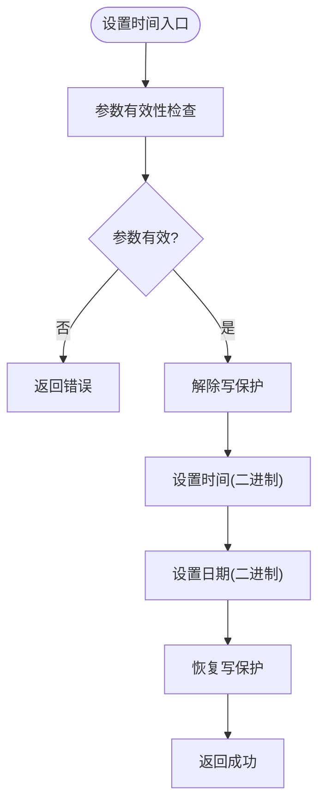
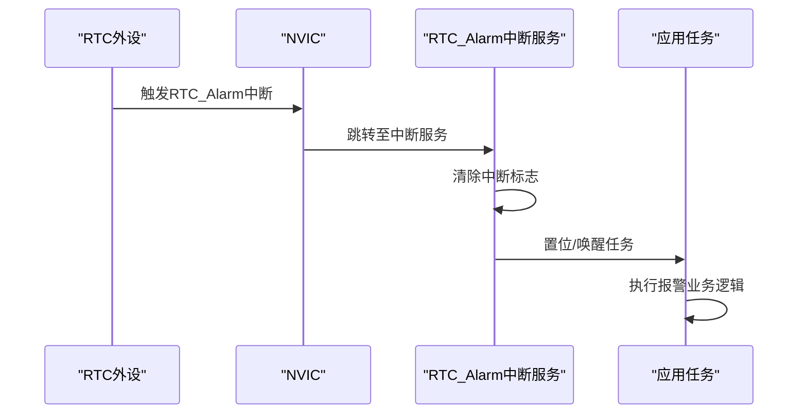
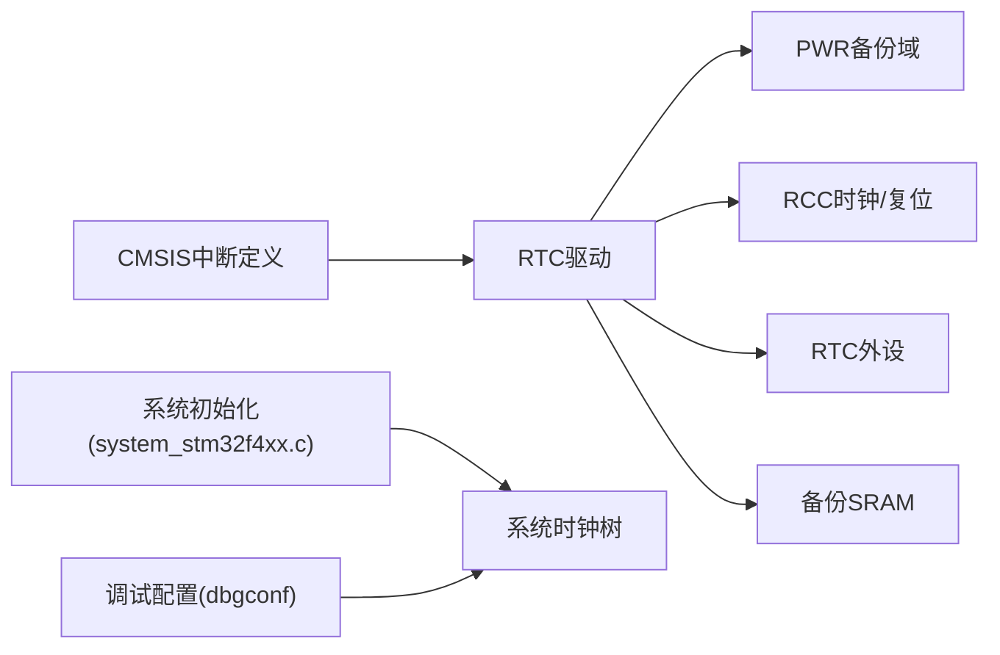

# RTC时钟驱动

<cite>
**本文引用的文件**   
- [RTC_driver.c](file://_gbk_backup/Driver/BSP/RTC_driver.c)
- [stm32f4xx.h](file://_gbk_backup/Driver/CMSIS/stm32f4xx.h)
- [system_stm32f4xx.c](file://_gbk_backup/Driver/CMSIS/system_stm32f4xx.c)
- [F407_freeRTOS_STM32F407ZG.dbgconf](file://DebugConfig/F407_freeRTOS_STM32F407ZG.dbgconf)
</cite>

## 目录
1. [简介](#简介)
2. [项目结构](#项目结构)
3. [核心组件](#核心组件)
4. [架构总览](#架构总览)
5. [详细组件分析](#详细组件分析)
6. [依赖关系分析](#依赖关系分析)
7. [性能与功耗考虑](#性能与功耗考虑)
8. [故障排查指南](#故障排查指南)
9. [结论](#结论)
10. [附录](#附录)

## 简介
本文件面向STM32F4系列的RTC（实时时钟）驱动，围绕以下目标展开：
- 详细说明RTC初始化流程：时钟源选择、分频系数设置、初始时间配置。
- 解释时间读取与设置函数的工作原理，包括BCD码与二进制格式处理。
- 描述闹钟功能的实现思路（事件配置与中断机制），并给出在工程中扩展的要点。
- 说明日历计算相关能力（闰年判断、月份天数、日期校验）在驱动中的体现与使用建议。
- 介绍备份寄存器的使用方法，用于保存关键数据。
- 提供RTC校准与同步方法，确保时间精度。
- 汇总错误处理与调试技巧，以及低功耗模式下的RTC管理策略。

## 项目结构
本项目中与RTC相关的代码位于BSP层，主要文件为RTC驱动实现；系统启动与外设时钟由CMSIS与系统文件负责；调试配置中可控制调试时RTC的行为。

图表来源
- [RTC_driver.c:1-67](file://_gbk_backup/Driver/BSP/RTC_driver.c#L1-L67)
- [stm32f4xx.h:244-751](file://_gbk_backup/Driver/CMSIS/stm32f4xx.h#L244-L751)
- [system_stm32f4xx.c:774-821](file://_gbk_backup/Driver/CMSIS/system_stm32f4xx.c#L774-L821)
- [F407_freeRTOS_STM32F407ZG.dbgconf:25-48](file://DebugConfig/F407_freeRTOS_STM32F407ZG.dbgconf#L25-L48)

章节来源
- [RTC_driver.c:1-67](file://_gbk_backup/Driver/BSP/RTC_driver.c#L1-L67)
- [stm32f4xx.h:244-751](file://_gbk_backup/Driver/CMSIS/stm32f4xx.h#L244-L751)
- [system_stm32f4xx.c:774-821](file://_gbk_backup/Driver/CMSIS/system_stm32f4xx.c#L774-L821)
- [F407_freeRTOS_STM32F407ZG.dbgconf:25-48](file://DebugConfig/F407_freeRTOS_STM32F407ZG.dbgconf#L25-L48)

## 核心组件
- RTC初始化与写保护管理：通过PWR/RCC使能备份域与时钟，选择LSE作为RTC时钟源，配置异步/同步预分频，进入/退出初始化模式，完成参数写入后恢复写保护，并使用备份寄存器标记首次初始化状态。
- 时间与日期读写：封装了带参数有效性检查的设置函数与获取函数，统一以二进制格式进行读写。
- 字符串解析设置：支持从“YYYY-MM-DD HH:MM:SS”格式的字符串解析并设置RTC。
- 高精度时间戳输出：基于亚秒计数器生成毫秒级时间戳字符串。

章节来源
- [RTC_driver.c:9-67](file://_gbk_backup/Driver/BSP/RTC_driver.c#L9-L67)
- [RTC_driver.c:75-121](file://_gbk_backup/Driver/BSP/RTC_driver.c#L75-L121)
- [RTC_driver.c:128-172](file://_gbk_backup/Driver/BSP/RTC_driver.c#L128-L172)
- [RTC_driver.c:198-226](file://_gbk_backup/Driver/BSP/RTC_driver.c#L198-L226)

## 架构总览
下图展示了RTC驱动的调用链路与关键外设交互：

图表来源
- [RTC_driver.c:9-67](file://_gbk_backup/Driver/BSP/RTC_driver.c#L9-L67)

## 详细组件分析

### RTC初始化流程（时钟源、分频、初始时间）
- 时钟源选择：优先使用外部低速晶振LSE（32.768kHz），确保长期运行精度。
- 分频系数设置：
  - 异步预分频：设置为127（0x7F）。
  - 同步预分频：设置为255（0xFF）。
- 初始时间配置：初始化阶段不直接设置时间，而是通过后续设置函数完成；首次上电可通过字符串解析函数一次性设置。

图表来源
- [RTC_driver.c:9-67](file://_gbk_backup/Driver/BSP/RTC_driver.c#L9-L67)

章节来源
- [RTC_driver.c:9-67](file://_gbk_backup/Driver/BSP/RTC_driver.c#L9-L67)

### 时间读取与设置（含格式处理）
- 设置函数：
  - 对传入的时间与日期参数进行范围校验（小时、分钟、秒、星期、月、日、年）。
  - 解除写保护后，分别调用底层设置时间与日期API，均以二进制格式写入。
  - 完成后恢复写保护，返回综合结果。
- 获取函数：
  - 先初始化结构体，再分别读取时间与日期，统一以二进制格式返回。
- 字符串解析设置：
  - 解析“YYYY-MM-DD HH:MM:SS”，自动判断上下午，年份转换为RTC相对年（从2000年起算），星期字段按示例固定值设置。
  - 最终调用统一的设置函数完成写入。

图表来源
- [RTC_driver.c:75-100](file://_gbk_backup/Driver/BSP/RTC_driver.c#L75-L100)

章节来源
- [RTC_driver.c:75-100](file://_gbk_backup/Driver/BSP/RTC_driver.c#L75-L100)
- [RTC_driver.c:108-121](file://_gbk_backup/Driver/BSP/RTC_driver.c#L108-L121)
- [RTC_driver.c:128-172](file://_gbk_backup/Driver/BSP/RTC_driver.c#L128-L172)

### 闹钟功能（事件配置与中断机制）
当前驱动未包含闹钟配置与中断服务程序的具体实现，但工程已暴露RTC闹钟中断向量。若需扩展：
- 事件配置：
  - 通过RTC报警寄存器配置报警条件（时/分/秒/日期等）。
  - 启用对应报警中断位。
- 中断处理：
  - 在RTC_Alarm_IRQn的中断服务程序中清除中断标志，执行业务逻辑（如唤醒、记录日志、触发任务）。
- 注意事项：
  - 修改RTC寄存器前需解除写保护。
  - 在中断中避免长时间阻塞操作，必要时置标志位交由主循环或RTOS任务处理。

图表来源
- [stm32f4xx.h:244-751](file://_gbk_backup/Driver/CMSIS/stm32f4xx.h#L244-L751)

章节来源
- [stm32f4xx.h:244-751](file://_gbk_backup/Driver/CMSIS/stm32f4xx.h#L244-L751)

### 日历计算（闰年、月份天数、日期验证）
- 驱动中对日期参数的合法性进行了基础校验（例如月份1-12、日期1-31、年份范围等）。
- 更严格的日历计算（闰年判断、二月份天数动态计算）建议在应用层或工具库中实现，并在设置前对输入进行二次校验，以避免非法日期写入RTC。

章节来源
- [RTC_driver.c:75-100](file://_gbk_backup/Driver/BSP/RTC_driver.c#L75-L100)

### 备份寄存器（保存关键数据）
- 首次初始化检测：通过读取备份寄存器DR1的值判断是否为首次上电，从而决定是否执行完整初始化流程。
- 初始化完成标记：在初始化成功后向DR1写入特定标志字，避免重复初始化。
- 扩展建议：可将设备ID、校准偏移、用户配置等关键数据存入其他备份寄存器，注意备份域在掉电后仍可保持。

章节来源
- [RTC_driver.c:18-65](file://_gbk_backup/Driver/BSP/RTC_driver.c#L18-L65)

### 时间戳与亚秒精度
- 获取当前时间与亚秒计数值，将亚秒换算为毫秒，并以“HH:MM:SS.mmm”格式输出。
- 该功能可用于日志打点、事件排序与高精度计时场景。

章节来源
- [RTC_driver.c:198-226](file://_gbk_backup/Driver/BSP/RTC_driver.c#L198-L226)

## 依赖关系分析
- RTC驱动依赖：
  - PWR/RCC：备份域访问、LSE时钟、RTC时钟使能与配置。
  - RTC外设：写保护、初始化模式、预分频、时间与日期读写、亚秒读取。
  - 备份SRAM：存储初始化标志与用户数据。
- 系统层依赖：
  - CMSIS头文件定义中断向量（如RTC_Alarm_IRQn）。
  - 系统初始化文件负责主时钟树配置（PLL、HSE等），间接影响系统运行环境。
- 调试配置：
  - dbgconf中可配置调试模式下RTC是否停止，便于调试时观察RTC行为。

图表来源
- [RTC_driver.c:9-67](file://_gbk_backup/Driver/BSP/RTC_driver.c#L9-L67)
- [stm32f4xx.h:244-751](file://_gbk_backup/Driver/CMSIS/stm32f4xx.h#L244-L751)
- [system_stm32f4xx.c:774-821](file://_gbk_backup/Driver/CMSIS/system_stm32f4xx.c#L774-L821)
- [F407_freeRTOS_STM32F407ZG.dbgconf:25-48](file://DebugConfig/F407_freeRTOS_STM32F407ZG.dbgconf#L25-L48)

章节来源
- [RTC_driver.c:9-67](file://_gbk_backup/Driver/BSP/RTC_driver.c#L9-L67)
- [stm32f4xx.h:244-751](file://_gbk_backup/Driver/CMSIS/stm32f4xx.h#L244-L751)
- [system_stm32f4xx.c:774-821](file://_gbk_backup/Driver/CMSIS/system_stm32f4xx.c#L774-L821)
- [F407_freeRTOS_STM32F407ZG.dbgconf:25-48](file://DebugConfig/F407_freeRTOS_STM32F407ZG.dbgconf#L25-L48)

## 性能与功耗考虑
- 时钟源选择：LSE具备较低功耗与较高长期稳定性，适合RTC场景。
- 预分频配置：合理设置异步/同步预分频以获得1Hz基准节拍，同时兼顾亚秒分辨率需求。
- 写保护策略：仅在必要时刻解除写保护，减少误写风险。
- 调试模式：在调试时可配置RTC在Core Halt时继续运行或停止，便于定位时序问题。

章节来源
- [RTC_driver.c:9-67](file://_gbk_backup/Driver/BSP/RTC_driver.c#L9-L67)
- [F407_freeRTOS_STM32F407ZG.dbgconf:25-48](file://DebugConfig/F407_freeRTOS_STM32F407ZG.dbgconf#L25-L48)

## 故障排查指南
- LSE无法就绪：
  - 检查硬件晶振与负载电容，确认LSE起振。
  - 增加超时检测，避免死等。
- 写入失败：
  - 确认已解除写保护且处于非初始化模式。
  - 检查参数范围（小时、分钟、秒、星期、月、日、年）。
- 时间不同步：
  - 确认异步/同步预分频配置正确。
  - 在写入后等待寄存器同步。
- 调试时RTC异常：
  - 检查dbgconf中RTC在调试时的行为配置。
- 备份数据丢失：
  - 确认备份域访问权限与备份SRAM时钟已使能。
  - 检查备份寄存器写入是否被意外复位。

章节来源
- [RTC_driver.c:9-67](file://_gbk_backup/Driver/BSP/RTC_driver.c#L9-L67)
- [RTC_driver.c:75-100](file://_gbk_backup/Driver/BSP/RTC_driver.c#L75-L100)
- [F407_freeRTOS_STM32F407ZG.dbgconf:25-48](file://DebugConfig/F407_freeRTOS_STM32F407ZG.dbgconf#L25-L48)

## 结论
本RTC驱动实现了基于LSE的稳定时钟源选择、合理的预分频配置、安全的写保护与备份域管理，并提供时间与日期的读写封装、字符串解析设置与高精度时间戳输出。虽然未内置闹钟中断处理，但工程已暴露相应中断向量，便于扩展。结合备份寄存器与调试配置，可在多种应用场景下保证时间的准确性与可靠性。

## 附录

### 常用接口速览
- 初始化：RTC_Init_With_LSE
- 设置时间日期：RTC_SetDateTimeEx
- 获取时间日期：RTC_GetDateTimeEx
- 字符串设置：RTC_SetDateTimeFromString
- 时间戳格式化：GetTimestamp

章节来源
- [RTC_driver.c:9-67](file://_gbk_backup/Driver/BSP/RTC_driver.c#L9-L67)
- [RTC_driver.c:75-100](file://_gbk_backup/Driver/BSP/RTC_driver.c#L75-L100)
- [RTC_driver.c:108-121](file://_gbk_backup/Driver/BSP/RTC_driver.c#L108-L121)
- [RTC_driver.c:128-172](file://_gbk_backup/Driver/BSP/RTC_driver.c#L128-L172)
- [RTC_driver.c:198-226](file://_gbk_backup/Driver/BSP/RTC_driver.c#L198-L226)