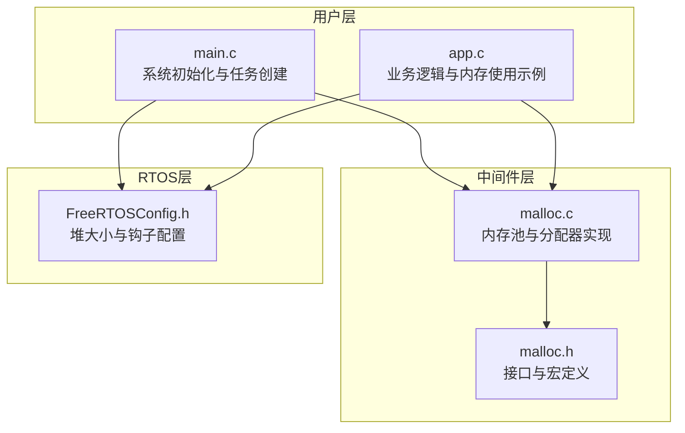
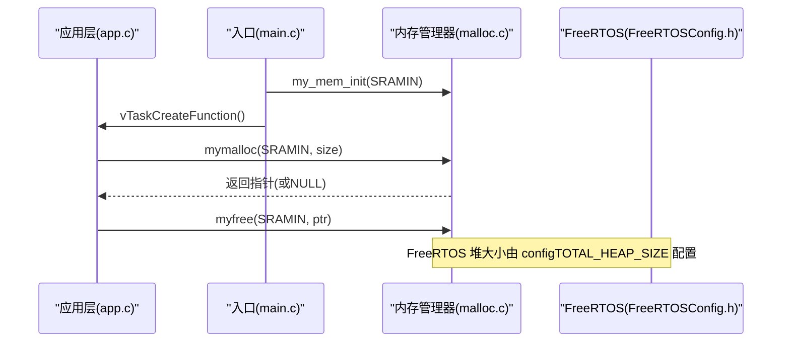
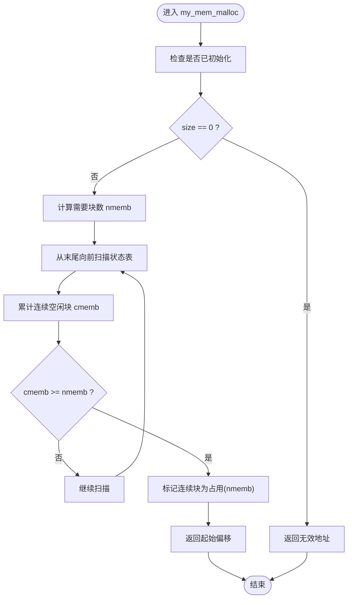
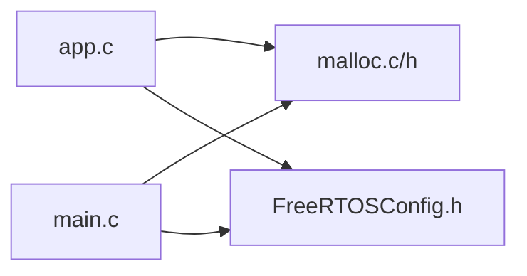

# 内存管理器

<cite>
**本文引用的文件**   
- [malloc.c](file://_gbk_backup/Middle/MALLOC/malloc.c)
- [malloc.h](file://_gbk_backup/Middle/MALLOC/malloc.h)
- [FreeRTOSConfig.h](file://_gbk_backup/User/FreeRTOSConfig.h)
- [app.c](file://_gbk_backup/User/app.c)
- [main.c](file://_gbk_backup/User/main.c)
</cite>

## 目录
1. [简介](#简介)
2. [项目结构](#项目结构)
3. [核心组件](#核心组件)
4. [架构总览](#架构总览)
5. [详细组件分析](#详细组件分析)
6. [依赖关系分析](#依赖关系分析)
7. [性能与碎片化考量](#性能与碎片化考量)
8. [故障排查指南](#故障排查指南)
9. [结论](#结论)
10. [附录：配置与使用要点](#附录配置与使用要点)

## 简介
本仓库实现了一个面向 STM32F4 的自定义内存管理器，提供多区域（内部 SRAM、CCM SRAM、外部 SRAM）固定块大小的内存池分配与释放接口，并在 FreeRTOS 环境下被上层应用用于动态对象（如 FATFS 对象、协议缓冲区等）的生命周期管理。该文档围绕以下目标展开：
- 解释动态内存分配算法与内存池管理、块分配策略
- 说明内存对齐机制与空闲链表/状态表管理
- 描述与 FreeRTOS 的集成方式、线程安全保护与泄漏检测现状
- 给出配置项说明（堆大小、分配阈值等）
- 提供内存监控工具使用方法（占用统计、碎片率分析思路）
- 总结最佳实践、性能优化建议与常见问题诊断方法

## 项目结构
本项目中与内存管理直接相关的代码集中在 Middle/MALLOC 目录，并在 User 层通过 main 初始化并调用；FreeRTOS 相关配置位于 User/FreeRTOSConfig.h。

图表来源
- [main.c:34-59](file://_gbk_backup/User/main.c#L34-L59)
- [app.c:311-366](file://_gbk_backup/User/app.c#L311-L366)
- [malloc.h:34-53](file://_gbk_backup/Middle/MALLOC/malloc.h#L34-L53)
- [malloc.c:28-51](file://_gbk_backup/Middle/MALLOC/malloc.c#L28-L51)
- [FreeRTOSConfig.h:38-43](file://_gbk_backup/User/FreeRTOSConfig.h#L38-L43)

章节来源
- [main.c:34-59](file://_gbk_backup/User/main.c#L34-L59)
- [app.c:311-366](file://_gbk_backup/User/app.c#L311-L366)
- [malloc.h:34-53](file://_gbk_backup/Middle/MALLOC/malloc.h#L34-L53)
- [malloc.c:28-51](file://_gbk_backup/Middle/MALLOC/malloc.c#L28-L51)
- [FreeRTOSConfig.h:38-43](file://_gbk_backup/User/FreeRTOSConfig.h#L38-L43)

## 核心组件
- 内存池与状态表
  - 三个内存池：内部 SRAM、CCM SRAM、外部 SRAM，分别以数组形式声明并按需对齐
  - 每个内存池对应一个“内存管理状态表”（映射表），记录每块的占用长度或空闲标记
- 内存管理控制器
  - 统一封装初始化函数指针、使用率计算函数指针、各池基址、映射表指针以及就绪标志
- 对外 API
  - my_mem_init：初始化指定内存池
  - my_mem_malloc / my_mem_free：内部分配/释放（按偏移）
  - mymalloc / myfree / myrealloc：用户侧分配/释放/重分配
  - my_mem_perused：统计已用块数占比（百分比×10）

章节来源
- [malloc.h:56-78](file://_gbk_backup/Middle/MALLOC/malloc.h#L56-L78)
- [malloc.c:28-51](file://_gbk_backup/Middle/MALLOC/malloc.c#L28-L51)
- [malloc.c:85-109](file://_gbk_backup/Middle/MALLOC/malloc.c#L85-L109)
- [malloc.c:119-160](file://_gbk_backup/Middle/MALLOC/malloc.c#L119-L160)
- [malloc.c:171-194](file://_gbk_backup/Middle/MALLOC/malloc.c#L171-L194)
- [malloc.c:202-258](file://_gbk_backup/Middle/MALLOC/malloc.c#L202-L258)

## 架构总览
下图展示从应用层到内存管理器的调用链，以及与 FreeRTOS 配置的关联。

图表来源
- [main.c:39-59](file://_gbk_backup/User/main.c#L39-L59)
- [app.c:311-366](file://_gbk_backup/User/app.c#L311-L366)
- [malloc.c:85-109](file://_gbk_backup/Middle/MALLOC/malloc.c#L85-L109)
- [FreeRTOSConfig.h:38-43](file://_gbk_backup/User/FreeRTOSConfig.h#L38-L43)

## 详细组件分析

### 内存池与块分配策略
- 固定块大小
  - 每个内存池采用固定大小的块进行划分，块大小在头文件中定义
  - 分配时根据请求字节数向上取整为若干块，再在状态表中寻找连续空闲块
- 状态表（映射表）
  - 每个元素表示一个块的状态：0 表示空闲，非零值表示占用且值为占用块数量
  - 分配时从后向前扫描，累计连续空闲块数，达到所需块数即标记为占用
  - 释放时根据首块状态读取占用块数，将连续块清零
- 边界检查
  - 释放前校验偏移是否在内存池范围内，越界返回错误码

图表来源
- [malloc.c:119-160](file://_gbk_backup/Middle/MALLOC/malloc.c#L119-L160)

章节来源
- [malloc.c:119-160](file://_gbk_backup/Middle/MALLOC/malloc.c#L119-L160)
- [malloc.c:171-194](file://_gbk_backup/Middle/MALLOC/malloc.c#L171-L194)

### 内存对齐机制
- 内存池数组声明时使用对齐属性，确保基地址满足硬件访问对齐要求（例如 32 字节对齐）
- 块大小与对齐配合，保证数据结构的自然对齐，减少总线访问开销

章节来源
- [malloc.c:28-31](file://_gbk_backup/Middle/MALLOC/malloc.c#L28-L31)
- [malloc.h:40-53](file://_gbk_backup/Middle/MALLOC/malloc.h#L40-L53)

### 碎片整理与空闲合并策略
- 当前实现未包含显式的空闲链表与碎片整理（合并相邻空闲块）逻辑
- 释放操作仅将对应块标记为空闲，不进行跨块合并
- 因此，长期运行可能产生“外部碎片”（分散的空闲块无法组合成足够大的连续块）

章节来源
- [malloc.c:171-194](file://_gbk_backup/Middle/MALLOC/malloc.c#L171-L194)

### 与 FreeRTOS 的集成
- 独立于 FreeRTOS 堆
  - 自定义内存管理器维护自己的内存池，不直接使用 FreeRTOS 的 ucHeap
  - FreeRTOS 堆大小通过 configTOTAL_HEAP_SIZE 配置，用于内核对象与任务栈等
- 线程安全
  - 当前内存管理器未内置互斥锁或临界区保护
  - 若在多任务环境中并发调用 mymalloc/myfree，需在应用层加锁或使用队列/信号量保护共享资源
- 内存泄漏检测
  - FreeRTOS 配置中未启用 malloc 失败钩子
  - 建议在应用层增加分配失败计数与日志上报，结合使用率统计定位潜在泄漏

章节来源
- [FreeRTOSConfig.h:38-43](file://_gbk_backup/User/FreeRTOSConfig.h#L38-L43)
- [FreeRTOSConfig.h:45-50](file://_gbk_backup/User/FreeRTOSConfig.h#L45-L50)
- [malloc.c:119-160](file://_gbk_backup/Middle/MALLOC/malloc.c#L119-L160)

### 内存使用监控
- 使用率统计
  - my_mem_perused 遍历状态表统计已用块数，返回“使用率×10”的值（便于显示小数点后一位）
- 碎片率分析
  - 可通过遍历状态表统计“最大连续空闲块长度”与“总空闲块数”，估算外部碎片程度
  - 建议在调试版本中暴露统计接口，周期性打印

章节来源
- [malloc.c:97-109](file://_gbk_backup/Middle/MALLOC/malloc.c#L97-L109)

### 典型用法与生命周期
- 在 main 中初始化内存池
- 在业务任务中按需分配/释放对象（如 FATFS 对象、协议缓冲区）
- 分配失败时返回 NULL，应做错误处理与降级策略

章节来源
- [main.c:39-59](file://_gbk_backup/User/main.c#L39-L59)
- [app.c:311-366](file://_gbk_backup/User/app.c#L311-L366)

## 依赖关系分析
- 模块耦合
  - app.c 与 main.c 均依赖 malloc.h/c 提供的分配接口
  - FreeRTOS 配置与内存管理器相互独立，但共同影响系统可用内存
- 外部依赖
  - 编译器对齐属性与链接器地址分配（__attribute__((at(...)))）
  - FreeRTOS 调度器与任务/队列/信号量等同步原语（在应用层使用）

图表来源
- [app.c:311-366](file://_gbk_backup/User/app.c#L311-L366)
- [main.c:39-59](file://_gbk_backup/User/main.c#L39-L59)
- [FreeRTOSConfig.h:38-43](file://_gbk_backup/User/FreeRTOSConfig.h#L38-L43)

章节来源
- [app.c:311-366](file://_gbk_backup/User/app.c#L311-L366)
- [main.c:39-59](file://_gbk_backup/User/main.c#L39-L59)
- [FreeRTOSConfig.h:38-43](file://_gbk_backup/User/FreeRTOSConfig.h#L38-L43)

## 性能与碎片化考量
- 分配复杂度
  - 线性扫描状态表，时间复杂度 O(N)，N 为块数量
  - 适合中小规模内存池；当池很大时可考虑引入空闲链表或分段空闲列表优化
- 空间开销
  - 状态表占用额外 RAM，大小为“池大小/块大小”
- 碎片化
  - 无合并策略，易产生外部碎片
  - 建议：
    - 尽量分配相同大小的对象，减少小块碎片
    - 对频繁分配/释放的对象采用对象池复用
    - 定期统计碎片指标，必要时重启关键子系统回收内存

[本节为通用性能讨论，不直接分析具体文件]

## 故障排查指南
- 分配失败（返回 NULL）
  - 检查请求大小是否超过单块连续容量上限
  - 检查是否多次分配未释放导致耗尽
  - 查看 my_mem_perused 的使用率趋势
- 越界释放
  - 释放前校验偏移是否在池内范围
  - 避免重复释放同一指针
- 多线程竞争
  - 在应用层对共享内存池的访问加锁（互斥量/临界区）
  - 或在 ISR 中避免直接调用分配/释放接口
- 内存泄漏
  - 结合使用率统计与日志，定位未释放路径
  - 在 FreeRTOS 中可开启 malloc 失败钩子以便快速告警

章节来源
- [malloc.c:171-194](file://_gbk_backup/Middle/MALLOC/malloc.c#L171-L194)
- [malloc.c:220-258](file://_gbk_backup/Middle/MALLOC/malloc.c#L220-L258)
- [FreeRTOSConfig.h:45-50](file://_gbk_backup/User/FreeRTOSConfig.h#L45-L50)

## 结论
该内存管理器以固定块大小的多池方案提供了简单高效的动态内存分配能力，适用于嵌入式系统中对确定性与时序敏感的场景。其优势在于实现简洁、可控性强；不足在于缺乏空闲合并与线程安全保护，需要在应用层补充相应机制。结合 FreeRTOS 的配置与监控手段，可在实际项目中实现稳定可靠的内存管理。

[本节为总结性内容，不直接分析具体文件]

## 附录：配置与使用要点
- 内存池参数
  - 块大小、池大小、表大小在头文件中定义，可根据目标平台调整
- 初始化顺序
  - 在 main 中先初始化内存池，再创建任务
- 使用建议
  - 优先使用固定大小分配，减少碎片
  - 对关键对象采用对象池或静态分配
  - 在应用层增加分配失败计数与日志
  - 定期输出使用率与碎片指标

章节来源
- [malloc.h:40-53](file://_gbk_backup/Middle/MALLOC/malloc.h#L40-L53)
- [main.c:39-59](file://_gbk_backup/User/main.c#L39-L59)