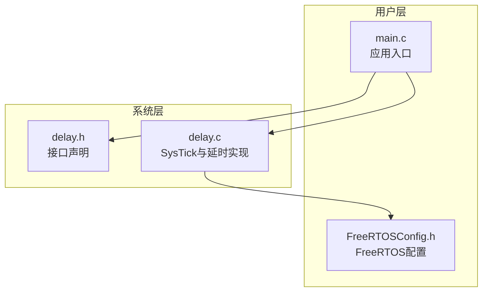
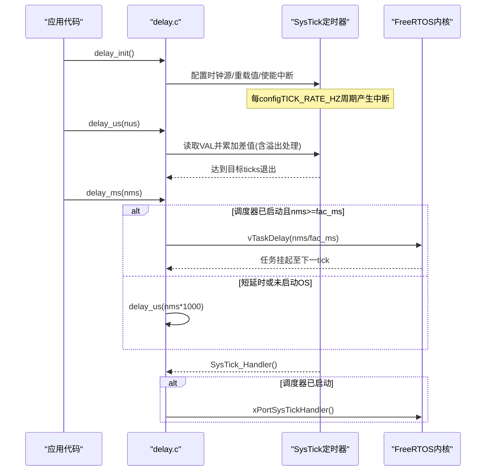
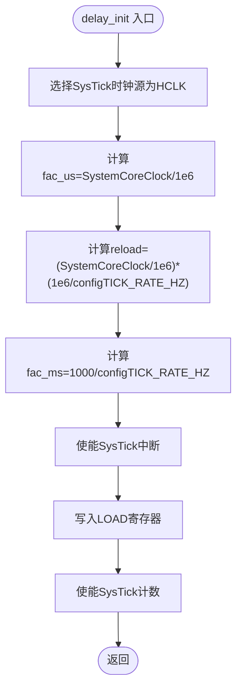
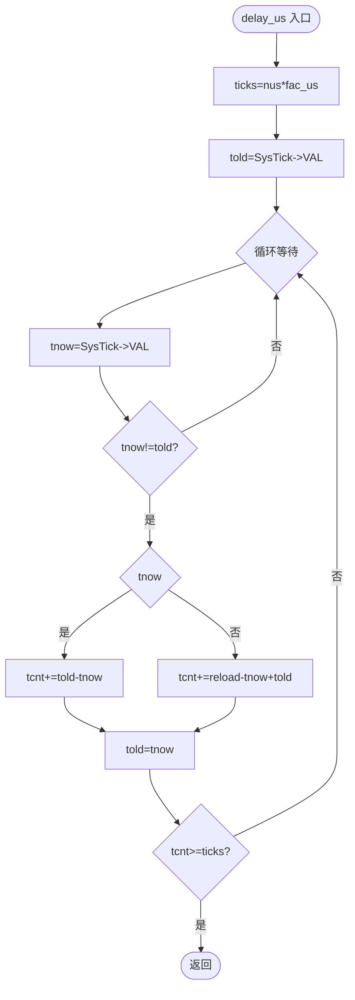
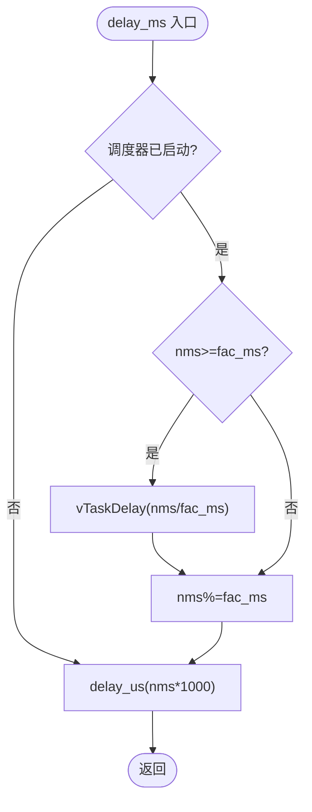
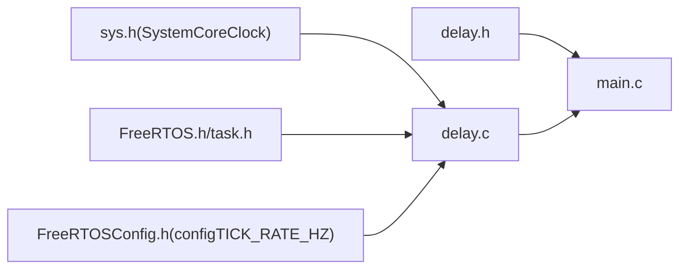

# 延时系统

<cite>
**本文引用的文件**   
- [delay.c](file://_gbk_backup/Driver/SYSTEM/delay.c)
- [delay.h](file://_gbk_backup/Driver/SYSTEM/delay.h)
- [main.c](file://_gbk_backup/User/main.c)
- [FreeRTOSConfig.h](file://_gbk_backup/User/FreeRTOSConfig.h)
</cite>

## 目录
1. [简介](#简介)
2. [项目结构](#项目结构)
3. [核心组件](#核心组件)
4. [架构总览](#架构总览)
5. [详细组件分析](#详细组件分析)
6. [依赖关系分析](#依赖关系分析)
7. [性能与精度](#性能与精度)
8. [故障排查指南](#故障排查指南)
9. [结论](#结论)
10. [附录：使用示例与最佳实践](#附录使用示例与最佳实践)

## 简介
本文件面向STM32F4 + FreeRTOS的延时子系统，系统性说明SysTick定时器的配置原理、微秒级与毫秒级延时的实现机制、与FreeRTOS的集成方式、精度保证策略以及常见问题定位方法。文档同时给出在不同场景下的延时函数选用建议与初始化流程要点，帮助读者在工程实践中稳定、高效地使用延时功能。

## 项目结构
延时相关代码位于驱动层SYSTEM模块，主程序在User层调用并初始化延时系统；FreeRTOS内核配置通过FreeRTOSConfig.h提供节拍频率与中断优先级等关键参数。

图表来源
- [main.c:34-60](file://_gbk_backup/User/main.c#L34-L60)
- [delay.c:1-81](file://_gbk_backup/Driver/SYSTEM/delay.c#L1-L81)
- [FreeRTOSConfig.h:15-17](file://_gbk_backup/User/FreeRTOSConfig.h#L15-L17)

章节来源
- [main.c:34-60](file://_gbk_backup/User/main.c#L34-L60)
- [delay.c:1-81](file://_gbk_backup/Driver/SYSTEM/delay.c#L1-L81)
- [FreeRTOSConfig.h:15-17](file://_gbk_backup/User/FreeRTOSConfig.h#L15-L17)

## 核心组件
- SysTick定时器：作为系统节拍与时基源，用于微秒计数与毫秒节拍。
- delay_init()：完成SysTick时钟源选择、重载值计算、中断使能及全局系数初始化。
- delay_us()：基于SysTick计数器轮询的微秒级延时，处理计数器溢出。
- delay_ms()：结合FreeRTOS任务调度状态，长延时走OS调度，短延时回退到微秒级。
- delay_xms()：纯忙等待的毫秒级延时，不触发任务调度。

章节来源
- [delay.c:22-35](file://_gbk_backup/Driver/SYSTEM/delay.c#L22-L35)
- [delay.c:38-56](file://_gbk_backup/Driver/SYSTEM/delay.c#L38-L56)
- [delay.c:60-71](file://_gbk_backup/Driver/SYSTEM/delay.c#L60-L71)
- [delay.c:75-79](file://_gbk_backup/Driver/SYSTEM/delay.c#L75-L79)

## 架构总览
延时系统与FreeRTOS的交互如下：SysTick中断既服务于FreeRTOS内核节拍，也作为微秒计数的硬件基础。delay_ms()根据调度器状态智能选择OS延时或微秒延时，确保在RTOS环境下既不阻塞调度，又保持高精度短时延时。

图表来源
- [delay.c:14-20](file://_gbk_backup/Driver/SYSTEM/delay.c#L14-L20)
- [delay.c:22-35](file://_gbk_backup/Driver/SYSTEM/delay.c#L22-L35)
- [delay.c:38-71](file://_gbk_backup/Driver/SYSTEM/delay.c#L38-L71)
- [FreeRTOSConfig.h:17](file://_gbk_backup/User/FreeRTOSConfig.h#L17)

## 详细组件分析

### SysTick定时器配置与中断优先级
- 时钟源选择：SysTick采用HCLK作为时钟源，确保计数频率等于CPU主频SystemCoreClock。
- 重载值计算：
  - fac_us = SystemCoreClock / 1,000,000，表示每微秒的计数增量。
  - reload = (SystemCoreClock / 1,000,000) * (1,000,000 / configTICK_RATE_HZ)，即每个tick对应的计数值。
  - fac_ms = 1000 / configTICK_RATE_HZ，用于将毫秒转换为tick数。
- 中断使能：开启SysTick中断，以便FreeRTOS内核进行任务调度与时间片管理。
- NVIC优先级分组：main中设置NVIC_PriorityGroup_4（全抢占式），FreeRTOS可管理的最高中断优先级由configMAX_SYSCALL_INTERRUPT_PRIORITY决定。

图表来源
- [delay.c:22-35](file://_gbk_backup/Driver/SYSTEM/delay.c#L22-L35)
- [FreeRTOSConfig.h:15-17](file://_gbk_backup/User/FreeRTOSConfig.h#L15-L17)

章节来源
- [delay.c:22-35](file://_gbk_backup/Driver/SYSTEM/delay.c#L22-L35)
- [main.c:36-37](file://_gbk_backup/User/main.c#L36-L37)
- [FreeRTOSConfig.h:93-103](file://_gbk_backup/User/FreeRTOSConfig.h#L93-L103)

### 微秒级延时 delay_us()
- 计数目标：ticks = nus * fac_us。
- 溢出处理：通过比较当前VAL与上次told，若发生递减方向变化（计数器从0上溢回到LOAD），则按“told - tnow”或“reload - tnow + told”累加tcnt，从而正确统计跨越一次溢出的时间。
- 退出条件：当累计tcnt >= ticks时退出循环，达到精确延时。

图表来源
- [delay.c:38-56](file://_gbk_backup/Driver/SYSTEM/delay.c#L38-L56)

章节来源
- [delay.c:38-56](file://_gbk_backup/Driver/SYSTEM/delay.c#L38-L56)

### 毫秒级延时 delay_ms() 与FreeRTOS集成
- 调度器状态检测：若调度器未启动，直接回退到微秒延时路径。
- 长延时优化：当nms >= fac_ms且调度器已启动，调用vTaskDelay(nms/fac_ms)让出CPU，避免忙等。
- 剩余部分：对nms取模后，再调用delay_us()完成不足一个tick的精确延时。

图表来源
- [delay.c:60-71](file://_gbk_backup/Driver/SYSTEM/delay.c#L60-L71)
- [FreeRTOSConfig.h:17](file://_gbk_backup/User/FreeRTOSConfig.h#L17)

章节来源
- [delay.c:60-71](file://_gbk_backup/Driver/SYSTEM/delay.c#L60-L71)
- [FreeRTOSConfig.h:17](file://_gbk_backup/User/FreeRTOSConfig.h#L17)

### SysTick中断与FreeRTOS内核
- SysTick_Handler中判断调度器是否已启动，若已启动则转发给xPortSysTickHandler()，由FreeRTOS内核维护任务调度与时间片。
- 该设计确保在RTOS环境下，SysTick既可作为微秒计时基准，又不干扰内核节拍。

章节来源
- [delay.c:14-20](file://_gbk_backup/Driver/SYSTEM/delay.c#L14-L20)
- [FreeRTOSConfig.h:105-107](file://_gbk_backup/User/FreeRTOSConfig.h#L105-L107)

### 非阻塞毫秒延时 delay_xms()
- 通过循环调用delay_us(1000)实现nms毫秒的忙等待，不会触发任务调度，适用于需要严格时序但不允许让出CPU的场景。

章节来源
- [delay.c:75-79](file://_gbk_backup/Driver/SYSTEM/delay.c#L75-L79)

## 依赖关系分析
- delay.c依赖sys.h获取SystemCoreClock，依赖FreeRTOS头文件以调用调度器状态查询与延时API。
- main.c在系统初始化阶段调用delay_init()，随后创建任务并启动调度器。
- FreeRTOSConfig.h定义configTICK_RATE_HZ=1000Hz，决定了fac_ms=1ms，并与SysTick重载值reload保持一致。

图表来源
- [delay.c:1-6](file://_gbk_backup/Driver/SYSTEM/delay.c#L1-L6)
- [main.c:34-38](file://_gbk_backup/User/main.c#L34-L38)
- [FreeRTOSConfig.h:15-17](file://_gbk_backup/User/FreeRTOSConfig.h#L15-L17)

章节来源
- [delay.c:1-6](file://_gbk_backup/Driver/SYSTEM/delay.c#L1-L6)
- [main.c:34-38](file://_gbk_backup/User/main.c#L34-L38)
- [FreeRTOSConfig.h:15-17](file://_gbk_backup/User/FreeRTOSConfig.h#L15-L17)

## 性能与精度
- 精度来源：
  - 微秒延时基于SysTick硬件计数器，误差主要来源于中断延迟与分支开销，通常在高主频下可达到亚微秒级抖动。
  - 毫秒延时在RTOS环境下，长延时由vTaskDelay提供tick级精度；短延时由delay_us补足。
- 性能优化：
  - 长延时优先使用vTaskDelay，避免占用CPU。
  - 短延时使用delay_us，减少上下文切换开销。
  - 关闭不必要的调试输出与外设访问，降低中断与分支带来的抖动。
- 适用场景：
  - delay_us：通信协议位级延时、精确时序控制。
  - delay_ms：一般业务延时，兼顾RTOS友好性。
  - delay_xms：不允许让出CPU的严格时序段（谨慎使用）。

[本节为通用指导，不直接分析具体文件]

## 故障排查指南
- 现象：延时不准确或抖动大
  - 检查SysTick时钟源是否为HCLK，确认SystemCoreClock与实际主频一致。
  - 检查configTICK_RATE_HZ是否与SysTick重载值匹配（reload计算依赖该值）。
- 现象：RTOS环境下延时异常
  - 确认SysTick_Handler中已调用xPortSysTickHandler()，且调度器已启动。
  - 检查NVIC优先级分组与FreeRTOS可管理中断优先级范围是否合理。
- 现象：长时间延时导致系统卡顿
  - 避免在高频循环中使用delay_xms()，改用delay_ms()或事件/队列机制。
- 现象：微秒延时过长
  - 检查是否存在高优先级中断频繁打断，导致SysTick中断延迟增大。

章节来源
- [delay.c:14-20](file://_gbk_backup/Driver/SYSTEM/delay.c#L14-L20)
- [delay.c:22-35](file://_gbk_backup/Driver/SYSTEM/delay.c#L22-L35)
- [FreeRTOSConfig.h:93-103](file://_gbk_backup/User/FreeRTOSConfig.h#L93-L103)

## 结论
本延时系统以SysTick为核心，结合FreeRTOS的任务调度机制，提供了高精度微秒延时与RTOS友好的毫秒延时。通过合理的重载值计算与溢出处理，系统在RTOS与非RTOS环境下均能稳定工作。工程实践中应依据延时长度与实时性要求选择合适的函数，并注意中断优先级与系统主频配置的一致性。

[本节为总结性内容，不直接分析具体文件]

## 附录：使用示例与最佳实践

- 初始化流程
  - 在main中首先配置NVIC优先级分组，然后调用delay_init()初始化SysTick与延时系数。
  - 随后初始化串口、外设、队列与任务，最后启动FreeRTOS调度器。

- 典型用法
  - 微秒级延时：在通信协议或精确时序控制处调用delay_us()。
  - 毫秒级延时：在普通业务逻辑中调用delay_ms()，利用RTOS调度提升整体吞吐。
  - 非阻塞毫秒延时：仅在必须禁止调度的关键段使用delay_xms()，并尽量缩短时长。

- 代码片段路径参考
  - 初始化与调用位置：[main.c:34-38](file://_gbk_backup/User/main.c#L34-L38)
  - 接口声明：[delay.h:6-9](file://_gbk_backup/Driver/SYSTEM/delay.h#L6-L9)
  - 微秒延时实现：[delay.c:38-56](file://_gbk_backup/Driver/SYSTEM/delay.c#L38-L56)
  - 毫秒延时实现：[delay.c:60-71](file://_gbk_backup/Driver/SYSTEM/delay.c#L60-L71)
  - FreeRTOS节拍配置：[FreeRTOSConfig.h:17](file://_gbk_backup/User/FreeRTOSConfig.h#L17)

章节来源
- [main.c:34-38](file://_gbk_backup/User/main.c#L34-L38)
- [delay.h:6-9](file://_gbk_backup/Driver/SYSTEM/delay.h#L6-L9)
- [delay.c:38-71](file://_gbk_backup/Driver/SYSTEM/delay.c#L38-L71)
- [FreeRTOSConfig.h:17](file://_gbk_backup/User/FreeRTOSConfig.h#L17)