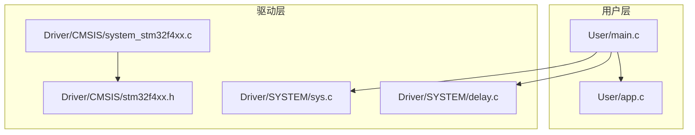
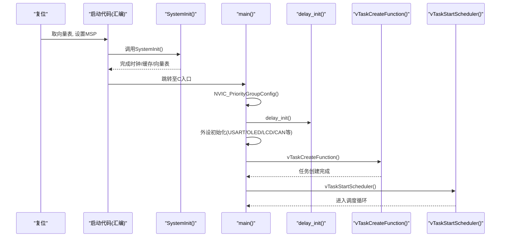
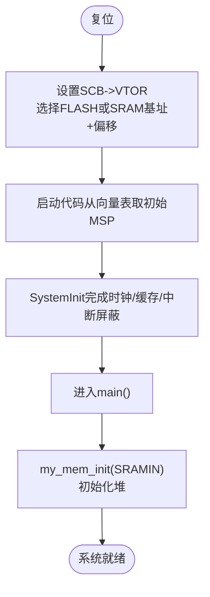
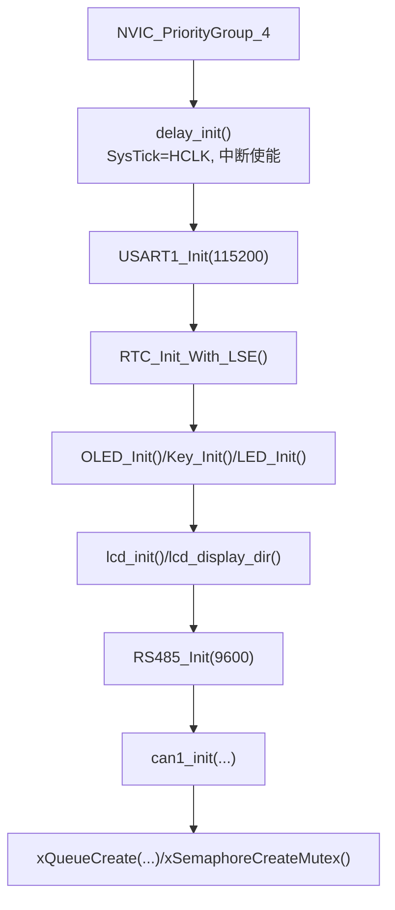
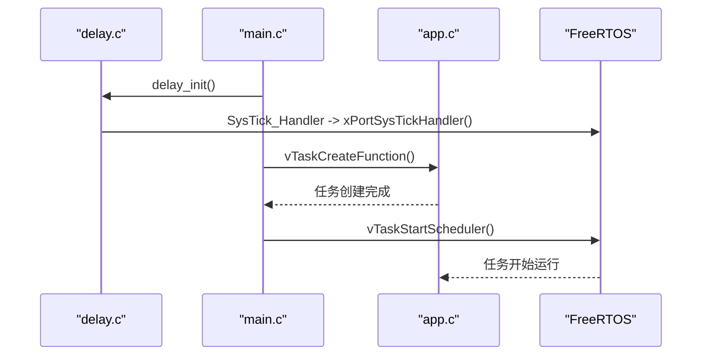
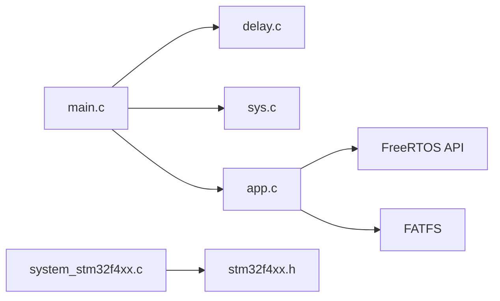

# 系统初始化

<cite>
**本文引用的文件**   
- [main.c](file://_gbk_backup/User/main.c)
- [app.c](file://_gbk_backup/User/app.c)
- [system_stm32f4xx.c](file://_gbk_backup/Driver/CMSIS/system_stm32f4xx.c)
- [stm32f4xx.h](file://_gbk_backup/Driver/CMSIS/stm32f4xx.h)
- [sys.c](file://_gbk_backup/Driver/SYSTEM/sys.c)
- [delay.c](file://_gbk_backup/Driver/SYSTEM/delay.c)
</cite>

## 目录
1. [引言](#引言)
2. [项目结构](#项目结构)
3. [核心组件](#核心组件)
4. [架构总览](#架构总览)
5. [详细组件分析](#详细组件分析)
6. [依赖关系分析](#依赖关系分析)
7. [性能与启动时序](#性能与启动时序)
8. [故障诊断与自检](#故障诊断与自检)
9. [结论](#结论)

## 引言
本文件面向STM32F407（FreeRTOS）系统的“系统初始化”模块，系统性梳理从复位到FreeRTOS调度器启动的完整流程。内容覆盖：
- 向量表设置、栈指针初始化与堆初始化
- 硬件抽象层初始化顺序（外设时钟使能、GPIO配置、中断优先级分组）
- 系统核心服务启动（SysTick、内存管理、FreeRTOS内核）
- 系统配置参数加载与验证机制
- 系统自检（内存测试、外设功能验证）
- 启动日志输出与故障诊断方法
- 系统重启与看门狗管理实现要点

## 项目结构
本项目采用分层组织方式：
- User层：应用入口 main.c、任务与应用逻辑 app.c
- Driver层：CMSIS系统初始化 system_stm32f4xx.c、设备头文件 stm32f4xx.h、通用系统工具 sys.c、延时与SysTick delay.c
- Middle层：文件系统、内存管理等（本文件聚焦系统初始化）

图表来源
- [main.c:34-60](file://_gbk_backup/User/main.c#L34-L60)
- [app.c:529-541](file://_gbk_backup/User/app.c#L529-L541)
- [system_stm32f4xx.c:476-515](file://_gbk_backup/Driver/CMSIS/system_stm32f4xx.c#L476-L515)
- [delay.c:22-35](file://_gbk_backup/Driver/SYSTEM/delay.c#L22-L35)

章节来源
- [main.c:34-60](file://_gbk_backup/User/main.c#L34-L60)
- [app.c:529-541](file://_gbk_backup/User/app.c#L529-L541)

## 核心组件
- 系统启动入口与外设初始化序列：main.c
- CMSIS系统初始化与向量表重定位：system_stm32f4xx.c
- 中断优先级分组与系统工具：sys.c
- SysTick与延时库：delay.c
- FreeRTOS任务创建与业务逻辑：app.c
- 设备定义与中断号：stm32f4xx.h

章节来源
- [main.c:34-60](file://_gbk_backup/User/main.c#L34-L60)
- [system_stm32f4xx.c:476-515](file://_gbk_backup/Driver/CMSIS/system_stm32f4xx.c#L476-L515)
- [sys.c:34-93](file://_gbk_backup/Driver/SYSTEM/sys.c#L34-L93)
- [delay.c:22-35](file://_gbk_backup/Driver/SYSTEM/delay.c#L22-L35)
- [app.c:529-541](file://_gbk_backup/User/app.c#L529-L541)
- [stm32f4xx.h:179-200](file://_gbk_backup/Driver/CMSIS/stm32f4xx.h#L179-L200)

## 架构总览
下图展示从复位到FreeRTOS调度器启动的关键路径：

图表来源
- [system_stm32f4xx.c:476-515](file://_gbk_backup/Driver/CMSIS/system_stm32f4xx.c#L476-L515)
- [main.c:34-60](file://_gbk_backup/User/main.c#L34-L60)
- [delay.c:22-35](file://_gbk_backup/Driver/SYSTEM/delay.c#L22-L35)
- [app.c:529-541](file://_gbk_backup/User/app.c#L529-L541)

## 详细组件分析

### 1) 向量表设置、栈指针初始化与堆初始化
- 向量表重定位：在SystemInit中根据宏选择将向量表置于内部SRAM或FLASH，并设置偏移量VECT_TAB_OFFSET。
- 栈指针初始化：由启动代码在复位后从向量表读取初始MSP；同时提供sys_msr_msp用于运行时修改MSP。
- 堆初始化：使用my_mem_init(SRAMIN)完成堆初始化，供后续动态分配（如FATFS对象）。

图表来源
- [system_stm32f4xx.c:357-358](file://_gbk_backup/Driver/CMSIS/system_stm32f4xx.c#L357-L358)
- [system_stm32f4xx.c:510-514](file://_gbk_backup/Driver/CMSIS/system_stm32f4xx.c#L510-L514)
- [sys.c:65-68](file://_gbk_backup/Driver/SYSTEM/sys.c#L65-L68)
- [main.c:39](file://_gbk_backup/User/main.c#L39)

章节来源
- [system_stm32f4xx.c:357-358](file://_gbk_backup/Driver/CMSIS/system_stm32f4xx.c#L357-L358)
- [system_stm32f4xx.c:510-514](file://_gbk_backup/Driver/CMSIS/system_stm32f4xx.c#L510-L514)
- [sys.c:65-68](file://_gbk_backup/Driver/SYSTEM/sys.c#L65-L68)
- [main.c:39](file://_gbk_backup/User/main.c#L39)

### 2) 硬件抽象层初始化顺序
- 中断优先级分组：NVIC_PriorityGroup_4（全部抢占式，无子优先级），确保高优先级中断可抢占低优先级任务。
- SysTick初始化：delay_init()配置SysTick为HCLK源，按configTICK_RATE_HZ计算重载值，开启中断。
- 外设时钟与GPIO：main中依次初始化USART1、RTC、OLED、按键、LED、LCD、RS485、CAN等，这些外设的时钟与GPIO由各自驱动函数完成。
- 队列与互斥量：创建CAN接收队列、按键队列、LCD显示队列、SD卡写入队列与互斥量。

图表来源
- [main.c:36-55](file://_gbk_backup/User/main.c#L36-L55)
- [delay.c:22-35](file://_gbk_backup/Driver/SYSTEM/delay.c#L22-L35)

章节来源
- [main.c:36-55](file://_gbk_backup/User/main.c#L36-L55)
- [delay.c:22-35](file://_gbk_backup/Driver/SYSTEM/delay.c#L22-L35)

### 3) 系统核心服务启动流程
- SysTick：delay_init()中启用SysTick中断，并在SysTick_Handler中转发给FreeRTOS的xPortSysTickHandler，保证任务调度tick。
- 内存管理器：my_mem_init(SRAMIN)初始化堆，后续FATFS对象、FIL结构体通过mymalloc/myfree进行动态分配。
- FreeRTOS内核：vTaskCreateFunction()创建所有任务，vTaskStartScheduler()启动调度器。

图表来源
- [delay.c:14-35](file://_gbk_backup/Driver/SYSTEM/delay.c#L14-L35)
- [main.c:37-59](file://_gbk_backup/User/main.c#L37-L59)
- [app.c:529-541](file://_gbk_backup/User/app.c#L529-L541)

章节来源
- [delay.c:14-35](file://_gbk_backup/Driver/SYSTEM/delay.c#L14-L35)
- [main.c:37-59](file://_gbk_backup/User/main.c#L37-L59)
- [app.c:529-541](file://_gbk_backup/User/app.c#L529-L541)

### 4) 系统配置参数的加载与验证机制
- 时钟配置：SystemInit依据编译期宏与HSE_VALUE/HSE_STARTUP_TIMEOUT进行外部晶振启动与PLL配置，失败时回退HSI。
- 中断优先级：NVIC_PriorityGroup_4固定为全抢占模式，避免子优先级带来的复杂性。
- 外设参数：各外设初始化函数接受波特率、模式等参数，例如USART1_Init(115200)、RS485_Init(9600)、can1_init(...)。
- 验证建议：可在外设初始化成功后打印状态码或寄存器校验位，结合串口日志确认配置生效。

章节来源
- [system_stm32f4xx.c:647-867](file://_gbk_backup/Driver/CMSIS/system_stm32f4xx.c#L647-L867)
- [stm32f4xx.h:128-154](file://_gbk_backup/Driver/CMSIS/stm32f4xx.h#L128-L154)
- [main.c:36-55](file://_gbk_backup/User/main.c#L36-L55)

### 5) 系统自检功能（内存测试与外设功能验证）
- 内存自检：建议在my_mem_init之后执行一段简单的堆读写测试（分配-填充-释放），以验证堆可用性与一致性。
- 外设自检：
  - USART：发送回显帧，检查接收中断与队列是否正常。
  - CAN：发送测试帧并自收，校验ID与数据长度。
  - LCD/OLED：绘制基本图形与字符串，确认显示正常。
  - SD卡：挂载文件系统并写读小文件，验证FATFS工作正常。
- 电池电压检测：周期性读取VBAT ADC，低于阈值触发低功耗模式。

章节来源
- [app.c:154-179](file://_gbk_backup/User/app.c#L154-L179)
- [app.c:414-450](file://_gbk_backup/User/app.c#L414-L450)

### 6) 启动日志输出与故障诊断
- 启动阶段日志：在main中关键步骤前后打印信息（如“USART init OK”、“SD mount success”），便于定位初始化失败点。
- 运行时监控：vTaskMonitor周期性打印任务列表与最小栈空间，帮助发现栈溢出风险。
- 按键调试：短按2次打印任务栈使用情况，长按关闭背光，短按点亮背光。

章节来源
- [app.c:74-91](file://_gbk_backup/User/app.c#L74-L91)
- [app.c:368-412](file://_gbk_backup/User/app.c#L368-L412)
- [app.c:440-446](file://_gbk_backup/User/app.c#L440-L446)

### 7) 系统重启与看门狗管理
- 软复位：通过sys_soft_reset()触发AIRCR复位，可用于异常恢复或OTA升级后重启。
- 待机模式：sys_standby()配置PWR与WKUP引脚，进入深度睡眠并由外部事件唤醒。
- 看门狗：仓库未包含独立看门狗驱动；若需增强可靠性，可在主循环喂狗或在异常处理中复位。

章节来源
- [sys.c:75-93](file://_gbk_backup/Driver/SYSTEM/sys.c#L75-L93)

## 依赖关系分析
- main.c依赖delay.c（SysTick）、sys.c（系统工具）、以及各外设驱动。
- app.c依赖FreeRTOS API、FATFS、LCD、CAN、RTC等。
- system_stm32f4xx.c依赖stm32f4xx.h中的宏与寄存器定义。

图表来源
- [main.c:34-60](file://_gbk_backup/User/main.c#L34-L60)
- [app.c:529-541](file://_gbk_backup/User/app.c#L529-L541)
- [system_stm32f4xx.c:476-515](file://_gbk_backup/Driver/CMSIS/system_stm32f4xx.c#L476-L515)

章节来源
- [main.c:34-60](file://_gbk_backup/User/main.c#L34-L60)
- [app.c:529-541](file://_gbk_backup/User/app.c#L529-L541)
- [system_stm32f4xx.c:476-515](file://_gbk_backup/Driver/CMSIS/system_stm32f4xx.c#L476-L515)

## 性能与启动时序
- 时钟路径：HSE稳定→PLL锁定→切换SYSCLK→Flash预取/缓存/等待周期配置。
- SysTick频率：基于SystemCoreClock与configTICK_RATE_HZ计算重载值，确保任务调度精度。
- 外设初始化顺序：先通信类（USART/RS485/CAN），再显示类（OLED/LCD），最后存储类（SD卡），减少竞争与阻塞。
- 任务栈大小：根据任务复杂度分配（如BMSRecord、SDCard_WriteTask较大栈），并通过vTaskMonitor观察最小剩余栈。

章节来源
- [system_stm32f4xx.c:647-867](file://_gbk_backup/Driver/CMSIS/system_stm32f4xx.c#L647-L867)
- [delay.c:22-35](file://_gbk_backup/Driver/SYSTEM/delay.c#L22-L35)
- [app.c:529-541](file://_gbk_backup/User/app.c#L529-L541)

## 故障诊断与自检
- 常见问题定位：
  - HSE启动失败：检查HSE_VALUE与HSE_STARTUP_TIMEOUT是否与硬件匹配。
  - SysTick不触发：确认SysTick中断使能与FreeRTOS tick钩子。
  - SD卡挂载失败：检查FATFS对象分配与互斥量创建是否成功。
- 自检建议：
  - 内存：分配-填充-释放循环，统计失败次数。
  - 外设：发送-接收回环，校验数据一致性与超时。
  - 显示：绘制色块与字符，确认刷新正常。
- 日志策略：
  - 启动阶段：每个关键步骤打印“OK/FAIL”。
  - 运行阶段：周期性打印任务栈与队列水位，异常时立即dump关键状态。

章节来源
- [stm32f4xx.h:128-154](file://_gbk_backup/Driver/CMSIS/stm32f4xx.h#L128-L154)
- [delay.c:14-35](file://_gbk_backup/Driver/SYSTEM/delay.c#L14-L35)
- [app.c:414-450](file://_gbk_backup/User/app.c#L414-L450)
- [app.c:74-91](file://_gbk_backup/User/app.c#L74-L91)

## 结论
本项目的系统初始化遵循清晰的层次化流程：先由CMSIS完成底层时钟与向量表配置，再由main完成外设与系统服务初始化，最终通过FreeRTOS创建任务并启动调度器。该设计保证了启动的可预测性与可扩展性。建议在现有基础上补充内存自检与外设回环测试，完善启动日志与异常恢复机制，以提升系统鲁棒性与可维护性。