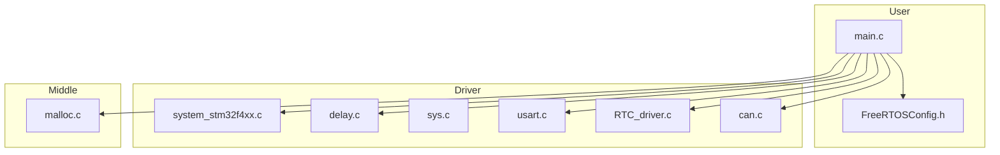
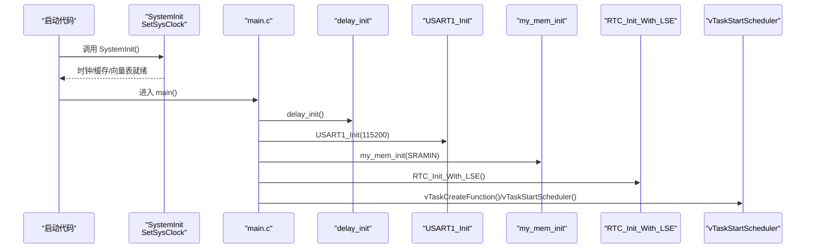
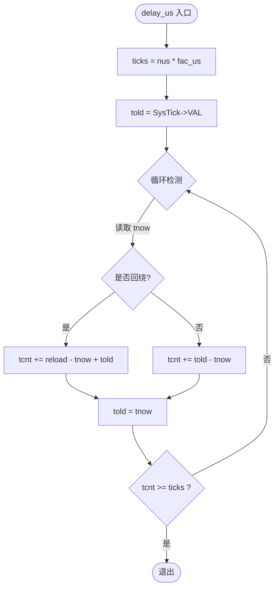
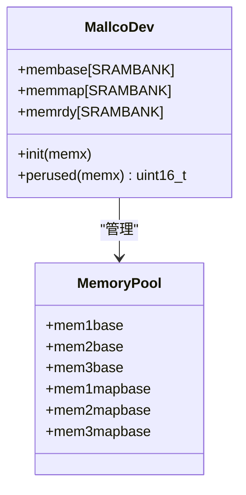
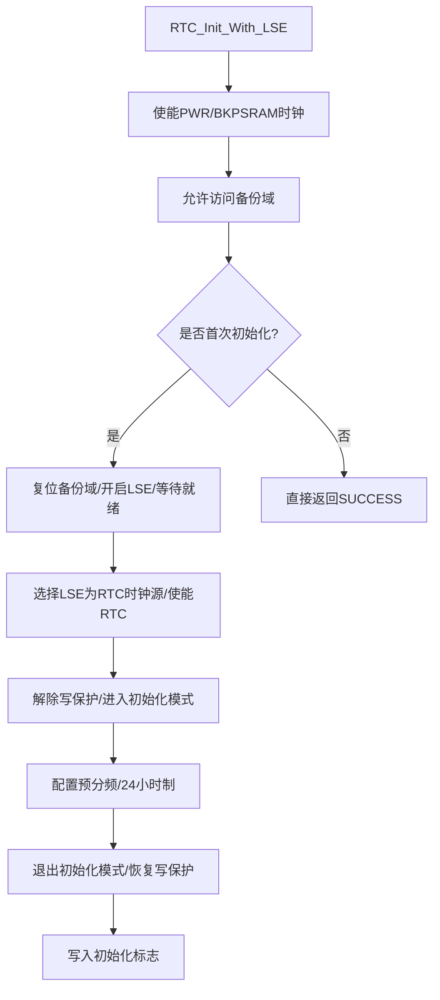
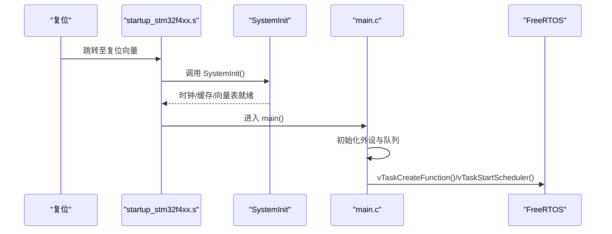
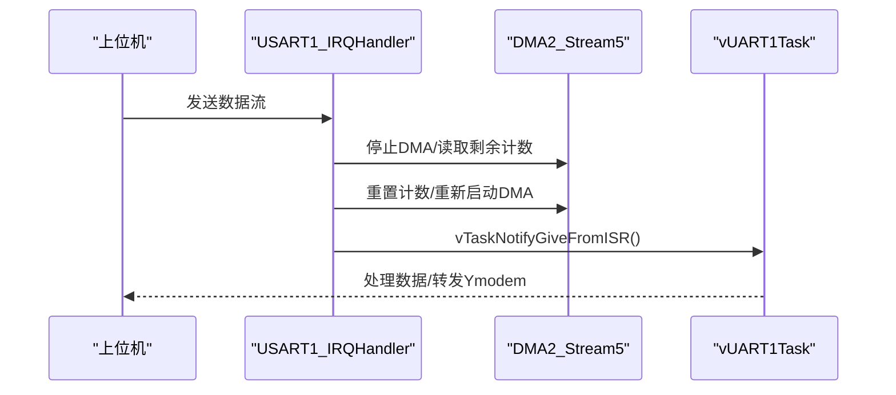
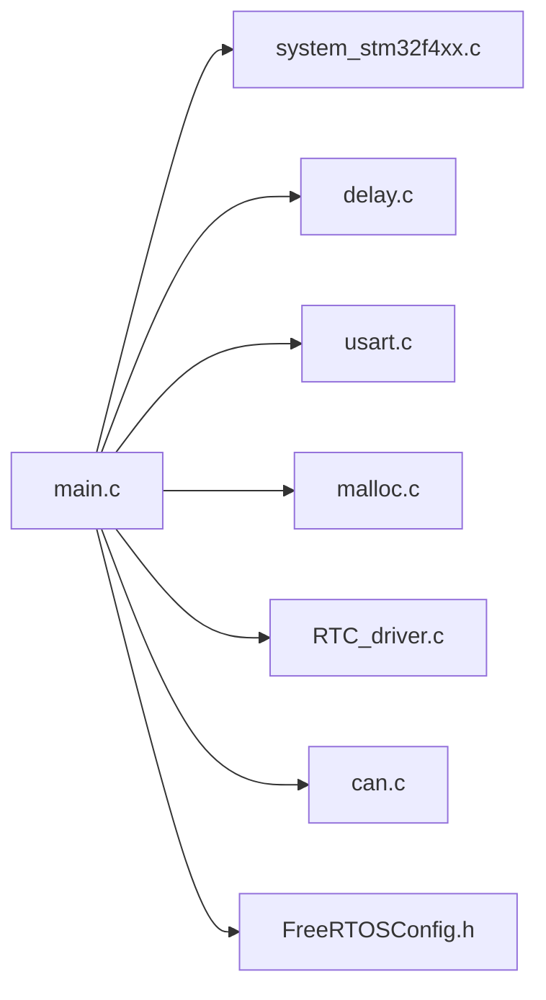

# 系统服务和工具

<cite>
**本文引用的文件**   
- [main.c](file://_gbk_backup/User/main.c)
- [system_stm32f4xx.c](file://_gbk_backup/Driver/CMSIS/system_stm32f4xx.c)
- [delay.c](file://_gbk_backup/Driver/SYSTEM/delay.c)
- [sys.c](file://_gbk_backup/Driver/SYSTEM/sys.c)
- [malloc.c](file://_gbk_backup/Middle/MALLOC/malloc.c)
- [RTC_driver.c](file://_gbk_backup/Driver/BSP/RTC_driver.c)
- [usart.c](file://_gbk_backup/Driver/SYSTEM/usart.c)
- [FreeRTOSConfig.h](file://_gbk_backup/User/FreeRTOSConfig.h)
- [can.c](file://_gbk_backup/Driver/BSP/can.c)
</cite>

## 目录
1. [简介](#简介)
2. [项目结构](#项目结构)
3. [核心组件](#核心组件)
4. [架构总览](#架构总览)
5. [详细组件分析](#详细组件分析)
6. [依赖关系分析](#依赖关系分析)
7. [性能与资源监控](#性能与资源监控)
8. [故障排查指南](#故障排查指南)
9. [结论](#结论)

## 简介
本文件面向 STM32F407 工程中的“系统服务与工具”，聚焦以下能力：
- 延时函数实现原理与微秒级精度保证（基于 SysTick）
- 内存管理器实现（动态分配、内存池、碎片整理思路）
- RTC 时钟驱动（时间设置、闹钟与日历计算说明）
- 系统启动流程与硬件初始化顺序
- 实用工具函数（串口通信、基础系统控制等）
- 系统资源监控与性能分析方法

## 项目结构
本项目采用分层组织方式：
- User：应用入口、任务创建、协议处理
- Driver：CMSIS 系统层、SYSTEM 通用系统服务、BSP 外设驱动
- Middle：中间件（如 FreeRTOS、FATFS、MALLOC 内存管理）

图表来源
- [main.c:34-60](file://_gbk_backup/User/main.c#L34-L60)
- [system_stm32f4xx.c:476-515](file://_gbk_backup/Driver/CMSIS/system_stm32f4xx.c#L476-L515)
- [delay.c:22-35](file://_gbk_backup/Driver/SYSTEM/delay.c#L22-L35)
- [usart.c:101-166](file://_gbk_backup/Driver/SYSTEM/usart.c#L101-L166)
- [malloc.c:28-51](file://_gbk_backup/Middle/MALLOC/malloc.c#L28-L51)
- [RTC_driver.c:9-67](file://_gbk_backup/Driver/BSP/RTC_driver.c#L9-L67)
- [can.c:1-31](file://_gbk_backup/Driver/BSP/can.c#L1-L31)

章节来源
- [main.c:34-60](file://_gbk_backup/User/main.c#L34-L60)
- [system_stm32f4xx.c:476-515](file://_gbk_backup/Driver/CMSIS/system_stm32f4xx.c#L476-L515)

## 核心组件
- 系统时钟与启动：SystemInit/SetSysClock，配置 HSE/PLL、AHB/APB 分频、Flash 等待周期
- 延时服务：SysTick 中断 + 轮询计数，提供 us/ms 级延时
- 内存管理：多区域内存池 + 位图式分配表，支持 malloc/free/realloc
- RTC 驱动：LSE 时钟源、时间/日期读写、字符串解析设置
- 串口通信：USART1 + DMA + IDLE 中断，支持 printf 重定向与队列分发
- 系统工具：低功耗、中断开关、软复位等

章节来源
- [system_stm32f4xx.c:476-515](file://_gbk_backup/Driver/CMSIS/system_stm32f4xx.c#L476-L515)
- [delay.c:22-35](file://_gbk_backup/Driver/SYSTEM/delay.c#L22-L35)
- [malloc.c:28-51](file://_gbk_backup/Middle/MALLOC/malloc.c#L28-L51)
- [RTC_driver.c:9-67](file://_gbk_backup/Driver/BSP/RTC_driver.c#L9-L67)
- [usart.c:101-166](file://_gbk_backup/Driver/SYSTEM/usart.c#L101-L166)
- [sys.c:34-93](file://_gbk_backup/Driver/SYSTEM/sys.c#L34-L93)

## 架构总览
系统启动后先由 CMSIS 完成底层时钟与向量表配置，随后 main 中依次初始化延时、串口、内存池、RTC、外设与队列，最后创建任务并启动调度器。

图表来源
- [system_stm32f4xx.c:476-515](file://_gbk_backup/Driver/CMSIS/system_stm32f4xx.c#L476-L515)
- [main.c:34-60](file://_gbk_backup/User/main.c#L34-L60)

## 详细组件分析

### 延时函数与 SysTick 定时器
- 初始化流程
  - 选择 SysTick 时钟源为 HCLK
  - 根据 SystemCoreClock 和 configTICK_RATE_HZ 计算每毫秒节拍数 fac_ms 与每微秒刻度 fac_us
  - 开启 SysTick 中断，设置重载值 reload 以产生固定周期的 Tick 中断
- 微秒延时实现
  - 通过读取 SysTick->VAL 的递减计数，累加经过的 ticks，达到目标 ticks 即返回
  - 考虑计数器回绕（reload-tnow+told），确保跨周期正确累计
- 毫秒延时实现
  - 若 FreeRTOS 已启动且 nms >= fac_ms，则使用 vTaskDelay 进行 OS 级延时
  - 剩余不足一个 Tick 的部分，转为 delay_us 精确延时

图表来源
- [delay.c:22-35](file://_gbk_backup/Driver/SYSTEM/delay.c#L22-L35)
- [delay.c:38-56](file://_gbk_backup/Driver/SYSTEM/delay.c#L38-L56)

章节来源
- [delay.c:22-35](file://_gbk_backup/Driver/SYSTEM/delay.c#L22-L35)
- [delay.c:38-56](file://_gbk_backup/Driver/SYSTEM/delay.c#L38-L56)
- [delay.c:60-71](file://_gbk_backup/Driver/SYSTEM/delay.c#L60-L71)

### 内存管理器（动态分配、内存池、碎片整理）
- 内存池布局
  - 定义三个内存区：内部 SRAM、CCM、外部 SRAM，分别对应 mem1base/mem2base/mem3base
  - 每个区配套一个分配状态表 memmap（块占用标记）
- 分配算法
  - 将请求 size 转换为所需连续块数 nmemb
  - 从表尾向前扫描，统计连续空闲块 cmemb，当 cmemb == nmemb 时标记这些块为非空并返回偏移地址
- 释放与扩容
  - 释放时根据偏移计算起始块号与块数，清零对应表项
  - realloc 先申请新块，拷贝旧数据，再释放旧块
- 碎片整理
  - 当前实现未包含自动碎片整理；可通过周期性合并相邻空闲块或后台整理任务优化

图表来源
- [malloc.c:28-51](file://_gbk_backup/Middle/MALLOC/malloc.c#L28-L51)

章节来源
- [malloc.c:28-51](file://_gbk_backup/Middle/MALLOC/malloc.c#L28-L51)
- [malloc.c:85-109](file://_gbk_backup/Middle/MALLOC/malloc.c#L85-L109)
- [malloc.c:119-159](file://_gbk_backup/Middle/MALLOC/malloc.c#L119-L159)
- [malloc.c:171-194](file://_gbk_backup/Middle/MALLOC/malloc.c#L171-L194)
- [malloc.c:202-258](file://_gbk_backup/Middle/MALLOC/malloc.c#L202-L258)

### RTC 时钟驱动（时间设置、闹钟、日历）
- 初始化流程（LSE 作为时钟源）
  - 使能 PWR 与 BKPSRAM 时钟，允许访问备份域
  - 首次初始化时复位备份域，开启 LSE 并等待就绪
  - 选择 LSE 为 RTC 时钟源，使能 RTC，解除写保护，进入初始化模式
  - 配置异步/同步预分频、24 小时制，退出初始化模式并恢复写保护
  - 写入标志寄存器标记已完成初始化
- 时间与日期设置
  - 参数有效性检查（时/分/秒、星期/月/日/年范围）
  - 解除写保护后设置时间与日期，再恢复写保护
- 获取时间与格式化
  - 提供结构体获取与字符串格式化输出
  - 支持从“YYYY-MM-DD HH:MM:SS”字符串解析并设置 RTC
- 闹钟功能与日历计算
  - 当前驱动未直接暴露闹钟 API；可在上层基于 RTC_GetTime/RTC_GetDate 实现定时逻辑
  - 日历计算（闰年、月末边界等）建议在上层封装，避免在驱动内耦合复杂业务

图表来源
- [RTC_driver.c:9-67](file://_gbk_backup/Driver/BSP/RTC_driver.c#L9-L67)

章节来源
- [RTC_driver.c:9-67](file://_gbk_backup/Driver/BSP/RTC_driver.c#L9-L67)
- [RTC_driver.c:75-100](file://_gbk_backup/Driver/BSP/RTC_driver.c#L75-L100)
- [RTC_driver.c:108-121](file://_gbk_backup/Driver/BSP/RTC_driver.c#L108-L121)
- [RTC_driver.c:128-172](file://_gbk_backup/Driver/BSP/RTC_driver.c#L128-L172)

### 系统启动流程与硬件初始化顺序
- 启动阶段
  - 芯片复位后执行 startup 汇编，调用 SystemInit 配置时钟、缓存、向量表
  - 进入 main 后按序初始化：NVIC 分组、SysTick 延时、USART1、内存池、RTC、OLED/按键/LED、LCD、RS485、CAN、队列
  - 创建任务并启动 FreeRTOS 调度器
- 关键要点
  - 中断优先级分组设置为抢占优先，无子优先级
  - 所有外设初始化均在任务创建前完成，避免竞态条件

图表来源
- [system_stm32f4xx.c:476-515](file://_gbk_backup/Driver/CMSIS/system_stm32f4xx.c#L476-L515)
- [main.c:34-60](file://_gbk_backup/User/main.c#L34-L60)

章节来源
- [main.c:34-60](file://_gbk_backup/User/main.c#L34-L60)

### 串口通信与调试输出（USART1）
- 初始化
  - 使能 GPIOA、USART1、DMA2 时钟
  - 配置 PA9/PA10 复用为 USART1_TX/RX
  - 配置 DMA2 Stream5 Channel4 循环接收，大小 DMA_RX_BUFFER_SIZE
  - 启用 USART1 IDLE 中断，配置 NVIC
- 数据处理
  - IDLE 中断中停止 DMA，计算 received_len，重启 DMA，并通过 vTaskNotifyGiveFromISR 通知任务
  - 支持 printf 重定向到 USART1
- 实用接口
  - 发送单字节/字符串
  - 判断是否为 Ymodem 命令（用于协议分流）

图表来源
- [usart.c:101-166](file://_gbk_backup/Driver/SYSTEM/usart.c#L101-L166)
- [usart.c:185-205](file://_gbk_backup/Driver/SYSTEM/usart.c#L185-L205)

章节来源
- [usart.c:101-166](file://_gbk_backup/Driver/SYSTEM/usart.c#L101-L166)
- [usart.c:185-205](file://_gbk_backup/Driver/SYSTEM/usart.c#L185-L205)
- [usart.c:286-301](file://_gbk_backup/Driver/SYSTEM/usart.c#L286-L301)

### 系统工具函数（sys.c）
- 低功耗：WFI 指令、待机模式（PWR 配置）
- 中断控制：全局中断开/关
- 栈管理：设置 MSP
- 软复位：通过 AIRCR 触发

章节来源
- [sys.c:34-93](file://_gbk_backup/Driver/SYSTEM/sys.c#L34-L93)

### CAN 总线驱动（扩展帧）
- 支持 CAN1 中断接收 + FreeRTOS 队列，CAN2 仅发送
- 数据结构包含扩展 ID、数据负载与 DLC
- 丢包计数便于监控队列溢出情况

章节来源
- [can.c:1-31](file://_gbk_backup/Driver/BSP/can.c#L1-L31)
- [can.h:1-42](file://_gbk_backup/Driver/BSP/can.h#L1-L42)

## 依赖关系分析
- main.c 依赖：
  - CMSIS system_stm32f4xx.c（系统时钟）
  - SYSTEM delay.c（SysTick 延时）
  - SYSTEM usart.c（串口与调试）
  - Middle malloc.c（内存管理）
  - BSP RTC_driver.c（RTC）
  - BSP can.c（CAN）
  - FreeRTOSConfig.h（调度与堆配置）

图表来源
- [main.c:34-60](file://_gbk_backup/User/main.c#L34-L60)
- [FreeRTOSConfig.h:1-49](file://_gbk_backup/User/FreeRTOSConfig.h#L1-L49)

章节来源
- [main.c:34-60](file://_gbk_backup/User/main.c#L34-L60)
- [FreeRTOSConfig.h:1-49](file://_gbk_backup/User/FreeRTOSConfig.h#L1-L49)

## 性能与资源监控
- 内存使用率
  - 通过 my_mem_perused 可获取各内存区的已用块比例（放大10倍表示百分比）
- 任务与队列
  - 使用 FreeRTOS 队列句柄与任务句柄监控收发链路（如 CAN1 接收队列、LCD 显示队列、SD 卡写入队列）
- 丢包统计
  - CAN1 丢包计数器可用于评估总线负载与队列深度是否足够
- 串口吞吐
  - 通过 DMA + IDLE 中断减少 CPU 占用，提升吞吐效率

章节来源
- [malloc.c:97-109](file://_gbk_backup/Middle/MALLOC/malloc.c#L97-L109)
- [can.c:1-31](file://_gbk_backup/Driver/BSP/can.c#L1-L31)
- [usart.c:101-166](file://_gbk_backup/Driver/SYSTEM/usart.c#L101-L166)

## 故障排查指南
- SysTick 相关
  - 若延时异常，检查 SystemCoreClock 是否与硬件一致，configTICK_RATE_HZ 是否合理
  - 确认 SysTick 中断已启用且未被屏蔽
- 内存分配失败
  - 检查 my_mem_init 是否调用，memrdy 标志是否正确
  - 观察 my_mem_perused 趋势，必要时调整内存池大小或引入后台碎片整理
- RTC 初始化失败
  - 检查 LSE 是否起振，备份域是否被误写
  - 确认写保护状态与时钟源选择是否正确
- 串口数据丢失
  - 检查 DMA 是否被正确重启，IDLE 中断是否清除标志
  - 核对队列长度与任务消费速度是否匹配

章节来源
- [delay.c:22-35](file://_gbk_backup/Driver/SYSTEM/delay.c#L22-L35)
- [malloc.c:85-109](file://_gbk_backup/Middle/MALLOC/malloc.c#L85-L109)
- [RTC_driver.c:9-67](file://_gbk_backup/Driver/BSP/RTC_driver.c#L9-L67)
- [usart.c:185-205](file://_gbk_backup/Driver/SYSTEM/usart.c#L185-L205)

## 结论
该工程围绕 STM32F407 构建了稳定的系统服务与工具集：
- 通过 CMSIS 与 SysTick 提供可靠的系统时钟与高精度延时
- 内存管理器在多区域内存池上实现了高效的动态分配
- RTC 驱动提供了稳定的时间基准与便捷的设置接口
- 串口与 DMA 结合提升了通信效率，配合 FreeRTOS 实现任务化数据处理
- 建议在后续版本中加入后台碎片整理与更完善的性能统计钩子，进一步提升系统鲁棒性与可观测性