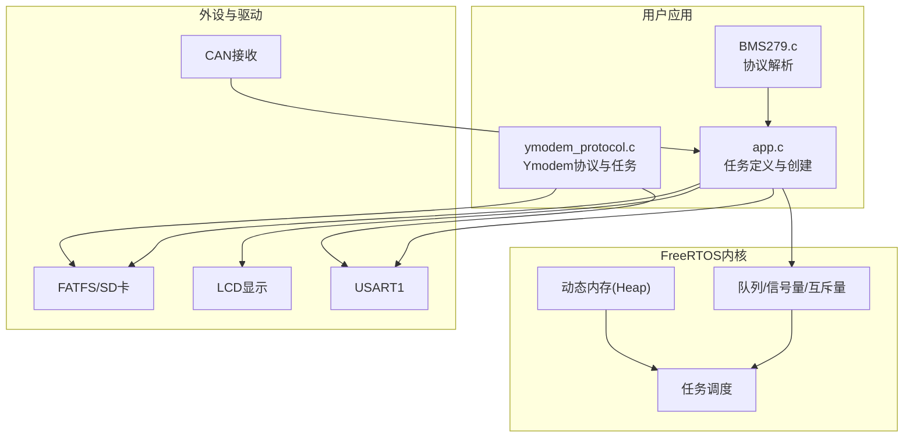
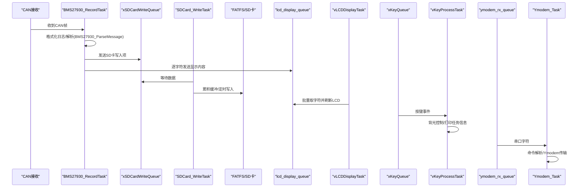
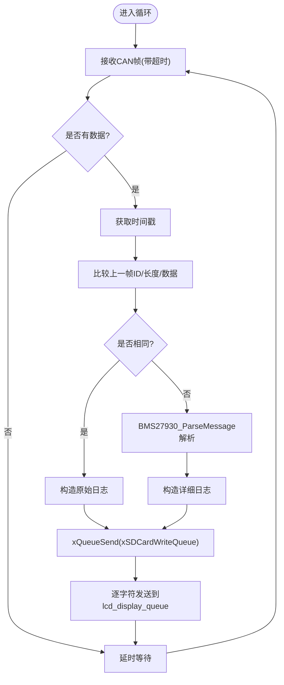
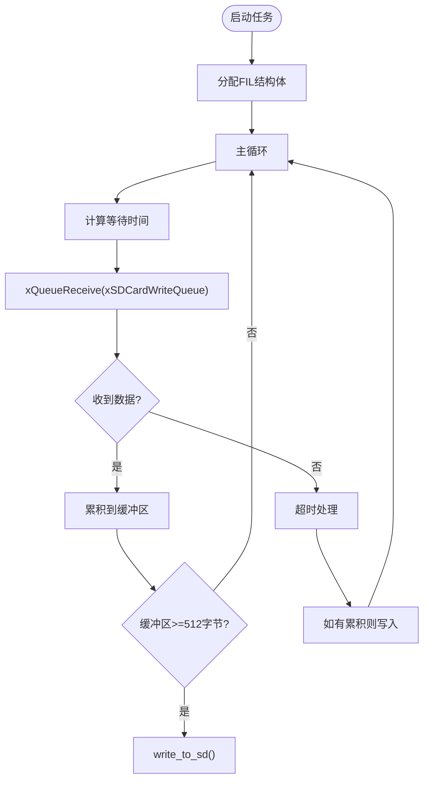
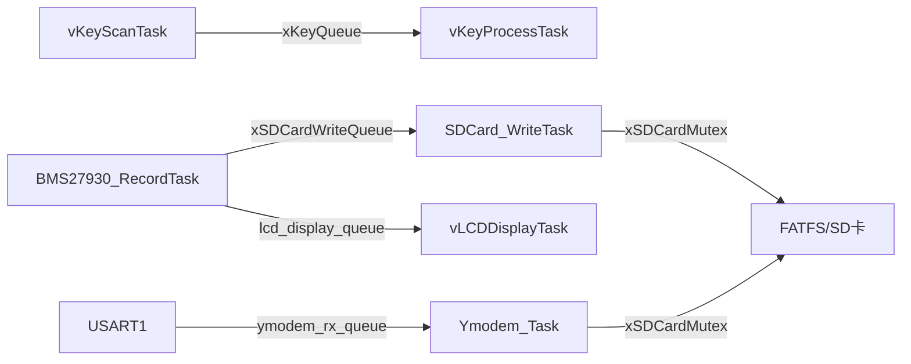
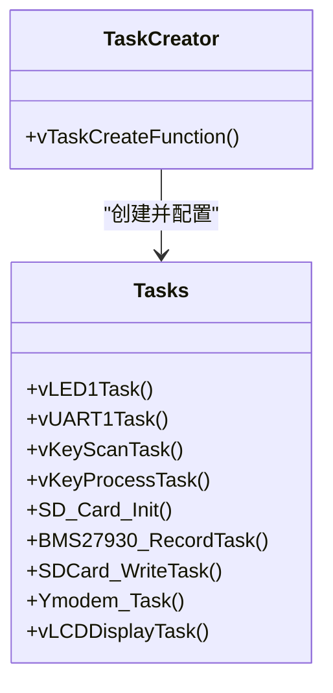

# FreeRTOS任务管理

<cite>
**本文引用的文件**   
- [app.c](file://_gbk_backup/User/app.c)
- [app.h](file://_gbk_backup/User/app.h)
- [BMS279.c](file://_gbk_backup/User/BMS279.c)
- [BMS279.h](file://_gbk_backup/User/BMS279.h)
- [ymodem_protocol.c](file://_gbk_backup/User/ymodem_protocol.c)
- [ymodem_protocol.h](file://_gbk_backup/User/ymodem_protocol.h)
- [FreeRTOSConfig.h](file://_gbk_backup/User/FreeRTOSConfig.h)
</cite>

## 目录
1. [引言](#引言)
2. [项目结构](#项目结构)
3. [核心组件](#核心组件)
4. [架构总览](#架构总览)
5. [详细组件分析](#详细组件分析)
6. [依赖关系分析](#依赖关系分析)
7. [性能与实时性考虑](#性能与实时性考虑)
8. [故障排查指南](#故障排查指南)
9. [结论](#结论)
10. [附录：任务创建函数与参数说明](#附录任务创建函数与参数说明)

## 引言
本文件面向STM32 CAN Tracker的FreeRTOS任务管理系统，聚焦以下任务的职责划分、优先级策略、同步机制、栈大小与内存管理、监控调试方法，以及任务创建函数的实现细节与参数配置。系统包含CAN数据记录、SD卡写入、按键扫描与处理、LCD显示、Ymodem文件传输等关键任务，并通过队列、信号量与互斥量进行任务间通信与资源保护。

## 项目结构
本项目在User层实现了FreeRTOS应用任务与协议解析，主要文件如下：
- app.c / app.h：任务入口、任务创建、任务逻辑（CAN记录、SD卡写入、按键扫描/处理、LCD显示、任务监控）
- BMS279.c / BMS279.h：GB/T27930充电协议解析与J1939多包解析
- ymodem_protocol.c / ymodem_protocol.h：Ymodem协议实现与串口交互任务
- FreeRTOSConfig.h：FreeRTOS内核配置（调度器、优先级、堆大小、钩子、API开关等）

图表来源
- [app.c:200-309](file://_gbk_backup/User/app.c#L200-L309)
- [app.c:313-366](file://_gbk_backup/User/app.c#L313-L366)
- [app.c:454-521](file://_gbk_backup/User/app.c#L454-L521)
- [ymodem_protocol.c:711-748](file://_gbk_backup/User/ymodem_protocol.c#L711-L748)
- [BMS279.c:42-114](file://_gbk_backup/User/BMS279.c#L42-L114)

章节来源
- [app.c:1-547](file://_gbk_backup/User/app.c#L1-L547)
- [app.h:1-15](file://_gbk_backup/User/app.h#L1-L15)
- [BMS279.c:1-710](file://_gbk_backup/User/BMS279.c#L1-L710)
- [ymodem_protocol.c:1-749](file://_gbk_backup/User/ymodem_protocol.c#L1-L749)
- [FreeRTOSConfig.h:1-125](file://_gbk_backup/User/FreeRTOSConfig.h#L1-L125)

## 核心组件
- BMS27930_RecordTask：从CAN读取报文，格式化并写入SD卡队列，同时向LCD显示队列发送字符流；对重复报文仅记录原始数据，不同报文调用BMS27930_ParseMessage输出详细信息。
- SDCard_WriteTask：从队列消费数据，累积到扇区缓冲（512字节），或超时（默认1分钟）后统一写入SD卡，降低频繁写盘对SD卡的损耗。
- vKeyScanTask：按键状态机扫描，支持单击、双击、长按，通过队列发送键值。
- vKeyProcessTask：消费按键队列，执行背光控制、打印任务列表与栈高水位等调试操作。
- vLCDDisplayTask：周期性（约100ms）批量刷新LCD，将队列中的字符按行缓存并绘制。
- Ymodem_Task：串口命令交互与Ymodem文件传输任务，提供help/ls/cd/pwd/get/settime/exit等命令。

章节来源
- [app.c:94-152](file://_gbk_backup/User/app.c#L94-L152)
- [app.c:200-309](file://_gbk_backup/User/app.c#L200-L309)
- [app.c:313-366](file://_gbk_backup/User/app.c#L313-L366)
- [app.c:370-412](file://_gbk_backup/User/app.c#L370-L412)
- [app.c:454-521](file://_gbk_backup/User/app.c#L454-L521)
- [ymodem_protocol.c:711-748](file://_gbk_backup/User/ymodem_protocol.c#L711-L748)

## 架构总览
下图展示任务间的通信与依赖关系，包括队列、互斥量与外部资源（FATFS/SD卡、LCD、USART）。

图表来源
- [app.c:200-309](file://_gbk_backup/User/app.c#L200-L309)
- [app.c:313-366](file://_gbk_backup/User/app.c#L313-L366)
- [app.c:454-521](file://_gbk_backup/User/app.c#L454-L521)
- [ymodem_protocol.c:711-748](file://_gbk_backup/User/ymodem_protocol.c#L711-L748)

## 详细组件分析

### BMS27930_RecordTask（CAN数据记录）
- 职责
  - 阻塞式接收CAN报文（带超时），获取时间戳。
  - 判断是否与前一次报文相同：相同则仅记录原始数据；不同则调用BMS27930_ParseMessage生成类型、描述与解析信息。
  - 将日志字符串发送到SD卡写入队列，同时将字符逐个发送到LCD显示队列。
- 关键点
  - 使用can1_receive_msg获取报文，GetTimestamp生成时间戳。
  - 通过xQueueSend非阻塞发送SD卡队列，若满则打印警告。
  - 对LCD队列进行空间检查，当使用率超过阈值时打印告警。
- 复杂度
  - 每帧O(len)比较与格式化；解析分支取决于报文类型，整体为线性开销。
- 错误处理
  - 队列满时打印警告；LCD队列接近满时打印告警。

图表来源
- [app.c:200-309](file://_gbk_backup/User/app.c#L200-L309)
- [BMS279.c:42-114](file://_gbk_backup/User/BMS279.c#L42-L114)

章节来源
- [app.c:200-309](file://_gbk_backup/User/app.c#L200-L309)
- [BMS279.c:42-114](file://_gbk_backup/User/BMS279.c#L42-L114)

### SDCard_WriteTask（SD卡写入）
- 职责
  - 从xSDCardWriteQueue消费数据，累积到512字节缓冲，达到扇区大小或超时（默认1分钟）后统一写入SD卡。
  - 使用互斥量xSDCardMutex保护FATFS文件对象，避免并发访问导致损坏。
- 关键点
  - 计算wait_time以支持“立即处理”与“累计等待”两种模式。
  - write_to_sd内部打开/追加/写入/关闭文件，文件名基于RTC日期生成。
- 复杂度
  - 累积写入减少文件系统开销；I/O瓶颈主要在SD卡写入。
- 错误处理
  - 内存分配失败删除自身任务；f_open/f_write返回错误码打印日志。

图表来源
- [app.c:313-366](file://_gbk_backup/User/app.c#L313-L366)
- [app.c:35-71](file://_gbk_backup/User/app.c#L35-L71)

章节来源
- [app.c:313-366](file://_gbk_backup/User/app.c#L313-L366)
- [app.c:35-71](file://_gbk_backup/User/app.c#L35-L71)

### vKeyScanTask（按键扫描）
- 职责
  - 按键状态机：空闲→按下→释放单次→等待松开，支持单击、双击、长按。
  - 通过xKeyQueue发送键值给处理任务。
- 关键点
  - 使用vTaskDelay周期扫描，避免忙等。
  - 长按与双击通过计时阈值区分。
- 复杂度
  - O(1)状态转移，轻量级。

章节来源
- [app.c:94-152](file://_gbk_backup/User/app.c#L94-L152)

### vKeyProcessTask（按键处理）
- 职责
  - 消费xKeyQueue，根据键值执行背光开关、打印任务列表与栈高水位。
- 关键点
  - 使用vTaskList与uxTaskGetStackHighWaterMark进行调试输出。
- 复杂度
  - O(1)分发逻辑。

章节来源
- [app.c:370-412](file://_gbk_backup/User/app.c#L370-L412)

### vLCDDisplayTask（LCD显示）
- 职责
  - 周期性（约100ms）批量读取lcd_display_queue，解析行并刷新LCD。
- 关键点
  - 行缓存line_cache固定行数，滚动更新。
  - 过滤不可见字符，替换为十六进制占位符。
- 复杂度
  - 每周期O(N)字符处理，N为100ms内累积字符数。

章节来源
- [app.c:454-521](file://_gbk_backup/User/app.c#L454-L521)

### Ymodem_Task（文件传输）
- 职责
  - 初始化Ymodem模块，创建接收队列，处理串口命令与Ymodem文件传输。
- 关键点
  - 使用ymodem_rx_queue接收串口字符，回显并构建命令。
  - 通过Ymodem_SendFile进行文件传输，使用xSDCardMutex保护FATFS访问。
- 复杂度
  - 命令解析O(L)，文件传输受限于串口速率与SD卡I/O。

章节来源
- [ymodem_protocol.c:688-748](file://_gbk_backup/User/ymodem_protocol.c#L688-L748)
- [ymodem_protocol.c:303-428](file://_gbk_backup/User/ymodem_protocol.c#L303-L428)

## 依赖关系分析
- 任务间通信
  - xKeyQueue：按键扫描→按键处理
  - xSDCardWriteQueue：CAN记录→SD卡写入
  - lcd_display_queue：CAN记录→LCD显示
  - ymodem_rx_queue：串口中断/上层→Ymodem任务
- 资源保护
  - xSDCardMutex：SD卡写入与Ymodem文件访问的互斥保护
- 外部依赖
  - can1_receive_msg、GetTimestamp、BMS27930_ParseMessage
  - FATFS f_open/f_write/f_close
  - LCD显示接口
  - USART1发送/接收

图表来源
- [app.c:94-152](file://_gbk_backup/User/app.c#L94-L152)
- [app.c:200-309](file://_gbk_backup/User/app.c#L200-L309)
- [app.c:313-366](file://_gbk_backup/User/app.c#L313-L366)
- [ymodem_protocol.c:711-748](file://_gbk_backup/User/ymodem_protocol.c#L711-L748)

章节来源
- [app.c:94-152](file://_gbk_backup/User/app.c#L94-L152)
- [app.c:200-309](file://_gbk_backup/User/app.c#L200-L309)
- [app.c:313-366](file://_gbk_backup/User/app.c#L313-L366)
- [ymodem_protocol.c:711-748](file://_gbk_backup/User/ymodem_protocol.c#L711-L748)

## 性能与实时性考虑
- 优先级设置策略
  - CAN数据处理（BMS27930_RecordTask）优先级较高（3），确保CAN报文及时解析与转发。
  - Ymodem_Task优先级也为3，保证串口交互与文件传输的响应性。
  - 其他任务（按键、SD卡写入、LCD显示）优先级为2，满足一般实时需求。
  - 空闲任务与LED任务优先级较低（1），不影响关键路径。
- 实时性原则
  - 高频、低延迟的数据采集与解析任务赋予更高优先级。
  - I/O密集型任务（SD卡写入、LCD刷新）采用批处理与缓冲降低抖动。
- 内存与栈分配
  - 任务栈大小：CAN记录与Ymodem任务512字，按键相关128/256字，LCD显示512字。
  - FreeRTOS堆大小30KB，启用动态分配；部分结构体（如FIL）使用自定义malloc/free。
- 优化建议
  - 若CAN负载增大，可评估提高BMS27930_RecordTask优先级或增加队列深度。
  - LCD刷新频率可根据UI需求调整，平衡刷新流畅度与CPU占用。
  - SD卡写入超时可根据业务需求缩短，但需权衡写放大与寿命。

章节来源
- [app.c:529-541](file://_gbk_backup/User/app.c#L529-L541)
- [FreeRTOSConfig.h:38-42](file://_gbk_backup/User/FreeRTOSConfig.h#L38-L42)

## 故障排查指南
- 任务监控
  - 使用vTaskMonitor周期性打印任务列表与栈高水位，或通过按键触发打印。
  - 关注LCD队列使用率告警，必要时增大队列或刷新周期。
- 常见问题
  - SD卡写入失败：检查xSDCardMutex是否正确获取/释放，确认FATFS挂载成功。
  - Ymodem传输中断：检查串口队列是否阻塞，确认对方设备已准备就绪。
  - 按键无响应：检查xKeyQueue是否被消费，确认扫描周期合理。
- 调试步骤
  - 打印任务列表与栈使用情况，定位栈溢出风险。
  - 在关键路径添加日志，观察队列长度与等待时间。
  - 使用示波器/逻辑分析仪验证CAN与串口时序。

章节来源
- [app.c:74-91](file://_gbk_backup/User/app.c#L74-L91)
- [app.c:370-412](file://_gbk_backup/User/app.c#L370-L412)
- [app.c:313-366](file://_gbk_backup/User/app.c#L313-L366)
- [ymodem_protocol.c:303-428](file://_gbk_backup/User/ymodem_protocol.c#L303-L428)

## 结论
本项目的FreeRTOS任务管理以CAN数据为核心，围绕记录、存储、显示与人机交互展开。通过合理的优先级分配、队列与互斥量同步机制，系统在实时性与稳定性之间取得平衡。建议在CAN负载增长场景下进一步优化队列与刷新策略，并持续监控任务栈与队列使用率以确保长期稳定运行。

## 附录：任务创建函数与参数说明
- vTaskCreateFunction
  - 功能：集中创建所有应用任务，统一配置名称、栈大小、优先级与参数。
  - 参数说明
    - 任务函数指针：各任务入口函数
    - 任务名：用于调试识别
    - 栈大小：单位通常为Word（32位），根据任务复杂度设定
    - 参数指针：可选参数，可为NULL
    - 优先级：数值越大优先级越高（configMAX_PRIORITIES=32）
    - 任务句柄：可选，用于后续查询或控制
  - 关键任务配置
    - vLED1Task：优先级1，栈128
    - vUART1Task：优先级4，栈128，保存句柄
    - vKeyScanTask：优先级2，栈128
    - vKeyProcessTask：优先级2，栈256
    - SD_Card_Init：优先级2，栈256
    - BMS27930_RecordTask：优先级3，栈512
    - SDCard_WriteTask：优先级2，栈512
    - Ymodem_Task：优先级3，栈512，传递句柄
    - vLCDDisplayTask：优先级2，栈512

图表来源
- [app.c:529-541](file://_gbk_backup/User/app.c#L529-L541)

章节来源
- [app.c:529-541](file://_gbk_backup/User/app.c#L529-L541)