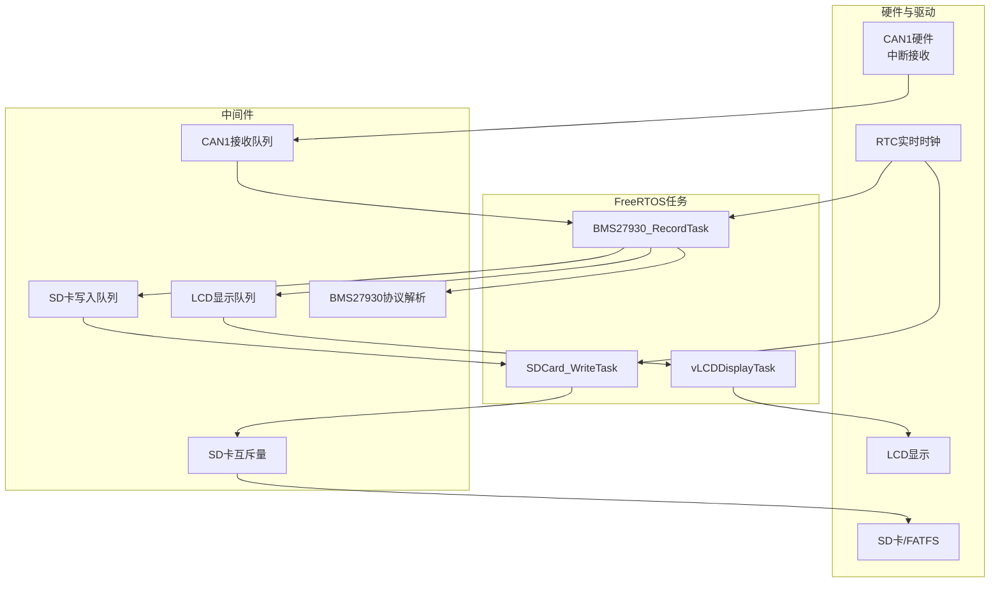
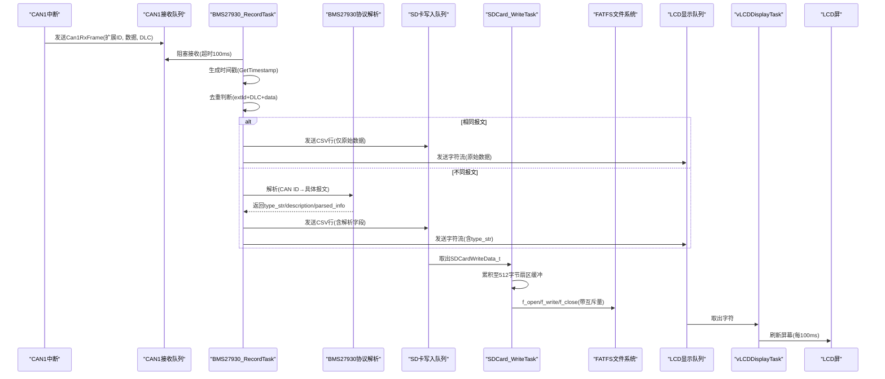
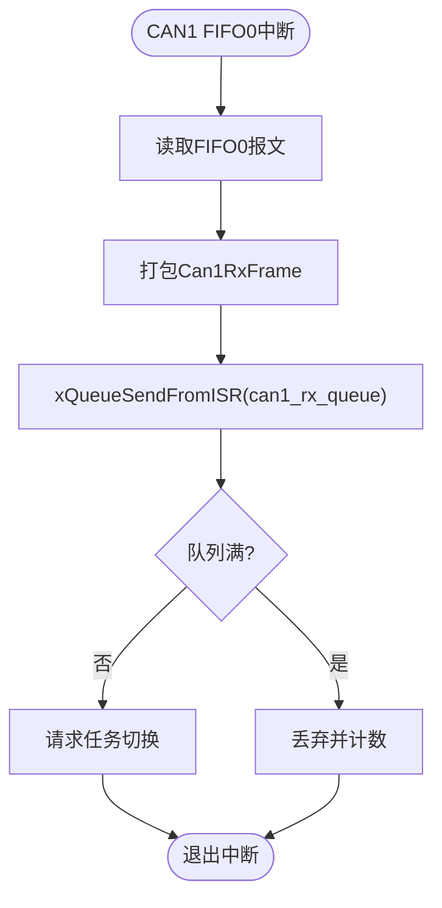
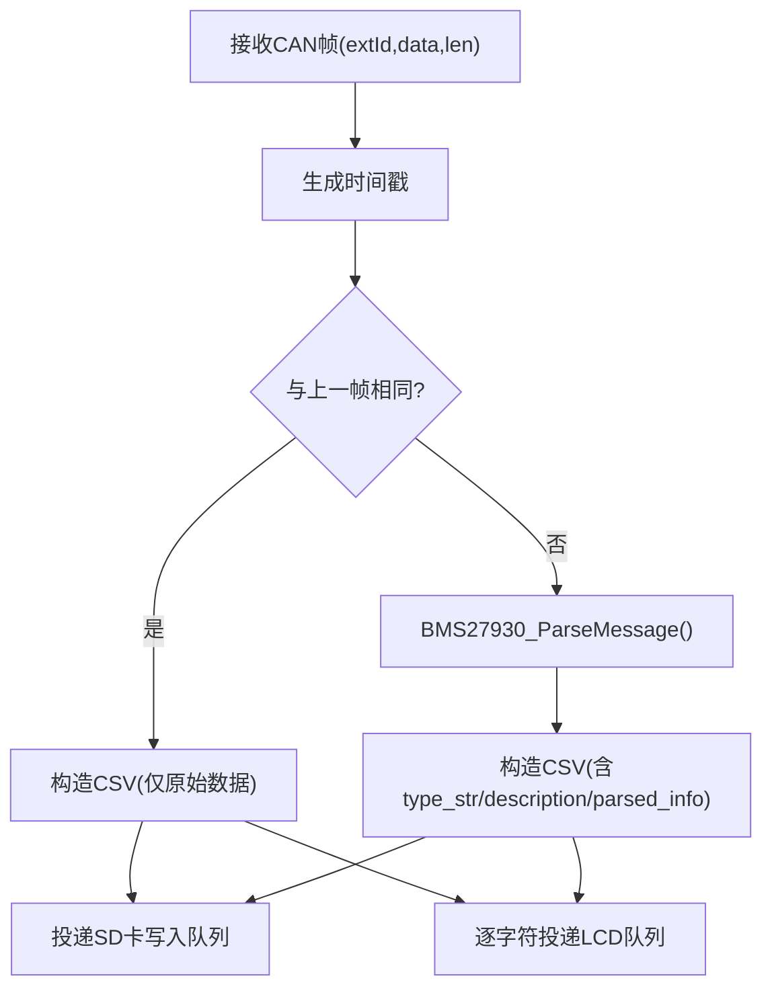
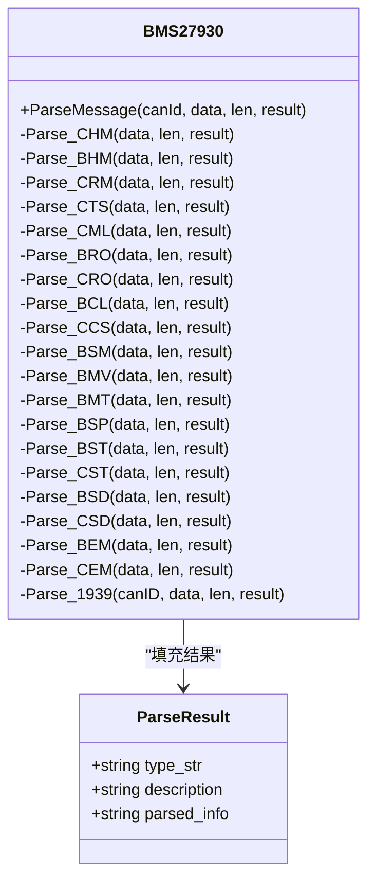
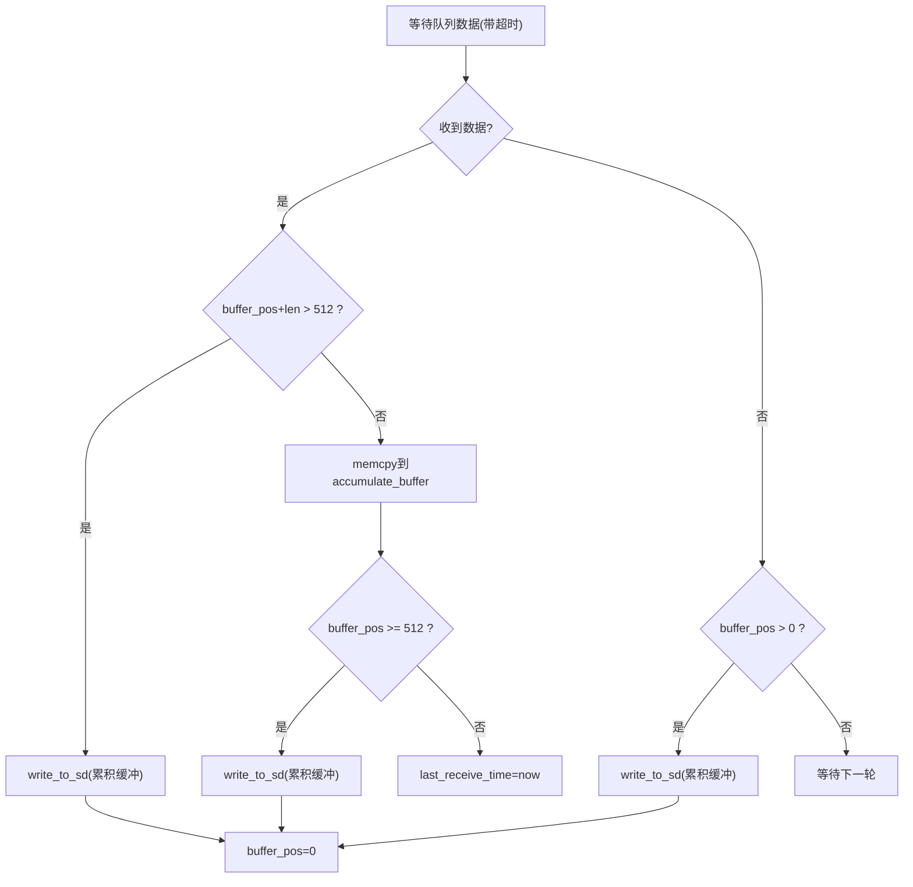
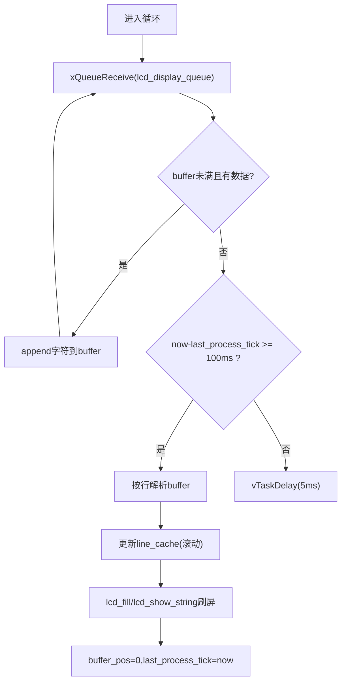
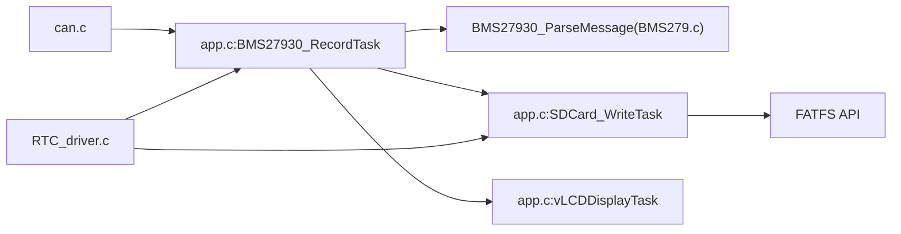

# 数据流设计

<cite>
**本文引用的文件**   
- [main.c](file://_gbk_backup/User/main.c)
- [app.c](file://_gbk_backup/User/app.c)
- [BMS279.c](file://_gbk_backup/User/BMS279.c)
- [can.c](file://_gbk_backup/Driver/BSP/can.c)
- [can.h](file://_gbk_backup/Driver/BSP/can.h)
- [RTC_driver.c](file://_gbk_backup/Driver/BSP/RTC_driver.c)
</cite>

## 目录
1. [引言](#引言)
2. [项目结构](#项目结构)
3. [核心组件](#核心组件)
4. [架构总览](#架构总览)
5. [详细组件分析](#详细组件分析)
6. [依赖关系分析](#依赖关系分析)
7. [性能与监控](#性能与监控)
8. [故障排查指南](#故障排查指南)
9. [结论](#结论)

## 引言
本文件面向STM32 CAN Tracker的数据流设计，系统化梳理从CAN总线中断到最终数据存储与显示的完整路径：CAN中断 → BMS27930_RecordTask → 协议解析 → SD卡写入队列 → SDCard_WriteTask → FATFS文件系统 → LCD显示队列 → vLCDDisplayTask。文档重点说明：
- 原始CAN帧到GB/T 27930协议数据的解析流程
- CSV格式文件的生成与批量写入策略
- 报文去重机制与时间戳插入机制
- 缓冲区管理（512字节扇区缓冲）与批量写入优化
- 数据流监控与性能分析方法（队列长度、丢包统计、吞吐量估算）

## 项目结构
本项目基于FreeRTOS任务模型，关键模块分布如下：
- 驱动层：CAN收发驱动、RTC时钟驱动、FATFS文件系统封装
- 应用层：BMS27930协议解析、记录任务、SD卡写入任务、LCD显示任务
- 系统初始化：外设初始化、队列/互斥量创建、任务创建与调度

图表来源
- [can.c:40-106](file://_gbk_backup/Driver/BSP/can.c#L40-L106)
- [app.c:200-366](file://_gbk_backup/User/app.c#L200-L366)
- [app.c:452-521](file://_gbk_backup/User/app.c#L452-L521)
- [RTC_driver.c:198-226](file://_gbk_backup/Driver/BSP/RTC_driver.c#L198-L226)

章节来源
- [main.c:34-60](file://_gbk_backup/User/main.c#L34-L60)
- [app.c:529-541](file://_gbk_backup/User/app.c#L529-L541)

## 核心组件
- CAN中断与队列：CAN1中断服务程序将接收到的扩展帧打包为Can1RxFrame并发送到FreeRTOS队列；应用侧通过can1_receive_msg阻塞式读取。
- 记录任务：BMS27930_RecordTask从CAN队列取帧，生成时间戳，执行去重判断，调用协议解析，构造CSV行，同时投递到SD卡写入队列和LCD显示队列。
- SD卡写入任务：SDCard_WriteTask聚合多行CSV文本至512字节扇区缓冲，达到阈值或超时后通过FATFS写入文件。
- LCD显示任务：vLCDDisplayTask周期性消费LCD队列，按行缓存刷新屏幕。
- 协议解析：BMS27930_ParseMessage根据CAN ID分发到具体报文解析函数，输出类型、描述与解析信息。
- 时间戳：GetTimestamp从RTC获取时、分、秒及亚秒毫秒，生成“HH:MM:SS.mmm”格式字符串。

章节来源
- [can.c:186-224](file://_gbk_backup/Driver/BSP/can.c#L186-L224)
- [can.c:116-141](file://_gbk_backup/Driver/BSP/can.c#L116-L141)
- [app.c:200-309](file://_gbk_backup/User/app.c#L200-L309)
- [app.c:311-366](file://_gbk_backup/User/app.c#L311-L366)
- [app.c:452-521](file://_gbk_backup/User/app.c#L452-L521)
- [BMS279.c:42-114](file://_gbk_backup/User/BMS279.c#L42-L114)
- [RTC_driver.c:198-226](file://_gbk_backup/Driver/BSP/RTC_driver.c#L198-L226)

## 架构总览
下图展示端到端数据流与控制流，包括中断、任务、队列、解析、存储与显示的关键交互。

图表来源
- [can.c:186-224](file://_gbk_backup/Driver/BSP/can.c#L186-L224)
- [app.c:200-309](file://_gbk_backup/User/app.c#L200-L309)
- [app.c:311-366](file://_gbk_backup/User/app.c#L311-L366)
- [app.c:452-521](file://_gbk_backup/User/app.c#L452-L521)
- [BMS279.c:42-114](file://_gbk_backup/User/BMS279.c#L42-L114)
- [RTC_driver.c:198-226](file://_gbk_backup/Driver/BSP/RTC_driver.c#L198-L226)

## 详细组件分析

### CAN中断与接收队列
- 中断处理：CAN1_RX0_IRQHandler在FIFO0接收中断中读取报文，提取扩展ID、DLC和数据负载，打包为Can1RxFrame并通过xQueueSendFromISR投递到can1_rx_queue。若队列满则丢弃并累加丢包计数。
- 应用接收：can1_receive_msg以阻塞方式从队列取帧，拷贝数据到用户缓冲区并返回DLC。

图表来源
- [can.c:186-224](file://_gbk_backup/Driver/BSP/can.c#L186-L224)
- [can.h:17-28](file://_gbk_backup/Driver/BSP/can.h#L17-L28)

章节来源
- [can.c:40-106](file://_gbk_backup/Driver/BSP/can.c#L40-L106)
- [can.c:116-141](file://_gbk_backup/Driver/BSP/can.c#L116-L141)
- [can.c:186-224](file://_gbk_backup/Driver/BSP/can.c#L186-L224)
- [can.h:17-28](file://_gbk_backup/Driver/BSP/can.h#L17-L28)

### BMS27930_RecordTask：去重、时间戳、CSV构建与双队列投递
- 去重机制：比较当前帧的extId、DLC与data与上一帧是否完全一致；若一致，仅记录原始数据行；否则进行协议解析并追加解析字段。
- 时间戳：每次收到报文即调用GetTimestamp生成“HH:MM:SS.mmm”，保证时序准确性。
- CSV构建：统一以“时间戳,扩展ID,原始数据字节序列[,类型,描述,解析信息]”形式拼接；相同报文不附加解析字段，减少冗余。
- 双队列投递：
  - SD卡写入队列：投递包含完整CSV行的结构体，供SDCard_WriteTask批量写入。
  - LCD显示队列：逐字符投递，vLCDDisplayTask周期刷新显示；对相同报文仅显示原始数据，对不同报文显示到type_str为止，降低显示开销。

图表来源
- [app.c:200-309](file://_gbk_backup/User/app.c#L200-L309)
- [BMS279.c:42-114](file://_gbk_backup/User/BMS279.c#L42-L114)
- [RTC_driver.c:198-226](file://_gbk_backup/Driver/BSP/RTC_driver.c#L198-L226)

章节来源
- [app.c:200-309](file://_gbk_backup/User/app.c#L200-L309)
- [BMS279.c:42-114](file://_gbk_backup/User/BMS279.c#L42-L114)
- [RTC_driver.c:198-226](file://_gbk_backup/Driver/BSP/RTC_driver.c#L198-L226)

### 协议解析：GB/T 27930报文分类与字段展开
- 主入口：BMS27930_ParseMessage根据CAN ID分发到具体解析函数（如CHM、BHM、CRM、CTS、CML、BRO、CRO、BCL、CCS、BSM、BMV、BMT、BSP、BST、CST、BSD、CSD、BEM、CEM等）。
- 未知ID：走Parse_1939分支，支持J1939组包传输（CM/DT/ACK），并在组包完成后针对PGN（BRM、BCP、BCS等）进行二次解析。
- 输出结构：每个解析函数填充ParseResult_t的type_str、description、parsed_info，便于上层统一格式化输出。

图表来源
- [BMS279.c:42-114](file://_gbk_backup/User/BMS279.c#L42-L114)
- [BMS279.c:119-708](file://_gbk_backup/User/BMS279.c#L119-L708)

章节来源
- [BMS279.c:42-114](file://_gbk_backup/User/BMS279.c#L42-L114)
- [BMS279.c:119-708](file://_gbk_backup/User/BMS279.c#L119-L708)

### SD卡写入任务：512字节扇区缓冲与批量写入
- 缓冲策略：维护accumulate_buffer[512]，当新数据加入会溢出时先写盘；达到512字节立即写盘；若超过WRITE_TIMEOUT_MS无新数据也触发写盘，避免长时间未落盘。
- 文件命名：使用RTC日期生成文件名“BMS_log_YYYYMMDD.csv”，不存在则新建，存在则追加写入。
- 并发保护：通过xSDCardMutex互斥量保护f_open/f_write/f_close，确保多任务安全访问文件系统。

图表来源
- [app.c:311-366](file://_gbk_backup/User/app.c#L311-L366)
- [app.c:34-71](file://_gbk_backup/User/app.c#L34-L71)

章节来源
- [app.c:311-366](file://_gbk_backup/User/app.c#L311-L366)
- [app.c:34-71](file://_gbk_backup/User/app.c#L34-L71)

### LCD显示任务：队列消费与屏幕刷新
- 消费策略：vLCDDisplayTask循环从lcd_display_queue读取字符，累积到buffer，直到buffer满或无更多数据。
- 刷新周期：每100ms进行一次解析与刷屏；将字符流按行拆分，超出可视范围则滚动缓存，最后整屏刷新。
- 显示内容：相同报文仅显示原始数据；不同报文显示到type_str为止，减少显示负载。

图表来源
- [app.c:452-521](file://_gbk_backup/User/app.c#L452-L521)

章节来源
- [app.c:452-521](file://_gbk_backup/User/app.c#L452-L521)

### 时间戳生成与时序准确性
- 时间源：RTC通过LSE提供高精度时钟；GetTimestamp读取RTC时间与亚秒值，换算为毫秒，生成“HH:MM:SS.mmm”。
- 插入时机：BMS27930_RecordTask在每次收到CAN帧后立即生成时间戳，确保每条记录的时序准确。

章节来源
- [RTC_driver.c:198-226](file://_gbk_backup/Driver/BSP/RTC_driver.c#L198-L226)
- [app.c:200-309](file://_gbk_backup/User/app.c#L200-L309)

## 依赖关系分析
- 模块耦合：
  - CAN中断与队列：can.c提供中断入队与出队接口，被BMS27930_RecordTask消费。
  - 解析模块：BMS27930_ParseMessage被RecordTask调用，输出结构化解析结果。
  - 存储模块：SDCard_WriteTask依赖FATFS与互斥量，受RecordTask生产数据驱动。
  - 显示模块：vLCDDisplayTask消费RecordTask产生的字符流。
- 外部依赖：
  - FreeRTOS队列/信号量/定时器
  - STM32 HAL/标准库（CAN、RTC、GPIO、NVIC）
  - FATFS文件系统API

图表来源
- [can.c:116-141](file://_gbk_backup/Driver/BSP/can.c#L116-L141)
- [app.c:200-366](file://_gbk_backup/User/app.c#L200-L366)
- [BMS279.c:42-114](file://_gbk_backup/User/BMS279.c#L42-L114)
- [RTC_driver.c:198-226](file://_gbk_backup/Driver/BSP/RTC_driver.c#L198-L226)

章节来源
- [can.c:116-141](file://_gbk_backup/Driver/BSP/can.c#L116-L141)
- [app.c:200-366](file://_gbk_backup/User/app.c#L200-L366)
- [BMS279.c:42-114](file://_gbk_backup/User/BMS279.c#L42-L114)
- [RTC_driver.c:198-226](file://_gbk_backup/Driver/BSP/RTC_driver.c#L198-L226)

## 性能与监控
- 队列长度监控：
  - RecordTask在投递LCD队列前检查剩余空间与等待消息数，当使用率超过80%打印警告，提示显示端可能滞后。
- 丢包统计：
  - can.c内部维护can1_rx_lost_count，在中断入队失败时递增，可用于评估CAN总线高负载时的丢包情况。
- 吞吐量估算：
  - 可通过串口日志统计单位时间内CSV行数与平均行长，结合SD卡写入频率估算吞吐；也可在RecordTask中增加计数器，定期打印。
- 栈空间监控：
  - 按键任务可触发打印各任务栈高水位，辅助评估栈分配是否合理。

章节来源
- [app.c:264-302](file://_gbk_backup/User/app.c#L264-L302)
- [can.c:18-19](file://_gbk_backup/Driver/BSP/can.c#L18-L19)
- [app.c:370-412](file://_gbk_backup/User/app.c#L370-L412)

## 故障排查指南
- SD卡写入失败：
  - 检查f_mount挂载是否成功；确认xSDCardMutex创建成功；观察f_open/f_write返回值与bw是否等于len。
- 文件未生成或为空：
  - 确认WRITE_TIMEOUT_MS设置合理，确保长时间无数据也能触发写盘；检查SD卡写入队列是否长期满导致RecordTask无法投递。
- LCD显示异常：
  - 检查lcd_display_queue是否频繁满；确认vLCDDisplayTask刷新周期与字符投递速率匹配；必要时增大队列深度或减少显示字段。
- 时间戳异常：
  - 确认RTC初始化成功且LSE稳定；检查GetTimestamp返回值是否为NULL；核对预分频配置与毫秒换算逻辑。

章节来源
- [app.c:34-71](file://_gbk_backup/User/app.c#L34-L71)
- [app.c:311-366](file://_gbk_backup/User/app.c#L311-L366)
- [app.c:452-521](file://_gbk_backup/User/app.c#L452-L521)
- [RTC_driver.c:198-226](file://_gbk_backup/Driver/BSP/RTC_driver.c#L198-L226)

## 结论
本数据流设计通过FreeRTOS任务与队列解耦了CAN中断、协议解析、存储与显示环节，实现了高内聚低耦合的系统架构。关键特性包括：
- 基于CAN中断与队列的高可靠数据采集
- GB/T 27930协议的全面解析与J1939组包支持
- 512字节扇区缓冲与超时驱动的批量写入，提升SD卡寿命与吞吐
- 时间戳精确插入与报文去重，保证数据质量
- LCD显示队列与周期性刷新，兼顾实时性与资源占用
建议在生产环境中增加更完善的性能统计（如每秒行数、队列利用率、丢包率）与错误恢复机制，进一步提升系统鲁棒性。